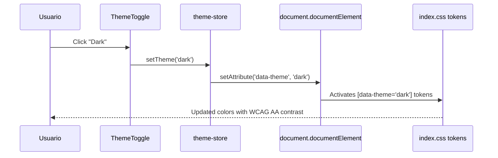

# Design Document Format

## Document Structure

```
# Documento de Diseño — [Title]

## Resumen
## Decisiones de Diseño Clave
## Arquitectura
## Componentes e Interfaces
## Modelos de Datos
## Propiedades de Correctitud
## Manejo de Errores
## Estrategia de Testing
```

---

## Section: Resumen

Two parts:
1. **Problem synthesis** (1 paragraph): restate the problem in your own words — don't copy from requirements. Synthesis shows understanding.
2. **Solution approach** (numbered list, 4–6 items): what you're going to do, at implementation level.

```markdown
## Resumen

El sistema actual define tokens semánticos en `index.css` pero los valores 
actuales no cumplen los ratios de contraste WCAG AA. Además, varios componentes 
usan colores hardcodeados que ignoran el sistema de tokens, haciendo que los 
cambios de tema sean inconsistentes.

La solución consiste en:
1. Redefinir los valores de los tokens existentes en `:root` y `[data-theme='dark']`
2. Añadir tokens nuevos para estados interactivos (`--interactive-*`)
3. Migrar colores hardcodeados en componentes a tokens semánticos
4. Crear una utilidad de cálculo de contraste (`contrast-utils.ts`)
5. Escribir pruebas unitarias y property-based para validar ratios
```

---

## Section: Decisiones de Diseño Clave

For each architectural decision, you need both parts:

```markdown
## Decisiones de Diseño Clave

**Mantener CSS custom properties en `index.css`** en lugar de migrar a CSS-in-JS o Tailwind.
*Alternativas descartadas:* CSS-in-JS añade complejidad de bundling sin beneficio real aquí; 
un archivo separado `theme.css` fragmenta lo que ya funciona unificado en un solo archivo.

**No crear `theme.css` separado.** Todos los tokens permanecen en `index.css`.
*Alternativas descartadas:* La separación haría que los tokens de modo claro y oscuro 
estuvieran en archivos distintos, complicando las referencias cruzadas y el mantenimiento.

**Utilidad de contraste como módulo puro** (`contrast-utils.ts`) sin side effects.
*Alternativas descartadas:* Una función inline en los tests no sería reutilizable; 
una librería externa añade una dependencia para algo que son 40 líneas de matemáticas.
```

**Rule:** If you can't state why the alternative was rejected, the decision isn't fully reasoned. Keep thinking.

---

## Section: Arquitectura

Two Mermaid diagrams. Verify syntax mentally before writing.

### Component Diagram
```markdown
```mermaid
graph TD
    subgraph "Design Tokens (index.css)"
        ROOT[":root (Modo Claro)"]
        DARK["[data-theme='dark'] (Modo Oscuro)"]
    end

    subgraph "Theme Engine"
        TS["theme-store.ts"]
    end

    subgraph "Componentes"
        LS["LoginScreen"]
        AC["AdminConsole"]
    end

    TS -->|setTheme()| ROOT
    TS -->|setTheme()| DARK
    ROOT --> LS
    ROOT --> AC
    DARK --> LS
    DARK --> AC
```
```

### Sequence / Data Flow Diagram
```markdown

```

---

## Section: Componentes e Interfaces

For each component from the requirements:

```markdown
### 1. Tokens Semánticos de Color (`frontend/src/style/index.css`)

**Tokens a actualizar:**

| Token | Uso | Modo Claro | Modo Oscuro |
|-------|-----|-----------|-------------|
| `--text-primary` | Texto principal | `#111827` | `#f1f5f9` |
| `--text-secondary` | Texto secundario | `#374151` | `#d1d5db` |
| `--brand-primary` | Color de marca | `#4f46e5` | `#818cf8` |

**Tokens nuevos:**

| Token | Uso | Modo Claro | Modo Oscuro |
|-------|-----|-----------|-------------|
| `--interactive-hover` | Fondo hover | `rgba(79,70,229,0.08)` | `rgba(129,140,248,0.12)` |
| `--text-on-brand` | Texto sobre brand | `#ffffff` | `#ffffff` |

### 2. Utilidad de Contraste (`frontend/src/utils/contrast-utils.ts`)

```typescript
/** Parsea #RGB o #RRGGBB a [r, g, b] normalizados (0-1). Lanza error si inválido. */
export function parseHex(hex: string): [number, number, number];

/** Calcula luminancia relativa WCAG 2.1 */
export function relativeLuminance(r: number, g: number, b: number): number;

/** Ratio de contraste entre dos colores. Siempre >= 1. */
export function contrastRatio(hex1: string, hex2: string): number;

/** Verifica si el par cumple el umbral dado */
export function meetsContrast(fg: string, bg: string, threshold: number): boolean;
```
```

---

## Section: Modelos de Datos

Only for testing infrastructure or data structures not already covered above.

```markdown
## Modelos de Datos

```typescript
/** Par de tokens a verificar en pruebas */
interface TokenPair {
  foreground: string;       // nombre del token (--text-primary)
  foregroundValue: string;  // valor hex (#111827)
  background: string;
  backgroundValue: string;
  requiredRatio: number;    // 4.5 para texto, 3 para UI
  mode: 'light' | 'dark';
}
```
```

---

## Section: Propiedades de Correctitud

Formal invariants derived from acceptance criteria. These become property-based tests in Phase 3.

```markdown
## Propiedades de Correctitud

**Propiedad 1 — Simetría y cotas del ratio de contraste**
Para cualquier par de colores hexadecimales válidos (a, b):
- `contrastRatio(a, b) === contrastRatio(b, a)` (simetría)
- `contrastRatio(a, b) >= 1.0` (cota inferior)
- `contrastRatio(a, a) === 1.0` (identidad)
*Valida: Requisito 9.4*

**Propiedad 2 — Round-trip de parseHex**
Para cualquier tripleta (r, g, b) en [0, 255]:
construir `#RRGGBB` → parsear con `parseHex` → obtener (r/255, g/255, b/255) con precisión float.
*Valida: Requisito 9.4*

**Propiedad 3 — Jerarquía de contraste preservada entre modos**
Para cualquier token de fondo y para ambos modos (claro, oscuro):
`ratio(--text-primary) > ratio(--text-secondary) > ratio(--text-muted)`
*Valida: Requisito 4.1*
```

For **bugfix specs**, add a regression prevention property per "Comportamiento Sin Cambios" item.

---

## Section: Manejo de Errores

| Escenario | Comportamiento |
|-----------|----------------|
| `parseHex` recibe string sin `#` | Lanza `Error('Invalid hex color format')` |
| `parseHex` recibe longitud incorrecta | Lanza `Error('Invalid hex color format')` |
| Token CSS no definido en componente | CSS usa valor heredado (comportamiento nativo, no requiere manejo) |

---

## Section: Estrategia de Testing

```markdown
## Estrategia de Testing

**Enfoque dual: Unit Tests + Property-Based Tests**

- **Property-based** (fast-check): Validan propiedades universales de la función 
  de contraste — correctas para cualquier input posible.
- **Unit tests** (vitest): Validan combinaciones específicas de tokens y edge cases.

*Justificación:* La utilidad de contraste es una función pura matemática — 
el territorio ideal para property testing. Los tokens tienen valores concretos 
que conviene verificar específicamente.

**Estructura de archivos:**
```
frontend/src/
├── utils/
│   └── contrast-utils.ts
└── __tests__/
    ├── contrast-utils.test.ts          # unit tests
    └── properties/
        └── contrast.property.test.ts  # property tests
```

**Comandos:**
```bash
cd frontend && npx vitest --run contrast   # solo tests de contraste
cd frontend && npx vitest --run           # todos los tests
```
```
