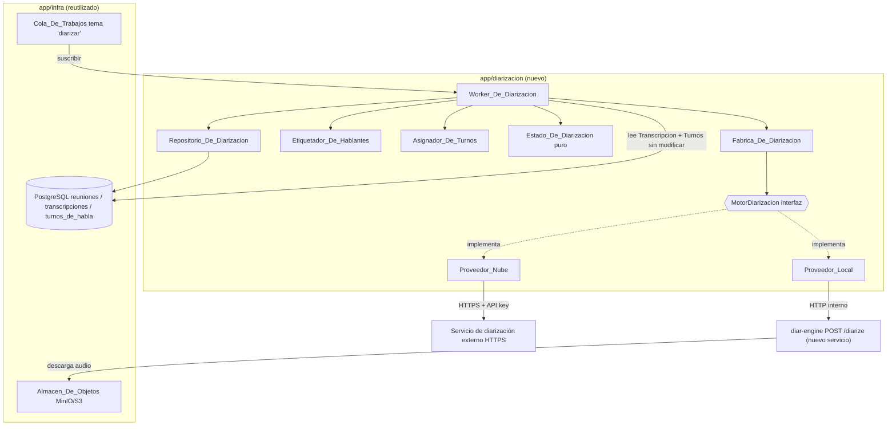
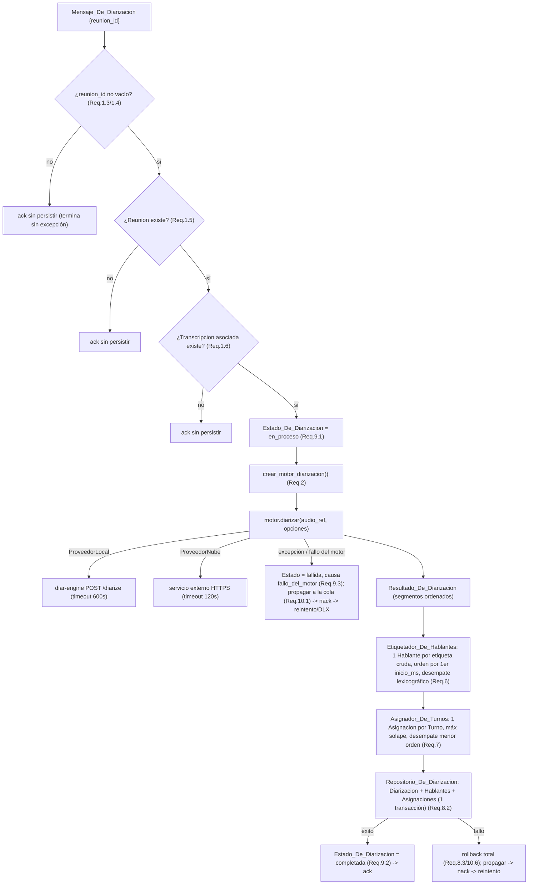
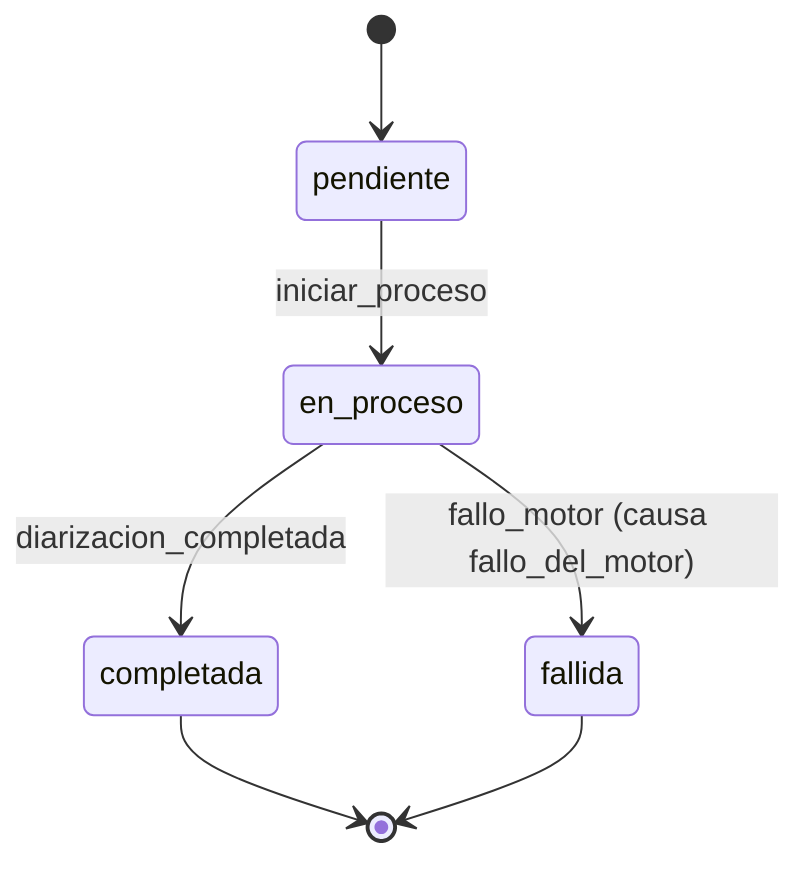

# Design Document

## Overview

Este documento describe el diseño del módulo **Identificación de hablantes (diarización)** de sauri (Milestone 3). El módulo consume la `Grabacion_De_Audio` y la `Transcripcion` ya producidas por el Milestone 2, ejecuta un `Motor_De_Diarizacion` intercambiable para detectar los segmentos temporales atribuidos a cada hablante anónimo, etiqueta a los hablantes de forma anónima y estable, asigna cada `Turno_De_Habla` al `Hablante` que más habló durante ese turno, y persiste la `Diarizacion` asociada a la `Reunion` y a su `Transcripcion`.

El diseño **reutiliza los patrones ya consolidados** por el módulo de Transcripción (`backend/app/transcripcion/`) y las abstracciones de infraestructura existentes (`backend/app/infra/`), creando un nuevo paquete paralelo `backend/app/diarizacion/` y un nuevo servicio HTTP propio `backend/diar-engine/`. La diarización **no reemplaza ni modifica** la `Transcripcion` ni sus `Turnos_De_Habla`, y **no altera** el `Estado_De_Proceso` de la `Reunion`.

### Decisión de integración clave: ciclos de vida separados

El módulo de Transcripción deja la `Reunion` en el estado terminal `"completado"` del `Estado_De_Proceso` (ver `app/reuniones/state_machine.py`, donde `completado` ∈ `ESTADOS_TERMINALES`). Este módulo **no toca** esa máquina de estados ni la entidad `Reunion`. En su lugar, la `Diarizacion` rastrea su propio `Estado_De_Diarizacion` (`pendiente` → `en_proceso` → `completada` | `fallida`) mediante una **máquina de estados independiente** y pura, replicando la disciplina del `state_machine.py` existente pero sin compartir su tabla de transiciones ni su persistencia. Esto satisface el Req. 9.5 (preservar `Estado_De_Proceso`) por construcción: ningún componente de este módulo invoca `registrar_transicion` ni escribe en `reuniones` ni en `estado_historial`.

### Paralelismo con el módulo de Transcripción

| Transcripción (Milestone 2)                     | Diarización (Milestone 3, este módulo)               |
| ----------------------------------------------- | ---------------------------------------------------- |
| `app/transcripcion/motor_asr.py` (`MotorASR`)   | `app/diarizacion/motor_diarizacion.py` (`MotorDiarizacion`) |
| `app/transcripcion/factory.py` (`crear_motor_asr`) | `app/diarizacion/factory.py` (`crear_motor_diarizacion`) |
| `app/transcripcion/proveedor_local.py`          | `app/diarizacion/proveedor_local.py`                 |
| `app/transcripcion/proveedor_nube.py`           | `app/diarizacion/proveedor_nube.py`                  |
| `app/transcripcion/repository.py`               | `app/diarizacion/repository.py`                      |
| `app/transcripcion/worker.py` (tema `transcribir`) | `app/diarizacion/worker.py` (tema `diarizar`)     |
| `asr-engine/` (`POST /transcribe`)              | `diar-engine/` (`POST /diarize`)                     |
| Variables `ASR_*`                               | Variables `DIARIZATION_*`                            |

Se reutilizan **sin cambios** las abstracciones de infraestructura: `app/infra/queue.py` (`ColaDeTrabajos`), `app/infra/queue_rabbitmq.py` (entrega al-menos-una-vez, reintentos, dead-letter), `app/infra/object_store.py` (`Almacen_De_Objetos`), `app/infra/database.py` (sesiones async) y `app/infra/models.py` (al que se añaden los nuevos modelos ORM).

> **Nota sobre reintentos:** la implementación `ColaDeRabbitMQ` lee actualmente `ASR_MAX_RETRIES` (ver `_leer_max_retries` en `queue_rabbitmq.py`). El Req. 10.2 de este módulo especifica `DIARIZATION_MAX_RETRIES` (rango 0–10, default 3). El diseño contempla generalizar la lectura de la variable de reintentos para que la misma `ColaDeTrabajos` honre `DIARIZATION_MAX_RETRIES` cuando sirve el tema `diarizar` (ver Data Models → Configuración y Error Handling).

## Architecture

### Componentes y responsabilidades

- **Worker_De_Diarizacion** (`app/diarizacion/worker.py`): orquesta el procesamiento de un `Mensaje_De_Diarizacion`. Valida el mensaje, carga la `Reunion` y su `Transcripcion`, marca el `Estado_De_Diarizacion` en `en_proceso`, invoca el `Motor_De_Diarizacion`, etiqueta hablantes, asigna turnos por solape temporal, y delega la persistencia transaccional. Se suscribe al tema `"diarizar"` al iniciar.
- **Fabrica_De_Diarizacion** (`app/diarizacion/factory.py`): `crear_motor_diarizacion()` construye exactamente un `Proveedor_De_Diarizacion` activo según `DIARIZATION_PROVIDER`.
- **MotorDiarizacion** (`app/diarizacion/motor_diarizacion.py`): interfaz común independiente del proveedor; define `diarizar(audio_ref, opciones)` y `capacidades()`, más los tipos de datos `OpcionesDiarizacion`, `SegmentoDeHablante`, `ResultadoDiarizacion`, `CapacidadesDiarizacion`.
- **Proveedor_Local** (`app/diarizacion/proveedor_local.py`): invoca el `Servicio_De_Diarizacion_Local` por HTTP interno (servicio-a-servicio dentro de Docker), sin salida a servicios externos.
- **Proveedor_Nube** (`app/diarizacion/proveedor_nube.py`): transmite a un servicio externo por HTTPS con autenticación por API key.
- **Servicio_De_Diarizacion_Local** (`diar-engine/main.py`): servicio FastAPI propio; expone `POST /diarize` y `GET /health`. Descarga el audio del `Almacen_De_Objetos` y produce segmentos de hablante.
- **Etiquetador_De_Hablantes** (`app/diarizacion/etiquetado.py`): función pura que agrupa `Segmentos_De_Hablante` por `Etiqueta_De_Hablante_Cruda`, ordena y asigna `orden` y `Etiqueta_De_Hablante`.
- **Asignador_De_Turnos** (`app/diarizacion/asignacion.py`): función pura que asigna cada `Turno_De_Habla` al `Hablante` de máximo `Solape_Temporal` acumulado, con desempate determinista.
- **Estado_De_Diarizacion** (`app/diarizacion/estado.py`): función pura `aplicar_evento_diarizacion` con la tabla de transiciones del ciclo de vida propio de la `Diarizacion`.
- **Repositorio_De_Diarizacion** (`app/diarizacion/repository.py`): persiste `Diarizacion` + `Hablantes` + `Asignaciones_De_Hablante` en una única transacción y recupera por `reunion_id`.
- **Cola_De_Trabajos** (`app/infra/queue.py` / `queue_rabbitmq.py`): entrega al-menos-una-vez, ack/nack, reintentos acotados y dead-letter (reutilizada).

### Diagrama de componentes



### Flujo de datos del worker



### Decisión de diseño: transacción única controlada por el worker

Siguiendo la decisión ya tomada en el módulo de Transcripción (el worker controla una única transacción y el repositorio opera sobre la sesión provista), el `Worker_De_Diarizacion` abre **una** transacción que abarca:

1. La escritura de la `Diarizacion` con su `Estado_De_Diarizacion` final.
2. La escritura de todos los `Hablantes`.
3. La escritura de todas las `Asignaciones_De_Hablante`.

El `Repositorio_De_Diarizacion.crear(session, ...)` agrega entidades a la **sesión provista** sin abrir/cerrar ni confirmar (idéntico contrato a `TranscripcionRepository.crear`). El commit lo hace el worker al final del bloque `async with session.begin()`. Esto garantiza atomicidad (Req. 8.2, 8.3, 10.6): un fallo en cualquier escritura revierte todo y no deja `Diarizacion` parcial ni huérfana.

### Decisión de diseño: distinción entre "sin hablantes" y "fallo del motor"

Igual que en Transcripción, se distinguen dos situaciones:

- **Sin hablantes detectados (resultado válido):** el motor respondió correctamente con **cero** `Segmentos_De_Hablante`. El worker persiste una `Diarizacion` con cero `Hablantes` y cero `Asignaciones_De_Hablante`, marca `Estado_De_Diarizacion = completada`, registra el resultado como "sin hablantes detectados" y hace `ack` (Req. 7.5). **No** es un error.
- **Fallo del motor (excepción):** el proveedor señaló un fallo (error HTTP, timeout, respuesta sin la estructura esperada, error de inicialización). El worker marca `Estado_De_Diarizacion = fallida` con `Causa_De_Fallo_Diarizacion = "fallo_del_motor"` (Req. 9.3) y **propaga la excepción** a la `Cola_De_Trabajos` (Req. 10.1) para activar la política de reintentos (`nack`).

> Distinción operativa: "sin hablantes" produce `ack` (resultado determinista, no se reintenta); una excepción produce `nack` (se reintenta hasta agotar `DIARIZATION_MAX_RETRIES`).

## Components and Interfaces

### MotorDiarizacion (interfaz común) — Req. 2.7, 5

```python
class MotorDiarizacion(ABC):
    async def diarizar(self, audio_ref: str, opciones: OpcionesDiarizacion) -> ResultadoDiarizacion: ...
    def capacidades(self) -> CapacidadesDiarizacion: ...
```

Tipos de datos (en `motor_diarizacion.py`):

- `OpcionesDiarizacion(duracion_ms: int | None = None)` — la `Duracion_De_Grabacion` se deriva de `Grabacion_De_Sesion.duracion_segundos * 1000` y permite al motor/validación acotar `fin_ms` (Req. 5.4).
- `SegmentoDeHablante(etiqueta_cruda: str, inicio_ms: int, fin_ms: int)` — unidad temporal con `Etiqueta_De_Hablante_Cruda` (Req. 5.2, 5.3).
- `ResultadoDiarizacion(segmentos: list[SegmentoDeHablante], num_hablantes: int)` — lista ordenada ascendente por `inicio_ms` (Req. 5.1); `num_hablantes` igual a la cantidad de etiquetas crudas distintas (Req. 5.5).
- `CapacidadesDiarizacion(es_local: bool, nombre_proveedor: str)` — declaración del proveedor (Req. 8.4).

El `Worker_De_Diarizacion` interactúa con el motor **únicamente** a través de esta interfaz (Req. 2.7).

### Fabrica_De_Diarizacion — Req. 2

`crear_motor_diarizacion() -> MotorDiarizacion`, replicando la lógica de `crear_motor_asr`:

1. Normalizar: `provider = os.environ.get("DIARIZATION_PROVIDER", "").strip().lower()` (Req. 2.1).
2. `""` (ausente o vacío) o `"local"` → `ProveedorLocal(url=DIARIZATION_LOCAL_URL)` (Req. 2.2, 2.4).
3. `"cloud"` → `ProveedorNube()` (Req. 2.3).
4. Cualquier otro valor → `ValueError` cuyo mensaje **incluye el valor inválido recibido** (Req. 2.5).
5. Si se selecciona `ProveedorLocal` y `DIARIZATION_LOCAL_URL` está ausente o vacía → `ValueError` indicando la ausencia de la URL (Req. 2.6).

Construye **exactamente un** proveedor activo por invocación (Req. 2.1).

### Proveedor_Local — Req. 3

- `diarizar(audio_ref, opciones)`: `POST {DIARIZATION_LOCAL_URL}/diarize` con cuerpo `{"audio_ref": audio_ref}`, timeout **600 s** (Req. 3.1).
- Procesa sin enviar el audio fuera de la infraestructura de sauri (Req. 3.2): la comunicación es servicio-a-servicio interna con el contenedor `diar-engine`.
- Respuesta exitosa con estructura válida: convierte cada elemento de `segments` en `SegmentoDeHablante(etiqueta_cruda=seg["speaker"], inicio_ms=seg["start_ms"], fin_ms=seg["end_ms"])` (Req. 3.4).
- Error HTTP (`response.raise_for_status()`) → propaga excepción, sin segmentos parciales (Req. 3.5).
- Timeout / inalcanzable (`httpx.TimeoutException`, `httpx.ConnectError`) → propaga excepción (Req. 3.6).
- Respuesta **sin la clave `segments`** (estructura inválida) → `ValueError` (Req. 3.7), distinguiéndola de `segments: []` (lista vacía válida → resultado sin hablantes). Se replica la verificación explícita `if "segments" not in data` ya usada en `proveedor_local.py` de Transcripción.

### Proveedor_Nube — Req. 4

- Inicialización (`__init__`): leer `DIARIZATION_CLOUD_API_KEY` y `DIARIZATION_CLOUD_ENDPOINT`.
  - `DIARIZATION_CLOUD_API_KEY` ausente o vacía → `ValueError` indicando ausencia de credencial (Req. 4.4).
  - `DIARIZATION_CLOUD_ENDPOINT` cuyo esquema no sea `https://` → `ValueError` indicando esquema no soportado (Req. 4.2).
- `diarizar`: transmite por HTTPS (Req. 4.1) autenticando con `Authorization: Bearer {api_key}` (Req. 4.3), timeout **120 s** (Req. 4.6).
- Conversión de segmentos con **validación** (Req. 4.5): `etiqueta_cruda` no vacía, `inicio_ms` y `fin_ms` enteros ≥ 0, `fin_ms ≥ inicio_ms`.
- Timeout, error HTTP, conexión fallida o respuesta sin segmentos válidos → `ErrorServicioExterno`, conservando la `Grabacion_De_Audio` sin modificar (Req. 4.6).

Se replica el patrón de manejo de excepciones (`ErrorServicioExterno`) y el método privado `_parsear_y_validar_respuesta` de `proveedor_nube.py` de Transcripción, adaptando el campo `text` → `speaker` (`etiqueta_cruda`).

### Servicio_De_Diarizacion_Local (diar-engine) — contrato `POST /diarize` — Req. 3.3

```
POST /diarize
Request:  { "audio_ref": str }
Response: {
  "segments": [ { "speaker": str, "start_ms": int, "end_ms": int }, ... ],
  "num_speakers": int
}
GET /health -> { "status": "ok" }
```

El servicio descarga el audio del `Almacen_De_Objetos` por `audio_ref` (idéntico patrón a `asr-engine/main.py`), ejecuta el motor de diarización propio y devuelve cero o más segmentos, cada uno con `speaker`, `start_ms`, `end_ms`. La integración concreta del motor de diarización conserva este contrato.

### Etiquetador_De_Hablantes (función pura) — Req. 6

`etiquetar_hablantes(segmentos: list[SegmentoDeHablante]) -> list[Hablante]`:

1. Agrupar segmentos por `Etiqueta_De_Hablante_Cruda`; crear exactamente un `Hablante` por etiqueta cruda distinta (Req. 6.1).
2. Para cada etiqueta cruda, calcular el `inicio_ms` mínimo entre sus segmentos (primera aparición).
3. Ordenar las etiquetas crudas por la clave `(primer_inicio_ms, etiqueta_cruda)` ascendente — el segundo componente garantiza el desempate determinista por orden lexicográfico ascendente (Req. 6.4).
4. Asignar `orden` consecutivo iniciando en 1, e incrementando en 1; asignar `Etiqueta_De_Hablante = f"Hablante {orden}"` (Req. 6.2).
5. El `Hablante` no contiene ningún campo de identidad nominal ni dato personal (Req. 6.3).

### Asignador_De_Turnos (función pura) — Req. 7

`asignar_turnos(turnos, segmentos, hablantes) -> list[(turno_id, hablante)]`:

Para cada `Turno_De_Habla` con intervalo `[inicio_ms, fin_ms]`:

1. Para cada `Hablante`, sumar el `Solape_Temporal` con **todos** los segmentos de su `Etiqueta_De_Hablante_Cruda`. El solape de un turno `[ts, te]` con un segmento `[ss, se]` es `max(0, min(te, se) - max(ts, ss))`.
2. Seleccionar el `Hablante` con `Solape_Temporal` acumulado máximo (Req. 7.1).
3. Desempate: si dos o más `Hablantes` comparten el solape máximo, o si todos tienen solape cero, asignar al `Hablante` de **menor `orden`** entre los candidatos (Req. 7.2).
4. Crear exactamente una `Asignacion_De_Hablante` por `Turno_De_Habla` (Req. 7.1).

Los `Turnos_De_Habla` se leen de la `Transcripcion` existente y **no se modifican**: `texto`, `inicio_ms`, `fin_ms` y `orden` se conservan intactos (Req. 7.3). Si no hay turnos, se producen cero asignaciones (Req. 7.4); si no hay segmentos (cero hablantes), se producen cero asignaciones (Req. 7.5).

### Estado_De_Diarizacion (máquina de estados pura) — Req. 9

`aplicar_evento_diarizacion(estado_actual, evento) -> ResultadoTransicionDiarizacion`, análogo a `aplicar_evento` de `state_machine.py` pero con su propia tabla:



- Estados: `pendiente`, `en_proceso`, `completada`, `fallida`. Terminales: `completada`, `fallida`.
- `fallo_motor` → `fallida` con `causa = "fallo_del_motor"` (Req. 9.3).
- Cada cambio de estado registra `actualizada_en` en UTC (Req. 9.4).
- Esta máquina es **independiente** de la de `Reunion`; el módulo no llama a `registrar_transicion` ni escribe en `reuniones`/`estado_historial` (Req. 9.5).

### Repositorio_De_Diarizacion — Req. 8

- `crear(session, diarizacion, hablantes, asignaciones)`: agrega la `Diarizacion`, todos sus `Hablantes` y todas sus `Asignaciones_De_Hablante` a la **sesión provista** por el worker, en la misma transacción (Req. 8.2). El rollback elimina cualquier registro parcial (Req. 8.3, 10.6). Mismo contrato que `TranscripcionRepository.crear`.
- `obtener_por_reunion(reunion_id) -> Diarizacion | None`: recupera la `Diarizacion` **junto con sus `Hablantes` y `Asignaciones_De_Hablante`** mediante `selectinload` (Req. 8.5); devuelve `None` si no existe (Req. 8.6). Replica el patrón de `obtener_por_reunion` de Transcripción (abre su propia sesión de solo lectura).

### Worker_De_Diarizacion — Req. 1, 6, 7, 8, 9, 10

Algoritmo de `_procesar_diarizacion(mensaje, session_factory)`:

1. **Validar mensaje (Req. 1.3, 1.4):** extraer `reunion_id`; si ausente, no string o vacío → terminar sin excepción y sin persistir (`ack`).
2. **Cargar Reunion (Req. 1.5):** si no existe → terminar sin excepción y sin persistir (`ack`).
3. **Cargar Transcripcion (Req. 1.6):** vía `TranscripcionRepository.obtener_por_reunion`; si no existe → terminar sin excepción y sin persistir (`ack`).
4. **Marcar en_proceso (Req. 9.1):** crear/actualizar la `Diarizacion` con `Estado_De_Diarizacion = en_proceso` y `actualizada_en` UTC.
5. **Crear motor (Req. 2):** `crear_motor_diarizacion()`.
6. **Diarizar:** `motor.diarizar(audio_ref, OpcionesDiarizacion(duracion_ms=...))`. Una excepción aquí marca `fallida`/`fallo_del_motor` (Req. 9.3) y **se propaga** (Req. 10.1).
7. **Etiquetar hablantes (Req. 6)** con el `Etiquetador_De_Hablantes`.
8. **Asignar turnos (Req. 7)** con el `Asignador_De_Turnos` sobre los `Turnos_De_Habla` de la `Transcripcion`.
9. **Persistir (Req. 8.2):** `Diarizacion` + `Hablantes` + `Asignaciones_De_Hablante` en una transacción; registrar `proveedor` y `num_hablantes` desde `motor.capacidades()` y el resultado (Req. 8.4); marcar `completada` (Req. 9.2). `ack`.

El worker se suscribe al tema `"diarizar"` al iniciar (Req. 1.1) vía `iniciar_worker(cola, session_factory)`, idéntico patrón a `transcripcion/worker.py`.

### Cola_De_Trabajos (reutilizada) — Req. 1.7–1.9, 10.2–10.4

Se reutiliza `ColaDeRabbitMQ`. Semántica ya implementada:

- Procesamiento exitoso del manejador → `ack` (Req. 1.7).
- Excepción del manejador → `nack` sin reencolar inmediato (Req. 1.8) con conteo de reintentos vía header `x-death`.
- **Reintentos acotados (Req. 10.2):** mientras los reintentos acumulados `< DIARIZATION_MAX_RETRIES` (rango 0–10, default 3), reencolar.
- **Dead-letter (Req. 1.9, 10.3):** configurado vía `QUEUE_DLX_EXCHANGE`; al agotar reintentos, `nack(requeue=False)` deriva a la cola dead-letter.
- **Sin dead-letter (Req. 10.4):** al agotar reintentos, descartar registrando el agotamiento.

> **Brecha a completar:** `_leer_max_retries` en `queue_rabbitmq.py` está acoplado a `ASR_MAX_RETRIES`. Para servir el tema `diarizar` con `DIARIZATION_MAX_RETRIES`, se generalizará la lectura (p. ej. parámetro de la variable de entorno o lectura combinada), conservando el rango 0–10 y default 3. La validación del rango es lógica pura testeable.

## Data Models

### Configuración (variables de entorno)

| Variable | Componente | Uso | Requerimiento |
| --- | --- | --- | --- |
| `DIARIZATION_PROVIDER` | Fabrica_De_Diarizacion | `local` \| `cloud` (case-insensitive, trim); vacío/ausente → `local` | 2.1–2.5 |
| `DIARIZATION_LOCAL_URL` | Proveedor_Local | URL base del `diar-engine`; obligatoria si proveedor local | 2.2, 2.6, 3.1 |
| `DIARIZATION_CLOUD_API_KEY` | Proveedor_Nube | Credencial de autenticación; obligatoria | 4.3, 4.4 |
| `DIARIZATION_CLOUD_ENDPOINT` | Proveedor_Nube | URL HTTPS del servicio externo | 4.1, 4.2 |
| `DIARIZATION_MAX_RETRIES` | Cola_De_Trabajos | Máximo de reintentos (0–10, default 3) | 10.2 |

### Mensaje_De_Diarizacion (tema `diarizar`)

```json
{ "reunion_id": "str" }
```

`reunion_id` debe ser una cadena no vacía; en caso contrario el worker termina sin persistir (Req. 1.4).

### Modelos de dominio del motor (en memoria)

- `SegmentoDeHablante(etiqueta_cruda, inicio_ms, fin_ms)` — unidad producida por el motor (Req. 5.2, 5.3).
- `ResultadoDiarizacion(segmentos, num_hablantes)` — lista ordenada ascendente por `inicio_ms` (Req. 5.1).
- `CapacidadesDiarizacion(es_local, nombre_proveedor)` — declaración del proveedor (Req. 8.4).

### Modelos ORM (SQLAlchemy, añadidos a `app/infra/models.py`)

Se siguen las convenciones existentes: PK `String(36)` (UUID), FKs con `ondelete="CASCADE"`, marcas `DateTime(timezone=True)`, restricciones de unicidad nombradas en `__table_args__`.

**Diarizacion** (tabla `diarizaciones`):

| Campo | Tipo | Notas |
| --- | --- | --- |
| `id` | `str(36)` PK | UUID |
| `reunion_id` | `str(36)` FK → `reuniones.id` | `UniqueConstraint` `uq_diarizacion_reunion_id` (Req. 8.1, 10.5) |
| `transcripcion_id` | `str(36)` FK → `transcripciones.id` | asociación 1:1 con la Transcripcion insumo |
| `proveedor` | `str(128)` | desde `capacidades().nombre_proveedor` (Req. 8.4) |
| `num_hablantes` | `int` | cantidad de `Hablantes` detectados (Req. 8.4, 5.5) |
| `estado_diarizacion` | `str(32)` | `pendiente` \| `en_proceso` \| `completada` \| `fallida` (Req. 9) |
| `causa_fallo` | `str(64)?` | `fallo_del_motor` cuando `fallida` (Req. 9.3) |
| `creada_en` | `datetime` (UTC) | |
| `actualizada_en` | `datetime` (UTC) | marca del último cambio de estado (Req. 9.4) |

**Hablante** (tabla `hablantes`):

| Campo | Tipo | Notas |
| --- | --- | --- |
| `id` | `str(36)` PK | UUID |
| `diarizacion_id` | `str(36)` FK → `diarizaciones.id` | |
| `etiqueta_cruda` | `str(128)` | `Etiqueta_De_Hablante_Cruda` del motor |
| `etiqueta` | `str(64)` | `Etiqueta_De_Hablante` "Hablante N" (Req. 6.2) |
| `orden` | `int` | consecutivo desde 1 (Req. 6.2); sin identidad nominal (Req. 6.3) |

**AsignacionDeHablante** (tabla `asignaciones_de_hablante`):

| Campo | Tipo | Notas |
| --- | --- | --- |
| `id` | `str(36)` PK | UUID |
| `diarizacion_id` | `str(36)` FK → `diarizaciones.id` | |
| `turno_id` | `str(36)` FK → `turnos_de_habla.id` | `UniqueConstraint` `uq_asignacion_turno_id`: exactamente una Asignacion por Turno (Req. 7.1) |
| `hablante_id` | `str(36)` FK → `hablantes.id` | |

Relaciones SQLAlchemy: `Diarizacion.hablantes` y `Diarizacion.asignaciones` (`relationship` con `back_populates`), cargadas con `selectinload` en `obtener_por_reunion` (Req. 8.5). No se añade ninguna relación ni columna sobre `Reunion`, `Transcripcion` ni `TurnoDeHabla` (preservación del insumo, Req. 7.3, 9.5).

### Enfoque de migración Alembic

Nueva migración `003_diarizacion_schema.py`, encadenada tras la última revisión existente:

- `revision = "003_diarizacion_schema"`, `down_revision = "002_unique_transcripcion_reunion_id"` (siguiendo la cadena `001 → 002 → 003`).
- `upgrade()`: crear el tipo `Enum` `estado_diarizacion` (`pendiente`, `en_proceso`, `completada`, `fallida`) con `checkfirst=True` (patrón de `001_initial_schema.py`); reutilizar el enum existente `causa_fallo` para `diarizaciones.causa_fallo`; `create_table` para `diarizaciones`, `hablantes` y `asignaciones_de_hablante` con sus FKs `ondelete="CASCADE"`, columnas UUID y las `UniqueConstraint` `uq_diarizacion_reunion_id` y `uq_asignacion_turno_id`.
- `downgrade()`: `drop_table` en orden inverso (`asignaciones_de_hablante`, `hablantes`, `diarizaciones`) y `drop` del enum `estado_diarizacion` con `checkfirst=True`.

> Nota de consistencia: las migraciones usan `UUID(as_uuid=True)` y tipos `sa.Enum`, mientras los modelos ORM declaran `String(36)` y `String`. La nueva migración mantiene esta misma convención ya presente en `001`/`002`.

## Correctness Properties

*Una propiedad es una característica o comportamiento que debe ser verdadero en todas las ejecuciones válidas del sistema — esencialmente, una afirmación formal sobre lo que el sistema debe hacer. Las propiedades sirven de puente entre las especificaciones legibles por humanos y las garantías de corrección verificables por máquina.*

Las propiedades se derivan del prework de criterios de aceptación, consolidando criterios lógicamente redundantes en propiedades únicas y comprensivas. Los criterios clasificados como SMOKE/INTEGRATION (suscripción, ack/nack/DLX, contratos HTTP, egreso HTTPS, separación arquitectónica) se cubren con pruebas de integración/humo y no como propiedades (ver Testing Strategy).

### Property 1: Selección del proveedor por configuración

*Para cualquier* valor de `DIARIZATION_PROVIDER` igual a "local" o "cloud" con capitalización y espacios arbitrarios al inicio/fin, y *para cualquier* caso en que la variable esté ausente o sea una cadena vacía o de solo espacios, la `Fabrica_De_Diarizacion` construye exactamente un proveedor: `Proveedor_Local` para "local", vacío o ausente, y `Proveedor_Nube` para "cloud".

**Validates: Requirements 2.1, 2.2, 2.3, 2.4**

### Property 2: Valor de proveedor inválido señala error con el valor recibido

*Para cualquier* cadena de `DIARIZATION_PROVIDER` que, normalizada (trim + minúsculas), no sea "local" ni "cloud" ni vacía, la `Fabrica_De_Diarizacion` rechaza la construcción sin instanciar ningún proveedor y señala un error de configuración cuyo mensaje incluye el valor inválido recibido.

**Validates: Requirements 2.5**

### Property 3: Rechazo de endpoint no cifrado en el Proveedor_Nube

*Para cualquier* `DIARIZATION_CLOUD_ENDPOINT` cuyo esquema no sea `https`, la inicialización del `Proveedor_Nube` falla sin transmitir ninguna `Grabacion_De_Audio` y señala un error de configuración que indica el esquema no soportado.

**Validates: Requirements 4.2**

### Property 4: Mapeo fiel de la respuesta local a Segmentos_De_Hablante

*Para cualquier* respuesta válida del `Servicio_De_Diarizacion_Local` con una lista de N elementos `{speaker, start_ms, end_ms}`, el `Proveedor_Local` produce exactamente N `SegmentoDeHablante`, preservando para cada uno la `etiqueta_cruda`, `inicio_ms` y `fin_ms` correspondientes en el mismo orden.

**Validates: Requirements 3.4**

### Property 5: Validez de los Segmentos_De_Hablante del resultado

*Para cualquier* `ResultadoDiarizacion` válido producido por un `Motor_De_Diarizacion` sobre una `Grabacion_De_Audio` de `Duracion_De_Grabacion` D, todo `SegmentoDeHablante` cumple: `inicio_ms` y `fin_ms` son enteros, `inicio_ms ≥ 0`, `fin_ms ≥ inicio_ms`, `fin_ms ≤ D`, y (para el `Proveedor_Nube`) `etiqueta_cruda` no vacía.

**Validates: Requirements 4.5, 5.2, 5.3, 5.4**

### Property 6: Orden ascendente de los Segmentos_De_Hablante

*Para cualquier* `ResultadoDiarizacion` válido, la lista de `SegmentoDeHablante` está ordenada de forma no decreciente por `inicio_ms`.

**Validates: Requirements 5.1**

### Property 7: Número de hablantes igual a etiquetas crudas distintas

*Para cualquier* `ResultadoDiarizacion`, el `Etiquetador_De_Hablantes` crea exactamente un `Hablante` por cada `Etiqueta_De_Hablante_Cruda` distinta presente en los segmentos (biyección entre etiquetas crudas distintas y `Hablantes`), y `num_hablantes` reportado es igual a esa cantidad.

**Validates: Requirements 5.5, 6.1**

### Property 8: Etiquetado anónimo, ordenado y determinista de hablantes

*Para cualquier* lista de `SegmentoDeHablante`, el `Etiquetador_De_Hablantes` ordena los `Hablantes` por la marca `inicio_ms` del primer segmento en que aparece cada `Etiqueta_De_Hablante_Cruda`, desempatando empates de primer `inicio_ms` por el orden lexicográfico ascendente de la `Etiqueta_De_Hablante_Cruda`; asigna un `orden` consecutivo que comienza en 1 e incrementa en 1, una `Etiqueta_De_Hablante` con el formato "Hablante N" (N = `orden`), y ningún campo de identidad nominal.

**Validates: Requirements 6.2, 6.3, 6.4**

### Property 9: Asignación de Turnos por máximo solape con desempate determinista

*Para cualquier* conjunto de `Turnos_De_Habla` y `Hablantes` (con sus segmentos), el `Asignador_De_Turnos` crea exactamente una `Asignacion_De_Hablante` por `Turno_De_Habla`, vinculándolo al `Hablante` cuyo `Solape_Temporal` acumulado con el turno es máximo; y cuando dos o más `Hablantes` comparten el solape máximo, o cuando el solape es cero con todos, el turno se asigna al `Hablante` de menor `orden` entre los candidatos.

**Validates: Requirements 7.1, 7.2**

### Property 10: Preservación de los Turnos_De_Habla de la Transcripcion

*Para cualquier* `Transcripcion` con sus `Turnos_De_Habla`, tras producir las `Asignaciones_De_Hablante` cada `Turno_De_Habla` conserva sin modificar su `texto`, `inicio_ms`, `fin_ms` y `orden`.

**Validates: Requirements 7.3**

### Property 11: Resultado sin hablantes produce Diarizacion vacía válida

*Para cualquier* `ResultadoDiarizacion` con lista de segmentos vacía, el `Worker_De_Diarizacion` persiste una `Diarizacion` con cero `Hablantes` y cero `Asignaciones_De_Hablante`, marca el `Estado_De_Diarizacion` en "completada", y trata el resultado como válido (sin lanzar error), registrándolo como sin hablantes detectados; y *para cualquier* `Transcripcion` sin `Turnos_De_Habla`, se persisten cero `Asignaciones_De_Hablante` sin error.

**Validates: Requirements 7.4, 7.5**

### Property 12: Unicidad de la Diarizacion por Reunion

*Para cualquier* `reunion_id` y *para cualquier* número de procesamientos o reintentos del mismo `Mensaje_De_Diarizacion`, existe a lo sumo una `Diarizacion` persistida asociada a esa `Reunion`.

**Validates: Requirements 8.1, 10.5**

### Property 13: Atomicidad de la persistencia

*Para cualquier* conjunto de `Diarizacion` + `Hablantes` + `Asignaciones_De_Hablante`, la persistencia es todo-o-nada: si la transacción tiene éxito quedan persistidos la `Diarizacion` y la totalidad de sus `Hablantes` y `Asignaciones_De_Hablante`; si ocurre un fallo en cualquier punto de la persistencia, no queda ningún registro parcial asociado a la `Reunion` y se propaga un indicador de fallo que habilita el reintento.

**Validates: Requirements 8.2, 8.3, 10.6**

### Property 14: Registro de metadatos del proveedor

*Para cualquier* `CapacidadesDiarizacion` declarada por el `Motor_De_Diarizacion`, la `Diarizacion` persistida registra el `proveedor` utilizado y el `num_hablantes` detectados consistentes con lo declarado por el motor y el resultado.

**Validates: Requirements 8.4**

### Property 15: Round-trip de persistencia y recuperación

*Para cualquier* `Diarizacion` con sus `Hablantes` y `Asignaciones_De_Hablante` persistida para una `Reunion`, la consulta por `reunion_id` recupera esa `Diarizacion` junto con todos sus `Hablantes` y `Asignaciones_De_Hablante` equivalentes.

**Validates: Requirements 8.5**

### Property 16: Corrección de la máquina de estados del Estado_De_Diarizacion

*Para cualquier* par (estado_actual, evento), `aplicar_evento_diarizacion` retorna éxito con el nuevo estado únicamente si el par pertenece al mapa de transiciones válidas; en todo otro caso (estado terminal o evento no admitido) retorna sin éxito conservando el estado actual. En particular, `pendiente`+`iniciar_proceso`→`en_proceso`, `en_proceso`+`diarizacion_completada`→`completada`, y `en_proceso`+`fallo_motor`→`fallida` con `causa="fallo_del_motor"`.

**Validates: Requirements 9.1, 9.2, 9.3**

### Property 17: Cada cambio de estado registra una marca UTC

*Para cualquier* transición de estado exitosa del `Estado_De_Diarizacion`, el `Worker_De_Diarizacion` registra `actualizada_en` con una marca de tiempo expresada en UTC.

**Validates: Requirements 9.4**

### Property 18: Preservación del Estado_De_Proceso de la Reunion

*Para cualquier* `Estado_De_Proceso` inicial de la `Reunion` y *para cualquier* desenlace del procesamiento de diarización (completada, fallida o terminación temprana), el `Estado_De_Proceso` de la `Reunion` permanece sin cambios tras el procesamiento.

**Validates: Requirements 9.5**

### Property 19: Entrada inválida o insumo ausente no persiste ni lanza excepción

*Para cualquier* `Mensaje_De_Diarizacion` cuyo `reunion_id` esté ausente, vacío, sea solo espacios o no sea cadena; *para cualquier* `reunion_id` que no corresponda a una `Reunion` existente; y *para cualquier* `Reunion` sin `Transcripcion` asociada, el `Worker_De_Diarizacion` termina el procesamiento sin lanzar excepción y sin persistir ninguna `Diarizacion`.

**Validates: Requirements 1.3, 1.4, 1.5, 1.6**

### Property 20: Fallo del motor se propaga sin persistir Diarizacion completada

*Para cualquier* fallo señalado por el `Motor_De_Diarizacion` durante el procesamiento (excepción), el `Worker_De_Diarizacion` marca el `Estado_De_Diarizacion` en "fallida" con `Causa_De_Fallo_Diarizacion = "fallo_del_motor"`, propaga el fallo a la `Cola_De_Trabajos` (habilitando la política de reintentos) y no persiste ninguna `Diarizacion` en estado "completada" para ese mensaje.

**Validates: Requirements 9.3, 10.1**

## Error Handling

El manejo de errores distingue cuatro categorías, cada una con un efecto distinto sobre la `Diarizacion` y la `Cola_De_Trabajos`. En ningún caso se modifica el `Estado_De_Proceso` de la `Reunion` (Req. 9.5).

1. **Entrada inválida / insumo ausente (no es error):** mensaje sin `reunion_id` válido (Req. 1.4), `reunion_id` inexistente (Req. 1.5) o `Reunion` sin `Transcripcion` (Req. 1.6). El worker termina limpiamente, no persiste y hace `ack`. No hay `Diarizacion`.

2. **Sin hablantes detectados (no es error de procesamiento):** el motor responde con lista vacía de segmentos (Req. 7.5). El worker persiste una `Diarizacion` con cero `Hablantes`/`Asignaciones`, marca `Estado_De_Diarizacion = completada` y hace `ack` (resultado determinista, no se reintenta).

3. **Fallo del motor (errores reintentables):** el proveedor lanza excepción por:
   - Error HTTP del `Servicio_De_Diarizacion_Local` (Req. 3.5).
   - Timeout (600 s local / 120 s nube) o servicio inalcanzable (Req. 3.6, 4.6).
   - Respuesta sin la estructura de segmentos esperada (Req. 3.7) o sin segmentos válidos en nube (Req. 4.6).
   - Error de configuración del proveedor en inicialización: `DIARIZATION_PROVIDER` inválido (Req. 2.5), `DIARIZATION_LOCAL_URL` ausente (Req. 2.6), endpoint no-HTTPS (Req. 4.2), `DIARIZATION_CLOUD_API_KEY` ausente (Req. 4.4).

   El worker marca `Estado_De_Diarizacion = fallida` con causa `fallo_del_motor` (Req. 9.3) y **propaga la excepción** (Req. 10.1). La cola hace `nack` sin reencolar inmediato (Req. 1.8) y aplica la política de reintentos acotada.

4. **Fallo de persistencia:** cualquier error durante la escritura de `Diarizacion`/`Hablantes`/`Asignaciones_De_Hablante` revierte la transacción completa (Req. 8.3, 10.6); no quedan registros parciales ni huérfanos y se propaga el fallo para habilitar reintento. La unicidad por `reunion_id` (Req. 8.1, 10.5) garantiza que un reintento no cree duplicados.

### Política de reintentos y dead-letter (Req. 10)

- Reintentos acotados por `DIARIZATION_MAX_RETRIES` (rango 0–10, default 3) (Req. 10.2).
- Con DLX configurado (`QUEUE_DLX_EXCHANGE`): al agotar reintentos, derivar a dead-letter (Req. 1.9, 10.3).
- Sin DLX: al agotar reintentos, descartar registrando el agotamiento (Req. 10.4).

### Errores de configuración

Los errores de configuración (`ValueError` con mensaje descriptivo que incluye el dato ofensor) se detectan al construir el proveedor o inicializar el `Proveedor_Nube`, y se manifiestan en el arranque del worker o en el primer procesamiento, evitando estados inconsistentes.

## Testing Strategy

Se emplea un enfoque dual: **pruebas basadas en propiedades** (PBT) para la lógica universal y **pruebas por ejemplo / integración** para casos concretos, contratos de servicio y comportamiento de infraestructura. El proyecto ya usa Python/pytest con Hypothesis (ver `backend/.hypothesis/`), por lo que se reutiliza esa configuración.

### Aplicabilidad de PBT

PBT es apropiado para este módulo porque el núcleo es lógica determinista con espacios de entrada amplios: la selección de proveedor por configuración, el mapeo y validación de segmentos, el etiquetado anónimo y ordenado (con desempate), la asignación de turnos por máximo solape (con desempate), la máquina de estados pura del `Estado_De_Diarizacion`, los invariantes de preservación del insumo, y los invariantes de persistencia (unicidad, atomicidad, round-trip). Las dependencias externas (`diar-engine`, servicio cloud, RabbitMQ, PostgreSQL) se aíslan con mocks o sesiones de prueba para que las propiedades ejerciten la lógica sin coste de I/O real.

PBT **no** aplica a: cableado de suscripción (Req. 1.1, 2.7, 3.2), publicación en la cola (Req. 1.2), comportamiento de `ack`/`nack`/DLX y reintentos de la cola (Req. 1.7–1.9, 10.2–10.4), contrato del `diar-engine` (Req. 3.1, 3.3), y egreso HTTPS y cabeceras de autenticación (Req. 4.1, 4.3). Estos se cubren con pruebas de integración (1–3 ejemplos) o de humo.

### Biblioteca y configuración de PBT

- **Biblioteca:** Hypothesis (estándar de PBT para Python; ya presente en el backend). No se implementa PBT desde cero.
- **Iteraciones:** mínimo **100** por prueba de propiedad (`@settings(max_examples=100)`).
- **Etiqueta obligatoria** en cada prueba de propiedad, como comentario que referencia la propiedad del diseño:
  `# Feature: identificacion-hablantes, Property {número}: {texto de la propiedad}`
- Cada propiedad de corrección se implementa con **una sola** prueba de propiedad.

### Cobertura de pruebas

**Pruebas de propiedad (Hypothesis)** — una por cada propiedad 1–20:
- Generadores: valores de `DIARIZATION_PROVIDER` (capitalización/espacios), esquemas de URL/endpoint, respuestas de segmentos (listas de tamaño variable con `speaker`/`start_ms`/`end_ms`), duraciones de grabación, conjuntos de `Turnos_De_Habla` y `Segmentos_De_Hablante` con intervalos solapados (incluyendo empates y solape cero), etiquetas crudas con primeras apariciones empatadas, pares (estado, evento) del `Estado_De_Diarizacion`, mensajes de cola (campos faltantes/vacíos), y capacidades del motor.
- Asignación y etiquetado (Prop. 7, 8, 9, 10): generar topologías de solape adversas (turnos que cruzan varios segmentos, empates exactos, solape cero) para ejercitar los desempates.
- Persistencia (Prop. 12, 13, 15): usar una base de datos de prueba (vía `backend/tests/conftest.py`) con sesiones transaccionales; inyectar fallos para verificar rollback (Prop. 13).
- Preservación (Prop. 10, 18): comparar el estado de los `Turnos_De_Habla` y el `Estado_De_Proceso` de la `Reunion` antes/después del procesamiento.

**Pruebas por ejemplo y edge cases (pytest)** — casos concretos:
- Factory: "local"/"cloud" con URL (Req. 2.2, 2.3); `DIARIZATION_LOCAL_URL` ausente → `ValueError` (Req. 2.6).
- Proveedor_Local: error HTTP (Req. 3.5), timeout/inalcanzable (Req. 3.6), respuesta sin `segments` vs `segments: []` (Req. 3.7).
- Proveedor_Nube: `DIARIZATION_CLOUD_API_KEY` ausente (Req. 4.4), timeout/error/respuesta sin segmentos válidos (Req. 4.6).
- Worker: `reunion_id` inexistente (Req. 1.5), `Reunion` sin `Transcripcion` (Req. 1.6), consulta sin `Diarizacion` → `None` (Req. 8.6).

**Pruebas de integración / humo** — infraestructura y contratos:
- Suscripción al tema `"diarizar"` al iniciar (Req. 1.1) y publicación del `Mensaje_De_Diarizacion` (Req. 1.2).
- `ack` tras éxito (Req. 1.7), `nack` tras excepción (Req. 1.8), derivación a DLX y reintentos acotados con `DIARIZATION_MAX_RETRIES` (Req. 1.9, 10.2–10.4).
- Contrato `POST /diarize` del `diar-engine` (Req. 3.1, 3.3) y egreso HTTPS + cabecera de autenticación del `Proveedor_Nube` (Req. 4.1, 4.3).

### Disciplina TDD

Conforme a AGENTS.md §3, cada cambio de comportamiento sigue RED → GREEN → REFACTOR: la prueba (propiedad, ejemplo o integración) se escribe y se ejecuta primero (debe fallar), luego se implementa el mínimo para que pase, y finalmente se refactoriza manteniéndola verde. Las tareas de prueba no son opcionales y se secuencian antes de su tarea de implementación correspondiente.
