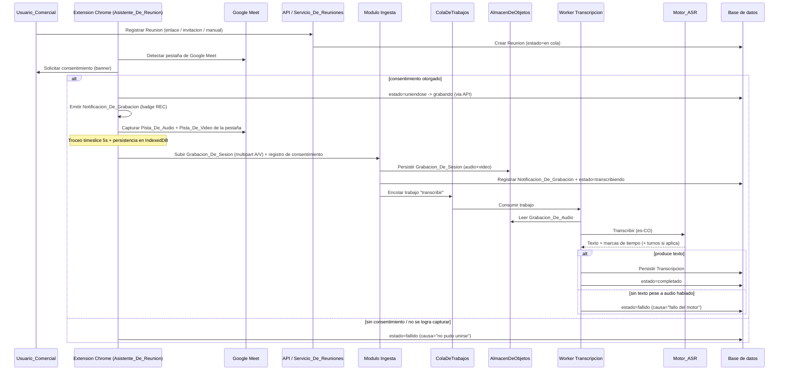
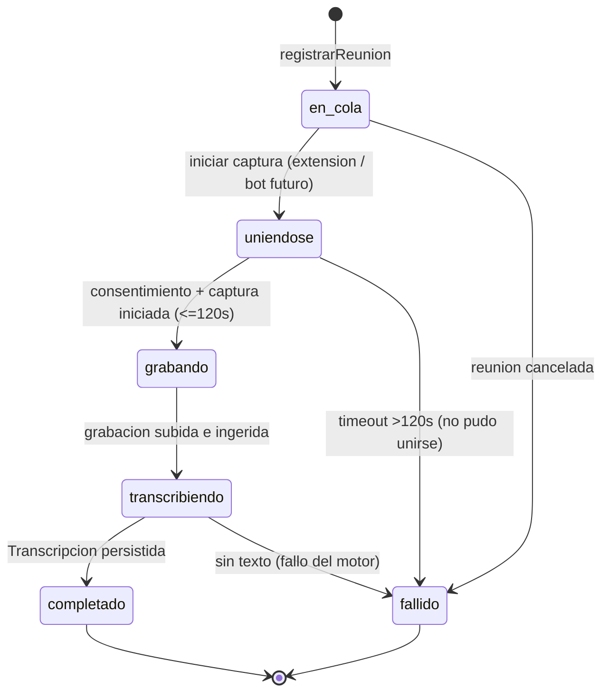

# Design Document

## Overview

Este documento describe el diseño técnico del módulo **Captura y Transcripción de Reuniones** de **sauri**, el MVP de la plataforma interna de inteligencia de reuniones comerciales de Summan. El módulo permite que sauri se incorpore como asistente a una reunión de Google Meet, capture su **audio y video**, genere una **Transcripcion** en español de Colombia a partir de la pista de audio, la persista asociada a la Reunion, y gestione los estados y errores de todo el proceso bajo acceso autenticado.

El diseño se rige por tres principios derivados de los requerimientos y de las decisiones tomadas con el usuario:

1. **Reutilizar antes que reinventar.** Cada capa se apoya en componentes maduros y en infraestructura estándar. La capa de captura del MVP es un **componente propio de sauri**: una extensión de Chrome MV3 que captura Google Meet (detección de la reunión, consentimiento, captura de audio de la pestaña, troceo y persistencia local, cola de trabajos con reintentos). El resto del pipeline reutiliza infraestructura estándar: un motor de ASR de mercado, almacenamiento de objetos, una cola de mensajería y una base de datos relacional. No se construye desde cero nada que ya exista como infraestructura estándar.
2. **Intercambiabilidad detrás de interfaces.** Las piezas con mayor riesgo de cambio —la **fuente de captura** (`Asistente_De_Reunion`) y el motor de transcripción (`Motor_ASR`)— se abstraen detrás de interfaces estables (patrón *adapter/strategy*). El `Asistente_De_Reunion` abstrae el **origen de la grabación**: su implementación principal en el MVP es la extensión de Chrome (cliente), y una implementación alternativa futura es un bot servidor headless, ambas detrás del mismo contrato. La implementación concreta es sustituible sin tocar la lógica de orquestación ni el resto del pipeline (almacenar → transcribir → persistir), que es idéntico sin importar el origen.
3. **Portabilidad cloud-agnóstica.** Toda capacidad específica de nube (almacenamiento de objetos, cola/mensajería) se accede mediante una abstracción con implementación equivalente en GCP y AWS, y una implementación local para Docker Compose sobre macOS. Ninguna lógica de negocio depende de una API propietaria exclusiva de un proveedor.

### Alcance del módulo

**Dentro de alcance:** unión del asistente (por enlace, invitación de calendario o solicitud manual), captura de audio+video, almacenamiento de la `Grabacion_De_Sesion`, transcripción en español de Colombia con marcas de tiempo y turnos temporales, persistencia de la `Transcripcion`, máquina de estados del `Estado_De_Proceso` con historial y causas de fallo, notificación y registro de grabación, retención configurable con borrado, cifrado en reposo y tránsito, y acceso autenticado/autorizado.

**Fuera de alcance (puntos de extensión futuros):** identificación nominal de hablantes, notas/resúmenes con IA, integración con CRM (ClickUp), biblioteca/reproductor/visualización/compartición y analítica. El diseño deja puertas abiertas (modelo de datos extensible, eventos de dominio publicables) pero no implementa estas capacidades.

### Implicaciones transversales (a tener presentes en cada decisión)

- **Costo:** los dos grandes generadores de costo son los **minutos de ASR** (especialmente con proveedor en la nube) y el **almacenamiento de la Pista_De_Video** (mucho más pesada que el audio). El diseño mitiga ambos: ASR intercambiable a un proveedor local (faster-whisper) para reducir costo por minuto, y retención configurable aplicada a la `Grabacion_De_Sesion` completa para acotar el almacenamiento de video.
- **Cumplimiento:** la grabación de reuniones en Colombia exige tratar audio, video y transcripción como **datos personales** (Ley 1581 de 2012) y notificar la grabación a los participantes. El diseño incorpora `Notificacion_De_Grabacion` visible y su registro auditable como parte del flujo, no como un añadido.

## Architecture

### Estilo arquitectónico: monolito modular con workers

El **monolito modular** acompañado de **workers asíncronos** que consumen una cola. La captura del MVP **no** se ejecuta en el servidor: ocurre en el cliente, dentro de la **extensión de Chrome** del Usuario_Comercial (ver más abajo). Justificación:

- El MVP tiene un único dominio cohesivo (una Reunion atraviesa un pipeline lineal). Microservicios introducirían sobrecarga de operación, despliegue y observabilidad sin beneficio real a este tamaño.
- La separación que sí aporta valor —y que el diseño adopta— es por **naturaleza de ejecución**, no por dominio: trabajo *request/response* (API, incluida la **ingesta** de la grabación subida por la extensión) frente a trabajo *long-running* (transcribir, retención). Esa frontera se materializa con una **cola de trabajos**, no con múltiples servicios de negocio.
- Los módulos internos (`reuniones`, `ingesta`, `transcripcion`, `retencion`, `auth`) tienen límites explícitos y se comunican por interfaces, de modo que si una pieza necesita extraerse a su propio servicio en el futuro (p. ej. la transcripción local con GPU), el corte ya está preparado.

### Origen de la captura: extensión de Chrome (implementación principal del MVP)

La captura del MVP la realiza la **extensión de Chrome de sauri** (MV3) que corre en el navegador del Usuario_Comercial. Es un componente propio de sauri que captura Google Meet. La extensión: detecta la pestaña de Google Meet, pide consentimiento al Participante anfitrión, captura **audio y video** de la pestaña, ensambla la grabación localmente y la **sube al backend de sauri** vía HTTP. A partir de la subida, el backend almacena la `Grabacion_De_Sesion`, encola el trabajo y transcribe igual que con cualquier otro origen.

El **bot servidor headless** queda como **implementación alternativa futura** detrás de la misma interfaz `Asistente_De_Reunion`. Requiere un entorno con navegador headless, un ciclo de vida largo (toda la reunión) y un perfil de recursos distinto al del API; cuando se implemente, se ejecutará como worker aislado. La interfaz aísla esta decisión: el resto del sistema no distingue si la grabación llegó desde la extensión o desde un bot servidor.

### Separación backend / frontend

Se adopta **separación backend/frontend** con un **API HTTP (REST/JSON)** como contrato. El backend expone la gestión de Reuniones, consulta de estados y acceso a Transcripciones; el frontend es un cliente web SPA delgado que consume ese API. Justificación: el acceso autenticado del equipo comercial (Req. 9) y la consulta de estados/transcripciones (Req. 4.5) se modelan con naturalidad como API, y un contrato HTTP estable permite evolucionar la UI (o añadir clientes) sin tocar el backend. El frontend queda mínimamente especificado en este MVP (registro de reunión, lista de reuniones con estado, vista de transcripción), dado que la experiencia rica de reproducción/visualización está fuera de alcance.

### Stack tecnológico

Decisión de stack confirmada para el módulo. Estas elecciones son fijas y orientan la implementación; mantienen la **portabilidad cloud-agnóstica** y el **Docker Compose local** descritos en este documento.

- **Backend y workers — Python con FastAPI.** El API HTTP (REST/JSON) y los workers asíncronos se construyen en Python sobre FastAPI. La validación de tipos y calidad de código usa las herramientas estándar de Python (mypy para tipado, ruff para linting/estilo). La **cola de trabajos** se consume mediante un worker Python. La persistencia (metadatos, estados, transcripción) usa **SQLAlchemy** como ORM sobre **PostgreSQL**. Las pruebas basadas en propiedades (PBT) del backend usan **Hypothesis** con un mínimo de **100 iteraciones** por propiedad.
- **Extensión de Chrome (fuente de captura principal) — TypeScript sobre Manifest V3.** La lógica de captura (service worker, documento offscreen y content script) se escribe en TypeScript. La UI del panel lateral se construye en **React** con **Vite + CRXJS**. Las pruebas de la capa de captura usan el runner JS estándar (Vitest/Jest) y las pruebas end-to-end usan **Playwright**.
- **App web (frontend SPA) — TypeScript + React (Vite).** Comparte los tipos del dominio con la extensión para mantener una sola fuente de verdad de los contratos del lado cliente.
- **Motor_ASR local — contenedor propio basado en faster-whisper.** La implementación local del `Motor_ASR` es un contenedor propio de sauri basado en faster-whisper, detrás de la interfaz `Motor_ASR`. El **proveedor en la nube** es una implementación alternativa seleccionable por **configuración**, sin cambios en el código del `Servicio_De_Reuniones`.

### Diagrama de componentes

```mermaid
graph TB
    subgraph Cliente
        UI[Frontend SPA<br/>autenticado]
        EXT[Extension Chrome de sauri MV3<br/>impl. principal Asistente_De_Reunion]
    end

    subgraph Backend["Backend - Monolito modular (contenedor API)"]
        API[API HTTP REST/JSON]
        ING[Modulo Ingesta<br/>endpoint de subida A/V multipart]
        AUTH[Modulo Auth<br/>autenticacion + autorizacion]
        SR[Servicio_De_Reuniones<br/>orquestacion + maquina de estados]
        RET[Modulo Retencion<br/>retencion configurable + borrado]
    end

    subgraph Workers["Workers asincronos (contenedores)"]
        TRW[Worker de Transcripcion<br/>invoca Motor_ASR]
        RETW[Worker de Retencion<br/>borrado programado]
    end

    subgraph Abstracciones["Interfaces abstraidas (portabilidad)"]
        QUEUE[(Cola / Mensajeria<br/>ColaDeTrabajos)]
        OBJ[(Almacenamiento de Objetos<br/>AlmacenDeObjetos)]
        DB[(Base de datos relacional<br/>metadatos / estados / transcripcion)]
    end

    subgraph Externos["Sustituibles por configuracion"]
        MEET[Google Meet]
        ASR[Motor_ASR<br/>Proveedor nube | Proveedor local Whisper]
        BOT[Bot servidor headless<br/>impl. futura Asistente_De_Reunion]
    end

    UI -->|HTTPS| API
    EXT -->|detecta + captura A/V| MEET
    EXT -->|sube Grabacion_De_Sesion + registro de consentimiento| ING
    BOT -.->|impl. alternativa futura| ING
    API --> AUTH
    API --> SR
    ING --> AUTH
    ING -->|persiste Grabacion_De_Sesion| OBJ
    ING --> SR
    SR --> DB
    SR --> QUEUE
    RET --> DB
    QUEUE --> TRW
    QUEUE --> RETW
    TRW -->|lee Grabacion_De_Audio| OBJ
    TRW -->|audio| ASR
    TRW -->|persiste Transcripcion| DB
    TRW -->|eventos de estado| QUEUE
    RETW --> OBJ
    RETW --> DB
```

### Flujo del pipeline asíncrono

El pipeline es **asíncrono y dirigido por eventos/estados**. La captura ocurre en el cliente (extensión de Chrome); el backend recibe la **subida** de la grabación, la almacena, encola la transcripción y responde sin bloquear. Los workers avanzan el estado publicando eventos que el `Servicio_De_Reuniones` aplica a la máquina de estados. El origen de la captura es intercambiable: el mismo flujo de ingesta → transcripción aplica si la grabación llega desde un bot servidor futuro.



Notas: la extensión de sauri implementa una **cola de trabajos en IndexedDB** (estados `pending/processing/done/failed`, `retryCount`, recuperación por `chrome.alarms` y `onStartup`) para **reintentar la subida** ante fallos transitorios de red. La cancelación de la reunión antes de capturar se modela como transición a `fallido` con causa `reunión cancelada` (ver máquina de estados).

## Components and Interfaces

Las interfaces se describen a alto nivel (contratos), no como código de implementación. Todas son **agnósticas del proveedor concreto**.

### Servicio_De_Reuniones (orquestador)

Núcleo del backend. Responsable de registrar Reuniones, decidir y disparar la unión (manual o por hora programada), aplicar las transiciones de la máquina de estados, persistir el historial de estados y exponer el estado/causa de fallo. Es el **único** componente que conoce las reglas de transición; los workers solo emiten eventos.

Operaciones de alto nivel:
- `registrarReunion(entrada) -> Reunion` — acepta enlace de Google Meet, identificador de invitación de calendario o solicitud manual con enlace (Req. 1.7). Crea la Reunion en estado `en cola` (Req. 1.1).
- `solicitarUnion(reunionId)` — encola el trabajo de unión para una Reunion en cola (Req. 1.2).
- `programarUnionPorCalendario(reunionId, horaInicio)` — dispara la unión en la hora programada (Req. 1.3).
- `aplicarEvento(reunionId, evento) -> Estado_De_Proceso` — función pura de transición que valida y aplica un evento de dominio, registrando estado + marca de tiempo (Req. 4.1, 4.2).
- `consultarReunion(reunionId) -> {estado, causaFallo?}` — expone estado actual y causa si aplica (Req. 4.5).

### Asistente_De_Reunion (interfaz de la fuente de captura)

Abstracción de la **fuente de captura** de la reunión. Define el contrato que produce una `Grabacion_De_Sesion` (audio+video) asociada a una Reunion, **independientemente del origen**. Tiene dos implementaciones:

- **Implementación principal del MVP — extensión de Chrome (cliente):** corre en el navegador del Usuario_Comercial, detecta Google Meet, pide consentimiento, captura A/V de la pestaña y **sube** la grabación al backend. Es un componente propio de sauri (ver más abajo).
- **Implementación alternativa futura — bot servidor headless:** un participante headless basado en navegador que se une a Meet del lado servidor. Detrás del mismo contrato.

Contrato a alto nivel (válido para ambas implementaciones):
- `iniciarCaptura(reunionId) -> SesionDeCaptura` — comienza a capturar `Pista_De_Audio` + `Pista_De_Video` mientras dure la reunión (Req. 2.1).
- `emitirNotificacionDeGrabacion(reunionId)` — hace visible a los participantes que la reunión se está grabando (Req. 6.1); registra la emisión asociada a la Reunion (Req. 6.5).
- `finalizarYEntregar(sesion) -> Grabacion_De_Sesion` — cierra la grabación y entrega el contenedor con ambas pistas (o las pistas parciales hasta el punto de interrupción) al backend mediante el contrato de **ingesta** (Req. 2.2, 2.4).

#### Capa de captura de la extensión de Chrome de sauri (MV3)

El diseño adopta para la extensión de sauri la siguiente capa de captura:

- **Captura de audio** vía `chrome.tabCapture.getMediaStreamId` (disparada por un gesto de usuario en el popup) + **documento offscreen** con `MediaRecorder` (`audio/webm;codecs=opus`), **troceo `timeslice` de 5 s**, persistencia de los *chunks* en **IndexedDB** y **ensamblado por `sessionId`**.
- **Cola de trabajos en IndexedDB** (estados `pending/processing/done/failed`, `retryCount`) con recuperación por `chrome.alarms` y `onStartup` (reintentos robustos), empleada para los **reintentos de subida** al backend.
- **Detección de Google Meet** por atributos ARIA con variantes español/inglés (`content.js`), **banner de consentimiento** en Shadow DOM, **badge REC** y toasts.
- **Restricciones MV3 ya resueltas:** gesto de usuario obligatorio para `tabCapture`, **loopback de audio** obligatorio (`AudioContext.destination`), *service worker* efímero con estado en `chrome.storage.session`.
- **Suite de pruebas** de la capa de captura (tests del documento offscreen y de la cola).

#### Adaptaciones necesarias (esfuerzo bajo-medio, según análisis)

1. **Video continuo:** hoy la extensión pide `getUserMedia` con `video:false` y solo toma capturas de pantalla periódicas. La adaptación: solicitar la **pista de video del `tabStream`**, **componer un stream audio+video**, usar `mimeType` `video/webm` con codecs `vp8`/`vp9`+`opus` y ajustar el tipo del `Blob` ensamblado. Se **mantiene el loopback de audio**.
2. **Subida al backend:** reemplazar el tramo final del pipeline de la extensión (hoy llama a Gemini y guarda una nota en Obsidian vía File System Access API) por una **subida HTTP multipart (audio+video)** al backend de sauri. Requiere añadir `host_permissions` del dominio del backend y un **esquema de autenticación** para la subida (ligado al acceso autenticado del Usuario_Comercial, Req. 9). Se **reutiliza la cola** para reintentos de subida.
3. **Registro de consentimiento persistente y auditable:** el requisito de privacidad de sauri (Req. 6.5) exige **registrar la emisión** de la `Notificacion_De_Grabacion`; el diseño persiste ese registro **en el backend**, asociado a la Reunion (entidad `Notificacion_De_Grabacion`), de forma auditable.

#### Fuera de alcance de este módulo

El cliente Gemini, la generación de notas en Markdown y el guardado en Obsidian **no forman parte** de este módulo: corresponden a un módulo posterior de notas con IA. Se mencionan solo para acotar qué queda fuera del tramo final del pipeline de la extensión.

Notas y limitaciones conocidas: la captura desde la extensión depende del navegador del Usuario_Comercial (la pestaña de Meet debe permanecer abierta durante la reunión) y de las restricciones MV3 ya citadas. La captura de A/V se hace a nivel de cliente (composición de la pestaña de Meet), no como stream individual por participante. El bot servidor headless (impl. futura) presenta limitaciones distintas: Google Meet no expone una API oficial para que un bot se una y grabe, la admisión puede ser manual (sala de espera) y la UI de Meet puede cambiar. La interfaz `Asistente_De_Reunion` aísla ambas particularidades del resto del sistema.

### Ingesta (interfaz de subida del backend)

Contrato HTTP del backend que **recibe la `Grabacion_De_Sesion` subida por el `Asistente_De_Reunion`** (extensión de Chrome en el MVP; bot servidor en el futuro). Es el punto de entrada del pipeline servidor y desacopla el origen de captura del almacenamiento y la transcripción.

Contrato a alto nivel:
- `subirGrabacion(reunionId, claveIdempotencia, audio, video, metadatosConsentimiento) -> ResultadoIngesta` — recibe una subida **multipart** (Pista_De_Audio + Pista_De_Video), exige autenticación del Usuario_Comercial (Req. 9), persiste la `Grabacion_De_Sesion` en el `AlmacenDeObjetos`, registra la `Notificacion_De_Grabacion` (Req. 6.5), transiciona la Reunion a `transcribiendo` y encola el trabajo de transcripción.
  - `claveIdempotencia`: identificador estable por `sessionId`/Reunion que permite **reintentos de subida seguros** desde la cola de la extensión sin duplicar la `Grabacion_De_Sesion` (ver Correctness Properties).
  - `metadatosConsentimiento`: marca de emisión de la notificación, para persistir el registro auditable.
- La autenticación de la subida se liga al `Modulo Auth` (OIDC/JWT); el dominio del backend debe figurar en los `host_permissions` de la extensión.

### Motor_ASR / Proveedor_De_Transcripcion (interfaz de transcripción)

Interfaz común e independiente del proveedor concreto (Req. 5.1). El proveedor activo se selecciona por **configuración** sin tocar el código del `Servicio_De_Reuniones` (Req. 5.2, 5.5).

Contrato a alto nivel:
- `transcribir(audioRef, opciones) -> Transcripcion`
  - `audioRef`: referencia a la `Grabacion_De_Audio` en el `AlmacenDeObjetos` (o stream local).
  - `opciones`: incluye `idiomaPrioritario = "es-CO"` (Req. 3.2).
  - Retorna segmentos de texto con marcas de tiempo relativas al inicio del audio (Req. 3.4) y, **si el proveedor lo soporta**, `Turno_De_Habla` con inicio/fin sin identidad nominal (Req. 3.5).
- `capacidades() -> { soportaTurnos: bool, esLocal: bool }` — permite al sistema adaptar su comportamiento (p. ej. registrar turnos solo si están disponibles).

Implementaciones previstas:
- **Proveedor en la nube** (arranque del MVP): servicio de ASR gestionado; el audio se envía por canal cifrado (Req. 5.4, 7.2).
- **Proveedor local basado en faster-whisper** (extensión por configuración): procesa la `Grabacion_De_Audio` **sin enviarla a un servicio externo** (Req. 5.3), ejecutado en su propio contenedor.

La selección entre ambos es una **estrategia** resuelta en el arranque por una fábrica que lee la configuración. El `Servicio_De_Reuniones` solo conoce la interfaz.

### AlmacenDeObjetos (interfaz de almacenamiento de objetos)

Abstracción cloud-agnóstica para guardar la `Grabacion_De_Sesion` (audio + video, archivos grandes).

Contrato a alto nivel:
- `guardar(clave, contenido, metadatos) -> Referencia`
- `obtener(referencia) -> contenido`
- `eliminar(referencia)` — usado por la retención (Req. 6.3).
- `urlTemporalDeLectura(referencia, ttl) -> URL` — acceso temporal controlado para clientes autorizados.

Implementaciones equivalentes: **GCP Cloud Storage**, **AWS S3**, y **almacenamiento compatible S3 local** (p. ej. MinIO en Docker Compose) para desarrollo en macOS (Req. 8.2, 8.3, 8.4). El cifrado en reposo se exige a nivel de bucket/implementación (Req. 7.1).

### ColaDeTrabajos (interfaz de cola / mensajería)

Abstracción cloud-agnóstica para orquestar el pipeline asíncrono y desacoplar API de workers.

Contrato a alto nivel:
- `publicar(tema, mensaje)` — encola un trabajo o evento de dominio.
- `suscribir(tema, manejador)` — consume con confirmación (*ack*) tras procesamiento exitoso.
- Semántica requerida: **entrega al-menos-una-vez** con reintentos y **cola de mensajes fallidos** (*dead-letter*) para trabajos que agotan reintentos. Esto obliga a que los manejadores sean **idempotentes** (ver Correctness Properties).

Implementaciones equivalentes: **GCP Pub/Sub**, **AWS SQS/SNS**, y un **broker local** (p. ej. RabbitMQ o Redis en Docker Compose) para desarrollo.

### Modulo Auth (autenticación y autorización)

Autentica a cada usuario antes de permitir registrar Reuniones o consultar Transcripciones (Req. 9.1, 9.2) y restringe el acceso a Grabaciones/Transcripciones a `Usuarios_Comerciales` autorizados (Req. 7.3, 9.3). Toda denegación por usuario no autorizado se **registra** (Req. 7.4). Se apoya en un proveedor de identidad estándar (OIDC/JWT); el contrato relevante es `autenticar(token) -> Usuario` y `autorizar(usuario, recurso, accion) -> bool`.

### Modulo Retencion

Aplica el periodo de retención configurable a la `Grabacion_De_Sesion` completa (audio + video) y a la `Transcripcion`, y elimina los datos cuando expira (Req. 6.2, 6.3, 6.6). Se ejecuta como worker programado que detecta datos expirados y emite borrados a través del `AlmacenDeObjetos` y la base de datos.

## Data Models

Modelo relacional (portable entre PostgreSQL gestionado en GCP/AWS y PostgreSQL local en Docker). Los blobs grandes (audio/video) viven en el `AlmacenDeObjetos`; la base de datos guarda **referencias** y metadatos.

### Reunion

| Campo | Tipo | Descripción |
|-------|------|-------------|
| `id` | UUID | Identificador único de la Reunion. |
| `enlace_meet` | String | Enlace de Google Meet. |
| `origen` | Enum | `enlace` \| `invitacion_calendario` \| `manual` (Req. 1.7). |
| `id_invitacion_calendario` | String? | Presente si `origen = invitacion_calendario`. |
| `hora_inicio_programada` | Timestamp? | Para disparo por calendario (Req. 1.3). |
| `estado_proceso` | Enum | Estado actual (ver máquina de estados). |
| `causa_fallo` | Enum? | `no pudo unirse` \| `reunion cancelada` \| `fallo del motor` (Req. 4.4). |
| `creada_por` | UUID | Usuario_Comercial que la registró. |
| `creada_en` | Timestamp | Marca de creación. |

### EstadoHistorial (historial de estados)

| Campo | Tipo | Descripción |
|-------|------|-------------|
| `id` | UUID | Identificador. |
| `reunion_id` | UUID | FK a Reunion. |
| `estado` | Enum | Estado registrado. |
| `causa_fallo` | Enum? | Causa si el estado es `fallido`. |
| `ocurrido_en` | Timestamp | Marca de tiempo de la transición (Req. 4.2). |

Cada cambio de estado inserta una fila; el `estado_proceso` de `Reunion` es el último estado del historial.

### Grabacion_De_Sesion

| Campo | Tipo | Descripción |
|-------|------|-------------|
| `id` | UUID | Identificador. |
| `reunion_id` | UUID | FK única a Reunion (Req. 2.3). |
| `clave_idempotencia` | String | Clave estable de la subida (por `sessionId`/Reunion); única, evita duplicar la grabación ante reintentos de subida de la extensión. |
| `origen_captura` | Enum | `extension_chrome` \| `bot_servidor` — fuente que produjo la grabación. |
| `audio_ref` | String | Referencia en AlmacenDeObjetos a la Pista_De_Audio. |
| `video_ref` | String? | Referencia a la Pista_De_Video (puede faltar si interrupción). |
| `duracion_segundos` | Int | Duración capturada. |
| `interrumpida` | Bool | True si la captura se interrumpió antes del fin (Req. 2.4). |
| `expira_en` | Timestamp? | Fin del periodo de retención (Req. 6.2, 6.6). |
| `finalizada_en` | Timestamp | Cierre de la grabación. |

### Transcripcion

| Campo | Tipo | Descripción |
|-------|------|-------------|
| `id` | UUID | Identificador. |
| `reunion_id` | UUID | FK a Reunion (Req. 3.3). |
| `idioma` | String | Idioma prioritario, p. ej. `es-CO` (Req. 3.2). |
| `proveedor` | String | Proveedor_De_Transcripcion que la generó. |
| `soporta_turnos` | Bool | Si los turnos están poblados. |
| `expira_en` | Timestamp? | Fin del periodo de retención (Req. 6.2). |
| `creada_en` | Timestamp | Marca de creación. |

### Turno_De_Habla / Segmento

| Campo | Tipo | Descripción |
|-------|------|-------------|
| `id` | UUID | Identificador. |
| `transcripcion_id` | UUID | FK a Transcripcion. |
| `texto` | String | Texto del segmento/turno. |
| `inicio_ms` | Int | Marca de inicio relativa al inicio del audio (Req. 3.4, 3.5). |
| `fin_ms` | Int | Marca de fin relativa al inicio del audio. |
| `orden` | Int | Orden secuencial dentro de la Transcripcion. |

Invariante: `0 <= inicio_ms <= fin_ms <= duracion_segundos*1000` y los segmentos no se solapan (`fin_ms[i] <= inicio_ms[i+1]`). Sin campo de identidad nominal (fuera de alcance).

### Notificacion_De_Grabacion (registro)

| Campo | Tipo | Descripción |
|-------|------|-------------|
| `id` | UUID | Identificador. |
| `reunion_id` | UUID | FK a Reunion (Req. 6.5). |
| `emitida_en` | Timestamp | Momento de emisión de la notificación a los participantes. |

### RegistroDeAcceso (auditoría de seguridad)

| Campo | Tipo | Descripción |
|-------|------|-------------|
| `id` | UUID | Identificador. |
| `usuario_id` | UUID? | Usuario solicitante (nulo si no autenticado). |
| `recurso` | String | Grabacion_De_Sesion o Transcripcion solicitada. |
| `resultado` | Enum | `permitido` \| `denegado` (Req. 7.4). |
| `ocurrido_en` | Timestamp | Marca del intento. |

### Máquina de estados del Estado_De_Proceso



Reglas de la máquina de estados (aplicadas por `Servicio_De_Reuniones.aplicarEvento`, función pura):
- Las transiciones válidas son **exactamente** las del diagrama; cualquier evento que no corresponda a una transición válida desde el estado actual se rechaza sin cambiar el estado.
- `completado` y `fallido` son **estados terminales**: ningún evento posterior los modifica.
- Toda transición a `fallido` exige una `causa_fallo` ∈ { `no pudo unirse`, `reunion cancelada`, `fallo del motor` } (Req. 4.4).
- Toda transición registra una fila en `EstadoHistorial` con su marca de tiempo (Req. 4.2).

## Correctness Properties

*Una propiedad es una característica o comportamiento que debe cumplirse en todas las ejecuciones válidas de un sistema —en esencia, una afirmación formal sobre lo que el sistema debe hacer. Las propiedades son el puente entre las especificaciones legibles por humanos y las garantías de correctitud verificables por máquina.*

Estas propiedades se derivan del prework y se han consolidado para eliminar redundancia. Cubren la lógica de dominio del módulo (máquina de estados, integridad de datos, estructura temporal de la transcripción, control de acceso, retención, intercambiabilidad del Motor_ASR y conformidad de los adaptadores de infraestructura). Las verificaciones de infraestructura externa, configuración y cifrado se cubren con tests de integración/smoke (ver Testing Strategy), no con PBT.

### Property 1: Registro de Reunion inicia en "en cola"

*Para toda* entrada de registro válida (enlace de Google Meet, identificador de invitación de calendario, o solicitud manual con enlace), `registrarReunion` produce una Reunion cuyo `estado_proceso` es exactamente `en cola`.

**Validates: Requirements 1.1**

### Property 2: Aceptación de tipos de entrada de Reunion

*Para toda* entrada de uno de los tres tipos válidos (enlace, identificador de invitación de calendario, solicitud manual con enlace) el registro la acepta, y *para toda* entrada que no corresponde a ninguno de los tres tipos válidos el registro la rechaza.

**Validates: Requirements 1.7**

### Property 3: Integridad de la máquina de estados

*Para toda* secuencia de eventos aplicada a una Reunion mediante `aplicarEvento`: (a) solo se aplican transiciones presentes en la máquina de estados, descartando sin efecto cualquier evento inválido para el estado actual; (b) el `estado_proceso` resultante pertenece siempre al conjunto { `en cola`, `uniéndose`, `grabando`, `transcribiendo`, `completado`, `fallido` }; (c) una vez alcanzado un estado terminal (`completado` o `fallido`) ningún evento posterior modifica el estado; y (d) cada transición válida agrega exactamente una entrada a `EstadoHistorial` con su marca de tiempo.

**Validates: Requirements 1.4, 1.5, 2.5, 3.6, 4.1, 4.2**

### Property 4: Toda transición a "fallido" registra una causa válida

*Para toda* secuencia de eventos que lleve a una Reunion al estado `fallido`, el estado resultante es `fallido` con una `causa_fallo` no nula perteneciente al conjunto { `no pudo unirse`, `reunión cancelada`, `fallo del motor` }, correspondiente al evento de fallo recibido (timeout de unión > 120 s ⇒ `no pudo unirse`; cancelación desde `en cola` ⇒ `reunión cancelada`; ASR sin texto pese a audio hablado ⇒ `fallo del motor`).

**Validates: Requirements 1.6, 3.7, 4.3, 4.4**

### Property 5: Consistencia de la consulta de estado

*Para toda* secuencia de eventos aplicada a una Reunion, `consultarReunion` devuelve el `estado_proceso` igual al último estado registrado en `EstadoHistorial`, e incluye la `causa_fallo` si y solo si el estado actual es `fallido`.

**Validates: Requirements 4.5**

### Property 6: Integridad referencial 1:1

*Para toda* Grabacion_De_Sesion producida, esta referencia exactamente una Reunion por su identificador y ninguna Reunion tiene más de una Grabacion_De_Sesion; y *para toda* Transcripcion persistida, esta referencia exactamente la Reunion correspondiente por su identificador.

**Validates: Requirements 2.2, 2.3, 3.3**

### Property 7: Invariante temporal de la Transcripcion

*Para toda* Transcripcion, cada segmento o Turno_De_Habla cumple `0 <= inicio_ms <= fin_ms <= duracion_segundos*1000`; los segmentos, ordenados por `orden`, no se solapan (`fin_ms[i] <= inicio_ms[i+1]`); y ningún segmento contiene identidad nominal del hablante.

**Validates: Requirements 3.4, 3.5**

### Property 8: Idioma de transcripción es-CO

*Para toda* invocación de transcripción originada por el sistema, las opciones enviadas al Motor_ASR fijan `es-CO` como idioma prioritario y la Transcripcion resultante registra `es-CO` como idioma.

**Validates: Requirements 3.2**

### Property 9: Intercambiabilidad del Motor_ASR

*Para todo* Proveedor_De_Transcripcion que implemente la interfaz común del Motor_ASR (con cualquier salida válida, soporte o no soporte de turnos, local o externo), el `Servicio_De_Reuniones` produce una Transcripcion válida (que cumple la Property 7) sin cambios en su código, dependiendo únicamente de la interfaz.

**Validates: Requirements 5.5**

### Property 10: Control de acceso y auditoría

*Para toda* solicitud de registro de Reunion o de acceso a una Grabacion_De_Sesion o Transcripcion, el acceso se concede si y solo si el solicitante está autenticado y autorizado como Usuario_Comercial; toda solicitud no autenticada o no autorizada es denegada y genera exactamente una entrada en `RegistroDeAcceso` con `resultado = denegado`.

**Validates: Requirements 7.3, 7.4, 9.1, 9.2, 9.3**

### Property 11: Cálculo del periodo de retención

*Para todo* periodo de retención configurable y cualquier instante de creación, la fecha de expiración calculada para la Grabacion_De_Sesion y la Transcripcion es exactamente `creada_en + periodo`.

**Validates: Requirements 6.2**

### Property 12: Borrado por retención del dato completo

*Para todo* conjunto de datos con fechas de expiración variadas y un instante de referencia `now`, la operación de retención elimina exactamente los datos cuyo `expira_en <= now` y conserva el resto; al eliminar una Grabacion_De_Sesion expirada se eliminan tanto la Pista_De_Audio como la Pista_De_Video, y la Transcripcion expirada asociada.

**Validates: Requirements 6.3, 6.6**

### Property 13: Conformidad de adaptadores de infraestructura

*Para toda* implementación de `AlmacenDeObjetos` (GCP, AWS, local) un round-trip `guardar` seguido de `obtener` devuelve el contenido original, y tras `eliminar` el objeto deja de estar disponible; *para toda* implementación de `ColaDeTrabajos` (GCP, AWS, local) un mensaje publicado es entregado a un suscriptor del mismo tema. Todas las implementaciones satisfacen idéntico contrato observable.

**Validates: Requirements 8.3, 8.4**

### Property 14: Idempotencia de los manejadores del pipeline y de la ingesta

*Para todo* mensaje de trabajo del pipeline (captura finalizada/ingesta, transcripción), procesarlo más de una vez produce el mismo estado final que procesarlo una sola vez (no duplica Grabaciones, Transcripciones ni transiciones de estado). En particular, *para toda* subida de grabación con una misma `clave_idempotencia`, la ingesta crea **a lo sumo una** `Grabacion_De_Sesion` y encola **a lo sumo un** trabajo de transcripción, sin importar cuántas veces la extensión reintente la subida. Esta propiedad es necesaria por la semántica de entrega al-menos-una-vez de la `ColaDeTrabajos` y por los reintentos de subida de la cola de la extensión.

**Validates: Requirements 2.3, 4.1, 4.2**

### Property 15: Intercambiabilidad de la fuente de captura

*Para toda* implementación de `Asistente_De_Reunion` que cumpla el contrato (extensión de Chrome o bot servidor headless), una `Grabacion_De_Sesion` entregada al backend mediante la ingesta produce el mismo flujo posterior (almacenar → transcribir → persistir) y los mismos estados resultantes, dependiendo únicamente de la interfaz y no del origen de la captura. El campo `origen_captura` no altera el comportamiento del pipeline.

**Validates: Requirements 2.1, 2.2**

## Error Handling

El manejo de errores se organiza por etapa del pipeline y se refleja en la máquina de estados mediante transiciones a `fallido` con causa explícita.

| Etapa | Error | Manejo | Estado / causa |
|-------|-------|--------|----------------|
| Captura/Unión | La captura no inicia en ≤ 120 s (sin consentimiento, no se obtiene el stream de la pestaña) | La extensión abandona el intento al expirar el temporizador | `fallido` / `no pudo unirse` (Req. 1.6) |
| Captura/Unión | La reunión fue cancelada antes de capturar | Evento de cancelación aplicado desde `en cola` | `fallido` / `reunión cancelada` (Req. 4.3) |
| Subida/Ingesta | Fallo transitorio de red al subir la grabación desde la extensión | La cola de la extensión reintenta la subida (misma `clave_idempotencia`, sin duplicar); la ingesta es idempotente (Property 14) | Permanece en flujo hasta ingerir; alerta si agota reintentos |
| Captura | Interrupción de audio o video antes del fin | Se conservan las pistas parciales y se marca `interrumpida = true`; el pipeline continúa con lo capturado | Permanece en flujo; se registra la interrupción (Req. 2.4) |
| Transcripción | El Motor_ASR no produce texto pese a audio con habla | Transición a fallo tras confirmar audio no vacío | `fallido` / `fallo del motor` (Req. 3.7) |
| Transcripción | Error transitorio del proveedor ASR (red, límite de tasa) | Reintento con backoff vía ColaDeTrabajos; tras agotar reintentos, mensaje a dead-letter | Permanece en `transcribiendo`; alerta operativa |
| Acceso | Solicitud no autenticada o no autorizada | Denegar y registrar en `RegistroDeAcceso` | Sin cambio de estado (Req. 7.4) |
| Infraestructura | Fallo al guardar/leer del AlmacenDeObjetos o publicar en la cola | Reintento idempotente (Property 14); dead-letter si persiste | Alerta operativa |

Principios:
- **Causas de fallo cerradas:** solo las tres causas definidas (Req. 4.4) pueden marcarse; cualquier otra condición se mapea a una de ellas o se trata como error transitorio reintentable.
- **Idempotencia ante reentrega:** dado el al-menos-una-vez de la cola, todos los manejadores son idempotentes (Property 14), evitando grabaciones/transcripciones/transiciones duplicadas.
- **Degradación parcial:** una captura interrumpida no aborta el pipeline; se transcribe lo disponible.
- **Estados terminales inmutables:** `completado` y `fallido` no se revierten (Property 3).

## Testing Strategy

Enfoque dual: **tests basados en propiedades** (PBT) para la lógica de dominio universal y **tests de ejemplo/integración/smoke** para comportamientos puntuales, infraestructura externa y configuración.

### Pruebas basadas en propiedades (PBT)

Aplican a la lógica pura y de dominio del módulo: máquina de estados, integridad referencial, estructura temporal de la Transcripcion, control de acceso, retención, idioma, intercambiabilidad del Motor_ASR, conformidad de adaptadores e idempotencia.

Reglas:
- Se usará una librería de PBT establecida según el lenguaje: el **backend en Python usa Hypothesis**; las pruebas del lado cliente (extensión de Chrome y app web, en TypeScript) usan **fast-check** cuando apliquen propiedades del lado cliente. **No** se implementará PBT desde cero.
- Cada propiedad de la sección Correctness Properties se implementa con **un único** test de propiedad.
- Mínimo **100 iteraciones** por test de propiedad.
- Cada test se etiqueta con un comentario referenciando la propiedad del diseño, en el formato:
  `Feature: meeting-capture-transcription, Property {número}: {texto de la propiedad}`
- Las propiedades de intercambiabilidad (9) y conformidad de adaptadores (13) usan **contract/model-based testing**: una misma suite se ejecuta contra cada implementación (incluidas las locales/fakes), validando comportamiento observable equivalente.
- Los componentes externos (bot de Meet, proveedor ASR en la nube, almacenamiento, cola) se sustituyen por **fakes/mocks** en los tests de propiedad para mantener el costo bajo y la ejecución determinista.

Mapa propiedad → foco de prueba:
- Properties 1, 2 → registro de Reunion.
- Properties 3, 4, 5 → máquina de estados y consulta (generadores de secuencias de eventos, incl. eventos inválidos y casos límite como el umbral de 120 s).
- Property 6 → integridad referencial 1:1.
- Properties 7, 8 → estructura e idioma de la Transcripcion (generadores de transcripciones, incluyendo turnos solapados/negativos como casos límite que deben rechazarse, caracteres no ASCII y texto en español).
- Property 9 → intercambiabilidad del Motor_ASR (fakes conformes con salidas variadas).
- Property 10 → control de acceso (usuarios autenticados/no, autorizados/no; recursos variados).
- Properties 11, 12 → retención (periodos y fechas de expiración variados alrededor de `now`).
- Property 13 → contrato de AlmacenDeObjetos y ColaDeTrabajos contra cada implementación.
- Property 14 → idempotencia (reprocesamiento de mensajes duplicados y **reintentos de subida** con la misma `clave_idempotencia`).
- Property 15 → intercambiabilidad de la fuente de captura (fakes de `Asistente_De_Reunion`: extensión y bot servidor) verificando flujo y estados idénticos tras la ingesta.

### Tests de ejemplo (unitarios)

Para comportamientos puntuales no universales:
- 1.2 unión manual encola trabajo; 1.3 disparo por hora de calendario (reloj simulado); 3.1 invocación al ASR con el audio de la sesión; 5.2 la fábrica devuelve el proveedor según configuración; 6.5 registro de la Notificacion_De_Grabacion.

### Tests de integración

Para verificación de servicios externos y wiring (1–3 ejemplos representativos, no PBT):
- 2.1 captura de audio+video desde la extensión con Meet mockeado (tests de la capa de captura: documento offscreen y cola); ingesta: subida multipart autenticada al backend, incluida la reentrega con misma `clave_idempotencia` (idempotencia); 6.1 emisión de la notificación al iniciar la captura; 5.3 el adaptador local no realiza llamadas externas; 5.4 el adaptador externo envía el audio al servicio configurado; round-trip end-to-end del pipeline (extensión → ingesta → transcripción) con dependencias en contenedores locales (Docker Compose).

### Tests de smoke / cumplimiento

Para configuración y setup de una sola ejecución:
- 5.1 interacción con el ASR solo vía interfaz (revisión estructural); 6.4 tratamiento como datos personales (revisión de cumplimiento); 7.1 cifrado en reposo habilitado; 7.2 TLS en tránsito; 8.1 construcción de imágenes Docker; 8.2 arranque del stack local con Docker Compose sobre macOS.

## Deployment and Portability

### Desarrollo local (Docker Compose sobre macOS)

Stack local equivalente a producción, con implementaciones locales de las abstracciones:
- API + workers (imágenes Docker, Req. 8.1, 8.2).
- PostgreSQL local (metadatos, estados, transcripción).
- Almacenamiento compatible S3 local (p. ej. MinIO) como `AlmacenDeObjetos`.
- Broker local (p. ej. RabbitMQ/Redis) como `ColaDeTrabajos`.
- Motor_ASR: contenedor propio basado en faster-whisper, o proveedor en la nube por configuración.
- Captura: **extensión de Chrome** cargada como *unpacked* en el navegador del desarrollador, apuntando al endpoint de ingesta local (la extensión no se contendoriza; corre en el cliente). El **bot servidor headless** (impl. futura) sería un contenedor con navegador headless.

### Producción (GCP / AWS) — equivalencias cloud-agnósticas

| Abstracción | GCP | AWS | Local |
|-------------|-----|-----|-------|
| `AlmacenDeObjetos` | Cloud Storage | S3 | MinIO (S3-compatible) |
| `ColaDeTrabajos` | Pub/Sub | SQS/SNS | RabbitMQ / Redis |
| Base de datos | Cloud SQL (PostgreSQL) | RDS (PostgreSQL) | PostgreSQL en contenedor |
| Contenedores | Cloud Run / GKE | ECS/Fargate / EKS | Docker Compose |

La selección de implementación se resuelve por configuración en el arranque (fábricas que leen variables de entorno), sin dependencias de APIs propietarias exclusivas en la lógica de negocio (Req. 8.3, 8.4). La conformidad de cada implementación al contrato se garantiza con la suite de contrato (Property 13).

## Security and Privacy

### Seguridad
- **Cifrado en reposo** (Req. 7.1): habilitado a nivel de bucket del `AlmacenDeObjetos` y de la base de datos para Grabaciones y Transcripciones.
- **Cifrado en tránsito** (Req. 7.2): TLS en todas las comunicaciones entre componentes y hacia el Proveedor_De_Transcripcion, incluido el envío de audio al proveedor externo.
- **Autenticación** (Req. 9.1, 9.2): proveedor de identidad estándar (OIDC/JWT); ninguna operación de registro o consulta procede sin autenticación válida.
- **Autorización** (Req. 7.3, 9.3): acceso a Grabaciones y Transcripciones restringido a Usuarios_Comerciales autorizados.
- **Auditoría** (Req. 7.4): toda denegación se registra en `RegistroDeAcceso`.

### Privacidad y cumplimiento (Colombia)
- **Notificación de grabación** (Req. 6.1, 6.5): al iniciar la captura el `Asistente_De_Reunion` (extensión de Chrome) emite una `Notificacion_De_Grabacion` visible a los participantes (badge REC / banner de consentimiento) y la subida al backend registra su emisión de forma **persistente y auditable**, asociada a la Reunion. sauri persiste el registro de consentimiento en el backend de forma auditable para cumplir el requisito de privacidad.
- **Datos personales** (Req. 6.4): audio, video y transcripción se tratan como datos personales bajo la normativa colombiana (Ley 1581 de 2012). **Implicación de cumplimiento:** la grabación requiere informar a los participantes; la notificación visible es el mecanismo base de consentimiento y debe revisarse con el área de cumplimiento.
- **Retención y borrado** (Req. 6.2, 6.3, 6.6): periodo configurable aplicado a la Grabacion_De_Sesion completa (audio + video) y a la Transcripcion, con borrado automático al expirar. **Implicación de costo:** la Pista_De_Video domina el almacenamiento; un periodo de retención corto sobre la sesión completa es la principal palanca para acotar el costo de almacenamiento, junto con el uso del proveedor ASR local para reducir el costo por minuto de transcripción.

## Integration Triggers (Google Meet)

El módulo soporta tres disparadores para unir el Asistente_De_Reunion (Req. 1.2, 1.3, 1.7):
- **Enlace directo:** el Usuario_Comercial registra una Reunion con un enlace de Google Meet.
- **Invitación de calendario:** una invitación aporta enlace y `hora_inicio_programada`; el `Servicio_De_Reuniones` dispara la unión en esa hora.
- **Solicitud manual:** el Usuario_Comercial pide explícitamente la unión a una Reunion en cola.

Limitaciones conocidas (ya descritas en Components and Interfaces): en el MVP la captura la realiza la **extensión de Chrome** en el navegador del Usuario_Comercial, por lo que la pestaña de Google Meet debe permanecer abierta durante la reunión y aplican las restricciones MV3 (gesto de usuario para `tabCapture`, loopback de audio, service worker efímero). El **bot servidor headless** (impl. futura) presenta otras limitaciones: Google Meet no ofrece API oficial de bot-grabador, depende de un cliente headless sujeto a admisión por el anfitrión (cuenta para el timeout de 120 s), a políticas de Google Workspace y a cambios de la UI de Meet. La abstracción `Asistente_De_Reunion` aísla ambas particularidades y permite sustituir la fuente de captura sin afectar al resto del sistema.

## Future Extension Points

El diseño deja puertas abiertas sin implementarlas:

- **Bot servidor headless como segunda implementación de `Asistente_De_Reunion`:** una fuente de captura del lado servidor (participante headless que se une a Meet) detrás del mismo contrato y la misma ingesta, para escenarios donde no es viable que el Usuario_Comercial capture desde su navegador con la extensión. No requiere cambios en el pipeline (almacenar → transcribir → persistir).
- **Notas/resúmenes con IA** (consumidores de la Transcripcion vía eventos de dominio): aquí encajan el cliente Gemini, la generación de notas Markdown y el guardado en Obsidian, capacidades fuera de alcance de este módulo que corresponden a un módulo posterior de notas con IA.
- **Identificación nominal de hablantes** (el modelo de Turno_De_Habla puede extenderse con un campo de identidad), **integración con CRM ClickUp**, **biblioteca/reproductor/visualización/compartición** (sobre la Grabacion_De_Sesion ya persistida) y **analítica**.

Los eventos de dominio publicados en la ColaDeTrabajos y el modelo de datos extensible son los principales puntos de extensión.
