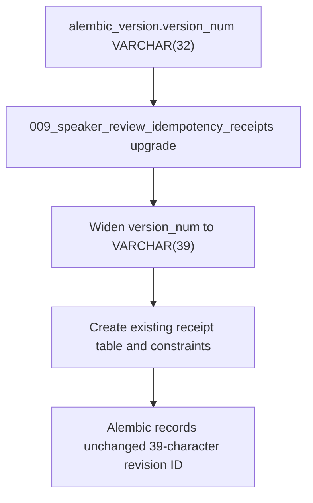
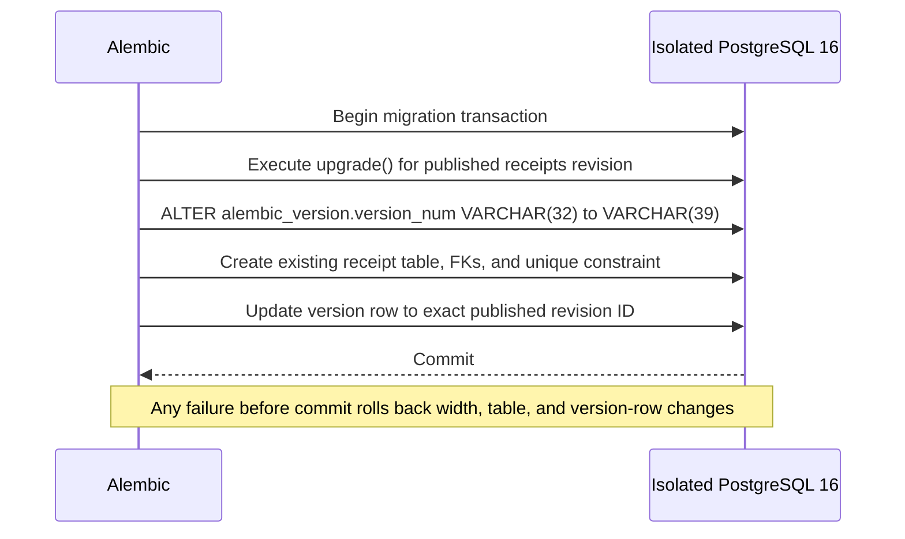

# Design — Alembic Revision ID Width

## Summary

The receipts migration fails on PostgreSQL because Alembic must store its 39-character revision identity in the default `alembic_version.version_num` column, which is only 32 characters wide. PostgreSQL rejects the version-table update, so the migration transaction remains at revision 008 and its receipt table is not committed. The approved bugfix is limited to enabling that forward transition while preserving the published migration identities and effects.

1. Widen the existing Alembic version column from 32 to exactly 39 characters at the start of the receipts migration's `upgrade()`.
2. Keep both published 009 revision IDs, their parent relationships, and their existing schema/data operations unchanged.
3. Keep the width change in the same PostgreSQL migration transaction as receipt-table creation, so a failed upgrade does not leave a partially applied revision.
4. Make the version-column widening monotonic: downgrade removes the receipt schema as before but does not shrink Alembic's metadata column.
5. Verify the target upgrade on an isolated synthetic PostgreSQL 16 database, along with revision-history and receipt-schema regression properties.

## Approved Inputs and Root Cause

- Exact requirement authority: `.spectra/specs/alembic-version-id-width/bugfix.md`, Mira-approved at commit `a8ca67af9b8ff4bcda544dfc727b408e3f8b1dc2` (approval recorded in open PR #486). The approved criterion for 39-character persistence is explicitly proposed in that artifact, not a pre-existing width contract.
- Repository base: `f50e014add142fccc28175d7de07da59efa16ec4`; the assigned worktree was rebased on `origin/main` before authoring and remains at that base.
- `backend/alembic/versions/009_speaker_review_idempotency_receipts.py` declares revision `009_speaker_review_idempotency_receipts` and creates the existing receipt schema. The ID is 39 characters. Its current upgrade body does not widen the Alembic version table.
- Alembic's default version table uses `version_num VARCHAR(32)`. The PostgreSQL error is raised while Alembic records the new revision, after the migration body, which causes the transaction to roll back.
- The companion published revision is `009_recording_media_sources`. This design does not reconcile the two-branch migration graph: that is outside this bugfix's approved scope. The target validation explicitly upgrades to `009_speaker_review_idempotency_receipts`, rather than claiming that `upgrade head` is unambiguous.

## Key Design Decisions

**Widen `alembic_version.version_num` to 39 at the beginning of the receipts revision's `upgrade()`** using Alembic's `op.alter_column` abstraction, with the existing type `sa.String(length=32)` and target type `sa.String(length=39)`. The widening must occur before receipt-table operations and before Alembic records the new revision. This is the smallest change that makes the exact approved 39-character target persistable while keeping its identity stable.

*Rejected alternatives:* Renaming or shortening the published revision changes historical identity and contradicts the approved preservation boundary. Widening to an arbitrary larger value (such as 64 or 255) is not required by this bugfix and broadens the schema change beyond the observed 39-character criterion. Changing Alembic's environment-wide version-table construction affects unrelated migrations and is outside the stated migration-local scope. Adding a later migration cannot solve this failure because Alembic must first persist this revision before it can execute a later one.

**Keep the widening in the receipts migration rather than editing the media-source revision or adding a graph node.** The failing 39-character ID belongs to the receipts revision, so it owns the prerequisite metadata change. The other 009 identity and its migration effects remain untouched.

*Rejected alternatives:* Altering the sibling 009 migration would couple the fix to an unrelated branch and still fail on the receipts branch when it executes. Changing either `down_revision`, adding a merge revision, or otherwise reconciling the graph is a separate lineage concern; it is not needed for the explicitly targeted upgrade and would exceed this bugfix's constraints.

**Do not shrink the column in `downgrade()`.** The schema-width change is a safe monotonic expansion of Alembic's bookkeeping table; a downgrade returns the application schema to the prior revision but leaves a capacity needed to record the published 39-character revision if it is applied again. This avoids a narrow window in which Alembic could be unable to persist a revision during a future migration/downgrade sequence.

*Rejected alternatives:* Reverting the column to 32 would make the Alembic metadata schema dependent on the current application revision and reintroduce the same failure on a subsequent upgrade. A data rewrite or version-ID alias is unnecessary and would violate history preservation.

## Architecture

Only the existing backend migration is modified. No API, application model, user-data table, or migration graph component is introduced. Alembic updates its own version table around execution of the migration; PostgreSQL transactional DDL keeps the width change, receipt-table DDL, and version-row update within the migration transaction.

## Components and Interfaces

### Alembic receipts migration (`backend/alembic/versions/009_speaker_review_idempotency_receipts.py`)

- Retain `revision = "009_speaker_review_idempotency_receipts"` exactly.
- Retain `down_revision = "008_speaker_review_aggregate"` and all other revision metadata.
- At the start of `upgrade()`, alter `alembic_version.version_num` from `sa.String(length=32)` to `sa.String(length=39)` using `op.alter_column` and explicit existing/target types. Do this before `op.create_table`.
- Keep the existing table name, columns, types, nullability, foreign keys (`ON DELETE CASCADE`), unique constraint name and columns, and table-creation semantics unchanged.
- Leave `downgrade()`'s receipt-table removal unchanged; do not shrink `alembic_version.version_num`.
- Do not edit `009_recording_media_sources.py`, migration IDs/parents, or migration environment configuration.

No application-level data model change is needed: `alembic_version` is Alembic-owned metadata, not a Sauri domain model.

## Data Model

The only schema change is to Alembic's internal version table:

| Table/column | Before | After upgrade | Downgrade behavior |
|---|---|---|---|
| `alembic_version.version_num` | `VARCHAR(32)` | `VARCHAR(39)` | Remains `VARCHAR(39)` |

The receipts migration's existing application persistence structure is unchanged: table `speaker_review_idempotency_receipts`, columns `id`, `review_id`, `item_id`, `idempotency_key`, `request_hash`, and `response`, plus its existing foreign keys and `(review_id, idempotency_key)` uniqueness. No field, key, relationship, or stored value is renamed, dropped, or transformed by this fix.

## Correctness Properties

**Property 1 — Target revision round-trip.** When the isolated PostgreSQL 16 database is at `008_speaker_review_aggregate` and the upgrade to `009_speaker_review_idempotency_receipts` succeeds, Alembic stores the exact full revision string (all 39 characters) in `alembic_version.version_num`; it is not truncated or aliased. Validates proposed acceptance criterion 1.

**Property 2 — Successful transition is atomic.** After a successful targeted upgrade, the database records the receipts revision and the receipts table with its approved structure. If any migration operation fails before commit, the database remains at 008, has no partially created receipts table, and has no partially committed version-column alteration. Validates proposed acceptance criterion 2 and the QA-observed failure boundary.

**Property 3 — Published identities and effects are preserved.** For both published 009 revision IDs, the revision string and migration identity remain exact; the media-source revision is untouched; and the receipts revision retains its approved fields, foreign keys, uniqueness, and migration effect. No Alembic version history is rewritten or falsified. Validates both Unchanged Behavior items and acceptance criterion 3.

**Property 4 — Downgrade/re-upgrade preserves the version capacity and receipt contract.** Downgrading the receipts revision removes the receipt table according to its existing downgrade behavior but leaves `alembic_version.version_num` at width 39; re-upgrading succeeds and recreates the same receipt schema. This is an operational safety invariant of the selected monotonic-width design; it does not expand the approved product behavior.

## Error Handling and Failure Safety

| Scenario | Expected behavior |
|---|---|
| Version-column alteration fails | PostgreSQL aborts the migration transaction. Do not catch and continue; fail the upgrade and leave the recorded revision at 008. |
| Receipt-table creation or constraint creation fails after widening | The PostgreSQL transaction rolls back the width alteration and any partial receipt DDL; do not leave a version row claiming the new revision. |
| Alembic updates the version row | The width is already 39, so the exact revision ID can be written without truncation. |
| Database already records either published 009 identity | Preserve the existing version row and migration effects. Do not rewrite its identity or re-run an already-applied migration. This fix is exercised on the required 008-to-receipts path; it does not claim to repair unrelated migration-graph ambiguity. |
| Downgrade of the receipts migration | Use the existing table-drop behavior; keep the version column at 39. Do not attempt an unsafe narrowing or discard history. |
| Non-PostgreSQL or unsupported transaction behavior in a test environment | Do not claim PostgreSQL atomicity from SQLite results; run the specified isolated PostgreSQL 16 validation. |

## Testing Strategy

Use synthetic migration data and a dedicated, isolated PostgreSQL 16 database only. Never run the migration against a shared or live database. Test the exact revision target rather than `head`, because resolving the separately documented sibling-009 graph is outside this bugfix.

1. **Reproduction/regression integration:** initialize the isolated database, upgrade through `008_speaker_review_aggregate`, then target `009_speaker_review_idempotency_receipts`. Assert successful completion, exact stored revision string, `character_maximum_length = 39` for `alembic_version.version_num`, and presence of the receipts table and expected constraints.
2. **Failure atomicity:** in a disposable synthetic database at revision 008, use a controlled migration failure after the widening statement (for example, a pre-existing synthetic receipts-table name that makes `CREATE TABLE` fail). Assert the transaction leaves revision 008, restores the version column to width 32, and leaves the pre-existing collision fixture unchanged. On the clean success-path fixture, assert the failed migration does not leave a newly created receipts table. Ensure fixture setup and teardown are isolated and non-destructive to shared state.
3. **Receipt-schema preservation:** assert exact existing column names/types/nullability, both cascading foreign keys, and the named unique constraint on `(review_id, idempotency_key)` after upgrade. Exercise duplicate-key rejection with synthetic rows.
4. **History identity regression:** inspect both published revision modules and the resulting Alembic script graph; assert the two revision IDs and their existing parent declarations are unchanged. Confirm that no test assumes `alembic upgrade head` succeeds under this width-only change.
5. **Downgrade/re-upgrade regression:** downgrade the target receipt revision to 008, assert the receipt table is removed and the version column remains width 39, then re-upgrade and reassert exact target ID and receipt schema.

Run focused backend migration tests from `backend/` with the configured backend interpreter and the isolated PostgreSQL test setup recorded by QA; also run the full `tests/test_migration.py` module. The packet's QA evidence reproduces the initial failure once on isolated PostgreSQL 16; this design does not claim the fix or these proposed tests have already been implemented or run.
