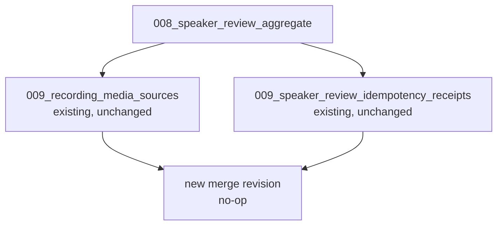
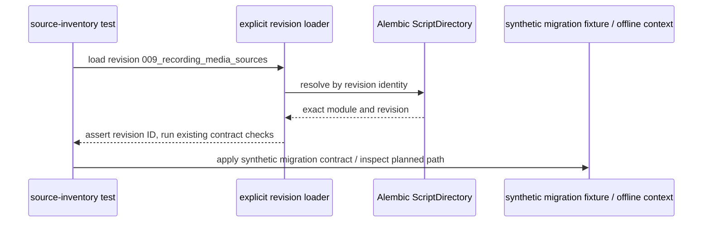

# Design — Reconcile Migration 009 Lineage and Deterministic Source-Inventory Tests

## Summary

Two independently approved migrations both descend from `008_speaker_review_aggregate`, so Alembic currently sees two heads. Separately, the source-inventory migration tests identify their target by selecting the first file with that parent, which can load the receipts migration instead. The fix must preserve both published migration identities and all persisted effects while making selection and upgrade planning deterministic.

1. Keep both existing `009_*` revisions and their upgrade/downgrade bodies unchanged.
2. Add an Alembic merge revision whose `down_revision` contains both 009 revision IDs and whose upgrade/downgrade are no-ops.
3. Make source-inventory tests load the exact `009_recording_media_sources` revision (assert identity) rather than scanning by parent.
4. Test both one-head graph resolution and compatibility when a database is recorded at either existing 009 revision.
5. Preserve the existing isolated synthetic SQLite migration tests and use offline SQL generation for the PostgreSQL upgrade-plan check; never use a live/shared database.

## Approved Inputs and Root Cause

- Exact defect authority: `.spectra/specs/bugfix-migration-009-lineage/bugfix.md`, Mira-approved at upstream commit `153c3daf5be3d91b8c72ca40f9d329f484094311`.
- Reproduction evidence: `qa-reproduction.md` and its five raw logs, which record the three isolated SQLite test-node failures, two Alembic heads, and offline `upgrade head --sql` ambiguity. This is evidence of the defect, not a fix result.
- Unchanged source-inventory behavior: approved `.spectra/specs/meeting-review-playback/tasks.md` T-1/T-2 at `8537e154ab06680422d8bd42111ca64339bfb4bf`.
- Unchanged idempotency receipt behavior: approved `.spectra/specs/recording-speaker-review/tasks.md` T-2 at `576a6a992db4452a653a7112f394e73da5177792`; `.spectra/specs/recording-speaker-review/requirements.md` Requirement 3 AC 5.
- Scope is limited to Alembic graph reconciliation and deterministic migration-test selection. No feature behavior, baseline decision, published revision identity, or existing schema/data effect is changed.

The root causes are independent. First, the two existing 009 scripts each identify 008 as their parent, so Alembic correctly exposes two branch heads and cannot resolve the unqualified `head` target. Second, `_source_inventory_migration()` in `backend/tests/test_migration.py` selects the first globbed script with the shared parent; the receipts migration may be returned and its `CREATE TABLE` collides with the test fixture's already-present table. A merge node fixes only the graph; exact revision selection fixes only the test helper. Both are necessary.

## Key Design Decisions

**Add a no-op Alembic merge revision after the two existing 009 revisions.** The merge changes graph topology without editing immutable published revision IDs or re-running their operations. An environment at either 009 head can traverse the other sibling's effect and then the merge; an environment at common revision 008 traverses both branches before reaching the merge head. This satisfies the requirement that a single target include both effects.

*Rejected alternatives:* Renaming or rewriting a published 009 revision risks making databases with its existing version row appear to have an unknown revision. Choosing one 009 as the other's parent would change historical identity/ancestry and can cause the dependent migration to rerun when upgrading from an installation that recorded it differently. Dropping either migration or its data violates the approved compatibility requirements. A conditional migration that inspects and silently skips schema operations would obscure migration state and is unnecessary when Alembic's merge semantics express the intended graph directly.

**Keep the merge revision schema-neutral.** Its only responsibility is to join graph ancestry; it must not duplicate operations already owned by either branch.

*Rejected alternatives:* Copying either branch's DDL into the merge would apply effects twice on paths that already ran that branch, risking duplicate-object errors or data loss. Replacing one branch's effects with merge operations would rewrite ownership of persisted state.

**Identify the source-inventory migration by its revision ID, not its parent or file order.** The helper will load the module for the exact filename/revision and assert `revision == "009_recording_media_sources"`. The three regression nodes will exercise the same explicit target.

*Rejected alternatives:* Sorting files or selecting the first matching parent only makes filesystem selection appear stable; it still identifies the wrong migration conceptually and breaks as soon as another sibling is added. Altering the production migration's parent solely to satisfy the test would corrupt the intended lineage.

**Use multiple complementary graph validations rather than a live database.** Unit tests assert revision identities, merge parents, one resolved head, and the expected ancestry. Existing isolated migration tests validate the effects with synthetic rows; Alembic's offline SQL generation from the common predecessor demonstrates that the single-head path includes both effects without connecting to a database.

*Rejected alternatives:* Running the whole historical PostgreSQL migration chain on SQLite is incompatible with existing PostgreSQL-specific migrations; running against shared/local persistent PostgreSQL is outside the authorized scope and would add data risk. Static-only source checks cannot establish Alembic's graph behavior or migration effect order.

## Architecture

The Alembic script graph has a common 008 parent, two unchanged 009 branch revisions, and one new merge head. The merge revision is a metadata-only convergence point; it performs no DDL or data writes.



Migration test selection is independent of directory enumeration. Existing test assertions remain responsible for their previously approved schema/backfill behavior; graph tests check the Alembic script directory and compatibility paths.



## Components and Interfaces

### 1. Existing migration revisions

- `backend/alembic/versions/009_recording_media_sources.py`: preserve `revision`, `down_revision`, schema operations, backfill, and downgrade semantics exactly.
- `backend/alembic/versions/009_speaker_review_idempotency_receipts.py`: preserve `revision`, `down_revision`, receipt table fields, keys, FKs, and downgrade exactly.

No edits to either file are part of the design. Their existing migration effects remain independently owned by those revisions.

### 2. New Alembic merge revision

Add one sequentially named file in `backend/alembic/versions/` using the repository's Alembic revision conventions. It declares a unique new revision ID, with:

```python
revision = "<new unique revision id>"
down_revision = (
    "009_recording_media_sources",
    "009_speaker_review_idempotency_receipts",
)
```

`upgrade()` and `downgrade()` contain no schema or data operations (explicit no-op bodies). It does not set branch labels or dependencies. The unique revision identifier and filename must follow the existing repository convention and be verified against the checked-in revisions before implementation; no numeric identity is prescribed by this design.

When upgrading from 008, Alembic applies both branch revisions once before the merge. When starting from either existing 009 version row, Alembic applies only the missing sibling branch and then records the merge. The merge itself never inspects or mutates application tables. Downgrade across the merge is likewise schema-neutral; downgrading beyond the merge may invoke existing branch downgrade operations according to Alembic's selected target and remains subject to their established semantics. Do not infer a new product rollback guarantee beyond this graph behavior.

### 3. Deterministic source-inventory test loader

In `backend/tests/test_migration.py`, replace the helper's glob-and-first-parent search with selection of the exact source-inventory migration file/revision. Retain module-loading behavior only after confirming loader/spec availability, and assert the loaded module's `revision` is exactly `009_recording_media_sources`. Preserve the three independently named test nodes and their existing assertions for backfill, downgrade/re-upgrade, and duplicate tuple rejection. Do not change fixtures to accidentally mask the lineage defect.

### 4. Alembic graph and compatibility tests

Extend the migration test coverage with focused checks that:

- both existing 009 revision IDs remain present and retain `008_speaker_review_aggregate` as their immediate parent;
- the new revision has both exact 009 IDs as parents and is the single head;
- walking ancestry from that head includes both 009 IDs and the common 008 parent;
- offline SQL upgrade planning from the common 008 base resolves one head and contains each branch's schema effect once;
- starting revision-state simulations at each existing 009 ID produces a path that applies the missing sibling before merge, without rewriting or deleting the existing version identity.

Compatibility-path checks must distinguish graph planning evidence from actual database execution. Use Alembic's script/revision APIs and a disposable synthetic migration context where the repository's existing SQLite compatibility permits; otherwise assert the planned upgrade steps structurally and document the exact boundary. Do not claim live PostgreSQL compatibility based on static graph assertions alone.

## Data Models

No application model or persisted schema changes are introduced by the merge revision itself. Existing schema/data remain owned by the two original revisions:

- `recording_media_sources` and `session_recordings.video_presence` remain the source-inventory revision's responsibility.
- `speaker_review_idempotency_receipts` remains the speaker-review revision's responsibility.
- Alembic's version table retains original 009 IDs; the merge adds its new revision state only after both branches are represented.

All test rows and database contexts are synthetic and disposable.

## Correctness Properties

**Property 1 — Single, complete migration head.** For the Alembic script directory, exactly one head is resolved; its ancestor set contains `009_recording_media_sources`, `009_speaker_review_idempotency_receipts`, and `008_speaker_review_aggregate`.

**Property 2 — Stable published revision identities.** The two 009 modules retain their current revision strings and immediate common parent. The reconciliation revision does not replace either identity. Validates `bugfix.md` Expected Behavior, Fix Constraints, and AC 2/4.

**Property 3 — Deterministic inventory target.** For every directory enumeration order, the inventory-test loader resolves revision `009_recording_media_sources`; no parent-only first-match lookup can select the receipts migration. Validates AC 1.

**Property 4 — Effects exactly once from common predecessor 008.** An offline upgrade explicitly bounded from `008_speaker_review_aggregate` to `head` contains the media-source schema/backfill operations and receipt schema operation once each and has no multiple-head failure. Validate by executing `alembic upgrade 008_speaker_review_aggregate:head --sql` and asserting each effect appears exactly once in the generated SQL. Validates AC 3 and the “both approved migration effects” expected behavior.

**Property 5 — Either-009 forward compatibility.** For a database version recorded at either existing 009 ID, upgrading to the merge head preserves that ID as historical state, applies the other sibling effect, and records convergence without repeating the already-applied branch. Validate using migration-path planning plus a disposable, synthetic integration path if available; never extrapolate from the empty no-op merge alone.

**Property 6 — Source inventory behavior unchanged.** For legacy recordings, preserve exactly one audio source per `audio_ref`, add video only for non-null `video_ref`, leave unavailable MIME and offset null, initialize legacy presence to `unknown`, and preserve original references through downgrade/re-upgrade. Duplicate `(recording_id, kind, object_ref)` remains rejected. Validates `bugfix.md` Unchanged Behavior 1–2 and the approved playback plan T-1/T-2.

**Property 7 — Receipt behavior unchanged.** The receipts schema retains its approved fields, `(review_id, idempotency_key)` uniqueness, and cascading foreign keys; same-key retry persistence behavior is unaffected by the lineage reconciliation. Validates `bugfix.md` Unchanged Behavior 3 and approved speaker-review plan T-2 / requirements Requirement 3 AC 5.

**Property 8 — Unrelated revisions unchanged.** Traversal before 008 and after the reconciliation point preserves existing migration behavior; the fix changes only graph convergence and deterministic test selection. Validates `bugfix.md` Unchanged Behavior 5.

## Error Handling

| Scenario | Expected handling |
|---|---|
| Exact source-inventory revision cannot be loaded | Test fails immediately with an explicit missing-revision assertion; it must not fall back to another revision with the same parent. |
| Revision ID resolves to an unexpected module | Assert `module.revision == "009_recording_media_sources"` and fail with the actual ID. |
| New merge revision has missing/incorrect parent | Graph test fails before SQL generation; do not compensate by editing existing 009 parents. |
| Alembic reports more than one head or an unresolved target | Fail graph/offline-upgrade validation; do not use `heads`-specific operator instructions as a substitute for a unique `head`. |
| Schema operation appears more than once in generated plan | Fail SQL-path assertion and investigate graph selection; no `IF NOT EXISTS` masking or operation skipping is introduced. |
| Compatibility path cannot be exercised in the test database | Keep the structural path assertion, record the precise unsupported runtime constraint, and avoid reporting end-to-end database compatibility as proven. |

## Testing Strategy

Use deterministic unit/graph checks, the three independently runnable source-inventory contract nodes, and Alembic offline SQL generation. Preserve exact reproduction commands from `qa-reproduction.md` (run from `backend/` with the recorded interpreter):

```bash
/path/to/configured/python -m pytest -q tests/test_migration.py::test_source_inventory_migration_backfills_only_explicit_legacy_sources
/path/to/configured/python -m pytest -q tests/test_migration.py::test_source_inventory_downgrade_preserves_refs_and_reupgrade_backfills
/path/to/configured/python -m pytest -q tests/test_migration.py::test_source_inventory_rejects_duplicate_recording_kind_and_reference
/path/to/configured/python -m alembic heads
/path/to/configured/python -m alembic upgrade 008_speaker_review_aggregate:head --sql
```

Replace `/path/to/configured/python` with the exact configured interpreter recorded in `qa-reproduction.md`; do not substitute unqualified `python` in an environment where it is unavailable. Also run the complete `tests/test_migration.py` module. The acceptance evidence must include:

1. all three named nodes passing independently and selecting the source-inventory ID;
2. `alembic heads` listing exactly one head with both 009 ancestors;
3. the explicit offline range `008_speaker_review_aggregate:head` completing without ambiguity and its generated SQL containing each branch's migration effects exactly once;
4. explicit graph/path compatibility checks from each historical 009 starting state, with clear separation between structurally proven behavior and database-executed evidence.

No live/shared database, destructive migration, real recording, or non-synthetic test data is used. This design does not claim tests have been run or that the defect is fixed; those are implementation/QA outcomes.
