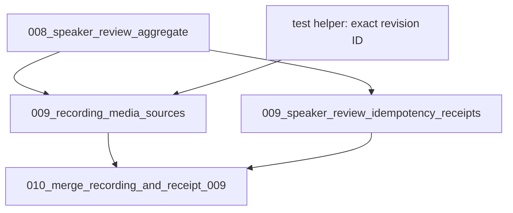
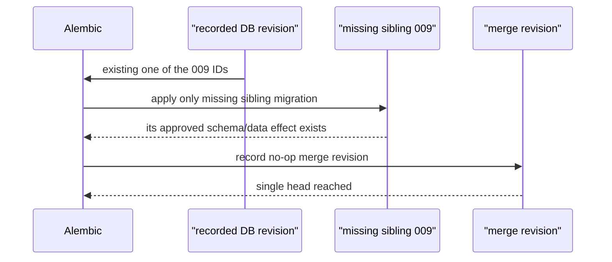

# Design — Reconcile Migration 009 Lineage and Deterministic Source-Inventory Tests

## Summary

Two published Alembic revisions share `008_speaker_review_aggregate` as their parent, leaving two heads. A migration test helper independently selects the first migration file with that parent, so filesystem iteration can select the receipt-table migration while exercising source-inventory behavior. The approved bugfix requires one upgrade head without changing either migration identity or effect.

1. Add an additive, no-op Alembic merge revision whose parents are the two existing 009 revision IDs.
2. Keep both existing 009 migration files and their operations unchanged.
3. Make the source-inventory test helper select `009_recording_media_sources` by exact revision identity, not parent or directory order.
4. Extend migration tests to assert graph ancestry/head uniqueness and upgrade compatibility from either recorded 009 revision.
5. Validate the three isolated regression nodes, Alembic graph and offline SQL plan; record actual outcomes without claiming unrun checks.

## Approved Inputs and Scope

- Defect authority: `.spectra/specs/bugfix-migration-009-lineage/bugfix.md`, approved by Mira for exact upstream commit `153c3daf5be3d91b8c72ca40f9d329f484094311`; source artifact is the version in this worktree. Supporting QA evidence: `qa-reproduction.md` and its raw logs.
- Existing behavior authority: approved playback tasks T-1/T-2 at `8537e154ab06680422d8bd42111ca64339bfb4bf` and speaker-review task T-2 at `576a6a992db4452a653a7112f394e73da5177792`.
- No product baseline or new product behavior is introduced. Work is confined to Alembic revision metadata/graph, migration source-inventory tests, and this specification. No live/shared database operation, destructive data rewrite, historical ID rewrite, or feature-spec change is included.

## Root Cause

`backend/alembic/versions/009_recording_media_sources.py` and `009_speaker_review_idempotency_receipts.py` both declare `down_revision = "008_speaker_review_aggregate"`. Alembic therefore has sibling heads. Separately, `backend/tests/test_migration.py::_source_inventory_migration()` returns the first module yielded by `MIGRATIONS_DIR.glob("*.py")` whose parent equals 008. It selects by a non-unique property and enumeration order rather than the intended revision. The selected receipts migration creates `speaker_review_idempotency_receipts`, which the isolated test fixture already has, producing the observed duplicate-table failure. These are separate defects: a merge revision resolves graph ambiguity; exact-ID selection resolves test ambiguity.

## Key Design Decisions

**Add a new merge revision with both existing 009 revisions as `down_revision`.** The merge node is an additive reconciliation point and performs no schema/data operation. Alembic can traverse either sibling's missing branch before reaching the shared head; databases whose version table records either existing 009 retain that identity and need only the other branch's existing effect plus the merge marker. This preserves published revision identities and operations.
*Rejected alternative:* Editing either published 009 revision to chain after the other changes its historical parent and can invalidate databases that already recorded it. Rewriting version-table rows, deleting a migration, or squashing effects risks falsifying history or losing schema/data and violates the approved constraint.

**Use an explicit revision-ID selector for the inventory migration test helper.** Resolve/load the intended migration and assert its `revision == "009_recording_media_sources"`; reject a missing or mismatched revision explicitly. The tests no longer rely on glob order or a shared parent value.
*Rejected alternative:* Sorting the glob or adding a filename-prefix preference only makes an ambiguous selector depend on a different incidental convention. Renaming the published migration also risks changing stable artifact identity.

**Keep the merge revision behavior-free.** Its sole role is graph convergence; the sibling migrations remain responsible for their own independent schema effects.
*Rejected alternative:* Moving either operation into the merge or making migration operations conditional would blur ownership and could silently omit/double-apply a published effect.

## Architecture and Flow

The merge revision's numeric/name convention must follow the repository's next sequential migration placement, but the immutable revision identity strings remain the two existing 009 IDs. Its `revision` is a new unique Alembic identifier; its `down_revision` is the tuple of both existing IDs; `upgrade()` and `downgrade()` are no-ops. The exact filename/revision naming is implementation detail constrained to be unique and consistent with repository conventions.

From the common 008 parent, Alembic traverses both sibling migrations before the merge node. From a database already at either sibling, it applies the other sibling and then reaches the merge node. The upgrade planner and tests must verify these paths rather than infer them solely from diagram structure.

## Components, Interfaces, and Placement

| Component | Placement | Design/interface | Tests |
|---|---|---|---|
| Merge migration | `backend/alembic/versions/` | New Alembic revision with `revision` unique, `down_revision` containing both 009 IDs, `branch_labels = None`, `depends_on = None`; empty upgrade/downgrade. | Alembic graph/upgrade-plan checks in `backend/tests/test_migration.py`. |
| Source-inventory selector | `backend/tests/test_migration.py` | Helper selects the exact revision ID `009_recording_media_sources`, asserting identity and failing clearly if absent. | Existing three named tests remain focused on backfill, downgrade/re-upgrade, uniqueness. |
| Existing 009 migrations | `backend/alembic/versions/009_*.py` | Retain IDs and operation bodies unchanged. | Regression checks verify effects and that both IDs are in merge ancestry. |

No application module, API, frontend, extension, `packages/shared-types`, or `docker-compose.yml` change is required. No new runtime dependency or external service is introduced. The migration graph is the only production schema/deployment surface affected.

## Data and Migration Compatibility

The merge revision must not create/drop tables, alter columns, copy rows, or modify the existing version records. The existing recording source migration retains its approved backfill, nullable metadata, video-presence default, uniqueness constraint, and downgrade behavior. The receipt migration retains its fields, uniqueness, and foreign keys.

The implementation tests must exercise upgrade plans from (a) the common 008 predecessor, (b) a database marked at `009_recording_media_sources`, and (c) a database marked at `009_speaker_review_idempotency_receipts`, using disposable synthetic fixtures/SQLite where supported and offline SQL generation where dialect-specific planning is needed. Confirm that both effects appear once and that final graph inspection yields exactly one head with both revision IDs in ancestry. Do not run migrations against a shared/live database. Downgrade of the merge marker is a no-op; testing the legacy source-inventory downgrade/re-upgrade remains isolated from the new graph test and preserves its approved behavior.

## Correctness Properties

1. **Single-head convergence:** Alembic reports one head, and the head ancestry contains both `009_recording_media_sources` and `009_speaker_review_idempotency_receipts`. Validates bugfix AC 2.
2. **Both effects from common ancestor:** An upgrade from 008 traverses each 009 identity once and yields both source-inventory and receipt schema effects. Offline SQL includes both operations once. Validates AC 3 and the preservation clauses.
3. **Existing-version compatibility:** Starting with either 009 identity recorded, upgrade applies the other branch's effect and reaches the merge head without changing the recorded historical identity or losing existing schema/data. Validates AC 4.
4. **Deterministic test selection:** The helper selects revision `009_recording_media_sources` regardless of migration-file enumeration order, and fails explicitly if that identity is missing. Validates AC 1's selector condition.
5. **Source inventory preservation:** For legacy recordings, one audio row exists per `audio_ref`; video row exists only for non-null `video_ref`; unavailable MIME/video offset remain null; legacy video presence is `unknown`; references survive downgrade/re-upgrade. Duplicate `(recording_id, kind, object_ref)` remains rejected. Validates every playback item in Unchanged Behavior and AC 5.
6. **Receipt preservation:** The receipts table retains approved columns, key uniqueness, foreign-key relationships, and retry persistence behavior; reconciliation does not alter its existing migration operation. Validates speaker-review Unchanged Behavior and AC 5.
7. **No unrelated migration drift:** Existing revisions outside the reconciled path retain their current upgrade/downgrade behavior. Validate the graph path and relevant migration suite without changing preceding revisions.

## Error Handling and Recovery

| Condition | Expected response |
|---|---|
| Merge migration references a missing/incorrect parent or duplicates an existing revision ID | Alembic graph validation fails; correct migration metadata before publishing. |
| Exact inventory revision cannot be loaded or its declared ID differs | Test helper fails with a clear assertion/error; it must not fall back to a sibling migration. |
| Upgrade planning from either recorded 009 fails or would re-run an already-applied table creation | Regression test fails; do not add conditional destructive SQL or alter `alembic_version` to mask it. Reassess graph traversal before release. |
| Offline SQL generation still reports multiple heads or omits one migration effect | Treat design implementation as incomplete; retain both effects and repair graph metadata. |
| Migration application fails on a disposable test database | Capture exception and leave live/shared databases untouched; use rollback of the disposable test transaction/environment only. |

## Security and Privacy

This is schema-version metadata and synthetic migration testing only. Tests use synthetic recording IDs/references and synthetic receipt rows; no meeting media, transcript, customer data, credentials, or tokens are needed. No auth, access-control, retention policy, or external integration changes are permitted by this bugfix.

## Testing and Validation Strategy

Run checks from the task worktree, following `AGENTS.md` and the approved reproduction environment. Validation is required; this design does not claim any tests have passed.

- Run each approved regression node independently:
  - `python -m pytest -q tests/test_migration.py::test_source_inventory_migration_backfills_only_explicit_legacy_sources`
  - `python -m pytest -q tests/test_migration.py::test_source_inventory_downgrade_preserves_refs_and_reupgrade_backfills`
  - `python -m pytest -q tests/test_migration.py::test_source_inventory_rejects_duplicate_recording_kind_and_reference`
- From `backend/`, inspect heads (`python -m alembic heads`) and generate offline SQL from the common predecessor (`python -m alembic upgrade head --sql` with the configured PostgreSQL dialect); assert one head and both migration effects exactly once.
- Add/run disposable migration graph compatibility tests for both pre-existing 009 version states and the common 008 state, checking preserved tables/rows and target head. Do not claim SQLite alone proves PostgreSQL semantics; use offline PostgreSQL SQL generation for dialect-specific evidence.
- Run the broader `backend/tests/test_migration.py` suite and `git diff --check`. Use the exact configured project interpreter if bare `python` is unavailable, as recorded in `qa-reproduction.md`.
- Report command, interpreter/environment, and result for each check; unrun or blocked checks remain explicitly unverified.

## Spectra Status

Phase: `design` — `complete` means this design has been authored, not audited, implemented, validated, or approved for release.
