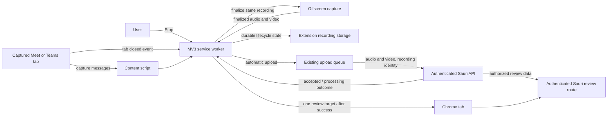

# Design — Chrome Recording Completion

## Summary

The approved requirements join two independently sufficient capture-ending events to one recording lifecycle, but do not authorize meeting-ended inference, a new consent policy, or upload-defect remediation. The lifecycle must preserve recording identity and honest outcomes across extension restarts/reloads and must only launch review after successful processing, without weakening authenticated access.

1. Treat Stop and closure of the captured meeting tab as idempotent signals to finalize the existing recording.
2. Persist a per-recording completion state in extension durable storage and pass the same recording identity through finalization, upload, processing status, and review launch.
3. Reuse the existing upload/backend processing pipeline; report upload and processing states from their actual outcomes and keep upload repair scoped to `task_11001b7f5b084e09`.
4. Resolve a recording's authenticated review URL only after processing success; serialize launch attempts and persist a launch marker so repeated events/reloads do not open duplicate tabs.
5. Keep review data behind the existing authenticated and authorized Sauri boundary; do not add a consent flow, retention policy, or visual redesign.

**Traceability:** authored from approved `.spectra/specs/chrome-recording-completion/requirements.md` snapshot at upstream commit `98e52824d5b8f30f5e1b189c3d4f2ce5aed926f2` (Mira APPROVED, card `task_ed37bc5db81a46d1`, author PR #605 open/not merged). Source requirements and `.config.spectra` are carried into this worktree unchanged for traceability. The approved product baseline packet supplied for this audit is `PRODUCT_BASELINE.md` at commit `4953b3b4b8a058fd4738342307cc50bfd66814f1`, blob `c6f9ef9bf3fac9eac23763e25e25e1089a16c446` (owner approval task `task_a08baf81140a4073`, PR #528); this design uses it only for established portal/access boundaries, not as blanket authorization for this new extension delta. Scope authority for that delta remains Fer's 2026-10-30 direction and Cyrus's reconciliation recorded in the approved requirements snapshot.

## Key Design Decisions

**Keep the capture session ID as the stable client correlation/idempotency key and explicitly persist its backend identity mapping.** The current worker creates a `sessionId` at capture start and uses it as `idempotency_key`, but the upload code currently creates a fresh `meeting_id` inside each request. The completion record and durable upload job must instead carry `sessionId`, one `meetingId` generated and persisted once for this capture, and the server-returned `recordingId`. The mapping is `sessionId → meetingId → recordingId`; use `sessionId` as the IndexedDB key for finalization/retry and idempotency, `meetingId` as the Sauri meeting/review/status route key, and `recordingId` as the backend `SessionRecording` identity returned by ingestion. Persist the mapping before network I/O; retries reuse the same `meetingId` and `sessionId`, validate/persist the returned `recordingId`, and never generate a new meeting. Existing backend ingestion already uniquely constrains `SessionRecording.idempotency_key` and returns `recording_id` plus `state`; the extension must retain `meetingId` because the response does not return it. A retry response must map back to the same meeting; any mismatch is a protocol error, not a reason to silently remap. *Rejected alternative:* using an ephemeral worker variable or generating `meeting_id` per request loses stable association across MV3 restarts/retries; using `recordingId` before ingestion is impossible because the backend assigns it.

**Keep extension orchestration in the MV3 service worker and capture-specific operations in the existing offscreen/capture boundary.** Content scripts report captured-tab lifecycle; they do not own durable state, upload, or auth. The worker coordinates finalization, persisted transitions, upload queue, status observation, and tab opening through Chrome messaging and APIs. *Rejected alternative:* embedding the full workflow in a content script couples it to a page lifetime and page context; a long-running worker is not available under MV3.

**Use authenticated meeting state and asset endpoints as the processing source of truth; gate review on all required assets.** The existing meeting record exposes `process_state` (`queued`, `joining`, `recording`, `transcribing`, `completed`, `failed`). Map `queued`/`joining`/`recording`/`transcribing` to in-progress and `failed` to processing failure. `completed` alone is not the requirement's `Processing_Success`: for the same `meetingId`, authenticate and require (a) `process_state === 'completed'`, (b) the protected transcript endpoint returns a transcript for that meeting, and (c) the protected playback manifest returns a usable video source (`muxed_video_source` or at least one `video_sources` entry; `video_presence: absent|unknown` or no usable source is not ready). Only then persist `processing_succeeded` and launch review. If `process_state` is completed but either asset is unavailable, retain a non-ready/reconciling state; do not assert success or launch. Authenticated meeting/status, transcript, and playback access are bound to `meetingId`; `recordingId` must match the ingestion response associated with that meeting. API/login repair (`task_dfcb314806c04033`) must provide or preserve authenticated status access; if no existing status read is available, downstream implementation must add the minimal authenticated meeting-status read in that task's API ownership rather than inventing a new processing state. *Rejected alternative:* trusting `process_state === completed`, upload acceptance, or local state alone can launch review without the transcript and video required by the glossary; creating a new client-side processing authority conflicts with backend state.

**Launch review only after authenticated completed status and both required assets are verified for the persisted identity mapping.** `process_state=completed` is necessary but insufficient: require the matching meeting's protected transcript endpoint and playback manifest to confirm transcript and usable video before marking `processing_succeeded`; launch to that same `meetingId` and let the web destination enforce authentication and authorization before returning data. Login redirection may preserve the target but an extension URL or identifier is not authorization. Playback behavior is owned by `task_6a271652b2c34130`; this design consumes its resulting review route rather than redefining playback. *Rejected alternative:* auto-opening on upload acceptance or meeting completion alone can misrepresent a missing video/transcript as ready; embedding protected data in extension state bypasses the Sauri authorization boundary.

**Persist a single launch decision per recording and serialize concurrent launch attempts.** Mark launch as pending/started before invoking `chrome.tabs.create`, then record the created tab ID/result and reconcile an interrupted attempt at startup using the persisted recording/launch state. Use an idempotent recording-specific target, not repeated calls from event listeners. The guarantee is that repeated completion/retry/reload handling does not issue multiple launches; if a browser crash occurs in the narrow interval between tab creation and persisting its ID, reconciliation must inspect an already-open matching Sauri target before creating another. *Rejected alternative:* a process-local boolean fails after worker termination; tab URL query parameters alone do not prevent concurrent duplicate creation.

**Use one provider-neutral completion contract for Meet and Teams without claiming Teams capture already exists.** Stop from the extension's capture controls and closure of the persisted captured tab both call the same coordinator for either provider. The current Meet adapter supplies the existing recording handle; a Teams completion adapter is part of this design's implementation scope at the completion boundary and must supply the same `sessionId`/captured-tab binding and finalized media handle to the shared coordinator. This adapter accepts a Teams capture handle but does not create or claim an existing Teams media-capture pipeline, and does not add unrelated capture controls. Acceptance and tests must exercise both provider adapter paths with synthetic handles. Meeting-ended signals from either provider are not completion triggers. *Rejected alternative:* deferring Teams completion as a future prerequisite would contradict Requirement 5.1; duplicating the lifecycle per provider would create divergent idempotency and status behavior. Consent, retention, and capture-provider behavior beyond this adapter remain out of scope.

## Architecture

### Component diagram



### Completion sequence

```mermaid
sequenceDiagram
  participant C as Stop or captured-tab-close event
  participant W as MV3 service worker
  participant S as Durable recording state
  participant O as Capture/offscreen boundary
  participant Q as Existing upload queue
  participant A as Authenticated Sauri API
  participant T as Chrome tabs / Sauri review
  C->>W: completion signal(sessionId, trigger)
  W->>S: atomically claim finalization by sessionId
  alt first accepted completion signal
    W->>O: finalize media for sessionId
    O-->>W: finalized audio and video
    W->>S: persist sessionId + stable meetingId + finalized state
    W->>Q: enqueue sessionId, meetingId and assets
    Q->>A: upload using meetingId and idempotency_key=sessionId
    A-->>Q: recording_id + process_state
    Q->>S: persist recordingId mapping and truthful upload result
    loop until terminal state or assets are ready
      W->>A: authenticated status, transcript and playback reads for meetingId
      A-->>W: process_state and available assets
    end
    alt completed and transcript plus video available
      W->>S: claim one review launch by sessionId/meetingId
      W->>T: open authenticated review target for meetingId
      T->>A: authenticated, authorized review request
      A-->>T: video and transcript for same meetingId
    else processing failure or required asset unavailable
      W->>S: retain failure or non-ready outcome for same mapping
    end
  else duplicate signal or retry
    W->>S: resume/reconcile existing lifecycle; do not create another recording
  end
```

The flow above describes desired boundaries, not a claim that every endpoint or route is already implemented. Use the established recording/meeting API contract and playback route; any missing status/read capability is a dependency/interface gap to be resolved in the implementation tasks without weakening the requirements. The portal API/login repair (`task_dfcb314806c04033`) and accessible meeting playback (`task_6a271652b2c34130`) are dependencies. Upload failure remediation remains separately owned by `task_11001b7f5b084e09`.

## Components and Interfaces

### 1. Capture lifecycle adapter — `extension/src/content.ts` and `extension/src/background.ts`

- The content script reports capture-context lifecycle messages only; a meeting-ended page signal is not a completion message.
- Meet and Teams capture adapters supply the same provider-neutral `{ provider, capturedTabId, sessionId }` handle to the coordinator. The existing Meet content script reports discovery/meeting-ended only; a Teams adapter implements the same completion contract for its capture context. The extension Stop control sends an explicit stop for whichever provider owns the active handle.
- At capture start, persist the handle and its `sessionId` in the durable completion record before capture can enter `recording`; `chrome.storage.session.sauriState` remains a UI projection, not the authoritative tab-to-session binding. `chrome.tabs.onRemoved` resolves the closed `tabId` against this durable active-record index, so it still finds the recording after worker restart or `handleMeetEnded` has run.
- A meeting-ended message may clear only meeting-discovery/pending UI data. It MUST NOT clear, replace, or detach an active completion record or its tab binding. The tab-close handler claims the matching record transactionally and calls one `completeRecording(sessionId, trigger)` coordinator. Stop and tab-close races reuse this record and its preallocated `meetingId`; the backend `recordingId` is filled from ingestion response.
- Keep captured media finalization in the existing offscreen/capture owner. Do not move capture data into page DOM, content-script storage, or tab URLs.

### 2. Durable completion coordinator — `extension/src/background.ts` plus `extension/src/recording-db.ts`

The service worker coordinates; `extension/src/recording-db.ts` owns durable completion records alongside the existing media chunks. This state is distinct from server processing truth and must not replace existing media records or upload-queue ownership. Bump `sauri-recordings` from DB version 1 to 2 and add a `completion_records` object store keyed by `sessionId`, with a non-unique index on `capturedTabId` for active-capture lookup. The upgrade is additive: preserve the existing `chunks` store, key path, and `by_session` index; create no synthetic completion records for legacy chunk rows. `onblocked`/`versionchange` handling must close live DB connections and leave v1 data readable; do not clear or rewrite chunk rows during upgrade. All claims and status changes use transactions across the completion store; a failed upgrade/write must keep capture data and must not report a successful state.

```typescript
type CompletionStatus =
  | 'capturing'
  | 'finalizing'
  | 'upload_pending'
  | 'uploading'
  | 'upload_succeeded'
  | 'upload_failed'
  | 'upload_outcome_unavailable'
  | 'processing'
  | 'processing_assets_unavailable'
  | 'processing_failed'
  | 'processing_succeeded'
  | 'review_launch_pending'
  | 'review_opened';

interface RecordingCompletion {
  /** Extension-generated at capture start; stable local key and backend idempotency_key. */
  sessionId: string;
  /** Capture source adapter; completion lifecycle is shared across both providers. */
  provider: 'meet' | 'teams';
  /** Generated once before first upload and reused for every retry; Sauri meeting/review key. */
  meetingId: string;
  /** Server-returned SessionRecording.id; absent until first successful ingestion response. */
  recordingId?: string;
  capturedTabId: number;
  status: CompletionStatus;
  trigger?: 'stop' | 'captured_tab_closed';
  uploadError?: string;
  processingError?: string;
  reviewTabId?: number;
  updatedAt: number;
}
```

Persist only state and opaque identifiers needed to resume. Do not add audio/video or transcript copies to this record. Error fields are bounded, non-sensitive summaries; never persist auth tokens or raw transcript/audio content for status display. IndexedDB reads/writes and the claim operation must be transactional so two events/restarts cannot both claim finalization or review launch. If the existing schema/API cannot perform the required atomic transition, add a narrowly scoped transaction at the persistence boundary; do not introduce a separate state database.

### 3. Upload and processing status bridge — `extension/src/upload-queue.ts`, `extension/src/background.ts`, and authenticated backend API

- Enqueue the already-finalized media with the stable `sessionId` idempotency key and persisted `meetingId`; audio/video representation must match the capture's declared `video_presence`. The API response's `recording_id` and `state` are validated and saved as `recordingId`/initial process state before upload chunks are cleared. A retry uses precisely the same IDs and payload identity; the backend unique idempotency key returns the existing recording rather than creating another.
- Truthful upload display is gated on the upload queue's settled result, not merely on calling it. In current code, `uploadRecording` catches non-2xx and network failures without throwing, while `processUploadQueue` interprets resolution as success and marks the job done. This spec does not duplicate `task_11001b7f5b084e09`'s repair: this flow depends on that repair (or an equivalent separately reviewed result contract) making non-2xx/network/invalid response observable as queue failure. The completion UI may display `upload_succeeded` only when the queue reports success after a valid successful response containing the stable `recording_id`; while the repaired contract is absent/unconfirmed, retain `uploading`/`upload_outcome_unavailable`, never success. Terminal failure is retained against this same `sessionId`/`meetingId`/`recordingId` mapping; retry does not allocate a new recording.
- Map authenticated meeting `process_state` exactly: `queued`, `joining`, `recording`, `transcribing` → processing; `failed` → processing failure; `completed` → candidate completion only. For `completed`, require authenticated status for the persisted `meetingId`, a successful transcript response for that meeting, and a playback manifest with an accessible muxed or separate video source before `processing_succeeded`. Missing video (including `video_presence` absent/unknown), missing transcript, 404, network failure, or auth failure remains unavailable/non-ready; never open the review tab. The endpoint must authorize the authenticated user for that meeting.
- Persist all mapping/status transitions by `sessionId`; on worker startup/reload reconcile the same `meetingId` and verify the returned `recordingId` association, preventing a prior recording's result from bleeding into another.
- If the authenticated status/assets cannot be read, preserve the last truthful known state and indicate unavailable/retryable status; never replace it with success. Do not invent retry limits or timing targets absent from requirements.
- API/login contract work remains with `task_dfcb314806c04033`; review/playback route remains with `task_6a271652b2c34130`. The upload outcome contract is a blocking dependency on `task_11001b7f5b084e09`, not an implementation of its fix.

### 4. Completion status UI — `extension/src/panel/SidePanelApp.tsx` and `extension/src/panel/components/RecordingCompletionStatus.tsx`

- The Side Panel owns the visible upload/processing result because it is the extension surface already used for capture controls and remains available after the meeting tab closes. It subscribes to durable completion-record updates by `sessionId`; it must not infer success from `sauriState` becoming idle or from queue dispatch.
- `RecordingCompletionStatus` renders the recording title/identity and exactly one current outcome: finalizing, upload in progress, upload succeeded, upload failed, processing in progress, processing failed, processing status unavailable, review ready/opened. Ready/opened is shown only after the same-recording transcript and playable video checks pass. Errors have a retry/status-refresh action only where an existing retry API supports it; this UI does not implement the separately owned upload-repair behavior.
- The status panel must recover after closing/reopening the Side Panel or service-worker restart by loading persisted completion records; it must not present another recording's stale status. This satisfies Requirements 2.3–2.5 and 3.1–3.4 without adding a new portal screen or redefining review playback.

### 5. Review launch — `extension/src/background.ts` and `frontend/src/`

- Trigger only from `processing_succeeded` for the persisted `sessionId → meetingId → recordingId` mapping, after checking completed status plus both assets.
- Resolve the canonical review destination from the persisted `meetingId` (the current review/playback APIs are meeting-keyed); verify the server-returned `recordingId` still belongs to it. The route must provide both video and transcript as required; playback implementation stays with `task_6a271652b2c34130`.
- Before exposing protected data, frontend/API enforces login and authorization for the requested recording. A redirect to login may preserve the target, but access is granted only after server authorization.
- Claim and persist launch before `chrome.tabs.create`; persist returned tab ID and reconcile pending launches after service-worker restart. Repeated signal, retry, or status refresh must not create another review tab. Tests must cover concurrent signals and crash/reload reconciliation, including lookup of an already-open matching protected target.
- The extension reports the launch result; it does not cache, proxy, or display transcript/video data itself.

## Data Models

The `RecordingCompletion` record above is keyed by `sessionId`; its immutable persisted mapping is `sessionId → meetingId → recordingId`. `sessionId` is generated at capture start and already accompanies the capture/upload queue; generate one `meetingId` once for the recording and persist it with the completion record before upload; the backend `recordingId` is populated only from the authenticated ingestion response. The current backend `SessionRecording.idempotency_key` uniqueness and ingestion `recording_id` response provide retry deduplication and the server identity. The current extension request's fresh `meeting_id` per attempt must change to the persisted `meetingId`; never regenerate it on retry. Backend meeting, recording and process-state records remain authoritative. This is a request/identity-flow correction; no new backend entity or migration is implied.

The browser tab ID is transient routing metadata, not recording identity or authorization. On a stale/missing tab ID, compare the canonical Sauri origin and `meetingId`-specific review target before deciding whether an open tab already represents the launch. Never treat a client-provided identifier as access permission.

## Correctness Properties

1. **Trigger convergence — Requirements 1.1–1.5, 5.2:** For any active recording, Stop, captured-tab-close, or both in either order cause at most one finalization for its persisted `sessionId`; a meeting-ended signal alone causes none.
2. **Recording identity conservation — Requirements 1.3, 2.2, 2.6, 4.6, 5.5:** Every final media asset and upload request uses the same `sessionId` and persisted `meetingId`; the server `recordingId` returned for that idempotency key remains mapped to that meeting across retries, and review/status uses that same `meetingId`. No retry generates a replacement ID or recording.
3. **Truthful upload state — Requirements 2.1–2.5:** Upload-in-progress or unverified outcome never renders success; upload success is recorded only after the separately repaired queue contract resolves with a valid successful response for the same mapping; observable failure remains failure for that recording until a later verified success.
4. **Truthful processing state — Requirements 3.1–3.4:** `process_state=completed` alone is insufficient. Processing success is shown only when authenticated status is completed and same-meeting transcript and accessible video are both confirmed; processing failure is retained; reload/retry cannot substitute another recording's stale result.
5. **Success-gated review — Requirements 4.1, 4.4:** No review launch is claimed before server-confirmed completed state plus transcript and video readiness for the mapped meeting; processing failure, pending state, or missing/unavailable assets cannot open a ready review destination.
6. **At-most-one launch — Requirements 4.5, 5.5:** Any set of duplicate completion events, retries, reloads, or concurrent worker handlers for one recording leads to at most one review tab creation/recognized matching destination.
7. **Authorization boundary — Requirements 4.2–4.3, 5.3:** Without an authenticated session and server authorization for the recording, the review route returns no video/transcript data, regardless of extension launch state or identifier knowledge.
8. **Meet and Teams completion parity — Requirement 5.1:** The shared coordinator accepts the same Stop/tab-close contract for both provider adapters; test each adapter with synthetic active-capture bindings. This completion design does not claim that Teams capture already exists or add unrelated capture controls.
9. **Durable tab binding and upgrade safety — Requirements 1.2, 1.5, 3.4:** For any active record, its `capturedTabId → sessionId` binding survives worker restarts and meeting-ended messages until the record is completed; upgrading IndexedDB v1→v2 preserves all chunk rows and leaves legacy rows usable.
10. **Surface scope — Requirement 5.4:** No visual redesign, consent workflow, retention rule, or privacy-policy change.

## Error Handling

| Scenario | Required behavior |
| --- | --- |
| Stop and tab-close race / duplicate event | Atomically accept one finalization claim; later event resumes/reconciles the same record without another recording. |
| Captured tab closes before active recording association can be resolved | Do not finalize an unrelated recording; retain/report unresolved state through existing extension feedback and avoid a false success. |
| Offscreen finalization fails | Retain finalization failure for the same recording; do not enqueue incomplete media or report upload/processing success. |
| Upload pending/in progress | Show a non-success state associated with recording; preserve the queue's retry ownership. |
| Upload fails or network is unavailable | Retain truthful failure/unavailable state; retry uses same recording identity; do not claim processing success. Upload defect fix remains separate. |
| Authenticated status request fails or user session expires | Preserve last server-confirmed state; present unavailable/auth-required recovery without exposing protected media. Resume status reconciliation after authentication. |
| Processing fails | Retain failure for that recording and do not open it as ready for review. |
| Review authorization denied | Keep recording's processing success distinct from review access; show access failure/reauthentication via protected portal boundary and never expose media/transcript. |
| Tab creation or worker interruption | Keep launch pending and reconcile against existing recording-specific Sauri tabs on restart before attempting creation. |
| Teams adapter cannot resolve the active capture handle | Keep the recording non-successful, surface a completion error in the Side Panel, and do not finalize another session; the implementation must supply the provider-neutral handle for Teams as well as Meet. |

## Testing Strategy

Use synthetic recordings and synthetic meeting IDs only. No real meeting audio/video, transcript, credentials, or customer data in fixtures.

**Extension unit and property tests:** place pure transition/idempotency logic under `extension/src/core/` with colocated `*.test.ts`; add persistence/coordinator coverage beside the existing extension modules/tests. Exercise Stop then close, close then Stop, repeated events, event after worker restart, a meeting-ended event followed by captured-tab-close, and retry preserving the exact `sessionId`/`meetingId`/`recordingId` mapping. Verify both Meet and Teams adapters feed the shared coordinator contract with synthetic handles. Test backend response mismatch, non-2xx/network/invalid-response queue result, each `process_state` mapping, `completed` without transcript, `completed` without video, Side Panel status recovery/re-render for the same session, and launch deduplication. Upgrade a populated v1 IndexedDB fixture to v2 and assert original chunk rows and indexes remain readable while the new completion store exists. Property-based tests should generate event sequences and assert trigger convergence, identity conservation, truthful queue outcomes, success requiring completed state plus both assets, and at-most-one launch claim.

**Extension integration/E2E:** `extension/tests/e2e/` should verify a synthetic capture's completion-to-upload/status path and that only confirmed success opens one Sauri target. Include reload/restart and duplicate-event scenarios. Mock external network only at test boundaries; use synthetic server responses, never production or live meeting content.

**Backend/API and frontend tests:**
- `backend/tests/ingestion/` and/or the existing recording/meeting module tests should verify authenticated status retrieval, same-recording association, and rejection of unauthorized access if any API contract changes.
- `frontend/src/` colocated component tests should verify protected review-route behavior: both media and transcript resolve for the requested recording only after authentication/authorization; pending/failed status is not presented as ready.
- These backend/frontend checks are required only for their actual changed contracts; the design does not presuppose API/schema changes.

**Validation commands:** `npm run test`, `npm run typecheck`, `npm run build`, and `npm run test:e2e` from `extension/` for extension changes; `npm run test`, `npm run typecheck`, `npm run build` from `frontend/` for frontend changes; `pytest` from `backend/` for backend changes. Run the project's configured commands only for changed surfaces. The extension requires an additive IndexedDB schema upgrade from DB_VERSION 1 to 2 with migration/compatibility tests; no SQL migration or Compose change is expected unless a separate authenticated-status contract gap requires it.

### Folder placement and deployment impact

| Surface | Expected folders to add/modify | Tests | Migration? |
| --- | --- | --- | --- |
| Chrome extension | `extension/src/core/` (pure completion transitions/provider-neutral source contract); `extension/src/background.ts`, `extension/src/content.ts`, `extension/src/recording-db.ts` (DB v2 additive store), `extension/src/upload-queue.ts`, `extension/src/panel/SidePanelApp.tsx`, new `extension/src/panel/components/RecordingCompletionStatus.tsx`, and capture/offscreen boundary only as required | `extension/src/core/*.test.ts`, new colocated `extension/src/recording-db.test.ts`, panel component tests, coordinator tests, `extension/tests/e2e/` | Yes: IndexedDB v1→v2 additive client migration; preserve chunks; no server SQL migration expected |
| Web frontend | `frontend/src/` protected review route/API integration only if existing playback task does not already provide the needed authenticated destination | `frontend/src/` component tests | No |
| Backend API | `backend/app/meetings/` or current recording/ingestion owner only if authenticated status contract is missing | matching `backend/tests/meetings/` or `backend/tests/ingestion/` | Not presumed; only if an identified durable-status gap needs schema change |
| Shared types | `packages/shared-types/` only if an existing frontend/backend contract needs a shared additive type; extension local types remain local unless a contract consumer justifies a change | shared package tests/typecheck if changed | No |
| Compose | No change expected | N/A | N/A |

Implementation must read current owners and contracts before selecting exact files; the table names canonical placement and conditional scope, not permission to modify unrelated surfaces or duplicate the separate upload, portal-login, or playback work.
