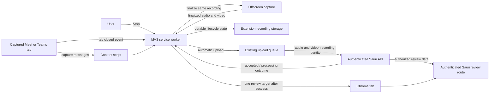

# Design — Chrome Recording Completion

## Summary

The approved requirements join two independently sufficient capture-ending events to one recording lifecycle, but do not authorize meeting-ended inference, a new consent policy, or upload-defect remediation. The lifecycle must preserve recording identity and honest outcomes across extension restarts/reloads and must only launch review after successful processing, without weakening authenticated access.

1. Treat Stop and closure of the captured meeting tab as idempotent signals to finalize the existing recording.
2. Persist a per-recording completion state in extension durable storage and pass the same recording identity through finalization, upload, processing status, and review launch.
3. Reuse the existing upload/backend processing pipeline; report upload and processing states from their actual outcomes and keep upload repair scoped to `task_11001b7f5b084e09`.
4. Resolve a recording's authenticated review URL only after processing success; serialize launch attempts and persist a launch marker so repeated events/reloads do not open duplicate tabs.
5. Keep review data behind the existing authenticated and authorized Sauri boundary; do not add a consent flow, retention policy, or visual redesign.

**Traceability:** authored from approved `.spectra/specs/chrome-recording-completion/requirements.md` snapshot at upstream commit `98e52824d5b8f30f5e1b189c3d4f2ce5aed926f2` (Mira APPROVED, card `task_ed37bc5db81a46d1`, author PR #605 open/not merged). Source requirements and `.config.spectra` are carried into this worktree unchanged for traceability. Scope authority is Fer's 2026-10-30 direction and Cyrus's reconciliation recorded in that requirements snapshot; the current DRAFT baseline is not blanket authority.

## Key Design Decisions

**Use one durable completion record keyed by the existing recording identity, with explicit lifecycle states and idempotent transitions.** Stop and captured-tab-close race or may both arrive; both must converge on the already-active recording rather than allocate one. Persist state before asynchronous upload and tab-launch side effects, then make each side effect conditional on an uncompleted state transition. *Rejected alternative:* ephemeral service-worker variables lose state when MV3 terminates; creating a new record per trigger violates same-recording and duplicate-prevention criteria. Do not mint an unrelated client identity if a stable recording identifier is already created by capture; if the existing identifier cannot uniquely identify a recording, resolve that implementation dependency without changing product semantics.

**Keep extension orchestration in the MV3 service worker and capture-specific operations in the existing offscreen/capture boundary.** Content scripts report captured-tab lifecycle; they do not own durable state, upload, or auth. The worker coordinates finalization, persisted transitions, upload queue, status observation, and tab opening through Chrome messaging and APIs. *Rejected alternative:* embedding the full workflow in a content script couples it to a page lifetime and page context; a long-running worker is not available under MV3.

**Use the existing authenticated Sauri processing and review APIs as the source of truth for server-side processing outcome.** The extension may show locally known finalization/upload outcomes, but must not infer server processing success from upload completion, an accepted response, or elapsed time. Poll/refresh the existing recording status through its authenticated API, or consume an existing status signal if one is already supported; API mapping/auth work in `task_dfcb314806c04033` is a dependency, not scope to duplicate here. *Rejected alternative:* local-only processing status cannot survive reload reliably and can display stale or fabricated success; adding an independent status store would create conflicting authorities.

**Launch review only when the server reports processing success and authorization is enforced by the review destination.** Construct the target from the same recording/meeting identity, and let the web destination enforce authenticated session and per-recording authorization before returning video or transcript. Login redirection may lead to the same protected target after authentication, but an extension tab URL or opaque identifier is not authorization. Playback behavior is owned by `task_6a271652b2c34130`; this design consumes its resulting review route rather than redefining playback. *Rejected alternative:* auto-opening on upload acceptance exposes incomplete work as ready; embedding media/transcript in extension state bypasses the Sauri authorization boundary.

**Persist a single launch decision per recording and serialize concurrent launch attempts.** Mark launch as pending/started before invoking `chrome.tabs.create`, then record the created tab ID/result and reconcile an interrupted attempt at startup using the persisted recording/launch state. Use an idempotent recording-specific target, not repeated calls from event listeners. The guarantee is that repeated completion/retry/reload handling does not issue multiple launches; if a browser crash occurs in the narrow interval between tab creation and persisting its ID, reconciliation must inspect an already-open matching Sauri target before creating another. *Rejected alternative:* a process-local boolean fails after worker termination; tab URL query parameters alone do not prevent concurrent duplicate creation.

**Do not redesign or broaden consent, retention, or provider behavior.** Stop and captured-tab-close are the only authorized completion triggers; meeting-ended alone is ignored. The requirement names Meet and Teams as target capture contexts but explicitly does not claim Teams capture exists; implement completion wiring only for capture contexts that provide the existing recording identity and finalized media, and treat Teams capture support as a prerequisite/capability boundary rather than inventing a new capture implementation. *Rejected alternative:* assuming Teams support from the requirement would misrepresent current capability and broaden scope; adding a consent or retention change is explicitly excluded.

## Architecture

### Component diagram



### Completion sequence

```mermaid
sequenceDiagram
  participant C as Stop or captured-tab-close event
  participant W as MV3 service worker
  participant S as Durable recording state
  participant O as Capture/offscreen boundary
  participant Q as Existing upload queue
  participant A as Authenticated Sauri API
  participant T as Chrome tabs / Sauri review
  C->>W: completion signal(recordingId, trigger)
  W->>S: atomically claim finalization if active
  alt first accepted completion signal
    W->>O: finalize media for recordingId
    O-->>W: finalized audio and video
    W->>S: persist finalized/upload-pending state
    W->>Q: enqueue same recordingId and assets
    Q->>A: upload recording assets
    A-->>Q: upload result for recordingId
    Q->>S: persist truthful upload result
    A-->>W: processing state for recordingId
    loop until terminal processing outcome
      W->>A: authenticated status read(recordingId)
      A-->>W: processing or failure or success
    end
    alt processing success
      W->>S: claim one review launch(recordingId)
      W->>T: open authenticated review target
      T->>A: authenticated, authorized review request
      A-->>T: video and transcript for recordingId
    else processing failure
      W->>S: retain processing failure(recordingId)
    end
  else duplicate signal or retry
    W->>S: resume/reconcile existing lifecycle; do not create another recording
  end
```

The flow above describes desired boundaries, not a claim that every endpoint or route is already implemented. Use the established recording/meeting API contract and playback route; any missing status/read capability is a dependency/interface gap to be resolved in the implementation tasks without weakening the requirements. The portal API/login repair (`task_dfcb314806c04033`) and accessible meeting playback (`task_6a271652b2c34130`) are dependencies. Upload failure remediation remains separately owned by `task_11001b7f5b084e09`.

## Components and Interfaces

### 1. Capture lifecycle adapter — `extension/src/content.ts` and `extension/src/background.ts`

- The content script reports capture-context lifecycle messages only; a meeting-ended page signal is not a completion message.
- The service worker observes closure of the specific captured tab associated with the active recording, not arbitrary tab closure. It also receives the explicit Stop command.
- Both signals include the existing `recordingId`; the closure listener must resolve this association from persisted active-capture state, not a transient global variable.
- Both signals call one `completeRecording(recordingId, trigger)` coordinator. That coordinator performs an atomic state transition and safely ignores/reconciles duplicate signals.
- Keep captured media finalization in the existing offscreen/capture owner. Do not move capture data into page DOM, content-script storage, or tab URLs.

### 2. Durable completion coordinator — `extension/src/background.ts` plus `extension/src/recording-db.ts`

The service worker coordinates, while the existing IndexedDB recording persistence is the candidate durable store for the per-recording record. This state is distinct from server processing truth and must not replace existing media records or upload-queue ownership.

```typescript
type CompletionStatus =
  | 'capturing'
  | 'finalizing'
  | 'upload_pending'
  | 'uploading'
  | 'upload_succeeded'
  | 'upload_failed'
  | 'processing'
  | 'processing_failed'
  | 'processing_succeeded'
  | 'review_launch_pending'
  | 'review_opened';

interface RecordingCompletion {
  recordingId: string;
  meetingId: string;
  capturedTabId: number;
  status: CompletionStatus;
  trigger?: 'stop' | 'captured_tab_closed';
  uploadError?: string;
  processingError?: string;
  reviewTabId?: number;
  updatedAt: number;
}
```

Persist only state and opaque identifiers needed to resume. Do not add audio/video or transcript copies to this record. Error fields are bounded, non-sensitive summaries; never persist auth tokens or raw transcript/audio content for status display. IndexedDB reads/writes and the claim operation must be transactional so two events/restarts cannot both claim finalization or review launch. If the existing schema/API cannot perform the required atomic transition, add a narrowly scoped transaction at the persistence boundary; do not introduce a separate state database.

### 3. Upload and processing status bridge — `extension/src/upload-queue.ts`, `extension/src/background.ts`, and authenticated backend API

- Invoke the established queue for both finalized audio and video, retaining the same `recordingId`/meeting association used by the active recording. This design does not specify a replacement upload protocol or repair the separate upload defect.
- Distinguish `upload_pending`/`uploading` from `upload_succeeded`; record `upload_failed` on terminal failure and retain it across restart. A retry resumes the existing recording and does not allocate a new meeting/recording.
- After upload is accepted, obtain the recording's actual processing status from the authenticated Sauri API. A queue acceptance or upload success is not processing success.
- Persist observed status transitions by recording ID. On worker startup or completion UI reload, reconcile from the server, preventing a prior recording's outcome from being displayed for another.
- If server status cannot be read (network/auth/API error), preserve last truthful known state and indicate unavailable/retryable status; never replace it with success. Do not invent retry limits or timing targets absent from requirements.
- Match existing API contracts and the in-flight API/login task; document any required endpoint/status contract in downstream tasks rather than assuming an unverified route shape here.

### 4. Review launch — `extension/src/background.ts` and `frontend/src/`

- Trigger only from `processing_succeeded` for the matching `recordingId`.
- Resolve the canonical review destination from the existing Sauri route/meeting identity. The route must resolve the same recording and provide both video and transcript as required; playback implementation stays with `task_6a271652b2c34130`.
- Before exposing protected data, frontend/API enforces login and authorization for the requested recording. A redirect to login may preserve the target, but access is granted only after server authorization.
- Claim and persist launch before `chrome.tabs.create`; persist returned tab ID and reconcile pending launches after service-worker restart. Repeated signal, retry, or status refresh must not create another review tab. Tests must cover concurrent signals and crash/reload reconciliation, including lookup of an already-open matching protected target.
- The extension reports the launch result; it does not cache, proxy, or display transcript/video data itself.

## Data Models

The `RecordingCompletion` record above is an extension-side workflow projection keyed by the canonical recording ID; backend recording/meeting entities remain authoritative for persisted media association and processing status. Add no backend entity or migration unless the existing backend lacks a durable same-recording status contract required by approved criteria. If such a gap exists, specify the smallest compatible schema/API addition in implementation tasks and explicitly review migration necessity there; this design does not assume a migration is needed.

The browser tab ID is transient routing metadata, not recording identity or authorization. On a stale/missing tab ID, compare the canonical Sauri origin and recording-specific review target before deciding whether an open tab already represents the launch. Never treat a client-provided recording/meeting ID as access permission.

## Correctness Properties

1. **Trigger convergence — Requirements 1.1–1.5, 5.2:** For any active recording, Stop, captured-tab-close, or both in either order cause at most one finalization of that recording; a meeting-ended signal alone causes none.
2. **Recording identity conservation — Requirements 1.3, 2.2, 2.6, 4.6, 5.5:** Every final media asset, upload result, processing state, and review target in a completion lifecycle refers to the same `recordingId` and associated `meetingId`; retries do not create another recording.
3. **Truthful upload state — Requirements 2.1–2.5:** Upload-in-progress never renders success; upload success is recorded only after successful upload completion; failure remains a failure for that recording until a later verified success transition.
4. **Truthful processing state — Requirements 3.1–3.4:** Processing success is shown only from server-confirmed success for the same recording; processing failure is retained; reload/retry cannot substitute another recording's stale result.
5. **Success-gated review — Requirements 4.1, 4.4:** No review launch is claimed before server-confirmed processing success; processing failure or pending state cannot open a ready review destination.
6. **At-most-one launch — Requirements 4.5, 5.5:** Any set of duplicate completion events, retries, reloads, or concurrent worker handlers for one recording leads to at most one review tab creation/recognized matching destination.
7. **Authorization boundary — Requirements 4.2–4.3, 5.3:** Without an authenticated session and server authorization for the recording, the review route returns no video/transcript data, regardless of extension launch state or identifier knowledge.
8. **Surface scope — Requirements 5.1, 5.4:** Completion wiring does not imply Teams capture implementation and introduces no visual redesign, consent workflow, retention rule, or privacy-policy change.

## Error Handling

| Scenario | Required behavior |
| --- | --- |
| Stop and tab-close race / duplicate event | Atomically accept one finalization claim; later event resumes/reconciles the same record without another recording. |
| Captured tab closes before active recording association can be resolved | Do not finalize an unrelated recording; retain/report unresolved state through existing extension feedback and avoid a false success. |
| Offscreen finalization fails | Retain finalization failure for the same recording; do not enqueue incomplete media or report upload/processing success. |
| Upload pending/in progress | Show a non-success state associated with recording; preserve the queue's retry ownership. |
| Upload fails or network is unavailable | Retain truthful failure/unavailable state; retry uses same recording identity; do not claim processing success. Upload defect fix remains separate. |
| Authenticated status request fails or user session expires | Preserve last server-confirmed state; present unavailable/auth-required recovery without exposing protected media. Resume status reconciliation after authentication. |
| Processing fails | Retain failure for that recording and do not open it as ready for review. |
| Review authorization denied | Keep recording's processing success distinct from review access; show access failure/reauthentication via protected portal boundary and never expose media/transcript. |
| Tab creation or worker interruption | Keep launch pending and reconcile against existing recording-specific Sauri tabs on restart before attempting creation. |
| Teams context has no supported capture/finalization implementation | Do not claim completion support for that context; no new Teams capture capability is specified here. |

## Testing Strategy

Use synthetic recordings and synthetic meeting IDs only. No real meeting audio/video, transcript, credentials, or customer data in fixtures.

**Extension unit and property tests:** place pure transition/idempotency logic under `extension/src/core/` with colocated `*.test.ts`; add persistence/coordinator coverage beside the existing extension modules/tests. Exercise Stop then close, close then Stop, repeated events, event after worker restart, status from another recording, retry preserving identity, processing failure, and launch deduplication. Property-based tests should generate event sequences and assert trigger convergence, identity conservation, success gating, and at-most-one launch claim.

**Extension integration/E2E:** `extension/tests/e2e/` should verify a synthetic capture's completion-to-upload/status path and that only confirmed success opens one Sauri target. Include reload/restart and duplicate-event scenarios. Mock external network only at test boundaries; use synthetic server responses, never production or live meeting content.

**Backend/API and frontend tests:**
- `backend/tests/ingestion/` and/or the existing recording/meeting module tests should verify authenticated status retrieval, same-recording association, and rejection of unauthorized access if any API contract changes.
- `frontend/src/` colocated component tests should verify protected review-route behavior: both media and transcript resolve for the requested recording only after authentication/authorization; pending/failed status is not presented as ready.
- These backend/frontend checks are required only for their actual changed contracts; the design does not presuppose API/schema changes.

**Validation commands:** `npm run test`, `npm run typecheck`, `npm run build`, and `npm run test:e2e` from `extension/` for extension changes; `npm run test`, `npm run typecheck`, `npm run build` from `frontend/` for frontend changes; `pytest` from `backend/` for backend changes. Run the project's configured commands only for changed surfaces. A migration is not expected unless investigation finds the existing durable processing status insufficient; if added, include migration/model tests and no Compose change absent a deployment requirement.

### Folder placement and deployment impact

| Surface | Expected folders to add/modify | Tests | Migration? |
| --- | --- | --- | --- |
| Chrome extension | `extension/src/core/` (pure state transitions if needed); `extension/src/background.ts`, `extension/src/recording-db.ts`, `extension/src/upload-queue.ts`, and capture/offscreen boundary only as required | `extension/src/core/*.test.ts`, module-adjacent extension tests, `extension/tests/e2e/` | No |
| Web frontend | `frontend/src/` protected review route/API integration only if existing playback task does not already provide the needed authenticated destination | `frontend/src/` component tests | No |
| Backend API | `backend/app/meetings/` or current recording/ingestion owner only if authenticated status contract is missing | matching `backend/tests/meetings/` or `backend/tests/ingestion/` | Not presumed; only if an identified durable-status gap needs schema change |
| Shared types | `packages/shared-types/` only if an existing frontend/backend contract needs a shared additive type; extension local types remain local unless a contract consumer justifies a change | shared package tests/typecheck if changed | No |
| Compose | No change expected | N/A | N/A |

Implementation must read current owners and contracts before selecting exact files; the table names canonical placement and conditional scope, not permission to modify unrelated surfaces or duplicate the separate upload, portal-login, or playback work.
