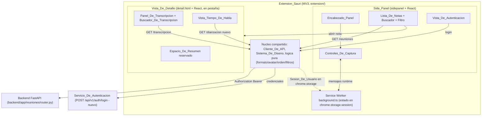
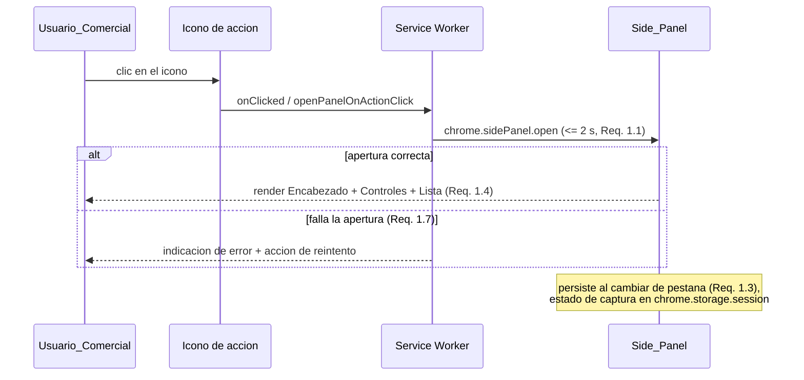
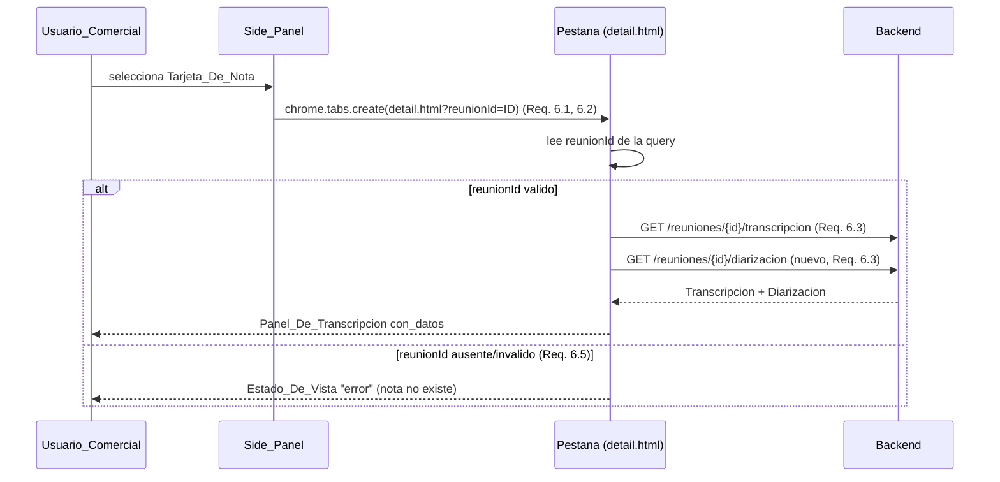
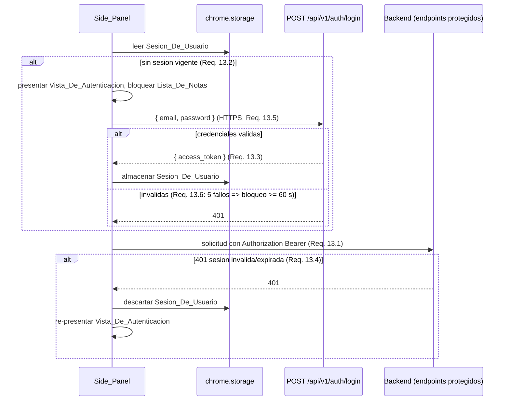

# Design Document

## Overview

Este documento describe el diseño del módulo **Side Panel de Chrome y Vista de Detalle de Transcripción** de sauri. El módulo aporta la capa de experiencia de usuario sobre las capacidades ya construidas por los Milestones 1 (captura), 2 (transcripción/ASR) y 3 (diarización). **No** genera transcripción ni diarización: las **consume** desde la API del backend (`backend/app/reuniones/router.py`) y las presenta.

El módulo se materializa en tres frentes:

1. **Side_Panel de la Extension_Sauri**: migrar el `extension/` actual de `action.default_popup` (ver `extension/manifest.json`) a la API `chrome.sidePanel` con el permiso `"sidePanel"`. El panel aloja el `Encabezado_Panel`, los `Controles_De_Captura` (reutilizando la lógica de captura ya presente en `extension/src/panel/App.tsx` y `extension/src/background.ts`) y la `Lista_De_Notas` con búsqueda y filtro.
2. **Vista_De_Detalle web**: una página React empaquetada en la propia extensión (`detail.html`), abierta en una pestaña del navegador, que presenta el `Espacio_De_Resumen` reservado, el `Panel_De_Transcripcion` con identificación de hablantes, el `Buscador_De_Transcripcion` y la `Vista_Tiempo_De_Habla`.
3. **Consumo y autenticación de la API**: un `Cliente_De_API` compartido que adjunta la `Sesion_De_Usuario` (JWT Bearer, ya soportado por `backend/app/auth/dependencies.py`) y un flujo de autenticación real que permite retirar el bypass `AUTH_DISABLED`.

### Decisiones de diseño clave

- **Reutilización de la base de captura existente.** `extension/src/background.ts` ya mantiene el estado efímero en `chrome.storage.session` (`sauriState`), ya define `BACKEND_URL = "http://localhost:8000"` y ya adjunta `Authorization: Bearer {authToken}` leyendo `chrome.storage.sync`. El módulo reutiliza estos patrones; **no** introduce un mecanismo nuevo de estado ni de token.
- **El Side_Panel y la Vista_De_Detalle son dos superficies de la misma build.** El proyecto ya usa Vite + `@crxjs/vite-plugin` + React + TypeScript (`extension/vite.config.ts`, `extension/package.json`). La Vista_De_Detalle se añade como una nueva entrada HTML/React en la misma build, no como un proyecto web separado (no existe una app web independiente en el repo). Esto mantiene un único `Sistema_De_Diseno` y un único `Cliente_De_API`.
- **Lógica determinista pura y aislada.** El formato de marcas de tiempo, las iniciales y el color de avatar, el cálculo de `Tiempo_De_Habla`, los ordenamientos y los filtros de búsqueda se implementan como **funciones puras** en TypeScript, sin dependencias de DOM ni de red. Esto las hace directamente verificables con pruebas basadas en propiedades (`fast-check`, ya presente en `devDependencies`).
- **La Nota es una proyección de la Reunion.** No existe una entidad "Nota" en el backend; una `Nota` es la representación en UI de una `Reunion` (`backend/app/infra/models.py`, clase `Reunion`) y de sus datos derivados. El historial se obtiene del endpoint ya existente `GET /api/v1/reuniones/`.
- **Brechas de backend identificadas y propuestas explícitamente** (ver Data Models → Contratos de API): falta un endpoint de diarización, falta exponer el identificador de cada `Turno_De_Habla` en el endpoint de transcripción, falta un campo de título de Nota, y falta un endpoint de login para retirar `AUTH_DISABLED`.

### Alcance

Queda **fuera de alcance**: la generación del resumen con IA (solo se reserva el `Espacio_De_Resumen` estructural, Req. 7.2/7.3), la generación de transcripción y diarización (Milestones 2 y 3), la identificación nominal de hablantes (la diarización entrega "Hablante N"), CRM, analítica y administración. La estética de alta gama se traduce a requisitos verificables sobre el `Sistema_De_Diseno` y los `Estados_De_Vista`, no a juicios subjetivos.

## Architecture

### Vista de componentes



### Apertura del Side_Panel (Req. 1)

El `manifest.json` migra de `action.default_popup` a la configuración de `chrome.sidePanel`:

- Se añade `"sidePanel"` a `permissions` (Req. 1.2).
- Se elimina `action.default_popup`; el `action` se conserva sólo como icono de barra (Req. 1.1).
- En `background.ts` se registra, al instalar/iniciar, `chrome.sidePanel.setPanelBehavior({ openPanelOnActionClick: true })` y se declara `side_panel.default_path` en el manifiesto.



La persistencia del `Estado_De_Captura` al cambiar de pestaña (Req. 1.3) es gratuita por construcción: el estado vive en `chrome.storage.session` gestionado por el service worker (`background.ts`), no en el ciclo de vida del documento del panel; el panel sólo refleja ese estado y reacciona a `chrome.storage.onChanged` (patrón ya usado en `App.tsx`).

### Adaptabilidad de ancho (Req. 1.5, 1.6)

El layout del Side_Panel usa contenedores fluidos: entre 320 y 600 px el contenido se ajusta sin recorte horizontal (Req. 1.5); por debajo de 320 px se habilita `overflow-x` para evitar pérdida de contenido (Req. 1.6).

### Flujo de navegación a la Vista_De_Detalle (Req. 6)



El identificador transmitido (Req. 6.2) es el `reunion_id` de la `Reunion` asociada a la Nota, pasado como parámetro de consulta de la URL de `detail.html` (canal interno de la extensión, no expuesto a terceros).

## Components and Interfaces

### Núcleo compartido (`extension/src/core/`)

Módulos puros y reutilizables por el Side_Panel y la Vista_De_Detalle:

- **`api/client.ts` (Cliente_De_API)** — Req. 13.1, 14.1, 14.2. Envuelve `fetch` contra `BACKEND_URL`. Inyecta `Authorization: Bearer {sesion}` leyendo la `Sesion_De_Usuario` de `chrome.storage` (misma convención que `background.ts`). Expone:
  - `listarReuniones(): Promise<NotaDTO[]>` → `GET /api/v1/reuniones/`.
  - `obtenerTranscripcion(reunionId): Promise<TranscripcionDTO>` → `GET /api/v1/reuniones/{id}/transcripcion`.
  - `obtenerDiarizacion(reunionId): Promise<DiarizacionDTO>` → `GET /api/v1/reuniones/{id}/diarizacion` (endpoint nuevo, ver Data Models).
  - Cada solicitud aplica un `timeout` (10 s para datos, Req. 4.9/6.6/14.4) vía `AbortController`. Una respuesta `401` dispara el descarte de la sesión y la re-autenticación (Req. 13.4).
- **`tiempo.ts`** — función pura `formatearMarcaDeTiempo(ms): string` (Req. 11). Detalle en "Lógica determinista".
- **`hablantes.ts`** — funciones puras `inicialesDeEtiqueta(etiqueta): string` y `colorDeAvatar(orden): string` (Req. 8.4). Detalle en "Lógica determinista".
- **`speakerTime.ts`** — función pura `calcularTiempoDeHabla(turnos, asignaciones, hablantes): EntradaTiempoDeHabla[]` (Req. 10.2, 10.4).
- **`orden.ts`** — funciones puras de ordenamiento de Notas (Req. 4.6) e Intervenciones (Req. 8.2).
- **`busqueda.ts`** — funciones puras `filtrarNotas(notas, texto, filtro)` (Req. 5) y `coincidenciasDeTranscripcion(intervenciones, texto)` (Req. 9).
- **`vista.ts`** — derivación pura del `Estado_De_Vista` a partir del estado de una solicitud remota (Req. 12.3, 12.6).
- **`design/tokens.ts`** + **`design/tokens.css`** — el `Sistema_De_Diseno` (Req. 12.1, 12.2).

### Side_Panel (`extension/src/panel/`)

- **`Encabezado_Panel`** (Req. 2): título "REC Notas" y `Boton_Nueva_Nota` ("+ Nueva nota REC") con estilo de acción primaria del `Sistema_De_Diseno`. Deshabilitado mientras `Estado_De_Captura ∈ {grabando, deteniendo}` (Req. 2.5).
- **`Controles_De_Captura`** (Req. 3): `Selector_De_Fuente_De_Audio` (≥ "Pantalla + audio", ya presente como `CAPTURE_MODES` en `App.tsx`), `Toggle_De_Captura`, `Selector_De_Microfono` (enumeración ya implementada en `App.tsx` vía `navigator.mediaDevices.enumerateDevices`), `Boton_De_Ajustes`. El indicador de grabación activa con cronómetro "MM:SS" (Req. 3.9) reutiliza `formatearMarcaDeTiempo` acotado a minutos.
- **`Lista_De_Notas`** (Req. 4, 5): obtiene el historial vía `Cliente_De_API.listarReuniones`, mapea cada Nota a una `Tarjeta_De_Nota`, aplica orden (Req. 4.6), búsqueda y filtro (Req. 5), y gestiona los `Estados_De_Vista` (Req. 4.7–4.9).
- **`Tarjeta_De_Nota`** (Req. 4.3–4.5): muestra título (o placeholder, Req. 4.4) y fecha "D/M, HH:MM" (Req. 4.5). Al activarse abre la Vista_De_Detalle (Req. 6.1).
- **`Vista_De_Autenticacion`** (Req. 13.2): se presenta cuando no hay `Sesion_De_Usuario` vigente y bloquea la `Lista_De_Notas` hasta autenticarse.

El `Side_Panel` se comunica con `background.ts` por `chrome.runtime.sendMessage` para iniciar/detener captura (mensajes `start-capture`/`stop-capture` ya existentes) y refleja `Estado_De_Captura` desde `chrome.storage.session`.

### Vista_De_Detalle (`extension/src/detail/`)

- **`Vista_De_Detalle`** (Req. 6, 7): lee `reunionId` de la query; orquesta las dos solicitudes (transcripción y diarización) con `Estados_De_Vista` independientes por región (Req. 14.3). Presenta simultáneamente título de Nota, `Espacio_De_Resumen` y `Panel_De_Transcripcion` (Req. 7.1).
- **`Espacio_De_Resumen`** (Req. 7.2, 7.3): región estructural con indicador estático "resumen disponible próximamente", sin lógica ni interacción.
- **`Panel_De_Transcripcion`** (Req. 8): renderiza una `Intervencion` por `Turno_De_Habla`, ordenadas por `(inicio_ms, orden)` (Req. 8.2), uniendo cada turno con su `Hablante` vía las `Asignaciones_De_Hablante`. Texto preservado sin modificar (Req. 8.5). Scroll vertical (Req. 8.6). Maneja los casos sin diarización (Req. 8.7) y sin transcripción (Req. 8.8).
- **`Intervencion`** (Req. 8.3): `Etiqueta_De_Hablante`, `Avatar_De_Hablante` (iniciales + color determinista), `Marca_De_Tiempo_Formateada` de `inicio_ms` y texto.
- **`Buscador_De_Transcripcion`** (Req. 9): resalta coincidencias (≤ 500 ms, sin distinción de mayúsculas), desplaza a la primera coincidencia por `inicio_ms` y limita a 200 caracteres.
- **`Vista_Tiempo_De_Habla`** (Req. 10): una entrada por `Hablante` (incluidos los de tiempo 0), tiempo como `Marca_De_Tiempo_Formateada`, ordenada por tiempo desc. y desempate por `orden` asc.

### Servicio_De_Autenticacion (backend, nuevo) — Req. 13

Componente nuevo en `backend/app/auth/` que valida credenciales y emite la `Sesion_De_Usuario` (JWT) usando la utilidad ya existente `crear_token` (`backend/app/auth/token.py`). Se expone como `POST /api/v1/auth/login` y se registra en `backend/app/main.py` (hoy sólo registra `ingesta_router` y `reuniones_router`). Su incorporación permite retirar el bypass `AUTH_DISABLED` de `backend/app/auth/dependencies.py`.

## Data Models

### Entidades consumidas (del backend, sin recalcular — Req. 14.1, 14.2)

El módulo consume las entidades ya definidas en `backend/app/infra/models.py`:

- **Reunion** (`reuniones`): `id`, `enlace_meet`, `origen`, `estado_proceso`, `causa_fallo`, `creada_por`, `creada_en`. Proyectada como **Nota** en la UI.
- **Transcripcion** (`transcripciones`): `id`, `reunion_id`, `idioma`, `proveedor`, `soporta_turnos`, `creada_en`.
- **TurnoDeHabla** (`turnos_de_habla`): `id`, `transcripcion_id`, `texto`, `inicio_ms`, `fin_ms`, `orden`.
- **Diarizacion** (`diarizaciones`): `id`, `reunion_id`, `transcripcion_id`, `proveedor`, `num_hablantes`, `estado_diarizacion`, `causa_fallo`.
- **Hablante** (`hablantes`): `id`, `diarizacion_id`, `etiqueta_cruda`, `etiqueta` ("Hablante N"), `orden`.
- **AsignacionDeHablante** (`asignaciones_de_hablante`): `id`, `diarizacion_id`, `turno_id`, `hablante_id` (exactamente una por `Turno_De_Habla`).

### Contratos de API

#### Existente — `GET /api/v1/reuniones/` (historial de Notas) — Req. 4.1

Ya implementado en `backend/app/reuniones/router.py` y **ya filtra por el usuario autenticado** (`where(Reunion.creada_por == usuario.id)`), satisfaciendo Req. 4.1 sin cambios de lógica de autorización. Respuesta actual por elemento:

```json
{ "reunion_id": "str", "enlace_meet": "str", "origen": "str",
  "estado_proceso": "str", "causa_fallo": "str|null", "creada_en": "ISO-8601|null" }
```

**Brecha propuesta (aditiva): campo `titulo`.** `Reunion` no tiene columna de título y este módulo **no** genera títulos (fuera de alcance). Se propone que el endpoint incluya `"titulo": str | null` (por ahora `null` hasta que un módulo futuro lo asigne). El `Cliente_De_API` mapea cada elemento a:

```ts
interface NotaDTO {
  reunionId: string;
  titulo: string | null;        // null => la UI muestra placeholder (Req. 4.4)
  estadoProceso: string;        // para Filtro_De_Notas (Req. 5.2)
  creadaEn: string | null;      // ISO-8601 => fecha "D/M, HH:MM" (Req. 4.5)
}
```

Mientras el backend no añada `titulo`, el cliente lo trata como `null` (degradación elegante: siempre muestra placeholder).

#### Existente — `GET /api/v1/reuniones/{id}/transcripcion` — Req. 6.3, 8, 14

Ya implementado. Respuesta actual:

```json
{ "transcripcion_id": "str", "reunion_id": "str", "idioma": "str",
  "proveedor": "str", "soporta_turnos": true, "creada_en": "ISO-8601|null",
  "segmentos": [ { "texto": "str", "inicio_ms": 0, "fin_ms": 0, "orden": 0 } ] }
```

**Brecha propuesta (aditiva): exponer `id` del Turno por segmento.** Las `Asignaciones_De_Hablante` vinculan `turno_id → hablante_id`, pero el endpoint actual **no** expone el `id` de cada `TurnoDeHabla`, por lo que el frontend no puede unir cada segmento con su hablante. Se propone añadir `"id": str` a cada elemento de `segmentos`. Es un cambio aditivo y compatible:

```json
{ "id": "str", "texto": "str", "inicio_ms": 0, "fin_ms": 0, "orden": 0 }
```

Si la Reunion no tiene Transcripcion, el endpoint ya responde `404` (Req. 7.6/8.8 → `Estado_De_Vista` "vacio").

#### Nuevo — `GET /api/v1/reuniones/{id}/diarizacion` — Req. 6.3, 8, 10, 14 (BRECHA CRÍTICA)

**No existe** un endpoint de diarización en `backend/app/reuniones/router.py`. Sin él, el `Panel_De_Transcripcion` no puede atribuir hablantes ni la `Vista_Tiempo_De_Habla` puede calcular tiempos. Se propone, siguiendo el patrón del endpoint de transcripción (verificar Reunion → `404`; recuperar entidad → `404` si ausente; serializar):

```
GET /api/v1/reuniones/{reunion_id}/diarizacion
200 OK:
{
  "diarizacion_id": "str",
  "reunion_id": "str",
  "estado_diarizacion": "completada",
  "num_hablantes": 0,
  "hablantes": [ { "id": "str", "etiqueta": "Hablante N", "orden": 0 } ],
  "asignaciones": [ { "turno_id": "str", "hablante_id": "str" } ]
}
404: la Reunion no existe, o no tiene Diarizacion disponible (=> Estado_De_Vista "vacio", Req. 10.5)
```

El endpoint requiere autenticación (misma `Depends(obtener_usuario_actual)`) y recupera `Hablantes` + `Asignaciones_De_Hablante` con `selectinload` (relaciones ya declaradas en el modelo `Diarizacion`).

DTOs consumidos por el frontend:

```ts
interface IntervencionDTO {        // union de TurnoDeHabla + Asignacion + Hablante (en cliente)
  turnoId: string;
  texto: string;
  inicioMs: number;
  finMs: number;
  orden: number;
  hablante: HablanteDTO | null;    // null => "hablante no identificado" (Req. 8.7)
}
interface HablanteDTO { id: string; etiqueta: string; orden: number; }
```

> La unión `Turno → Asignacion → Hablante` se realiza en el cliente sin modificar los datos (Req. 14.2): es una proyección de lectura, no un recálculo de diarización.

#### Nuevo — `POST /api/v1/auth/login` (Servicio_De_Autenticacion) — Req. 13 (BRECHA)

Hoy `backend/app/main.py` no registra ningún router de auth y `dependencies.py` depende del bypass `AUTH_DISABLED`. Se propone:

```
POST /api/v1/auth/login
Request:  { "email": "str", "password": "str" }
200 OK:   { "access_token": "str (JWT)", "token_type": "bearer", "expires_in": 3600 }
401:      credenciales invalidas
```

El token se emite con `crear_token` (`token.py`, claims `sub/email/nombre/es_comercial/exp/iat`). La validación de credenciales requiere una **fuente de identidad** que hoy no existe en `models.py` (no hay tabla `usuarios`). El diseño propone introducir un almacén mínimo de usuarios comerciales autorizados (entidad nueva `Usuario` o integración con el IdP de Summan); su detalle pertenece a una iteración de backend, pero el **contrato** y la **retirada de `AUTH_DISABLED`** se definen aquí (ver "Autenticación").

### Modelo de estado del cliente

```ts
type EstadoDeCaptura = "inactiva" | "grabando" | "deteniendo";       // Req. 1.3, 2, 3
type EstadoDeVista = "cargando" | "con_datos" | "vacio" | "error";   // Req. 12.3

interface SolicitudRemota<T> {       // base de la derivacion de Estado_De_Vista
  fase: "inicial" | "en_curso" | "exito" | "fallo";
  datos: T | null;
  previos: T | null;                 // conserva datos previos en error (Req. 4.9)
}
```

### Sistema_De_Diseno (tokens) — Req. 12.1, 12.2

Conjunto único de tokens aplicado a ambas superficies, expuesto como variables CSS y como objeto TS:

| Categoría | Tokens (ejemplos) |
| --- | --- |
| Color | `--color-fondo`, `--color-superficie`, `--color-primario` (acción primaria), `--color-texto`, `--color-texto-tenue`, `--color-error`, `--color-grabando`, `--color-foco` |
| Tipografía | `--fuente-base`, escala `--texto-sm/base/lg/xl`, pesos |
| Espaciado | escala `--esp-1..--esp-6` |
| Radios | `--radio-sm/md/lg` |
| Elevaciones | `--sombra-sm/md` |
| Avatares | paleta ordenada `PALETA_AVATAR: string[]` (entrada para `colorDeAvatar`) |
| Foco | `--anillo-foco` con contraste >= 3:1 respecto a colores adyacentes (Req. 12.4) |

Los componentes compartidos (botón, tarjeta, campo de búsqueda, avatar, contenedor de `Estado_De_Vista`) se construyen exclusivamente a partir de estos tokens (Req. 12.2) y exponen un indicador de foco visible derivado de `--anillo-foco` (Req. 12.4).

### Estados_De_Vista — Req. 12.3, 12.5–12.7

La derivación es una función pura `derivarEstadoDeVista(solicitud)`:

| Fase de la solicitud | Resultado |
| --- | --- |
| `en_curso` (sin respuesta) | `"cargando"` (Req. 12.5) |
| `exito` con >= 1 elemento | `"con_datos"` (Req. 12.6) |
| `exito` con 0 elementos | `"vacio"` (Req. 12.6) |
| `fallo` | `"error"` + acción de reintento, conservando `previos` (Req. 12.7, 4.9) |

Cada región de datos remotos (Lista_De_Notas, Panel_De_Transcripcion, Vista_Tiempo_De_Habla) presenta en todo momento **exactamente uno** de los cuatro estados (Req. 12.3), visualmente distinguibles.

## Autenticación (retirada de AUTH_DISABLED) — Req. 13

### Estado actual

`backend/app/auth/dependencies.py` acepta `AUTH_DISABLED=1`, devolviendo un `_DEV_USER` fijo y omitiendo la verificación del JWT. `extension/src/background.ts` ya adjunta `Authorization: Bearer {authToken}` cuando hay token en `chrome.storage.sync`, pero no hay flujo de login y opera "sin auth (dev mode)" si falta.

### Diseño objetivo



- **Almacenamiento de la Sesion_De_Usuario** (Req. 13.3): `chrome.storage` de la extensión (reutiliza la clave/convención existente de `background.ts`).
- **Transporte cifrado** (Req. 13.5): el `Cliente_De_API` exige `https://` para el backend en producción; `http://localhost` se admite sólo en desarrollo. La transmisión del token ocurre únicamente por el canal de la solicitud autenticada.
- **Expiración/invalidez** (Req. 13.4): una respuesta `401` descarta la sesión almacenada y re-presenta el flujo.
- **Bloqueo por intentos** (Req. 13.6): el Side_Panel cuenta fallos consecutivos; tras 5, bloquea nuevos intentos >= 60 s (lógica determinista pura testeable).
- **Indisponibilidad** (Req. 13.7): si el `Servicio_De_Autenticacion` no responde en 30 s, se indica indisponibilidad y no se almacena sesión.
- **Retirada de `AUTH_DISABLED`**: una vez disponible `POST /api/v1/auth/login`, se elimina la rama de bypass de `dependencies.py` (o se restringe a entornos de test). Los endpoints siguen protegidos por `Depends(obtener_usuario_actual)`, sin cambios en su firma.

## Lógica determinista clave

Estas funciones puras concentran la corrección verificable del módulo. Viven en `extension/src/core/`.

### Marca_De_Tiempo_Formateada — `formatearMarcaDeTiempo(ms)` — Req. 11

1. Si `ms` es negativa, `NaN` o no disponible → devolver el placeholder "--:--" (sin valor numérico, Req. 11.5).
2. Truncar a segundos completos: `totalSeg = floor(ms / 1000)` (Req. 11.3).
3. `seg = totalSeg % 60`, `min = floor(totalSeg / 60) % 60`, `horas = floor(totalSeg / 3600)`.
4. Si `ms < 3_600_000` → `"MM:SS"` con dos dígitos cada campo (Req. 11.1); `0 → "00:00"` (Req. 11.4).
5. Si `ms >= 3_600_000` → `"HH:MM:SS"`, horas con relleno a >= 2 dígitos, minutos y segundos con dos dígitos (Req. 11.2).

### Avatar_De_Hablante — Req. 8.4

- **`inicialesDeEtiqueta(etiqueta)`**: toma hasta dos caracteres de iniciales derivados de la `Etiqueta_De_Hablante`; nunca más de dos caracteres.
- **`colorDeAvatar(orden)`**: indexa `PALETA_AVATAR` de forma determinista y cíclica: `PALETA_AVATAR[(orden - 1) % PALETA_AVATAR.length]`. Garantiza color estable por `Hablante` dentro de la misma Vista_De_Detalle y reutilización cíclica cuando hay más hablantes que colores.

### Tiempo_De_Habla — `calcularTiempoDeHabla(turnos, asignaciones, hablantes)` — Req. 10.2, 10.4

1. Para cada `Hablante`, sumar `(fin_ms - inicio_ms)` de los `Turnos_De_Habla` cuyo `turno_id` esté asignado a ese hablante por una `Asignacion_De_Hablante` (Req. 10.2).
2. Incluir **todos** los hablantes, también los de tiempo total 0 (Req. 10.1).
3. Ordenar por `Tiempo_De_Habla` descendente; ante empate, por `orden` del hablante ascendente (Req. 10.4).

### Ordenamientos — Req. 4.6, 8.2

- **Notas** (Req. 4.6): por `creadaEn` descendente (más reciente primero); ante fechas idénticas, desempate determinista y repetible por `reunionId` ascendente.
- **Intervenciones** (Req. 8.2): por `inicio_ms` ascendente; ante `inicio_ms` idénticos, por `orden` del turno ascendente.

Ambos comparadores son **totales** (sin empates no resueltos), garantizando orden estable y repetible.

### Filtros de búsqueda — Req. 5, 9

- **`filtrarNotas(notas, texto, filtro)`** (Req. 5): normaliza el texto (trim + minúsculas); si queda vacío, la búsqueda por título está inactiva (Req. 5.6). Una Nota pasa si su título (en minúsculas) contiene el texto **y** satisface el `Filtro_De_Notas` activo (rango de fecha o `Estado_De_Proceso`) (Req. 5.3). El texto se limita a 100 caracteres (Req. 5.7).
- **`coincidenciasDeTranscripcion(intervenciones, texto)`** (Req. 9): con texto no vacío (>= 1 carácter distinto de espacio), devuelve las coincidencias sin distinción de mayúsculas, conservando el orden original; con texto vacío/espacios, no hay coincidencias y se conserva el orden (Req. 9.3). El texto se limita a 200 caracteres (Req. 9.5).

## Correctness Properties

*Una propiedad es una característica o comportamiento que debe ser verdadero en todas las ejecuciones válidas del sistema — esencialmente, una afirmación formal sobre lo que el sistema debe hacer. Las propiedades sirven de puente entre las especificaciones legibles por humanos y las garantías de corrección verificables por máquina.*

Las propiedades se derivan del prework de criterios de aceptación, consolidando criterios lógicamente redundantes. Los criterios clasificados como EXAMPLE/SMOKE/INTEGRATION (apertura de `chrome.sidePanel`, permisos del manifiesto, layout responsivo, navegación por pestañas, enumeración de micrófonos, efectos de `chrome.storage`, contenido estático y consistencia visual) se cubren con pruebas por ejemplo, de integración o de humo (ver Testing Strategy), no como propiedades. Todas las propiedades ejercitan **funciones puras** del núcleo compartido (`extension/src/core/`).

### Property 1: Formato de Marca_De_Tiempo_Formateada

*Para cualquier* valor de milisegundos `ms`: si `ms` es un entero en `[0, 3_600_000)`, `formatearMarcaDeTiempo(ms)` produce `"MM:SS"` con minutos y segundos de dos dígitos en rango 00–59 y segundos truncados (parte fraccionaria de segundo descartada); si `ms >= 3_600_000`, produce `"HH:MM:SS"` con horas rellenadas a al menos dos dígitos y minutos/segundos de dos dígitos; si `ms == 0` produce `"00:00"`; y si `ms` es negativo o no disponible produce un placeholder sin valor numérico de tiempo.

**Validates: Requirements 11.1, 11.2, 11.3, 11.4, 11.5, 3.9, 8.3, 10.3**

### Property 2: Avatar determinista (iniciales y color cíclico)

*Para cualquier* `Etiqueta_De_Hablante`, `inicialesDeEtiqueta` devuelve a lo sumo dos caracteres; y *para cualquier* `orden` entero positivo, `colorDeAvatar(orden)` es determinista, pertenece a `PALETA_AVATAR`, y es cíclico: `colorDeAvatar(orden) == colorDeAvatar(orden + PALETA_AVATAR.length)`, de modo que un mismo `Hablante` (mismo `orden`) presenta siempre el mismo color.

**Validates: Requirements 8.4**

### Property 3: Placeholder de título de Nota

*Para cualquier* título de Nota, `tituloParaMostrar` devuelve el placeholder definido si y sólo si el título es nulo, vacío o compuesto únicamente de espacios; en cualquier otro caso devuelve el título original sin modificar.

**Validates: Requirements 4.4, 7.5**

### Property 4: Formato de fecha de la Tarjeta_De_Nota

*Para cualquier* instante de creación válido, `formatearFechaNota` produce el patrón `"D/M, HH:MM"` donde D es el día (1–31) sin relleno forzado, M es el mes (1–12) sin relleno forzado, HH son horas de 24 h con dos dígitos (00–23) y MM minutos con dos dígitos (00–59).

**Validates: Requirements 4.5**

### Property 5: Proyección de Notas a Tarjetas (biyección con campos requeridos)

*Para cualquier* historial recuperado de Notas, la proyección a `Tarjetas_De_Nota` produce exactamente una tarjeta por Nota (igual cardinalidad y correspondencia 1:1 por `reunionId`), y cada tarjeta incluye un título mostrable (título o placeholder) y la fecha formateada de creación.

**Validates: Requirements 4.2, 4.3**

### Property 6: Orden de Notas (no creciente por fecha, total y repetible)

*Para cualquier* lista de Notas, `ordenarNotas` las ordena de la más reciente a la más antigua por fecha de creación, desempatando de forma determinista por `reunionId` ascendente; el orden resultante es total (sin empates no resueltos) e idempotente (reordenar el resultado no lo cambia).

**Validates: Requirements 4.6**

### Property 7: Filtro de Notas como conjunción de búsqueda y criterio

*Para cualquier* historial, texto de búsqueda y criterio de `Filtro_De_Notas`, `filtrarNotas` devuelve exactamente las Notas cuyo título normalizado (trim + minúsculas) contiene el texto normalizado **y** que satisfacen el criterio (rango de fecha o `Estado_De_Proceso`); ninguna Nota excluida satisface ambos predicados a la vez.

**Validates: Requirements 5.1, 5.2, 5.3**

### Property 8: Búsqueda de Notas inactiva con texto en blanco

*Para cualquier* historial y *para cualquier* texto vacío o compuesto únicamente de espacios, `filtrarNotas` no excluye ninguna Nota por coincidencia de título; en consecuencia, con texto en blanco y filtro inactivo el resultado es el conjunto completo del historial.

**Validates: Requirements 5.4, 5.6**

### Property 9: Mapeo de Turnos a Intervenciones (biyección y preservación)

*Para cualquier* `Transcripcion`, el mapeo a `Intervenciones` produce exactamente una `Intervencion` por `Turno_De_Habla` (igual cardinalidad y correspondencia 1:1 por `turnoId`), y cada `Intervencion` conserva sin modificar el `texto`, `inicio_ms`, `fin_ms` y `orden` del `Turno_De_Habla` de origen.

**Validates: Requirements 8.1, 8.5, 14.2**

### Property 10: Orden de Intervenciones por (inicio_ms, orden)

*Para cualquier* conjunto de `Turnos_De_Habla`, `ordenarIntervenciones` ordena las `Intervenciones` de forma ascendente por `inicio_ms` y, ante `inicio_ms` idénticos, de forma ascendente por `orden`; el orden resultante es total e idempotente.

**Validates: Requirements 8.2**

### Property 11: Atribución de Hablante a la Intervencion

*Para cualquier* `Turno_De_Habla` y conjunto de `Asignaciones_De_Hablante` y `Hablantes`: si existe una `Asignacion_De_Hablante` para el `turno_id`, la `Intervencion` presenta la `Etiqueta_De_Hablante` y el `Avatar_De_Hablante` del `Hablante` asignado; si no existe asignación (Transcripcion sin Diarizacion), presenta una `Etiqueta_De_Hablante` de marcador "hablante no identificado", conservando en ambos casos el texto y la `Marca_De_Tiempo_Formateada`.

**Validates: Requirements 8.3, 8.7**

### Property 12: Coincidencias del Buscador_De_Transcripcion

*Para cualquier* conjunto de `Intervenciones` y texto de búsqueda con al menos un carácter distinto de espacio, `coincidenciasDeTranscripcion` marca como coincidentes exactamente las `Intervenciones` cuyo texto contiene el texto buscado sin distinción de mayúsculas; la primera coincidencia seleccionada es la de menor `inicio_ms`; y el conjunto y orden de `Intervenciones` mostradas no se altera por la búsqueda.

**Validates: Requirements 9.1, 9.2, 9.4**

### Property 13: Búsqueda de transcripción inactiva con texto en blanco

*Para cualquier* conjunto de `Intervenciones` y *para cualquier* texto vacío o compuesto únicamente de espacios, `coincidenciasDeTranscripcion` no produce ninguna coincidencia y conserva el orden original de las `Intervenciones`.

**Validates: Requirements 9.3**

### Property 14: Cálculo y cobertura del Tiempo_De_Habla

*Para cualquier* conjunto de `Turnos_De_Habla`, `Asignaciones_De_Hablante` y `Hablantes`, `calcularTiempoDeHabla` produce exactamente una entrada por `Hablante` (incluidos los `Hablantes` con tiempo 0), y el `Tiempo_De_Habla` de cada `Hablante` es la suma de `(fin_ms - inicio_ms)` de los `Turnos_De_Habla` atribuidos a ese `Hablante` por sus `Asignaciones_De_Hablante`.

**Validates: Requirements 10.1, 10.2**

### Property 15: Orden de la Vista_Tiempo_De_Habla

*Para cualquier* conjunto de entradas de `Tiempo_De_Habla`, el orden es no creciente por `Tiempo_De_Habla` y, ante valores idénticos, ascendente por `orden` del `Hablante`; el orden resultante es total e idempotente.

**Validates: Requirements 10.4**

### Property 16: Derivación total y exclusiva del Estado_De_Vista

*Para cualquier* `SolicitudRemota`, `derivarEstadoDeVista` retorna **exactamente uno** de los cuatro `Estados_De_Vista`: `"cargando"` cuando la solicitud está en curso sin respuesta; `"con_datos"` cuando finaliza con éxito y hay al menos un elemento; `"vacio"` cuando finaliza con éxito y no hay elementos; y `"error"` cuando falla, conservando en este caso los datos previos disponibles para reintento.

**Validates: Requirements 4.7, 4.8, 4.9, 6.4, 6.6, 7.6, 8.8, 8.9, 8.10, 10.5, 10.6, 10.7, 12.3, 12.5, 12.6, 12.7, 14.3, 14.4, 14.5**

### Property 17: Máquina de Estado_De_Captura

*Para cualquier* par (`Estado_De_Captura`, evento), `aplicarEventoCaptura` retorna el nuevo estado únicamente para las transiciones válidas y conserva el estado actual en cualquier otro caso. En particular: `inactiva` + `iniciar` → `grabando`; `grabando` + `detener` → `deteniendo`; `deteniendo` + `finalizada` → `inactiva`.

**Validates: Requirements 2.4, 3.3, 3.4, 3.5**

### Property 18: Habilitación del Boton_Nueva_Nota según el Estado_De_Captura

*Para cualquier* `Estado_De_Captura`, el `Boton_Nueva_Nota` está deshabilitado si y sólo si el estado es `"grabando"` o `"deteniendo"`, y habilitado cuando es `"inactiva"`.

**Validates: Requirements 2.5**

### Property 19: Round-trip del reunion_id en la URL de la Vista_De_Detalle

*Para cualquier* `reunion_id`, construir la URL de `detail.html` con ese identificador y luego leer el parámetro de consulta recupera exactamente el mismo `reunion_id`.

**Validates: Requirements 6.2**

### Property 20: Bloqueo de autenticación por intentos fallidos

*Para cualquier* secuencia de intentos de autenticación con sus marcas de tiempo, el predicado `estaBloqueado` es verdadero si y sólo si se acumularon al menos 5 fallos consecutivos y han transcurrido menos de 60 segundos desde el quinto fallo; transcurridos 60 segundos o tras un éxito, el bloqueo se levanta.

**Validates: Requirements 13.6**

## Error Handling

El módulo distingue las siguientes categorías de error, todas mapeadas a un `Estado_De_Vista` o a una indicación de UI explícita, conservando siempre la posibilidad de reintento sin recargar la región completa (Req. 12.7).

1. **Fallo de apertura del Side_Panel (Req. 1.7):** si `chrome.sidePanel.open` rechaza, el `background.ts`/panel presenta una indicación de error con acción de reintento.
2. **Fallo al iniciar captura/nueva nota (Req. 2.6, 3.10):** el `Estado_De_Captura` permanece en `"inactiva"` y se muestra un mensaje de error; no se realiza la transición a `"grabando"`.
3. **Ausencia de micrófonos (Req. 3.7):** el `Selector_De_Microfono` presenta un estado vacío informativo sin bloquear el resto de los `Controles_De_Captura`.
4. **Datos remotos no disponibles (Req. 4.8, 7.6, 8.8, 10.5):** una respuesta exitosa sin elementos (p. ej. `404` de transcripción/diarización, o historial vacío) deriva en `Estado_De_Vista` `"vacio"` con el mensaje correspondiente.
5. **Fallo de red, error del backend o timeout de 10 s (Req. 4.9, 6.6, 8.10, 10.7, 14.4):** el `Cliente_De_API` aborta vía `AbortController` y la región pasa a `Estado_De_Vista` `"error"` con acción de reintento, conservando los datos previamente mostrados si existían. El reintento vuelve a fase `"cargando"` (Req. 14.5).
6. **Identificador de Reunion inválido en la Vista_De_Detalle (Req. 6.5):** si la query no contiene un `reunion_id` válido, la vista presenta `Estado_De_Vista` `"error"` indicando que la nota no existe, sin emitir solicitudes.
7. **Sesión inválida o expirada (Req. 13.4):** una respuesta `401` descarta la `Sesion_De_Usuario` almacenada, informa la expiración y re-presenta la `Vista_De_Autenticacion`.
8. **Credenciales rechazadas repetidamente (Req. 13.6):** tras 5 fallos consecutivos, el Side_Panel bloquea nuevos intentos ≥ 60 s e indica el bloqueo.
9. **Servicio de autenticación no disponible (Req. 13.7):** si el login no responde en 30 s, se indica indisponibilidad y no se almacena ninguna sesión.

Regiones independientes: el `Panel_De_Transcripcion` y la `Vista_Tiempo_De_Habla` manejan su `Estado_De_Vista` por separado (Req. 14.3); el fallo de la diarización no impide presentar la transcripción, y viceversa.

## Testing Strategy

Se emplea un enfoque dual conforme a AGENTS.md §3 (TDD: RED → GREEN → REFACTOR): **pruebas basadas en propiedades** (PBT) para la lógica determinista universal y **pruebas por ejemplo / integración** para render, cableado de APIs de Chrome, contratos HTTP y comportamiento de infraestructura.

### Aplicabilidad de PBT

PBT es apropiado para este módulo porque su núcleo de corrección está en **funciones puras** de TypeScript (`extension/src/core/`) con espacios de entrada amplios: formato de tiempos, iniciales y color de avatar, cálculo de `Tiempo_De_Habla`, ordenamientos con desempate, filtros de búsqueda, derivación de `Estado_De_Vista`, máquina de `Estado_De_Captura`, round-trip del identificador y predicado de bloqueo de autenticación. Estas funciones no dependen del DOM ni de la red, por lo que se prueban directamente y a bajo coste.

PBT **no** aplica a: la apertura de `chrome.sidePanel` y el permiso del manifiesto (Req. 1.1, 1.2), el layout responsivo y el scroll (Req. 1.5, 1.6, 8.6), el render concreto de regiones (Req. 1.4, 2.1–2.3, 3.1, 3.2, 7.1–7.4), la enumeración de micrófonos (Req. 3.6), la navegación por pestañas (Req. 6.1), los efectos sobre `chrome.storage` y el adjunto del header en I/O real (Req. 13.1, 13.3, 14.1), y la consistencia visual y el contraste de tokens (Req. 12.2, 12.4). Estos se cubren con pruebas por ejemplo, de integración o de humo.

### Biblioteca y configuración de PBT

- **Biblioteca:** `fast-check` (ya presente en `extension/package.json` → `devDependencies`), ejecutada con `vitest` (script `npm test` → `vitest run`). No se implementa PBT desde cero.
- **Iteraciones:** mínimo **100** por prueba de propiedad (`fc.assert(fc.property(...), { numRuns: 100 })`).
- **Etiqueta obligatoria** en cada prueba de propiedad, como comentario que referencia la propiedad del diseño:
  `// Feature: chrome-side-panel, Property {número}: {texto de la propiedad}`
- Cada propiedad de corrección (1–20) se implementa con **una sola** prueba de propiedad.

### Cobertura de pruebas

**Pruebas de propiedad (`fast-check` + `vitest`)** — una por cada propiedad 1–20. Generadores destacados:
- Property 1: enteros en `[0, 3.6e6)`, `[3.6e6, ...)`, `0`, negativos y valores no disponibles (`NaN`/`null`).
- Property 2: cadenas de etiqueta arbitrarias y `orden` positivos grandes (para verificar ciclicidad sobre `PALETA_AVATAR`).
- Properties 6, 10, 15: listas con fechas/`inicio_ms`/tiempos repetidos para ejercitar los desempates y la idempotencia del orden.
- Properties 7, 8, 12, 13: textos con mayúsculas/minúsculas, espacios iniciales/finales y cadenas en blanco.
- Properties 9, 11, 14: conjuntos de `Turnos_De_Habla`, `Asignaciones_De_Hablante` y `Hablantes` generados conjuntamente, incluyendo turnos sin asignación y hablantes sin turnos (tiempo 0).
- Property 16: `SolicitudRemota` en todas sus fases, con colecciones vacías y no vacías.
- Property 17: todos los pares (`Estado_De_Captura`, evento), incluidos pares inválidos.
- Property 20: secuencias de intentos (éxitos/fallos) con marcas de tiempo dentro y fuera de la ventana de 60 s.

**Pruebas por ejemplo y edge cases (`vitest`)**:
- Render de las tres regiones del Side_Panel (Req. 1.4) y de las regiones de la Vista_De_Detalle (Req. 7.1).
- Contenido estático: títulos, etiquetas de botones, indicador "próximamente" (Req. 2.1, 2.2, 7.3).
- Casos de error: fallo de apertura (Req. 1.7), fallo de inicio de captura (Req. 2.6, 3.10), sin micrófonos (Req. 3.7), id inválido (Req. 6.5).
- Límites de longitud de búsqueda: 100 caracteres en Notas (Req. 5.7) y 200 en transcripción (Req. 9.5).
- Política de transporte: rechazo de endpoint `http://` no-localhost (Req. 13.5).
- Contraste del anillo de foco ≥ 3:1 para los pares de tokens definidos (Req. 12.4).

**Pruebas de integración / humo**:
- Manifiesto: presencia del permiso `"sidePanel"` y `side_panel.default_path`, ausencia de `action.default_popup` (Req. 1.2) — aserción sobre `manifest.json`.
- Apertura del Side_Panel al clic y persistencia al cambiar de pestaña con `chrome.storage.session` simulado (Req. 1.1, 1.3).
- Transiciones de captura iniciadas por el `Toggle_De_Captura` contra el `background.ts` (Req. 3.3, 3.4).
- `Cliente_De_API`: adjunto del header `Authorization: Bearer` desde `chrome.storage`, manejo de `401`, timeout de 10 s y reintento (Req. 13.1, 13.3, 13.4, 14.1, 14.4, 14.5).
- Contrato de los endpoints nuevos (`GET /diarizacion`, `POST /auth/login`) y aditivos (`titulo`, `id` de turno) verificados en el backend con `pytest` siguiendo el patrón de `backend/tests/` (ver brechas en Data Models).

### Validación

- Frontend (extensión): `npm run typecheck` (`tsc --noEmit`) y `npm test` (`vitest run`) en `extension/`, conforme a los scripts ya definidos en `extension/package.json` y a la regla de TypeScript de AGENTS.md §1.
- Backend (endpoints nuevos/aditivos): `pytest` en `backend/` con Hypothesis donde aplique, reutilizando `backend/tests/conftest.py`.

### Disciplina TDD

Conforme a AGENTS.md §3, cada cambio de comportamiento sigue RED → GREEN → REFACTOR: la prueba (propiedad, ejemplo o integración) se escribe y ejecuta primero (debe fallar), luego se implementa el mínimo para que pase y finalmente se refactoriza manteniéndola verde. Las tareas de prueba no son opcionales y se secuencian antes de su tarea de implementación correspondiente.
