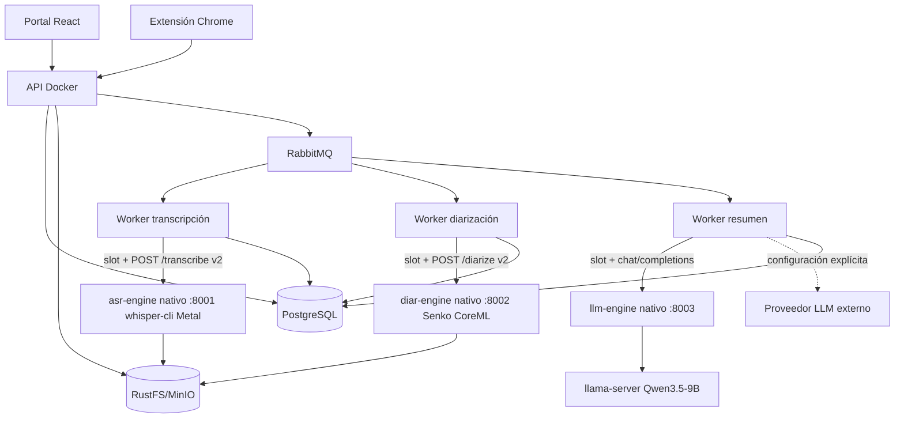
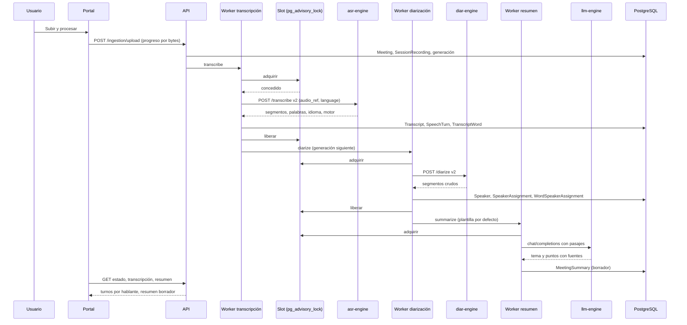

# Documento de Diseño — Core de voz

## Resumen

Sauri ya separa los motores detrás de servicios HTTP nativos en el host (`backend/asr-engine/native_main.py` en el puerto 8001, `backend/diar-engine/native_main.py` en el 8002, arrancados por `scripts/engines/native-engines.sh`) y los workers Docker los consumen mediante `LocalProvider`. Lo que hay detrás de esas costuras es lo que falla: MLX-Whisper y pyannote son lentos y consumen memoria, el contrato solo transporta segmentos (sin palabras), la atribución asigna cada segmento entero a un hablante, el idioma está fijo en `es-CO`, el resumen solo habla con Ollama y nada de esto se ha visto de punta a punta en el portal.

La solución sustituye las implementaciones detrás de las costuras existentes (strangler), sin tocar el modelo de reuniones, la cola ni el fencing de generaciones:
1. Contrato v2 de los motores: el ASR devuelve palabras con tiempos y el idioma usado; la diarización devuelve segmentos crudos; ambos declaran modelo y dispositivo.
2. `native_main.py` de ASR pasa a ejecutar `whisper-cli` (whisper.cpp, Metal) con `large-v3-turbo` Q5_0, y el de diarización a usar Senko (CoreML). Cada uno normaliza el audio con una función común, se protege de la suspensión y de la superposición de cargas.
3. Las palabras se guardan en tablas nuevas; la diarización produce una asignación de hablante por palabra y el API construye los turnos visibles agrupando palabras.
4. El idioma sale de configuración; el resumen se solicita solo al terminar la diarización, usa un cliente de chat compatible con OpenAI (por defecto un `llm-engine` local con Qwen3.5-9B) y devuelve puntos con citas validadas, marcado como borrador.
5. El portal gana las piezas mínimas para el recorrido: página de carga, estado real, pestaña de resumen y turnos por hablante.

## Decisiones de Diseño Clave

**Conservar los servicios de motor HTTP nativos y reemplazar solo su interior.** Los workers, la cola, el fencing y los contratos de persistencia no cambian de forma.
*Alternativas descartadas:* ejecutar los motores dentro de los contenedores Docker (en macOS Docker corre una VM Linux sin CoreML ni Metal: perdería la aceleración que da el 90 % de la ganancia); una app nativa Swift (reescritura sin evidencia de que el lenguaje sea el cuello de botella).

**whisper.cpp por subproceso `whisper-cli` por petición.** Cargar el modelo cuesta 168 ms (medido en `whisper_print_timings`); un servidor residente no ahorra nada y añade estado.
*Alternativas descartadas:* `whisper-server` (mismo motor, proceso residente de ~1,5 GiB sin beneficio medido); binding Python (compilación nativa adicional que fijar); MLX-Whisper (medido por Codex: 9,0 s frente a 6,0 s y más memoria en el mismo fragmento); Parakeet Ultra (3× más rápido pero con errores de nombres y mezcla de idiomas, sin referencia humana; queda como adaptador futuro).

**Senko en un venv propio con el commit fijado `1bcb09041bfa170b4a5a4b0af92f66eff76204d5`**, `device="coreml"`, `accurate=True`, VAD con duración mínima 0, y se usa la salida cruda (`raw_segments`).
*Alternativas descartadas:* FluidAudio (49,6 s frente a 11,1 s en 98 min y requiere compilar Swift); pyannote 3.1/community-1 (8–15 min por reunión); la salida suavizada de Senko porque descarta turnos ≤ 0,78 s, justo el hablante breve.

**Las palabras se guardan en tablas nuevas y `SpeechTurn` sigue siendo el segmento ASR original.** El turno que ve el usuario se construye al leer, agrupando palabras por hablante.
*Alternativas descartadas:* reemplazar `SpeechTurn` por turnos atribuidos (rompe las revisiones por generación de `recording-speaker-review` y la restricción de un transcript por reunión); guardar las palabras como JSON en `transcripts` (no consultable ni indexable y infla la fila).

**Atribución por palabra como función pura** `attribute_words` que reutiliza el índice de solapamiento ya validado (`_OverlapIndex` de `backend/app/diarization/assignment.py`), con las umbrales de Codex más un respaldo por vecindad.
*Alternativas descartadas:* punto medio de la palabra (cambia resultados y parte palabras largas); alineación forzada con wav2vec2 (añade minutos y un modelo por idioma); modificar `assign_turns` (los 400+ casos de equivalencia de #907 protegen su comportamiento por segmento y deben seguir iguales).

**Ejecución en serie y un único trabajo pesado a la vez mediante un `pg_advisory_lock` de sesión tomado por los workers** (ASR, diarización, resumen) antes de llamar al motor. Se libera solo si el proceso o la conexión mueren. Los motores nativos se protegen además de la suspensión con `caffeinate -i` durante cada petición.
*Alternativas descartadas:* paralelizar ASR y diarización ahora (la diarización dura ~30 s de ~6 min: <10 % de ganancia con un join concurrente complejo); reserva con lease y fencing distribuido de #907 T9 (válida para varios hosts, desproporcionada para uno); `flock` en archivo del host (los workers corren en Docker y no comparten el sistema de archivos de forma fiable en macOS); un semáforo por proceso (no coordina workers distintos, que fue la causa de las colisiones de GPU).

**Proveedor de resumen = cliente de chat compatible con OpenAI** (`POST {base_url}/chat/completions` con `response_format` JSON Schema). El valor por defecto apunta a un `llm-engine` nativo (servicio FastAPI en el puerto 8003) que arranca `llama-server` bajo demanda, lo detiene tras 120 s de inactividad y lo envuelve en `caffeinate`.
*Alternativas descartadas:* mantener solo Ollama (el dueño quiere conectar proveedores externos; Ollama, ChatGPT, Gemini y otros exponen la API compatible, así que un único adaptador los cubre); un SDK por proveedor (código duplicado y dependencias nuevas); dejar `llama-server` residente (≈5,5 GiB permanentes: la presión de memoria fue el problema original).

**Qwen3.5-9B Q4_K_M con `llama.cpp` en el commit `af76639f728c69c74c873cc45f038aaa17afd09e` compilado estático.** El `llama-completion` de Homebrew (b8670) aborta con `GGML_ASSERT(K >= 1)` por una incompatibilidad con GGML 0.22 (diagnóstico de Codex).
*Alternativas descartadas:* Qwen3-4B (sin memoria, pero inventó que no había metas y su autorrevisión no lo corrigió); Qwen2.5-14B (aborta por presión de memoria); resumen puramente extractivo (12–16 s pero omitió el bloque final y no entrega "puntos clave").

**Resumen siempre borrador, con citas validadas por código.** El esquema JSON fija los identificadores de pasaje permitidos (enum), máximo 2 por punto, y el código descarta cualquier punto sin cita válida.
*Alternativas descartadas:* confiar en la autorrevisión del modelo (falló en las pruebas); post-corregir con expresiones regulares (puede inventar datos).

**Plantilla por defecto sembrada con el contenido que el dueño indicó el 14/11/2026** (tema principal; argumentos y puntos clave; presentación clara y estructurada), marcada como "propuesta del dueño, editable". `docs/product/baseline.md` aún no aprueba ninguna plantilla por defecto.
*Alternativas descartadas:* dejar el resumen manual (el servicio lanza `NotImplementedError` si no hay plantilla por defecto: es un 500 hoy); inventar otra plantilla.

**Idioma por configuración** (`SAURI_DEFAULT_LANGUAGE`, por defecto `es`), con `language` opcional en el mensaje de cola; sin columna nueva ni preferencia por usuario.
*Alternativas descartadas:* preferencia por usuario en el panel de administración (decisión de producto fuera de alcance, requiere enmienda del baseline); mantener `es-CO` (los motores ya lo reducen a `es`: el sufijo no aporta).

**Portal sin biblioteca de enrutado ni estilos Terra.** Se amplía el conmutador de vistas existente de `frontend/src/App.tsx` con una vista de carga y una de resumen.
*Alternativas descartadas:* introducir un router (la spec `portal-visual-design` lo planifica con su propia estructura y lo haría dos veces); aplicar el tema Terra (fuera de alcance).

**La revisión de hablantes reproduce un tramo de la grabación original; no hay ruta de «muestra».** El portal calcula el tramo con los turnos atribuidos por palabra y le pide al reproductor que lo toque de principio a fin.
*Alternativas descartadas:* generar y servir un WAV por hablante (`GET .../excerpt` del PR #893 y `speaker_excerpt_service.py`): crea audio derivado, contradice la decisión del dueño del 13/11 y el requisito de no guardar muestras de voz; elegir el tramo en el servidor (ata el backend a una decisión de presentación y obliga a otra llamada por cada «Escuchar»).

## Arquitectura



Todo trabajo pesado pasa por el mismo `pg_advisory_lock` (nodo "slot" en el diagrama siguiente). Los motores nativos descargan el original, lo normalizan a un WAV temporal, lo borran al terminar y se protegen con `caffeinate -i` mientras responden.



## Componentes e Interfaces

### 1. Contrato v2 del motor ASR (`backend/app/transcription/asr_engine.py`, `local_provider.py`, `backend/asr-engine/*.py`)

```python
@dataclass
class TranscriptionOptions:
    preferred_language: str = "es"   # "auto" permitido

@dataclass
class TranscriptionWord:
    text: str
    start_ms: int
    end_ms: int
    probability: float | None = None
    timing_repaired: bool = False

@dataclass
class EngineInfo:
    name: str       # "whisper.cpp"
    model: str      # "ggml-large-v3-turbo-q5_0"
    device: str     # "metal"

@dataclass
class TranscriptionResult:
    segments: list[TranscriptionSegment]
    words: list[TranscriptionWord]      # puede estar vacío solo en motores sin palabras
    language: str
    engine: EngineInfo
    inverted_words: int = 0
    supports_turns: bool = True
```

Petición `POST /transcribe`: `{"audio_ref": str, "language": str, "contract_version": 2}`.
Respuesta: `{"contract_version": 2, "segments": [{text,start_ms,end_ms}], "words": [{text,start_ms,end_ms,probability,timing_repaired}], "language": str, "engine": {name,model,device}, "diagnostics": {"inverted_words": int, "audio_ms": int, "stage_ms": {"download": int, "normalize": int, "inference": int}}}`.
`LocalProvider` rechaza con `EngineContractError` una respuesta sin `contract_version == 2`. La autenticación (token de motor y `X-Sauri-Recording-Capability`), `_validate_audio_ref` y las rutas del object store no cambian.

### 2. Adaptador nativo ASR (`backend/asr-engine/native_main.py`)

Reemplaza `mlx_whisper` por un subproceso:

```
whisper-cli -m {ASR_MODEL_PATH} -f {wav} -l {es|auto} -t {ASR_THREADS=4} -bs 5 -bo 5 -fa -ojf -of {tmp}/out
```

Parámetros exactos medidos por Codex (`optimization/report.md`, fila "Whisper Turbo Metal · búsqueda 5/5"). Variables de entorno: `WHISPER_CLI` (por defecto `/opt/homebrew/bin/whisper-cli`), `ASR_MODEL_PATH` (por defecto `~/.local/share/sauri/models/ggml-large-v3-turbo-q5_0.bin`), `ASR_THREADS`.
Modelo: 574 041 195 bytes, SHA-256 `394221709cd5ad1f40c46e6031ca61bce88931e6e088c188294c6d5a55ffa7e2` (el instalador lo verifica).
Normalización de tokens a palabras (`words_from_ggml_json`, función pura): se omiten tokens con `id >= 50257`; un token que no empieza por espacio o salto se une a la palabra anterior (fin = máximo, probabilidad = mínimo). Regla de reparación determinista: si `end < start` o `start < 0`, la palabra se fija con `start = end = fin de la palabra válida anterior` (o 0), `timing_repaired = true` y se cuenta en `inverted_words`; si el fin excede la duración del audio se recorta a ella. Nunca se inventan tiempos distintos de este.
Un segmento con texto y sin palabras es un error de contrato (`no_word_timestamps`), no se fabrica alineación.

### 3. Adaptador nativo de diarización (`backend/diar-engine/native_main.py`)

```python
d = Diarizer(device="coreml", vad="pyannote", clustering="cpu", warmup=True, quiet=True)
p = d.vad_processor_pyannote_coreml
p.lib.vad_set_min_duration_on(p.processor, 0.0)
p.lib.vad_set_min_duration_off(p.processor, 0.0)
r = d.diarize(wav_path=str(wav), accurate=True, generate_colors=False)
segments = r["raw_segments"]   # [{start, end, speaker}] en segundos
```

Se convierten a `SpeakerSegment(raw_label, start_ms, end_ms)`; sin filtro de duración mínima. Respuesta: `{"contract_version": 2, "segments": [...], "speaker_count": int, "engine": {"name": "senko", "model": "senko-coreml", "device": "coreml"}, "diagnostics": {...}}`. Senko se instala en `~/.local/share/sauri/native-engines/diar-venv` con el commit fijado; el instalador verifica los hashes de modelos que Codex registró en `scripts/engines/engine-hashes.json`.

### 4. Utilidades comunes de motor (`backend/engine-common/sauri_engine_common/`, nuevo)

```python
def normalize_to_wav(source: Path, dest: Path, *, timeout_s: int = 300) -> NormalizeReport: ...
class KeepAwake:                       # contexto: lanza `caffeinate -i -w <pid>`; no toca ajustes globales
    def __enter__(self) -> "KeepAwake": ...
    def __exit__(self, *exc) -> None: ...
```

`normalize_to_wav` ejecuta `ffmpeg -nostdin -v error -y -i {source} -vn -ac 1 -ar 16000 -c:a pcm_s16le {dest}` (sin `aresample=async`: Codex comprobó que altera la duración en 110 ms sin demostrar una reparación). Devuelve duración en ms; el motor la informa en `diagnostics.audio_ms` y el worker registra una discrepancia si `recording.duration_seconds` existe y difiere en más de 100 ms. `scripts/engines/native-engines.sh` añade `backend/engine-common` al `PYTHONPATH`.

### 5. Slot de motor pesado (`backend/app/infra/engine_slot.py`, nuevo)

```python
@asynccontextmanager
async def engine_slot(engine: AsyncEngine, *, kind: str, poll_s: float = 2.0, timeout_s: float = 3600.0) -> AsyncIterator[None]:
    """Toma pg_advisory_lock(SLOT_KEY) en una conexión dedicada; espera sondeando
    pg_try_advisory_lock; libera al salir. Si el proceso muere, PostgreSQL lo libera."""
```

`SLOT_KEY` es una constante de 64 bits derivada del nombre `sauri.heavy_engine`. Los tres workers lo envuelven alrededor de la llamada al motor, nunca de las transacciones de persistencia. La espera se registra como etapa `slot_wait`.

### 6. Persistencia de palabras y atribución (`backend/app/infra/models.py`, migración `015_*`, `backend/app/diarization/word_attribution.py`)

Función pura:

```python
def attribute_words(words: Sequence[WordTime], segments: Sequence[SpeakerSegment], *, near_ms: int = 500) -> list[WordAttribution]: ...

@dataclass(frozen=True)
class WordAttribution:
    word_sequence: int
    raw_label: str | None
    state: Literal["assigned", "ambiguous", "unassigned"]
    candidates: tuple[tuple[str, float], ...]   # (raw_label, fracción de solapamiento)
```

Regla (calibrada con la de Codex en `pipeline_steps.assign_word`): duración de la palabra `d = max(end-start, 20 ms)`; por etiqueta, solapamiento acumulado vía `_OverlapIndex(exclusive=True)`. Si el mayor solapamiento es ≥ 40 % de `d` → `assigned` al mayor, salvo que el segundo sea ≥ 25 % de `d` y la diferencia con el primero < 20 % de `d` → `ambiguous` con ambos candidatos. Si el mayor es < 40 %: se busca el segmento más cercano a la palabra a ≤ `near_ms`; si existe → `assigned` a su etiqueta (marcado `via_nearest` en diagnóstico, no en el modelo); si no → `unassigned`. Orden de palabras y desempates deterministas (menor secuencia de hablante).

Turnos visibles (`group_words_into_turns`, función pura): palabras consecutivas con la misma etiqueta forman un turno; palabras `unassigned` se adjuntan al turno vigente (no lo parten) y se cuentan; `ambiguous` también continúan el turno pero el turno lleva `has_ambiguous`; un silencio > 2000 ms entre palabras parte el turno aunque no cambie el hablante.

### 7. Workers (`backend/app/transcription/worker.py`, `backend/app/diarization/worker.py`)

- **Transcripción**: `TranscriptionOptions(preferred_language=settings.default_language or message["language"])`; envuelve `engine.transcribe` en `engine_slot`; persiste `Transcript` (idioma devuelto por el motor), `SpeechTurn` por segmento (igual que hoy) y `TranscriptWord` por palabra, en la misma transacción. Se elimina el `"es-CO"` de worker, dataclasses, `Transcript.language` por defecto y las dos esquemas de motor.
- **Diarización**: envuelve `engine.diarize` en `engine_slot`; tras `label_speakers` y `assign_turns` (sin cambios), calcula `attribute_words` y en `complete_revision` persiste `WordSpeakerAssignment` en la misma transacción y generación. Si la reunión no tiene palabras (transcripciones previas), omite la atribución y deja el comportamiento actual.
- **Disparo del resumen**: tras confirmar la revisión, el worker llama `summaries.service.accept_request` con la plantilla por defecto del dueño de la reunión (idempotente por reunión y revisión). La falla de este paso no cambia el estado de la reunión: queda un resumen `failed` reintentable.

### 8. Resumen (`backend/app/summaries/engine.py`, `passages.py` nuevo, `factory.py`)

```python
class KeyPoint(BaseModel):
    text: str
    sources: list[PassageRef]          # 1..2

class PassageRef(BaseModel):
    passage_id: str                    # "P0007"
    start_ms: int
    end_ms: int

class CanonicalSummary(BaseModel):
    topic: str                         # <= 450 caracteres
    key_points: list[KeyPoint]         # <= 12
    review_state: Literal["draft"] = "draft"
```

`build_passages(turns_with_speakers, window_ms=60_000)` agrupa los turnos atribuidos en ventanas de ~60 s (≈ 60 pasajes para 60 min, como el diseño compacto de Codex que redujo la entrada de 32 042 a 13 739 tokens) con el formato `[P0007 00:07:00–00:08:10] Speaker 2: …`. El texto completo se envía; ningún pasaje se descarta (si no cabe en contexto se falla con `context_exceeded` en lugar de truncar).
`OpenAICompatibleSummarizationEngine(base_url, model, api_key, timeout_s)` envía `POST {base_url}/chat/completions` con `temperature 0`, un mensaje de sistema que prohíbe expandir siglas no definidas, inferir ausencias y mezclar meta/propuesta/decisión/logro, y trata cualquier instrucción dentro de la transcripción como dato; `response_format = json_schema` con `passage_id` como `enum` de los ids presentes y `maxItems 2`. Tras validar, descarta puntos sin fuente válida; si no queda ninguno, `SummaryInvalidError`.
Variables: `SUMMARIZATION_BASE_URL` (por defecto `http://host.docker.internal:8003/v1`), `SUMMARIZATION_MODEL` (`qwen3.5-9b`), `SUMMARIZATION_API_KEY_FILE` (obligatorio para hosts externos; los destinos loopback/`localhost`/`host.docker.internal` usan exclusivamente `SAURI_ENGINE_TOKEN_FILE`), `SUMMARIZATION_TIMEOUT_SECONDS` (presupuesto de inferencia, 900 s por defecto). El token local nunca se usa con un host externo y no se siguen redirecciones HTTP. La misma variable de tiempo debe exportarse al gateway nativo y al worker: el gateway permite 120 s de arranque más el presupuesto de inferencia; el cliente espera esa suma más 5 s de margen HTTP. El adaptador `OllamaSummarizationEngine` se elimina; Ollama sigue disponible por su ruta `/v1`. `llm-engine` aplica la misma autenticación por token que los otros motores.

**Desviación implementada en U4 — plantilla inicial por usuario.** La migración 015 siembra una copia privada y editable de «Resultados clave» y «General» para cada usuario sin predeterminada. `ensure_default` crea esa misma copia de forma perezosa para usuarios posteriores, bajo bloqueo de su fila y con IDs deterministas; conserva cualquier predeterminada ya elegida. Una plantilla global compartida habría requerido cambiar el modelo de propiedad y las autorizaciones existentes; las copias mantienen ese aislamiento y evitan que la edición de un usuario afecte a otros. El texto aprobado reside en `backend/app/copy/templates_es.py`. La procedencia de propuesta del dueño se muestra únicamente mientras la copia permanezca sin editar. El downgrade 015 conserva plantillas, categorías, preferencias y ediciones del usuario.

**Fallos y validación.** Se descartan fuentes inexistentes y puntos sin fuente antes de conservar como máximo dos fuentes por punto y doce puntos. `context_exceeded` y `summary_invalid` se persisten como `failure_cause` de la solicitud y pasan inmediatamente a `failed`, sin reintento. Los fallos de proveedor/timeout se clasifican como `llm_unavailable`, siguen el reintento existente y quedan `failed` al agotarlo. La migración 016 añade esa columna nullable sin cambiar el payload del outbox ni su idempotencia.

### 9. `llm-engine` nativo (`backend/llm-engine/native_main.py`, nuevo)

FastAPI en el puerto 8003 con `POST /v1/chat/completions` (reenvía a `llama-server` en `127.0.0.1:8004`), `GET /health`. Arranca `llama-server` al primer uso: `-m Qwen3.5-9B-Q4_K_M.gguf -c 32768 -ctk q8_0 -ctv q8_0 --port 8004`, con el modo de razonamiento desactivado (verificar el indicador con `llama-server --help` del binario compilado y registrarlo en `provenance.json`); rechaza con 503 `llm_port_busy` un puerto 8004 ocupado antes de lanzar, verifica que su hijo siga vivo tras el health check, aísla y termina su grupo de procesos, y lo detiene tras 120 s sin peticiones; cada petición va bajo `KeepAwake`. El binario se compila del commit fijado estático (`-DLLAMA_OPENSSL=OFF`, Metal activo) en `~/.local/share/sauri/native-engines/llm/bin/llama-server`. Modelo: `unsloth/Qwen3.5-9B-GGUF` revisión `3885219b6810b007914f3a7950a8d1b469d598a5`, SHA-256 `03b74727a860a56338e042c4420bb3f04b2fec5734175f4cb9fa853daf52b7e8`.

### 10. API y portal (`backend/app/meetings/router.py`, `frontend/src/*`, `packages/shared-types`)

- `GET /api/v1/meetings/{id}/transcript` añade `presentation: "words" | "segments"` y, si hay palabras y una revisión completa, devuelve turnos construidos con `group_words_into_turns` (campos: `sequence`, `speaker_id|null`, `start_ms`, `end_ms`, `text`, `word_count`, `has_ambiguous`); sin palabras conserva el formato actual.
- `GET /api/v1/meetings/{id}/summary` incluye `key_points[].sources` y `review_state`.
- Portal: vista de carga (`SpeakerRecognitionTestScreen` ya implementa `uploadRecording`; se extrae la subida con XHR y progreso a `UploadView`), estado real por polling del campo `process_state` ya existente, `SummaryPanel` (pestaña Resumen con marca "Borrador", citas que al pulsar saltan al turno cuyo intervalo contiene `start_ms`) y turnos por hablante en `TranscriptView`. Tipos nuevos en `packages/shared-types`.

### 11. Revisión de hablantes (`backend/app/meetings/`, `frontend/src/`)

- `GET /api/v1/meetings/{id}/speaker-review`: `{review_id, revision_id, status, items: [{speaker_id, current_label, attribution_state, disposition, version}], labels_by_speaker_id: {speaker_id: label}}`. Incluye todos los hablantes de la revisión activa (con su disposición), no solo los pendientes, para que un nombre elegido no desaparezca.
- `PUT /api/v1/meetings/{id}/speaker-review/revisions/{revision_id}/speakers/{speaker_id}`: cuerpo `{disposition: "named"|"corrected"|"confirmed", label?, expected_version, idempotency_key}` (`label` obligatorio en `named` y `corrected`). Responde con la revisión completa (misma forma que el GET). `404` si la reunión no es del usuario; `409` si `revision_id` no es la activa o `expected_version` no coincide. Repetir la misma `idempotency_key` devuelve el mismo resultado sin duplicar.
- `GET /meetings/{id}/transcript` (turnos por palabra) resuelve `speaker_label` con la etiqueta elegida de la misma revisión (`chosen_label`) y cae a `Speaker N` si no hay.
- Tramo de escucha (`frontend/src/speaker-review-interval.ts`): sobre `turns` atribuidos filtra los de `speakerId`, descarta los `hasAmbiguous`, une turnos contiguos con pausas ≤ 250 ms, elige el tramo más largo y lo recorta a 20 s; devuelve `{startMs, endMs, short: boolean}` (`short` si dura menos de 5 s) o `null` si el hablante no tiene tramos utilizables.
- `PlaybackController.playInterval(startMs, endMs)`: busca a `startMs`, reproduce y se detiene al llegar a `endMs`; un nuevo `playInterval` o un `seek` manual cancela el anterior.
- Se elimina `backend/app/meetings/speaker_excerpt_service.py` y la exigencia de `ExcerptKeyring` al arrancar (`main.py`, `worker.py`) porque nada los usa y contradicen la decisión de no generar audio derivado.

## Modelos de Datos

```python
class TranscriptWord(Base):                       # tabla transcript_words (migración 015)
    id: str                                       # uuid
    transcript_id: str                            # FK transcripts.id ON DELETE CASCADE
    sequence: int                                 # orden dentro del transcript
    text: str
    start_ms: int
    end_ms: int
    probability: float | None
    timing_repaired: bool
    # UNIQUE (transcript_id, sequence); INDEX (transcript_id, start_ms)

class WordSpeakerAssignment(Base):                # tabla word_speaker_assignments
    diarization_id: str                           # FK diarizations.id ON DELETE CASCADE
    word_id: str                                  # FK transcript_words.id ON DELETE CASCADE
    speaker_id: str | None                        # FK speakers.id; NULL si no asignada
    state: Literal["assigned", "ambiguous", "unassigned"]
    candidates_json: list[dict] | None            # solo si ambiguous
    # PK (diarization_id, word_id)
```

La migración se numera con el siguiente `0NN` libre en `backend/alembic/versions/` al implementarse (hoy el último es `014_meeting_summaries_templates`; el PR abierto #885 propone otro 015 y debe reconciliarse). No hay columnas de audio, embeddings ni voces. `retention/worker.py` debe borrar `transcript_words` y `word_speaker_assignments` con el transcript (cascada); PR #905 ya cubre la retención de revisiones y se reconcilia en la tarea correspondiente.

## Propiedades de Correctitud

**Propiedad 1 — Conservación del texto.** Para cualquier lista de palabras `W` y segmentos `S`, `"".join(text de turnos agrupados)` reconstruye exactamente `"".join(text de W)` y `len(attribute_words(W, S)) == len(W)`: ninguna palabra se pierde ni se duplica. *Valida: Requisitos 4.1, 4.5*

**Propiedad 2 — Determinismo y orden.** `attribute_words(W, S)` es una función pura: la misma entrada da la misma salida, y reordenar `S` no cambia el resultado. *Valida: Requisito 4.1*

**Propiedad 3 — Hablante breve visible.** Si una etiqueta de `S` cubre ≥ 5 s con palabras superpuestas, al menos una palabra queda `assigned` a esa etiqueta. *Valida: Requisito 4.6*

**Propiedad 4 — Sin tiempos inventados.** Para cualquier token con `end < start` o `start < 0`, `words_from_ggml_json` produce `start == end ==` fin de la palabra válida anterior (o 0), `timing_repaired == true` y `inverted_words` crece en 1. Las palabras con tiempos válidos pasan intactas, con los mismos `start_ms` y `end_ms` que el motor informó. *Valida: Requisito 4.2*

**Propiedad 5 — Monotonía.** Las palabras emitidas cumplen `start_ms <= end_ms` y `end_ms(i) <= end_ms(i+1)` salvo solapamiento declarado por el motor. *Valida: Requisitos 4.2, 4.5*

**Propiedad 6 — Ambigüedad conserva candidatos.** Toda palabra `ambiguous` lleva ≥ 2 candidatos con fracciones en (0, 1]; toda `unassigned` lleva 0 candidatos tras el respaldo por vecindad. *Valida: Requisito 4.3*

**Propiedad 7 — Idioma sin valor fijo.** El idioma pasado al motor es exactamente el configurado o el del mensaje; con `auto`, el idioma persistido es el devuelto por el motor. No existe el literal `es-CO` en `backend/app` ni en los esquemas de motor. *Valida: Requisito 5*

**Propiedad 8 — Citas verificables.** Todo `passage_id` de un `Borrador_de_Resumen` aceptado pertenece al conjunto de pasajes de esa transcripción y su `start_ms` es el inicio de ese pasaje; ningún punto sin fuente sobrevive. *Valida: Requisito 6.3*

**Propiedad 9 — Cobertura de entrada.** La concatenación de los pasajes construidos contiene todos los turnos atribuidos sin omitir ninguno; si no caben en el contexto, la operación falla en vez de truncar. *Valida: Requisito 6.2*

**Propiedad 10 — Exclusión mutua del slot.** Dos contextos `engine_slot` concurrentes nunca se superponen; si el holder muere, otro lo obtiene en ≤ `poll_s`. *Valida: Requisito 3.3*

**Propiedad 11 — Idempotencia.** Reentregar un mensaje con la misma generación no duplica `transcript_words`, `speakers` ni `word_speaker_assignments` (restricciones únicas y fencing existente). *Valida: Requisito 8.2*

**Propiedad 12 — Secretos fuera de registros.** Ninguna línea de log contiene el contenido de `api_key`, el token de motor ni texto de transcripción. *Valida: Requisitos 6.5, 10.2*

**Propiedad 13 — Tramo de escucha acotado.** Para cualquier lista de turnos atribuidos y cualquier hablante, el tramo devuelto está contenido en los turnos de ese hablante, no los cruza con otro hablante, dura como máximo 20 000 ms, y `short` es verdadero exactamente cuando dura menos de 5 000 ms. *Valida: Requisito 10.2*

**Propiedad 14 — Disposiciones idempotentes y aisladas.** Repetir una petición con la misma `idempotency_key` no cambia la versión ni el estado; registrar un hablante no modifica la disposición de otro; una `revision_id` o `expected_version` obsoletas producen conflicto sin cambios. *Valida: Requisitos 10.3, 10.5*

## Manejo de Errores

| Escenario | Comportamiento |
|-----------|----------------|
| Respuesta de motor sin `contract_version == 2` | `EngineContractError`; reunión pasa a fallida reintentable con causa `engine_contract_mismatch`. |
| `whisper-cli` o Senko sale con error o expira | HTTP 500 con causa categorizada sin ruta ni contenido; el worker registra el fallo y deja la reunión reintentable. El original no se toca. |
| Segmento con texto y sin palabras | `no_word_timestamps` (error de contrato); no se fabrica alineación. |
| `ffmpeg` falla al normalizar | HTTP 422 `normalize_failed`; WAV temporal eliminado. |
| Espera del slot excede `timeout_s` | El mensaje se devuelve a la cola con reintento (límites `ASR_MAX_RETRIES`), la reunión sigue en `transcribing`. |
| Muerte del proceso con el slot tomado | PostgreSQL libera el lock de sesión; el reintento se reencola por el mecanismo existente de recuperación. |
| `llm-engine` o `llama-server` no arranca / OOM | `summary.failed` con causa `llm_unavailable`; el portal ofrece reintentar; transcripción y hablantes ya están disponibles. |
| Resumen sin ninguna fuente válida | `SummaryInvalidError`, estado `failed`; no se guarda texto sin citas. |
| Transcript sin palabras (grabaciones previas) | La API usa `presentation: "segments"`; la diarización no escribe atribución por palabra. |
| `SUMMARIZATION_BASE_URL` externo sin credencial | Falla de configuración al arrancar el worker con mensaje claro; no hay envío silencioso a un servicio externo. |

## Estrategia de Testing

**Enfoque dual: pruebas unitarias y basadas en propiedades.** Las funciones puras (`words_from_ggml_json`, `attribute_words`, `group_words_into_turns`, `build_passages`, validación de citas) son el territorio ideal para propiedades (Hypothesis); la integración se verifica con contratos de motor y un recorrido real.

- **Propiedades (pytest + Hypothesis, `backend/tests/`)**: Propiedades 1–9 y 12 con generadores de palabras, segmentos y tokens; Propiedad 10 con dos tareas asyncio y PostgreSQL real; Propiedad 11 con reentrega sobre PostgreSQL real.
- **Contratos de motor**: `backend/tests/asr_engine` y `diar_engine` verifican el esquema v2 con dobles de `whisper-cli` y de Senko (los dobles solo en pruebas); un test marcado `native` ejecuta los binarios reales sobre un fixture de 30 s generado con `ffmpeg` (tono + silencio, sin voces reales) y solo corre con `SAURI_RUN_NATIVE_TESTS=1`.
- **Integración (PostgreSQL, RabbitMQ, RustFS reales)**: `tests/integration/` recorre subida → transcripción → diarización → resumen con motores falsos en red local y comprueba filas, generaciones y reintento.
- **Frontend/extensión**: `vitest` para `UploadView`, `SummaryPanel`, agrupación de turnos y citas; `npm run typecheck` y `npm run test` en la raíz.
- **Aceptación**: una corrida real con una grabación de ≥ 60 min del dueño en Condiciones_de_Referencia, registrando `Tiempo_Hasta_Transcripcion`, hablantes, % de palabras `sin_asignar` y duración del resumen (Requisito 8.4). Los resultados se guardan en `.spectra/specs/core-speech-pipeline/acceptance-run.md` sin audio ni texto.

**Estructura de archivos:**
```
backend/
├── engine-common/sauri_engine_common/{audio.py,keep_awake.py}
├── asr-engine/native_main.py            # whisper-cli
├── diar-engine/native_main.py           # Senko
├── llm-engine/native_main.py            # llama-server bajo demanda
├── app/infra/engine_slot.py
├── app/diarization/word_attribution.py
├── app/summaries/{engine.py,passages.py}
└── tests/{asr_engine,diar_engine,diarization,summaries,integration}/
frontend/src/{components/UploadView.tsx,components/SummaryPanel.tsx}
```

**Comandos:**
```bash
cd backend && uv run --extra dev pytest tests/diarization tests/summaries tests/asr_engine tests/diar_engine -q
cd backend && uv run --extra dev ruff check . && uv run --extra dev mypy app
npm run typecheck && npm run test
SAURI_RUN_NATIVE_TESTS=1 uv run --extra dev pytest tests/native -q   # requiere motores instalados
```


## Adenda 2026-11-16: Parakeet ultra como ASR local predeterminado (#1180)

**Decisión del dueño.** Parakeet-TDT-0.6B-v3 «ultra» (Core ML, `fluidaudiocli` de FluidAudio, commit `16780f04d2ece24f67d0fc00efccd0296491c1a8`; modelo `FluidInference/parakeet-ultra-coreml` revisión `95eaa59a39d4394f047a4dc5cce480388a60d1b6`) pasa a ser el modelo local de transcripción predeterminado; Whisper large-v3-turbo Q5_0 sigue instalado y es el respaldo automático. Esto sustituye la decisión de «ASR whisper.cpp Turbo Q5_0» tomada con la evaluación de Codex (que descartó un Parakeet anterior por errores de idioma y nombres: era la versión v3 sin «ultra»).

**Evidencia medida (M3 Air, idle, una grabación de 60 min).** Whisper por la ruta de producción (VAD + trozos de ≤ 120 s, beam 5): 549 s. Parakeet ultra: 19,5 s de motor en caliente, ~0,4 GB de memoria; 25 s de petición completa por la pasarela (descarga 0,8 s, conversión 4,8 s, motor 19,6 s); un clip de 2 min tarda ~1 s. La primera ejecución con un modelo nuevo tarda ~70 s (Core ML compila para el Neural Engine; caché en `~/Library/Caches/fluidaudiocli`). Calidad: 98,6 % de acuerdo en la atribución de hablantes con Senko y 89 % de acuerdo de palabras con Whisper; más débil con nombres propios poco comunes, más literal (muletillas) y con menos puntuación en los primeros ~20 min. El v3 sin «ultra» deriva al inglés (10,5 % de las palabras frente a 0,2 % con «ultra»; 34 s de motor). Las cifras de calidad se midieron contra Whisper y contra Senko, no contra una referencia humana completa.

**Alternativas descartadas (medidas en la misma grabación de 60 min).** v3 sin «ultra» (deriva al inglés, 10,5 %); «redux» (130 s y 2 GB de memoria); `parakeet-mlx` (291 s, 28,9 % de las palabras en inglés y solo 4 076 de 7 663 palabras); WhisperKit (532–553 s: no mejora a whisper.cpp ni alcanza la meta de ≤ 2 min por hora); vocabulario CTC / `--custom-vocab` (dispara de más); `--encoder-compute-units gpu|all` (se cuelga al compilar Core ML: nunca se usa); `--language es` (sin efecto: no hay bloqueo de idioma); concurrencia predeterminada de 4 (es la correcta).

**Diseño.** (1) Backend `parakeet` en la pasarela (`asr_parakeet.py`): una ejecución del CLI por grabación completa, en su propio grupo de procesos, sin descargas (`--local-model-dir`, registro inalcanzable, binario y modelo verificados). (2) Guardia de salida y respaldo automático a Whisper local con `engine_fallback_reason` (deriva al inglés, salida vacía, bucles de repetición, tiempos rotos, fallo, tiempo agotado, idioma `auto` o no soportado); umbrales por variables de entorno. (3) Catálogo con modelos de varios archivos, `preferred`, `needs` y licencia; `local:default` = Parakeet si está instalado y sano, si no Whisper. (4) Procedencia: el motor que realmente transcribió y el motivo del respaldo. (5) El portal estima ~2 min por hora con Parakeet y ~10 con Whisper.

**Debilidades conocidas e idea prevista.** Nombres propios poco comunes, muletillas y puntuación inicial. Híbrido planeado y **sin medir**: transcribir con Parakeet y repetir con Whisper solo los tramos de baja confianza (`confidence` por palabra ya viaja como `probability`).

**Licencias.** Modelo CC-BY-4.0 (NVIDIA Parakeet-TDT-0.6B-v3, post-entrenado como parakeet-ultra por Moondream, convertido a Core ML por FluidInference): atribución obligatoria, en `NOTICE`, en la ficha del catálogo y en la tarjeta del modelo. FluidAudio Apache-2.0.

**No verificado.** Calidad con referencia humana completa; el híbrido; Macs con 8 GiB de memoria; macOS anteriores al 27; la primera compilación del Neural Engine tras instalar desde el portal en otro equipo.
