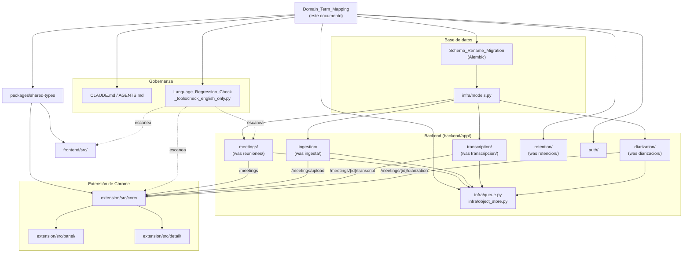
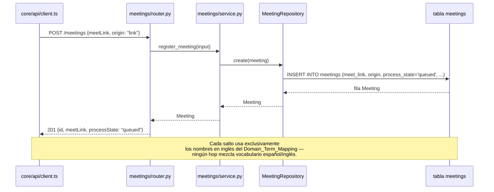

# Documento de Diseño — English Codebase Standard

## Resumen

sauri creció módulo por módulo escribiendo el dominio en español (`Reunion`, `Hablante`, `estado_proceso`) mientras partes puntuales del mismo código —sobre todo en `extension/src/core/` y en acrónimos técnicos— ya estaban en inglés. El resultado no es "una app en español" sino Spanglish sin regla: el mismo archivo mezcla `busqueda.ts` con `speakerTime.ts`, la misma clase mezcla `causa_fallo` con `audio_ref`. Traducir "lo obviamente español" no alcanza, porque el propio glosario de negocio (Reunion, Hablante, Transcripcion, Diarizacion) está en español y es la fuente de la mitad de esas inconsistencias. Este diseño trata el dominio completo como una única superficie a traducir de una vez, con una tabla de mapeo español→inglés (Domain_Term_Mapping) como fuente de verdad única, para que ningún módulo tenga que inventar su propia traducción.

El enfoque:

1. Congelar un **Domain_Term_Mapping** único (este documento, sección Componentes e Interfaces) que cubre entidades, tablas, columnas, literales de estado/evento, rutas de API y nombres de módulo — toda traducción posterior cita esta tabla, no re-deriva nombres.
2. Renombrar el esquema de base de datos con **una sola migración Alembic** (`op.rename_table`/`op.alter_column`) que preserva los datos existentes, con `downgrade()` simétrico.
3. Renombrar módulo por módulo el backend (`meetings`, `ingestion`, `transcription`, `diarization`, `retention`, `auth`, `infra`) actualizando en el mismo cambio clases, funciones, rutas y sus tests.
4. Renombrar `packages/shared-types` como el contrato compartido entre backend, extensión y frontend, corrigiendo de paso un desajuste preexistente entre sus valores de enum y los literales reales del backend.
5. Renombrar la extensión de Chrome (`core/`, `panel/`, `detail/`, archivos de nivel superior) y el frontend, incluyendo una migración de esquema de IndexedDB para no perder grabaciones pendientes de subir.
6. Traducir el texto de interfaz visible al usuario (placeholders, estados vacíos, el aviso de grabación mostrado en Google Meet).
7. Actualizar `CLAUDE.md` y `AGENTS.md` para que dejen de instruir "dominio en español".
8. Añadir un **Language_Regression_Check** (`_tools/check_english_only.py`) enganchado a `.githooks/pre-commit` y a `make check-english`, para que el Spanglish no vuelva a colarse.
9. Desplegar el cambio como una unidad atómica (backend + extensión + frontend juntos), no de forma incremental con capas de compatibilidad.

## Decisiones de Diseño Clave

**Traducir también el dominio de negocio, no solo el Spanglish técnico.**
*Alternativas descartadas:* mantener `Reunion`/`Hablante`/`Transcripcion` en español y traducir solo los nombres técnicos mezclados habría sido menos disruptivo, pero perpetúa exactamente la inconsistencia que origina esta spec — el dominio es la mitad del problema (`GrabacionDeSesion` junto a `audio_ref`). El usuario confirmó esta opción explícitamente en requisitos.

**Una sola migración Alembic para todo el esquema (`0XX_rename_schema_to_english.py`)**, no una migración por tabla.
*Alternativas descartadas:* migraciones separadas por tabla facilitarían revisar diffs pequeños, pero un rollback parcial dejaría el esquema en un estado híbrido español/inglés inconsistente entre tablas relacionadas por foreign key. El rename es conceptualmente una sola operación atómica.

**`op.rename_table` / `op.alter_column`, nunca `drop_table` + `create_table`.**
*Alternativas descartadas:* recrear las tablas vacías es más simple de escribir, pero destruye los datos ya cargados en los entornos locales/de desarrollo — viola el requisito de preservación de datos (Requisito 3.2).

**Despliegue atómico: backend, extensión y frontend se publican juntos, sin capa de compatibilidad dual.**
*Alternativas descartadas:* una capa de compatibilidad temporal (aceptar tanto `reunion_id` como `meeting_id` en el payload, servir `/reuniones` y `/meetings` a la vez) permitiría un despliegue gradual, pero introduce exactamente el vocabulario mixto que esta spec busca eliminar, aunque sea "temporal". El equipo es pequeño y sauri es una herramienta interna sin usuarios externos dependientes del contrato de API — una ventana corta de incompatibilidad es aceptable y más barata que mantener dos vocabularios.

**Colas RabbitMQ: renombrar los topics `"transcribir"`/`"diarizar"` a `"transcribe"`/`"diarize"` y tratar el purgado/recreación de colas como un paso operativo del despliegue**, documentado en Manejo de Errores, no como lógica de compatibilidad en el código.
*Alternativas descartadas:* hacer que los workers escuchen ambos nombres de topic evita perder mensajes en tránsito durante el despliegue, pero reintroduce Spanglish permanente en `queue_rabbitmq.py` para cubrir una ventana de minutos en un entorno de desarrollo sin tráfico real.

**IndexedDB de la extensión: bump de versión + `onupgradeneeded` que migra los registros existentes** de `claveIdempotencia`/`titulo`/`enlaceMeet` a `idempotencyKey`/`title`/`meetLink`, en vez de recrear el object store vacío.
*Alternativas descartadas:* recrear el store es más simple, pero destruiría grabaciones reales que un usuario haya capturado y que aún no se subieron al backend — a diferencia del rename de código, esto es dato de usuario, no solo nomenclatura.

**Corregir en el mismo cambio el desajuste de valores de enum en `packages/shared-types`** (los valores actuales `"en cola"`, `"uniéndose"` con espacio/tilde nunca coincidieron con los literales reales del backend `en_cola`/`uniendose`).
*Alternativas descartadas:* dejar ese bug para una spec de corrección aparte — pero esas mismas líneas se tocan al traducir los valores del enum a inglés; postergarlo propagaría un bug conocido bajo un nombre nuevo (`"queued"` vs. el error análogo).

**`Language_Regression_Check` como un único script agnóstico de lenguaje** (`_tools/check_english_only.py`, regex sobre texto plano), enganchado a `.githooks/pre-commit` (mismo mecanismo que ya bloquea commits directos a `main`) y expuesto como `make check-english` para escaneos manuales completos.
*Alternativas descartadas:* un linter dedicado por stack (regla custom de `ruff` para Python + regla custom de `eslint` para TypeScript) sería más "nativo", pero duplica configuración y mantenimiento para un chequeo que es, en esencia, buscar patrones de texto — no requiere un AST por lenguaje.

**Renombrar archivos con `git mv`, nunca borrar y volver a crear.**
*Alternativas descartadas:* recrear el archivo con el nuevo nombre y contenido es operativamente equivalente pero rompe `git blame`/historial de line-by-line sin ningún beneficio.

**JWT: sin compatibilidad dual de claims.** Los tokens firmados antes del despliegue (con claims `es_comercial`/`nombre`) simplemente dejan de validar tras el rename; el usuario vuelve a iniciar sesión.
*Alternativas descartadas:* aceptar ambos nombres de claim en `token.py`/`dependencies.py` durante una ventana de transición contradice la decisión de despliegue atómico anterior y el costo de un re-login es mínimo en una herramienta interna.

## Arquitectura

### Diagrama de componentes



### Diagrama de secuencia — verificación end-to-end del contrato renombrado



## Componentes e Interfaces

Todas las tablas siguientes forman el **Domain_Term_Mapping** (Glosario, Requisito 2.7). Las tareas de implementación citan estas filas; no se re-derivan traducciones ad hoc.

### 1. Esquema de base de datos (`backend/app/infra/models.py`)

| Clase | Tabla actual | → Clase nueva | → Tabla nueva |
|---|---|---|---|
| `Reunion` | `reuniones` | `Meeting` | `meetings` |
| `EstadoHistorial` | `estado_historial` | `StateHistory` | `state_history` |
| `GrabacionDeSesion` | `grabaciones_de_sesion` | `SessionRecording` | `session_recordings` |
| `Transcripcion` | `transcripciones` | `Transcript` | `transcripts` |
| `TurnoDeHabla` | `turnos_de_habla` | `SpeechTurn` | `speech_turns` |
| `NotificacionDeGrabacion` | `notificaciones_de_grabacion` | `RecordingNotice` | `recording_notices` |
| `RegistroDeAcceso` | `registro_de_acceso` | `AccessLog` | `access_log` |
| `Diarizacion` | `diarizaciones` | `Diarization` | `diarizations` |
| `Hablante` | `hablantes` | `Speaker` | `speakers` |
| `AsignacionDeHablante` | `asignaciones_de_hablante` | `SpeakerAssignment` | `speaker_assignments` |
| `Usuario` | `usuarios` | `User` | `users` |

Columnas por tabla (solo columnas con nombre en español; se omiten `id`, `email`, `audio_ref`, `video_ref` que ya son válidas en inglés):

| Tabla | Columna actual | → Columna nueva |
|---|---|---|
| `meetings` | `enlace_meet` | `meet_link` |
| | `titulo` | `title` |
| | `origen` | `origin` |
| | `id_invitacion_calendario` | `calendar_invite_id` |
| | `hora_inicio_programada` | `scheduled_start_time` |
| | `estado_proceso` | `process_state` |
| | `causa_fallo` | `failure_cause` |
| | `creada_por` | `created_by` |
| | `creada_en` | `created_at` |
| `state_history` | `reunion_id` | `meeting_id` |
| | `estado` | `state` |
| | `causa_fallo` | `failure_cause` |
| | `ocurrido_en` | `occurred_at` |
| `session_recordings` | `reunion_id` | `meeting_id` |
| | `clave_idempotencia` | `idempotency_key` |
| | `origen_captura` | `capture_origin` |
| | `duracion_segundos` | `duration_seconds` |
| | `interrumpida` | `interrupted` |
| | `expira_en` | `expires_at` |
| | `finalizada_en` | `finished_at` |
| `transcripts` | `reunion_id` | `meeting_id` |
| | `idioma` | `language` |
| | `proveedor` | `provider` |
| | `soporta_turnos` | `supports_turns` |
| | `expira_en` | `expires_at` |
| | `creada_en` | `created_at` |
| `speech_turns` | `transcripcion_id` | `transcript_id` |
| | `texto` | `text` |
| | `inicio_ms` | `start_ms` |
| | `fin_ms` | `end_ms` |
| | `orden` | `sequence` |
| `recording_notices` | `reunion_id` | `meeting_id` |
| | `emitida_en` | `issued_at` |
| `access_log` | `usuario_id` | `user_id` |
| | `recurso` | `resource` |
| | `resultado` | `result` |
| | `ocurrido_en` | `occurred_at` |
| `diarizations` | `reunion_id` | `meeting_id` |
| | `transcripcion_id` | `transcript_id` |
| | `proveedor` | `provider` |
| | `num_hablantes` | `speaker_count` |
| | `estado_diarizacion` | `diarization_state` |
| | `causa_fallo` | `failure_cause` |
| | `creada_en` / `actualizada_en` | `created_at` / `updated_at` |
| `speakers` | `diarizacion_id` | `diarization_id` |
| | `etiqueta_cruda` | `raw_label` |
| | `etiqueta` | `label` |
| | `orden` | `sequence` |
| `speaker_assignments` | `diarizacion_id` | `diarization_id` |
| | `turno_id` | `turn_id` |
| | `hablante_id` | `speaker_id` |
| `users` | `nombre` | `name` |
| | `es_comercial` | `is_sales` |
| | `creado_en` | `created_at` |

Constraints/índices con nombre en español: `uq_grabacion_reunion_id`→`uq_session_recording_meeting_id`, `uq_grabacion_clave_idempotencia`→`uq_session_recording_idempotency_key`, `uq_transcripcion_reunion_id`→`uq_transcript_meeting_id`, `uq_diarizacion_reunion_id`→`uq_diarization_meeting_id`, `uq_asignacion_turno_id`→`uq_speaker_assignment_turn_id`, `uq_usuario_email`→`uq_user_email`.

**Literales de estado/evento** (usados como valores de columna `String`, no como identificadores — deben traducirse igual porque son parte del contrato entre `state_machine.py`, la BD y la extensión):

| Dominio | Español | → Inglés |
|---|---|---|
| `process_state` (Meeting) | `en_cola` / `uniendose` / `grabando` / `transcribiendo` / `completado` / `fallido` | `queued` / `joining` / `recording` / `transcribing` / `completed` / `failed` |
| `failure_cause` (Meeting) | `no_pudo_unirse` / `reunion_cancelada` / `fallo_del_motor` | `could_not_join` / `meeting_cancelled` / `engine_failure` |
| eventos state machine (Meeting) | `iniciar_captura` / `reunion_cancelada` / `captura_iniciada` / `timeout_union` / `grabacion_subida` / `transcripcion_completada` / `fallo_motor` | `start_capture` / `meeting_cancelled` / `capture_started` / `join_timeout` / `recording_uploaded` / `transcription_completed` / `engine_failed` |
| `diarization_state` | `pendiente` / `en_proceso` / `completada` / `fallida` | `pending` / `in_progress` / `completed` / `failed` |
| eventos diarización | `iniciar_proceso` / `diarizacion_completada` / `fallo_motor` | `start_process` / `diarization_completed` / `engine_failed` |
| `origin` (Meeting) | `enlace` / `invitacion_calendario` / `manual` | `link` / `calendar_invite` / `manual` |
| `capture_origin` | `extension_chrome` / `bot_servidor` | `chrome_extension` / `server_bot` |
| `access_log.result` | `permitido` / `denegado` | `allowed` / `denied` |
| topics de cola (RabbitMQ) | `transcribir` / `diarizar` | `transcribe` / `diarize` |

### 2. `meetings/` (was `reuniones/`)

| Archivo | Español | → Inglés |
|---|---|---|
| `state_machine.py` | `ESTADOS`, `ESTADOS_TERMINALES`, `CAUSAS_FALLO_VALIDAS`, `TRANSICIONES_VALIDAS`, `EVENTO_A_CAUSA`, `ResultadoTransicion` (`exitosa`, `nuevo_estado`, `causa_fallo`), `aplicar_evento` | `STATES`, `TERMINAL_STATES`, `VALID_FAILURE_CAUSES`, `VALID_TRANSITIONS`, `EVENT_TO_CAUSE`, `TransitionResult` (`successful`, `new_state`, `failure_cause`), `apply_event` |
| `router.py` | prefix/tag `"reuniones"`; `_obtener_cola`, `_obtener_almacen`, `crear_reunion`, `listar_reuniones`, `renombrar_reunion_endpoint`, `eliminar_reunion_endpoint`, `obtener_reunion`, `solicitar_union_endpoint`, `obtener_transcripcion`, `obtener_diarizacion`; `EntradaRenombrar.titulo`; rutas `/solicitar-union`, `/transcripcion`, `/diarizacion` | tag `"meetings"`; `_get_queue`, `_get_object_store`, `create_meeting`, `list_meetings`, `rename_meeting_endpoint`, `delete_meeting_endpoint`, `get_meeting`, `request_join_endpoint`, `get_transcript`, `get_diarization`; `RenameInput.title`; rutas `/{id}/request-join`, `/{id}/transcript`, `/{id}/diarization` |
| `service.py` | `registrar_transicion`, `registrar_reunion`, `consultar_reunion`, `renombrar_reunion`, `eliminar_reunion`, `solicitar_union`, `programar_union_por_calendario` | `record_transition`, `register_meeting`, `get_meeting`, `rename_meeting`, `delete_meeting`, `request_join`, `schedule_join_by_calendar` |
| `repository.py` | `ReunionRepository.crear/obtener_por_id/actualizar_estado` | `MeetingRepository.create/get_by_id/update_state` |
| `schemas.py` | `_validar_enlace_meet`, `EntradaReunionEnlace`, `EntradaReunionCalendario`, `EntradaReunionManual`, `EntradaReunion`, `validar_enlace` | `_validate_meet_link`, `LinkMeetingInput`, `CalendarMeetingInput`, `ManualMeetingInput`, `MeetingInput`, `validate_link` |

Ruta completa: `/reuniones` → `/meetings`; `POST /{id}/solicitar-union` → `POST /{id}/request-join`; `GET /{id}/transcripcion` → `GET /{id}/transcript`; `GET /{id}/diarizacion` → `GET /{id}/diarization`.

### 3. `ingestion/` (was `ingesta/`)

| Archivo | Español | → Inglés |
|---|---|---|
| `router.py` | tag `"ingesta"`, ruta `/subir`; `_obtener_almacen`, `_obtener_cola`, `subir_grabacion` | tag `"ingestion"`, ruta `/upload`; `_get_object_store`, `_get_queue`, `upload_recording` |
| `service.py` | `procesar_ingesta` | `process_ingestion` |
| `repository.py` | `GrabacionRepository.crear/obtener_por_reunion/existe_por_clave_idempotencia` | `RecordingRepository.create/get_by_meeting/exists_by_idempotency_key` |
| `schemas.py` | `DatosIngesta` (`reunion_id`, `clave_idempotencia`, `origen_captura`, `duracion_segundos`, `interrumpida`, `notificacion_emitida_en`, `titulo`, `enlace_meet`) | `IngestionData` (`meeting_id`, `idempotency_key`, `capture_origin`, `duration_seconds`, `interrupted`, `notice_issued_at`, `title`, `meet_link`) |

### 4. `transcription/` (was `transcripcion/`)

| Archivo actual | → Archivo | Símbolos español → inglés |
|---|---|---|
| `factory.py` | `factory.py` | `crear_motor_asr` → `create_asr_engine` (env vars `ASR_PROVIDER`/`ASR_LOCAL_URL` ya en inglés, sin cambio) |
| `motor_asr.py` | `asr_engine.py` | `MotorASR`→`ASREngine`; `OpcionesTranscripcion`(`idioma_prioritario`)→`TranscriptionOptions`(`preferred_language`); `SegmentoTranscripcion`(`texto`,`inicio_ms`,`fin_ms`)→`TranscriptionSegment`(`text`,`start_ms`,`end_ms`); `ResultadoTranscripcion`(`segmentos`,`idioma`,`soporta_turnos`)→`TranscriptionResult`(`segments`,`language`,`supports_turns`); `CapacidadesASR`(`soporta_turnos`,`es_local`)→`ASRCapabilities`(`supports_turns`,`is_local`); `transcribir`/`capacidades`→`transcribe`/`capabilities` |
| `proveedor_local.py` | `local_provider.py` | `ProveedorLocal`→`LocalProvider` |
| `proveedor_nube.py` | `cloud_provider.py` | `ErrorServicioExterno`→`ExternalServiceError`; `ProveedorNube`→`CloudProvider`; `_parsear_y_validar_respuesta`→`_parse_and_validate_response` |
| `repository.py` | `repository.py` | `TranscripcionRepository.crear/obtener_por_reunion`→`TranscriptRepository.create/get_by_meeting` |
| `worker.py` | `worker.py` | `_procesar_transcripcion`→`_process_transcription`; `iniciar_worker`→`start_worker`; topic `"transcribir"`→`"transcribe"` |

### 5. `diarization/` (was `diarizacion/`)

| Archivo actual | → Archivo | Símbolos español → inglés |
|---|---|---|
| `asignacion.py` | `assignment.py` | `asignar_turnos`→`assign_turns` |
| `estado.py` | `state.py` | `aplicar_evento_diarizacion`→`apply_diarization_event`; `ResultadoTransicionDiarizacion`→`DiarizationTransitionResult` |
| `etiquetado.py` | `labeling.py` | `Hablante`(dataclass: `etiqueta_cruda`,`etiqueta`,`orden`)→`Speaker`(`raw_label`,`label`,`sequence`); `etiquetar_hablantes`→`label_speakers`; literal `"Hablante {i}"`→`"Speaker {i}"` |
| `factory.py` | `factory.py` | `crear_motor_diarizacion`→`create_diarization_engine` |
| `motor_diarizacion.py` | `diarization_engine.py` | `MotorDiarizacion`→`DiarizationEngine`; `OpcionesDiarizacion`(`duracion_ms`)→`DiarizationOptions`(`duration_ms`); `SegmentoDeHablante`(`etiqueta_cruda`,`inicio_ms`,`fin_ms`)→`SpeakerSegment`(`raw_label`,`start_ms`,`end_ms`); `ResultadoDiarizacion`(`segmentos`,`num_hablantes`)→`DiarizationResult`(`segments`,`speaker_count`); `CapacidadesDiarizacion`(`es_local`,`nombre_proveedor`)→`DiarizationCapabilities`(`is_local`,`provider_name`); `diarizar`/`capacidades`→`diarize`/`capabilities` |
| `proveedor_local.py` / `proveedor_nube.py` | `local_provider.py` / `cloud_provider.py` | mismo patrón que transcription (`ProveedorLocal`/`ProveedorNube`/`ErrorServicioExterno` → `LocalProvider`/`CloudProvider`/`ExternalServiceError`) |
| `repository.py` | `repository.py` | `DiarizacionRepository.crear/obtener_por_reunion`→`DiarizationRepository.create/get_by_meeting` |
| `worker.py` | `worker.py` | `_procesar_diarizacion`→`_process_diarization`; `iniciar_worker`→`start_worker`; topic `"diarizar"`→`"diarize"` |

### 6. `retention/` (was `retencion/`)

| Archivo actual | → Archivo | Símbolos |
|---|---|---|
| `config.py` | `config.py` | `obtener_periodo_retencion`→`get_retention_period` (env var `RETENTION_DAYS` sin cambio) |
| `expiracion.py` | `expiration.py` | `calcular_expiracion`→`calculate_expiration`; `aplicar_retencion`→`apply_retention` |
| `worker.py` | `worker.py` | `ejecutar_borrado_retencion`→`run_retention_deletion`; `iniciar_worker_retencion`→`start_retention_worker` |

### 7. `auth/` (nombre de módulo sin cambio)

| Archivo | Símbolos español → inglés |
|---|---|
| `audit.py` | `registrar_acceso`→`record_access` |
| `authorization.py` | `verificar_autorizacion`→`verify_authorization`; `requerir_comercial`→`require_sales`; `usuario.es_comercial`→`user.is_sales` |
| `dependencies.py` | `_bypass_activo`→`_bypass_active`; `obtener_usuario_actual`→`get_current_user` |
| `passwords.py` | `_ALGORITMO`→`_ALGORITHM`; `sal`→`salt`; `derivado`→`derived`; `iteraciones`→`iterations`; `esperado`→`expected` |
| `schemas.py` | `UsuarioAutenticado`(`nombre`,`es_comercial`)→`AuthenticatedUser`(`name`,`is_sales`) |
| `seed.py` | `_password_semilla`→`_seed_password`; `sembrar_usuarios`→`seed_users`; `USUARIOS_SEMILLA`→`SEED_USERS` |
| `token.py` | `crear_token`→`create_token`; params `usuario_id`,`nombre`,`es_comercial`→`user_id`,`name`,`is_sales`; JWT claims `nombre`,`es_comercial`→`name`,`is_sales` (claim `sub` sin cambio) |

### 8. `infra/` (colas y almacenamiento de objetos)

| Archivo | Símbolos español → inglés |
|---|---|
| `queue.py` | `ColaDeTrabajos`(ABC)→`JobQueue`; `publicar`/`suscribir`/`conectar`/`desconectar`→`publish`/`subscribe`/`connect`/`disconnect`; params `tema`,`mensaje`,`manejador`→`topic`,`message`,`handler`; `crear_cola_de_trabajos`→`create_job_queue` |
| `queue_rabbitmq.py` | `ColaDeRabbitMQ`→`RabbitMQJobQueue`; `_leer_max_retries`→`_read_max_retries`; `_contar_reintentos`→`_count_retries`; `_leer_dlx_exchange`→`_read_dlx_exchange`; header `x-sauri-reintentos`→`x-sauri-retries`; `_TEMA_A_ENV_RETRIES`→`_TOPIC_TO_ENV_RETRIES` (claves `"transcribir"`/`"diarizar"`→`"transcribe"`/`"diarize"`) |
| `object_store.py` | `AlmacenDeObjetos`(ABC)→`ObjectStore`; `guardar`/`obtener`/`eliminar`/`url_temporal_de_lectura`→`save`/`get`/`delete`/`temporary_read_url`; params `clave`,`contenido`,`referencia`→`key`,`content`,`reference`; `crear_almacen_de_objetos`→`create_object_store` |
| `object_store_s3.py` | `AlmacenDeObjetosS3`→`S3ObjectStore` |
| `database.py` | eliminar los duplicados en español `crear_engine`/`crear_session` (dejar solo `create_engine`/`create_session_factory`, ya existentes) |

### 9. `packages/shared-types`

Ver sección Modelos de Datos para el contenido concreto post-rename.

### 10. `extension/src/core/`

| Archivo actual | → Archivo | Símbolos español → inglés |
|---|---|---|
| `authBloqueo.ts` | `authLock.ts` | `MAX_FALLOS_CONSECUTIVOS`→`MAX_CONSECUTIVE_FAILURES`; `VENTANA_BLOQUEO_MS`→`LOCKOUT_WINDOW_MS`; `estaBloqueado`→`isLocked`; tipo `IntentoDeAutenticacion`→`AuthAttempt` (definido en `types.ts`) |
| `busqueda.ts` | `search.ts` | `LIMITE_BUSQUEDA_NOTAS`→`NOTES_SEARCH_LIMIT`; `LIMITE_BUSQUEDA_TRANSCRIPCION`→`TRANSCRIPT_SEARCH_LIMIT`; `filtrarNotas`→`filterNotes`; `coincidenciasDeTranscripcion`→`transcriptMatches`; `ResultadoBusquedaTranscripcion`(`intervenciones`,`turnoIdsCoincidentes`,`primeraCoincidenciaId`)→`TranscriptSearchResult`(`interventions`,`matchingTurnIds`,`firstMatchId`); `normalizar`→`normalize` |
| `captura.ts` | `capture.ts` | `aplicarEventoCaptura`→`applyCaptureEvent`; `botonNuevaNotaHabilitado`→`newNoteButtonEnabled`; `TRANSICIONES`→`TRANSITIONS`; estados `inactiva`/`grabando`/`deteniendo`→`idle`/`recording`/`stopping`; eventos `iniciar`/`detener`/`finalizada`→`start`/`stop`/`finished` |
| `hablantes.ts` | `speakers.ts` | `PALETA_AVATAR`→`AVATAR_PALETTE`; `inicialesDeEtiqueta`→`labelInitials`; `colorDeAvatar`→`avatarColor` |
| `intervenciones.ts` | `interventions.ts` | `ETIQUETA_HABLANTE_NO_IDENTIFICADO`→`UNIDENTIFIED_SPEAKER_LABEL`; `atribuirHablante`→`attributeSpeaker`; `mapearIntervenciones`→`mapInterventions` |
| `notas.ts` | `notes.ts` | `PLACEHOLDER_TITULO`→`TITLE_PLACEHOLDER`; `tituloParaMostrar`→`displayTitle`; `formatearFechaNota`→`formatNoteDate`; `proyectarTarjetas`→`projectCards` |
| `orden.ts` | `order.ts` | `ordenarNotas`→`sortNotes`; `ordenarIntervenciones`→`sortInterventions`; `ordenarTiempoDeHabla`→`sortSpeakingTime` |
| `tiempo.ts` | `time.ts` | `PLACEHOLDER_NO_DISPONIBLE`→`NOT_AVAILABLE_PLACEHOLDER`; `UNA_HORA_MS`→`ONE_HOUR_MS`; `formatearMarcaDeTiempo`→`formatTimestamp` |
| `vista.ts` | `view.ts` | `derivarEstadoDeVista`→`deriveViewState`; estados `inicial`/`en_curso`/`exito`/`fallo`→`initial`/`in_progress`/`success`/`failure`; resultados `cargando`/`con_datos`/`vacio`→`loading`/`withData`/`empty` |
| `detailUrl.ts` | *(sin cambio de nombre)* | `PARAM_REUNION_ID`("reunionId")→`PARAM_MEETING_ID`("meetingId"); `construirUrlDetalle`→`buildDetailUrl`; `leerReunionId`→`readMeetingId` |
| `speakerTime.ts` | *(sin cambio de nombre)* | `calcularTiempoDeHabla`→`calculateSpeakingTime`; `turnosPorId`→`turnsById` |
| `types.ts` | *(sin cambio de nombre)* | Ver tabla de tipos abajo |

Cada archivo renombrado se mueve con `git mv` y arrastra su test pareado (`*.test.ts`, `*.exploration.test.ts`, `*.preservation.test.ts`) con el mismo nombre base nuevo.

**`types.ts`** (todos los tipos, `→` traducción):
`EstadoDeCaptura`→`CaptureState`, `EventoCaptura`→`CaptureEvent`, `EstadoDeVista`→`ViewState`, `SolicitudRemota`→`RemoteRequest`, `NotaDTO`→`NoteDTO`, `TarjetaDeNota`→`NoteCard`, `FiltroDeNotas`→`NotesFilter`, `TurnoDeHablaDTO`→`SpeechTurnDTO`, `TranscripcionDTO`→`TranscriptDTO`, `HablanteDTO`→`SpeakerDTO`, `AsignacionDeHablanteDTO`→`SpeakerAssignmentDTO`, `DiarizacionDTO`→`DiarizationDTO`, `IntervencionDTO`→`InterventionDTO`, `EntradaTiempoDeHabla`→`SpeakingTimeEntry`, `IntentoDeAutenticacion`→`AuthAttempt`. Campos: `reunionId`→`meetingId`, `titulo`→`title`, `estadoProceso`→`processState`, `creadaEn`→`createdAt`, `tituloMostrado`→`displayedTitle`, `fechaMostrada`→`displayedDate`, `texto`→`text`, `inicioMs`→`startMs`, `finMs`→`endMs`, `orden`→`sequence`, `transcripcionId`→`transcriptId`, `segmentos`→`segments`, `etiqueta`→`label`, `turnoId`→`turnId`, `hablanteId`→`speakerId`, `diarizacionId`→`diarizationId`, `estadoDiarizacion`→`diarizationState`, `numHablantes`→`speakerCount`, `hablantes`→`speakers`, `asignaciones`→`assignments`.

**`core/api/client.ts`**: `BACKEND_URL_DEFECTO`→`DEFAULT_BACKEND_URL`; `CLAVE_SESION`→`SESSION_KEY`; `ErrorSesionInvalida`→`InvalidSessionError`; `ErrorTransporteNoSeguro`→`InsecureTransportError`; `ErrorNoEncontrado`→`NotFoundError`; `validarTransporte`→`validateTransport`; `leerSesion`→`readSession`; `descartarSesion`→`discardSession`; `almacenarSesion`→`storeSession`; `solicitar`→`request`; `listarReuniones`→`listMeetings`; `obtenerTranscripcion`→`getTranscript`; `obtenerDiarizacion`→`getDiarization`; `renombrarReunion`→`renameMeeting`; `eliminarReunion`→`deleteMeeting`. Todas las llamadas usan las rutas nuevas de la tabla del Componente 2 (`/meetings`, `/meetings/{id}/request-join`, etc.).

**`core/design/tokens.ts`**: `COLOR_TOKENS` (`fondo`→`background`, `superficie`→`surface`, `superficieAlterna`→`surfaceAlt`, `primario`→`primary`, `texto`→`text`, `textoTenue`→`textMuted`, `grabando`→`recording`, `foco`→`focus`); `TYPOGRAPHY_TOKENS` (`fuenteBase`→`baseFont`, `textoSm/Base/Lg/Xl`→`textSm/Base/Lg/Xl`, `pesoRegular/Medio/Semibold`→`weightRegular/Medium/Semibold`); `SPACING_TOKENS` (`esp1`-`esp6`→`space1`-`space6`); `RADIUS_TOKENS` (`radioSm/Md/Lg`→`radiusSm/Md/Lg`); `ELEVATION_TOKENS` (`sombraSm/Md`→`shadowSm/Md`); `PALETA_AVATAR`→`AVATAR_PALETTE`.

### 11. `extension/src/panel/components/`

| Archivo actual | → Archivo | Componente | Props/estado clave |
|---|---|---|---|
| `ControlesDeCaptura.tsx` | `CaptureControls.tsx` | `ControlesDeCaptura`→`CaptureControls` | `ControlesDeCapturaProps`→`CaptureControlsProps` (`estadoDeCaptura`→`captureState`, `microfonos`→`microphones`, `microfonoSeleccionado`→`selectedMicrophone`, `onSeleccionarMicrofono`→`onSelectMicrophone`, `onToggleCaptura`→`onToggleCapture`, `onAbrirAjustes`→`onOpenSettings`, `tiempoTranscurridoMs`→`elapsedTimeMs`, `errorInicio`→`startError`, `errorMicrofono`→`microphoneError`); `formatearCronometro`→`formatStopwatch`; `FUENTES_DE_AUDIO`→`AUDIO_SOURCES` |
| `EncabezadoPanel.tsx` | `PanelHeader.tsx` | `EncabezadoPanel`→`PanelHeader` | `EncabezadoPanelProps`→`PanelHeaderProps` (`estadoDeCaptura`→`captureState`, `onNuevaNota`→`onNewNote`, `errorInicio`→`startError`) |
| `ListaDeNotas.tsx` | `NotesList.tsx` | `ListaDeNotas`→`NotesList` | `ListaDeNotasProps`→`NotesListProps` (`estado`→`state`, `notas`→`notes`, `onReintentar`→`onRetry`, `onAbrirNota`→`onOpenNote`, `onEliminarNota`→`onDeleteNote`, `onRenombrarNota`→`onRenameNote`); vars `textoInput`→`inputText`, `textoDebounced`→`debouncedText`, `filtro`→`filter`, `renombrandoId`→`renamingId`, `tituloEditado`→`editedTitle`; fns `iniciarRenombrar`→`startRename`, `confirmarRenombrar`→`confirmRename`, `confirmarEliminar`→`confirmDelete`; también su texto de interfaz (Requisito 5) |
| `VistaDeAutenticacion.tsx` | `AuthView.tsx` | `VistaDeAutenticacion`→`AuthView` | `VistaDeAutenticacionProps`→`AuthViewProps` (`indisponible`→`unavailable`, `sesionExpirada`→`sessionExpired`); vars `intentos`→`attempts`, `bloqueado`→`locked` |

`panel/SidePanelApp.tsx` (nombre sin cambio): var `estadoDeCaptura`→`captureState`.

### 12. `extension/src/detail/`

| Archivo actual | → Archivo | Componente | Notas |
|---|---|---|---|
| `BuscadorDeTranscripcion.tsx` | `TranscriptSearch.tsx` | `BuscadorDeTranscripcion`→`TranscriptSearch` | props `intervenciones`→`interventions`, `onResultado`→`onResult`; vars `texto`→`text`, `sinCoincidencias`→`noMatches` |
| `DetailApp.tsx` | *(sin cambio de nombre)* | `DetailApp` | `reunionId`→`meetingId`, `solicitudTranscripcion`→`transcriptRequest`, `solicitudDiarizacion`→`diarizationRequest`, `asignaciones`→`assignments`, `resultadoBusqueda`→`searchResult`, `cargarTranscripcion`→`loadTranscript`, `cargarDiarizacion`→`loadDiarization`, `turnos`→`turns`, `hablantes`→`speakers`, `intervenciones`→`interventions`, `entradasTiempoDeHabla`→`speakingTimeEntries`, `estadoTranscripcion`→`transcriptState`, `estadoDiarizacion`→`diarizationState`; consts `SOLICITUD_INICIAL`→`INITIAL_REQUEST`, `SIN_TURNOS`→`NO_TURNS`, `SIN_HABLANTES`→`NO_SPEAKERS` |
| `EspacioDeResumen.tsx` | `SummarySpace.tsx` | `EspacioDeResumen`→`SummarySpace` | — |
| `PanelDeTranscripcion.tsx` | `TranscriptPanel.tsx` | `PanelDeTranscripcion`→`TranscriptPanel` | props `PanelDeTranscripcionProps`→`TranscriptPanelProps`; var `refsPorTurno`→`refsByTurn` |
| `VistaTiempoDeHabla.tsx` | `SpeakingTimeView.tsx` | `VistaTiempoDeHabla`→`SpeakingTimeView` | props `VistaTiempoDeHablaProps`→`SpeakingTimeViewProps`; var `ordenadas`→`sorted` |

### 13. Archivos de nivel superior de la extensión

| Archivo | Cambios |
|---|---|
| `background.ts` | función `uploadRecording(mimeType, sessionId, notificationEmittedAt, titulo, enlaceMeet)` → params `title`, `meetLink`; claves del payload enviado a `/meetings/upload` siguen la tabla del Componente 3 (`reunion_id`→`meeting_id`, `clave_idempotencia`→`idempotency_key`, `origen_captura`→`capture_origin`, `duracion_segundos`→`duration_seconds`, `interrumpida`→`interrupted`, `notificacion_emitida_en`→`notice_issued_at`, `titulo`→`title`, `enlace_meet`→`meet_link`); literal `"extension_chrome"`→`"chrome_extension"` |
| `content.ts` | Aviso de grabación mostrado en el DOM de Google Meet: `"sauri está grabando esta reunión"` → `"sauri is recording this meeting"` (Requisito 5.1 — texto visible a los participantes) |
| `upload-queue.ts` | `UploadJob` (`claveIdempotencia`,`titulo`,`enlaceMeet`) → (`idempotencyKey`,`title`,`meetLink`); `EnqueueUploadInput` actualiza el mismo `Pick<...>`; índice de IndexedDB `"claveIdempotencia"`→`"idempotencyKey"` — requiere migración de esquema, ver Modelos de Datos y Manejo de Errores |
| `recording-db.ts` | Sin identificadores en español (limpio); solo requiere ajustar el `onupgradeneeded` para el bump de versión que motiva el cambio de `upload-queue.ts` |
| `offscreen.ts` | Sin identificadores en español; solo comentarios (ya cubiertos por Requisito 1.2) |

### 14. `frontend/src/`

| Archivo actual | → Archivo | Cambios |
|---|---|---|
| `api.ts` | *(sin cambio)* | `registrarReunion`→`registerMeeting`; `listarReuniones`→`listMeetings`; `obtenerTranscripcion`→`getTranscript` |
| `App.tsx` | *(sin cambio)* | variante de tipo `View`: `"transcripcion"`→`"transcript"`; `handleSelectReunion`→`handleSelectMeeting` |
| `components/RegisterForm.tsx` | *(sin cambio)* | state `enlaceMeet`/`setEnlaceMeet`→`meetLink`/`setMeetLink` |
| `components/ReunionList.tsx` | `MeetingList.tsx` | `ReunionList`→`MeetingList`; `ESTADO_COLORS`→`STATE_COLORS` (claves `ProcessState`); `reuniones`/`setReuniones`→`meetings`/`setMeetings` |
| `components/TranscripcionView.tsx` | `TranscriptView.tsx` | `TranscripcionView`→`TranscriptView`; props `TranscripcionViewProps`→`TranscriptViewProps` (`reunionId`→`meetingId`) |

## Modelos de Datos

### `packages/shared-types/src/index.ts` (estado final)

```typescript
export enum ProcessState {
  Queued = "queued",
  Joining = "joining",
  Recording = "recording",
  Transcribing = "transcribing",
  Completed = "completed",
  Failed = "failed",
}

export enum FailureCause {
  CouldNotJoin = "could_not_join",
  MeetingCancelled = "meeting_cancelled",
  EngineFailure = "engine_failure",
}

export enum MeetingOrigin {
  Link = "link",
  CalendarInvite = "calendar_invite",
  Manual = "manual",
}

export enum CaptureOrigin {
  ChromeExtension = "chrome_extension",
  ServerBot = "server_bot",
}

export interface Meeting {
  id: string;
  meetLink: string;
  title: string | null;
  origin: MeetingOrigin;
  calendarInviteId: string | null;
  scheduledStartTime: string | null;
  processState: ProcessState;
  failureCause: FailureCause | null;
  createdBy: string;
  createdAt: string;
}

export interface SessionRecording {
  id: string;
  meetingId: string;
  idempotencyKey: string;
  captureOrigin: CaptureOrigin;
  audioRef: string;
  videoRef: string | null;
  durationSeconds: number;
  interrupted: boolean;
  expiresAt: string | null;
  finishedAt: string;
}

export interface Transcript {
  id: string;
  meetingId: string;
  language: string;
  provider: string;
  supportsTurns: boolean;
  expiresAt: string | null;
  createdAt: string;
}

export interface SpeechTurn {
  id: string;
  transcriptId: string;
  text: string;
  startMs: number;
  endMs: number;
  sequence: number;
}
```

**Nota de corrección incluida en este rename:** los valores de `ProcessState`/`FailureCause` en el paquete actual usan espacios y tildes (`"en cola"`, `"uniéndose"`, `"reunión cancelada"`) que **nunca coincidieron** con los literales reales que produce el backend (`en_cola`, `uniendose`, `reunion_cancelada`). Los valores nuevos en inglés (`"queued"`, `"joining"`, `"meeting_cancelled"`) se definen para que coincidan exactamente con los literales de la tabla del Componente 1 — corrigiendo el bug de origen junto con la traducción (Decisión de Diseño 7).

### Esqueleto de la migración Alembic

```python
"""Rename Spanish schema to English (Requisito 2, 3)."""

def upgrade() -> None:
    op.rename_table("reuniones", "meetings")
    op.alter_column("meetings", "enlace_meet", new_column_name="meet_link")
    op.alter_column("meetings", "estado_proceso", new_column_name="process_state")
    # ... resto de columnas de la tabla del Componente 1 ...
    op.execute("UPDATE meetings SET process_state = 'queued' WHERE process_state = 'en_cola'")
    # ... UPDATE por cada literal de estado/evento traducido ...
    op.rename_table("estado_historial", "state_history")
    # ... resto de tablas en el mismo orden que la tabla del Componente 1 ...

def downgrade() -> None:
    # simétrico: revierte cada UPDATE y rename_table/alter_column en orden inverso
    ...
```

### Migración de esquema de IndexedDB (`extension/src/recording-db.ts` / `upload-queue.ts`)

```typescript
const DB_VERSION = 2; // bump desde 1

request.onupgradeneeded = (event) => {
  const db = request.result;
  if (event.oldVersion < 2) {
    const store = request.transaction!.objectStore("uploadQueue");
    // Copia los registros existentes de claveIdempotencia/titulo/enlaceMeet
    // a idempotencyKey/title/meetLink antes de crear el nuevo índice,
    // para no perder trabajos de subida pendientes (Decisión de Diseño 6).
    store.createIndex("idempotencyKey", "idempotencyKey", { unique: true });
    store.deleteIndex("claveIdempotencia");
  }
};
```

## Propiedades de Correctitud

**Propiedad 1 — Preservación de datos en la migración de esquema**
Para cualquier conjunto de filas existentes en una tabla española antes de `upgrade()`, tras ejecutar la `Schema_Rename_Migration` la tabla inglesa correspondiente contiene el mismo número de filas con los mismos valores (solo el nombre de tabla/columna cambia). Ejecutar `downgrade()` a continuación revierte al esquema y contenido originales.
*Valida: Requisito 3.2, 3.3*

**Propiedad 2 — Equivalencia de comportamiento de la máquina de estados**
Para todo par (estado, evento) válido bajo `aplicar_evento` con los literales españoles antiguos, `apply_event` con los literales ingleses mapeados produce un `TransitionResult` isomorfo (mismo resultado de éxito/fracaso y mismo estado siguiente bajo el mapeo de la tabla del Componente 1). El renombramiento de literales no cambia ninguna transición.
*Valida: Requisito 2.6, 8.2*

**Propiedad 3 — Equivalencia de `assign_turns`**
Para cualquier entrada de turnos/segmentos/hablantes, `assign_turns` (renombrado) asigna el mismo `speaker_id` por turno que `asignar_turnos` daba para la entrada equivalente con nombres antiguos — el rename no altera el comportamiento de una función pura.
*Valida: Requisito 8.2*

**Propiedad 4 — Consistencia de vocabulario en el contrato de API**
Para toda ruta y payload renombrados, una petición construida con los nombres de campo en inglés recibe una respuesta que usa exclusivamente nombres en inglés — ningún endpoint mezcla vocabulario español/inglés en la misma respuesta.
*Valida: Requisito 2.6, 4.4*

**Propiedad 5 — Cero referencias huérfanas (Language_Regression_Check)**
Tras completar el rename de un módulo, ejecutar `_tools/check_english_only.py` sobre `backend/`, `extension/src/`, `frontend/src/`, `packages/shared-types/` (excluyendo Transcript_Content, fixtures marcados como español y `.spectra/specs/` Legacy_Specs) devuelve cero coincidencias de los términos retirados en el Domain_Term_Mapping.
*Valida: Requisito 7.1, 7.2*

**Propiedad 6 — La migración de IndexedDB preserva trabajos pendientes**
Para cualquier conjunto de registros `UploadJob` presentes en el object store antes del bump de versión, tras `onupgradeneeded` existe el mismo número de registros con `idempotencyKey`/`title`/`meetLink` poblados a partir de los valores previos `claveIdempotencia`/`titulo`/`enlaceMeet`.
*Valida: Requisito 4.4 (aplicado al almacenamiento local de la extensión)*

**Propiedad 7 — Cierre de compilación**
Tras completar el rename de todos los módulos, `npm run typecheck` (raíz, fan-out a `extension`/`frontend`/`packages/shared-types`) y `mypy backend/app` (modo estricto) reportan cero errores — prueba mecánica de que ninguna referencia quedó sin actualizar.
*Valida: Requisito 4.4, 8.1*

## Manejo de Errores

| Escenario | Comportamiento |
|---|---|
| Token JWT firmado antes del despliegue (claims `es_comercial`/`nombre`) se usa después del rename | `token.py`/`dependencies.py` solo reconocen `is_sales`/`name`; el token antiguo falla la validación de forma estándar (401) y el usuario vuelve a iniciar sesión. Sin lógica de compatibilidad dual (Decisión de Diseño). |
| Mensajes en tránsito en RabbitMQ bajo los topics antiguos `"transcribir"`/`"diarizar"` al momento del despliegue | Paso operativo del despliegue (no lógica de runtime): purgar/recrear las colas como parte de `make build`/`make up` tras el rename, documentado en la tarea de infraestructura correspondiente. Entorno interno sin tráfico de producción real en este momento. |
| Migración de IndexedDB falla a mitad de `onupgradeneeded` en el navegador de un usuario | La transacción de `onupgradeneeded` es atómica en IndexedDB: si falla, el navegador revierte a la versión anterior del esquema y el usuario conserva sus `UploadJob` con los nombres de campo antiguos; la extensión actualizada simplemente no arranca hasta que el usuario recargue (comportamiento nativo del navegador, no requiere manejo adicional). |
| `Language_Regression_Check` encuentra una coincidencia en código nuevo | Reporta archivo y línea sin bloquear (Requisito 7.3); si está enganchado como `.githooks/pre-commit`, el desarrollador puede revisar el hallazgo y decidir corregirlo o, si es un falso positivo, usar `git commit --no-verify` (mismo escape hatch documentado ya para el hook de protección de rama). |
| `Language_Regression_Check` escanea `Transcript_Content` o un fixture de audio en español y genera un falso positivo | El script excluye por convención de ruta: `backend/tests/**/fixtures/`, cualquier archivo bajo `.spectra/specs/`, y campos de valor de columna `text`/`texto` en fixtures marcados con un comentario `# spanish-sample-data` (convención a introducir en la tarea del script). |
| Referencia huérfana a un identificador español tras un rename parcial (import roto) | Detectado por `npm run typecheck` / `mypy` (Propiedad 7) antes de fusionar cualquier tarea — no es un error de runtime a manejar, es un gate de CI/local previo al commit. |

## Estrategia de Testing

**Enfoque: refactor mecánico protegido por la suite existente + tests nuevos para el propio mecanismo de migración.**

La mayoría de este trabajo es un rename — no cambia comportamiento — por lo que la suite de tests existente es el oráculo de correctitud (AGENTS.md §3: un rename no requiere un ciclo RED nuevo si la aserción no cambia). Sí requieren TDD completo (RED→GREEN→REFACTOR) las piezas que son comportamiento genuinamente nuevo:

- La propia `Schema_Rename_Migration` (Propiedad 1): escribir el test de migración con datos de fixture *antes* de escribir `upgrade()`/`downgrade()`.
- `_tools/check_english_only.py` (Propiedad 5): escribir un test que alimente el script con una cadena en español conocida y espere una coincidencia, antes de implementar el escaneo.
- La migración de IndexedDB (Propiedad 6): escribir el test de `onupgradeneeded` con datos previos antes de implementar la migración.

**Orden de ejecución** (uno por uno, cada módulo se valida antes de pasar al siguiente, por Requisito 8.3):

1. `infra/models.py` + `Schema_Rename_Migration` — `pytest backend/tests/infra` + `pytest backend/tests/test_migration.py` (nuevo)
2. `packages/shared-types` — `npm run typecheck -w @sauri/shared-types`
3. `auth/` → `ingestion/` → `meetings/` → `transcription/` → `diarization/` → `retention/` (orden de dependencia: auth es transversal, ingestion/meetings alimentan a transcription, que alimenta a diarization) — `pytest backend/tests/<module>` por cada uno
4. `infra/queue.py`, `infra/object_store.py` y los `*/worker.py` — `pytest backend/tests/test_queue.py backend/tests/test_worker.py`
5. `extension/src/core/` — `npm run test -w extension -- core`
6. `extension/src/panel/`, `extension/src/detail/`, archivos de nivel superior — `npm run test -w extension`
7. `frontend/src/` — `npm run test -w frontend`
8. `CLAUDE.md`/`AGENTS.md` + `_tools/check_english_only.py` — sin test runner propio; verificación manual de que el script detecta un caso conocido y no reporta falsos positivos sobre el repo ya renombrado
9. Verificación de cierre — `npm run typecheck` (raíz), `mypy backend/app`, `pytest` (suite completa), `npm run test` (raíz), `npm run test:e2e` (extensión)

**Comandos por módulo (ejemplo `meetings/`):**
```bash
cd backend && pytest tests/reuniones -v   # baseline verde antes del rename
# ... git mv + rename de identificadores ...
cd backend && mv tests/reuniones tests/meetings   # o git mv archivo por archivo
cd backend && pytest tests/meetings -v    # debe seguir en verde
cd backend && mypy app/meetings
```

**Comando de verificación de idioma:**
```bash
make check-english          # escaneo completo del repo
_tools/check_english_only.py --staged   # usado internamente por .githooks/pre-commit
```
