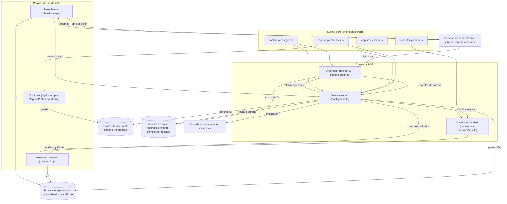
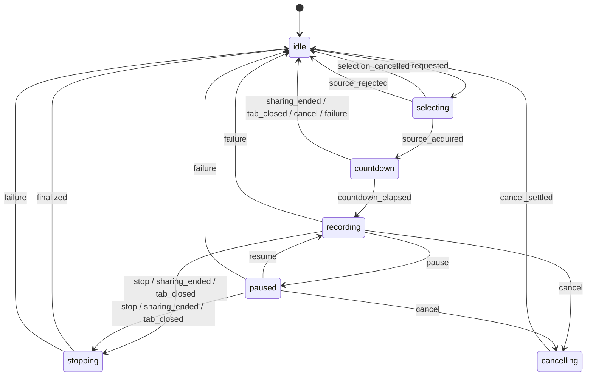
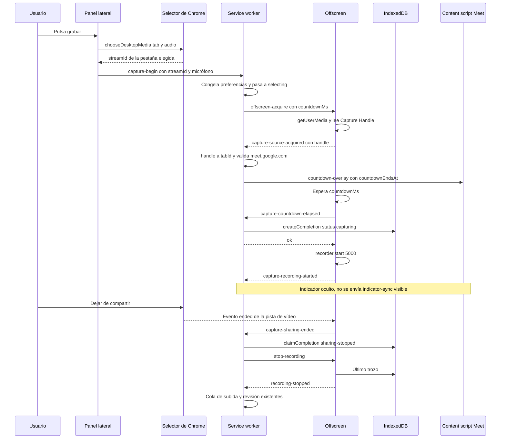

# Documento de Diseño — Preferencias y controles de captura de la extensión

> **Estado:** redactado el 2026-11-14 a partir de `requirements.md` (fase 1 completa). **No autoriza implementación:** el dueño debe revisarlo antes. Las decisiones marcadas «condicionada a U0» dependen de una prueba técnica corta en Chrome real (ver `tasks.md`, Unidad 0). Las preguntas abiertas de producto se listan al final; este diseño no las resuelve.

## Resumen

Hoy la extensión graba la pestaña activa en cuanto el usuario pulsa grabar en el panel lateral: el service worker pide un `streamId` con `chrome.tabCapture.getMediaStreamId` sobre la pestaña activa, el documento offscreen arranca un `MediaRecorder` con trozos de 5 s guardados en IndexedDB, y el panel ofrece solo grabar/detener y un selector de micrófono previo. Verificado en `main` (`2191914`): no hay cuenta atrás, ni preferencias guardadas (la página de opciones solo pide permiso de micrófono), ni indicador flotante (el content script solo pinta el aviso «sauri is recording this meeting»), ni pausa, ni cancelar, ni cambio de micrófono en vivo, ni reacción a «dejar de compartir» (el offscreen no escucha el evento `ended` de las pistas), ni selección deliberada de pestaña. Los requisitos piden lo contrario en cada punto: el usuario elige la pestaña de Meet en un selector del navegador, espera la cuenta atrás configurada, y controla la sesión con un indicador flotante opcional o, si lo oculta, terminándola al dejar de compartir la pestaña. Todo esto debe convivir sin romper el ciclo ya construido de finalización, subida con reintentos y apertura de la revisión (`chrome-recording-completion`) ni el contrato de ingesta del backend (`core-speech-pipeline`), que no cambia.

La solución consiste en:
1. Guardar las dos preferencias en `chrome.storage.local` con un esquema versionado y validado (`core/capture-preferences.ts`), editable en la página de opciones, y congelar una copia al empezar cada sesión.
2. Sustituir la captura implícita de la pestaña activa por el selector nativo de pestañas de Chrome (mecanismo exacto condicionado a U0), identificar la pestaña elegida y rechazarla si no es Google Meet.
3. Modelar la sesión con una máquina de estados pura (`core/capture-session.ts`: `idle → selecting → countdown → recording ⇄ paused → stopping | cancelling → idle`) cuyo reloj vive en el documento offscreen, el único contexto que retiene el flujo de medios y no muere a los 30 s como el service worker.
4. Implementar pausa/reanudar con `MediaRecorder.pause()/resume()` sobre una única grabadora por sesión, y enrutar siempre el audio por un grafo Web Audio fijo para poder cambiar de micrófono sin cambiar las pistas de la grabadora.
5. Pintar el indicador flotante desde el content script de Meet como un host Shadow DOM cerrado que contiene un `iframe` de la propia extensión; los controles, el selector de micrófono y la entrada de notas viven en ese iframe (origen de la extensión), nunca en el DOM de Meet.
6. Conectar «detener», «dejar de compartir» y «cerrar la pestaña» al mismo coordinador de finalización ya existente, y añadir un estado terminal `cancelled` que nunca encola subida ni abre revisión.

## Decisiones de Diseño Clave

**D1 — Preferencias en `chrome.storage.local`, no en `chrome.storage.sync`.** Clave `capturePreferences`, objeto `CapturePreferences` con `version: 1`. Se leen con `parseCapturePreferences()`, que nunca lanza: un valor ausente, corrupto o de otra versión devuelve los valores por defecto. *Alternativas descartadas:* `chrome.storage.sync` sube los datos a los servidores de sincronización de Google; aunque estas dos preferencias son inocuas, la regla del proyecto es que nada salga de la máquina salvo configuración explícita del dueño, y la cuenta atrás o el indicador pueden razonablemente diferir entre equipos. `localStorage` de la página de opciones no es accesible desde el service worker ni desde el offscreen. `chrome.storage.session` se borra al cerrar el navegador y las preferencias deben persistir. *Hallazgo lateral (no se cambia aquí):* `authToken` vive hoy en `chrome.storage.sync`; se anota para una revisión de seguridad aparte.

**D2 — Copia congelada de preferencias por sesión.** Al recibir `capture-begin`, el service worker lee las preferencias una sola vez y guarda la copia en el estado de sesión (`CaptureSessionState.preferences`). Cambiarlas durante una grabación solo afecta a la siguiente (Req 1.3). *Alternativas descartadas:* leer en vivo durante la sesión haría aparecer o desaparecer el indicador a mitad de grabación y alteraría una cuenta atrás en curso, comportamiento que los requisitos no piden.

**D3 — Fuente de captura: selector nativo de Chrome, mecanismo condicionado a U0.** El requisito 2.1 pide un flujo de selección del navegador y el 4.2 que la sesión termine al «dejar de compartir»; ambos apuntan a la interfaz nativa de compartir de Chrome (selector + barra «Dejar de compartir»), que `chrome.tabCapture` no ofrece. Candidatos en orden de preferencia, a decidir con evidencia en U0:
- **A1 (preferido):** el panel lateral llama a `chrome.desktopCapture.chooseDesktopMedia(["tab", "audio"], cb)` dentro del clic del usuario (página de extensión, sin `targetTab`, de modo que el `streamId` pertenece a la extensión), y el offscreen lo consume con `getUserMedia({ audio/video: { mandatory: { chromeMediaSource: "desktop", chromeMediaSourceId } } })` en los segundos siguientes. Requiere el permiso `desktopCapture` (pregunta P3).
- **A2:** `getDisplayMedia({ video: { displaySurface: "browser" }, audio: true, selfBrowserSurface: "exclude", monitorTypeSurfaces: "exclude", surfaceSwitching: "exclude" })` en el offscreen con motivo `DISPLAY_MEDIA`. Solo si U0 demuestra que funciona sin activación de usuario en el offscreen.
- **B (respaldo):** selector propio en el panel con las pestañas `https://meet.google.com/*` abiertas (`chrome.tabs.query`, permisos ya existentes) y `chrome.tabCapture` sobre la elegida. No aporta la barra nativa «Dejar de compartir», por lo que incumpliría Req 4.2; si U0 obliga a B, se vuelve al dueño antes de implementar.

El resto del diseño es independiente del candidato: el offscreen recibe un `CaptureSourceToken` y entrega un `MediaStream` más la identidad de la pestaña. *Alternativas descartadas:* `getDisplayMedia` en el panel lateral deja el flujo atado a la vida del panel (el usuario puede cerrarlo) y un `MediaStream` no se puede transferir al offscreen; captura de ventana o pantalla completa está prohibida por Req 2.6, por eso las fuentes se limitan a `"tab"` (+ `"audio"`).

**D4 — Identidad de la pestaña elegida mediante Capture Handle, condicionada a U0.** El selector nativo no devuelve el `tabId`. El content script de Meet (ya inyectado en `https://meet.google.com/*`) llama al cargar a `navigator.mediaDevices.setCaptureHandleConfig({ handle: "sauri:" + nonce, exposeOrigin: false, permittedOrigins: [extensionOrigin] })` y comunica `{ type: "capture-handle-ready", handle }` al service worker, que guarda `handle → tabId` en `chrome.storage.session`. El offscreen lee `videoTrack.getCaptureHandle()?.handle`; el service worker lo traduce a `tabId`, comprueba con `chrome.tabs.get` que la URL es `https://meet.google.com/…` y solo entonces continúa. Si no hay handle válido, la fuente se rechaza (`not_meet_tab`) y no se crea sesión (Req 2.5, 2.6). *Alternativas descartadas:* deducir la pestaña por la etiqueta de la pista o por el título es frágil y suplantable; capturar siempre la pestaña activa contradice la selección deliberada. Riesgo a verificar en U0: que Meet sobrescriba su propio Capture Handle; si ocurre, el content script lo vuelve a fijar antes de abrir el selector (mensaje `capture-handle-refresh`), y si aun así falla se aplica el respaldo B.

**D5 — La cuenta atrás corre en el documento offscreen; la interfaz solo la dibuja.** Tras adquirir y validar la fuente, el offscreen programa el fin de la cuenta atrás (`setTimeout` de `countdownSeconds × 1000` ms) y publica `countdownEndsAt` (epoch ms). Al vencer, pide confirmación al service worker (`capture-countdown-elapsed`), que crea el registro durable `RecordingCompletion` y responde; solo con esa respuesta el offscreen llama a `recorder.start(5000)` (Req 1.4, 2.3, 2.4). El panel y una superposición de cuenta atrás en la pestaña elegida calculan los segundos restantes con `countdownEndsAt - Date.now()`. Si la cuenta atrás se interrumpe (cerrar pestaña, dejar de compartir, error), no se crea registro ni se sube nada. *Alternativas descartadas:* el service worker puede terminarse tras ~30 s sin eventos y los valores de cuenta atrás están abiertos (pueden superar ese margen); `chrome.alarms` tiene granularidad mínima de 30 s; el panel lateral puede cerrarse durante la espera; el content script muere si la pestaña recarga. El offscreen ya retiene el flujo, así que el reloj y el arranque no dependen de ningún salto de mensajería adicional salvo la confirmación durable.

**D6 — El flujo se adquiere antes de la cuenta atrás.** Un `streamId` de `desktopCapture` caduca en pocos segundos si no se consume; además, validar audio, vídeo e identidad antes de contar evita una cuenta atrás que termine en error. Durante la cuenta atrás el flujo existe pero no se graba nada. La barra nativa de compartir aparece desde la selección; dejar de compartir en ese momento simplemente aborta. *Alternativa descartada:* adquirir al final de la cuenta atrás haría caducar el `streamId` con cuentas atrás largas.

**D7 — Pausa con `MediaRecorder.pause()/resume()` sobre una única grabadora por sesión.** Al pausar: `recorder.requestData()` (vacía a IndexedDB lo grabado hasta ese instante) y `recorder.pause()`; al reanudar, `recorder.resume()`. Nunca se detiene y recrea la grabadora para pausar: varios `MediaRecorder` producirían varios encabezados WebM y la concatenación actual de trozos (`assembleBlob`) dejaría de ser un archivo válido. Lo que ocurre durante la pausa no se graba (Req 3.4: «pause temporarily stops capture»); no hay pérdida fuera de la pausa porque el primer dato tras `resume()` continúa el mismo contenedor. Chrome no deja huecos en las marcas de tiempo del contenedor tras `resume()`, de modo que la duración del archivo es la suma de tramos grabados y audio y vídeo siguen alineados; U0 lo mide con `ffprobe`. El temporizador visible usa `accumulatedMs + (now - segmentStartedAt)` y se congela en pausa. El contrato de ingesta no cambia (`duration_seconds` sigue enviándose como hoy). *Alternativas descartadas:* silenciar las pistas (`track.enabled = false`) graba negro y silencio y alarga el archivo con contenido inútil; partir en varios archivos exige cambiar el contrato del backend.

**D8 — Grafo de audio fijo y cambio de micrófono en vivo.** El audio siempre pasa por `AudioContext → MediaStreamAudioDestinationNode` (pestaña + micrófono opcional), también cuando no hay micrófono. La grabadora se crea con `[mixDestination.stream.getAudioTracks()[0], tabVideoTrack]`; cambiar de micrófono desconecta el nodo anterior, para su pista, obtiene el nuevo dispositivo con `getUserMedia({ audio: { deviceId: { exact } } })` y lo conecta al mismo destino: el conjunto de pistas de la grabadora no cambia, condición necesaria para que `MediaRecorder` no falle. Efecto elegido (pendiente de confirmar en P5): el mismo que ya tiene hoy el selector del panel —el micrófono elegido se mezcla en la grabación—, aplicado en vivo y sin recordarse para la siguiente sesión. La lista de micrófonos la enumera el offscreen (origen de la extensión, permiso ya concedido desde la página de opciones) y se publica en el estado de sesión. *Alternativas descartadas:* el flujo actual graba `tabStream` directamente cuando no hay micrófono, lo que impide añadir uno después; `replaceTrack` no existe en `MediaRecorder`; enumerar dispositivos en el content script lo haría con el origen de Meet, con otros identificadores y otro permiso.

**D9 — Indicador flotante: host Shadow DOM cerrado + `iframe` de la extensión.** El content script crea `<div id="sauri-indicator-host">` en `document.documentElement` con `attachShadow({ mode: "closed" })`, `all: initial`, `position: fixed` y `z-index: 2147483647`. Dentro hay un asa de arrastre (en el shadow DOM, para que el arrastre no lo capture el iframe) y un `<iframe src="chrome.runtime.getURL('src/indicator/index.html')">` sin atributos `allow`. El iframe es una página de extensión: lee `chrome.storage.session` directamente, envía los controles al service worker y aloja la futura entrada de notas, así que ningún dato de control ni texto de notas pasa por el DOM de Meet (coherente con la decisión 4 de `recording-notes`). El content script no consulta el DOM de Meet más allá de lo que ya hace; el indicador solo escribe su propio nodo. Se añade a `web_accessible_resources` únicamente `src/indicator/index.html`, con `matches: ["https://meet.google.com/*"]` y `use_dynamic_url: true` para que la página no pueda usar la URL como huella de la extensión. No se añaden permisos de host. *Alternativas descartadas:* controles directamente en el shadow DOM del content script obligarían a mostrar etiquetas de micrófono y a escribir notas en un DOM compartido con Meet y a confiar mensajes de control a un contexto expuesto a la página; abrir el panel lateral como indicador no es «flotante» ni movible; una ventana emergente (`chrome.windows.create`) queda fuera de la pestaña y Chrome la puede ocultar. Riesgo a verificar en U0: que la CSP de Meet bloquee el iframe; respaldo: controles en el shadow DOM sin lista de micrófonos detallada y con la entrada de notas abriendo el panel lateral, que se llevaría al dueño solo si cambia lo que él ve.

**D10 — Mostrar, mantener y recuperar el indicador.** El service worker envía `indicator-sync` a la pestaña capturada en cada transición. Al cargar, el content script pregunta `indicator-query` y pinta el indicador si corresponde: así una recarga o una navegación interna de Meet lo restauran. Se pinta si y solo si `preferences.showFloatingIndicator && phase ∈ {recording, paused} && tabId === capturedTabId` (Req 3.1, 4.1). Si la pestaña navega fuera de `meet.google.com`, no hay content script y no hay indicador; la captura continúa (la pestaña sigue compartida) y se termina con «Dejar de compartir», con «Detener» del panel o cerrando la pestaña. La posición se guarda en el estado de sesión (`indicatorPosition`) para sobrevivir a recargas y se limita siempre a la ventana visible (`clampIndicatorPosition`). El temporizador se calcula en el iframe; nadie despierta al service worker cada segundo.

**D11 — Mensajes de control solo desde contextos de la extensión.** Los mensajes `capture-*` de control (pausar, reanudar, cancelar, cambiar micrófono, detener, iniciar) se aceptan solo si `sender.id === chrome.runtime.id`, `sender.url` empieza por `chrome.runtime.getURL("")` y, si vienen de una pestaña, esa pestaña es `capturedTabId` y el `sessionId` coincide. Un content script (cuya `sender.url` es la de Meet) solo puede enviar `indicator-query`, `indicator-moved` y `capture-handle-ready`. Esto amplía la regla actual («si `sender.tab` existe, rechazar controles»), que rechazaría también al iframe del indicador. *Alternativa descartada:* confiar en `sender.tab` sin mirar `sender.url` permitiría a la página de Meet, vía el content script, controlar la grabación.

**D12 — Cancelar es un estado terminal propio; detener, dejar de compartir y cerrar la pestaña convergen.** Se añade `"cancelled"` a `RecordingCompletion.status` (sin nueva versión de IndexedDB: es un valor, no un almacén). Cancelar para la grabadora con disposición `cancel`: el offscreen no emite `recording-stopped`, sino `capture-cancelled`; el registro pasa a `cancelled` y queda fuera de `getPendingFinalizations`, de la cola de subida y de la revisión (Req 3.3). Qué se hace con los trozos ya grabados y con notas pendientes de esa sesión es la pregunta P2; mientras no se responda, la implementación no borra nada y la unidad que lo haría queda bloqueada. El evento `ended` de la pista de vídeo de la pestaña se traduce a `capture-sharing-ended` y llama al coordinador existente `completeRecording(sessionId, "sharing-stopped")`; `claimCompletion` es atómico, así que si además se cierra la pestaña o se pulsa detener solo hay una finalización (Req 3.6, 4.2). *Alternativa descartada:* reutilizar el disparador `"stop"` para dejar de compartir funcionaría, pero ocultaría en el registro qué terminó la sesión; añadir `"sharing-stopped"` (almacenado como `"sharing_stopped"`) es una línea y mejora el diagnóstico.

**D13 — Lo que este diseño deja abierto a propósito.** No define composición del selector más allá de «solo pestañas», ni qué pasa al volver a pulsar grabar tras cerrar el selector sin elegir (simplemente se vuelve a `idle`, sin lógica especial), ni valores o valor por defecto de la cuenta atrás (P1), ni persistencia del micrófono, ni resolución (se mantiene la actual `1280×720` como límite técnico existente, sin requisito nuevo), ni modos alternativos, ni formato o edición de notas, ni acceso a notas con el indicador oculto (P4), ni consentimiento, retención o feedback de procesamiento (Req 5). El aviso de grabación existente (`show-consent-banner`) no se toca.

## Arquitectura

### Diagrama de componentes



### Máquina de estados de la sesión



Cualquier evento no listado para un estado es un no-op (el estado no cambia). `failure` desde `recording`, `paused` o `stopping` deja el registro con `captureError` mediante el `settleCapture(sessionId, true)` existente.

### Secuencia: iniciar, pausar y dejar de compartir con el indicador oculto



Con el indicador visible, el mismo flujo envía `indicator-sync { visible: true }` tras `capture-recording-started`; los botones del iframe emiten `capture-pause`, `capture-resume`, `capture-cancel`, `capture-set-mic` y `stop-capture`, que el service worker valida (D11) y reenvía al offscreen.

## Componentes e Interfaces

### 1. Preferencias (`extension/src/core/capture-preferences.ts`, nuevo)

```typescript
export const CAPTURE_PREFERENCES_KEY = "capturePreferences";

export interface CapturePreferences {
  version: 1;
  /** Debe pertenecer a COUNTDOWN_OPTIONS_SECONDS. */
  countdownSeconds: number;
  showFloatingIndicator: boolean;
}

/** Valores del dueño (P1). Hasta su respuesta, la unidad que los fija queda bloqueada. */
export const COUNTDOWN_OPTIONS_SECONDS: readonly number[];
export const DEFAULT_CAPTURE_PREFERENCES: CapturePreferences;

/** Total: nunca lanza. Cualquier entrada inválida devuelve `defaults`. */
export function parseCapturePreferences(
  raw: unknown,
  options: readonly number[] = COUNTDOWN_OPTIONS_SECONDS,
  defaults: CapturePreferences = DEFAULT_CAPTURE_PREFERENCES,
): CapturePreferences;
```

Reglas de validación: objeto con `version === 1`, `countdownSeconds` entero incluido en `options`, `showFloatingIndicator` booleano; si falla un campo se usa el del valor por defecto para ese campo (no se descarta el otro). Las funciones reciben `options` y `defaults` como parámetros para que las pruebas no dependan de los valores pendientes.

### 2. Almacén de preferencias (`extension/src/preferences-store.ts`, nuevo)

```typescript
export async function loadCapturePreferences(): Promise<CapturePreferences>;   // chrome.storage.local.get + parse
export async function saveCapturePreferences(p: CapturePreferences): Promise<void>; // valida antes de escribir; rechaza inválidos
export function onCapturePreferencesChanged(cb: (p: CapturePreferences) => void): () => void; // area "local"
```

### 3. Formulario de preferencias (`extension/src/options/CapturePreferencesForm.tsx`, nuevo; `OptionsApp.tsx` lo monta)

`<select>` nativo con etiqueta visible para la cuenta atrás (opciones de `COUNTDOWN_OPTIONS_SECONDS`) y `<input type="checkbox">` con etiqueta para mostrar el indicador. Guarda al cambiar; confirma con un nodo `role="status"`. Usa `COLOR_TOKENS`, `SPACING_TOKENS`, `FOCUS_RING` existentes. La sección de micrófono actual se conserva.

### 4. Máquina de estados (`extension/src/core/capture-session.ts`, nuevo)

```typescript
export type CapturePhase =
  | "idle" | "selecting" | "countdown" | "recording" | "paused" | "stopping" | "cancelling";

export type CaptureErrorCode =
  | "not_meet_tab" | "no_audio_track" | "no_video_track" | "source_unavailable"
  | "recorder_failed" | "storage_failed" | "offscreen_unavailable";

export interface IndicatorPosition { x: number; y: number } // px CSS desde la esquina superior izquierda

export interface MicOption { deviceId: string; label: string }

export interface CaptureSessionState {
  phase: CapturePhase;
  sessionId?: string;
  capturedTabId?: number;
  preferences?: CapturePreferences;     // copia congelada (D2)
  countdownEndsAt?: number;             // epoch ms; solo en "countdown"
  accumulatedMs: number;                // tiempo grabado en tramos cerrados
  segmentStartedAt?: number;            // epoch ms; definido si y solo si phase === "recording"
  micDeviceId: string | null;
  micOptions: MicOption[];
  indicatorPosition?: IndicatorPosition;
  lastError?: CaptureErrorCode;
}

export type CaptureSessionEvent =
  | { type: "start_requested"; preferences: CapturePreferences; micDeviceId: string | null }
  | { type: "selection_cancelled" }
  | { type: "source_rejected"; reason: CaptureErrorCode }
  | { type: "source_acquired"; sessionId: string; capturedTabId: number; at: number }
  | { type: "countdown_elapsed"; at: number }
  | { type: "pause"; at: number }
  | { type: "resume"; at: number }
  | { type: "stop"; at: number }
  | { type: "sharing_ended"; at: number }
  | { type: "tab_closed"; at: number }
  | { type: "cancel"; at: number }
  | { type: "cancel_settled" }
  | { type: "finalized" }
  | { type: "failure"; reason: CaptureErrorCode };

export const IDLE_SESSION: CaptureSessionState; // { phase: "idle", accumulatedMs: 0, micDeviceId: null, micOptions: [] }

/** Pura; un evento no permitido devuelve el mismo objeto. */
export function applyCaptureSessionEvent(s: CaptureSessionState, e: CaptureSessionEvent): CaptureSessionState;

/** accumulatedMs + (phase === "recording" ? max(0, now - segmentStartedAt) : 0) */
export function elapsedRecordingMs(s: CaptureSessionState, now: number): number;

/** Req 3.1/4.1: true si y solo si se debe pintar el indicador en tabId. */
export function shouldShowIndicator(s: CaptureSessionState, tabId: number): boolean;
```

Al pasar a `idle` se conserva solo `micOptions` e `indicatorPosition: undefined`; `lastError` se conserva para que el panel lo muestre hasta el siguiente `start_requested`. `pause`, `stop` y `cancel` desde `recording` suman `at - segmentStartedAt` a `accumulatedMs`.

La máquina existente `core/capture.ts` (`idle | recording | stopping`) la usa el panel; se mantiene y se deriva de `CapturePhase` (`recording|paused → "recording"`, `stopping|cancelling → "stopping"`, resto → `"idle"`) para no romper `PanelHeader` ni sus pruebas.

### 5. Mensajes (`extension/src/core/capture-messages.ts`, nuevo)

```typescript
export type CaptureSourceToken =
  | { kind: "desktop-stream-id"; streamId: string }          // A1
  | { kind: "display-media" }                                // A2
  | { kind: "tab-stream-id"; streamId: string; tabId: number }; // B

/** Panel o iframe del indicador → service worker (solo contextos de la extensión, D11). */
export type CaptureControlMessage =
  | { type: "capture-begin"; source: CaptureSourceToken; micDeviceId: string | null }
  | { type: "capture-selection-cancelled" }
  | { type: "capture-pause"; sessionId: string }
  | { type: "capture-resume"; sessionId: string }
  | { type: "capture-cancel"; sessionId: string }
  | { type: "capture-set-mic"; sessionId: string; deviceId: string | null }
  | { type: "stop-capture" };                                 // existente

/** Service worker → offscreen. */
export type OffscreenCommand =
  | { type: "offscreen-acquire"; sessionId: string; source: CaptureSourceToken; micDeviceId: string | null; countdownMs: number }
  | { type: "offscreen-pause"; sessionId: string }
  | { type: "offscreen-resume"; sessionId: string }
  | { type: "offscreen-cancel"; sessionId: string }
  | { type: "offscreen-set-mic"; sessionId: string; deviceId: string | null }
  | { type: "offscreen-status" }
  | { type: "stop-recording"; sessionId: string };            // existente

/** Offscreen → service worker. */
export type OffscreenEvent =
  | { type: "capture-source-acquired"; sessionId: string; captureHandle: string | null; videoPresence: "muxed" | "absent"; countdownEndsAt: number }
  | { type: "capture-source-rejected"; sessionId: string; reason: CaptureErrorCode }
  | { type: "capture-countdown-elapsed"; sessionId: string; at: number }  // espera respuesta { ok: boolean }
  | { type: "capture-recording-started"; sessionId: string; at: number }
  | { type: "capture-paused"; sessionId: string; at: number }
  | { type: "capture-resumed"; sessionId: string; at: number }
  | { type: "capture-sharing-ended"; sessionId: string; at: number }
  | { type: "capture-cancelled"; sessionId: string }
  | { type: "capture-mics"; devices: MicOption[] }
  | { type: "capture-mic-lost"; sessionId: string };
  // se mantienen: recording-stopped, recording-error, capture-video-presence

/** Service worker → content script de la pestaña capturada. */
export type TabMessage =
  | { type: "indicator-sync"; visible: boolean; position: IndicatorPosition | null }
  | { type: "countdown-overlay"; endsAt: number | null }
  | { type: "capture-handle-refresh" };
  // se mantienen: show-consent-banner, hide-consent-banner, get-current-title

/** Content script → service worker (contexto de página: nunca controla la captura). */
export type ContentReport =
  | { type: "indicator-query" }
  | { type: "indicator-moved"; position: IndicatorPosition }
  | { type: "capture-handle-ready"; handle: string };

export function isExtensionContextSender(sender: chrome.runtime.MessageSender, runtimeId: string, extensionOrigin: string): boolean;
export function isCaptureControlMessage(m: { type: string }): m is CaptureControlMessage;
```

### 6. Grafo de audio (`extension/src/capture-graph.ts`, nuevo)

```typescript
export interface CaptureGraph {
  /** Pistas fijas para el MediaRecorder: [audio mezclado, vídeo de la pestaña]. */
  readonly recordingStream: MediaStream;
  setMicrophone(deviceId: string | null): Promise<void>; // desconecta, para y conecta; nunca cambia recordingStream
  onMicrophoneLost(cb: () => void): void;                 // pista del micrófono "ended"
  dispose(): void;                                        // para todas las pistas propias y cierra el AudioContext
}
export function createCaptureGraph(tabStream: MediaStream, deps: { audioContext: AudioContext; getUserMedia: typeof navigator.mediaDevices.getUserMedia }, monitorTabAudio: boolean): Promise<CaptureGraph>;
```

`monitorTabAudio` mantiene el reenvío de audio de la pestaña al altavoz que hoy existe para `tabCapture` (que silencia la pestaña); U0 determina si con el candidato elegido Chrome ya reproduce el audio localmente, en cuyo caso se pasa `false` para no duplicarlo.

### 7. Offscreen (`extension/src/offscreen.ts`, modificado)

Nuevo estado de módulo (el offscreen no es efímero como el service worker): `session: { id, recorder, graph, countdownTimer, disposition: "keep" | "cancel" } | null`. Maneja `OffscreenCommand`:
- `offscreen-acquire`: obtiene el flujo según `source`; exige al menos una pista de audio y una de vídeo (si no, `capture-source-rejected` con `no_audio_track`/`no_video_track` y libera pistas); lee `getCaptureHandle()`; registra `ended` en la pista de vídeo; crea el grafo; emite `capture-source-acquired`, programa la cuenta atrás, y al vencer espera `{ ok: true }` de `capture-countdown-elapsed` antes de `recorder.start(5000)`.
- `offscreen-pause` / `offscreen-resume`: `requestData()` + `pause()`; `resume()`. Solo válidos en estado `recording` / `paused` de la grabadora.
- `offscreen-cancel`: `disposition = "cancel"`, `stop()`; `onstop` emite `capture-cancelled` en lugar de `recording-stopped`. Durante la cuenta atrás, limpia el temporizador y libera pistas.
- `offscreen-set-mic`: `graph.setMicrophone()`.
- `offscreen-status`: responde `{ sessionId, recorderState, countdownEndsAt }` para reconciliar tras reiniciar el service worker.
- `stop-recording` (existente): sin cambios de semántica; funciona también desde `paused`.

Se mantienen intactos `storeChunk`, `settleCapture`, el ensamblado y los mensajes `recording-stopped`/`recording-error`.

### 8. Service worker (`extension/src/background.ts`, modificado)

- Proyección nueva `captureSession: CaptureSessionState` en `chrome.storage.session`, actualizada solo con `applyCaptureSessionEvent`. `sauriState` sigue existiendo para título, URL y aviso; su `status` pasa a `"recording"` cuando se crea el registro durable (no antes), conservando las guardas actuales.
- `chrome.storage.session.setAccessLevel` no cambia: el content script no lee el almacenamiento; el iframe del indicador sí, por ser página de la extensión.
- Validación de remitente (D11) antes del `switch`.
- `capture-begin`: si `phase !== "idle"` responde `{ ok: false }` (evita doble arranque); congela preferencias; genera `sessionId`; `ensureOffscreenDocument()` (motivo `USER_MEDIA`, o `DISPLAY_MEDIA` con A2); envía `offscreen-acquire`.
- `capture-source-acquired`: traduce handle → `tabId`, valida URL de Meet; si falla envía `offscreen-cancel` y aplica `source_rejected`.
- `capture-countdown-elapsed`: `createCompletion({ sessionId, provider: "meet", capturedTabId, meetingId: crypto.randomUUID(), status: "capturing" })`, refresca el título, responde `{ ok: true }`; muestra insignia REC y aviso de grabación como hoy.
- `capture-pause|resume|cancel|set-mic`: comprueba `sessionId` y fase; reenvía al offscreen; aplica el evento cuando el offscreen confirma.
- `capture-sharing-ended`: `completeRecording(sessionId, "sharing-stopped")`; en cuenta atrás, aborta sin registro.
- `capture-cancelled`: `cancelCapture(sessionId)` en IndexedDB, limpia insignia, aviso e indicador; no encola subida.
- `chrome.tabs.onRemoved`: además del camino existente, si la pestaña está en cuenta atrás, cancela en el offscreen.
- Arranque del service worker: si `captureSession.phase ∉ {idle}`, consulta `offscreen-status`; si no hay offscreen o la sesión no coincide, aplica `failure("offscreen_unavailable")` y `settleCapture(sessionId, true)` cuando exista registro.

### 9. Registro durable (`extension/src/recording-db.ts` y `extension/src/core/recording-completion.ts`, modificados)

- `RecordingCompletion.status` añade `"cancelled"`; `trigger` añade `"sharing_stopped"`.
- `cancelCapture(sessionId): Promise<boolean>` — transacción atómica: solo desde `capturing` sin `captureError`; devuelve `false` en cualquier otro caso (una sesión ya reclamada por detener no se puede cancelar).
- `CompletionTrigger` añade `"sharing-stopped"`; `claimCompletion` lo guarda como `"sharing_stopped"`. `applyCompletionEvent` no cambia su lógica.
- `DB_VERSION` sigue en `2`.

### 10. Panel lateral (`extension/src/panel/SidePanelApp.tsx`, `components/CaptureControls.tsx`, modificados)

El botón de grabar abre el selector nativo dentro del manejador de clic (A1) y envía `capture-begin`, o `capture-selection-cancelled` si el usuario cierra el selector (Req 2.2). Lee `captureSession` para mostrar cuenta atrás restante, «en pausa» y el error de rechazo (`not_meet_tab`, `no_audio_track`…). El temporizador usa `elapsedRecordingMs` en lugar de su propio `Date.now()` de arranque, para no contar pausas. No se añaden controles de pausa ni cancelar al panel (no son requisito y ampliarían el alcance).

### 11. Indicador (`extension/src/indicator/host.ts`, `IndicatorApp.tsx`, `index.html`, `index.tsx`, nuevos; `content.ts` solo lo importa)

- `host.ts` (content script): `mountIndicator(position)`, `unmountIndicator()`, `showCountdownOverlay(endsAt)`, arrastre con Pointer Events (`setPointerCapture` sobre el asa), movimiento con flechas cuando el asa tiene foco (10 px, 50 px con Mayús), `clampIndicatorPosition` al soltar y en `resize`, y `indicator-moved` al terminar. Se comprueba `document.documentElement.contains(host)` antes de montar para no duplicar.
- `IndicatorApp.tsx` (página de extensión en el iframe): suscrita a `chrome.storage.onChanged` (`session.captureSession`); muestra temporizador (`role="timer"`, `aria-live="off"`), estado («Grabando»/«En pausa») en una región `aria-live="polite"`, botones Pausar/Reanudar (uno a la vez, `aria-pressed`), Detener, Cancelar (con confirmación en línea de un paso para evitar pérdida accidental), `<select>` de micrófono con `micOptions` y opción «Sin micrófono», y el botón Notas (Unidad 7).
- `core/indicator-position.ts` (nuevo): `clampIndicatorPosition(pos, size, viewport, margin = 8): IndicatorPosition` y `DEFAULT_INDICATOR_POSITION(viewport, size)` (esquina inferior derecha con margen de 16 px, elección técnica sin valor de producto).
- Tamaño fijo del iframe: 300 × 56 px colapsado; 320 × 260 px con notas abiertas (Unidad 7). Objetivos táctiles de 32 × 32 px como mínimo.

### 12. Manifiesto (`extension/manifest.json`, modificado)

- `permissions`: añadir `"desktopCapture"` solo si U0 elige A1 (P3). Tras sustituir la captura, retirar `"tabCapture"` y `"activeTab"` si ningún código los usa (menos avisos de permisos); `manifest.test.ts` lo comprueba.
- `web_accessible_resources`: nueva entrada `{ "resources": ["src/indicator/index.html"], "matches": ["https://meet.google.com/*"], "use_dynamic_url": true }`. La entrada existente de `src/detail/index.html` no se toca.
- `host_permissions` y `content_scripts`: sin cambios.
- `vite.config.ts`: añadir la entrada `indicator: resolve(__dirname, "src/indicator/index.html")`.

### Accesibilidad

Todo control es un `<button>`/`<select>` nativo con nombre accesible; orden de tabulación asa → temporizador → pausar/reanudar → detener → cancelar → micrófono → notas; anillo de foco `FOCUS_RING` (`#ffd166`, 2 px); el asa es movible con teclado (Req 3.8 sin ratón); la superposición de cuenta atrás anuncia una sola vez «La grabación empieza en N segundos» (`aria-live="polite"`) y no cada segundo; el punto pulsante se desactiva con `prefers-reduced-motion: reduce`. Contrastes con los tokens existentes: `text #f2f4f8` sobre `surface #181b21` ≈ 15,7:1; `recording #ff5c5c` sobre `surface` ≈ 5,7:1; foco `#ffd166` sobre `surface` ≈ 12,0:1; todos superan 4,5:1. El iframe lleva `title` descriptivo para lectores de pantalla.

### Permisos y privacidad

Sin nuevos permisos de host. El content script no lee del DOM de Meet nada nuevo: solo crea su nodo y fija un Capture Handle aleatorio visible únicamente para el origen de la extensión (`permittedOrigins`), sin exponer el origen (`exposeOrigin: false`). Las preferencias, la posición y la lista de micrófonos quedan en almacenamiento local de la extensión; nada se envía al backend salvo lo que ya se envía hoy. El texto de notas nunca pasa por el DOM de Meet (iframe de la extensión). El único permiso nuevo posible (`desktopCapture`) muestra el aviso de Chrome sobre captura de pantalla y se consulta al dueño (P3).

## Modelos de Datos

```typescript
/** chrome.storage.local */
interface LocalStorageShape {
  capturePreferences?: CapturePreferences;
}

/** chrome.storage.session */
interface SessionStorageShape {
  captureSession?: CaptureSessionState;
  sauriState?: SauriState;                 // existente
  captureHandles?: Record<string, number>; // handle → tabId (D4)
}

/** Modelo de referencia para pruebas de continuidad de medios (Propiedad 8). */
interface RecorderTrace {
  recorderInstances: number;               // debe ser 1 por sesión
  audioTrackIds: string[];                 // id de la pista de audio entregada a MediaRecorder en cada cambio de micrófono
  chunkSequence: number[];                 // claves autoincrementales de los trozos almacenados
  calls: Array<"start" | "pause" | "resume" | "requestData" | "stop">;
}
```

## Propiedades de Correctitud

**Propiedad 1 — Clausura de la máquina de estados.** Para cualquier secuencia de `CaptureSessionEvent` (fast-check, ≥ 200 secuencias de hasta 40 eventos), cada estado alcanzado pertenece a `CapturePhase`; un evento no permitido devuelve el mismo objeto; `segmentStartedAt` está definido si y solo si `phase === "recording"`; `countdownEndsAt` solo en `countdown`. *Valida: Req 3.2–3.5.*

**Propiedad 2 — No hay grabación sin inicio explícito y selección.** En toda secuencia, `recording` solo es alcanzable tras `start_requested → source_acquired → countdown_elapsed` en ese orden y sin `selection_cancelled`/`source_rejected` intermedios. Con `selection_cancelled` o `source_rejected` desde `selecting`, el estado vuelve a `idle` y no existe `RecordingCompletion` ni trozo para ningún `sessionId`. *Valida: Req 2.1, 2.2, 2.5, 2.6.*

**Propiedad 3 — La cuenta atrás precede a la grabación.** Para cualquier `countdownSeconds` de las opciones vigentes, con temporizadores falsos, `recorder.start` no se llama antes de `countdownSeconds × 1000` ms desde `capture-source-acquired`, ni antes de que el service worker confirme el registro durable; si la cuenta atrás se interrumpe, `start` no se llama nunca. *Valida: Req 1.4, 2.3, 2.4.*

**Propiedad 4 — Temporizador honesto.** Para cualquier secuencia de pausas y reanudaciones con instantes crecientes, `elapsedRecordingMs` es monótona no decreciente en el tiempo, constante mientras `phase === "paused"` e igual a la suma de los tramos en `recording`. *Valida: Req 3.1, 3.4, 3.5.*

**Propiedad 5 — Un único desenlace por sesión.** Para cualquier combinación y orden de `stop`, `sharing_ended`, `tab_closed` y `cancel` sobre una sesión grabando: hay exactamente un desenlace entre {finalizada y encolada, cancelada, fallida}; `stop`/`sharing_ended`/`tab_closed` en cualquier orden producen una sola llamada a `stop-recording` (compatible con la Propiedad 1 de `chrome-recording-completion`); una sesión `cancelled` nunca aparece en `getPendingFinalizations`, en la cola de subida ni en `getPendingReviewLaunches`. *Valida: Req 3.3, 3.6, 4.2.*

**Propiedad 6 — Copia congelada de preferencias.** Para cualquier par de preferencias (p₀ al iniciar, p₁ escrita durante la sesión), la sesión en curso usa p₀ para cuenta atrás y visibilidad; la siguiente sesión usa p₁. *Valida: Req 1.3.*

**Propiedad 7 — Lectura total y viaje de ida y vuelta de preferencias.** Para cualquier `raw: unknown` (fast-check `anything()`), `parseCapturePreferences(raw, opts, def)` devuelve un valor válido (cuenta atrás ∈ `opts`, booleano); para cualquier preferencia válida `p`, `parse(JSON.parse(JSON.stringify(p))) ≡ p`; `saveCapturePreferences` rechaza valores fuera de `opts`. *Valida: Req 1.1, 1.2, 1.5.*

**Propiedad 8 — Continuidad de medios.** Para cualquier secuencia de pausa/reanudar/cambio de micrófono durante una sesión: hay una sola instancia de `MediaRecorder`; las únicas llamadas son `start` (una vez), `pause`/`resume` alternos, `requestData` antes de cada `pause`, y `stop` (una vez); la pista de audio entregada a la grabadora es la misma en toda la sesión; las claves de los trozos son estrictamente crecientes y `assembleBlob` los concatena en ese orden. *Valida: Req 3.4, 3.5, 3.7.*

**Propiedad 9 — Visibilidad del indicador.** Para cualquier estado y pestaña, el host del indicador existe en la pestaña si y solo si `shouldShowIndicator(state, tabId)`; con `showFloatingIndicator === false` nunca se crea el host ni el iframe durante toda la sesión. *Valida: Req 3.1, 4.1, 4.3.*

**Propiedad 10 — Confianza del remitente.** Para cualquier `MessageSender` generado (con o sin `tab`, con `url` de Meet, de otra web o de la extensión, con `id` ajeno), un `CaptureControlMessage` solo produce efecto si `isExtensionContextSender` es verdadero y, cuando hay `tab`, `tab.id === capturedTabId` y el `sessionId` coincide; un mensaje de control desde el content script no cambia ni el estado ni el offscreen. *Valida: Req 2.5; privacidad (D11).*

**Propiedad 11 — Posición siempre visible.** Para cualquier posición, tamaño del indicador y tamaño de ventana (con ventana ≥ tamaño + 2 × margen), `clampIndicatorPosition` devuelve una posición cuyo rectángulo queda dentro de la ventana con el margen; es idempotente (`clamp(clamp(p)) = clamp(p)`) y no mueve una posición ya válida. *Valida: Req 3.8.*

**Propiedad 12 — Modo oculto termina al dejar de compartir.** Con `showFloatingIndicator === false`, el evento `ended` de la pista de vídeo durante `recording` o `paused` produce la misma finalización, subida y lanzamiento de revisión que «Detener» (mismo `sessionId`, mismo `meetingId`); durante `countdown` no crea registro. *Valida: Req 4.2, 4.3.*

## Manejo de Errores

| Escenario | Comportamiento |
|-----------|----------------|
| El usuario cierra el selector sin elegir | `capture-selection-cancelled` → `idle`; no se crea `sessionId` durable ni offscreen nuevo; sin lógica especial para un segundo clic (D13). |
| Se elige una pestaña que no es de Meet o sin Capture Handle válido | Offscreen libera pistas; `source_rejected("not_meet_tab")`; el panel muestra el motivo; no hay registro. |
| El usuario desmarca «compartir audio» o no hay vídeo | `source_rejected("no_audio_track" \| "no_video_track")`; no empieza la cuenta atrás. |
| `streamId` caducado o `getUserMedia` falla | `source_rejected("source_unavailable")`. |
| Dejar de compartir durante la cuenta atrás | Se limpia el temporizador, se liberan pistas, `idle`; nada grabado ni subido. |
| Dejar de compartir durante `recording`/`paused` | `completeRecording(sessionId, "sharing-stopped")` → flujo existente de finalización y subida. |
| Cerrar la pestaña capturada | Camino existente `tabs.onRemoved` → `completeRecording(…, "captured-tab-close")`; en cuenta atrás, `offscreen-cancel` sin registro. `claimCompletion` evita doble finalización si también llega `ended`. |
| Detener desde `paused` | `recorder.stop()` funciona desde pausa; mismo camino que desde `recording`. |
| La pestaña recarga o navega dentro de Meet | El content script se reinyecta, envía `indicator-query` y repinta el indicador con la posición guardada; la captura no se interrumpe. |
| La pestaña navega fuera de Meet | Sin content script ni indicador; la captura sigue; se termina con «Dejar de compartir», «Detener» del panel o cerrando la pestaña. |
| El service worker se reinicia | El estado está en `chrome.storage.session`; el offscreen conserva grabadora y reloj; al arrancar, el service worker reconcilia con `offscreen-status`. |
| El offscreen desaparece (recarga de la extensión, cierre por Chrome) | El service worker detecta la ausencia al reconciliar; `failure("offscreen_unavailable")` y `settleCapture(sessionId, true)`; los trozos ya guardados se conservan como hoy. |
| El micrófono elegido se desconecta | La pista del micrófono emite `ended`; el grafo lo desconecta, la grabación sigue con el audio de la pestaña, `capture-mic-lost` → `micDeviceId: null` y aviso en el indicador. |
| Permiso de micrófono denegado al cambiar | `setMicrophone` rechaza; se mantiene el micrófono anterior; aviso en el indicador. |
| Fallo de IndexedDB al vaciar en la pausa | Camino existente de `ondataavailable`: `settleCapture(…, true)`, `recording-error`, `failure("storage_failed")`. |
| Doble clic en grabar | `capture-begin` con `phase !== "idle"` responde `{ ok: false }`; un solo offscreen y un solo flujo. |
| Pausar/reanudar en una fase no válida o con `sessionId` ajeno | No-op y `{ ok: false }`. |
| Cancelar después de que «Detener» reclamó la sesión | `cancelCapture` devuelve `false`; la finalización en curso sigue. |
| La CSP de Meet bloquea el iframe (si U0 lo confirma) | Respaldo de D9: controles en el shadow DOM, notas abriendo el panel; se informa al dueño. |
| Preferencias corruptas o de otra versión | `parseCapturePreferences` devuelve valores por defecto por campo; la página de opciones las reescribe al primer cambio. |

## Estrategia de Testing

**Enfoque: TDD con pruebas unitarias, property-based y extremo a extremo, más una comprobación manual en Chrome.**

- **Property-based (fast-check 3.x, ya en `devDependencies`):** Propiedades 1, 2, 4, 5, 6, 7, 10 y 11 sobre módulos puros de `extension/src/core/`, con al menos 200 ejecuciones por propiedad (`fc.assert(…, { numRuns: 200 })`). Los generadores de opciones de cuenta atrás son arbitrarios (`fc.uniqueArray(fc.integer({ min: 0, max: 600 }), { minLength: 1 })`) para no depender de la respuesta a P1.
- **Unitarias (Vitest 1.x + jsdom + `fake-indexeddb`):** offscreen con `MediaRecorder`, `AudioContext` y `getUserMedia` simulados siguiendo `offscreen.capture.test.ts` (Propiedades 3 y 8 con `vi.useFakeTimers()`); service worker con `chrome.*` simulado como en `background.*.test.ts` (Propiedades 5, 6, 10, 12); `recording-db` con `fake-indexeddb` para `cancelled`; content script en jsdom para el host (Propiedad 9: el host existe solo cuando debe; `document.querySelector` no se llama desde `indicator/host.ts`); React Testing Library para `CapturePreferencesForm`, `IndicatorApp` y `CaptureControls` (roles, nombres accesibles, teclado).
- **Extremo a extremo (Playwright 1.45, `npm run test:e2e`):** nueva `extension/tests/e2e/capture-controls.spec.ts` sobre la extensión construida (`dist`), con Chrome lanzado con `--auto-select-desktop-capture-source=<título>` (o `--auto-select-tab-capture-source-by-title`, según U0) y una página sintética servida en `https://meet.google.com/sauri-e2e` mediante `context.route` (el content script real se inyecta; ningún dato de Meet real). Escenarios: preferencias guardadas y aplicadas a la siguiente sesión; cuenta atrás antes del primer trozo; pausa/reanudar con temporizador congelado; cancelar sin subida; dejar de compartir con indicador oculto que llega a la ingesta real del entorno desechable que ya monta `global-setup.ts`.
- **Comprobación manual en Chrome real (no la sustituye ninguna prueba):** extensión desempaquetada desde `extension/dist`, una reunión de Meet de prueba propia, capturas de pantalla de: selector, cuenta atrás, indicador grabando, en pausa, indicador movido, modo oculto y barra «Dejar de compartir», y el resultado en el portal.

**Estructura de archivos de prueba:**

```
extension/src/
├── core/
│   ├── capture-preferences.test.ts            # unitarias + Propiedad 7
│   ├── capture-session.test.ts                # unitarias
│   ├── capture-session.property.test.ts       # Propiedades 1, 2, 4, 5 (modelo)
│   ├── capture-messages.property.test.ts      # Propiedad 10
│   └── indicator-position.property.test.ts    # Propiedad 11
├── preferences-store.test.ts                  # Propiedad 6 (almacén) y escritura inválida
├── capture-graph.test.ts                      # Propiedad 8 (pista fija)
├── offscreen.session.test.ts                  # Propiedades 3 y 8
├── background.capture-session.test.ts         # Propiedades 5, 6, 10, 12
├── recording-db.cancel.test.ts                # estado cancelled
├── indicator/host.test.ts                     # Propiedad 9, arrastre y teclado
├── indicator/IndicatorApp.test.tsx            # controles y accesibilidad
└── options/CapturePreferencesForm.test.tsx
extension/tests/e2e/capture-controls.spec.ts
```

**Comandos (desde `extension/`):**

```bash
npm run typecheck
npm run test                      # todas las suites Vitest, incluidas las existentes
npx vitest run src/core/capture-session.property.test.ts   # una suite concreta
npm run build
npm run test:e2e                  # requiere Docker Desktop para el backend desechable de global-setup
```

Ninguno de estos comandos se ha ejecutado para este diseño: es documentación.

## Preguntas para el dueño

1. **¿Qué opciones de cuenta atrás quieres y cuál por defecto? ¿El indicador flotante aparece activado por defecto?** Recomiendo 0, 3, 5 y 10 segundos, 3 por defecto, e indicador visible por defecto porque es la forma más clara de saber que se está grabando.
2. **Al cancelar una grabación, ¿qué hacemos con lo ya grabado y con las notas escritas durante ella?** Recomiendo borrarlo todo del equipo en el momento y no enviar nada a Sauri: cancelar significa «esto no cuenta».
3. **¿Aceptas que la extensión pida un permiso nuevo de Chrome («capturar el contenido de la pantalla»)?** Es lo que permite usar el selector de pestañas propio de Chrome y su botón «Dejar de compartir», que es como terminas la grabación con el indicador oculto. Solo se ofrecerán pestañas, nunca la pantalla o ventanas. Recomiendo aceptarlo; a cambio se retirarán dos permisos actuales que dejarán de usarse.
4. **Con el indicador oculto, ¿cómo quieres llegar a las notas?** Sigue abierto en la línea base y este diseño no lo decide. Recomiendo que, mientras lo decides, las notas se tomen desde el panel lateral de la extensión, que ya está aprobado, sin crear otro control oculto.
5. **Si cambias de micrófono a mitad de grabación, ¿debe aplicarse en ese momento?** Los requisitos dejan abierto el efecto. Recomiendo que sí, que el nuevo micrófono se mezcle en la grabación desde ese instante (como ya hace hoy el selector del panel al empezar) y que no se recuerde para la siguiente grabación.
