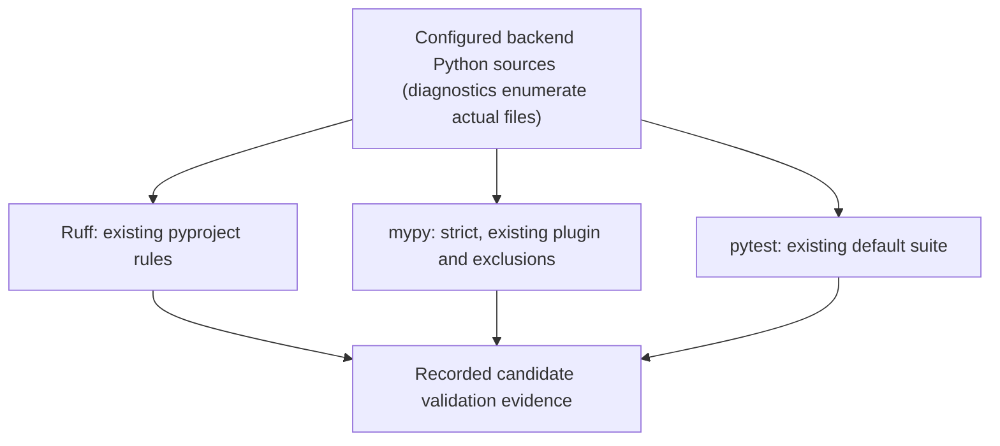

# Documento de Diseño — Restore lint-clean backend baseline (Ruff + mypy)

## Resumen

The backend's existing source and test files fail the repository's configured Ruff and strict mypy checks on the recorded unmodified baseline, although the default pytest suite passed in that same historical run. The design treats this as source-quality debt: repair only existing backend findings while preserving executable behavior and every current checker/test policy. The approved expected behavior also requires a fresh project environment for candidate validation; historical diagnostic counts are evidence, not acceptance thresholds.

1. Inventory diagnostics from the exact candidate and recorded tool versions; distinguish source findings from environment/toolchain failures.
2. Make the smallest source/test edits that satisfy existing Ruff and mypy configuration, without ignores, rule relaxation, or dependency/config changes.
3. For each lint/type finding, retain the pre-correction Ruff/mypy diagnostic as RED evidence before applying the minimal correction; add or identify focused protective tests for any affected unchanged behavior, which may pass both before and after the correction. If a new test is authored, write and run it before the production edit, without manufacturing a behavior failure.
4. Run focused tests, then the complete default backend `pytest -q` suite, Ruff, and mypy; record exact versions, commands, exits, and outputs.
5. Stop and report any proposed correction that changes runtime behavior or requires configuration/dependency policy changes.

## Decisiones de Diseño Clave

**Diagnose the complete configured backend target and repair only authorized source files, preserving `backend/pyproject.toml`.** `ruff check .` and `mypy .` are run from `backend/`; their actual per-file diagnostics determine the source inventory, not an assumed `app/` and `tests/`-only list. The Ruff policy is line length 120, Python target 3.11, and rules `E,F,W,I,N,UP,B,A,SIM`; mypy is strict with the Pydantic plugin and its existing exclusions/overrides. Apply minimal fixes to diagnosed application/test sources and any other backend Python source that is within the approved bugfix scope. For any diagnosed `backend/alembic/` migration, inspect the exact migration and preserve its operations, ordering, and resulting schema/data semantics; a static-only correction is permitted only when that equivalence is evidenced. If a diagnostic cannot be corrected without changing migration or runtime behavior, or falls outside the approved source scope, stop and report the exact file/diagnostic to Ansel rather than suppressing it or claiming a clean baseline. *Alternativas descartadas:* narrowing Ruff's target, weakening strict mypy, or adding ignores would hide findings and violate the approved behavior; assuming all findings are confined to `app/` and `tests/` would leave actual configured target files unexplained.

**Use diagnostics-driven, minimal edits; no blanket formatter or codemod.** Each edit must map to a concrete diagnostic and be reviewed for semantic impact. *Alternativas descartadas:* broad automated rewrites may create unrelated changes and obscure behavioral effects; the approved scope is limited to existing findings.

**Preserve runtime behavior; test behavior-bearing edits before implementation.** A focused regression test must demonstrate the expected unchanged behavior before the corresponding production edit; purely static or formatting-only edits may instead include explicit semantic-equivalence evidence. *Alternatives descartadas:* relying on a full-suite pass alone cannot show that a locally affected behavior remains intact; changing behavior would exceed this bugfix and needs a separate approved decision.

**Validate a fresh candidate environment separately from the historical reproduction.** Provision only as authorized by the approved bugfix (`pip install -e ".[dev]"` in a fresh environment), record actual Python/Ruff/mypy versions, and run the prescribed checks. Do not install or upgrade packages in the existing historical baseline environment. *Alternatives descartadas:* reusing the recorded Python 3.13.4/Ruff 0.15.17/mypy 2.1.0 environment as proof of the separately specified candidate toolchain confuses two distinct evidence sets; relying on asserted version ranges rather than actual resolved versions is not reproducible.

## Arquitectura

This is a source-quality repair, not a runtime architecture change. Existing code modules and their interfaces remain the runtime design. Static tools inspect backend application and test sources under the checked-in configuration; pytest verifies the default test set. No service, API, database, queue, or deployment component is added or altered.



```mermaid
sequenceDiagram
    participant Dev as Implementer
    participant Env as Fresh backend dev environment
    participant Src as Backend sources and tests
    participant Tools as Ruff, mypy, pytest
    participant Rec as Candidate evidence record
    Dev->>Env: Provision backend with existing dev dependency declaration
    Dev->>Tools: Record exact interpreter and tool versions
    Dev->>Tools: Run diagnostics against unchanged policy
    Tools->>Src: Report source/test findings
    Dev->>Tools: Retain pre-correction checker RED diagnostic; add/identify protective test if needed
    Dev->>Src: Apply minimal finding-specific correction
    Dev->>Tools: Run focused tests, full pytest, Ruff, and mypy
    Tools-->>Rec: Return exact commands, exits, summaries, and failures
```

## Componentes e Interfaces

### 1. Diagnosed backend sources and approved repair boundary (`backend/`)

Run the configured checks from `backend/` and inventory every reported file, including `backend/app/`, `backend/tests/`, and any other included Python source such as `backend/alembic/`. No exact per-file repair is prescribed before candidate diagnostics are inspected. Repair each finding only within the approved bugfix scope and preserve public interfaces and runtime semantics. For migration files, review the migration operation and its ordering before and after each proposed static/type correction; do not alter operations, schema/data effects, or migration ordering. If a finding is outside the authorized source boundary or requires behavior changes, record the exact diagnostic and stop/escalate rather than silently leaving it unresolved, suppressing it, or claiming the acceptance check is clean.

### 2. Existing checker configuration (`backend/pyproject.toml`)

This file is a constraint, not a target for modification. Ruff remains configured with line length `120`, target `py311`, and the existing selected rules. mypy remains `strict = true`, `python_version = "3.11"`, uses `pydantic.mypy`, retains the existing engine exclusions and missing-import overrides. pytest retains existing testpaths, asyncio mode, and markers. No new ignore, exclusion, marker, dependency pin, or configuration option is designed.

### 3. Candidate verification boundary

From `backend/` in the fresh candidate environment, execute exactly:

- `ruff check .`
- `mypy .`
- focused regression tests for each behavior-bearing production edit
- `pytest -q`

Record the actual environment versions, complete command/output or faithful saved output reference, exit status, and service prerequisites for any blocked integration test. These are validation steps, not new runtime interfaces.

## Modelos de Datos

No runtime or persisted data model changes are authorized. The implementation report should maintain a verification record containing: candidate commit, Python/Ruff/mypy versions, environment provisioning command, each validation command and exit status, findings/output reference, focused-test-to-change mapping, and any blocked prerequisite. This is evidence only; it does not introduce an application model or product data.

## Propiedades de Correctitud

**Propiedad 1 — Ruff baseline clean.** For the corrected candidate under the existing `backend/pyproject.toml` policy and the recorded fresh environment, `ruff check .` from `backend/` exits `0` with no findings. Configuration and ignore policy are byte-for-byte unchanged. *Valida: Bugfix acceptance criteria 1, 5, 6.*

**Propiedad 2 — Strict mypy baseline clean.** For the corrected candidate under the existing mypy policy and recorded fresh environment, `mypy .` from `backend/` exits `0` with no findings. Configuration, exclusions, and overrides are unchanged. *Valida: Bugfix acceptance criteria 2, 5, 6.*

**Propiedad 3 — Default test suite remains effective and green.** The unmodified default test discovery and markers execute; `pytest -q` exits `0` in an environment meeting external-service prerequisites. No tests are weakened, removed, or skipped merely to manufacture a pass. *Valida: Bugfix acceptance criteria 3, 5.*

**Propiedad 4 — Existing behavior is preserved for each production path touched.** For every changed production path, focused regression tests encode its approved unchanged behavior and pass on the pre-change and corrected candidates; they are protective tests, not tests expected to fail before the fix. The RED evidence for a behavior-preserving lint/type correction is the pre-correction Ruff/mypy diagnostic for the targeted finding (record exact file, rule/error, command, and output); then apply the minimal correction and demonstrate that diagnostic is gone, the protective test remains green, and the relevant check/test set stays green. For a static/formatting-only edit, retain explicit semantic-equivalence evidence in addition to the relevant checker and surrounding tests. Any correction that changes runtime or migration behavior is outside scope and must stop. *Valida: Bugfix acceptance criteria 4, 5 and each applicable “Comportamiento Sin Cambios” item.*

**Propiedad 5 — Toolchain effects are distinguished from source findings.** Candidate validation records actual Python/Ruff/mypy versions and separates fresh-environment candidate results from the recorded historical baseline; inability to provision or run a check is reported as blocked with exact evidence, not as success. *Valida: Bugfix acceptance criteria 6.*

## Manejo de Errores

| Escenario | Comportamiento |
|---|---|
| Fresh dependency provisioning fails | Record exact command, resolved environment state, and output; do not modify the existing baseline environment or infer source cleanliness. Escalate blocker. |
| Ruff or mypy still reports findings | Preserve complete output and exit status; map diagnostics to source findings vs. environment/toolchain causes; continue only within approved source scope. No ignores or policy relaxation. |
| Correction requires runtime behavior change | Stop that finding and report exact diagnostic, affected behavior, and why a semantics-preserving repair is unavailable; request separate approval through Ansel. |
| A pre-correction Ruff/mypy diagnostic identifies a targeted finding | Preserve the diagnostic as the RED evidence for the source correction; rerun the checker after correction. A protective unchanged-behavior test passing before the correction is expected and is not a RED failure. If a protective test fails, investigate the unexpected behavior/scope and stop to route it through Ansel rather than changing behavior to satisfy a lint finding. |
| Default integration-marked tests lack external services | Record exact command/output and unavailable service; preserve tests and markers and mark acceptance blocked until rerun with required services. |
| Candidate validation command fails or times out | Record exact command and observed result; do not infer success from a partial/unknown result. |

## Estrategia de Testing

For each diagnosed lint/type defect, establish RED with the pre-correction Ruff/mypy diagnostic on the exact candidate and retain its command, file/rule or error, and output. Apply the smallest authorized correction, then establish GREEN by rerunning the relevant checker and focused tests; REFACTOR only while those checks remain green. Separately, for each production path touched, add or identify focused protective regression tests for every applicable unchanged-behavior item and run them before and after the correction. These preservation tests may pass on both versions: they are not required to fail before a behavior-preserving fix, and no runtime behavior may be changed merely to manufacture RED. For formatting/static-only changes, document the precise semantic-equivalence rationale and still run the relevant checker and surrounding tests. A behavior-changing proposed fix is stopped and routed through Ansel.

**Test targets and commands:**

- Focused regression tests: run the specific pytest node(s) from `backend/` before and after the corresponding production change; record exact node IDs and command output.
- Full default test suite: `pytest -q` from `backend/`.
- Ruff: `ruff check .` from `backend/`.
- mypy: `mypy .` from `backend/`.

**Environment and reporting:** use a fresh backend environment provisioned from the existing project declaration; report actual resolved Python/Ruff/mypy versions. Do not install or upgrade packages in the recorded existing baseline venv. Run pytest with the needed external services when integration tests require them; a service-blocked result is not green acceptance. If tests and implementation are split into separate tasks, transfer any newly authored test commit/diff (if there is one), the pre-production base branch/SHA, the exact pre-correction Ruff/mypy RED command/output and targeted diagnostic, any protective test results, the authorized integration route, and candidate worktree handoff. The implementation phase must receive the checker RED evidence before production edits; do not require or fabricate a failing behavioral test when the approved behavior must remain unchanged. Post-hoc QA does not replace pre-correction checker evidence.
