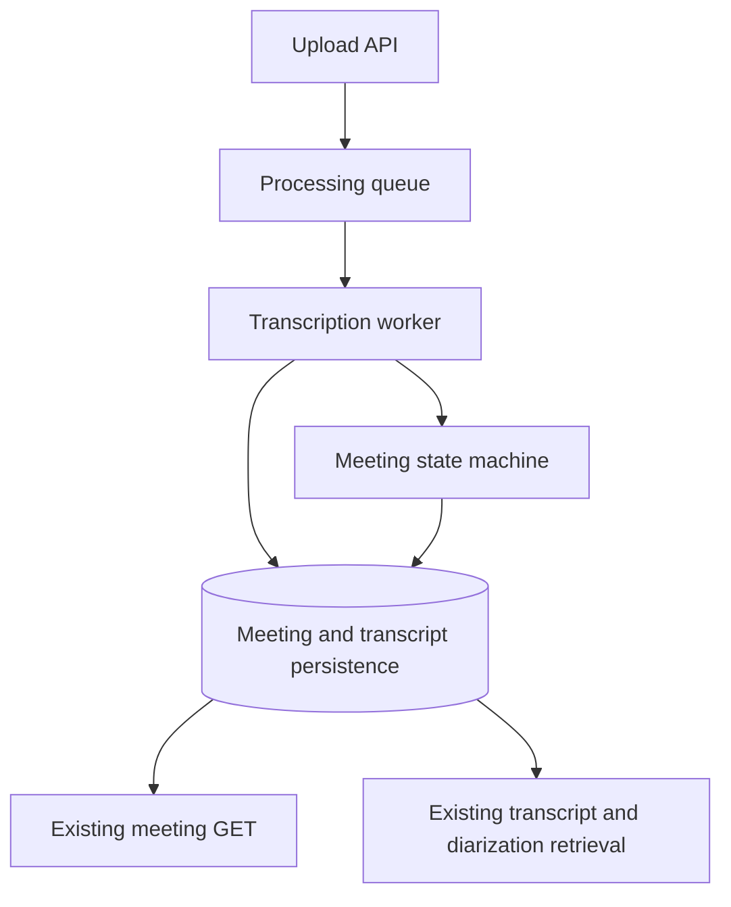

# Documento de Diseño — Uploaded Meeting Completion State

## Resumen

A direct upload can begin with a meeting still in `queued`, whereas the current meeting state machine only accepts `recording_uploaded` from `recording`. The transcription worker then tries to mark successful completion while the meeting is still `queued`; its completion event is rejected, although transcript persistence may have succeeded. The bugfix must make successful uploaded processing visible through the existing meeting state without misrepresenting unfinished or failed work, changing capture-path semantics, or expanding into the independent diarization GET 404.

1. Verify the actual direct-upload worker event sequence and existing persistence ordering before implementing the fix; the approved bugfix describes the root cause as a high-confidence hypothesis, not captured call-site proof.
2. Correct the meeting-domain state transition for the uploaded queued path so successful completion can occur only after required processing has succeeded.
3. Keep failure transitions and the established `joining` → `recording` → `transcribing` capture path intact.
4. Preserve transcript/diarization response contracts and user-facing wording; do not introduce a new label or claim anything about the separate GET `/diarization` failure.
5. Add focused state-machine and worker-level regression coverage using synthetic fixtures, plus a regression check for the existing capture transitions.

## Decisiones de Diseño Clave

**Represent direct-upload progress and completion through the existing meeting process-state domain, not a new API/UI state.** The current domain already has `queued`, `transcribing`, `completed`, and `failed`; approved scope requires truthful successful completion but explicitly leaves state vocabulary and labels open. The implementation should use these existing values and expose no new user-facing label.
*Alternativas descartadas:* Adding a new state or API field would expand the approved contract and require downstream compatibility work. Treating the transcript's existence alone as completion could incorrectly imply diarization/review readiness when processing is incomplete.

**Fix the invalid direct-upload transition at the meeting state boundary after confirming the event order.** `backend/app/meetings/state_machine.py` is the pure transition authority; `backend/app/transcription/worker.py` currently attempts `recording_uploaded` only when current state is `recording` and later sends `transcription_completed`. The approved bugfix points to a queued/direct-upload mismatch but explicitly requires implementation to verify the sequence. Ensure the chosen transition/event path preserves the invariant that incomplete or failed processing is not successful completion.
*Alternatives descartadas:* Editing only the GET serializer would hide an inconsistent persisted domain state and leave transition rejection intact. Relaxing all transition guards or treating rejected events as success would undermine the state machine's capture and failure guarantees.

**Do not alter transcript or diarization endpoint contracts, nor the independent diarization failure path.** Limit implementation to meeting state progression and its regression tests.
*Alternatives descartadas:* Coupling this correction to diarization retrieval or redesigning processing APIs is outside the approved defect, risks #248 gates, and is unsupported by the reproduction evidence.

**Keep the fix inside the existing meetings/transcription modules.** The state map and its pure unit/property tests belong under `backend/app/meetings/` and `backend/tests/meetings/`; any worker regression belongs under `backend/tests/transcription/` following existing patterns. No new module or cross-surface contract is needed.
*Alternatives descartadas:* Moving state ownership into a new orchestration module adds structure without a requirement. Duplicating state logic in the worker would create competing transition authorities.

## Arquitectura

The meeting state machine remains the single authority for process-state transitions. The upload/queue path supplies a meeting and recording to the transcription worker; the worker persists transcription results and applies a valid state event. The fix must establish a valid path from the initial `queued` state through in-progress processing to `completed`, only on successful processing. Failures remain `failed`; capture-origin meetings preserve their existing transition path.



```mermaid
sequenceDiagram
    participant C as Client
    participant U as Upload API
    participant W as Transcription worker
    participant S as Meeting state machine
    participant DB as Persistence
    C->>U: Upload recording for queued meeting
    U->>DB: Store recording and enqueue processing
    W->>DB: Load meeting and persisted recording
    W->>S: Apply verified in-progress event
    S-->>W: Valid processing state
    W->>DB: Persist transcript and speaker results per existing flow
    W->>S: Apply completion only after successful processing
    S-->>W: completed
    W->>DB: Persist resulting meeting state
    C->>DB: Read existing meeting/transcript results
    DB-->>C: Existing contracts; successful state only after completion
```

## Componentes e Interfaces

### 1. Meeting state machine (`backend/app/meetings/state_machine.py`)

- Retain `apply_event(current_state: str, event: str) -> TransitionResult` as a pure function and keep state/event vocabulary within the existing model unless implementation evidence proves a necessary, approved change.
- Add or adjust only the transition(s) needed to accept the verified queued-upload processing sequence and successful completion.
- A completed transition must not be reachable from a processing-incomplete or failed path; terminal states remain immutable.
- Preserve `queued` initialization, `queued` → `joining`, `joining` → `recording`, `recording` → `transcribing`, and established failure semantics.

### 2. Transcription worker (`backend/app/transcription/worker.py`)

- Verify queue validation, state reads, transcript persistence, and event ordering against implementation before editing.
- Apply a state event consistent with the meeting machine for the uploaded path; do not silently ignore rejected transitions or log success when state mutation failed.
- Apply successful completion only after required work has succeeded. Preserve existing engine-failure handling and transcript persistence behavior; do not change response schemas.

### 3. Tests

- State transition tests: cover the queued uploaded path, successful completion, invalid premature completion, terminal immutability, and existing capture transitions.
- Worker tests: synthetic queued meeting + valid recording; success results in completed state and persisted transcript; unfinished/error paths never report completed; capture-path behavior remains unchanged.
- Keep tests in `backend/tests/meetings/` and `backend/tests/transcription/`; extend the nearest existing tests rather than creating a new testing framework.

### Folder placement and infrastructure impact

| Surface | Folders added or modified | Tests | Migration | Compose | `packages/shared-types` |
|---|---|---|---|---|---|
| Backend | Modify `backend/app/meetings/state_machine.py` and, only if verified event flow requires it, `backend/app/transcription/worker.py` | `backend/tests/meetings/`; `backend/tests/transcription/` | None expected: no data/schema change is authorized | No change | No change |
| Web, extension, shared API | None | None | N/A | N/A | No change |

## Modelos de Datos

No new persisted fields or public response fields are required. Continue using the existing meeting process state and existing transcript/diarization persistence models. No migration is expected; if source inspection unexpectedly demonstrates a schema change is required, stop and return to Ansel because that would exceed the approved fix constraints.

## Propiedades de Correctitud

**Propiedad 1 — Successful uploaded processing is not left queued**  
For an uploaded meeting initialized in `queued`, when the verified processing path and all required successful processing work complete, the persisted meeting state returned by the existing meeting GET is not `queued` and indicates successful completion.  
*Valida: bugfix Acceptance Criterion 1; baseline §4.B.1–3.*

**Propiedad 2 — Completion is gated on successful processing**  
For an uploaded meeting whose processing is incomplete or has failed, no path reports a successful terminal state. Failure remains represented as failure.  
*Valida: bugfix Acceptance Criterion 3; Expected Behavior.*

**Propiedad 3 — Results remain associated and retrievable**  
Successful processing continues to persist and return the transcript and speaker assignments for the same meeting; no retrieval contract changes.  
*Valida: bugfix Acceptance Criterion 2; Unchanged Behavior.*

**Propiedad 4 — Capture transitions remain stable**  
For every established capture-path transition through `joining` and `recording`, applying the correction does not alter its accepted/rejected result or resulting state.  
*Valida: bugfix Acceptance Criterion 4; Unchanged Behavior.*

**Propiedad 5 — Regression evidence is isolated**  
Tests use synthetic data and do not treat this state correction as evidence that GET `/api/v1/meetings/{meeting_id}/diarization` 404 is resolved or that #248 gates changed.  
*Valida: bugfix Acceptance Criterion 5 and Fix Constraints.*

## Manejo de Errores

| Escenario | Comportamiento |
|---|---|
| Queue message does not match meeting owner or persisted recording | Preserve existing discard behavior; do not advance process state. |
| Meeting is missing | Preserve existing missing-meeting handling; do not create a successful state. |
| Engine times out or returns no usable transcription | Preserve existing failure transition; never report `completed`. |
| A state event is invalid | Do not mask it as successful completion. Keep current state, emit actionable diagnostic evidence, and ensure persisted work does not create a false completed status. |
| Transcript persistence or required processing fails | Preserve transaction/error behavior; completion must not be committed as successful. |
| Independent GET `/diarization` failure occurs | Out of scope; do not change its endpoint, gate, or claim it is fixed. |

## Estrategia de Testing

Use the existing backend pytest suite and synthetic data only. First add focused failing regression tests for the actual invalid transition and worker sequence, then implement the smallest valid correction and rerun them. Include pure state-machine cases and worker/persistence coverage for successful, incomplete, failed, and capture-origin paths; verify transcript and diarization results remain associated through existing APIs. Do not assert a new user-facing label or use the unrelated diarization 404 as a signal for this bug.

**Estructura de archivos:**
- `backend/tests/meetings/` — transition unit/property regression coverage.
- `backend/tests/transcription/` — worker and persistence regression coverage.

**Validation commands** (from `backend/`):
```bash
pytest tests/meetings
pytest tests/transcription
pytest
```

These are implementation-stage recommendations; no test run or product acceptance is claimed by this design artifact.
