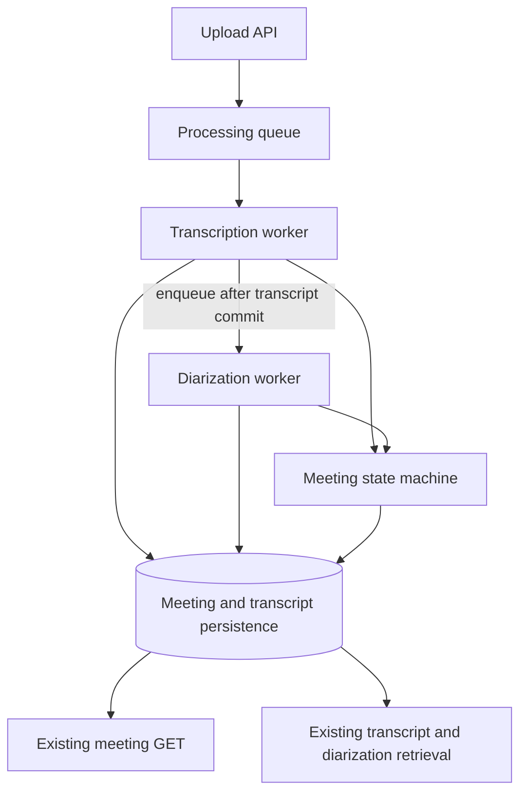

# Documento de Diseño — Uploaded Meeting Completion State

## Resumen

A direct upload can begin with a meeting still in `queued`, whereas the current meeting state machine only accepts `recording_uploaded` from `recording`. The transcription worker then tries to mark successful completion while the meeting is still `queued`; its completion event is rejected, although transcript persistence may have succeeded. The bugfix must make successful uploaded processing visible through the existing meeting state without misrepresenting unfinished or failed work, changing capture-path semantics, or expanding into the independent diarization GET 404.

1. Add `recording_uploaded: queued → transcribing` to the meeting state machine; retain `recording → transcribing` for the established capture path.
2. Keep the meeting in `transcribing` after transcript persistence and diarization enqueue; do not mark it complete at ASR completion.
3. After successful diarization results are atomically persisted, have the diarization worker apply `processing_completed: transcribing → completed` to the meeting in that transaction.
4. Map diarization engine or persistence failure to the existing meeting `engine_failed: transcribing → failed` path; never mark the meeting complete if either required stage is incomplete or failed.
5. Preserve API contracts, established capture transitions and synthetic-only testing; exclude unrelated GET `/diarization` behavior.

## Análisis de Causa Raíz

The state machine starts newly registered meetings in `queued`. In `backend/app/transcription/worker.py`, the pre-ASR transition currently calls `recording_uploaded` only if the loaded state equals `recording`, so a directly uploaded meeting in `queued` remains queued during ASR. After transcript persistence, the worker calls `transcription_completed`, which the current transition map accepts only from `transcribing`; that event is rejected. The worker then enqueues diarization separately, and `backend/app/diarization/worker.py` persists its result without updating meeting state. Therefore the meeting can remain `queued` even after both outputs are available. This is the mechanism indicated by the approved bugfix hypothesis and verified source; implementation must preserve correct transition/persistence ordering.

## Decisiones de Diseño Clave

**Represent direct-upload progress and completion through the existing meeting process-state domain, not a new API/UI state.** The current domain already has `queued`, `transcribing`, `completed`, and `failed`; approved scope requires truthful successful completion but explicitly leaves state vocabulary and labels open. The implementation should use these existing values and expose no new user-facing label.
*Alternativas descartadas:* Adding a new state or API field would expand the approved contract and require downstream compatibility work. Treating the transcript's existence alone as completion could incorrectly imply diarization/review readiness when processing is incomplete.

**Use an explicit two-stage completion gate in the existing meeting state machine.** Event sequence: direct upload `queued --recording_uploaded--> transcribing`; capture continues `joining --capture_started--> recording --recording_uploaded--> transcribing`; ASR success persists the transcript and enqueues diarization while meeting state stays `transcribing`; only successful diarization persistence applies `processing_completed` (`transcribing → completed`). Either processing stage's failure applies existing `engine_failed` (`transcribing → failed`). Thus diarization success proves transcript exists (the diarization worker requires it) and completion follows persistence of both required outputs.
*Alternatives descartadas:* Completing after ASR alone violates AC1, since diarization may still be pending or fail. Introducing a new public state/label or a new coordinating service exceeds the bugfix scope. Modifying a GET serializer would hide, not correct, persisted state.

**Keep coordination within existing meeting, transcription, and diarization modules.** The transition map remains in `backend/app/meetings/state_machine.py`; ASR orchestration stays in `backend/app/transcription/worker.py`; completion and failure transition calls are added to `backend/app/diarization/worker.py` around its existing atomic persistence. Tests extend `backend/tests/meetings/`, `backend/tests/transcription/`, and `backend/tests/diarization/`. No endpoint contract, independent GET `/diarization` behavior, or #248 gate changes.
*Alternatives descartadas:* A new orchestration module or duplicated state machine adds another source of truth; changing retrieval API contracts is unrelated and unsupported.

## Arquitectura

The meeting state machine remains the single authority for meeting process-state transitions. Direct upload follows `queued --recording_uploaded--> transcribing`. Capture retains `queued --start_capture--> joining --capture_started--> recording --recording_uploaded--> transcribing`. In either path, ASR success persists the transcript and enqueues diarization without completing the meeting. The diarization worker already requires that transcript; only after its successful transaction stores diarization, speakers, and assignments does it apply `processing_completed` (`transcribing → completed`) in the same transaction. ASR or diarization failure applies `engine_failed` (`transcribing → failed`); completion cannot occur early or from `failed`.



```mermaid
sequenceDiagram
    participant C as Client
    participant U as Upload API
    participant W as Transcription worker
    participant D as Diarization worker
    participant S as Meeting state machine
    participant DB as Persistence
    C->>U: Upload recording for queued meeting
    U->>DB: Store recording and enqueue transcription
    W->>DB: Load queued meeting and recording
    W->>S: recording_uploaded
    S-->>W: transcribing
    W->>DB: Persist transcript
    W->>D: Enqueue diarization
    Note over DB,S: Meeting remains transcribing
    D->>DB: Load transcript and recording
    D->>DB: Persist diarization, speakers and assignments
    D->>S: processing_completed (same transaction)
    S-->>D: completed
    C->>DB: Read existing meeting and results
    DB-->>C: Existing contracts; completion follows both persisted stages
```

## Componentes e Interfaces

### 1. Meeting state machine (`backend/app/meetings/state_machine.py`)

- Keep `apply_event(current_state: str, event: str) -> TransitionResult` pure.
- Add `VALID_TRANSITIONS["queued"]["recording_uploaded"] = "transcribing"` for direct uploads; retain `recording_uploaded: recording → transcribing`.
- Replace the ASR-to-completed event with `processing_completed: transcribing → completed`, called only by diarization after successful persistence.
- Retain `engine_failed: transcribing → failed`; completed and failed remain terminal and immutable. Do not permit completion from queued, recording, or failed.

### 2. Transcription worker (`backend/app/transcription/worker.py`)

- For an uploaded meeting, apply `recording_uploaded` when current state is `queued`; capture-origin `recording` keeps using the same event and transition.
- Persist transcript, then enqueue diarization as today. Remove its current `transcription_completed` → `completed` transition; meeting remains `transcribing` until diarization finishes.
- Preserve queue owner/recording validation, transcript persistence, failure reporting, and existing API contracts.

### 3. Diarization worker (`backend/app/diarization/worker.py`)

- Keep its requirement that a transcript exists and preserve the existing atomic write of diarization, speakers, and assignments.
- In that same DB transaction, load the meeting and apply `processing_completed`; commit results and `completed` state atomically. If the state transition is invalid, do not commit a false completion; raise/log the transition failure consistently with existing worker conventions.
- If engine execution or result persistence fails, apply `engine_failed` from `transcribing` in a failure-state transaction and do not set `completed`; preserve the existing error propagation/queue behavior rather than adding retry policy.

### 4. Tests

- `backend/tests/meetings/`: verify exact event paths, including queued→transcribing via `recording_uploaded`, transcribing→completed only via `processing_completed`, premature completion rejection, engine_failed, terminal immutability, and unchanged capture transitions.
- `backend/tests/transcription/`: synthetic direct-upload transcript success leaves meeting transcribing and queues diarization; ASR failure never completes.
- `backend/tests/diarization/`: synthetic diarization success atomically persists results and completes meeting; engine/persistence failure cannot complete; no transcript means no completion.

### Folder placement and infrastructure impact

| Surface | Folders added or modified | Tests | Migration | Compose | `packages/shared-types` |
|---|---|---|---|---|---|
| Backend | `backend/app/meetings/state_machine.py`, `backend/app/transcription/worker.py`, `backend/app/diarization/worker.py` | `backend/tests/meetings/`, `backend/tests/transcription/`, `backend/tests/diarization/` | None expected: existing meeting state values only | No change | No change |
| Web, extension, shared API | None | None | N/A | N/A | No change |

## Modelos de Datos

No new persisted fields or public response fields are required. Continue using the existing meeting process state and existing transcript/diarization persistence models. No migration is expected; if source inspection unexpectedly demonstrates a schema change is required, stop and return to Ansel because that would exceed the approved fix constraints.

## Propiedades de Correctitud

**Propiedad 1 — Registration remains queued until processing starts**
A newly registered meeting continues to initialize as `queued`; it does not enter a processing or successful state until upload processing begins.
*Valida: Unchanged Behavior 1.*

**Propiedad 2 — Uploaded completion waits for both stages**
For an uploaded meeting initialized in `queued`, `recording_uploaded` moves it to `transcribing`; transcript completion alone leaves it `transcribing`; only persisted successful diarization followed by `processing_completed` results in `completed`, returned by the existing meeting GET.
*Valida: bugfix Acceptance Criterion 1; baseline §4.B.1–3.*

**Propiedad 3 — Completion is gated on successful processing**
For an uploaded meeting whose processing is incomplete or has failed, no path reports a successful terminal state. Failure remains represented as failure.
*Valida: bugfix Acceptance Criterion 3; Expected Behavior.*

**Propiedad 4 — Results remain associated and retrievable**
Successful processing continues to persist and return the transcript and speaker assignments for the same meeting; no retrieval contract changes.
*Valida: bugfix Acceptance Criterion 2; Unchanged Behavior.*

**Propiedad 5 — Capture transitions remain stable**
For every established capture-path transition through `joining` and `recording`, applying the correction does not alter its accepted/rejected result or resulting state.
*Valida: bugfix Acceptance Criterion 4; Unchanged Behavior.*

**Propiedad 6 — Regression evidence is isolated**
Tests use synthetic data and do not treat this state correction as evidence that GET `/api/v1/meetings/{meeting_id}/diarization` 404 is resolved or that #248 gates changed.
*Valida: bugfix Acceptance Criterion 5 and Fix Constraints.*

## Manejo de Errores

| Escenario | Comportamiento |
|---|---|
| Queue message does not match meeting owner or persisted recording | Preserve existing discard behavior; do not advance process state. |
| Meeting is missing | Preserve existing missing-meeting handling; do not create a successful state. |
| ASR times out, returns no usable transcription, or transcript persistence fails | Apply `engine_failed` from `transcribing` where possible; never report `completed`. Preserve existing exception/queue behavior. |
| Diarization engine or result persistence fails | Do not apply `processing_completed`; apply `engine_failed` from `transcribing` in a failure-state transaction and preserve existing exception/queue behavior. |
| `processing_completed` is attempted from any state other than `transcribing` | Reject the transition; do not commit meeting completion. Log actionable diagnostic evidence. |
| Diarization message has invalid owner/recording or transcript is missing | Preserve existing discard behavior; meeting cannot become completed through this worker. |
| Independent GET `/diarization` failure occurs | Out of scope; do not change its endpoint, gate, or claim it is fixed. |

## Estrategia de Testing

Use the existing backend pytest suite and synthetic data only. First write focused failing regression tests, then implement and rerun them. Cover the exact meeting state event sequence and both asynchronous workers: transcription success persists the transcript and leaves the meeting `transcribing`; successful diarization persistence atomically results in `completed`; failures or missing/incomplete stages cannot yield completion; capture transitions and existing retrieval of transcript/speaker assignments remain unchanged. Test that meeting state and diarization result commit atomically on success, and that a failed persistence transaction does not leave a completed meeting. Do not assert a new user-facing label or use the unrelated diarization 404 as a signal for this bug.

**Estructura de archivos:**
- `backend/tests/meetings/` — transition unit/property regression coverage.
- `backend/tests/transcription/` — worker/persistence coverage: queued upload transitions to `transcribing`, transcript persists, diarization is enqueued, no early completion.
- `backend/tests/diarization/` — worker/persistence coverage: successful result plus `processing_completed` transaction; failure, absent transcript, and invalid transition cannot complete.

**Validation commands** (from `backend/`):
```bash
pytest tests/meetings
pytest tests/transcription
pytest tests/diarization
pytest
```

These are implementation-stage recommendations; no test run or product acceptance is claimed by this design artifact.
