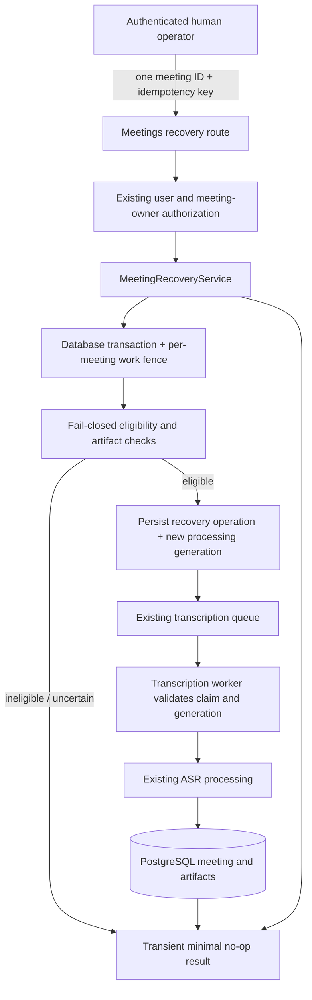

# Documento de Diseño — Guarded manual recovery for stale meeting processing

## Resumen

Re-ingesting a recording is intentionally idempotent and does not restore a stale meeting's processing state. The approved evidence does not show that an empty queue or an existing audio object proves that a particular meeting is idle, and one observed queued meeting already has a transcript. A recovery path therefore cannot be a replay shortcut: it must establish a durable per-meeting exclusion boundary, refuse ambiguous or artifact-bearing candidates without side effects, and make its result inspectable without exposing meeting content.

1. Add a human-invoked recovery operation to the existing backend meetings boundary; do not wire it to ingestion, normal worker retries, startup, or a scheduler.
2. Centralize eligibility and state mutation in a meetings recovery service using a database transaction, durable per-meeting recovery/worker fencing, and fail-closed checks for recording, generated outputs, review artifacts, and notes/speakers.
3. Keep recovery single-meeting and idempotent: an operation key identifies one request; a durable audit/result record returns the same result for duplicate submissions and does not enqueue twice.
4. Publish only the persisted recording identifiers to the existing transcription queue after the guarded state change commits; reject stale/duplicate worker messages that do not match the active processing generation.
5. Return and log a minimal result (opaque meeting reference, outcome, reason code, operation reference and timestamps), never transcript or note text, media references, or participant content.
6. Validate with synthetic backend tests at the service, API and worker boundaries; the first live-use pilot remains one meeting and is not authorized by this design or its tests.

## Decisiones de Diseño Clave

**Recovery is a meetings-domain operation, not a replay through ingestion.** The current `process_ingestion` path returns the existing recording and is not a recovery contract; using it would conflate ingestion idempotency with operator intent and could duplicate work. Recovery accepts a meeting identifier and request idempotency key, then uses the persisted recording row as the sole source for the transcription job.

**Use one database-coordinated per-meeting work fence shared by recovery and processing workers.** The design must add a durable work-claim/generation mechanism that is acquired by transcription and diarization workers before any per-meeting processing side effect and by recovery before its eligibility read. Recovery changes the generation while holding the claim; jobs carry the generation and workers reject a mismatch before touching state or data. If an existing or legacy queue message cannot be shown to be fenced against the new generation, the operation aborts without mutation. Queue depth and consumer counts are not proof of idleness. A row lock by itself is insufficient because current worker execution can span transactions and the broker can deliver later; the worker-side generation check and shared claim are required to fence both in-flight and delayed messages.

*Alternatives descartadas:* relying on empty RabbitMQ queue totals or a process-age timeout cannot prove the absence of an active or delayed meeting job. A process-local lock disappears on restart and is not shared across API/worker replicas. Blind queue purge/replay is destructive and can affect other meetings. Re-ingestion does not requeue an existing recording. No arbitrary staleness threshold is introduced because the approved bugfix defines no time threshold.

**Eligibility is deliberately conservative and read-only until every gate passes.** In the same transaction and while holding the work fence, require exactly one existing recording with a non-empty canonical audio reference; state exactly `queued` or `transcribing`; no transcription/diarization claim or active worker; no `Transcript`, `Diarization`, speaker review, generated processing output, or conflicting queued/in-flight work for that meeting; and no uncertainty in any probe. Existing notes and confirmed speakers are preserved as immutable rows and are not deleted or rewritten. The known transcript-bearing candidate is excluded and returns `ineligible_artifacts`/review-required; this design does not migrate, replace, or replay over it. Object existence alone does not qualify a meeting, and a failed/unavailable object check is a no-op. These are explicit safe conditions, not claims about the six live candidates.

**Preserve existing identity, ownership, and retention boundaries.** Place the authenticated operation under `backend/app/meetings/`; reuse the established meeting owner authorization and access-audit mechanisms, and do not add a broader administrator capability or change consent/retention rules. The permitted human operator role must remain limited to the existing authorized owner unless an approved requirement changes that boundary. No UI or client changes are required for this backend defect scope.

**Enforce the first pilot with a fail-closed, one-meeting gate.** Recovery is disabled by default via runtime setting `SAURI_MANUAL_RECOVERY_MODE=disabled`. To authorize the first use, Fer (project owner) must explicitly authorize the pilot after implementation, QA and security review; the deployment operator then sets `SAURI_MANUAL_RECOVERY_MODE=pilot` and one exact opaque `SAURI_RECOVERY_PILOT_MEETING_ID` in the protected deployment environment, never in source control, logs, or shared evidence. The first explicit recovery POST for that allowlisted meeting locks the singleton gate row without changing it, performs every eligibility check, then atomically claims the gate (`disabled -> running`) together with its accepted recovery operation; an ineligible request rolls back with the gate and all recovery/meeting data unchanged. Startup, deployment, and ordinary processing never arm or consume it. The gate moves atomically `disabled -> running -> awaiting_verification`; while running or awaiting verification every other recovery request is rejected without mutation. It is consumed only by the first accepted recovery operation and cannot be re-armed by the recovery API. The meeting owner who submits the pilot request is the named pilot operator and must inspect the content-free status endpoint, verify the final result and artifact-preservation verdict, and explicitly acknowledge verification. Only then can the gate become `verified`; this feature remains pilot-only and disabled for any second meeting. Expansion beyond that one pilot requires a separate explicit Fer authorization after reviewing the recorded verification evidence, plus a separate controlled configuration change; neither occurs automatically or within this fix. If status is incomplete, preservation is false/unknown, or the explicit verification is absent, the pilot remains blocked and no further recovery can run. No batch endpoint, bulk flag, automatic retries, deployment, live operation, or release authorization is part of this design.

## Arquitectura



```mermaid
sequenceDiagram
    participant O as Operator
    participant R as Meetings route
    participant S as Recovery service
    participant D as PostgreSQL
    participant Q as Transcription queue
    participant W as Worker
    O->>R: POST one meeting_id + Idempotency-Key
    R->>R: JWT, sales authorization, meeting ownership
    R->>S: recover(meeting_id, actor_id, key)
    S->>D: Begin; lock meeting/work claim; resolve duplicate key
    S->>D: Check state, recording, outputs, reviews, notes/speakers, work generation
    alt Any check fails or uncertain
        S-->>R: not_recovered + reason code (no meeting or recovery-data mutation)
        R-->>O: Verifiable no-op response
    else Eligible and fenced
        S->>D: Persist operation + generation/state transition atomically
        D-->>S: Commit
        S->>Q: Publish exact persisted recording and generation
        Q->>W: Deliver one recovery job
        W->>D: Acquire matching claim; verify generation before processing
        alt Mismatch or duplicate
            W-->>Q: Acknowledge as stale/duplicate without work
        else Match
            W->>W: Normal transcription pipeline
            W->>D: Persist transcript/state and completion evidence
        end
        S-->>R: accepted + operation reference
        R-->>O: Minimal accepted receipt
        O->>R: GET recovery status for operation_id
        R->>D: Verify owner; compare final state and artifact snapshot
        R-->>O: Content-free result + preservation verdict
        O->>R: POST verify-pilot acknowledgement
        R->>D: Confirm completed + unchanged snapshot; close pilot gate
        R-->>O: pilot_verified or fail-closed result
    end
```

The current queue API has no transactional publish with PostgreSQL. To avoid committing a state change while losing the recovery message, the recovery operation and a single outbox row must commit atomically; an outbox dispatcher publishes the job and marks delivery. The dispatcher is an implementation detail of this manual recovery path, not an automatic recovery trigger. It retries delivery of the already-authorized operation only, using the same operation ID and generation; it must not create a second recovery or reset processing state. If the implementation cannot provide durable outbox delivery and idempotent worker handling, recovery remains unavailable rather than falling back to an unsafe direct publish.

A recovery result has a small finite outcome vocabulary: `accepted`, `already_requested`, `not_found`, `not_authorized`, `pilot_not_armed`, `pilot_in_use`, `ineligible_state`, `ineligible_artifacts`, `active_or_pending_work`, `eligibility_unverified`, `dispatch_pending`, `awaiting_operator_verification`, `pilot_verified`, `processing_failed`, and `completed`. Messages/logs contain only outcome/reason codes and opaque operation/meeting identifiers. They must not include transcript text, notes, speaker labels, audio/video object references, or raw queue payloads.

## Componentes e Interfaces

### 1. Meetings route — `backend/app/meetings/router.py`

Add a single authenticated `POST /api/v1/meetings/{meeting_id}/recover` operation. Reuse `get_current_user`, the existing owner-scoped meeting authorization, and access auditing. Require an `Idempotency-Key`; validate its bounded format and bind it to actor + meeting + request operation. The body does not accept object references, owner IDs, processing state, or a batch of meeting IDs. Return a typed minimal response with `operation_id`, `meeting_id`, `status`, `reason_code` (when not accepted), and timestamps. Do not return transcript, notes, speakers, or media metadata.

Add an owner-authenticated `GET /api/v1/meetings/{meeting_id}/recoveries/{operation_id}` status/verification operation, using the same meeting-owner authorization and not-found behavior. It returns only durable processing status, reason code, timestamps, final meeting state, and an artifact-preservation verdict with before/after counts and a boolean result. The persisted snapshot is a digest of sorted opaque artifact-row IDs for preserved notes and confirmed speakers, plus counts for artifact types; it contains no text, labels, object references, or raw IDs in the response. Compute the current snapshot when status is read and compare with the pre-recovery snapshot; report `preservation_verified=false` on any mismatch or read error. A completed recovery is not considered operator-verified until this GET result confirms completed state and preserved snapshot. Ineligible/uncertain POST responses are transient no-op results and have no operation ID; their exact reason is returned directly without persisting recovery data.

Add a separate owner-authenticated `POST /api/v1/meetings/{meeting_id}/recoveries/{operation_id}/verify-pilot` acknowledgement. It accepts only an explicit `verified=true` confirmation from the named pilot operator and succeeds only when the persisted operation is complete, the status read recomputes an exact matching artifact snapshot, and the result is for the gate's one allowlisted meeting. It atomically advances `awaiting_verification` to `verified`; it cannot authorize another recovery or expand the allowlist. A failed check leaves the gate blocked.

An unauthorized or non-owner caller cannot use these endpoints to discover another user's meeting or its artifacts; preserve the current not-found behavior for non-owned records.

### 2. Recovery service — `backend/app/meetings/recovery_service.py`

`MeetingRecoveryService.recover(meeting_id, actor_id, idempotency_key)` owns eligibility and transaction orchestration. It obtains a database-backed exclusive per-meeting claim before checking mutable state. It checks the enumerated eligibility conditions and returns only a reason code for an aborted check without persisting an operation or changing meeting, artifact, or queue data. It revalidates the meeting state and generation under the same transaction before committing. The operation's unique idempotency constraint prevents an accepted request from enqueueing a second job; an abort has no persisted key and a later explicit request must repeat every eligibility check.

A successful transition is recorded through the existing meetings state-transition/history mechanism where the existing transition vocabulary permits it; do not silently add a general-purpose transition to `state_machine.py`. If the approved state graph lacks a recovery event, introduce the narrowly named recovery event with explicit source states, destination and history semantics, and regression tests. Its semantics return the stale meeting to the transcription-ready state (`transcribing`) only after all guards pass; the replay itself is a new fenced attempt, never a deletion/reset of artifacts.

### 3. Persistence — `backend/app/infra/models.py` and next `backend/alembic/versions/`

Add the smallest durable structures needed for correctness: a recovery-operation record (unique idempotency scope, meeting, actor, outcome/reason, processing generation, created/updated timestamps) and an outbox job record (unique operation ID, topic, opaque serialized job identifiers, delivery status/attempt metadata). Extend the meeting processing coordination model with a monotonic generation/claim identity if an existing model cannot safely represent it. Use foreign keys and indexes consistent with current PostgreSQL conventions; migration and ORM changes ship together. Do not persist transcript text, recording object references, raw broker payloads, or sensitive content in recovery/audit rows.

Rollback must not remove or overwrite existing meetings, notes, speakers, transcripts, diarizations, reviews, recordings, or retention metadata. Rollback of the schema migration is safe only before recovery operations have been used; after use, retain operation history and perform forward-compatible rollback rather than deleting audit evidence.

### 4. Worker fence and queue dispatch — `backend/app/transcription/worker.py`, `backend/app/diarization/worker.py`, `backend/app/infra/queue*.py`

Before any meeting transition, engine invocation, or artifact write, workers acquire the same database claim and validate the expected generation and job/recording/owner binding. Every normal job producer must include the generation at enqueue time after the coordination protocol is introduced; legacy jobs without a verifiable generation fail closed for recovery-sensitive meetings. Duplicate deliveries are acknowledged without repeating work once the operation/generation is terminal. Diarization work is included in the exclusion and artifact guard even though a successful recovery only dispatches transcription; a queued or active diarization job makes the candidate ineligible.

The outbox dispatcher publishes only committed operation records, using stable operation IDs and existing queue transport. Publish/ack ambiguity is resolved by idempotent worker claims, not by creating another processing generation. Do not log full message payloads; current worker warning paths that may emit raw payloads must be narrowed for paths touched by this change.

### 5. Tests — `backend/tests/meetings/`, `backend/tests/transcription/`, `backend/tests/diarization/`, and `backend/tests/integration/`

Add focused synthetic tests beside the affected modules and an API/integration test for the actual recovery route. Existing recording-ingestion regression remains in `backend/tests/ingestion/`. No frontend, extension, shared-type, or client contract changes are required. No UI component is introduced; an operator uses the authenticated API boundary within the existing application access controls.

**Surface placement declaration:** Backend only. Add/modify `backend/app/meetings/`, `backend/app/infra/`, `backend/app/transcription/`, `backend/app/diarization/`, and `backend/alembic/versions/`; tests in the corresponding `backend/tests/meetings/`, `transcription/`, `diarization/`, plus integration tests. One database migration is required. `docker-compose.yml` does not need changes; `packages/shared-types/` does not need changes.

## Modelos de Datos

```text
MeetingProcessingControl
- meeting_id (PK/FK)
- generation (monotonic integer)
- claim_token (nullable opaque UUID)
- claim_kind (nullable enum: transcription | diarization | recovery)
- claim_expires_at (nullable timestamp; expiration alone never proves safety)

MeetingRecoveryOperation
- operation_id (UUID PK)
- meeting_id (FK)
- actor_id (opaque user ID)
- idempotency_key_digest (unique scoped digest)
- generation (integer)
- status (accepted | dispatch_pending | processing | completed | failed)
- reason_code (nullable finite code for later processing/dispatch outcome)
- created_at / updated_at (UTC)

RecoveryOutbox
- id (UUID PK)
- operation_id (unique FK)
- topic (fixed transcription topic)
- generation (integer)
- delivery_state (pending | published)
- attempts / next_attempt_at / created_at

RecoveryPilotGate (singleton)
- state (disabled | running | awaiting_verification | verified | closed)
- allowed_meeting_id (nullable FK; exactly one when mode=pilot and gate is active)
- authorized_by (opaque meeting-owner actor ID; set by first accepted request)
- pilot_operation_id (nullable unique FK)
- armed_at / updated_at (UTC)
- verification_actor_id / verified_at (nullable)
- verification_artifact_snapshot_match (nullable boolean)
```

Names above describe conceptual fields; implementation must align with actual ORM/migration conventions. A database claim is not deemed inactive solely because a lease timestamp elapsed. Expired or missing claim state, database errors, uncertain broker state, missing generation on potentially overlapping jobs, or failure to query any artifact table causes fail-closed abort. The schema and protocol must ensure existing producers/workers participate before any recovery endpoint is enabled; if safe fleet-wide coordination cannot be established, the endpoint stays disabled and no operational recovery is possible.

The eligibility query explicitly covers current transcript/turn relationship, diarization, speaker-review artifacts, other generated processing outputs and queued/in-flight work; table names and relationships must be verified against the implementation before coding. Notes and confirmed speakers are preservation constraints, not proof of eligibility. Existing notes/speakers remain byte-for-byte unchanged. Any existing generated output is disqualifying; no output is deleted to make a candidate eligible.

## Propiedades de Correctitud

**Propiedad 1 — Fail-closed eligibility (Acceptance 2, 4).** For any meeting state, artifact inventory, active-work/claim state and probe result, if any required eligibility fact is false or unknown, recovery returns a no-op outcome and performs no recovery-state, meeting, artifact, queue, or recovery-operation write; meeting, recording, notes, speaker assignments, transcript, diarization, reviews and jobs remain unchanged. Existing access auditing for authorization denials remains unchanged, but eligibility no-ops do not persist an operation record.

**Propiedad 2 — Meeting-scoped single operation (Acceptance 1, 5).** A valid operation can reference exactly one meeting and one persisted recording. For all repeated requests with the same actor/meeting/idempotency key, there is at most one recovery generation and one logical transcription job; a different meeting cannot be affected by the operation.

**Propiedad 3 — Active-work exclusion (Acceptance 2; unchanged behavior 1).** For any worker and recovery interleaving on one meeting, both must acquire the same durable claim and verify the same generation. At most one may execute side effects for that generation; jobs with stale/missing generations do not invoke engines, mutate state, or create artifacts. Test concurrent transactions and delayed/duplicate delivery.

**Propiedad 4 — Artifact preservation (Acceptance 3; unchanged behavior 2, 3).** For all eligible synthetic meeting fixtures, recovery changes only the authorized processing coordination/state/history and adds recovery evidence; it does not alter notes, confirmed speakers, retention/consent attributes, or unrelated records. For fixtures containing any transcript, diarization, review, or other generated output, recovery does not replay or mutate those artifacts.

**Propiedad 5 — No automatic trigger or ordinary-flow regression (Acceptance 6, 7).** Recovery dispatch is reachable only through the authenticated explicit recovery route; ordinary ingestion, retries, worker startup and scheduled tasks do not create a recovery operation. Re-running existing-recording ingestion preserves its current return and persisted-state behavior. Its service test is not used as evidence for route/publisher correctness.

**Propiedad 6 — Content-safe observability (Acceptance 4).** For every response, access/audit row, application log and outbox record produced by recovery, synthetic transcript and note sentinel text, participant names, and object references are absent; the response still exposes a finite reason/outcome and operation reference sufficient to verify no-op or completion.

**Propiedad 7 — Pilot lock and operator verification (Acceptance 5).** With the runtime mode disabled, no recovery operation can be accepted. In pilot mode, the first accepted request must match the single configured meeting ID and atomically claim the singleton gate. Until the operation completes, the status endpoint verifies the saved artifact snapshot, and the meeting owner acknowledges verification, every subsequent recovery request is a no-op; even after acknowledgement, no second meeting can be processed in pilot mode. A mismatch, incomplete processing, snapshot change, missing acknowledgement, or failed status read leaves the gate blocking.

## Manejo de Errores

| Escenario | Comportamiento |
|---|---|
| Meeting missing or not owned by caller | Existing not-found response; record denied access with existing audit mechanism; do not disclose artifact/state details. |
| State is not `queued` or `transcribing` | No-op `ineligible_state`; no processing mutation or queue dispatch. |
| Existing transcript, diarization, review, other output, or conflicting note/speaker preservation cannot be guaranteed | No-op `ineligible_artifacts` / `eligibility_unverified`; no deletion, replacement, or replay. Transcript-bearing observed candidate remains intact and requires review. |
| Active claim, pending/in-flight job, delayed legacy job, or unknown worker status | No-op `active_or_pending_work` / `eligibility_unverified`; do not infer safety from broker totals, object existence, or elapsed time. |
| Database lock, eligibility query, artifact store, or transaction failure | Roll back state and outbox changes; return a generic retry-later/no-op reason without object/content details. Do not auto-retry the recovery request. |
| Same idempotency key repeated | Return the stored accepted outcome/operation reference; never create a second logical job. Eligibility no-ops persist no idempotency record, so any later explicit request repeats all checks. |
| Pilot mode disabled, allowlist missing/mismatched, or singleton gate already claimed | Return a content-free `pilot_not_armed` / `pilot_in_use` no-op; do not alter recovery or meeting data and do not queue a job. |
| Status is incomplete, artifact snapshot differs, or verification acknowledgement fails | Return `awaiting_operator_verification` / `eligibility_unverified`; keep pilot gate locked and do not permit another recovery. |
| Queue publish failure after commit | Keep operation `dispatch_pending`; outbox dispatcher retries delivery of that same authorized operation with stable IDs. Do not make it a new recovery attempt or report completed. |
| Worker sees stale, missing, mismatched generation or duplicate operation | Acknowledge safely without engine invocation or persistence; emit minimal reason-code evidence. |
| Transcription fails after accepted recovery | Preserve existing data and report `processing_failed`; do not introduce automatic full-recording retries. A future human action requires a new guarded operation and fresh eligibility proof. |

## Estrategia de Testing

Use synthetic meeting IDs, users, notes, speaker labels, object references, and sentinel transcript text only. Do not access real meetings or perform operational recovery as part of tests. Test no-op effects by comparing state and artifact rows before/after, and capture API/log/outbox output to assert sensitive sentinel values are absent.

- **Service unit/integration:** eligible synthetic queued and transcribing records; wrong state; no/duplicate recording; existing transcript, diarization, review, notes/speakers; missing artifact/probe; DB exception; idempotent same key; distinct keys; exact meeting isolation. Confirm all disqualifying cases have no state, job, or artifact mutation.
- **Concurrency/fencing:** worker already holds a claim; recovery wins claim before delayed worker; worker wins claim before recovery; duplicate delivery; legacy job without generation; claim expiration/worker restart; two concurrent recovery calls. Prove no engine invocation or duplicate artifact creation for stale jobs.
- **Outbox/queue contract:** transaction rollback leaves no publishable message; committed request is delivered once logically despite publisher timeout/ack ambiguity; worker de-duplicates by operation + generation; dispatch failures remain `dispatch_pending` and do not create another recovery operation.
- **API and pilot gate:** authenticated meeting owner can submit one explicit request only when runtime mode is `pilot`, exact allowlist matches, and singleton gate is unused; mode disabled, missing/mismatched allowlist, second candidate, or already claimed gate must no-op. Verify gate is claimed atomically with the one accepted operation and remains blocking through pending/failure states. The owner-authorized status GET reports final state and artifact preservation without content; the explicit verification POST succeeds only for a completed operation with matching artifact snapshot and moves the gate to verified. A subsequent meeting remains blocked even after verification. Exercise unauthorized/non-owner access, no body-supplied owner/object reference, stable accepted idempotency, content-free responses, and failed/incomplete verification. Test actual API, database and publisher boundary independently from the existing ingestion service reproduction.
- **Regression:** retain `backend/tests/ingestion/` existing-recording test and assert only that service's return and persisted meeting/recording/transcript state; separately run meetings/transcription/diarization tests and the relevant integration suite. Confirm no automatic recovery call in normal ingestion/worker startup.

No live pilot occurs in automated tests. Once implementation, QA and required security review pass, operational authorization is still separate: perform exactly one approved pilot meeting and manually verify completion and preservation before considering expansion. This design does not authorize that action.
