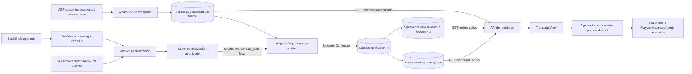
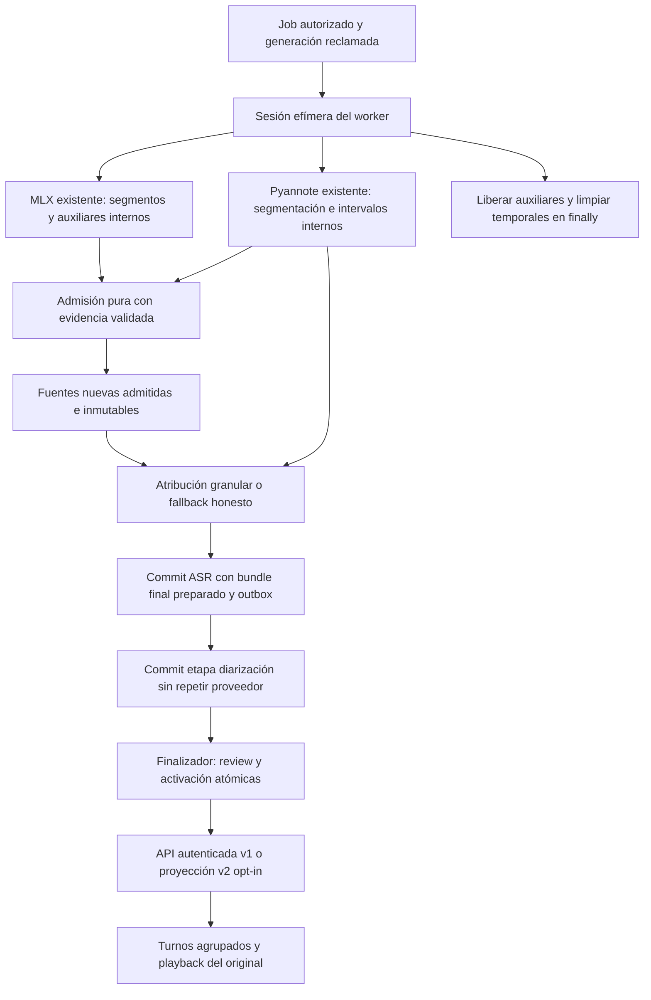

# Documento de Diseño — Renderizado de turnos completos en la transcripción

## Delta técnico H1 — borrado ligado al origen (#903)

Corrección de AC-H1–H3 por encargo de Ansel sobre `178f893`/PR902; no reabre fases aprobadas ni habilita #248/#246/#253. Ubicación: helper privado `_delete_transcript_artifacts(session, transcript)` en `backend/app/retention/worker.py`; tests `backend/tests/integration/test_retention_revision_artifacts.py`. Sin carpetas nuevas, migración, esquema, HTTP, Compose, shared-types o dependencias.

**Diseño mínimo:** selección por vencimiento existente → DELETE reviews del meeting fuente → DELETE diarizaciones por transcript ID → DELETE SQL transcript por ID → recording si venció → commit exterior único. El helper no hace commit y se reutiliza en ambas expiraciones. SQL evita NULL updates ORM sobre turns; errores se propagan y la sesión exterior revierte. Borrados ObjectStore mantienen su comportamiento no transaccional vigente; no se registran payloads privados.

**Relaciones inspeccionadas:**
- `transcripts.meeting_id` es UNIQUE: una fuente por meeting. Reviews se vinculan por meeting/revisión, sin FK al transcript: todas las revisiones de ese meeting derivan de su única fuente, incluidas legacy sin diarización. DELETE reviews limitado al meeting fuente activa cascadas de items/receipts, no identities globales/per-user.
- Diarization tiene FK restrictiva a transcript: eliminar todas las generaciones por ID fuente, sin filtro de estado, elimina ambos JSON. Sus cascadas eliminan speakers/assignments antes de borrar turns y liberan la FK restrictiva de assignment a SpeechTurn.
- DELETE transcript activa CASCADE ya existente de turns, summaries y requests. Permanecen User/plantillas/categorías, Meeting, claim, auditoría/outbox de recuperación y ledger de eventos de resumen sin contenido, que no dependen del transcript. Nunca borrar por owner ni llamar `delete_meeting`.
- Recording vencido conserva borrado existente audio/video/recording e inventario media. Si el transcript ya no existe, elimina igualmente reviews legacy de ese único recording/meeting. Expiración independiente conserva recording/media/objetos vigentes.

**Alternativas descartadas:** una migración de FK amplía esquema innecesariamente y no elimina reviews ni corrige por sí sola nulificación ORM; borrar meeting pierde auditoría/metadatos fuera del origen; ocultar o vaciar JSON deja fuente y FK bloqueadas.

**Propiedades y pruebas:** P-H1 (AC-H1): cero derivados de cualquier estado tras éxito. P-H2 (AC-H2): snapshot exacto de otros orígenes y datos de usuario/meeting intacto. P-H3 (AC-H3): fallo después de borrar hijos restaura snapshot completo; retry/redelivery idempotente. P-H4 (AC-H2): solo expiración recording borra sus objetos. Se prueban en PostgreSQL real con FK, turns cargados, reviews/receipts, ambos JSON y rollback. Suites pertinentes y Ruff/mypy del proyecto con deuda comparada; evidencia y limpieza Docker antes de publicar sin merge.

## Resumen

> **Lectura por alcance:** las secciones originales documentan el diseño previamente aprobado (AC1–AC7). El [delta de diseño #880](#delta-de-diseño-880--admisión-acústica-y-atribución-granular) al final precisa sus excepciones para ejecuciones nuevas: admisión acústica, atribución dentro de una fuente y resultados derivados versionados. No cambia las fuentes ni activa reprocesamiento histórico. El delta está escrito para revisión de Ansel e integración por Fer; no está implementado ni autoriza implementar. El estado `complete` de `.config.spectra` corresponde al alcance histórico y no acredita aprobación del delta.

El pipeline confirma la granularidad que produce el defecto: cada segmento ASR se persiste como `SpeechTurn` y se representa por separado; ASR no entrega límites de turno ni identidad de hablante como evidencia fiable. El diseño conserva esas filas fuente y deriva la presentación agrupada solo de asignaciones de la diarización activa con solapamiento positivo. Las grabaciones nuevas y las históricas elegibles se procesan con diarización versionada; si la fuente de audio se confirma ausente o expirada mientras el transcript aún está dentro de su retención vigente, se conserva la presentación fragmentada y se expone `not_reconstructible`. Fer autorizó reprocesamiento histórico aislado por generación (opción B, `inp_918c917473da4aa7`) y esta excepción acotada (`inp_497cfae022564392`); ninguna cambia la política de retención. Trazabilidad: `bugfix.md` APPROVED en `9fed8e2b14a10bb25960011326e3ebf9e7af5b27` (blob `ddf34bb41dc5d9d9aa38c15c312e9cf24a4e7b05`), AC1–AC7; `PRODUCT_BASELINE.md` APPROVED en `4953b3b4b8a058fd4738342307cc50bfd66814f1` (blob `c6f9ef9bf3fac9eac23763e25e25e1089a16c446`), §4.C.4 y §4.B.5. El efecto futuro per-user de correcciones entre grabaciones distintas no se redefine aquí; la prohibición de copia automática se limita a regeneraciones de la misma grabación.

1. Mantener `Transcript` y `SpeechTurn` fuente inmutables; registrar evidencia de solapamiento en las asignaciones y derivar turnos de presentación por corridas consecutivas del mismo `speaker_id`.
2. Versionar diarizaciones por meeting. La migración conserva la generación histórica como revisión 1, la marca `is_legacy=true` y deja `overlap_ms=NULL`; nuevas ejecuciones quedan marcadas como actuales y usan claves de speaker nuevas, coexistiendo sin sobrescribir asignaciones previas.
3. Reprocesar mediante un job idempotente los transcripts históricos cuyo audio siga disponible bajo la retención vigente; la nueva diarización y su revisión pendiente se publican juntas solo al completar.
4. Si la fuente histórica está confirmada como expirada o irrecuperable mientras el transcript sigue dentro de su retención vigente, conservar los fragmentos separados y exponer un intento versionado `not_reconstructible`; no buscar copias alternas ni cambiar la retención.
5. Mantener separadas las generaciones de la misma grabación: no transferir nombres o IDs de speaker por `raw_label`, posición, similitud o identidad acústica. No alterar el efecto futuro per-user de las correcciones entre grabaciones distintas definido por el baseline.
6. En `TranscriptView`, agrupar solo asignaciones positivas de la generación activa; conservar `Speaker N`, texto visible y playback temporalmente fiel mientras una generación nueva procesa o falla, e indicar el estado no reconstruible cuando corresponda.

## Decisiones de Diseño Clave

**Agrupar en el portal después de una atribución validada.** `TranscriptView` combina filas transcript fuente solo cuando sus asignaciones de la generación activa tienen `overlap_ms > 0` y el mismo `speaker_id`. El backend calcula la intersección con los segmentos originales del motor, única capa que conoce esos intervalos, y la persiste. *Alternativas descartadas:* ASR no entrega speaker IDs en sus segmentos; asignar por `speaker_id` sin validar overlap perpetuaría el empate artificial a cero; persistir pasajes derivados duplicaría el texto fuente y los tiempos sin necesidad.

**La continuidad depende de secuencia y de identidad dentro de una generación.** Se combinan únicamente elementos adyacentes en `sequence` con el mismo `speaker_id` no vacío y asignación positiva en esa generación. Una fila intermedia de otra persona o sin evidencia rompe la corrida. No se agrupan apariciones no consecutivas ni por etiqueta visible. *Alternativas descartadas:* agrupar cualquier aparición del mismo speaker borraría límites A-B-A; comparar etiquetas permitiría que nombres editables o `Speaker N` iguales mezclen IDs distintos; usar duración de silencio inventaría un umbral no aprobado.

**La presentación agrupada no crea un intervalo temporal compuesto.** Una fila visible puede reunir el texto de una corrida consecutiva del mismo speaker, pero conserva todos sus subintervalos fuente y no recibe un `end_ms` exterior. `MeetingPlaybackView` recibe intervalos de playback uno a uno, idénticos a cada `SpeechTurn` temporizado; la fila se resalta solo cuando el reloj cae dentro de uno de ellos, queda sin resaltar en una brecha y al activar la fila inicia en el `start_ms` del primer segmento. Así se conservan gaps y overlaps sin ensanchar, desplazar ni fabricar límites. *Alternativas descartadas:* representar la fila como `[primer start_ms, último end_ms]` cerraría brechas; cambiar las duraciones fuente o crear silencios artificiales alteraría la relación con el medio.

**Versionar diarización, no regenerar el transcript.** Una re-ejecución histórica usa las filas `SpeechTurn` y su transcripción existentes como entrada de asignación, y solicita una diarización nueva del mismo `audio_ref`; no vuelve a ejecutar ASR. Cada generación tiene `processing_revision`, su propio `Diarization.id`, `Speaker.id` y `SpeakerAssignment` por fila fuente. La migración marca las diarizaciones existentes `is_legacy=true`; workers nuevos escriben `is_legacy=false`. Las filas de una revisión no se actualizan ni eliminan al crear otra. *Alternativas descartadas:* reemplazar la diarización en sitio destruiría trazabilidad y podría borrar las referencias de revisión; re-ejecutar ASR alteraría texto/tiempos fuera del defecto investigado; mutar IDs antiguos equivaldría a remapear identidades.

**Una revisión nueva de la misma grabación empieza sin nombres heredados.** Cuando una generación se completa, se crea en la misma transacción un `SpeakerReview` para ese `processing_revision`, con items de clave nueva (ID opaco de `Speaker` creado en esa generación) y etiqueta inicial `Speaker N`. La revisión anterior, sus decisiones, excerpt references y receipts quedan preservadas en su revisión previa; ninguna etiqueta, speaker key, disposition o identidad se copia entre generaciones del mismo meeting. La revisión nueva queda pendiente de decisión humana. Esta regla no prohíbe ni redefine el efecto futuro per-user de correcciones entre grabaciones distintas establecido en `PRODUCT_BASELINE.md` §4.B.5; la correspondencia cross-recording no forma parte de este bugfix y debe respetar el aislamiento por usuario. *Alternativas descartadas:* asignar `raw_label` de revisiones distintas, secuencia, orden de aparición o parecido acústico no ofrece evidencia de identidad estable y puede presentar un nombre a la voz equivocada.

**La generación activa cambia solo con éxito atómico.** La API selecciona la generación completada de mayor `processing_revision`. Un intento `pending`, `in_progress`, `failed` o `not_reconstructible` no desplaza una generación completada: la transcripción sigue visible y asignaciones antiguas sin evidencia continúan sin agrupar. Diarization, asignaciones nuevas y review nueva se confirman en una sola transacción; si falla, no hay datos parciales ni cambio de generación activa. Un intento `not_reconstructible` se guarda como estado terminal versionado sin speaker, assignment ni review hijos; la API expone ese estado y el portal lo indica sin alterar las filas fuente. *Alternativas descartadas:* exponer resultados incompletos podría mezclar speakers/review; borrar la versión previa al empezar dejaría el transcript sin su historial disponible durante fallas; tratar falta confirmada de audio como fallo genérico ocultaría la condición terminal autorizada.

**Exponer solapamiento, revisión y el resultado terminal de backfill.** `GET /api/v1/meetings/{meeting_id}/diarization` agrega `overlap_ms`, `processing_revision` y el estado del último intento, que puede ser `not_reconstructible`, al resultado autenticado; el frontend agrupa solo con la generación completada activa. `GET .../speaker-review` por defecto resuelve la revisión alineada con la generación activa; añade un parámetro opcional `revision_id` para recuperar, con la misma autorización, una revisión histórica separada. No se modifica `packages/shared-types` porque estas respuestas HTTP no lo consumen. *Alternativa descartada:* omitir generación o evidencia deja al cliente incapaz de evitar que asignaciones legacy sin overlap se usen como identidad; no exponer revisión histórica dificultaría conservarla como registro recuperable sin activar sus nombres para la versión nueva.

**Clasificar ausencia de audio con evidencia del almacenamiento y sin ampliar retención.** El backfill solo considera un `Transcript` aún elegible bajo su `expires_at` y una `SessionRecording` con el `audio_ref` exacto. Antes de publicar trabajo, consulta disponibilidad mediante un nuevo contrato `ObjectStore.inspect(reference) -> available | missing`; `S3ObjectStore` implementa `inspect` con `head_object`, y solo el código S3 `NoSuchKey` para la key exacta, con bucket accesible, produce `missing`; un 404 sin código de objeto (p. ej. bucket ausente) no es evidencia. Timeout y error transitorio de red/servicio son indeterminados y reintentables; permiso denegado o respuesta inválida falla cerrada, sin crear estado terminal. Ninguno demuestra irreconstruibilidad. Si `SessionRecording.expires_at <= now` o la inspección confirma objeto inexistente mientras el transcript sigue vigente, la reserva de revisión pasa a `not_reconstructible` con causa `audio_unavailable`, sin emitir capability ni llamar al motor; la API lo hace observable y la UI mantiene `Speaker N` y fragmentos fuente. Si no existe `SessionRecording`/`audio_ref` ni evidencia persistida de expiración, no se infiere el motivo ni se marca terminal: no se encola, no se agrupa y no se busca otra copia. La expiración propia del transcript mantiene el comportamiento de retención existente; nunca se extiende para conservar texto. No se altera `RETENTION_DAYS`, permisos, ni retención, y no se descarga ni duplica audio durante la inspección.

**Etiquetas de review alineadas por generación.** El `TranscriptView` actual consulta el `currentLabel` del item de review coincidente y, si no hay item, usa `speaker.label` y luego `Speaker N`; sin embargo, `SpeakerReviewService.get_active_review` devuelve únicamente items pendientes, por lo que no es una fuente suficiente para nombres ya confirmados tras recargar. Extender la respuesta autenticada de review con `labels_by_speaker_id`, construido con todos los items de la misma `processing_revision` (`chosen_label` para una decisión named/corrected explícita; de lo contrario `current_label`, manteniendo `Speaker N` para atribución incierta no resuelta). `items` sigue conteniendo solo los pendientes para no cambiar el flujo de revisión. La vista consume únicamente etiquetas de la generación activa; la generación nueva no consulta la revisión anterior. La agrupación depende solo de ID+overlap, nunca de la etiqueta.

## Arquitectura

Especializaciones: **backend-api**, **web-application** y **cross-surface-integration**. El backend versiona asignaciones y review; el portal deriva las filas completas desde APIs autenticadas; la transcripción fuente no cambia. No se modifica la extensión. Audio, transcript y datos de speaker siguen bajo las salvaguardas de `SECURITY.md`; el job de backfill usa la autorización de grabación existente y no cambia retención.



```mermaid
sequenceDiagram
    participant M as Migración
    participant B as Backfill
    participant Q as JobQueue
    participant W as Worker de diarización
    participant DB as PostgreSQL
    participant O as ObjectStore S3-compatible
    participant E as Motor autorizado
    participant API as APIs autenticadas
    participant TV as TranscriptView
    M->>DB: Añadir revision/overlap/provider nullable; preservar generación 1
    B->>DB: Verificar transcript y recording aún elegibles por expiración
    B->>O: inspect(audio_ref) sobre la referencia exacta
    alt Audio presente y autorización vigente
        B->>DB: Bloquear Meeting y reservar/reusar una única revision N pending
        B->>Q: Publicar meeting_id + revision N tras commit
        Q->>W: Claim condicional pending -> in_progress
        W->>DB: Revalidar expiración y disponibilidad
        W->>E: Diarizar audio_ref con capability del objeto exacto
        E-->>W: Segmentos etiquetados solo dentro de esta ejecución
        W->>W: Asignar solo overlaps positivos; crear IDs nuevos
        W->>DB: Transacción: generación, assignments y review N pending
    else Expirado o ausencia autoritativa
        B->>DB: Bloquear Meeting; guardar intento terminal not_reconstructible sin hijos
    else Error indeterminado de storage/permisos
        B->>DB: No marcar terminal; dejar reintentable o fail-closed
    end
    API-->>TV: SpeechTurns fuente + generación/review activa + estado del intento
    TV->>TV: Agrupar por ID/overlap positivo y mostrar estado no reconstruible
    TV->>TV: Reproducir/highlight solo intervalos fuente, nunca los gaps
```

Mientras revision N está en proceso o falla, `GET transcript` sigue devolviendo las filas fuente retenidas y la generación activa anterior queda intacta. Si la inspección autoritativa marca `not_reconstructible`, el endpoint devuelve ese estado terminal y la vista deja cada fuente separada con `Speaker N`; si la fuente solo es desconocida, no la marca ni infiere asignación. Una fila histórica con `overlap_ms=NULL` permanece separada. Cuando una nueva generación completa se confirma junto con su review, las lecturas posteriores seleccionan esa generación; las asignaciones antiguas siguen accesibles solo bajo su revisión previa y no se mezclan con la nueva.

## Componentes e Interfaces

### 1. APIs de transcript, diarización y review

- `GET /api/v1/meetings/{meeting_id}/transcript` conserva su autorización y devuelve el transcript fuente existente (`id`, `text`, `start_ms`, `end_ms`, `sequence`), ordenado por `sequence`. No genera ni persiste turnos compuestos.
- `GET /api/v1/meetings/{meeting_id}/diarization` devuelve `{ processing_revision: number | null, speakers: Speaker[], assignments: Assignment[], latest_attempt: { processing_revision: number; diarization_state: "pending" | "in_progress" | "completed" | "failed" | "not_reconstructible"; failure_cause: string | null } | null }`. `processing_revision` y arrays refieren solo a la última generación `completed` (si ninguna, null y arrays vacíos); `latest_attempt` distingue pendiente, fallo y `not_reconstructible`. Cada assignment es `{ turn_id: string; speaker_id: string; overlap_ms: number | null }`; solo overlap positivo habilita agrupación; NULL es dato legacy sin evidencia persistida. La ruta mantiene autorización y retorna el estado terminal con transcript fuente retenido.
- `GET /api/v1/meetings/{meeting_id}/speaker-review` sin parámetro devuelve la revisión alineada a la generación activa y agrega `labels_by_speaker_id: Record<string, string>` resuelto desde todos los items persistidos; `items` conserva solo los pendientes para la UI de revisión. `frontend/src/api.ts` adapta ese campo wire a `SpeakerReview.labelsBySpeakerId: Record&lt;string, string>` en GET y PUT; TranscriptView no consume la snake_case directamente; el adapter también mapea las claves wire y los items anidados al contrato camelCase de `SpeakerReview` (`speakerId`, `currentLabel`, `attributionState: "attributed" | "uncertain"`, `excerptRef: string | null`, `expectedVersion: number`). Añade `?revision_id=N` opcional para leer revisión histórica bajo la misma autorización, pero la vista usa solo la revisión activa. Si no hay una generación nueva completada, conserva la revisión previamente activa. Las revisiones previas no se borran ni se convierten en la activa de otra generación. El router, que actualmente solo expone GET, añade `PUT /api/v1/meetings/{meeting_id}/speaker-review/revisions/{revision_id}/speakers/{speaker_id}` con `SpeakerReviewService.record_disposition`; responde con el snapshot agregado actualizado en la misma forma wire (mapa completo y `items` pendientes), y el receipt idempotente guarda esa respuesta completa para replay. Cada item wire incluye `speaker_id`, `current_label`, `attribution_state` (`attributed`|`uncertain`), `disposition`, `excerpt_ref` nullable y `expected_version`.
- Las rutas continúan llamando `_get_authorized_meeting`; accesos y errores de autorización conservan el comportamiento actual. No se envían datos de audio, texto adicional, contenido de reuniones ni `raw_label` histórico a los clientes.

### 2. Persistencia y asignación (`backend/app/diarization/`, `backend/app/infra/models.py`)

`assign_turns` retorna `(turn_id, speaker, overlap_ms)` únicamente si el máximo solapamiento es estrictamente positivo; el empate positivo conserva el desempate por menor `sequence`; máximo cero no crea asignación. `worker.py` persiste la medida junto a la asignación y el speaker creado en la misma generación. `raw_label` solo indexa los objetos devueltos por una sola llamada al motor; jamás se consulta contra otra revisión.

`DiarizationRepository` deja de asumir una sola fila por meeting y expone la generación activa/completada, el siguiente número de revisión y la persistencia atómica de una generación. `reserve_next_revision` bloquea la fila `Meeting` con `SELECT ... FOR UPDATE`, vuelve a consultar estados dentro de la transacción y crea como máximo una revisión siguiente; la unicidad `(meeting_id, processing_revision)` protege además contra procesos concurrentes. El mismo helper reserva un estado `pending` o, con evidencia autoritativa de audio ausente, transita a `not_reconstructible`. Solo luego del commit se publica `(meeting_id, processing_revision)`. Si el proceso cae antes de publicar, repetir el backfill publica la misma pendiente; si dos publicaciones ocurren, el worker reclama `pending -> in_progress` bajo bloqueo/actualización condicional y la segunda entrega es no-op. El worker solo escribe speakers, assignments y review tras respuesta válida del motor, en transacción atómica. Una fila completada o terminal no se muta; fallos reintentables no reemplazan generación activa. `state.py` permite `pending -> in_progress -> completed|failed|not_reconstructible`; `pending -> not_reconstructible` si la comprobación previa confirma expiración/ausencia; `failed -> pending` solo por evento explícito `retry` cuando la causa sea reintentable. `completed` y `not_reconstructible` son terminales; `not_reconstructible` requiere `failure_cause=audio_unavailable`.

`backend/app/infra/object_store.py` agrega `ObjectAvailability = Literal["available", "missing"]` y `ObjectStore.inspect(reference)`. `S3ObjectStore.inspect` usa `head_object`; solamente el código/status inequívoco de objeto ausente produce `missing`, mientras permisos, timeouts, errores de servicio y respuestas no reconocidas propagan una falla no-terminal. El método no descarga bytes ni expone la referencia fuera del backend. Tests sintéticos deben comprobar la traducción de not-found y la separación de errores transitorios/autorización.

### 3. Backfill histórico y re-procesamiento seguro

Agregar `backend/app/diarization/reprocess_legacy.py` como comando de backfill re-ejecutable. Enumera diarizaciones `is_legacy=true` cuyo `Transcript` y `SessionRecording` siguen presentes y cuya expiración permite reprocesamiento. Bajo bloqueo de fila del meeting vuelve a leer el intento actual, reserva/reusa exactamente una revisión y consulta `ObjectStore.inspect` para el `audio_ref` exacto. Si hay audio presente y permiso vigente, crea/reusa `pending` y publica el job tras commit; si `expires_at <= now` o el store confirma `missing`, crea `not_reconstructible` con `audio_unavailable`, sin engine ni capability ni hijos; errores indeterminados no se marcan y quedan reintentables/fail-closed. Si no existe `SessionRecording`/referencia ni evidencia explícita, no infiere pérdida ni inventa una ruta: no encola y deja la fuente separada. Una generación posterior completada o estado terminal es no-op. No modifica turnos fuente ni amplía la retención. El job contiene solo `meeting_id` y `processing_revision`, nunca texto ni nombres; el worker revalida ambos `expires_at`, vuelve a inspeccionar disponibilidad y solo luego emite capability firmado para el `audio_ref` exacto y llama al motor. La reserva única bajo `SELECT ... FOR UPDATE` y constraint `(meeting_id, processing_revision)` evita revisiones duplicadas; reejecutar el comando repone una publicación pendiente caída y redelivery usa el claim idempotente del worker.

El backfill no se ejecuta dentro de Alembic ni expone endpoint público de reprocesamiento. Para el transcript completo previamente guardado por Fer, se aplica la misma ruta general; el diseño no registra su identificador, texto ni otra información privada. Si el objeto ya no está disponible o la retención lo eliminó, no se intenta recuperarlo desde otra ubicación.

### 4. Modelos, revisión y migración

- Añadir `Diarization.processing_revision: int NOT NULL` (existentes a `1`) y `is_legacy: bool NOT NULL` (existentes `true`, default `false` para nuevas generaciones); cambiar la unicidad de `meeting_id` a `(meeting_id, processing_revision)`. Permitir `provider=NULL` mientras ningún provider haya iniciado (incluidas reservas y `not_reconstructible`); registrar el provider real antes de invocarlo y usar `speaker_count=0` para intentos sin hijos. Extender `diarization_state` y `backend/app/diarization/state.py` con terminal `not_reconstructible` y causa `failure_cause=audio_unavailable`; transición terminal solo con expiración elegible o ausencia autoritativa del objeto. La revisión 1 conserva IDs, speakers, assignments y estado originales; el flag permite al backfill identificar únicamente salidas anteriores al fix.
- Añadir `SpeakerAssignment.overlap_ms: int NULL`; las filas existentes quedan NULL. Reemplazar `uq_speaker_assignment_turn_id` por unicidad `(diarization_id, turn_id)`, de modo que el mismo `SpeechTurn` pueda tener asignaciones en revisiones distintas sin borrar las previas.
- `Speaker.id` sigue siendo UUID nuevo por generación. Cada `SpeakerReview` nuevo usa el mismo `processing_revision`; los items usan la nueva clave opaca del speaker y etiqueta inicial `Speaker N`. La tabla de review ya tiene unicidad por `(meeting_id, processing_revision)`; no se migra ni reescribe el contenido de revisiones previas, sus receipts o excerpt references.
- `Transcript` y `SpeechTurn` siguen siendo una única fuente por meeting y no necesitan versionarse para esta corrección: solo se reprocesa diarización y se atribuyen sus intervalos fuente.
- Una migración Alembic secuencial posterior a `011` (nombre exacto determinado por el autor de implementación tras sincronizar la rama) conserva datos existentes: añade columnas/constraints, marca filas existentes revisión 1 (`is_legacy=true`, `overlap_ms=NULL`), deja `is_legacy=false` por default y permite `provider=NULL` solo mientras ningún provider haya iniciado. Intentos sin hijos usan `speaker_count=0`; no se invoca servicio, descarga audio ni publica jobs en migración. La selección activa es la generación de mayor revisión `completed`; `pending`, `in_progress`, `failed` o `not_reconstructible` nunca la sustituyen.

### 5. Agrupador puro frontend (`frontend/src/transcript-turns.ts`)

Añadir función determinista sin I/O y prueba colocalizada `frontend/src/transcript-turns.test.ts`:

```typescript
interface SourceTranscriptSegment {
  id: string;
  text: string;
  startMs: number | null;
  endMs: number | null;
  sequence: number;
}

interface PresentationTurn {
  id: string;                    // ID de la primera fila fuente del grupo
  sourceIds: string[];           // IDs fuente conservados
  text: string;                  // textos no vacíos en orden, separados por un espacio
  timestampMs: number | null;   // startMs de la primera fuente, solo para mostrar/iniciar
  sequence: number;
  speakerId?: string;            // ID de la generación activa con overlap_ms > 0
  speakerLabel: string;          // label de la misma revisión o Speaker N
  speakerColor?: string;
}

interface PlaybackInterval {
  id: string;                    // ID exacto del SpeechTurn fuente
  presentationTurnId: string;   // fila visible que se resalta durante este intervalo
  startMs: number;               // límites exactos de la fuente
  endMs: number;
  text: string;                  // requerido por TimedPassage; no se renderiza como fila aparte
  sequence: number;
}

function groupTranscriptTurns(
  segments: SourceTranscriptSegment[],
  speakerIdByTurnId: ReadonlyMap<string, string>
): PresentationTurn[];
```

El caller construye `speakerIdByTurnId` solo con assignments positivos de la generación activa. Ordena por `sequence` ascendente con orden estable para empates; agrupa solo fuentes adyacentes con tiempos válidos y el mismo `speakerId` no vacío. Una fila sin speaker validado interrumpe la corrida, queda separada con `Speaker N` y no permite saltar a sus vecinos. El ID del grupo es el ID de su primera fuente; `sourceIds` mantiene la trazabilidad. `timestampMs` muestra y permite iniciar el turno desde el primer segmento, pero no es el inicio de un intervalo compuesto. Textos no vacíos se unen con un espacio, sin reescribir filas fuente. Filas sin tiempo válido permanecen independientes y no generan playback.

La lista `PlaybackInterval[]` se deriva por separado de cada fila fuente temporizada: sus `id`, `startMs`, `endMs` y `sequence` son exactamente los de `SpeechTurn`, y `presentationTurnId` se resuelve desde `sourceIds`. Ningún intervalo abarca dos segmentos; por tanto una brecha interna produce `findPassageAt(time)` nulo, y un overlap se conserva exactamente como estaba en la fuente.

### 6. Vista y playback (`frontend/src/components/TranscriptView.tsx`)

- Consumir transcript fuente, generación activa de diarización y review de la misma revisión; no usar etiquetas/reviews de otra `processing_revision`.
- Construir el mapa de asignación solo para `overlap_ms > 0`; legacy NULL, cero, ausencia, error de carga o generación fallida quedan sin asignación válida y se presentan individualmente como `Speaker N`. Si el último intento está `not_reconstructible`, mantener los fragmentos separados y mostrar ese estado sin ocultar ni reescribir el transcript.
- Resolver la etiqueta visible solo con `review.labelsBySpeakerId[speakerId]` de la misma `processing_revision`; `frontend/src/api.ts` adapta el campo wire `labels_by_speaker_id`. No leer `review.items` para pintar labels porque contiene únicamente items pendientes. El backend construye el mapa usando `chosen_label` para decisiones explícitas `named`/`corrected`; en los demás casos usa `current_label`, que conserva `Speaker N` ante incertidumbre no resuelta. Si falta una entrada, usar `speaker.label`; si tampoco existe, `Speaker N`. El ID de speaker, no la cadena de etiqueta, determina el agrupamiento.
- Renderizar una fila visible por corrida máxima con texto combinado y timestamp del primer segmento, conservando referencias a sus fuentes. Pasar a `MeetingPlaybackView` esa lista de filas para render y, por separado, `PlaybackInterval[]` uno a uno desde los `SpeechTurn` temporizados para el `PlaybackController`.
- Mapear `activePassageId` (ID fuente) a `presentationTurnId` para resaltar/desplazar la fila agrupada solo cuando el reloj cae dentro de un intervalo fuente. En gaps no hay passage activo; al activar el botón de una fila se inicia en el primer `startMs` de esa fila, sin inventar un `endMs` compuesto. Un fallo o estado pendiente de diarización no oculta el transcript.

### Ubicación y pruebas

| Área | Archivos que agrega/modifica | Tests sintéticos | Migración | Shared types / Compose |
|---|---|---|---|---|
| Backend diarización y backfill | `backend/app/diarization/assignment.py`, `repository.py`, `state.py`, `worker.py`, nuevo `reprocess_legacy.py`, `backend/app/infra/models.py`, `object_store.py`, `object_store_s3.py` | `backend/tests/diarization/test_assignment_property.py`, `test_state_property.py`, `test_worker.py`, nuevo `test_reprocess_legacy.py`, actualización de `test_repository.py`, nuevo `backend/tests/infra/test_object_store_availability.py` y nuevo `backend/tests/integration/test_diarization_reservation_concurrency.py` | Sí: siguiente Alembic posterior a `011`; revisiones/unique, overlap nullable, provider nullable para intentos sin motor | `packages/shared-types`: sin cambio; `docker-compose.yml`: sin cambio, usa motor host-native configurado abajo |
| Backend meetings API/review | `backend/app/meetings/router.py`, `speaker_review_service.py` y esquemas donde ya correspondan | `backend/tests/meetings/test_diarization_endpoint.py`, `backend/tests/speaker_review/` revisión activa por generation y conservación histórica | Misma migración | Sin cambio |
| Web portal | `frontend/src/api.ts`, `frontend/src/components/TranscriptView.tsx`, `frontend/src/components/MeetingPlaybackView.tsx`, nuevo `frontend/src/transcript-turns.ts` | `frontend/src/transcript-turns.test.ts`, `frontend/src/components/TranscriptView.test.tsx`, `frontend/src/components/__tests__/MeetingPlaybackView.test.tsx`, `frontend/src/components/__tests__/PlaybackController.test.ts`, `frontend/src/api.test.ts` | No | `packages/shared-types`: sin cambio; `docker-compose.yml`: sin cambio |
| Fuentes y datos existentes | No cambiar contenido/IDs de `Transcript`/`SpeechTurn`; mantener generaciones y reviews previas | migración prueba inmutabilidad; fixture sintética de generación 1/review previa + generación 2/review nueva prueba aislamiento | Incluida | Extension: sin cambios |

**Despliegue y compatibilidad:** `.spectra/PROJECT_STRUCTURE.md` confirma correctamente que Compose no proporciona un servicio de diarización, aunque su afirmación de que `DIARIZATION_LOCAL_URL` no está configurada es obsoleta: el `docker-compose.yml` actual pasa esa variable a API y worker (default `http://host.docker.internal:8002`), pero no inicia el motor. El runtime local soportado corre el motor diarización host-native fuera de Compose mediante `make engines-install` y `make engines-up`; esos comandos aseguran credenciales/modelo autorizado y servidor en el endpoint configurado. Si se usa otro host/puerto, configurar `DIARIZATION_LOCAL_URL` con una dirección accesible desde ambos contenedores. Por eso esta corrección no agrega un servicio Compose ni cambia `docker-compose.yml`. Antes del backfill, detener consumers antiguos de `diarize`, aplicar migración y desplegar worker/API capaces de leer revisiones; luego iniciar el engine local y solo entonces ejecutar el comando. Nunca ejecutar con código antiguo que asume unicidad por meeting. Reintentar por clave meeting/revisión; no permitir que un intento incompleto sustituya la generación activa.

## Modelos de Datos

`Transcript`/`SpeechTurn` mantienen su shape y su contenido fuente. `Diarization` agrega `processing_revision` e `is_legacy`; cada generación posee speakers propios y estado independiente, incluido el estado terminal `not_reconstructible` para un intento sin audio recuperable confirmado. Ese intento no crea speaker, assignment o `SpeakerReview` hijos y no desplaza la última generación completada. `SpeakerAssignment` agrega `overlap_ms: Integer | NULL` y su unicidad pasa a `(diarization_id, turn_id)`; generación 1 conserva `is_legacy=true` y asignaciones históricas NULL, generaciones actuales tienen `is_legacy=false` y guardan medidas positivas únicamente. `SpeakerReview.processing_revision` alinea revisión humana con la diarización: cada generación nueva tiene agregado/items frescos con `Speaker N`, mientras el agregado anterior permanece separado. `PresentationTurn` es derivado en memoria, nunca otra fuente de verdad. El coste es una ejecución adicional de diarización por cada grabación histórica reprocesable y almacenamiento adicional por su generación/intento; no se altera el coste ni la política de retención del audio fuente.

## Propiedades de Correctitud

**Propiedad 1 — Agrupación consecutiva por identidad de generación.** Para cualquier secuencia sintética ordenada con assignments positivos, cada corrida máxima contigua del mismo `speaker_id` dentro de una revisión produce exactamente un turno visible; una identidad distinta, una ausencia o un overlap no positivo la separa. Texto conserva orden. Valida AC1.

**Propiedad 2 — No agrupación por repetición no consecutiva.** Para secuencia `A, B, A`, la salida mantiene tres turnos incluso si las dos etiquetas visibles de A son iguales. Valida AC3 y “Comportamiento Sin Cambios” 2.

**Propiedad 3 — Solapamiento positivo.** `assign_turns` solo asigna/persiste una fila si el máximo temporal es estrictamente positivo; retorna ese total y conserva desempate por menor `sequence` entre máximos positivos. Máximo cero produce ausencia de asignación y `Speaker N`, nunca el speaker de menor secuencia. Valida AC1, AC4 y “Comportamiento Sin Cambios” 1.

**Propiedad 4 — Identidad aislada entre generaciones de la misma grabación.** Para toda migración, generación 1 conserva IDs, assignments y review anteriores, queda `is_legacy=true` y sus overlaps son NULL. Una nueva revisión de esa grabación tiene IDs no coincidentes, no copia nombre/disposition/review/excerpt y crea review pending separada; assignment de la misma `turn_id` puede coexistir solo bajo `diarization_id` distinto. Ningún nombre revisado de generación previa se transfiere a la nueva sin acción humana. No restringe el efecto futuro per-user entre grabaciones distintas de baseline §4.B.5. Valida la decisión B de Fer.

**Propiedad 5 — Reserva concurrente, redelivery y publicación atómica.** Dos backfills simultáneos sobre un meeting serializan la reserva por `Meeting FOR UPDATE` y la constraint `(meeting_id, processing_revision)` deja una sola revisión. Caída antes de publicar se recupera reencolando esa misma revisión; dos jobs publicados compiten por un claim condicional, solo uno procesa. Redelivery no duplica generación/review ni altera una generación completa; rollback conserva la generación activa y no deja speakers/assignments/review parciales. Fallos reintentables repiten con la misma revisión; solo el resultado completo se vuelve activo.

**Propiedad 6 — Reprocesamiento histórico seguro.** Backfill sintético selecciona solo diarizaciones `is_legacy=true`, transcript vigente y recording autorizado bajo retención; solo publica cuando `inspect` confirma el `audio_ref` exacto disponible, y nunca adivina la causa si falta referencia. Reusa la reserva pendiente, respeta expiración, publica con capability del objeto exacto y hace no-op tras completar o estado terminal. No consulta ni usa transcripciones reales en tests/logs. Valida AC1, AC2 y la opción B sin saltar límites de seguridad/retención.

**Propiedad 7 — Fidelidad exacta de intervalos y entradas inválidas.** Para cada intervalo fuente temporizado, `PlaybackInterval` conserva exactamente `id`, `startMs`, `endMs` y orden; ningún intervalo derivado abarca la brecha entre dos `SpeechTurn`. Ejemplo sintético: dos fragmentos A con `[0,100]` y `[200,300]` producen una fila visual A con ambos textos y dos intervalos separados, `findPassageAt(150) === null`, y Play busca el tiempo 0. Gaps/overlaps se preservan; entrada sin texto no inventa texto y timing inválido no genera asociación de playback. Valida AC5–AC6 y “Comportamiento Sin Cambios” 3–5.

**Propiedad 8 — Audio histórico irrecuperable explícito y no destructivo.** Si `SessionRecording.expires_at <= now` o `ObjectStore.inspect` confirma ausencia definitiva del `audio_ref` exacto mientras el transcript sigue retenido, la máquina de estados crea un único intento `not_reconstructible` con causa `audio_unavailable`, sin speaker/assignment/review hijos; deja intactas fuente y revisiones previas, mantiene cada fragmento separado con `Speaker N` y expone el estado en la vista. Redelivery es no-op. Error transitorio, permiso denegado o falta de evidencia no produce esta marca terminal. Valida AC2 y la decisión autorizada por Fer (`inp_497cfae022564392`).

## Manejo de Errores

| Escenario | Comportamiento |
|---|---|
| Nueva generación pendiente/en procesamiento | Mantener visible transcript y última generación completada. Filas antiguas con overlap NULL siguen separadas y `Speaker N`; no publicar parcialmente. |
| Timeout/falla transitoria del motor o transporte, job se interrumpe o se repite | Usar `DIARIZATION_TIMEOUT_SECONDS` del provider local existente y reintentos acotados de la queue. Registrar causa reintentable; el backfill vuelve a encolar la misma revisión pendiente. La transacción no deja assignments/review parciales; no borrar ni desactivar generación completada previa. No se añade provider cloud. |
| Audio ya expirado según `SessionRecording.expires_at`, o `ObjectStore.inspect(audio_ref)` confirma objeto inexistente mientras el transcript sigue retenido | La transición de `state.py` crea un único intento terminal `not_reconstructible`/`audio_unavailable`, sin hijos ni cambio de generación activa; preserva filas/reviews y muestra fragmentos separados con el estado. No recupera otra copia ni extiende retención. |
| Falta `SessionRecording`/referencia y no hay evidencia verificable, o el transcript mismo expiró | No inferir `not_reconstructible` ni buscar rutas alternativas; no reencolar ni ampliar acceso. Se mantiene la elegibilidad y eliminación de datos según retención vigente. |
| Error transitorio de storage, servicio o recording capability | No marcar `not_reconstructible`; registrar fallo reintentable o fallar cerrado por autorización, preservando la generación activa anterior. Revalidar en retry. |
| Engine capability inválida o no autoriza el audio_ref exacto | Fallar cerrado antes de descargar/procesar; no usar token genérico como sustituto; mantener texto y generación anterior. |
| Resultado de motor sin speaker/segmento o todo overlap es cero | No fabricar atribución; no persistir assignment sin overlap positivo; presentar esa fila separada como `Speaker N`. |
| Revisión nueva completada pero aún sin decisión humana | Presentar la nueva etiqueta `Speaker N` y mostrar review pendiente según el flujo existente; no copiar nombres de revisiones previas. |
| Fila sin asignación, ID de revisión inconsistente o asignación huérfana | Ignorarla para agrupación; conservar fila fuente y `Speaker N`; no hacer join entre revisiones. |
| Transcripción/API no autorizada o error HTTP | Conservar autenticación/autorización y manejo HTTP actual; no devolver datos de otra reunión/usuario. Error secundario de diarización no bloquea texto ya autorizado. |
| Migración/despliegue interrumpido | Consumers antiguos permanecen detenidos hasta API/worker versionados; no arrancar backfill parcialmente. Rollback operacional detiene backfill/consumers nuevos y conserva filas y columnas; no borrar revisiones nuevas después de procesarlas. Si es preciso deshacer, hacerlo con migración correctiva y análisis explícito de datos, no downgrade destructivo. |

## Estrategia de Testing

Usar exclusivamente reuniones, audio_refs, textos, nombres y segmentos sintéticos; no acceder ni copiar datos de reuniones reales. Nia ejecutó pruebas del comportamiento actual antes de esta corrección, pero ese resultado no valida el candidato futuro.

1. **Assignment unit/property:** actualizar `backend/tests/diarization/test_assignment_property.py` para overlap positivo, máximos, empate, cero, intervalos sin intersección, y resultado vacío cuando no haya evidencia.
2. **Migración/generaciones:** ampliar `backend/tests/diarization/test_migration.py`: filas existentes se vuelven revision 1/`is_legacy=true`/overlap NULL sin cambiar speaker/assignment/review IDs; filas nuevas usan `is_legacy=false`; una reserva `not_reconstructible` admite `provider=NULL`, `speaker_count=0` y ningún hijo; dos revisions pueden referir la misma `turn_id` bajo diferentes diarization IDs; constraints impiden duplicados dentro de una revision.
3. **Backfill y clasificación:** nuevo `backend/tests/diarization/test_reprocess_legacy.py` cubre transcript/recording vigentes, `expires_at`, objeto presente, `NoSuchKey` para key exacta, bucket-404 sin código específico, error transitorio/permiso, referencia ausente sin evidencia, transcript expirado, reejecución, caída entre reserva y publish y redelivery. Afirmar `not_reconstructible` solo con evidencia terminal, sin hijos ni mutación previa. Nuevo `backend/tests/infra/test_object_store_availability.py` cubre la traducción de `head_object`. El backfill no descarga audio ni publica texto/nombres. La carrera real de dos reservas se verifica con dos PostgreSQL sessions en el nuevo `backend/tests/integration/test_diarization_reservation_concurrency.py`.
4. **State, worker/review:** ampliar `backend/tests/diarization/test_state_property.py` para transiciones `pending -> not_reconstructible` por fuente ausente confirmada, terminalidad y rechazo de transiciones desde `not_reconstructible`, más retry de fallas transitorias. Ampliar `test_worker.py` y tests bajo `backend/tests/speaker_review/`: worker revalida expiración; no invoca engine para ausente/expirado; generación completada tiene UUIDs frescos, overlap positivo y review pending atómicos; historial previo queda igual; la carrera entre doble claim procesa una sola vez.
5. **API:** `backend/tests/meetings/test_diarization_endpoint.py` cubre selección de última generación completada, status del intento actual incluido `not_reconstructible`, `processing_revision`, overlap nullable/positivo y auth intacta. Tests de speaker-review verifican revisión activa, `labels_by_speaker_id` desde todos los estados, `chosen_label` explícito y `current_label` para confirmados/`Speaker N` inciertos. Tras `named`/`corrected`, el `PUT` conserva el label en el mapa aunque el speaker salga de `items`; GET tras reload lo conserva y replay idempotente devuelve su respuesta original. Una review histórica por `revision_id` nunca se usa como activa.
6. **Agrupador (Vitest):** `frontend/src/transcript-turns.test.ts` cubre `A,A,B,B,A`, cambios/repeticiones, IDs distintos con igual etiqueta, nulos/ausentes/cero, gaps/overlaps, texto vacío, timing inválido, order y no mutación.
7. **Vista y playback:** `frontend/src/components/TranscriptView.test.tsx` fixtures garantizan que no mezcla revisión 1 y 2; el label para el transcript viene solo de `review.labelsBySpeakerId` (wire field `labels_by_speaker_id`), nunca de `review.items`. Verifica que tras nombrar/corregir el item salga de la lista pendiente pero el label elegido persista sin volver a `Speaker N`, también tras reload; incertidumbre queda `Speaker N` y una review antigua no se expone en IDs nuevos. `frontend/src/api.test.ts` verifica que GET/PUT adapten el mapa y los items wire snake_case a camelCase y mantengan el mapa completo. Informa `not_reconstructible` sin agrupar ni ocultar fragmentos y mantiene transcript visible durante carga/fallo. `frontend/src/components/__tests__/MeetingPlaybackView.test.tsx` verifica una fila visual A para dos fuentes A, dos intervalos exactos en el controller, gap sin passage activo y Play desde el inicio del primer intervalo; `frontend/src/components/__tests__/PlaybackController.test.ts` conserva la propiedad de no hallar passage dentro de un gap.
8. Desde `frontend/`, ejecutar `npm run test -- src/transcript-turns.test.ts src/components/TranscriptView.test.tsx src/components/__tests__/MeetingPlaybackView.test.tsx src/components/__tests__/PlaybackController.test.ts src/api.test.ts` y `npm run typecheck`; desde `backend/`, ejecutar `<root>/backend/.venv/bin/python -m pytest tests/diarization/test_assignment_property.py tests/diarization/test_state_property.py tests/diarization/test_worker.py tests/diarization/test_reprocess_legacy.py tests/diarization/test_migration.py tests/infra/test_object_store_availability.py tests/meetings/test_diarization_endpoint.py tests/speaker_review`. Ejecutar también `&lt;root>/backend/.venv/bin/python -m pytest tests/integration/test_diarization_reservation_concurrency.py` contra PostgreSQL para comprobar locks y constraints reales (no SQLite). Son comandos de validación futura, no resultados ya obtenidos.

---

## Delta de diseño #880 — Admisión acústica y atribución granular

### Continuación implementada para integración QA — 2026-11-13

La orden correctiva posterior de Ansel autoriza completar código, no solo diseño; el estado documental histórico de abajo no es el límite vigente. Fuentes completas más envelope de palabras efímero reemplazan las filas por palabra de la primera pieza. La proyección final usa rangos exactos Unicode/intervalos originales e incertidumbre por padre completo; la vista agrupa corridas de voz también entre fuentes y mantiene playback separado de la fila agrupada. La preparación pareada usa motores locales existentes y la revisión/claim/handoff ya establecidos; el job de diarización materializa salida final, speakers y review atómicamente, sin coordinador/finalizador nuevo ni persistencia de words/scores.

**Refinamiento de persistencia:** en vez de tres tablas nuevas, `014_final_presentation` añade `prepared_result` y `presentation` JSON nullable a la misma revisión. Sus FKs/retención eliminan ambos con el origen; validación estricta del servicio comprueba referencias de fuente/revisión/speaker, partición y tiempos antes de activar/exponer. No hay texto duplicado, timeline acústica cruda, API de escritura ni retención extendida. Las referencias internas JSON se validan en aplicación, no mediante FKs por pieza; se elige esta alternativa menor para una salida final inmutable, sin subsistema nuevo. El contrato opt-in `presentation_version=2` y el fallback conservador siguen los controles propuestos abajo.

Evidencia, archivos, comandos y contrato mínimo de instalación sobre #899: `presentation-qa-validation.md`; tareas A6.1–A6.5. Nahuel publica código para integración QA sin merge. Ansel conserva instalación combinada, escucha/calificación real y prueba final con Fer; no se presenta esta entrega como producto integrado/aceptado.

### Actualización ejecutiva y técnica 2026-11-13 19:17Z (primera pieza, histórica)

Ansel comunicó autorización posterior de Fer para implementar y validar ambos defectos, sin merge ni sustitución unilateral de servicios vivos. Reemplaza el límite documental anterior; no convierte #898 ni la variante siguiente en aceptación funcional.

**Primera pieza implementada para QA aislado:** `ASR_ACOUSTIC_VALIDATION=1` carga únicamente el checkpoint powerset `pyannote/segmentation-3.0` ya instalado, desde su ruta local; no descarga ni usa un modelo nuevo. `VoiceActivityDetection` reutiliza su decisión powerset fija de biblioteca y `min_duration_on=0`, `min_duration_off=0`: no recorta habla breve ni rellena gaps. Decodifica el original completo una vez en memoria, conserva offsets y pasa el mismo waveform a MLX. No crea archivos de clips. El modelo permanece cargado; waveforms, scores y anotaciones son locales a la llamada, sin persistencia ni logs.

**Alternativa descartada con evidencia real de motores:** la conjunción propuesta con `no_speech_prob > 0.6` FALLÓ en ruido sintético real de 6 s: VAD no detectó voz, pero MLX produjo texto con score de no-habla cercano a cero. No se rebaja ni ajusta ese umbral; se elimina la dependencia del score decoder como detector de voz. La variante QA rechaza texto sin intersección con ninguna región de VAD **solo cuando existe cobertura válida del audio completo**; evidencia no disponible conserva la fuente. Esto usa un VAD neuronal real existente, no falta de assignment. Permanece sin calificación humana y puede perder habla que el VAD no detecte: no se habilita por defecto ni se certifica lista.

Los límites de palabras válidas y reconstrucción textual exacta se devuelven como unidades fuente candidatas antes de su primera persistencia. Palabras inválidas/texto no reconstruible preservan el segmento completo. No hay nuevos campos HTTP, esquema o datos históricos modificados en esta primera pieza. `DIARIZATION_EXCLUSIVE_ASSIGNMENTS=1` permite atribuir esas unidades solo si tienen un candidato positivo, contando la unión de intervalos por cluster; empate/simultaneidad quedan sin atribución y se preservan todos los clusters. Ambos flags están apagados por defecto.

**Límite explícito del avance:** emitir unidades por palabra no termina el contrato de presentación: los casos inciertos pueden quedar fragmentados y falta conservar la vinculación al segmento padre en una proyección final como la descrita abajo. No se presenta esta simplificación experimental como cumplimiento total de AC-R3/AC-R4/AC-R6. La proyección/agrupación/fallback y su contrato persistido siguen pendientes. La implementación no toca #248, no duplica su coordinador ni introduce staging nuevo. Se preservan las fuentes ya guardadas, la autorización y los estados existentes. La propuesta extensa de #898 sigue siendo referencia de las piezas faltantes, no evidencia de implementación.

### Estado, autoridad y alcance

**Fase 2 documental, propuesta para revisión; no implementación.** Autor: Nahuel. Tarjeta existente `task_e54417ff1e164f69`; issue [#880](https://github.com/lufermalgo/sauri/issues/880), candidato nativo [#882](https://github.com/lufermalgo/sauri/pull/882). Entrada aprobada por Fer e integrada mediante [#897](https://github.com/lufermalgo/sauri/pull/897), merge `ea1dd2acbe0de39e74d9f046816124037bedb465`. El rótulo «propuesta» del bugfix es el estado que tenía al publicarse; esta aprobación posterior permite diseñar E-R1–E-R5 y AC-R1–AC-R8, no ejecutar ni repetir la aprobación. Ansel revisa este diseño y Fer integra. `tasks.md` y `.config.spectra` permanecen sin cambios: el plan histórico no autoriza el delta ni se reabre su aprobación.

Se reutilizan H1–H6 del bugfix, `native-alignment-validation.md` del candidato #882 y la investigación privada `speaker-alignment-research.md` ya entregada. No se copian datos privados ni se vuelve a consultar la grabación. El resumen pertenece a `recording-notes`, fuera de este diseño. No se agregan modelos, descargas, servicios, gastos, clips, embeddings, entrenamiento o reconocimiento entre reuniones. Tampoco se autorizan cargas, inferencias, cambios de runtime o despliegues.

### Resumen del mecanismo y la solución

La salida no vacía de MLX pasa a ser texto publicable sin una comprobación acústica independiente; las palabras/scores se pierden antes de la atribución y el diarizador asigna un segmento entero al ganador. Las tres opciones de #882 ya estaban activas: repetirlas no soluciona el nuevo caso. H5 descarta mezcla de revisiones en el ejemplo, no demuestra identidades ni actividad acústica real. No se conoce el score efectivo que dejó pasar las palabras denunciadas.

La solución futura propuesta tiene cinco partes:

1. Una sesión de procesamiento local reúne **en memoria** la salida ASR, la evidencia de segmentación ya calculada por pyannote y los intervalos del mismo original. No usa la ausencia de assignment como VAD.
2. Una función pura de admisión produce `speech`, `non_speech` o `unavailable`. Solo una decisión de no-habla respaldada y calificada puede excluir texto de una salida **nueva**, antes de su primera persistencia. Incertidumbre conserva el segmento; nunca reescribe el histórico.
3. Con palabras válidas y reconstrucción exacta del texto se derivan piezas de atribución por cambios comprobables de voz. Se preservan el segmento ASR admitido como fuente y el orden textual; no se interpola texto ni se producen filas visibles por palabra.
4. Se conservan únicamente resultados finales necesarios para presentar/reproducir esas piezas, con referencias a fuentes y revisión. Los scores, palabras crudas y máscaras auxiliares no se guardan ni se exponen por la API de producto.
5. Una calificación acústica separada, con ruido y habla breve real autorizados, decide si los recursos existentes son suficientes. Las pruebas inyectadas no son ese permiso ni un detector productivo. Si la variante no cumple, no se habilita ni se declara corregida.

### Decisiones, compatibilidad y alternativas descartadas

| Decisión | Motivo y alternativa descartada |
|---|---|
| **Reutilizar segmentación de pyannote 3.1 y resultados MLX de la misma ejecución.** | Es evidencia acústica adicional disponible sin modelo nuevo. El hook `segmentation` de `pyannote.audio 3.3.2` entrega ventanas/frames; `speaker_counting` y la anotación final ayudan a verificar cobertura. No se presume que el conteo final sea VAD perfecto. Se descartan un modelo VAD nuevo, cloud, RMS como detector único y blacklist de palabras. |
| **Calificación previa obligatoria del adaptador acústico, sin umbrales nuevos arbitrarios.** | En MLX 0.4.3, `no_speech_threshold=0.6` es el default observado, no una precisión demostrada. Un logprob alto puede anularlo en el decoder. El diseño prueba una comprobación independiente sin ese override; no promete que vaya a resolver todo ruido. Se descartan suprimir automáticamente el prefijo, habla corta o cualquier ausencia de diarización. |
| **Sesión efímera coordinada por worker, no una caché durable entre jobs.** | El pipeline actual confirma transcript y publica diarización después: sus dos jobs no pueden compartir palabras en memoria. La ruta nueva debe reunir ambas respuestas antes de publicar su resultado. Se descartan guardar JSON crudo en PostgreSQL/S3/RabbitMQ, extender TTL o poner audio/words en mensajes. |
| **Fuentes admitidas inmutables más proyección final por rangos de texto.** | Una fuente puede contener A→B: el mapa actual `turn_id -> speaker_id` no puede expresarlo. Se propone una extensión versionada explícita, no hacer pasar dos assignments por el contrato antiguo ni modificar `SpeechTurn`. Se descartan partir texto proporcional al tiempo, duplicar texto fuente y conservar un documento de words crudas. |
| **Fallback conservador para ambigüedad.** | Solape positivo no certifica exclusividad ni identidad. Empate o evidencia cruzada conservan `Speaker N` en la proyección granular. El desempate histórico por secuencia sigue existiendo para consumidores legacy, pero no prueba la voz de una palabra. Se descarta rellenar huecos o bajar el conteo de clusters. |
| **Activación separada de los cambios documentales.** | Este diseño propone cambios internos, de esquema y una extensión HTTP opt-in; no los aplica. Consumidores existentes siguen en versión 1 y sin acceso a auxiliares. Se descarta cambiar silenciosamente el significado de `assignments` o activar el nuevo pipeline desde #882 sin plan/RED/revisión. |

**Precedencia acotada sobre el diseño anterior:** «versionar diarización, no regenerar transcript» sigue aplicando al backfill histórico y al transcript existente. La admisión aquí se aplica solo antes de la primera publicación de una transcripción nueva; no habilita ASR histórico. La atribución granular futura puede coexistir con el assignment de segmento legacy, pero la vista v2 no lo usa para inventar límites o exclusividad. La agrupación por IDs de speaker, el aislamiento de generaciones y la conservación de subintervalos siguen vigentes.

### Arquitectura y unidad de ejecución



```mermaid
sequenceDiagram
    participant W as Worker con claim de generación
    participant A as ASR nativo
    participant D as Diarizador nativo
    participant P as Política y alineación puras
    participant DB as PostgreSQL
    W->>A: audio_ref exacto y capability; evidence_version=1
    A-->>W: segmentos y auxiliares efímeros validados
    W->>D: mismo audio_ref y capability vigente; evidence_version=1
    D-->>W: intervalos y cobertura acústica efímeros
    W->>P: contexto local, offsets y evidencia de la misma sesión
    P-->>W: fuentes admitidas, piezas finales y limitaciones internas
    alt Respuestas válidas y fuente/claim aún vigentes
        W->>DB: commit ASR con fuentes, bundle final preparado y outbox
        W->>DB: claim y commit etapa diarización desde bundle; outbox
        W->>DB: finalizador activa resultado y review atómicamente
    else Respuesta inválida, fallo, expiración o claim obsoleto
        W->>DB: transición de fallo/fence existente; sin publicación parcial
    end
    W->>W: finally libera evidencia y temporales
```

**Dependencia y cambio necesario de orquestación, no trabajo ya realizado:** el diseño de `recording-speaker-review` y T-15 [#248](https://github.com/lufermalgo/sauri/issues/248) ya especifican `backend/app/transcription/processing_pipeline.py`, claims con lease, commits separados ASR/diarización, outbox durable y finalizador. Ese módulo no está en la base documental `ea1dd2a`; no se implementa otro coordinador ni se duplica T-15. La implementación de este delta depende de reconciliar el candidato exacto de #248 y sus contratos/lineage antes de editar ese seam. No se reactivan referencias de voz ni creación de excerpts descritas históricamente: la decisión posterior de Fer de no crear derivados sigue prevaleciendo.

La sesión efímera se integra como preparación de la etapa local ASR, coordinada desde `backend/app/transcription/worker.py`; reutiliza dueño/grabación/generación, claims y repositorios existentes. El claim durable y la reserva exacta de revisión preceden a inferencia; no hay transacción/lock abierto durante MLX o pyannote. Se preasignan claves de candidato de esa revisión, nunca se infiere «latest» al confirmar. En esta preparación se invoca cada motor una vez, con capability nueva y vigente para la misma referencia antes de cada llamada; no se alarga TTL.

**Frontera durable que conserva commits separados:** después de admisión/alineación y revalidación del binding, el commit ASR guarda las fuentes admitidas y un **bundle de resultado final preparado** de esa revisión (speakers, assignments y piezas finales, sin evidencia cruda), junto con completion/outbox ASR. El job de etapa diarización reclama su lease y materializa ese bundle preparado sin otra llamada al proveedor; output/completion/outbox de diarización conservan su transacción separada. El finalizador existente crea review y activa el resultado solo con ambas etapas completas y bindings aún vigentes, de forma atómica. El bundle es staging de salida de producto y hereda expiración/borrado de la revisión, no es un archivo de words/scores/timeline crudo. Se elimina al consumirse o al borrar/cancelar el candidato según la limpieza durable ya definida; no tiene TTL o retención propia.

Una doble entrega sin claim no infiere. Caída **antes** del primer commit pierde auxiliares y solo puede repetir preparación mediante el retry ya permitido; caída **después** consume el bundle final durable y no repite una etapa proveedor exitosa solo para reconstruir review. Outbox/finalizador recuperan sin pedir audio de nuevo. Este bundle y su consumo idempotente son extensiones necesarias de #248 que deben entrar en tareas/RED; no se reemplaza su barrera de readiness ni sus dos commits por una transacción monolítica.

No se declara review-ready ni se cambia generación activa antes de finalizar. Si falla el diarizador durante preparación no se confirma una salida no comprobada como si hubiera pasado la política; se usa el fallo de motor existente y se preserva el resultado previo. El momento del primer commit ASR se retrasa hasta disponer de evidencia, pero los snapshots fuente ya persistidos, el contrato de lectura parcial y el finalizador mantienen sus reglas. Requiere tests de estado, cola, recuperación y polling, sin nuevas etiquetas/porcentajes ni rediseño del indicador. Backfill histórico, cloud y motores que no negocian auxiliares siguen por su ruta previa; no se declara que satisfacen AC-R1/AC-R3 sin calificación.

### Componentes e interfaces internas propuestas

Los siguientes tipos son **contratos de diseño**, no código agregado ni API publicada. Los nombres/rutas se incorporarán al inventario de tareas solo después de aprobar diseño. El worker asigna el contexto de sesión: una respuesta de motor no decide dueño, revisión activa ni fuente por sí misma.

```typescript
type AcousticState = "speech" | "non_speech" | "unavailable";
interface WordEvidence {
  text: string; // token tal como MLX lo devuelve; solo memoria
  start_ms: number; end_ms: number;
  probability: number | null;
}
interface ASRSegmentEvidence {
  segment_index: number;
  words: WordEvidence[] | null;
  no_speech_prob: number | null;
  avg_logprob: number | null;
  compression_ratio: number | null;
}
interface SpeechSupport {
  start_ms: number; end_ms: number; // cobertura real del original
  state: "active" | "inactive" | "unknown";
}
interface EngineEvidenceHeader {
  evidence_version: 1;
  source_duration_ms: number;   // duración decodificada sin padding; no estimación de DB
  engine_config_digest: string; // versiones, checkpoints y opciones; nunca secretos
}
```

- `backend/asr-engine/native_main.py`: request opcional `evidence_version: 1`, ausente por defecto. Mantiene `segments` y `language` tal como hoy y añade `evidence: {header, segments: ASRSegmentEvidence[]}` **solo en ese modo interno**. Se conservan los tres flags existentes de #882; los scores corresponden al segmento/ventana que MLX realmente reporta, no a una probabilidad independiente por palabra. No se inventa un score para entradas ausentes ni se envían prompts/audio en el envelope.
- `backend/diar-engine/native_main.py`: misma negociación opcional; conserva la respuesta actual por defecto. Añade un envelope con `header`, `support: SpeechSupport[]`, e intervalos de diarización de esa llamada. El hook lee resultados existentes, no vuelve a ejecutar segmentación ni modifica clustering, `num_speakers`, mínimos o máximos. La adaptación mantiene cobertura, bordes de frames y ventanas; una región no cubierta o conflictiva es `unknown`, no `inactive`.
- `backend/app/transcription/local_provider.py`, `asr_engine.py` y `backend/app/diarization/local_provider.py`, `diarization_engine.py`: tipos internos opcionales con default ausente, sin obligar a otros proveedores a inventar evidencia. La negociación de versión desconocida falla como contrato interno inválido, no como lista de texto vacía. Los clientes que no solicitan el modo siguen con su contrato previo.
- `backend/app/transcription/acoustic_acceptance.py`: `evaluate_admission(segment, evidence, support, context) -> AcousticState`; función pura, sin I/O, logging de payload ni mutación.
- `backend/app/diarization/word_alignment.py`: `derive_pieces(source, words, speaker_intervals, context) -> FinalPiece[]`; función pura con validación exacta de texto, tiempos y revisión. El camino por segmento `assign_turns` conserva sus tests de compatibilidad.

**Validación de envelope:** versión exactamente 1; índices enteros únicos dentro de `segments`; milisegundos enteros finitos en el dominio decodificado sin padding; probabilidades presentes finitas en `[0,1]`, logprob/ratio presentes finitos. Se preserva la conversión a milisegundos del proveedor, sin inventar precisión ni corregir bordes. Header y respuestas deben corresponder a la referencia solicitada y al contexto local de sesión; una duración solo estimada o inconsistente no certifica cobertura negativa. Un campo opcional ausente produce evidencia no disponible; un payload que viola su tipo/dominio es fallo de contrato, no silencio. Nunca se acepta una revisión o dueño elegido por el motor.

**Límite del transporte:** este envelope circula únicamente entre worker y motores locales ya autenticados, con capability de la grabación exacta; no es un nuevo endpoint del portal. Nunca pasa por mensajes de cola, respuesta de reuniones, métricas o receipts. Debe verificarse que access logs y excepciones no serializan cuerpos ni `repr` de auxiliares. No se agregan permisos de red al motor ni destinos externos.

### Admisión acústica: regla candidata y calificación

**Evidencia disponible, no un oráculo:** en `pyannote.audio 3.3.2`, `pipelines/speaker_diarization.py::apply` ya llama a hooks `segmentation` y `speaker_counting`. La ruta powerset usa sus decisiones de segmentación; la otra binariza con la configuración cargada del pipeline. La extracción debe usar la rama efectiva y tiempos de `SlidingWindowFeature`, no aplicar un umbral común inventado a todos los modelos. No se cambian checkpoint, onset/offset, clustering ni `min_duration_off` para conseguir que pase un ejemplo.

La política candidata se evalúa **por segmento nuevo completo**; no elimina palabras individuales dentro de un segmento mixto porque no existe score de no-habla independiente por palabra. Las palabras quedan disponibles para atribución, no se usan como blacklist.

| Condición validada de la sesión | Decisión y efecto |
|---|---|
| Hay actividad acústica en la región relevante, o indicación acústica incompatible con no-habla. | `speech` o `unavailable` si hay contradicción; conservar texto y límites fuente válidos. No exigir duración mínima. |
| Toda la región está cubierta por frames válidos del original; las ventanas acústicas aplicables son inactivas sin evidencia positiva contradictoria; MLX reporta `no_speech_prob > 0.6`; versión/configuración del extractor y política calificadas conjuntamente. | Candidato `non_speech`: excluir ese segmento de la **salida nueva admitida**, sin crear palabras/assignments por él. El logprob textual alto no anula por sí solo estas evidencias acústicas. `0.6` reutiliza el default documentado de MLX, no una cifra ajustada al ejemplo; debe contrastarse en la calificación antes de habilitarlo. |
| Faltan auxiliares/scores/cobertura; bordes fuera de dominio; configuraciones no calificadas; evidencia acústica contradictoria o versión interna no compatible. | `unavailable`: conservar segmento fuente válido; no afirmar no-habla, no asignar nueva identidad por ese motivo. Error estructural de envelope y fallo de motor se distinguen de evidencia opcional ausente. |

La actividad de una sola ventana válida basta para impedir un certificado negativo; no se hace voto mayoritario que pueda borrar una voz breve. Se conservan márgenes/cobertura que realmente produjo el extractor; no se amplían por un número de milisegundos improvisado. Decodificación sin audio válido, cobertura incompleta o diferencia entre duraciones no habilita `non_speech`. No tener speaker asignado nunca alimenta la decisión de no-habla. Los clusters que el diarizador devuelve se mantienen aunque no tengan texto tras la admisión; no son identidades personales.

**Límite abierto de evidencia técnica:** esta conjunción es una política candidata concreta, no está validada acústicamente. No se sabe si los segmentos denunciados tenían `no_speech_prob > 0.6`; no se afirma que resolvería exactamente ese video. Si el extractor pierde habla breve o la regla no rechaza ruido verificado, no se habilita esa variante ni se declara AC-R1/AC-R2 cumplido. Se documenta el contraejemplo a Ansel sin bajar umbrales a ojo, añadir modelos o solicitar otra vez los criterios ya aprobados. La implementación/calificación requerirá encargo posterior; este PR no la inicia.

**Sin-habla versus fallo:** el código vigente en `backend/app/transcription/worker.py` trata resultado sin segmentos como `engine_failed` y no crea `Transcript`; no existe en esta ruta un éxito vacío independiente. Si la admisión deja cero segmentos, se preserva ese comportamiento externo, sin falsear un `completed`. La función pura puede distinguir internamente `non_speech` de una excepción, pero no inventa un estado público `no_speech` ni una causa nueva. Cambiar esa semántica exigiría un delta explícito aparte; no es necesario para rechazar las palabras de N0 ni para esta fase.

### Alineación, atribución honesta y conservación de texto

1. Validar tiempos finitos de cada palabra: `0 <= start_ms < end_ms <= source_duration_ms`, dentro del segmento fuente y sin corrección mediante clipping. Se conservan los offsets absolutos al inicio del medio original. Si internamente se usa una ventana, `absolute_ms = window_origin_ms + relative_ms`; se suma una sola vez y se valida el origen. No concatenar intervalos de voz quitando silencios.
2. Reconstruir texto de words **exactamente** frente al texto fuente admitido. Se permite únicamente identificar el recorte exterior `.strip()` ya aplicado por el adaptador; no normalizar acentos, traducir, eliminar puntuación o reconstruir por parecido. Si no hay correspondencia exacta, falta una palabra o un límite es inválido, se abandona la subdivisión de esa fuente entera: una pieza fallback conserva texto/tiempo fuente. No se aprovecha media lista para ocultar el resto.
3. Representar rangos de texto como índices Unicode de puntos de código, semiabiertos `[char_start,char_end)`. Backend valida `0 <= start < end <= len(source.text)`. Frontend debe usar puntos de código (`Array.from(text)`), no offsets UTF-16 con `slice` directo. Espacios/puntuación se asignan a la pieza contigua según su posición original; la concatenación ordenada de rangos reconstruye exactamente el texto fuente, sin duplicaciones. No se añade un espacio entre dos piezas de la misma fuente; entre fuentes distintas continúa la regla de presentación previa.
4. Para cada palabra válida, calcular candidatos por intersección con intervalos de speaker locales de la misma sesión. Hay atribución sustentada solo si hay un único candidato positivo y no hay evidencia simultánea de otro speaker en esa palabra. Cero candidatos, empate, simultaneidad o palabra que cruza A→B con soporte de ambos: `speaker_id=null` para esa palabra; no se elige el mayor para declarar exclusividad. Se mantiene el texto una vez y su orden. Intervalos duplicados del mismo cluster se unen como conjuntos antes de medir solape, para no contar dos veces.
5. Formar piezas máximas de rangos contiguos con el mismo speaker sustentado dentro de una fuente; un rango incierto rompe una corrida. A/B/A permanece A/B/A. Para una pieza, conservar la **unión disjunta exacta de los intervalos contribuyentes**, fusionando solo los que se tocan o solapan; nunca el envolvente que tape un gap. Es un resultado de playback final, no una lista persistida de tokens o probabilidades. Nombres se resuelven después desde la review de la revisión activa.
6. Fallback de D1: fuente completa sin subdivisión. Solo puede conservar atribución por segmento si la evidencia válida permite un único cluster positivo y sin otro candidato en esa fuente; con A y B presentes conserva `Speaker N`. Si faltan auxiliares, permanece sin atribución granular comprobada. No se presenta el desempate legacy como evidencia nueva. D5 empate o cero queda `Speaker N`, sin descartar texto.
7. Agrupar piezas sustentadas consecutivas en turnos de presentación, no una fila por palabra. Mantener las piezas sin speaker separadas y todos los intervalos originales de playback. La fuente y sus tiempos originales siguen accesibles como fuente; los límites derivados no los sustituyen en almacenamiento.

**D2 no fuerza una voz exclusiva:** sus intervalos B y A simultáneos pueden volver incierta una palabra. Se conserva A/B/A cuando hay soporte exclusivo para cada texto; cuando no, se conserva el orden y `Speaker N` donde corresponda. Ni ese fixture ni el número de clusters sirven para afirmar identidades acústicas.

### Modelos de datos finales y cambios de contrato necesarios

La tabla/forma siguiente es la **proyección final necesaria**, no almacenamiento de evidencia cruda. No duplica texto, audio o identidades y no tiene retención propia. Su existencia se propone para revisión de diseño: no se crea migración ni se asigna un número Alembic en este PR.

```typescript
interface FinalPiece {
  id: string;                  // opaco; único dentro del resultado
  source_turn_id: string;
  char_start: number; char_end: number; // puntos de código, rango semiabierto
  speaker_id: string | null;   // solo Speaker de esta diarización
  intervals: { start_ms: number; end_ms: number }[]; // unión disjunta final
  sequence: number;            // orden de fuente y luego de rango textual
}
interface FinalProjection {
  version: 2;
  transcript_id: string;
  processing_revision: number;
  policy_version: string;      // identificador técnico no sensible
  pieces: FinalPiece[];
}
```

- **Persistencia propuesta:** tres tablas aditivas en `backend/app/infra/models.py`: `transcript_presentations(id, diarization_id UNIQUE, transcript_id, version CHECK = 2, policy_version)`; `transcript_presentation_pieces(id, presentation_id, transcript_id, diarization_id, source_turn_id, char_start, char_end, speaker_id NULL, sequence)` con `UNIQUE(presentation_id, sequence)` y `CHECK(0 <= char_start AND char_start < char_end)`; `transcript_presentation_intervals(piece_id, sequence, start_ms, end_ms)` con PK `(piece_id, sequence)` y `CHECK(0 <= start_ms AND start_ms < end_ms)`. IDs usan el mismo tipo opaco de sus referencias actuales, no se cambia el tipo de `SpeechTurn`/`Speaker`. FKs compuestas y claves únicas de soporte aseguran que presentation/turn pertenecen al mismo transcript y speaker a la misma diarización; `speaker_id=NULL` no crea un speaker ficticio. Las FKs usan borrado en cascada desde resultado/fuente. Antes de confirmar, el servicio valida límites contra texto/duración, partición completa sin cruces de rangos y unión disjunta de intervalos; no se confía solo en un CHECK local para reglas entre filas. No se guarda `WordEvidence`, score, máscara, ventana cruda ni raw_label adicional. La secuencia de piezas, sus rangos y sus intervalos son salida final de presentación, como las asignaciones existentes; no una caché para repetir ASR o reconocer voces. El bundle preparado usa estos mismos campos finales y las claves preasignadas, asociado a la revisión reservada en el seam durable de #248; la etapa diarización materializa las tablas con esas claves sin cambiar su contenido. El plan posterior elegirá la siguiente migración Alembic válida y probará índices/FKs reales, sin backfill de palabras inventadas.
- **Retención:** eliminación/expiración del transcript o del resultado propietario elimina en cascada sus piezas/intervalos; las consultas aplican la misma autorización y expiración del origen. No se conserva proyección huérfana ni se convierte en un nuevo medio de escucha. No se agrega job que extienda retención. Una proyección no disponible nunca se reconstruye accediendo a otro audio.
- **Contrato HTTP propuesto:** `GET .../diarization?presentation_version=2` añade `presentation: FinalProjection | null`, sin cambiar `speakers`, `assignments`, `processing_revision` o `latest_attempt`. Sin ese parámetro devuelve exactamente v1. `GET .../transcript` y GET/PUT de review conservan formas, autorización y receipts. La extensión contiene solo referencias y límites finales necesarios para el transcript ya autorizado, nunca el envelope de motor, scores o intervalos crudos de pyannote. Un error de validación no se resuelve exponiendo auxiliares al navegador.
- **Fallback de disponibilidad:** resultado sin proyección v2 —legacy o ejecución sin words utilizables— no inventa una proyección retrospectiva. La vista conserva la presentación v1 y sus limitaciones identificadas para ese resultado; no afirma que AC-R3 esté implementado allí. En una proyección v2 sí creada, cada fuente sin words tiene una pieza fallback explícita y conservadora.
- **Frontend propuesto:** `frontend/src/api.ts` valida revisión y referencias; `transcript-turns.ts` recibe piezas como unidades con rangos, no modifica fuentes. Construye `PlaybackInterval[]` desde intervalos finales y conserva su vinculación con la pieza y fuente; `TranscriptView.tsx` usa solo labels de la misma revisión. Proyección incompatible o mezcla de IDs descarta la proyección completa y deja fuentes visibles sin nuevas identidades sustentadas; no mezcla medio resultado v2 con assignments v1. No hay pantalla nueva, edición, renombrado automático ni cambio de selección de escucha.

Esta extensión y el cambio de orquestación son cambios reales necesarios a contratos técnicos del diseño previo; deben constar en tareas/RED y revisión antes de implementación. No se presentan como ya compatibles por el solo hecho de ser campos opcionales. No se publican auxiliares sensibles ni se amplía su retención: la API presenta solo la salida final bajo el mismo dueño, fuente y revisión.

### Ciclo de vida: auxiliares efímeros frente a resultados retenidos

| Dato | Dónde vive y cuándo termina | Prohibiciones/verificación |
|---|---|---|
| Audio original | Almacén y retención existentes; lectura autorizada de la referencia exacta. Temporal ya requerido por cada motor, eliminado en `finally` como hoy. | Sin copia persistente, fragmento, muestra ni URL nueva en logs/cola. No alterar cleanup. |
| Words, scores, máscaras y cobertura acústica cruda | Solo memoria del motor y del worker durante esa sesión; envelope en respuesta interna, sin cache HTTP. Se liberan referencias en éxito, error, timeout, cancelación y fence. | Nada en DB, object store, mensajes RabbitMQ, receipts, snapshots, core dumps configurados por la app o trazas de excepciones. No afirmar borrado criptográfico de RAM administrada. |
| Intervalos originales de diarización y raw labels de la sesión | Memoria para atribución; los raw labels ya admitidos por el modelo `Speaker` mantienen su uso previo local, no se añade retención de su timeline. | No conservar anotación completa ni usar labels para emparejar otra revisión. |
| Texto/tiempos fuente admitidos, speakers, assignments/review y proyección final | Persistencia de producto con el mismo dueño, generación, expiración y borrado del origen. La proyección no guarda texto duplicado ni auxiliares crudos. | Fuentes históricas inmutables; sin ampliación de retención, reconocimiento o exportación de evidencia. |
| Política/configuración calificadas | Código/configuración técnica versionada sin audio, texto, scores ni IDs privados; identificador no sensible en el resultado final. | No tokens, rutas privadas, referencias de objeto ni hash de contenido privado. |
| Evidencia de validación | Fixtures sintéticos y agregados no sensibles en Git; observación acústica solo en memoria bajo encargo posterior. | No guardar muestras reales, capturas/transcripts privados, listas de palabras o métricas por persona. Sin telemetría sensible nueva. |

Limpiar memoria significa no conservar referencias, caches o archivos de payload tras el alcance de la ejecución, no prometer que el runtime sobreescribe cada byte. Las pruebas deben interceptar escrituras/logs y probar que no se serializan auxiliares en ningún destino; el perfil de memoria y la liberación se comprueban aparte en una sesión autorizada. Los límites del proceso y timeouts vigentes siguen aplicándose. El costo de memoria crece con palabras e intervalos de una sesión; no se guardan tensores completos si basta la cobertura reducida y nunca se acumulan sesiones terminadas en una caché.

### Propiedades de correctitud y trazabilidad

| Propiedad | Invariante comprobable | Requisito / aceptación |
|---|---|---|
| P-R1 — admisión negativa respaldada | Solo `non_speech` con cobertura/configuración calificadas puede excluir un segmento nuevo; texto no vacío, score aislado o assignment ausente no bastan. Cambiar posición/vocabulario no cambia la decisión con la misma evidencia. | E-R1, AC-R1 |
| P-R2 — habla breve y evidencia ausente | Con evidencia de habla se conservan texto y límites, incluso al inicio o breve. Auxiliares ausentes/contradictorios no se convierten en ruido confirmado. | E-R2/E-R4, AC-R2 |
| P-R3 — conservación exacta | Para cada fuente admitida, los rangos finales ordenados particionan su texto sin pérdidas/duplicados y los snapshots de fuentes previas permanecen idénticos. | E-R3, R-R1, AC-R3 |
| P-R4 — atribución sustentada | Cada pieza con speaker tiene evidencia positiva no ambigua de esa revisión; cero, empate, simultaneidad o mismatch textual no inventan speaker/división. | E-R3/E-R4, AC-R3/AC-R4 |
| P-R5 — tiempo original | Todo intervalo final procede de tiempos válidos del original; unión no tapa gaps ni elimina overlaps. Se conserva A/B/A y cada seek apunta al intervalo correspondiente, sin envolvente artificial. | R-R2, AC1–AC7, AC-R4/AC-R6 |
| P-R6 — detección no es identidad | Un cluster sin texto se conserva sin fabricar asignación ni persona; no se fija un conteo esperado. | E-R5, AC-R5 |
| P-R7 — aislamiento atómico | La activación de proyección, speakers y review ocurre solo tras los commits de etapas completos; el transcript parcial respeta su contrato previo. Ninguna pieza/label mezcla revisión o transcript; fallos/fences conservan el resultado activo anterior. | R-R3, AC-R6 |
| P-R8 — acceso, estados y limpieza | Cada llamada usa dueño/capability del objeto exacto; respuesta vacía conserva el estado externo vigente; fallos no se convierten en éxito. Ningún auxiliar queda persistido/logueado tras éxito, fallo o cancelación. | R-R4, AC-R7 |
| P-R9 — histórico no reconstruible | Sin audio vigente no hay inferencia ni proyección reconstruida; fuentes y estado `not_reconstructible` siguen las reglas aprobadas. | R-R5, AC-R6 |
| P-R10 — escucha sin derivados | Playback utiliza el original y selección significativa ya entregada; no se genera muestra persistente ni se define duración mínima. | R-R6, AC-R6 |
| P-R11 — evidencia de calidad honesta | Informe separa unit/property/contrato de observación acústica autorizada y declara versión/limitaciones; CI o menos clusters no certifican precisión. | AC-R8, límites H1–H6 |

Las cinco regresiones originales se mantienen: cambio de speaker (P-R4/P-R5), no unir A/B/A (P-R5), gaps/overlaps (P-R5), seek/highlight (P-R5/P-R10) y texto/timing inválido sin fabricación (P-R3/P-R4). No se sustituye ninguna por un recuento de filas.

### Manejo de errores y fallback

| Caso | Comportamiento diseñado |
|---|---|
| Words o score opcional ausentes, modelo sin auxiliares | `unavailable`, fuente válida conservada; sin subdivisión/identidad nueva no sustentada. No declarar validado AC-R1/AC-R3 para ese proveedor. |
| Formato interno inválido, versión no negociada, tiempos no finitos o referencia distinta | Rechazar envelope como fallo de contrato; error privado y transición vigente, sin publicación parcial ni fallback que oculte el fallo. Datos opcionales ausentes no equivalen a envelope malformado. |
| Una word inválida o texto no reconstruible, fuente válida | Invalidar subdivisión de esa fuente; pieza completa conservadora, texto y tiempos intactos. |
| Región acústica sin cobertura o contradicción | No certificar no-habla. Conservar texto; atribución granular solo donde sea sustentada y completa para la fuente. |
| Empate positivo o palabra con dos voces | Speaker N en la pieza; no copiar el ganador técnico legacy como voz exclusiva. |
| Respuesta sin segmentos o todos excluidos | Sin transcript nuevo; estado externo `engine_failed` vigente, no éxito vacío ni estado de producto nuevo. |
| Timeout/cancelación/error de motor | Cleanup existente y liberación de auxiliares; estado de fallo/fence y retry ya definidos, sin cache durable ni nueva repetición automática. |
| Audio expirado/ausente o dueño/claim cambiado antes del commit | No confirmar candidato; conservar fuentes anteriores y usar terminal/fence que corresponda. Nunca buscar otra copia ni elevar permisos. |
| Proyección HTTP ausente o inválida | Conservar fuentes visibles y fallback declarado; no mezclar reviews o combinar piezas parciales con assignments legacy. |

### Estrategia de pruebas y calificación futura (no ejecutadas)

**Pruebas deterministas RED→GREEN:** extender contratos nativos y de proveedor existentes; módulos puros nuevos de admisión/alineación; worker/repositorio con fallos y concurrencia; contrato HTTP v1/v2 y Vitest de adapter, agrupador y playback. Usar N0–N2/D0–D5 del bugfix como fixtures suministrados al seam puro, no como motor productivo. Agregar:

- N0 con logprob textual alto y evidencia acústica negativa, y fuera del prefijo; N1 breve al inicio y tras ruido. Variante contradictoria y score ausente conserva texto. Ningún filtro léxico o temporal.
- D0 produce rangos para A y B sin alterar fuente y conserva todas las palabras; D1 invalida toda subdivisión de la fuente. D2 preserva gaps/overlaps y nunca impone exclusividad en simultaneidad; D3 mantiene cluster sin texto; D5 empate/cero conserva texto y Speaker N.
- Rangos Unicode con acentos, signos y caracteres fuera de BMP; tokens con espacios y puntuación; mismatch entre tokenización y texto; monotonicidad textual independiente del overlap temporal. Offsets relativos/absolutos y doble aplicación de origen detectada.
- Dos entregas concurrentes, caída entre inferencia y commit, fuente expirada al confirmar, capability que vence entre llamadas, selección activa durante fallo: sin doble resultado, mezcla o publicación parcial. PostgreSQL real para locks/FK, no afirmar atomicidad solo con SQLite.
- v1 sin cambios; v2 opt-in no contiene scores/words crudas; no usa etiquetas de otra revisión. Cascadas/expiración eliminan la proyección con su origen. Spies de DB, store, cola, logging y temporales prueban ausencia de payloads auxiliares en éxito/error/cancelación.
- Regresión de `engine_failed` para salida vacía; autenticación/capability/cleanup ya cubiertos por #882/#887. No duplicar ese endurecimiento como otra solución.

**Protocolo de calificación acústica, pendiente de encargo de ejecución:**

1. Congelar versión/configuración de MLX/pyannote, política y extractor; declarar por adelantado casos, regiones evaluadas, separación de ajuste/prueba y criterio de paso. Conservar solo esos datos técnicos y resultados agregados no sensibles. No usar conteo de voces como verdad de referencia.
2. Bajo autorización posterior, contrastar en memoria contra escucha independiente: ruido sin habla al principio/medio/final, habla breve real y al inicio, habla débil, ruido con habla, transiciones rápidas, simultaneidad y gaps. Se usa el original autorizado sin clips ni nuevas copias persistentes; no se guardan transcripciones de referencia privadas. Este PR no elige ni accede a medios reales.
3. Medir separadamente falso texto admitido en no-habla, habla real omitida —incluidas intervenciones breves—, palabras conservadas, error de atribución temporal y casos sin atribución. Declarar limitaciones de referencia no persistente y no convertir un promedio en garantía universal.
4. Criterio mínimo de habilitación para los casos predeclarados: no admitir las palabras verificadas como ruido y no perder las palabras reales breves verificadas; conservación exacta y offsets correctos; ninguna regresión de autorización/revisión/playback. Si no se logra, se registra fallo y la variante no se habilita. No se inventa un porcentaje de calidad global ni se ajusta contra el conjunto reservado.
5. Revisión de Ansel sobre evidencia/candidato y decisión de integración por Fer; la aceptación de producto no se sustituye con tests. No se exige volver a aprobar E-R/AC-R ya aceptados. Nuevos modelos, privacidad o costos requieren decisión real separada, no una descarga experimental silenciosa.

**Comandos previstos para la implementación posterior:** los comandos originales de esta spec siguen vigentes. Se agregarían `python -m pytest tests/transcription/test_acoustic_acceptance.py tests/diarization/test_word_alignment.py` y contratos/worker/migración/API en el inventario de `tasks.md`; los nuevos paths todavía no existen y no se afirma haberlos corrido. Deben pasar Ruff/mypy del proyecto y las suites afectadas sin excluir fallos; si cambia TypeScript, `npm run typecheck` y tests/build de frontend definidos en el repositorio. No se añade un alineador/modelo externo para hacer pasar esos comandos.

**Checks de esta entrega documental:** diff y archivo único de diseño, metadata JSON existente válida, trazabilidad E-R/R-R/AC-R y fixtures completa, fences/diagramas/links internos revisados, ausencia de cambios de código/plan/runtime/datos. Estos checks no validan acústica ni ejecutan las suites anteriores. El PR informa el SHA remoto real y cualquier limitación de CI alojada.

### Riesgos, límites y siguiente fase

- **Falso negativo acústico sobre habla breve:** la segmentación existente no es un oráculo; ni el default 0.6 ni palabras bien alineadas certifican voz. Regla negativa conjunta, incertidumbre conservadora y calificación son necesarias. Si no alcanzan, el problema sigue abierto, no se reduce el alcance ni se elimina texto para aprobar.
- **Unión de fases y memoria:** mantener auxiliares hasta diarización alarga la sesión ASR y el consumo por reunión. Usar solo cobertura reducida de hooks, sin repetir inferencia o guardar tensores fuera de sesión; medir tiempo/memoria en la validación autorizada. No subir concurrencias o límites como parte del documento.
- **Proyección final versus auxiliares:** almacenar rangos e intervalos finales es necesario para reproducir una subdivisión sin retener words crudas. Requiere migración/contrato nuevos expresamente revisados, misma retención/cascadas y auditoría de sinks. No se disfraza JSON crudo como «resultado final».
- **Calidad y simultaneidad:** atribución por palabra mejora granularidad, no corrige texto mal reconocido ni separa dos voces mezcladas. Un `Speaker N` adicional puede ser la salida honesta; menos incertidumbre o menos clusters no es objetivo por sí mismo.
- **Histórico sin evidencia:** words y timeline descartados no pueden recuperarse del texto persistido; sin ejecución autorizada se conserva su fallback. Este diseño no autoriza generar esa evidencia ni corrige retrospectivamente el ejemplo.

**Salida de fase:** PR documental de este diseño listo para revisión de Ansel, integración reservada a Fer; no cierre funcional de #880 y no modificación/merge de #882. Tras aprobación de diseño corresponde enmendar incrementalmente `tasks.md` con contratos, migración aditiva, unidad de orquestación, RED→GREEN, calificación y responsables, sin duplicar T1–T20 ya aprobadas. Esa fase y la implementación necesitan su encargo; no se activan por publicar este documento.
