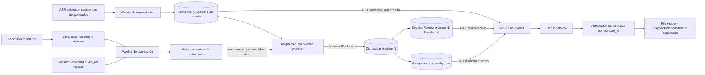

# Documento de Diseño — Renderizado de turnos completos en la transcripción

## Resumen

El pipeline confirma la granularidad que produce el defecto: cada segmento ASR se persiste como `SpeechTurn` y se representa por separado; ASR no entrega límites de turno ni identidad de hablante como evidencia fiable. El diseño conserva esas filas fuente y deriva la presentación agrupada solo de asignaciones de la diarización activa con solapamiento positivo. Las grabaciones nuevas y las históricas elegibles se procesan con diarización versionada; si la fuente de audio se confirma ausente o expirada mientras el transcript aún está dentro de su retención vigente, se conserva la presentación fragmentada y se expone `not_reconstructible`. Fer autorizó reprocesamiento histórico aislado por generación (opción B, `inp_918c917473da4aa7`) y esta excepción acotada (`inp_497cfae022564392`); ninguna cambia la política de retención. Trazabilidad: `bugfix.md` APPROVED en `9fed8e2b14a10bb25960011326e3ebf9e7af5b27` (blob `ddf34bb41dc5d9d9aa38c15c312e9cf24a4e7b05`), AC1–AC7; `docs/product/baseline.md` APPROVED en `4953b3b4b8a058fd4738342307cc50bfd66814f1` (blob `c6f9ef9bf3fac9eac23763e25e25e1089a16c446`), §4.C.4 y §4.B.5. El efecto futuro per-user de correcciones entre grabaciones distintas no se redefine aquí; la prohibición de copia automática se limita a regeneraciones de la misma grabación.

1. Mantener `Transcript` y `SpeechTurn` fuente inmutables; registrar evidencia de solapamiento en las asignaciones y derivar turnos de presentación por corridas consecutivas del mismo `speaker_id`.
2. Versionar diarizaciones por meeting. La migración conserva la generación histórica como revisión 1, la marca `is_legacy=true` y deja `overlap_ms=NULL`; nuevas ejecuciones quedan marcadas como actuales y usan claves de speaker nuevas, coexistiendo sin sobrescribir asignaciones previas.
3. Reprocesar mediante un job idempotente los transcripts históricos cuyo audio siga disponible bajo la retención vigente; la nueva diarización y su revisión pendiente se publican juntas solo al completar.
4. Si la fuente histórica está confirmada como expirada o irrecuperable mientras el transcript sigue dentro de su retención vigente, conservar los fragmentos separados y exponer un intento versionado `not_reconstructible`; no buscar copias alternas ni cambiar la retención.
5. Mantener separadas las generaciones de la misma grabación: no transferir nombres o IDs de speaker por `raw_label`, posición, similitud o identidad acústica. No alterar el efecto futuro per-user de las correcciones entre grabaciones distintas definido por el baseline.
6. En `TranscriptView`, agrupar solo asignaciones positivas de la generación activa; conservar `Speaker N`, texto visible y playback temporalmente fiel mientras una generación nueva procesa o falla, e indicar el estado no reconstruible cuando corresponda.

## Decisiones de Diseño Clave

**Agrupar en el portal después de una atribución validada.** `TranscriptView` combina filas transcript fuente solo cuando sus asignaciones de la generación activa tienen `overlap_ms > 0` y el mismo `speaker_id`. El backend calcula la intersección con los segmentos originales del motor, única capa que conoce esos intervalos, y la persiste. *Alternativas descartadas:* ASR no entrega speaker IDs en sus segmentos; asignar por `speaker_id` sin validar overlap perpetuaría el empate artificial a cero; persistir pasajes derivados duplicaría el texto fuente y los tiempos sin necesidad.

**La continuidad depende de secuencia y de identidad dentro de una generación.** Se combinan únicamente elementos adyacentes en `sequence` con el mismo `speaker_id` no vacío y asignación positiva en esa generación. Una fila intermedia de otra persona o sin evidencia rompe la corrida. No se agrupan apariciones no consecutivas ni por etiqueta visible. *Alternativas descartadas:* agrupar cualquier aparición del mismo speaker borraría límites A-B-A; comparar etiquetas permitiría que nombres editables o `Speaker N` iguales mezclen IDs distintos; usar duración de silencio inventaría un umbral no aprobado.

**La presentación agrupada no crea un intervalo temporal compuesto.** Una fila visible puede reunir el texto de una corrida consecutiva del mismo speaker, pero conserva todos sus subintervalos fuente y no recibe un `end_ms` exterior. `MeetingPlaybackView` recibe intervalos de playback uno a uno, idénticos a cada `SpeechTurn` temporizado; la fila se resalta solo cuando el reloj cae dentro de uno de ellos, queda sin resaltar en una brecha y al activar la fila inicia en el `start_ms` del primer segmento. Así se conservan gaps y overlaps sin ensanchar, desplazar ni fabricar límites. *Alternativas descartadas:* representar la fila como `[primer start_ms, último end_ms]` cerraría brechas; cambiar las duraciones fuente o crear silencios artificiales alteraría la relación con el medio.

**Versionar diarización, no regenerar el transcript.** Una re-ejecución histórica usa las filas `SpeechTurn` y su transcripción existentes como entrada de asignación, y solicita una diarización nueva del mismo `audio_ref`; no vuelve a ejecutar ASR. Cada generación tiene `processing_revision`, su propio `Diarization.id`, `Speaker.id` y `SpeakerAssignment` por fila fuente. La migración marca las diarizaciones existentes `is_legacy=true`; workers nuevos escriben `is_legacy=false`. Las filas de una revisión no se actualizan ni eliminan al crear otra. *Alternativas descartadas:* reemplazar la diarización en sitio destruiría trazabilidad y podría borrar las referencias de revisión; re-ejecutar ASR alteraría texto/tiempos fuera del defecto investigado; mutar IDs antiguos equivaldría a remapear identidades.

**Una revisión nueva de la misma grabación empieza sin nombres heredados.** Cuando una generación se completa, se crea en la misma transacción un `SpeakerReview` para ese `processing_revision`, con items de clave nueva (ID opaco de `Speaker` creado en esa generación) y etiqueta inicial `Speaker N`. La revisión anterior, sus decisiones, excerpt references y receipts quedan preservadas en su revisión previa; ninguna etiqueta, speaker key, disposition o identidad se copia entre generaciones del mismo meeting. La revisión nueva queda pendiente de decisión humana. Esta regla no prohíbe ni redefine el efecto futuro per-user de correcciones entre grabaciones distintas establecido en `docs/product/baseline.md` §4.B.5; la correspondencia cross-recording no forma parte de este bugfix y debe respetar el aislamiento por usuario. *Alternativas descartadas:* asignar `raw_label` de revisiones distintas, secuencia, orden de aparición o parecido acústico no ofrece evidencia de identidad estable y puede presentar un nombre a la voz equivocada.

**La generación activa cambia solo con éxito atómico.** La API selecciona la generación completada de mayor `processing_revision`. Un intento `pending`, `in_progress`, `failed` o `not_reconstructible` no desplaza una generación completada: la transcripción sigue visible y asignaciones antiguas sin evidencia continúan sin agrupar. Diarization, asignaciones nuevas y review nueva se confirman en una sola transacción; si falla, no hay datos parciales ni cambio de generación activa. Un intento `not_reconstructible` se guarda como estado terminal versionado sin speaker, assignment ni review hijos; la API expone ese estado y el portal lo indica sin alterar las filas fuente. *Alternativas descartadas:* exponer resultados incompletos podría mezclar speakers/review; borrar la versión previa al empezar dejaría el transcript sin su historial disponible durante fallas; tratar falta confirmada de audio como fallo genérico ocultaría la condición terminal autorizada.

**Exponer solapamiento, revisión y el resultado terminal de backfill.** `GET /api/v1/meetings/{meeting_id}/diarization` agrega `overlap_ms`, `processing_revision` y el estado del último intento, que puede ser `not_reconstructible`, al resultado autenticado; el frontend agrupa solo con la generación completada activa. `GET .../speaker-review` por defecto resuelve la revisión alineada con la generación activa; añade un parámetro opcional `revision_id` para recuperar, con la misma autorización, una revisión histórica separada. No se modifica `packages/shared-types` porque estas respuestas HTTP no lo consumen. *Alternativa descartada:* omitir generación o evidencia deja al cliente incapaz de evitar que asignaciones legacy sin overlap se usen como identidad; no exponer revisión histórica dificultaría conservarla como registro recuperable sin activar sus nombres para la versión nueva.

**Clasificar ausencia de audio con evidencia del almacenamiento y sin ampliar retención.** El backfill solo considera un `Transcript` aún elegible bajo su `expires_at` y una `SessionRecording` con el `audio_ref` exacto. Antes de publicar trabajo, consulta disponibilidad mediante un nuevo contrato `ObjectStore.inspect(reference) -> available | missing`; `S3ObjectStore` implementa `inspect` con `head_object`, y solo el código S3 `NoSuchKey` para la key exacta, con bucket accesible, produce `missing`; un 404 sin código de objeto (p. ej. bucket ausente) no es evidencia. Timeout y error transitorio de red/servicio son indeterminados y reintentables; permiso denegado o respuesta inválida falla cerrada, sin crear estado terminal. Ninguno demuestra irreconstruibilidad. Si `SessionRecording.expires_at <= now` o la inspección confirma objeto inexistente mientras el transcript sigue vigente, la reserva de revisión pasa a `not_reconstructible` con causa `audio_unavailable`, sin emitir capability ni llamar al motor; la API lo hace observable y la UI mantiene `Speaker N` y fragmentos fuente. Si no existe `SessionRecording`/`audio_ref` ni evidencia persistida de expiración, no se infiere el motivo ni se marca terminal: no se encola, no se agrupa y no se busca otra copia. La expiración propia del transcript mantiene el comportamiento de retención existente; nunca se extiende para conservar texto. No se altera `RETENTION_DAYS`, permisos, ni retención, y no se descarga ni duplica audio durante la inspección.

**Etiquetas de review alineadas por generación.** El `TranscriptView` actual consulta el `currentLabel` del item de review coincidente y, si no hay item, usa `speaker.label` y luego `Speaker N`; sin embargo, `SpeakerReviewService.get_active_review` devuelve únicamente items pendientes, por lo que no es una fuente suficiente para nombres ya confirmados tras recargar. Extender la respuesta autenticada de review con `labels_by_speaker_id`, construido con todos los items de la misma `processing_revision` (`chosen_label` para una decisión named/corrected explícita; de lo contrario `current_label`, manteniendo `Speaker N` para atribución incierta no resuelta). `items` sigue conteniendo solo los pendientes para no cambiar el flujo de revisión. La vista consume únicamente etiquetas de la generación activa; la generación nueva no consulta la revisión anterior. La agrupación depende solo de ID+overlap, nunca de la etiqueta.

## Arquitectura

Especializaciones: **backend-api**, **web-application** y **cross-surface-integration**. El backend versiona asignaciones y review; el portal deriva las filas completas desde APIs autenticadas; la transcripción fuente no cambia. No se modifica la extensión. Audio, transcript y datos de speaker siguen bajo las salvaguardas de `SECURITY.md`; el job de backfill usa la autorización de grabación existente y no cambia retención.



```mermaid
sequenceDiagram
    participant M as Migración
    participant B as Backfill
    participant Q as JobQueue
    participant W as Worker de diarización
    participant DB as PostgreSQL
    participant O as ObjectStore S3-compatible
    participant E as Motor autorizado
    participant API as APIs autenticadas
    participant TV as TranscriptView
    M->>DB: Añadir revision/overlap/provider nullable; preservar generación 1
    B->>DB: Verificar transcript y recording aún elegibles por expiración
    B->>O: inspect(audio_ref) sobre la referencia exacta
    alt Audio presente y autorización vigente
        B->>DB: Bloquear Meeting y reservar/reusar una única revision N pending
        B->>Q: Publicar meeting_id + revision N tras commit
        Q->>W: Claim condicional pending -> in_progress
        W->>DB: Revalidar expiración y disponibilidad
        W->>E: Diarizar audio_ref con capability del objeto exacto
        E-->>W: Segmentos etiquetados solo dentro de esta ejecución
        W->>W: Asignar solo overlaps positivos; crear IDs nuevos
        W->>DB: Transacción: generación, assignments y review N pending
    else Expirado o ausencia autoritativa
        B->>DB: Bloquear Meeting; guardar intento terminal not_reconstructible sin hijos
    else Error indeterminado de storage/permisos
        B->>DB: No marcar terminal; dejar reintentable o fail-closed
    end
    API-->>TV: SpeechTurns fuente + generación/review activa + estado del intento
    TV->>TV: Agrupar por ID/overlap positivo y mostrar estado no reconstruible
    TV->>TV: Reproducir/highlight solo intervalos fuente, nunca los gaps
```

Mientras revision N está en proceso o falla, `GET transcript` sigue devolviendo las filas fuente retenidas y la generación activa anterior queda intacta. Si la inspección autoritativa marca `not_reconstructible`, el endpoint devuelve ese estado terminal y la vista deja cada fuente separada con `Speaker N`; si la fuente solo es desconocida, no la marca ni infiere asignación. Una fila histórica con `overlap_ms=NULL` permanece separada. Cuando una nueva generación completa se confirma junto con su review, las lecturas posteriores seleccionan esa generación; las asignaciones antiguas siguen accesibles solo bajo su revisión previa y no se mezclan con la nueva.

## Componentes e Interfaces

### 1. APIs de transcript, diarización y review

- `GET /api/v1/meetings/{meeting_id}/transcript` conserva su autorización y devuelve el transcript fuente existente (`id`, `text`, `start_ms`, `end_ms`, `sequence`), ordenado por `sequence`. No genera ni persiste turnos compuestos.
- `GET /api/v1/meetings/{meeting_id}/diarization` devuelve `{ processing_revision: number | null, speakers: Speaker[], assignments: Assignment[], latest_attempt: { processing_revision: number; diarization_state: "pending" | "in_progress" | "completed" | "failed" | "not_reconstructible"; failure_cause: string | null } | null }`. `processing_revision` y arrays refieren solo a la última generación `completed` (si ninguna, null y arrays vacíos); `latest_attempt` distingue pendiente, fallo y `not_reconstructible`. Cada assignment es `{ turn_id: string; speaker_id: string; overlap_ms: number | null }`; solo overlap positivo habilita agrupación; NULL es dato legacy sin evidencia persistida. La ruta mantiene autorización y retorna el estado terminal con transcript fuente retenido.
- `GET /api/v1/meetings/{meeting_id}/speaker-review` sin parámetro devuelve la revisión alineada a la generación activa y agrega `labels_by_speaker_id: Record<string, string>` resuelto desde todos los items persistidos; `items` conserva solo los pendientes para la UI de revisión. `frontend/src/api.ts` adapta ese campo wire a `SpeakerReview.labelsBySpeakerId: Record&lt;string, string>` en GET y PUT; TranscriptView no consume la snake_case directamente; el adapter también mapea las claves wire y los items anidados al contrato camelCase de `SpeakerReview` (`speakerId`, `currentLabel`, `attributionState: "attributed" | "uncertain"`, `excerptRef: string | null`, `expectedVersion: number`). Añade `?revision_id=N` opcional para leer revisión histórica bajo la misma autorización, pero la vista usa solo la revisión activa. Si no hay una generación nueva completada, conserva la revisión previamente activa. Las revisiones previas no se borran ni se convierten en la activa de otra generación. El router, que actualmente solo expone GET, añade `PUT /api/v1/meetings/{meeting_id}/speaker-review/revisions/{revision_id}/speakers/{speaker_id}` con `SpeakerReviewService.record_disposition`; responde con el snapshot agregado actualizado en la misma forma wire (mapa completo y `items` pendientes), y el receipt idempotente guarda esa respuesta completa para replay. Cada item wire incluye `speaker_id`, `current_label`, `attribution_state` (`attributed`|`uncertain`), `disposition`, `excerpt_ref` nullable y `expected_version`.
- Las rutas continúan llamando `_get_authorized_meeting`; accesos y errores de autorización conservan el comportamiento actual. No se envían datos de audio, texto adicional, contenido de reuniones ni `raw_label` histórico a los clientes.

### 2. Persistencia y asignación (`backend/app/diarization/`, `backend/app/infra/models.py`)

`assign_turns` retorna `(turn_id, speaker, overlap_ms)` únicamente si el máximo solapamiento es estrictamente positivo; el empate positivo conserva el desempate por menor `sequence`; máximo cero no crea asignación. `worker.py` persiste la medida junto a la asignación y el speaker creado en la misma generación. `raw_label` solo indexa los objetos devueltos por una sola llamada al motor; jamás se consulta contra otra revisión.

`DiarizationRepository` deja de asumir una sola fila por meeting y expone la generación activa/completada, el siguiente número de revisión y la persistencia atómica de una generación. `reserve_next_revision` bloquea la fila `Meeting` con `SELECT ... FOR UPDATE`, vuelve a consultar estados dentro de la transacción y crea como máximo una revisión siguiente; la unicidad `(meeting_id, processing_revision)` protege además contra procesos concurrentes. El mismo helper reserva un estado `pending` o, con evidencia autoritativa de audio ausente, transita a `not_reconstructible`. Solo luego del commit se publica `(meeting_id, processing_revision)`. Si el proceso cae antes de publicar, repetir el backfill publica la misma pendiente; si dos publicaciones ocurren, el worker reclama `pending -> in_progress` bajo bloqueo/actualización condicional y la segunda entrega es no-op. El worker solo escribe speakers, assignments y review tras respuesta válida del motor, en transacción atómica. Una fila completada o terminal no se muta; fallos reintentables no reemplazan generación activa. `state.py` permite `pending -> in_progress -> completed|failed|not_reconstructible`; `pending -> not_reconstructible` si la comprobación previa confirma expiración/ausencia; `failed -> pending` solo por evento explícito `retry` cuando la causa sea reintentable. `completed` y `not_reconstructible` son terminales; `not_reconstructible` requiere `failure_cause=audio_unavailable`.

`backend/app/infra/object_store.py` agrega `ObjectAvailability = Literal["available", "missing"]` y `ObjectStore.inspect(reference)`. `S3ObjectStore.inspect` usa `head_object`; solamente el código/status inequívoco de objeto ausente produce `missing`, mientras permisos, timeouts, errores de servicio y respuestas no reconocidas propagan una falla no-terminal. El método no descarga bytes ni expone la referencia fuera del backend. Tests sintéticos deben comprobar la traducción de not-found y la separación de errores transitorios/autorización.

### 3. Backfill histórico y re-procesamiento seguro

Agregar `backend/app/diarization/reprocess_legacy.py` como comando de backfill re-ejecutable. Enumera diarizaciones `is_legacy=true` cuyo `Transcript` y `SessionRecording` siguen presentes y cuya expiración permite reprocesamiento. Bajo bloqueo de fila del meeting vuelve a leer el intento actual, reserva/reusa exactamente una revisión y consulta `ObjectStore.inspect` para el `audio_ref` exacto. Si hay audio presente y permiso vigente, crea/reusa `pending` y publica el job tras commit; si `expires_at <= now` o el store confirma `missing`, crea `not_reconstructible` con `audio_unavailable`, sin engine ni capability ni hijos; errores indeterminados no se marcan y quedan reintentables/fail-closed. Si no existe `SessionRecording`/referencia ni evidencia explícita, no infiere pérdida ni inventa una ruta: no encola y deja la fuente separada. Una generación posterior completada o estado terminal es no-op. No modifica turnos fuente ni amplía la retención. El job contiene solo `meeting_id` y `processing_revision`, nunca texto ni nombres; el worker revalida ambos `expires_at`, vuelve a inspeccionar disponibilidad y solo luego emite capability firmado para el `audio_ref` exacto y llama al motor. La reserva única bajo `SELECT ... FOR UPDATE` y constraint `(meeting_id, processing_revision)` evita revisiones duplicadas; reejecutar el comando repone una publicación pendiente caída y redelivery usa el claim idempotente del worker.

El backfill no se ejecuta dentro de Alembic ni expone endpoint público de reprocesamiento. Para el transcript completo previamente guardado por Fer, se aplica la misma ruta general; el diseño no registra su identificador, texto ni otra información privada. Si el objeto ya no está disponible o la retención lo eliminó, no se intenta recuperarlo desde otra ubicación.

### 4. Modelos, revisión y migración

- Añadir `Diarization.processing_revision: int NOT NULL` (existentes a `1`) y `is_legacy: bool NOT NULL` (existentes `true`, default `false` para nuevas generaciones); cambiar la unicidad de `meeting_id` a `(meeting_id, processing_revision)`. Permitir `provider=NULL` mientras ningún provider haya iniciado (incluidas reservas y `not_reconstructible`); registrar el provider real antes de invocarlo y usar `speaker_count=0` para intentos sin hijos. Extender `diarization_state` y `backend/app/diarization/state.py` con terminal `not_reconstructible` y causa `failure_cause=audio_unavailable`; transición terminal solo con expiración elegible o ausencia autoritativa del objeto. La revisión 1 conserva IDs, speakers, assignments y estado originales; el flag permite al backfill identificar únicamente salidas anteriores al fix.
- Añadir `SpeakerAssignment.overlap_ms: int NULL`; las filas existentes quedan NULL. Reemplazar `uq_speaker_assignment_turn_id` por unicidad `(diarization_id, turn_id)`, de modo que el mismo `SpeechTurn` pueda tener asignaciones en revisiones distintas sin borrar las previas.
- `Speaker.id` sigue siendo UUID nuevo por generación. Cada `SpeakerReview` nuevo usa el mismo `processing_revision`; los items usan la nueva clave opaca del speaker y etiqueta inicial `Speaker N`. La tabla de review ya tiene unicidad por `(meeting_id, processing_revision)`; no se migra ni reescribe el contenido de revisiones previas, sus receipts o excerpt references.
- `Transcript` y `SpeechTurn` siguen siendo una única fuente por meeting y no necesitan versionarse para esta corrección: solo se reprocesa diarización y se atribuyen sus intervalos fuente.
- Una migración Alembic secuencial posterior a `011` (nombre exacto determinado por el autor de implementación tras sincronizar la rama) conserva datos existentes: añade columnas/constraints, marca filas existentes revisión 1 (`is_legacy=true`, `overlap_ms=NULL`), deja `is_legacy=false` por default y permite `provider=NULL` solo mientras ningún provider haya iniciado. Intentos sin hijos usan `speaker_count=0`; no se invoca servicio, descarga audio ni publica jobs en migración. La selección activa es la generación de mayor revisión `completed`; `pending`, `in_progress`, `failed` o `not_reconstructible` nunca la sustituyen.

### 5. Agrupador puro frontend (`frontend/src/transcript-turns.ts`)

Añadir función determinista sin I/O y prueba colocalizada `frontend/src/transcript-turns.test.ts`:

```typescript
interface SourceTranscriptSegment {
  id: string;
  text: string;
  startMs: number | null;
  endMs: number | null;
  sequence: number;
}

interface PresentationTurn {
  id: string;                    // ID de la primera fila fuente del grupo
  sourceIds: string[];           // IDs fuente conservados
  text: string;                  // textos no vacíos en orden, separados por un espacio
  timestampMs: number | null;   // startMs de la primera fuente, solo para mostrar/iniciar
  sequence: number;
  speakerId?: string;            // ID de la generación activa con overlap_ms > 0
  speakerLabel: string;          // label de la misma revisión o Speaker N
  speakerColor?: string;
}

interface PlaybackInterval {
  id: string;                    // ID exacto del SpeechTurn fuente
  presentationTurnId: string;   // fila visible que se resalta durante este intervalo
  startMs: number;               // límites exactos de la fuente
  endMs: number;
  text: string;                  // requerido por TimedPassage; no se renderiza como fila aparte
  sequence: number;
}

function groupTranscriptTurns(
  segments: SourceTranscriptSegment[],
  speakerIdByTurnId: ReadonlyMap<string, string>
): PresentationTurn[];
```

El caller construye `speakerIdByTurnId` solo con assignments positivos de la generación activa. Ordena por `sequence` ascendente con orden estable para empates; agrupa solo fuentes adyacentes con tiempos válidos y el mismo `speakerId` no vacío. Una fila sin speaker validado interrumpe la corrida, queda separada con `Speaker N` y no permite saltar a sus vecinos. El ID del grupo es el ID de su primera fuente; `sourceIds` mantiene la trazabilidad. `timestampMs` muestra y permite iniciar el turno desde el primer segmento, pero no es el inicio de un intervalo compuesto. Textos no vacíos se unen con un espacio, sin reescribir filas fuente. Filas sin tiempo válido permanecen independientes y no generan playback.

La lista `PlaybackInterval[]` se deriva por separado de cada fila fuente temporizada: sus `id`, `startMs`, `endMs` y `sequence` son exactamente los de `SpeechTurn`, y `presentationTurnId` se resuelve desde `sourceIds`. Ningún intervalo abarca dos segmentos; por tanto una brecha interna produce `findPassageAt(time)` nulo, y un overlap se conserva exactamente como estaba en la fuente.

### 6. Vista y playback (`frontend/src/components/TranscriptView.tsx`)

- Consumir transcript fuente, generación activa de diarización y review de la misma revisión; no usar etiquetas/reviews de otra `processing_revision`.
- Construir el mapa de asignación solo para `overlap_ms > 0`; legacy NULL, cero, ausencia, error de carga o generación fallida quedan sin asignación válida y se presentan individualmente como `Speaker N`. Si el último intento está `not_reconstructible`, mantener los fragmentos separados y mostrar ese estado sin ocultar ni reescribir el transcript.
- Resolver la etiqueta visible solo con `review.labelsBySpeakerId[speakerId]` de la misma `processing_revision`; `frontend/src/api.ts` adapta el campo wire `labels_by_speaker_id`. No leer `review.items` para pintar labels porque contiene únicamente items pendientes. El backend construye el mapa usando `chosen_label` para decisiones explícitas `named`/`corrected`; en los demás casos usa `current_label`, que conserva `Speaker N` ante incertidumbre no resuelta. Si falta una entrada, usar `speaker.label`; si tampoco existe, `Speaker N`. El ID de speaker, no la cadena de etiqueta, determina el agrupamiento.
- Renderizar una fila visible por corrida máxima con texto combinado y timestamp del primer segmento, conservando referencias a sus fuentes. Pasar a `MeetingPlaybackView` esa lista de filas para render y, por separado, `PlaybackInterval[]` uno a uno desde los `SpeechTurn` temporizados para el `PlaybackController`.
- Mapear `activePassageId` (ID fuente) a `presentationTurnId` para resaltar/desplazar la fila agrupada solo cuando el reloj cae dentro de un intervalo fuente. En gaps no hay passage activo; al activar el botón de una fila se inicia en el primer `startMs` de esa fila, sin inventar un `endMs` compuesto. Un fallo o estado pendiente de diarización no oculta el transcript.

### Ubicación y pruebas

| Área | Archivos que agrega/modifica | Tests sintéticos | Migración | Shared types / Compose |
|---|---|---|---|---|
| Backend diarización y backfill | `backend/app/diarization/assignment.py`, `repository.py`, `state.py`, `worker.py`, nuevo `reprocess_legacy.py`, `backend/app/infra/models.py`, `object_store.py`, `object_store_s3.py` | `backend/tests/diarization/test_assignment_property.py`, `test_state_property.py`, `test_worker.py`, nuevo `test_reprocess_legacy.py`, actualización de `test_repository.py`, nuevo `backend/tests/infra/test_object_store_availability.py` y nuevo `backend/tests/integration/test_diarization_reservation_concurrency.py` | Sí: siguiente Alembic posterior a `011`; revisiones/unique, overlap nullable, provider nullable para intentos sin motor | `packages/shared-types`: sin cambio; `docker-compose.yml`: sin cambio, usa motor host-native configurado abajo |
| Backend meetings API/review | `backend/app/meetings/router.py`, `speaker_review_service.py` y esquemas donde ya correspondan | `backend/tests/meetings/test_diarization_endpoint.py`, `backend/tests/speaker_review/` revisión activa por generation y conservación histórica | Misma migración | Sin cambio |
| Web portal | `frontend/src/api.ts`, `frontend/src/components/TranscriptView.tsx`, `frontend/src/components/MeetingPlaybackView.tsx`, nuevo `frontend/src/transcript-turns.ts` | `frontend/src/transcript-turns.test.ts`, `frontend/src/components/TranscriptView.test.tsx`, `frontend/src/components/__tests__/MeetingPlaybackView.test.tsx`, `frontend/src/components/__tests__/PlaybackController.test.ts`, `frontend/src/api.test.ts` | No | `packages/shared-types`: sin cambio; `docker-compose.yml`: sin cambio |
| Fuentes y datos existentes | No cambiar contenido/IDs de `Transcript`/`SpeechTurn`; mantener generaciones y reviews previas | migración prueba inmutabilidad; fixture sintética de generación 1/review previa + generación 2/review nueva prueba aislamiento | Incluida | Extension: sin cambios |

**Despliegue y compatibilidad:** `docs/architecture/project-structure.md` confirma correctamente que Compose no proporciona un servicio de diarización, aunque su afirmación de que `DIARIZATION_LOCAL_URL` no está configurada es obsoleta: el `docker-compose.yml` actual pasa esa variable a API y worker (default `http://host.docker.internal:8002`), pero no inicia el motor. El runtime local soportado corre el motor diarización host-native fuera de Compose mediante `make engines-install` y `make engines-up`; esos comandos aseguran credenciales/modelo autorizado y servidor en el endpoint configurado. Si se usa otro host/puerto, configurar `DIARIZATION_LOCAL_URL` con una dirección accesible desde ambos contenedores. Por eso esta corrección no agrega un servicio Compose ni cambia `docker-compose.yml`. Antes del backfill, detener consumers antiguos de `diarize`, aplicar migración y desplegar worker/API capaces de leer revisiones; luego iniciar el engine local y solo entonces ejecutar el comando. Nunca ejecutar con código antiguo que asume unicidad por meeting. Reintentar por clave meeting/revisión; no permitir que un intento incompleto sustituya la generación activa.

## Modelos de Datos

`Transcript`/`SpeechTurn` mantienen su shape y su contenido fuente. `Diarization` agrega `processing_revision` e `is_legacy`; cada generación posee speakers propios y estado independiente, incluido el estado terminal `not_reconstructible` para un intento sin audio recuperable confirmado. Ese intento no crea speaker, assignment o `SpeakerReview` hijos y no desplaza la última generación completada. `SpeakerAssignment` agrega `overlap_ms: Integer | NULL` y su unicidad pasa a `(diarization_id, turn_id)`; generación 1 conserva `is_legacy=true` y asignaciones históricas NULL, generaciones actuales tienen `is_legacy=false` y guardan medidas positivas únicamente. `SpeakerReview.processing_revision` alinea revisión humana con la diarización: cada generación nueva tiene agregado/items frescos con `Speaker N`, mientras el agregado anterior permanece separado. `PresentationTurn` es derivado en memoria, nunca otra fuente de verdad. El coste es una ejecución adicional de diarización por cada grabación histórica reprocesable y almacenamiento adicional por su generación/intento; no se altera el coste ni la política de retención del audio fuente.

## Propiedades de Correctitud

**Propiedad 1 — Agrupación consecutiva por identidad de generación.** Para cualquier secuencia sintética ordenada con assignments positivos, cada corrida máxima contigua del mismo `speaker_id` dentro de una revisión produce exactamente un turno visible; una identidad distinta, una ausencia o un overlap no positivo la separa. Texto conserva orden. Valida AC1.

**Propiedad 2 — No agrupación por repetición no consecutiva.** Para secuencia `A, B, A`, la salida mantiene tres turnos incluso si las dos etiquetas visibles de A son iguales. Valida AC3 y “Comportamiento Sin Cambios” 2.

**Propiedad 3 — Solapamiento positivo.** `assign_turns` solo asigna/persiste una fila si el máximo temporal es estrictamente positivo; retorna ese total y conserva desempate por menor `sequence` entre máximos positivos. Máximo cero produce ausencia de asignación y `Speaker N`, nunca el speaker de menor secuencia. Valida AC1, AC4 y “Comportamiento Sin Cambios” 1.

**Propiedad 4 — Identidad aislada entre generaciones de la misma grabación.** Para toda migración, generación 1 conserva IDs, assignments y review anteriores, queda `is_legacy=true` y sus overlaps son NULL. Una nueva revisión de esa grabación tiene IDs no coincidentes, no copia nombre/disposition/review/excerpt y crea review pending separada; assignment de la misma `turn_id` puede coexistir solo bajo `diarization_id` distinto. Ningún nombre revisado de generación previa se transfiere a la nueva sin acción humana. No restringe el efecto futuro per-user entre grabaciones distintas de baseline §4.B.5. Valida la decisión B de Fer.

**Propiedad 5 — Reserva concurrente, redelivery y publicación atómica.** Dos backfills simultáneos sobre un meeting serializan la reserva por `Meeting FOR UPDATE` y la constraint `(meeting_id, processing_revision)` deja una sola revisión. Caída antes de publicar se recupera reencolando esa misma revisión; dos jobs publicados compiten por un claim condicional, solo uno procesa. Redelivery no duplica generación/review ni altera una generación completa; rollback conserva la generación activa y no deja speakers/assignments/review parciales. Fallos reintentables repiten con la misma revisión; solo el resultado completo se vuelve activo.

**Propiedad 6 — Reprocesamiento histórico seguro.** Backfill sintético selecciona solo diarizaciones `is_legacy=true`, transcript vigente y recording autorizado bajo retención; solo publica cuando `inspect` confirma el `audio_ref` exacto disponible, y nunca adivina la causa si falta referencia. Reusa la reserva pendiente, respeta expiración, publica con capability del objeto exacto y hace no-op tras completar o estado terminal. No consulta ni usa transcripciones reales en tests/logs. Valida AC1, AC2 y la opción B sin saltar límites de seguridad/retención.

**Propiedad 7 — Fidelidad exacta de intervalos y entradas inválidas.** Para cada intervalo fuente temporizado, `PlaybackInterval` conserva exactamente `id`, `startMs`, `endMs` y orden; ningún intervalo derivado abarca la brecha entre dos `SpeechTurn`. Ejemplo sintético: dos fragmentos A con `[0,100]` y `[200,300]` producen una fila visual A con ambos textos y dos intervalos separados, `findPassageAt(150) === null`, y Play busca el tiempo 0. Gaps/overlaps se preservan; entrada sin texto no inventa texto y timing inválido no genera asociación de playback. Valida AC5–AC6 y “Comportamiento Sin Cambios” 3–5.

**Propiedad 8 — Audio histórico irrecuperable explícito y no destructivo.** Si `SessionRecording.expires_at <= now` o `ObjectStore.inspect` confirma ausencia definitiva del `audio_ref` exacto mientras el transcript sigue retenido, la máquina de estados crea un único intento `not_reconstructible` con causa `audio_unavailable`, sin speaker/assignment/review hijos; deja intactas fuente y revisiones previas, mantiene cada fragmento separado con `Speaker N` y expone el estado en la vista. Redelivery es no-op. Error transitorio, permiso denegado o falta de evidencia no produce esta marca terminal. Valida AC2 y la decisión autorizada por Fer (`inp_497cfae022564392`).

## Manejo de Errores

| Escenario | Comportamiento |
|---|---|
| Nueva generación pendiente/en procesamiento | Mantener visible transcript y última generación completada. Filas antiguas con overlap NULL siguen separadas y `Speaker N`; no publicar parcialmente. |
| Timeout/falla transitoria del motor o transporte, job se interrumpe o se repite | Usar `DIARIZATION_TIMEOUT_SECONDS` del provider local existente y reintentos acotados de la queue. Registrar causa reintentable; el backfill vuelve a encolar la misma revisión pendiente. La transacción no deja assignments/review parciales; no borrar ni desactivar generación completada previa. No se añade provider cloud. |
| Audio ya expirado según `SessionRecording.expires_at`, o `ObjectStore.inspect(audio_ref)` confirma objeto inexistente mientras el transcript sigue retenido | La transición de `state.py` crea un único intento terminal `not_reconstructible`/`audio_unavailable`, sin hijos ni cambio de generación activa; preserva filas/reviews y muestra fragmentos separados con el estado. No recupera otra copia ni extiende retención. |
| Falta `SessionRecording`/referencia y no hay evidencia verificable, o el transcript mismo expiró | No inferir `not_reconstructible` ni buscar rutas alternativas; no reencolar ni ampliar acceso. Se mantiene la elegibilidad y eliminación de datos según retención vigente. |
| Error transitorio de storage, servicio o recording capability | No marcar `not_reconstructible`; registrar fallo reintentable o fallar cerrado por autorización, preservando la generación activa anterior. Revalidar en retry. |
| Engine capability inválida o no autoriza el audio_ref exacto | Fallar cerrado antes de descargar/procesar; no usar token genérico como sustituto; mantener texto y generación anterior. |
| Resultado de motor sin speaker/segmento o todo overlap es cero | No fabricar atribución; no persistir assignment sin overlap positivo; presentar esa fila separada como `Speaker N`. |
| Revisión nueva completada pero aún sin decisión humana | Presentar la nueva etiqueta `Speaker N` y mostrar review pendiente según el flujo existente; no copiar nombres de revisiones previas. |
| Fila sin asignación, ID de revisión inconsistente o asignación huérfana | Ignorarla para agrupación; conservar fila fuente y `Speaker N`; no hacer join entre revisiones. |
| Transcripción/API no autorizada o error HTTP | Conservar autenticación/autorización y manejo HTTP actual; no devolver datos de otra reunión/usuario. Error secundario de diarización no bloquea texto ya autorizado. |
| Migración/despliegue interrumpido | Consumers antiguos permanecen detenidos hasta API/worker versionados; no arrancar backfill parcialmente. Rollback operacional detiene backfill/consumers nuevos y conserva filas y columnas; no borrar revisiones nuevas después de procesarlas. Si es preciso deshacer, hacerlo con migración correctiva y análisis explícito de datos, no downgrade destructivo. |

## Estrategia de Testing

Usar exclusivamente reuniones, audio_refs, textos, nombres y segmentos sintéticos; no acceder ni copiar datos de reuniones reales. Nia ejecutó pruebas del comportamiento actual antes de esta corrección, pero ese resultado no valida el candidato futuro.

1. **Assignment unit/property:** actualizar `backend/tests/diarization/test_assignment_property.py` para overlap positivo, máximos, empate, cero, intervalos sin intersección, y resultado vacío cuando no haya evidencia.
2. **Migración/generaciones:** ampliar `backend/tests/diarization/test_migration.py`: filas existentes se vuelven revision 1/`is_legacy=true`/overlap NULL sin cambiar speaker/assignment/review IDs; filas nuevas usan `is_legacy=false`; una reserva `not_reconstructible` admite `provider=NULL`, `speaker_count=0` y ningún hijo; dos revisions pueden referir la misma `turn_id` bajo diferentes diarization IDs; constraints impiden duplicados dentro de una revision.
3. **Backfill y clasificación:** nuevo `backend/tests/diarization/test_reprocess_legacy.py` cubre transcript/recording vigentes, `expires_at`, objeto presente, `NoSuchKey` para key exacta, bucket-404 sin código específico, error transitorio/permiso, referencia ausente sin evidencia, transcript expirado, reejecución, caída entre reserva y publish y redelivery. Afirmar `not_reconstructible` solo con evidencia terminal, sin hijos ni mutación previa. Nuevo `backend/tests/infra/test_object_store_availability.py` cubre la traducción de `head_object`. El backfill no descarga audio ni publica texto/nombres. La carrera real de dos reservas se verifica con dos PostgreSQL sessions en el nuevo `backend/tests/integration/test_diarization_reservation_concurrency.py`.
4. **State, worker/review:** ampliar `backend/tests/diarization/test_state_property.py` para transiciones `pending -> not_reconstructible` por fuente ausente confirmada, terminalidad y rechazo de transiciones desde `not_reconstructible`, más retry de fallas transitorias. Ampliar `test_worker.py` y tests bajo `backend/tests/speaker_review/`: worker revalida expiración; no invoca engine para ausente/expirado; generación completada tiene UUIDs frescos, overlap positivo y review pending atómicos; historial previo queda igual; la carrera entre doble claim procesa una sola vez.
5. **API:** `backend/tests/meetings/test_diarization_endpoint.py` cubre selección de última generación completada, status del intento actual incluido `not_reconstructible`, `processing_revision`, overlap nullable/positivo y auth intacta. Tests de speaker-review verifican revisión activa, `labels_by_speaker_id` desde todos los estados, `chosen_label` explícito y `current_label` para confirmados/`Speaker N` inciertos. Tras `named`/`corrected`, el `PUT` conserva el label en el mapa aunque el speaker salga de `items`; GET tras reload lo conserva y replay idempotente devuelve su respuesta original. Una review histórica por `revision_id` nunca se usa como activa.
6. **Agrupador (Vitest):** `frontend/src/transcript-turns.test.ts` cubre `A,A,B,B,A`, cambios/repeticiones, IDs distintos con igual etiqueta, nulos/ausentes/cero, gaps/overlaps, texto vacío, timing inválido, order y no mutación.
7. **Vista y playback:** `frontend/src/components/TranscriptView.test.tsx` fixtures garantizan que no mezcla revisión 1 y 2; el label para el transcript viene solo de `review.labelsBySpeakerId` (wire field `labels_by_speaker_id`), nunca de `review.items`. Verifica que tras nombrar/corregir el item salga de la lista pendiente pero el label elegido persista sin volver a `Speaker N`, también tras reload; incertidumbre queda `Speaker N` y una review antigua no se expone en IDs nuevos. `frontend/src/api.test.ts` verifica que GET/PUT adapten el mapa y los items wire snake_case a camelCase y mantengan el mapa completo. Informa `not_reconstructible` sin agrupar ni ocultar fragmentos y mantiene transcript visible durante carga/fallo. `frontend/src/components/__tests__/MeetingPlaybackView.test.tsx` verifica una fila visual A para dos fuentes A, dos intervalos exactos en el controller, gap sin passage activo y Play desde el inicio del primer intervalo; `frontend/src/components/__tests__/PlaybackController.test.ts` conserva la propiedad de no hallar passage dentro de un gap.
8. Desde `frontend/`, ejecutar `npm run test -- src/transcript-turns.test.ts src/components/TranscriptView.test.tsx src/components/__tests__/MeetingPlaybackView.test.tsx src/components/__tests__/PlaybackController.test.ts src/api.test.ts` y `npm run typecheck`; desde `backend/`, ejecutar `<root>/backend/.venv/bin/python -m pytest tests/diarization/test_assignment_property.py tests/diarization/test_state_property.py tests/diarization/test_worker.py tests/diarization/test_reprocess_legacy.py tests/diarization/test_migration.py tests/infra/test_object_store_availability.py tests/meetings/test_diarization_endpoint.py tests/speaker_review`. Ejecutar también `&lt;root>/backend/.venv/bin/python -m pytest tests/integration/test_diarization_reservation_concurrency.py` contra PostgreSQL para comprobar locks y constraints reales (no SQLite). Son comandos de validación futura, no resultados ya obtenidos.
