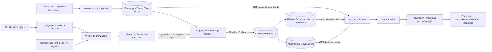

# Documento de Diseño — Renderizado de turnos completos en la transcripción

## Resumen

El defecto llega al portal porque cada segmento del resultado ASR se persiste y se presenta como un `SpeechTurn` independiente. La diarización ya calcula actividad de hablantes contra esos intervalos, pero asignaciones sin solapamiento positivo pueden ser arbitrarias, y las asignaciones históricas no guardan la evidencia necesaria para distinguirlas. El diseño conserva los segmentos transcript fuente y agrupa solo con asignaciones respaldadas por solapamiento positivo, también para grabaciones históricas mediante una nueva generación de diarización con identidades y revisión independientes. Fer autorizó la opción B el 2026-10-30 (respuesta `inp_918c917473da4aa7`): reprocesar grabaciones históricas cuyo audio siga disponible, conservar revisiones previas separadas y no transferir nombres automáticamente. En una respuesta posterior (`inp_497cfae022564392`), autorizó la excepción acotada: ante audio confirmado como expirado o irrecuperable, mantener los fragmentos fuente sin agrupar y marcarlos como no reconstruibles; aplicar la corrección a nuevas grabaciones y a las históricas con audio disponible, sin cambiar retención. Esta excepción es un delta respecto de AC1 en el snapshot aprobado y requiere una enmienda upstream de `bugfix.md` antes de la auditoría del diseño. El artefacto mantiene trazabilidad explícita a `bugfix.md` aprobado, commit `b0766bced264473d500d81ca74477b104378d2e7`, blob `dd7895959fbbf43e4348d19f00b20426c22a07a3`, y al comportamiento portal de `PRODUCT_BASELINE.md` aprobado en commit `4953b3b4b8a058fd4738342307cc50bfd66814f1`, blob `c6f9ef9bf3fac9eac23763e25e25e1089a16c446`, §4.C.4, según `task_a08baf81140a4073`. El rótulo DRAFT de la copia de baseline no invalida esa aprobación exacta.

1. Mantener `Transcript` y `SpeechTurn` fuente inmutables; registrar evidencia de solapamiento en las asignaciones y derivar turnos de presentación por corridas consecutivas del mismo `speaker_id`.
2. Versionar diarizaciones por meeting. La migración conserva la generación histórica como revisión 1, la marca `is_legacy=true` y deja `overlap_ms=NULL`; nuevas ejecuciones quedan marcadas como actuales y usan claves de speaker nuevas, coexistiendo sin sobrescribir asignaciones previas.
3. Reprocesar mediante un job idempotente los transcripts históricos cuyo audio siga disponible bajo la retención vigente; la nueva diarización y su revisión pendiente se publican juntas solo al completar.
4. Si la fuente histórica está confirmada como expirada o irrecuperable, mantener intactos el transcript y la revisión anterior, dejar sus fragmentos separados y registrar un intento versionado `not_reconstructible`; no buscar copias alternas ni modificar retención.
5. Mantener las revisiones anteriores bajo sus revisiones originales, sin asociarlas por `raw_label`, posición, similitud o identidad acústica a los speakers nuevos.
6. En `TranscriptView`, agrupar solo asignaciones positivas de la generación activa; conservar `Speaker N`, texto visible y playback temporalmente fiel mientras una generación nueva procesa o falla, e indicar el estado no reconstruible cuando corresponda.

## Decisiones de Diseño Clave

**Agrupar en el portal después de una atribución validada.** `TranscriptView` combina filas transcript fuente solo cuando sus asignaciones de la generación activa tienen `overlap_ms > 0` y el mismo `speaker_id`. El backend calcula la intersección con los segmentos originales del motor, única capa que conoce esos intervalos, y la persiste. *Alternativas descartadas:* ASR no entrega speaker IDs en sus segmentos; asignar por `speaker_id` sin validar overlap perpetuaría el empate artificial a cero; persistir pasajes derivados duplicaría el texto fuente y los tiempos sin necesidad.

**La continuidad depende de secuencia y de identidad dentro de una generación.** Se combinan únicamente elementos adyacentes en `sequence` con el mismo `speaker_id` no vacío y asignación positiva en esa generación. Una fila intermedia de otra persona o sin evidencia rompe la corrida. No se agrupan apariciones no consecutivas ni por etiqueta visible. *Alternativas descartadas:* agrupar cualquier aparición del mismo speaker borraría límites A-B-A; comparar etiquetas permitiría que nombres editables o `Speaker N` iguales mezclen IDs distintos; usar duración de silencio inventaría un umbral no aprobado.

**La presentación agrupada no crea un intervalo temporal compuesto.** Una fila visible puede reunir el texto de una corrida consecutiva del mismo speaker, pero conserva todos sus subintervalos fuente y no recibe un `end_ms` exterior. `MeetingPlaybackView` recibe intervalos de playback uno a uno, idénticos a cada `SpeechTurn` temporizado; la fila se resalta solo cuando el reloj cae dentro de uno de ellos, queda sin resaltar en una brecha y al activar la fila inicia en el `start_ms` del primer segmento. Así se conservan gaps y overlaps sin ensanchar, desplazar ni fabricar límites. *Alternativas descartadas:* representar la fila como `[primer start_ms, último end_ms]` cerraría brechas; cambiar las duraciones fuente o crear silencios artificiales alteraría la relación con el medio.

**Versionar diarización, no regenerar el transcript.** Una re-ejecución histórica usa las filas `SpeechTurn` y su transcripción existentes como entrada de asignación, y solicita una diarización nueva del mismo `audio_ref`; no vuelve a ejecutar ASR. Cada generación tiene `processing_revision`, su propio `Diarization.id`, `Speaker.id` y `SpeakerAssignment` por fila fuente. La migración marca las diarizaciones existentes `is_legacy=true`; workers nuevos escriben `is_legacy=false`. Las filas de una revisión no se actualizan ni eliminan al crear otra. *Alternativas descartadas:* reemplazar la diarización en sitio destruiría trazabilidad y podría borrar las referencias de revisión; re-ejecutar ASR alteraría texto/tiempos fuera del defecto investigado; mutar IDs antiguos equivaldría a remapear identidades.

**Una revisión nueva empieza sin nombres heredados.** Cuando una nueva generación se completa, se crea en la misma transacción un `SpeakerReview` para ese `processing_revision`, con items de clave nueva (ID opaco de `Speaker` creado en esa generación) y etiqueta inicial `Speaker N`. La revisión anterior, sus decisiones, excerpt references y receipts quedan preservadas en su revisión previa; ninguna etiqueta, speaker key, disposition o identidad se copia. La revisión nueva queda pendiente de decisión humana. No se introduce identificación acústica entre generaciones ni entre grabaciones. *Alternativas descartadas:* asignar `raw_label` anterior/nuevo, secuencia, orden de aparición o parecido acústico no ofrece evidencia de identidad estable y puede presentar un nombre a la voz equivocada.

**La generación activa cambia solo con éxito atómico.** La API selecciona la generación completada de mayor `processing_revision`. Un intento `pending`, `in_progress`, `failed` o `not_reconstructible` no desplaza una generación completada: la transcripción sigue visible y asignaciones antiguas sin evidencia continúan sin agrupar. Diarization, asignaciones nuevas y review nueva se confirman en una sola transacción; si falla, no hay datos parciales ni cambio de generación activa. Un intento `not_reconstructible` se guarda como estado terminal versionado sin speaker, assignment ni review hijos; la API expone ese estado y el portal lo indica sin alterar las filas fuente. *Alternativas descartadas:* exponer resultados incompletos podría mezclar speakers/review; borrar la versión previa al empezar dejaría el transcript sin su historial disponible durante fallas; tratar falta confirmada de audio como fallo genérico ocultaría la condición terminal autorizada.

**Exponer solapamiento, revisión y el resultado terminal de backfill.** `GET /api/v1/meetings/{meeting_id}/diarization` agrega `overlap_ms`, `processing_revision` y el estado del último intento, que puede ser `not_reconstructible`, al resultado autenticado; el frontend agrupa solo con la generación completada activa. `GET .../speaker-review` por defecto resuelve la revisión alineada con la generación activa; añade un parámetro opcional `revision_id` para recuperar, con la misma autorización, una revisión histórica separada. No se modifica `packages/shared-types` porque estas respuestas HTTP no lo consumen. *Alternativa descartada:* omitir generación o evidencia deja al cliente incapaz de evitar que asignaciones legacy sin overlap se usen como identidad; no exponer revisión histórica dificultaría conservarla como registro recuperable sin activar sus nombres para la versión nueva.

**Límite de reprocesamiento por disponibilidad y retención.** Un comando/worker de backfill enumera transcripts persistidos bajo las reglas de retención actuales y solo envía al motor aquellos para los que el `SessionRecording.audio_ref` está disponible y autorizado por la recording capability vigente. No se elude expiración, permisos ni política de retención y no se crea una copia adicional del audio. Cuando el registro de retención/almacenamiento confirma que el audio expiró o fue eliminado de forma irrecuperable, crea un intento versionado en estado `not_reconstructible`, sin speakers, assignments ni review; conserva intactos el transcript fuente y todas las revisiones previas, deja los fragmentos separados con `Speaker N` y expone el estado para indicarlo en el portal. Una falla transitoria del storage/capability no se etiqueta como irrecuperable: sigue el flujo de error reintentable o fail-closed que corresponda. No se intenta recuperar audio desde otra ubicación. La decisión de Fer autoriza reprocesar grabaciones históricas disponibles, incluida su grabación completa guardada, y mantener explícitamente las no reconstruibles; no autoriza cambiar privacidad, retención ni acceso.

**Etiqueta de presentación acorde al código actual.** `TranscriptView.speakerPresentation` usa `currentLabel.trim()` del item de speaker review coincidente si existe; si no, usa `speaker.label` y después `Speaker N`. En una generación nueva las claves de review son nuevas, de modo que la asociación previa no coincide y no se muestra por error. La agrupación no depende de la etiqueta editable, solo del ID y overlap de la misma generación.

## Arquitectura

Especializaciones: **backend-api**, **web-application** y **cross-surface-integration**. El backend versiona asignaciones y review; el portal deriva las filas completas desde APIs autenticadas; la transcripción fuente no cambia. No se modifica la extensión. Audio, transcript y datos de speaker siguen bajo las salvaguardas de `SECURITY.md`; el job de backfill usa la autorización de grabación existente y no cambia retención.



```mermaid
sequenceDiagram
    participant M as Migración
    participant B as Backfill
    participant Q as JobQueue
    participant W as Worker de diarización
    participant DB as PostgreSQL
    participant E as Motor autorizado
    participant API as APIs autenticadas
    participant TV as TranscriptView
    M->>DB: Añadir revision y overlap; preservar generación 1
    B->>DB: Buscar transcript + audio_ref vigente; crear/reusar revision N pending
    B->>Q: Encolar meeting_id + revision N (idempotente)
    Q->>W: Procesar revision N
    W->>E: Diarizar audio_ref con capability para ese objeto
    E-->>W: Segmentos etiquetados solo dentro de esta ejecución
    W->>W: Asignar turnos con overlap positivo y crear IDs nuevos
    W->>DB: Transacción: generación, assignments y SpeakerReview N pending
    API-->>TV: SpeechTurns fuente + diarización/review de generación activa
    TV->>TV: Agrupar corridas consecutivas con ID y overlap positivo
    TV->>TV: Enviar intervals exactos de cada SpeechTurn al PlaybackController
    TV->>TV: Resaltar su fila agrupada solo durante cada intervalo, no en gaps
```

Mientras revision N está en proceso o falla, `GET transcript` sigue devolviendo las filas fuente y la generación activa anterior queda intacta. Una fila histórica con `overlap_ms=NULL` permanece separada y se representa con `Speaker N`. Cuando una nueva generación completa se confirma junto con su review, las lecturas posteriores seleccionan esa generación; las asignaciones antiguas siguen accesibles solo bajo su revisión previa y no se mezclan con la nueva.

## Componentes e Interfaces

### 1. APIs de transcript, diarización y review

- `GET /api/v1/meetings/{meeting_id}/transcript` conserva su autorización y devuelve el transcript fuente existente (`id`, `text`, `start_ms`, `end_ms`, `sequence`), ordenado por `sequence`. No genera ni persiste turnos compuestos.
- `GET /api/v1/meetings/{meeting_id}/diarization` devuelve speakers y assignments de la generación completada activa, agregando `processing_revision` y `overlap_ms`. El tipo de assignment es `{ turn_id: string; speaker_id: string; overlap_ms: number | null }`; positivo habilita la asociación solo en esa generación, NULL es dato previo sin evidencia persistida. La respuesta informa también la revisión/estado del último intento, incluido `not_reconstructible`, para que el cliente distinga un reproceso pendiente, fallido o imposible del resultado activo.
- `GET /api/v1/meetings/{meeting_id}/speaker-review` sin parámetro devuelve la revisión alineada a la generación activa; añade `?revision_id=N` opcional para leer una revisión histórica bajo la misma autorización. Si no hay una generación nueva completada, conserva la revisión de la generación previamente activa. Las revisiones previas no se borran ni se convierten en la activa de una nueva generación.
- Las rutas continúan llamando `_get_authorized_meeting`; accesos y errores de autorización conservan el comportamiento actual. No se envían datos de audio, texto adicional, contenido de reuniones ni `raw_label` histórico a los clientes.

### 2. Persistencia y asignación (`backend/app/diarization/`, `backend/app/infra/models.py`)

`assign_turns` retorna `(turn_id, speaker, overlap_ms)` únicamente si el máximo solapamiento es estrictamente positivo; el empate positivo conserva el desempate por menor `sequence`; máximo cero no crea asignación. `worker.py` persiste la medida junto a la asignación y el speaker creado en la misma generación. `raw_label` solo indexa los objetos devueltos por una sola llamada al motor; jamás se consulta contra otra revisión.

`DiarizationRepository` deja de asumir una sola fila por meeting y expone la generación activa/completada, el siguiente número de revisión y la persistencia atómica de una generación. Una nueva generación se crea como `pending` antes de encolar; el worker cambia el estado y solo escribe speakers, assignments y review tras respuesta válida del motor. Si el backfill confirma que el audio expiró/eliminó, registra un intento versionado terminal con `diarization_state=not_reconstructible` y causa `audio_unavailable`, sin crear speakers, assignments o review ni alterar la generación completada. Falla transitoria permanece reintentable y autorización inválida falla cerrada. La clave idempotente del job es `(meeting_id, processing_revision)`: un redelivery reusa el mismo intento pendiente; una revision completada o terminal es no-op; ningún intento reemplaza datos completados salvo su finalización válida.

### 3. Backfill histórico y re-procesamiento seguro

Agregar `backend/app/diarization/reprocess_legacy.py` como comando de backfill re-ejecutable. Enumera diarizaciones marcadas `is_legacy=true` con transcript asociado y verifica disponibilidad/autorización del `SessionRecording.audio_ref` bajo la retención vigente. Si ya existe una generación posterior completada o un intento terminal `not_reconstructible`, hace no-op; si la revisión objetivo está `pending` o `failed` por causa reintentable del motor/transporte/storage, reutiliza y reencola esa misma revisión. Si el sistema confirma que la fuente fue expirada o eliminada, crea un intento versionado `not_reconstructible` sin speakers, assignments ni review; no consulta otras ubicaciones. Si no hay intento previo y el audio es accesible, crea la siguiente `processing_revision` pendiente. No modifica turnos fuente. Persiste el estado antes de publicar el job para que un redelivery o reinicio no duplique revisiones. El job contiene solo `meeting_id` y `processing_revision`, nunca texto ni nombres. La ejecución del motor recibe el audio por el mecanismo actual, incluido `X-Sauri-Recording-Capability` firmado para el `audio_ref` exacto. Se ejecuta una vez tras instalar el código y migración; el mismo comando puede reanudarse tras interrupción y no crea revisiones duplicadas al repetirse.

El backfill no se ejecuta dentro de Alembic ni expone endpoint público de reprocesamiento. Para el transcript completo previamente guardado por Fer, se aplica la misma ruta general; el diseño no registra su identificador, texto ni otra información privada. Si el objeto ya no está disponible o la retención lo eliminó, no se intenta recuperarlo desde otra ubicación.

### 4. Modelos, revisión y migración

- Añadir `Diarization.processing_revision: int NOT NULL` (existentes a `1`) y `is_legacy: bool NOT NULL` (existentes `true`, default `false` para nuevas generaciones); cambiar la unicidad de `meeting_id` a `(meeting_id, processing_revision)`. Extender el contrato de estado del modelo/API con terminal `not_reconstructible`; la revisión 1 conserva IDs, speakers, assignments y estado originales; el flag permite al backfill identificar únicamente salidas anteriores al fix.
- Añadir `SpeakerAssignment.overlap_ms: int NULL`; las filas existentes quedan NULL. Reemplazar `uq_speaker_assignment_turn_id` por unicidad `(diarization_id, turn_id)`, de modo que el mismo `SpeechTurn` pueda tener asignaciones en revisiones distintas sin borrar las previas.
- `Speaker.id` sigue siendo UUID nuevo por generación. Cada `SpeakerReview` nuevo usa el mismo `processing_revision`; los items usan la nueva clave opaca del speaker y etiqueta inicial `Speaker N`. La tabla de review ya tiene unicidad por `(meeting_id, processing_revision)`; no se migra ni reescribe el contenido de revisiones previas, sus receipts o excerpt references.
- `Transcript` y `SpeechTurn` siguen siendo una única fuente por meeting y no necesitan versionarse para esta corrección: solo se reprocesa diarización y se atribuyen sus intervalos fuente.
- Una migración Alembic secuencial posterior a `011` (nombre exacto determinado por el autor de implementación tras sincronizar la rama) realiza cambios aditivos y conserva los datos existentes. La migración añade columnas/constraints, marca filas existentes como revisión 1 (`is_legacy=true`, `overlap_ms=NULL`) y deja `is_legacy=false` como default para nuevas generaciones; no llama servicios, descarga grabaciones ni publica jobs. La selección activa es la generación de mayor revisión con estado `completed`; `pending`, `in_progress`, `failed` o `not_reconstructible` nunca sustituyen una revisión completada.

### 5. Agrupador puro frontend (`frontend/src/transcript-turns.ts`)

Añadir función determinista sin I/O y prueba colocalizada `frontend/src/transcript-turns.test.ts`:

```typescript
interface SourceTranscriptSegment {
  id: string;
  text: string;
  startMs: number | null;
  endMs: number | null;
  sequence: number;
}

interface PresentationTurn {
  id: string;                    // ID de la primera fila fuente del grupo
  sourceIds: string[];           // IDs fuente conservados
  text: string;                  // textos no vacíos en orden, separados por un espacio
  timestampMs: number | null;   // startMs de la primera fuente, solo para mostrar/iniciar
  sequence: number;
  speakerId?: string;            // ID de la generación activa con overlap_ms > 0
  speakerLabel: string;          // label de la misma revisión o Speaker N
  speakerColor?: string;
}

interface PlaybackInterval {
  id: string;                    // ID exacto del SpeechTurn fuente
  presentationTurnId: string;   // fila visible que se resalta durante este intervalo
  startMs: number;               // límites exactos de la fuente
  endMs: number;
  text: string;                  // requerido por TimedPassage; no se renderiza como fila aparte
  sequence: number;
}

function groupTranscriptTurns(
  segments: SourceTranscriptSegment[],
  speakerIdByTurnId: ReadonlyMap<string, string>
): PresentationTurn[];
```

El caller construye `speakerIdByTurnId` solo con assignments positivos de la generación activa. Ordena por `sequence` ascendente con orden estable para empates; agrupa solo fuentes adyacentes con tiempos válidos y el mismo `speakerId` no vacío. Una fila sin speaker validado interrumpe la corrida, queda separada con `Speaker N` y no permite saltar a sus vecinos. El ID del grupo es el ID de su primera fuente; `sourceIds` mantiene la trazabilidad. `timestampMs` muestra y permite iniciar el turno desde el primer segmento, pero no es el inicio de un intervalo compuesto. Textos no vacíos se unen con un espacio, sin reescribir filas fuente. Filas sin tiempo válido permanecen independientes y no generan playback.

La lista `PlaybackInterval[]` se deriva por separado de cada fila fuente temporizada: sus `id`, `startMs`, `endMs` y `sequence` son exactamente los de `SpeechTurn`, y `presentationTurnId` se resuelve desde `sourceIds`. Ningún intervalo abarca dos segmentos; por tanto una brecha interna produce `findPassageAt(time)` nulo, y un overlap se conserva exactamente como estaba en la fuente.

### 6. Vista y playback (`frontend/src/components/TranscriptView.tsx`)

- Consumir transcript fuente, generación activa de diarización y review de la misma revisión; no usar etiquetas/reviews de otra `processing_revision`.
- Construir el mapa de asignación solo para `overlap_ms > 0`; legacy NULL, cero, ausencia, error de carga o generación fallida quedan sin asignación válida y se presentan individualmente como `Speaker N`. Si el último intento está `not_reconstructible`, mantener los fragmentos separados y mostrar ese estado sin ocultar ni reescribir el transcript.
- Resolver la etiqueta visible del mismo ID/revisión con la precedencia existente `currentLabel.trim()`, `speaker.label`, `Speaker N`; el ID de speaker, no la cadena de etiqueta, determina el agrupamiento.
- Renderizar una fila visible por corrida máxima con texto combinado y timestamp del primer segmento, conservando referencias a sus fuentes. Pasar a `MeetingPlaybackView` esa lista de filas para render y, por separado, `PlaybackInterval[]` uno a uno desde los `SpeechTurn` temporizados para el `PlaybackController`.
- Mapear `activePassageId` (ID fuente) a `presentationTurnId` para resaltar/desplazar la fila agrupada solo cuando el reloj cae dentro de un intervalo fuente. En gaps no hay passage activo; al activar el botón de una fila se inicia en el primer `startMs` de esa fila, sin inventar un `endMs` compuesto. Un fallo o estado pendiente de diarización no oculta el transcript.

### Ubicación y pruebas

| Área | Archivos que agrega/modifica | Tests sintéticos | Migración | Shared types / Compose |
|---|---|---|---|---|
| Backend diarización y backfill | `backend/app/diarization/assignment.py`, `repository.py`, `worker.py`, nuevo `reprocess_legacy.py`, `backend/app/infra/models.py` | `backend/tests/diarization/test_assignment_property.py`, `test_worker.py`, nuevo `test_reprocess_legacy.py` y actualización de `test_repository.py` | Sí: siguiente número Alembic disponible posterior a `011`; versionado y unicidad por generación, overlap nullable | `packages/shared-types`: sin cambio; `docker-compose.yml`: sin cambio |
| Backend meetings API/review | `backend/app/meetings/router.py`, `speaker_review_service.py` y esquemas donde ya correspondan | `backend/tests/meetings/test_diarization_endpoint.py`, `backend/tests/speaker_review/` revisión activa por generation y conservación histórica | Misma migración | Sin cambio |
| Web portal | `frontend/src/api.ts`, `frontend/src/components/TranscriptView.tsx`, `frontend/src/components/MeetingPlaybackView.tsx`, nuevo `frontend/src/transcript-turns.ts` | `frontend/src/transcript-turns.test.ts`, `frontend/src/components/TranscriptView.test.tsx`, `frontend/src/components/__tests__/MeetingPlaybackView.test.tsx`, `frontend/src/components/__tests__/PlaybackController.test.ts`, `frontend/src/api.test.ts` | No | `packages/shared-types`: sin cambio; `docker-compose.yml`: sin cambio |
| Fuentes y datos existentes | No cambiar contenido/IDs de `Transcript`/`SpeechTurn`; mantener generaciones y reviews previas | migración prueba inmutabilidad; fixture sintética de generación 1/review previa + generación 2/review nueva prueba aislamiento | Incluida | Extension: sin cambios |

**Despliegue y compatibilidad:** detener consumers antiguos de `diarize` durante la migración y despliegue del worker/API capaces de leer revisiones; aplicar migración, desplegar consumidores y API versionados, y solo entonces ejecutar el backfill. No ejecutar el backfill con código antiguo que asume unicidad por meeting. Reanudar/reintentar solo mediante la clave meeting/revisión. No abrir una ventana en que la generación incompleta reemplace la activa.

## Modelos de Datos

`Transcript`/`SpeechTurn` mantienen su shape y su contenido fuente. `Diarization` agrega `processing_revision` e `is_legacy`; cada generación posee speakers propios y estado independiente, incluido el estado terminal `not_reconstructible` para un intento sin audio recuperable confirmado. Ese intento no crea speaker, assignment o `SpeakerReview` hijos y no desplaza la última generación completada. `SpeakerAssignment` agrega `overlap_ms: Integer | NULL` y su unicidad pasa a `(diarization_id, turn_id)`; generación 1 conserva `is_legacy=true` y asignaciones históricas NULL, generaciones actuales tienen `is_legacy=false` y guardan medidas positivas únicamente. `SpeakerReview.processing_revision` alinea revisión humana con la diarización: cada generación nueva tiene agregado/items frescos con `Speaker N`, mientras el agregado anterior permanece separado. `PresentationTurn` es derivado en memoria, nunca otra fuente de verdad. El coste es una ejecución adicional de diarización por cada grabación histórica reprocesable y almacenamiento adicional por su generación/intento; no se altera el coste ni la política de retención del audio fuente.

## Propiedades de Correctitud

**Propiedad 1 — Agrupación consecutiva por identidad de generación.** Para cualquier secuencia sintética ordenada con assignments positivos, cada corrida máxima contigua del mismo `speaker_id` dentro de una revisión produce exactamente un turno visible; una identidad distinta, una ausencia o un overlap no positivo la separa. Texto conserva orden. Valida AC1–AC2.

**Propiedad 2 — No agrupación por repetición no consecutiva.** Para secuencia `A, B, A`, la salida mantiene tres turnos incluso si las dos etiquetas visibles de A son iguales. Valida AC2 y “Comportamiento Sin Cambios” 2.

**Propiedad 3 — Solapamiento positivo.** `assign_turns` solo asigna/persiste una fila si el máximo temporal es estrictamente positivo; retorna ese total y conserva desempate por menor `sequence` entre máximos positivos. Máximo cero produce ausencia de asignación y `Speaker N`, nunca el speaker de menor secuencia. Valida “Comportamiento Sin Cambios” 1 y AC3.

**Propiedad 4 — Identidad aislada por revisión.** Para toda migración, generación 1 conserva IDs, assignments y review anteriores, queda `is_legacy=true` y sus overlaps son NULL. Una nueva revisión tiene IDs no coincidentes, no copia nombre/disposition/review/excerpt y crea review pending separada; assignment de misma `turn_id` puede coexistir solo bajo `diarization_id` distinto. No puede aparecer el nombre revisado de revisión 1 en una fila de revisión 2 sin una acción humana nueva. Valida decisión de Fer 2026-10-30 y AC3.

**Propiedad 5 — Idempotencia y publicación atómica.** Redelivery de `(meeting_id, processing_revision)` no crea dos generaciones/reviews ni altera una generación completa; falla antes de commit conserva la versión completada anterior y no persiste speakers/assignments/review parciales. Reintentar un fallo usa la misma revisión pendiente/reintentable y hace active solo al completar. Valida integridad y recuperación.

**Propiedad 6 — Reprocesamiento histórico seguro.** Backfill sintético selecciona solo diarizaciones `is_legacy=true`, respeta autorización y retención, reusa la revisión pending o con fallo reintentable al reejecutarse, hace no-op tras completar o un fallo terminal, y dirige el job al `audio_ref` exacto bajo recording capability vigente. No consulta ni usa transcripciones reales en tests/logs. Valida decisión de Fer sobre salidas históricas, incluida la grabación completa guardada, sin saltar límites de seguridad/retención.

**Propiedad 8 — Audio histórico irrecuperable explícito y no destructivo.** Cuando una fixture confirma expiración/eliminación definitiva del audio, backfill crea exactamente un intento versionado `not_reconstructible`, sin speaker/assignment/review hijos; deja intactas fuente y revisiones previas, mantiene cada fragmento separado con `Speaker N` y expone el estado al portal. Redelivery es no-op. Un error transitorio de storage/capability no produce esta marca terminal y conserva el tratamiento reintentable/fail-closed apropiado. Valida la excepción autorizada por Fer (`inp_497cfae022564392`), pendiente de incorporarse al AC1 upstream.

**Propiedad 7 — Fidelidad exacta de intervalos.** Para cada intervalo fuente temporizado, la lista de `PlaybackInterval` contiene exactamente el mismo `id`, `startMs`, `endMs` y orden; ningún intervalo derivado abarca la brecha entre dos `SpeechTurn`. Ejemplo sintético: dos fragmentos A con `[0,100]` y `[200,300]` producen una fila visual A con ambos textos y dos intervalos separados, `findPassageAt(150) === null`, y la acción Play busca el tiempo 0. Gaps y overlaps originales permanecen intactos. Valida AC4–AC5 y “Comportamiento Sin Cambios” 3–5.

## Manejo de Errores

| Escenario | Comportamiento |
|---|---|
| Nueva generación pendiente/en procesamiento | Mantener visible transcript y última generación completada. Filas antiguas con overlap NULL siguen separadas y `Speaker N`; no publicar parcialmente. |
| Timeout/falla transitoria del motor o transporte, job se interrumpe o se repite | Usar los timeouts existentes del provider (`DIARIZATION_TIMEOUT_SECONDS` local; 120 s cloud) y reintentos acotados de la queue. Registrar `failure_cause` reintentable; al agotarse la queue, el comando puede reencolar la misma revisión. La transacción no deja assignments/review parciales; no borrar ni desactivar generación completada previa. |
| Audio confirmado como expirado/eliminado de forma irrecuperable | Registrar un intento versionado con `diarization_state=not_reconstructible` y causa `audio_unavailable`, sin hijos ni cambio de generación activa; preservar datos/reviews previos y mostrar fragmentos separados como `Speaker N` con el estado indicado. No recuperar de otra copia ni eludir retención. |
| Falla transitoria de storage o recording capability | No marcar `not_reconstructible`; mantener fallo reintentable o fail-closed según el límite, preservando la generación activa anterior. |
| Engine capability inválida o no autoriza el audio_ref exacto | Fallar cerrado antes de descargar/procesar; no usar token genérico como sustituto; mantener texto y generación anterior. |
| Resultado de motor sin speaker/segmento o todo overlap es cero | No fabricar atribución; no persistir assignment sin overlap positivo; presentar esa fila separada como `Speaker N`. |
| Revisión nueva completada pero aún sin decisión humana | Presentar la nueva etiqueta `Speaker N` y mostrar review pendiente según el flujo existente; no copiar nombres de revisiones previas. |
| Fila sin asignación, ID de revisión inconsistente o asignación huérfana | Ignorarla para agrupación; conservar fila fuente y `Speaker N`; no hacer join entre revisiones. |
| Transcripción/API no autorizada o error HTTP | Conservar autenticación/autorización y manejo HTTP actual; no devolver datos de otra reunión/usuario. Error secundario de diarización no bloquea texto ya autorizado. |
| Migración/despliegue interrumpido | Consumers antiguos permanecen detenidos hasta API/worker versionados; no arrancar backfill parcialmente. Rollback operacional detiene backfill/consumers nuevos y conserva filas y columnas; no borrar revisiones nuevas después de procesarlas. Si es preciso deshacer, hacerlo con migración correctiva y análisis explícito de datos, no downgrade destructivo. |

## Estrategia de Testing

Usar exclusivamente reuniones, audio_refs, textos, nombres y segmentos sintéticos; no acceder ni copiar datos de reuniones reales. Nia ejecutó pruebas del comportamiento actual antes de esta corrección, pero ese resultado no valida el candidato futuro.

1. **Assignment unit/property:** actualizar `backend/tests/diarization/test_assignment_property.py` para overlap positivo, máximos, empate, cero, intervalos sin intersección, y resultado vacío cuando no haya evidencia.
2. **Migración/generaciones:** ampliar `backend/tests/diarization/test_migration.py`: filas existentes se vuelven revision 1/`is_legacy=true`/overlap NULL sin cambiar speaker/assignment/review IDs; nuevas filas tienen `is_legacy=false`; dos revisions pueden referir la misma `turn_id` bajo diferentes diarization IDs; constraints impiden duplicados dentro de una revision.
3. **Backfill/retry:** nuevo `backend/tests/diarization/test_reprocess_legacy.py` con fixtures sintéticas para objeto disponible, fuente confirmada expirada/eliminada, error transitorio de storage/capability, repetición de comando, redelivery, job completado no-op, fallo y retry de la misma revisión. Verificar que el caso terminal crea un único intento `not_reconstructible` sin hijos ni mutación de revisiones previas; el error transitorio no se vuelve terminal; command no descarga ni invoca engine en backfill y no publica texto/nombres.
4. **Worker/review:** ampliar `backend/tests/diarization/test_worker.py` y tests bajo `backend/tests/speaker_review/`: la generación nueva tiene UUIDs frescos, overlap positivo y review nueva pending en la misma transacción; revisión previa, disposition, excerpt y receipts quedan iguales y nunca se copian; fallo no cambia generación activa.
5. **API:** `backend/tests/meetings/test_diarization_endpoint.py` cubre selección de última generación completada, status del intento actual incluido `not_reconstructible`, `processing_revision`, overlap nullable/positivo y auth intacta. Tests de speaker-review verifican que review activa usa la misma revisión y la anterior se conserva recuperable por `revision_id`.
6. **Agrupador (Vitest):** `frontend/src/transcript-turns.test.ts` cubre `A,A,B,B,A`, cambios/repeticiones, IDs distintos con igual etiqueta, nulos/ausentes/cero, gaps/overlaps, texto vacío, timing inválido, order y no mutación.
7. **Vista y playback:** `frontend/src/components/TranscriptView.test.tsx` fixtures garantizan que no mezcla revisión 1 y 2, revisión nueva muestra `Speaker N` hasta decisión humana, la review antigua no se expone en el ID nuevo, el estado `not_reconstructible` se informa sin agrupar ni ocultar fragmentos, y el transcript permanece visible durante carga/fallo. `frontend/src/components/__tests__/MeetingPlaybackView.test.tsx` verifica una fila visual A para dos fuentes A, dos intervalos exactos en el controller, gap sin passage activo y Play desde el inicio del primer intervalo; `frontend/src/components/__tests__/PlaybackController.test.ts` conserva la propiedad de no hallar passage dentro de un gap.
8. Desde `frontend/`, ejecutar `npm run test -- src/transcript-turns.test.ts src/components/TranscriptView.test.tsx src/components/__tests__/MeetingPlaybackView.test.tsx src/components/__tests__/PlaybackController.test.ts src/api.test.ts` y `npm run typecheck`; desde `backend/`, ejecutar `<root>/backend/.venv/bin/python -m pytest tests/diarization/test_assignment_property.py tests/diarization/test_worker.py tests/diarization/test_reprocess_legacy.py tests/diarization/test_migration.py tests/meetings/test_diarization_endpoint.py tests/speaker_review`. Son comandos de validación futura, no resultados ya obtenidos.
