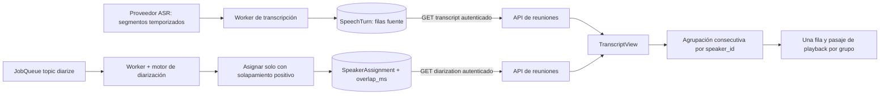

# Documento de Diseño — Renderizado de turnos completos en la transcripción

## Resumen

El defecto nace porque `worker.py` conserva cada segmento ASR como fila `SpeechTurn`; la API y el portal conservan esa granularidad. La diarización asigna hablantes por solapamiento temporal, pero `assign_turns` hoy elige también al speaker de menor secuencia si todos los solapamientos son cero, y las asignaciones históricas no guardan evidencia para distinguir ese caso. La instrucción directa de Fer del 2026-10-30 (chat `th_a9681ad91c2f4b5d`, mensaje `msg_ae70285a69464de2`) autoriza presentar segmentos consecutivos del mismo hablante como turnos completos. El requisito está trazado al `bugfix.md` aprobado en commit `b0766bced264473d500d81ca74477b104378d2e7` (blob `dd7895959fbbf43e4348d19f00b20426c22a07a3`), integrado en `origin/main` mediante merge `d6b5d44` (PR #607). El baseline aplicable es el snapshot `PRODUCT_BASELINE.md` en commit `4953b3b4b8a058fd4738342307cc50bfd66814f1` (blob `c6f9ef9bf3fac9eac23763e25e25e1089a16c446`), §4.C.4; la aprobación explícita de Fer para ese contenido está registrada en `task_a08baf81140a4073`. Aunque el archivo mantenga un rótulo DRAFT, el paquete confirma la aprobación de esta versión exacta; no se usa el snapshot histórico `f31c1437` como única autoridad.

1. Conservar intactas las filas fuente `SpeechTurn`; agregar a cada `SpeakerAssignment` una medida nullable `overlap_ms` para validar fiabilidad sin alterar textos ni tiempos fuente.
2. Para nuevas diarizaciones, almacenar únicamente asignaciones de solapamiento positivo; conservar asignaciones legacy sin evidencia como no resueltas, sin inferir identidad entre ejecuciones.
3. Derivar en el frontend grupos desde `SpeechTurn` y asignaciones con `overlap_ms > 0`, comparando `speaker_id`, no las etiquetas visibles.
4. Combinar solo filas consecutivas del mismo speaker con texto en orden, inicio de la primera y fin de la última; preservar los intervalos fuente y separar cualquier cambio de hablante.
5. Mantener la transcripción visible ante fallos; `overlap_ms` nulo o cero se presenta como `Speaker N` y nunca se agrupa.

## Decisiones de Diseño Clave

**Agrupar en el portal después de una atribución validada.** `TranscriptView` carga transcript y diarización; la composición de turnos sigue siendo una derivación de presentación, pero el cliente solo usa asignaciones con `overlap_ms > 0`. El backend calcula y persiste esa evidencia porque es la única capa con acceso a los intervalos originales del motor. *Alternativas descartadas:* ASR no tiene speaker IDs y agrupar ahí sería prematuro; confiar solo en `speaker_id` reproduce el error histórico cuando todo overlap era cero; almacenar nuevos turnos derivados duplicaría datos y no está aprobado.

**La continuidad se define por orden de secuencia y speaker ID.** Dos filas adyacentes en la transcripción se combinan si y solo si ambas tienen una asignación resuelta al mismo `speaker_id`. Una fila intermedia de otra persona siempre separa los grupos, aunque su última etiqueta vuelva a aparecer más adelante. No comparar etiquetas visibles: pueden cambiar por revisión humana o coincidir para personas distintas. *Alternativas descartadas:* agrupar cualquier aparición del mismo speaker borraría turnos no consecutivos; dividir por una duración de silencio inventaría un umbral no aprobado; exigir límites de turno de ASR contradice la instrucción funcional y no es respaldado por la evidencia del proveedor.

**Tiempos del pasaje derivado son el inicio y fin exteriores de sus filas fuente.** En cada grupo, el pasaje empieza en `start_ms` de la primera fila y termina en `end_ms` de la última. Las filas fuente y sus marcas originales permanecen intactas; no se desplazan ni modifican. Las relaciones temporales entre grupos distintos (incluidos huecos y solapamientos) se conservan usando esos extremos. Los huecos internos entre fragmentos agrupados quedan dentro del pasaje compuesto, como consecuencia de agrupar segmentos consecutivos del mismo speaker; no se rellenan ni se reescriben en los datos fuente. *Alternativas descartadas:* cambiar duraciones para hacer intervalos contiguos o introducir una lista de subintervalos de reproducción ampliaría el contrato sin aprobación.

**Exponer evidencia de atribución de forma aditiva.** Añadir `SpeakerAssignment.overlap_ms` nullable y serializarlo junto con `turn_id` y `speaker_id` en el endpoint autenticado de diarización existente. No cambia el endpoint de transcript ni los tipos compartidos: estas respuestas HTTP no consumen `packages/shared-types`. Se requiere una migración para la columna. *Alternativa descartada:* no agregar evidencia al contrato dejaría al frontend sin forma de distinguir IDs legacy potencialmente falsos de asignaciones confiables.

**Solapamiento positivo como evidencia persistida, legacy como no confiable.** Modificar `assign_turns` para omitir turnos cuyo overlap máximo sea cero y retornar el overlap del speaker elegido cuando sea positivo; empates entre positivos conservan el menor `sequence`. Persistir esos milisegundos en `SpeakerAssignment.overlap_ms`. La migración agrega una columna nullable; todas las filas existentes quedan `NULL`, sin backfill ni recálculo histórico. El portal no usa asignaciones `NULL` o `0`: presenta esos fragmentos por separado con `Speaker N`, evitando cualquier fusión basada en una asignación posiblemente fabricada.

**No reconstruir identidades legacy mediante `raw_label`.** No se crea `rebuild_assignments.py` ni se reejecuta automáticamente la diarización de resultados existentes. `raw_label` es una etiqueta local del motor y el código no garantiza estabilidad entre ejecuciones; ni su igualdad ni el orden de primera aparición prueban que una voz nueva corresponda al `Speaker` previamente revisado. Por eso la migración deja `overlap_ms=NULL` para toda asignación anterior y el portal no las usa para agrupar ni para afirmar una identidad: conserva sus fragmentos separados con `Speaker N`. Las filas y revisiones históricas quedan intactas. Las diarizaciones nuevas sí guardan `overlap_ms` positivo junto con IDs de speaker creados en esa misma ejecución; esa asociación solo se usa dentro de su generación. *Alternativas descartadas:* mapear por igualdad/orden de `raw_label` podría mover silenciosamente un nombre revisado a otra voz; reejecutar el motor y transferir las revisiones sin una señal acústica de correspondencia estable sería la misma inferencia no demostrada. Dejar legacy sin resolver retrasa la agrupación para esos registros, pero evita atribución falsa; una futura reparación requeriría un mecanismo de identidad estable aprobado y probado aparte.

**Etiqueta de presentación acorde al código actual.** `TranscriptView.speakerPresentation` usa el `currentLabel.trim()` del elemento de speaker review coincidente si está disponible; si no, usa `speaker.label` de diarización y, por último, `Speaker N`. La agrupación no depende de esa etiqueta editable: depende de la asignación positiva por `speaker_id`. No se agrega integración nueva de review.

## Arquitectura

Especializaciones: **backend-api**, **web-application** y **cross-surface-integration**. El backend proporciona las dos colecciones autenticadas existentes; la composición de presentación es una derivación cliente, no cambia el almacenamiento ni las reglas de autorización. La extensión no forma parte de esta corrección.



```mermaid
sequenceDiagram
    participant API as APIs autenticadas
    participant TV as TranscriptView
    participant G as Agrupador puro de presentación
    participant Q as JobQueue diarize
    participant W as Worker de diarización
    participant P as MeetingPlaybackView
    API-->>TV: SpeechTurns ordenados
    API-->>TV: assignments con overlap_ms (legacy NULL)
    TV->>G: usar solo overlap_ms > 0
    G-->>TV: grupos; legacy NULL y sin ID quedan separados con Speaker N
    Q->>W: meeting_id para nueva diarización
    W->>W: asignar overlap positivo a Speakers de la misma ejecución
    API-->>TV: asignaciones visibles tras commit
    TV->>P: pasajes agrupados con label/color
    P-->>TV: highlight/seek ligados a inicio/fin del grupo
```

La transcripción no espera a diarización para ser visible. Cada fila con `overlap_ms` nulo/cero o sin asignación queda independiente, usa `Speaker N` y no crea un vínculo de reproducción inválido; esto incluye resultados históricos, que permanecen sin agrupar en ausencia de correspondencia estable. En nuevas ejecuciones, el endpoint refleja asignaciones con overlap positivo solo tras el commit y el render agrupa esas asignaciones. Ninguna etapa modifica las filas fuente `SpeechTurn` ni el texto. Un fallo de diarización no borra ni bloquea la lectura del transcript.

## Componentes e Interfaces

### 1. APIs autenticadas existentes

- `GET /api/v1/meetings/{meeting_id}/transcript` permanece sin cambio: devuelve `SpeechTurn` con `id`, `text`, `start_ms`, `end_ms`, `sequence`, en orden y después de `_get_authorized_meeting`.
- `GET /api/v1/meetings/{meeting_id}/diarization` agrega `overlap_ms` por asignación, manteniendo `turn_id` y `speaker_id`. Positivo valida el vínculo; `NULL` identifica registros previos no recalculados, y cero no es válido para agrupar. El contrato cliente queda `assignments: Array<{ turn_id: string; speaker_id: string; overlap_ms: number | null }>`.
- Se conservan autenticación y autorización por propietario. El payload solo agrega evidencia técnica; no expone nuevos datos de transcript/audio ni cambia `packages/shared-types`.

### 2. Atribución y persistencia (`backend/app/diarization/assignment.py`, `repository.py`, `backend/app/infra/models.py`)

`assign_turns` retorna `(turn_id, speaker, overlap_ms)` solo para el máximo overlap estrictamente positivo; si todos dan cero no retorna esa fila. Los empates positivos mantienen menor `sequence`. Agregar columna `SpeakerAssignment.overlap_ms: int | None`, nullable: la migración deja filas existentes `NULL`; las nuevas guardan el total de intersección en milisegundos. `worker.py` persiste medida y asignación en la transacción atómica ya usada para crear el resultado de diarización. No se reemplazan asignaciones históricas ni se comparan speakers de ejecuciones distintas.

### 3. Compatibilidad de asignaciones legacy (sin reconstrucción de identidad)

No se ejecuta un job ni se reevalúa el audio histórico en esta corrección. La migración agrega la columna nullable sin backfill: toda asignación previa queda `overlap_ms=NULL`; por tanto, el portal la omite para agrupación y presenta cada fragmento por separado con `Speaker N`. Esto evita preservar etiquetas revisadas sobre una correspondencia nueva no demostrada. Las futuras ejecuciones del worker mantienen su flujo actual de crear `Diarization` y `Speaker` nuevos; las asignaciones y sus overlaps positivos se escriben en una transacción y `raw_label` solo enlaza segmentos con los speakers creados en esa misma ejecución. No se trasladan `SpeakerReview` ni nombres entre ejecuciones. La lectura de texto no depende del audio histórico ni de un backfill. *Alternativa descartada:* un job de rebuild basado en raw labels iguales u orden de aparición no da una garantía de identidad y puede atribuir un nombre humano a otra voz. El costo de esta decisión es que las grabaciones legacy no se agrupan hasta contar con una futura vía de correspondencia estable aprobada; su transcripción sigue visible y no se altera.

### 4. Agrupador puro frontend (`frontend/src/transcript-turns.ts`)

Añadir función determinista y sin I/O, con prueba colocalizada `frontend/src/transcript-turns.test.ts`:

```typescript
interface SourceTranscriptSegment {
  id: string;
  text: string;
  startMs: number | null;
  endMs: number | null;
  sequence: number;
}

interface PresentationTurn {
  id: string;                 // ID de la primera fila fuente del grupo
  sourceIds: string[];        // IDs de filas conservadas en backend
  text: string;               // textos no vacíos en orden, separados por un espacio
  startMs: number | null;     // inicio de primera fuente válida
  endMs: number | null;       // fin de última fuente válida
  sequence: number;           // secuencia de primera fuente
  speakerId?: string;         // presente solo para assignment con overlap_ms > 0
}

function groupTranscriptTurns(
  segments: SourceTranscriptSegment[],
  speakerIdByTurnId: ReadonlyMap<string, string>
): PresentationTurn[];
```

Orden de entrada: usar `sequence` ascendente. Combinar solo dos elementos adyacentes en esa lista cuando ambos tienen tiempos válidos y el mismo `speakerId` no vacío. Si no hay asignación o tiempo válido para alguno, conservarlo como grupo independiente; además, esa fila interrumpe la adyacencia, por lo que el agrupador no salta sobre ella para unir vecinos. No asumir que dos ausencias representan a la misma persona. El `id` del grupo es el ID de su primera fuente, para que `speakerPresentation` encuentre la asignación; `sourceIds` retiene trazabilidad en memoria. Texto vacío no añade contenido; el texto no se reescribe en backend. El método de separación entre cadenas es un espacio sencillo, sin alterar puntuación ni inventar texto.

Las filas sin tiempo válido permanecen representables como texto pero nunca se pasan a playback como pasajes temporizados; no se sintetizan límites ni se incorporan a un grupo temporizado. Para un grupo de fuentes con tiempo válido, `startMs`/`endMs` son los extremos de primera/última fuente. El agrupador no clasifica por igualdad de etiqueta, no aplica una ventana de silencio y no reordena fuera del campo `sequence`.

### 5. Vista y playback (`frontend/src/components/TranscriptView.tsx`)

- Crear el mapa `turn_id → speaker_id` solo con `diarization.assignments` cuyo `overlap_ms > 0`; omitir las asignaciones legacy `NULL` y derivar grupos desde `data.segments`/`data.turns` ordenadas; no mutar `data`.
- Para un grupo con `speakerId` validado, resolver etiqueta/color mediante `speakerPresentation` para preservar la revisión correspondiente. Si el grupo no tiene `speakerId` validado (legacy, cero, ausente), no consultar su asignación/revisión antigua y mostrar `Speaker N`; un ID legacy no puede recuperar una identidad revisada.
- Renderizar una fila por grupo. Construir `playbackPassages` de los mismos grupos temporizados, no de los segmentos sin agrupar, para que avance/resaltado y selección reproduzcan el inicio del grupo.
- Durante carga o error de diarización, conservar la transcripción visible con unidades no asignadas separadas; ningún fallo de esta lectura secundaria vuelve a fragmentar o esconder contenido ya cargado por error de estado. Las asignaciones legacy (`overlap_ms=NULL`) permanecen separadas sin esperar una reconstrucción automática.
- Conservar highlight/seek existentes; no se añade edición textual ni interacción visual nueva.

### Ubicación y pruebas

| Área | Archivos que se modifican | Pruebas | Migración | Shared types / Compose |
|---|---|---|---|---|
| Portal, lógica de agrupación | `frontend/src/transcript-turns.ts` (nuevo), `frontend/src/components/TranscriptView.tsx`, `frontend/src/api.ts` (campo nullable nuevo) | `frontend/src/transcript-turns.test.ts` (nuevo), `frontend/src/components/TranscriptView.test.tsx` | No | Sin cambio |
| Backend, atribución y persistencia | `backend/app/diarization/assignment.py`, `repository.py`, `worker.py`, `backend/app/infra/models.py` | `backend/tests/diarization/test_assignment_property.py`, `test_worker.py` (overlap positivo persistido en la misma ejecución) | Sí: siguiente versión secuencial en `backend/alembic/versions/`, agregar nullable `speaker_assignments.overlap_ms` | Sin cambio |
| API de diarización | `backend/app/meetings/router.py` agrega `overlap_ms` a cada asignación autenticada; `frontend/src/api.ts` actualiza el tipo | `backend/tests/meetings/test_diarization_endpoint.py`, `frontend/src/api.test.ts`: positivo, NULL legacy, serialización y autorización sin cambio | Incluida arriba | Sin cambio |
| Fuentes transcript/reviews | Sin cambio: `SpeechTurn`, audio, texto y reviews permanecen intactos; speakers/reviews legacy no se remapean | Verificar que migración no altera asignaciones legacy salvo dejarlas con overlap NULL y que el frontend no use esos IDs | Sin cambio adicional | Sin cambio |
| Extensión | Sin cambios | No aplica | No | No aplica |

## Modelos de Datos

`SpeechTurn` conserva filas fuente, texto, tiempos y secuencia. `SpeakerAssignment` agrega `overlap_ms: Integer | NULL`: nuevo valor >0 es evidencia de asignación; NULL identifica filas históricas no confiables, y el algoritmo nuevo no crea filas con 0. La migración no rellena overlap por suposición ni reejecuta la diarización; las asignaciones y reviews legacy no se remapean. Los `Speaker`/IDs nuevos se relacionan solo con segmentos y asignaciones de su propia ejecución. `PresentationTurn` sigue siendo derivado en memoria, no otra fuente de verdad; `sourceIds` conserva trazabilidad sin incluir contenido real en logs o fixtures. Todas las pruebas usan datos sintéticos.

## Propiedades de Correctitud

**Propiedad 1 — Agrupación consecutiva por identidad.** Para cualquier lista ordenada de segmentos sintéticos con speaker IDs resueltos, cada corrida máxima contigua de IDs iguales forma exactamente un turno; texto conserva el orden. Un ID distinto intermedio separa la corrida. Valida la instrucción directa de Fer y los criterios 1 y 2 del bugfix.

**Propiedad 2 — Repetición no consecutiva.** Si una secuencia de IDs es `A, B, A`, la salida conserva tres turnos en ese orden, aunque la etiqueta visible de A coincida. Valida “Comportamiento Sin Cambios” 2.

**Propiedad 3 — Solo atribución con evidencia positiva.** Un turno recibe asignación solo si algún segmento de diarización tiene solapamiento positivo; `assign_turns` retorna y persiste el overlap medido, mientras que máximo cero produce ausencia de asignación. El frontend solo trata `overlap_ms > 0` como identidad utilizable. La falta de evidencia se muestra como `Speaker N` y jamás se agrupa entre sí. Empates entre overlaps positivos conservan el desempate por menor secuencia. Valida criterios 2–3 y “Comportamiento Sin Cambios” 1.

**Propiedad 4 — Límites y relaciones de tiempo.** Para cada grupo con tiempo válido, inicio es el inicio de la primera fuente y fin el fin de la última. Los tiempos fuente permanecen iguales; intervalos y gaps entre grupos se conservan sin desplazamiento, ensanchamiento artificial ni cierre de huecos. Los huecos dentro del grupo compuesto no reescriben las fuentes. Valida criterio 4 y “Comportamiento Sin Cambios” 3.

**Propiedad 5 — Playback asociado a la unidad visible.** El grupo usado como pasaje y como fila comparte el mismo ID inicial, inicio y fin. El highlight en avance y el seek de selección permanecen ligados a ese inicio/fin; grupos sin tiempo válido no se enlazan a reproducción. Valida criterio 5 y “Comportamiento Sin Cambios” 4–5.

**Propiedad 6 — Conservación de datos fuente.** Para cualquier entrada, el agrupamiento no muta, descarta ni reordena las filas originales; la concatenación de `sourceIds` cubre en orden las fuentes elegibles. Valida el enfoque de presentación sin pérdida.

**Propiedad 7 — Legacy sin identidad inferida.** Toda asignación previa a la migración queda `overlap_ms=NULL`; ni el speaker ID legacy ni su etiqueta revisada se usan para agrupar o presentar identidad, y la fila conserva `Speaker N`. Una prueba de migración confirma que asignaciones, IDs y reviews existentes no se alteran; una fixture sintética de vista incluye un ID/review legacy con `overlap_ms=NULL` y verifica que no se agrupa ni muestra el nombre revisado. Valida la representación honesta y la protección contra reasignación de nombres a otra voz.

## Manejo de Errores

| Escenario | Comportamiento |
|---|---|
| Diarización sigue procesando, no está disponible o falla | No bloquear la lectura de texto. Renderizar fragmentos sin asignación con `Speaker N`, sin unirlos por presunción. |
| Resultado de diarización legacy con asignaciones `overlap_ms=NULL` | Ignorar esos speaker IDs en la agrupación y mostrar fragmentos separados con `Speaker N`. No se encola rebuild ni se transfiere una revisión humana a identidades reejecutadas sin prueba de correspondencia. El texto permanece visible. |
| Audio de una diarización legacy expirado/eliminado o no disponible | No eludir retención ni buscar otra copia; dejar overlap NULL y mantener `Speaker N` sin agrupación. La transcripción permanece visible. |
| Motor devuelve `raw_label` sin speaker ya persistido | No asociar a un speaker distinto por similitud/orden; dejar los turnos correspondientes sin asignación y con `Speaker N`. |
| Ningún segmento de diarización se solapa temporalmente con una fila transcript | `assign_turns` no devuelve asignación con overlap máximo cero; no persiste un speaker escogido por orden. El portal deja esa fila sin agrupar y presenta `Speaker N`. |
| Asignación apunta a fila que no está en el transcript | Ignorar la asignación huérfana; mantener esa fila como fuente no asignada con `Speaker N`. |
| Speaker ID presente pero etiqueta/revisión ausente | Mostrar `Speaker N`; agrupar solo si el mismo ID resuelto coincide, nunca por el texto de etiqueta. |
| Texto vacío, tiempo ausente o inválido | No fabricar texto ni tiempo. Mantener texto válido como unidad no temporizada; excluirlo de playback según el comportamiento existente. |
| Orden repetido o entrada de segmentos fuera de orden | Ordenar por `sequence` estable, manteniendo el orden recibido para empates; no tratar segmentos no adyacentes como contiguos. |
| Error de transcript o falta de autorización | Preservar manejo de error HTTP actual; no mostrar contenido no autorizado. Error de diarización por sí solo no convierte una lectura de transcript autorizada en error fatal. |
| Migración falla o se revierte el despliegue | No habilitar el worker nuevo antes de aplicar la columna nullable. En rollback, detener el worker nuevo antes de revertir esquema; el cliente trata campo ausente como legacy/no confiable y conserva texto sin fusionar. |

## Estrategia de Testing

Pruebas unitarias sintéticas para el agrupador puro y pruebas de vista para verificar wiring. La QA ejecutó pruebas previas del comportamiento actual (frontend: 2 archivos/24 tests; backend: 5 tests), no son validación de esta corrección.

1. **Atribución backend:** en `backend/tests/diarization/test_assignment_property.py`, fixtures sintéticos verifican que candidatos con cero overlap no generan asignación y que overlap positivo (incluidos máximos y empates) retorna la medida correcta y el speaker esperado.
2. **Migración/API:** `backend/tests/diarization/test_migration.py` valida que asignaciones previas queden `overlap_ms=NULL`; ampliar `backend/tests/meetings/test_diarization_endpoint.py` y `frontend/src/api.test.ts` para validar serialización de NULL/positivo y autorización intacta.
3. **Identidad legacy:** en `backend/tests/diarization/test_migration.py`, fixtures sintéticos verifican que asignaciones históricas migran con `overlap_ms=NULL` sin alterar sus IDs/referencias; en `frontend/src/components/TranscriptView.test.tsx`, un ID legacy que tiene review asociado pero `overlap_ms=NULL` no produce agrupación ni expone el nombre revisado, sino `Speaker N`. Las nuevas asignaciones enlazan únicamente speakers producidos por la misma ejecución.
4. **Agrupador (Vitest):** casos y propiedades con segmentos `A,A,B,B,A`, IDs distintos con la misma etiqueta, ausencia de asignaciones, asignación legacy `overlap_ms=NULL`, cero, gaps/overlaps, texto vacío, tiempos inválidos y secuencias. Afirmar corridas máximas, orden, límites y fuente inmutable; legacy y cero no se agrupan.
5. **Vista:** fixtures sintéticos verifican una fila por corrida de A, separación `A,B,A`, fallback `Speaker N` para ausencia/legacy, y precedencia real de etiqueta: `currentLabel.trim()` coincidente, luego `speaker.label`, luego `Speaker N`.
6. **Carga degradada/playback:** transcript visible y sin agrupación durante 404/error; las asignaciones legacy NULL permanecen separadas; `MeetingPlaybackView` recibe límites del grupo, seek/highlight siguen el mismo intervalo y no hay pasaje para entradas no temporizadas.
7. Desde `frontend/`, ejecutar `npm run test -- src/transcript-turns.test.ts src/components/TranscriptView.test.tsx src/api.test.ts` y `npm run typecheck`; desde `backend/`, ejecutar `pytest tests/diarization/test_assignment_property.py tests/diarization/test_worker.py tests/diarization/test_repository.py tests/diarization/test_migration.py tests/meetings/test_diarization_endpoint.py`. Son datos sintéticos; estos comandos son validación futura, no resultados ya obtenidos.

La corrección no depende de que ASR provea speaker IDs o límites explícitos: usa las asignaciones reales de diarización que ya se calculan sobre las filas persistidas. La lectura del transcript sigue disponible si diarización tarda/falla; esa degradación no autoriza a agrupar speakers desconocidos ni impide que el cliente presente el texto.
