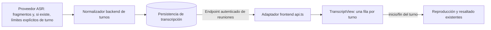

# Documento de Diseño — Renderizado de turnos completos en la transcripción

## Resumen

La ruta confirmada conserva la granularidad del ASR: el worker persiste un `SpeechTurn` por segmento, el endpoint serializa las filas por separado, y el adaptador y la vista web mantienen una fila por turno recibido. La evidencia no prueba qué límites produjo el proveedor en la grabación reportada ni ofrece una señal autoritativa para reconstruir los límites hablados. Por eso, corregir solo el mapeo de UI o agrupar por hablante no puede garantizar el comportamiento aprobado; primero se debe disponer de límites de turno respaldados por la fuente, conservando la precisión temporal y el contenido original.

1. Incorporar un paso explícito de normalización de turnos en el procesamiento backend, después de obtener la salida ASR y antes de persistir los turnos destinados a consumo del producto.
2. Basar los límites únicamente en metadatos de turnos emitidos por una fuente capaz de identificarlos; no inferirlos con etiquetas iguales, silencios, longitud de texto ni constantes nuevas.
3. Mantener por separado los fragmentos ASR originales y los turnos de presentación, relacionándolos con sus límites de texto y tiempos originales sin reescribir el contenido de origen.
4. Exponer cada turno completo en la respuesta de transcripción autenticada y consumirlo como unidad de presentación en el portal, manteniendo el vínculo de reproducción de inicio y fin.
5. Antes de implementar, verificar y documentar si los proveedores ASR activos entregan límites autoritativos de turno; si no los entregan, escalar a Ansel para una decisión de alcance/fuente, porque la especificación no autoriza una heurística.

## Decisiones de Diseño Clave

**Separar la agrupación de turnos del renderizado.** La normalización se ubica en el backend de transcripción, junto a la salida del proveedor y antes de persistir turnos. El frontend consume unidades de turno ya definidas y no decide la semántica del habla. *Alternativas descartadas:* agrupar únicamente en `TranscriptView` no arregla los datos usados por otros consumidores y no dispone de una señal de límites; agrupar solo en `frontend/src/api.ts` oculta el defecto tras un adaptador específico.

**Usar límites explícitos de turno de la fuente, sin heurística temporal.** Los segmentos ASR por sí solos no contienen IDs de turno o hablante según la inspección de QA. El diseño no presume que `supports_turns` produzca metadatos utilizables: la disponibilidad y semántica del proveedor se deben comprobar. *Alternativas descartadas:* intervalo de silencio, puntuación, longitud textual o etiqueta de hablante como reglas de agrupación carecen de autorización y pueden fusionar turnos distintos o inventar fronteras. Si no existe una fuente con límites fiables, no hay una implementación conforme que pueda elegirse con la evidencia actual; elevar la cuestión a Ansel antes de crear tareas.

**Conservar fragmentos ASR sin alteración y derivar turnos de presentación.** Los datos brutos y sus límites originales se mantienen como evidencia de procesamiento; los turnos son la vista normalizada con texto concatenado en el orden de origen y tiempos derivados de los extremos de sus fragmentos constituyentes. No se amplían límites para cubrir huecos ni se eliminan solapamientos. *Alternativas descartadas:* reemplazar los fragmentos originales por texto concatenado destruye trazabilidad; un campo JSON nuevo o una tabla nueva no se justifica sin demostrar que el esquema existente no puede representar los turnos y su procedencia.

**Evitar por ahora cambios de API pública o contratos compartidos.** Reutilizar la colección existente de `SpeechTurn` y el formato de respuesta solo si la inspección de implementación confirma que admite texto concatenado, speaker label y límites preservados sin pérdida. Si el contrato actual no puede representarlo fielmente, detenerse y solicitar una decisión de compatibilidad/esquema antes de alterarlo. *Alternativas descartadas:* duplicar el contrato en `packages/shared-types` sin consumidor compartido en el portal, o añadir campos no exigidos, amplía alcance sin evidencia.

**Dependencia de publicación.** La fuente aprobada es `bugfix.md` commit `b0766bced264473d500d81ca74477b104378d2e7`, blob `dd7895959fbbf43e4348d19f00b20426c22a07a3`, publicada sin cambios en PR #607 (`4565d6185e28e1b7209dbd84839abf8b5ac635d0`). Este trabajo no incorpora ni afirma que ese PR esté en `main`; su PR de diseño debe conservar la referencia y no incluir cambios del artefacto upstream.

## Arquitectura

Especializaciones aplicadas: **backend-api**, **web-application** y **cross-surface-integration**. La extensión Chrome no está en el alcance aprobado. El portal web sigue siendo un cliente lector; el backend autenticado conserva la autoridad sobre la transcripción. El diagrama representa el destino funcional condicionado a disponer de límites de turno fiables, no afirma que los proveedores actuales ya los suministren.



```mermaid
sequenceDiagram
    participant W as Worker de transcripción
    participant E as Proveedor ASR
    participant N as Normalizador de turnos
    participant DB as Persistencia
    participant API as API autenticada
    participant UI as Portal
    W->>E: procesa audio
    E-->>W: fragmentos ASR y señal de turno disponible
    W->>N: valida señal explícita; ordena fragmentos
    N->>N: construye texto y conserva extremos/gaps/overlaps originales
    N->>DB: persiste turnos de presentación y trazabilidad de origen
    API->>DB: lee turnos de la reunión autorizada
    DB-->>API: turnos ordenados con speaker y tiempos
    API-->>UI: respuesta de transcripción existente
    UI->>UI: representa fila y control por turno
    UI->>UI: mantiene highlight y seek ligados al tiempo original
```

Si el proveedor no aporta la señal necesaria, el flujo debe marcar la incapacidad de determinar turnos y bloquear la implementación de la agrupación; no debe producir límites sintéticos ni etiquetar silenciosamente fragmentos como turnos completos. El comportamiento de error/estado de producto ante esa condición requiere decisión de Ansel si no está ya definido en el baseline.

## Componentes e Interfaces

### 1. Normalización de transcripción (`backend/app/transcription/`)

- Ubicación propuesta: `worker.py` orquesta la operación; añadir módulo puro de agregación en `backend/app/transcription/` solo si la lógica necesita separación comprobada. Mantener los adaptadores de proveedor existentes y no imponer un patrón nuevo.
- Entrada: salida ASR ya tipada, incluyendo segmentos ordenados y cualquier metadato de límite de turno que el proveedor realmente exponga. La interfaz exacta se decide tras inspeccionar el tipo/proveedor activo; no agregar campos especulativos.
- Salida: secuencia de unidades de turno con texto en orden de origen, speaker label disponible y límites de inicio/fin tomados de sus fragmentos fuente; además, asociación rastreable con los fragmentos originales.
- Si hay speaker labels desconocidos o inciertos, conservar `Speaker N`; no inferir identidad.
- Los límites de grupo deben respetar turnos fuente, orden, huecos y solapamientos. No se permite fusionar dos turnos no consecutivos por etiqueta coincidente.

### 2. Persistencia y endpoint (`backend/app/transcription/`, `backend/app/infra/models.py`, `backend/app/meetings/`)

- Reusar el modelo/almacenamiento existente cuando represente sin pérdida tanto los turnos consumidos como su trazabilidad. No asumir que una migración es necesaria.
- `backend/app/meetings/router.py` conserva el límite de autorización actual para lectura. No crear ruta pública ni debilitar autenticación/autorización.
- **Migración: no prevista por defecto.** Solo requerir migración secuencial en `backend/alembic/versions/` si el análisis de esquema prueba que la representación existente no basta; esa incompatibilidad es una decisión de alcance para Ansel, no permiso para inventar un modelo.

### 3. Adaptador y vista web (`frontend/src/api.ts`, `frontend/src/components/TranscriptView.tsx`)

- El adaptador mapea cada turno de respuesta como una unidad, sin reagrupar ni fragmentar el texto.
- `TranscriptView` muestra una unidad con timestamp, speaker label y texto por turno. Sus estados, highlight y seek continúan usando el mismo intervalo asociado al pasaje.
- Texto o tiempo ausente/inválido no se completa artificialmente ni habilita una asociación temporal inválida.

### Ubicación, pruebas y contratos

| Área | Carpetas/archivos que podrían modificarse | Pruebas | Migración | `packages/shared-types` / Compose |
|---|---|---|---|---|
| Backend transcripción/persistencia | `backend/app/transcription/`; potencialmente `backend/app/infra/models.py` | `backend/tests/transcription/`; potencialmente `backend/tests/infra/` | No, salvo incompatibilidad probada del esquema | Sin cambio previsto |
| API de reuniones | `backend/app/meetings/` solo si el contrato existente necesita ajuste compatible | `backend/tests/meetings/` | No previsto | Sin cambio previsto |
| Portal | `frontend/src/api.ts`, `frontend/src/components/TranscriptView.tsx` | `frontend/src/api.test.ts`, `frontend/src/components/TranscriptView.test.tsx`; integración sintética adicional si la infraestructura existente lo permite | No aplica | Sin cambio previsto; no importar lógica backend |
| E2E | No previsto inicialmente | No previsto; evaluar solo si la prueba existente puede verificar el flujo real entre capas sin servicios no disponibles | No aplica | No aplica |

No se modifica `docker-compose.yml`: el alcance no introduce servicio nuevo. No se modifica `packages/shared-types`: la estructura documentada identifica al portal como consumidor HTTP y el paquete compartido no es necesario para esta interfaz salvo evidencia posterior de un contrato compartido existente.

## Modelos de Datos

No se aprueba una nueva tabla ni un nuevo tipo de dominio antes de inspeccionar el modelo real. Conceptualmente, la transformación requiere:

- Fragmentos fuente: secuencia ordenada con texto, `start`, `end` y metadatos originales del proveedor cuando existan.
- Turno presentado: texto concatenado únicamente dentro de un límite explícito de turno; speaker label conocido o `Speaker N`; inicio/fin preservados desde sus fragmentos constituyentes; vínculo a fragmentos fuente para trazabilidad.

La forma concreta deberá ajustarse a `SpeechTurn`/modelo existente y sus restricciones. Los fragmentos de entrada no se alteran. No copiar datos de reuniones reales a pruebas ni artefactos.

## Propiedades de Correctitud

**Propiedad 1 — Turno completo sustentado por límites fuente.** Para cualquier secuencia sintética con fronteras de turno explícitas, cada grupo presentado corresponde exactamente a una frontera de fuente, y el texto conserva el orden y contenido de sus fragmentos. No hay agrupación deducida solo de etiquetas, duración o silencio. Valida criterio de aceptación 1.

**Propiedad 2 — Distinción y orden.** Para cualquier secuencia con cambio de speaker o turno posterior no consecutivo del mismo speaker, la salida conserva todos los límites y el orden original. Valida criterios 2 y 3.

**Propiedad 3 — Fidelidad de tiempo.** Para cada turno producido, inicio y fin corresponden a los extremos originales definidos por la fuente para ese turno; gaps y overlaps entre turnos consecutivos permanecen iguales, sin desplazar, ensanchar ni fabricar valores. Valida criterio 4 y “Comportamiento Sin Cambios” 3.

**Propiedad 4 — Fidelidad de reproducción.** Los controles y el resaltado web siguen vinculados a los tiempos del pasaje correspondiente: avance sobre frontera resalta el pasaje correcto y activar reproducción inicia en su tiempo enlazado. Valida criterio 5 y “Comportamiento Sin Cambios” 4.

**Propiedad 5 — Entradas ausentes o inválidas.** Un fragmento sin texto válido no genera contenido inventado; tiempo ausente/inválido no crea enlace de reproducción. Valida “Comportamiento Sin Cambios” 5.

**Propiedad 6 — Datos originales inmutables.** La normalización no modifica fragmentos, orden, texto ni límites de entrada; toda salida puede rastrearse a su fuente sintética. Restricción de diseño para soportar diagnóstico y no perder información.

## Manejo de Errores

| Escenario | Comportamiento |
|---|---|
| Proveedor no ofrece límites de turno verificables | No agrupar por heurística. Detener la selección de estrategia y escalar a Ansel con evidencia del proveedor y pregunta de decisión; no afirmar que se satisface el criterio 1. |
| Metadatos de turno inconsistentes o fuera de orden | Rechazar la normalización de esa salida y propagar el fallo por el mecanismo de error de procesamiento existente; no persistir turnos inventados. No definir política de reintentos nueva. |
| Texto faltante/vacío | No fabricar texto; preservar el tratamiento actual de entrada inválida, verificado durante implementación. |
| Intervalo faltante o inválido | No fabricar tiempo ni vínculo de reproducción; conservar el comportamiento ya aprobado del adaptador/vista. |
| Falla de persistencia o API | Mantener los errores y límites de autorización existentes; no responder con transcripción parcial no autorizada ni debilitar controles. |

## Estrategia de Testing

Usar exclusivamente datos sintéticos. La QA ya ejecutó pruebas que confirman el mapeo de un segmento por turno, pero no una corrección ni un flujo integrado: frontend, 2 archivos/24 tests; backend, 5 tests. Esos resultados son evidencia del candidato inspeccionado, no aceptación de este diseño.

1. **Backend, unidad/property-based:** salida ASR sintética con límites fuente expresos, speaker changes, etiqueta repetida tras otro speaker, texto concatenado, orden, gaps y overlaps. Verificar las propiedades 1–3 y 6. Generar casos con fronteras fuente, no con señales inventadas.
2. **Backend, integración existente:** validar que persistencia y endpoint de reunión serialicen los turnos normalizados con speaker y tiempos y mantengan autorización. Probar ausencia de límites como condición bloqueante sin inventar política de producto.
3. **Frontend, unitarias:** probar el adaptador con respuesta de turnos y la vista con varias filas sintéticas; asegurar una fila por turno y conservación de los intervalos.
4. **Reproducción:** extender o reutilizar pruebas existentes de highlight/seek con huecos y límites solapados, verificando asociación exacta al tiempo y sin cambios de comportamiento.
5. Ejecutar pruebas dirigidas de los módulos afectados y comandos de proyecto configurados antes de abrir PR; no inferir que pasan a partir de la evidencia histórica de QA.

**Dependencia previa a tareas de implementación:** confirmar con inspección sintética/documentada qué proveedor activo aporta fronteras fiables y si la salida puede persistirse sin cambio de esquema. Si no, Ansel debe decidir qué fuente de turnos está autorizada o devolver la especificación para definir el comportamiento; no hay una heurística compatible que el diseño pueda escoger sin ampliar requisitos.
