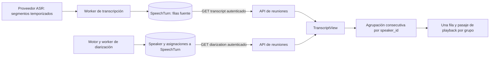
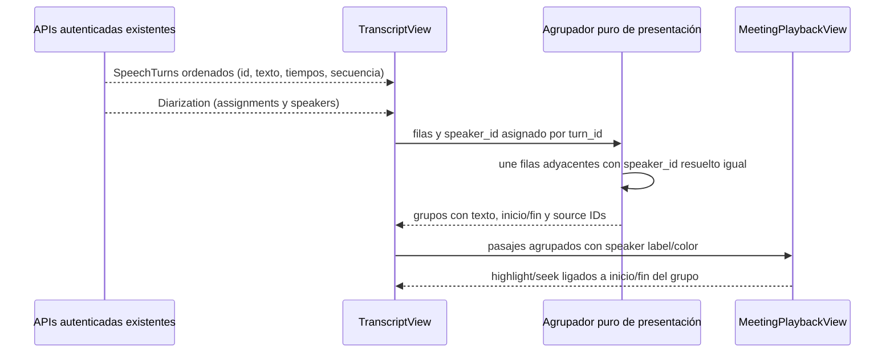

# Documento de Diseño — Renderizado de turnos completos en la transcripción

## Resumen

El defecto nace porque `worker.py` conserva cada segmento ASR como fila `SpeechTurn`; la ruta actual de transcripción y el portal respetan esas filas una por una. Las filas no llevan hablante; el worker de diarización asigna después speakers a las filas por solapamiento temporal. La instrucción directa de Fer del 2026-10-30 (chat `th_a9681ad91c2f4b5d`, mensaje `msg_ae70285a69464de2`) autoriza unir segmentos consecutivos del mismo hablante en frases/párrafos con inicio-fin. La fuente de requisitos es el `bugfix.md` aprobado en commit `b0766bced264473d500d81ca74477b104378d2e7` (blob `dd7895959fbbf43e4348d19f00b20426c22a07a3`), publicado sin cambios en PR #607, actualmente dependiente y no afirmado como integrado en `main`. Esa decisión directa y el bugfix aprobado son la autoridad funcional: el snapshot de `PRODUCT_BASELINE.md` citado por el bugfix está marcado DRAFT y no se presenta como baseline aprobado.

1. Conservar sin cambios las filas `SpeechTurn` y asignaciones de diarización ya persistidas; no agregar modelo ni migración.
2. En el frontend, derivar grupos de presentación desde los `SpeechTurn` ordenados y `SpeakerAssignment` del endpoint de diarización, comparando identidad estable de speaker, no texto visible de la etiqueta.
3. Combinar filas consecutivas cuyo speaker ID resuelto coincida, con texto en orden, inicio de la primera fila y fin de la última; cualquier fila de otro hablante separa los grupos, incluso si luego vuelve el mismo speaker.
4. Representar el mismo grupo como una sola fila de transcripción y un solo pasaje de reproducción/resaltado, con el ID de la primera fila fuente; preservar las filas originales como fuente de datos.
5. Si diarización aún no está disponible o no asigna un speaker a una fila, mantener la transcripción visible sin bloquear la carga, usar `Speaker N` y no unir entradas sin identidad común comprobada.

## Decisiones de Diseño Clave

**Agrupar en el portal después de atribuir speaker, no en ASR ni en persistencia.** `TranscriptView` ya carga transcripción y diarización; la segunda proporciona asignaciones `turn_id → speaker_id`. El frontend puede combinar filas consecutivas por `speaker_id` sin exigir metadatos de turno de ASR ni hacer escrituras nuevas. *Alternativas descartadas:* agrupar en el worker de ASR es prematuro porque las filas no tienen speaker y la diarización existente es un proceso posterior; almacenar turnos nuevos duplicaría datos y requeriría un esquema cuya necesidad no está demostrada; cambiar el endpoint también sería innecesario porque ya expone los IDs y tiempos que necesita el cliente.

**La continuidad se define por orden de secuencia y speaker ID.** Dos filas adyacentes en la transcripción se combinan si y solo si ambas tienen una asignación resuelta al mismo `speaker_id`. Una fila intermedia de otra persona siempre separa los grupos, aunque su última etiqueta vuelva a aparecer más adelante. No comparar etiquetas visibles: pueden cambiar por revisión humana o coincidir para personas distintas. *Alternativas descartadas:* agrupar cualquier aparición del mismo speaker borraría turnos no consecutivos; dividir por una duración de silencio inventaría un umbral no aprobado; exigir límites de turno de ASR contradice la instrucción funcional y no es respaldado por la evidencia del proveedor.

**Tiempos del pasaje derivado son el inicio y fin exteriores de sus filas fuente.** En cada grupo, el pasaje empieza en `start_ms` de la primera fila y termina en `end_ms` de la última. Las filas fuente y sus marcas originales permanecen intactas; no se desplazan ni modifican. Las relaciones temporales entre grupos distintos (incluidos huecos y solapamientos) se conservan usando esos extremos. Los huecos internos entre fragmentos agrupados quedan dentro del pasaje compuesto, como consecuencia de agrupar segmentos consecutivos del mismo speaker; no se rellenan ni se reescriben en los datos fuente. *Alternativas descartadas:* cambiar duraciones para hacer intervalos contiguos o introducir una lista de subintervalos de reproducción ampliaría el contrato sin aprobación.

**Sin cambio de API, modelo, contrato compartido ni migración.** La ruta autenticada de transcript ya retorna cada `SpeechTurn` con ID, texto, límites y secuencia; la ruta autenticada de diarización ya retorna speakers y asignaciones. El cliente une las respuestas manteniendo su autoridad existente y sin cambiar el payload del backend. No se toca `packages/shared-types` (no es el contrato de estas llamadas HTTP) ni `docker-compose.yml`. *Alternativa descartada:* un endpoint nuevo o una columna de turno persistido duplica una transformación de presentación y añade compatibilidad/migración sin necesidad técnica.

**Atribución desde la diarización existente.** `backend/app/diarization/worker.py` ejecuta el motor de diarización y `assign_turns` relaciona sus segmentos temporales con las filas `SpeechTurn`; el endpoint de diarización serializa speaker y asignaciones. El normalizador del frontend consume este resultado; no presupone que ASR incluya speaker IDs o IDs de turno. La etiqueta que se muestra sigue la precedencia ya implementada en `speakerPresentation`: speaker review vigente, luego etiqueta de diarización, luego `Speaker N`.

## Arquitectura

Especializaciones: **backend-api**, **web-application** y **cross-surface-integration**. El backend proporciona las dos colecciones autenticadas existentes; la composición de presentación es una derivación cliente, no cambia el almacenamiento ni las reglas de autorización. La extensión no forma parte de esta corrección.





La transcripción no espera a diarización para ser visible. Mientras no se dispone de una asignación, cada fragmento sin identidad compartida permanece independiente, aparece con `Speaker N` y no adquiere un enlace de reproducción inválido. Cuando la ruta de diarización devuelve sus datos, el render deriva los grupos sin modificar ni volver a guardar las filas originales. La solicitud de diarización fallida no borra ni bloquea el texto de transcripción.

## Componentes e Interfaces

### 1. Endpoints existentes (sin modificación)

- `GET /api/v1/meetings/{meeting_id}/transcript` conserva las filas `SpeechTurn` con `id`, `text`, `start_ms`, `end_ms` y `sequence`, ordenadas por secuencia y tras `_get_authorized_meeting`.
- `GET /api/v1/meetings/{meeting_id}/diarization` conserva los speakers y asignaciones autenticados. `SpeakerAssignment.turn_id` apunta al ID de la fila `SpeechTurn`; cada asignación resuelta identifica un `speaker_id`.
- Ningún endpoint se vuelve público ni relaja autorización. No se cambia schema HTTP ni migración DB.

### 2. Agrupador puro frontend (`frontend/src/transcript-turns.ts`)

Añadir función determinista y sin I/O, con prueba colocalizada `frontend/src/transcript-turns.test.ts`:

```typescript
interface SourceTranscriptSegment {
  id: string;
  text: string;
  startMs: number | null;
  endMs: number | null;
  sequence: number;
}

interface PresentationTurn {
  id: string;                 // ID de la primera fila fuente del grupo
  sourceIds: string[];        // IDs de filas conservadas en backend
  text: string;               // textos no vacíos en orden, separados por un espacio
  startMs: number | null;     // inicio de primera fuente válida
  endMs: number | null;       // fin de última fuente válida
  sequence: number;           // secuencia de primera fuente
  speakerId?: string;         // presente solo cuando la diarización asigna speaker
}

function groupTranscriptTurns(
  segments: SourceTranscriptSegment[],
  speakerIdByTurnId: ReadonlyMap<string, string>
): PresentationTurn[];
```

Orden de entrada: usar `sequence` ascendente. Combinar solo dos elementos adyacentes en esa lista cuando ambos tienen tiempos válidos y el mismo `speakerId` no vacío. Si no hay asignación o tiempo válido para alguno, conservarlo como grupo independiente; además, esa fila interrumpe la adyacencia, por lo que el agrupador no salta sobre ella para unir vecinos. No asumir que dos ausencias representan a la misma persona. El `id` del grupo es el ID de su primera fuente, para que `speakerPresentation` encuentre la asignación; `sourceIds` retiene trazabilidad en memoria. Texto vacío no añade contenido; el texto no se reescribe en backend. El método de separación entre cadenas es un espacio sencillo, sin alterar puntuación ni inventar texto.

Las filas sin tiempo válido permanecen representables como texto pero nunca se pasan a playback como pasajes temporizados; no se sintetizan límites ni se incorporan a un grupo temporizado. Para un grupo de fuentes con tiempo válido, `startMs`/`endMs` son los extremos de primera/última fuente. El agrupador no clasifica por igualdad de etiqueta, no aplica una ventana de silencio y no reordena fuera del campo `sequence`.

### 3. Vista y playback (`frontend/src/components/TranscriptView.tsx`)

- Crear el mapa `turn_id → speaker_id` desde `diarization.assignments` y derivar grupos desde las filas `data.segments`/`data.turns` ordenadas; no mutar `data`.
- Resolver etiqueta y color de grupo usando `speakerPresentation(group.id)`, manteniendo la revisión de speaker vigente y `Speaker N` para desconocidos.
- Renderizar una fila por grupo. Construir `playbackPassages` de los mismos grupos temporizados, no de los segmentos sin agrupar, para que avance/resaltado y selección reproduzcan el inicio del grupo.
- Durante carga o error de diarización, conservar la transcripción visible con unidades no asignadas separadas; ningún fallo de esta lectura secundaria vuelve a fragmentar o esconder contenido ya cargado por error de estado.
- Conservar highlight/seek existentes; no se añade edición textual ni interacción visual nueva.

### Ubicación y pruebas

| Área | Archivos que se modifican | Pruebas | Migración | Shared types / Compose |
|---|---|---|---|---|
| Portal, lógica de agrupación | `frontend/src/transcript-turns.ts` (nuevo), `frontend/src/components/TranscriptView.tsx` | `frontend/src/transcript-turns.test.ts` (nuevo), `frontend/src/components/TranscriptView.test.tsx` | No | Sin cambio |
| Backend/API/DB | Sin cambios: fuentes existentes `backend/app/transcription/worker.py`, `backend/app/diarization/worker.py`, `backend/app/meetings/router.py`, `backend/app/infra/models.py` | Pruebas backend existentes sirven de cobertura de contrato; no requieren cambios para esta solución cliente | No | Sin cambio |
| Extensión | Sin cambios | No aplica | No | No aplica |

## Modelos de Datos

No se cambia persistencia. `Transcript` conserva sus filas fuente `SpeechTurn` con ID, texto, inicio, fin y secuencia; `Diarization` conserva `Speaker` y `SpeakerAssignment` asociados por `turn_id`. `PresentationTurn` es un objeto derivado en memoria del portal, no una entidad persistida ni una nueva verdad del dominio. Su `sourceIds` permite auditar el agrupamiento durante ejecución y pruebas, sin incluir transcript real en logs ni fixtures. En pruebas se usan solo segmentos sintéticos.

## Propiedades de Correctitud

**Propiedad 1 — Agrupación consecutiva por identidad.** Para cualquier lista ordenada de segmentos sintéticos con speaker IDs resueltos, cada corrida máxima contigua de IDs iguales forma exactamente un turno; texto conserva el orden. Un ID distinto intermedio separa la corrida. Valida la instrucción directa de Fer y los criterios 1 y 2 del bugfix.

**Propiedad 2 — Repetición no consecutiva.** Si una secuencia de IDs es `A, B, A`, la salida conserva tres turnos en ese orden, aunque la etiqueta visible de A coincida. Valida “Comportamiento Sin Cambios” 2.

**Propiedad 3 — Speaker no resuelto.** La falta de speaker ID no se interpreta como identidad común: las filas sin asignación no se agrupan entre sí y se presentan con `Speaker N`; ninguna etiqueta o identidad se inventa. Valida criterios 2–3 y “Comportamiento Sin Cambios” 1.

**Propiedad 4 — Límites y relaciones de tiempo.** Para cada grupo con tiempo válido, inicio es el inicio de la primera fuente y fin el fin de la última. Los tiempos fuente permanecen iguales; intervalos y gaps entre grupos se conservan sin desplazamiento, ensanchamiento artificial ni cierre de huecos. Los huecos dentro del grupo compuesto no reescriben las fuentes. Valida criterio 4 y “Comportamiento Sin Cambios” 3.

**Propiedad 5 — Playback asociado a la unidad visible.** El grupo usado como pasaje y como fila comparte el mismo ID inicial, inicio y fin. El highlight en avance y el seek de selección permanecen ligados a ese inicio/fin; grupos sin tiempo válido no se enlazan a reproducción. Valida criterio 5 y “Comportamiento Sin Cambios” 4–5.

**Propiedad 6 — Conservación de datos fuente.** Para cualquier entrada, el agrupamiento no muta, descarta ni reordena las filas originales; la concatenación de `sourceIds` cubre en orden las fuentes elegibles. Valida el enfoque de presentación sin pérdida.

## Manejo de Errores

| Escenario | Comportamiento |
|---|---|
| Diarización sigue procesando, no está disponible o falla | No bloquear la lectura de texto. Renderizar fragmentos sin asignación con `Speaker N`, sin unirlos por presunción; cuando hay datos, rederivar grupos desde los IDs. La agrupación es derivada e idempotente, no requiere reintento de escritura. |
| Asignación apunta a fila que no está en el transcript | Ignorar la asignación huérfana; mantener esa fila como fuente no asignada con `Speaker N`. |
| Speaker ID presente pero etiqueta/revisión ausente | Mostrar `Speaker N`; agrupar solo si el mismo ID resuelto coincide, nunca por el texto de etiqueta. |
| Texto vacío, tiempo ausente o inválido | No fabricar texto ni tiempo. Mantener texto válido como unidad no temporizada; excluirlo de playback según el comportamiento existente. |
| Orden repetido o entrada de segmentos fuera de orden | Ordenar por `sequence` estable, manteniendo el orden recibido para empates; no tratar segmentos no adyacentes como contiguos. |
| Error de transcript o falta de autorización | Preservar manejo de error HTTP actual; no mostrar contenido no autorizado. Error de diarización por sí solo no convierte una lectura de transcript autorizada en error fatal. |

## Estrategia de Testing

Pruebas unitarias sintéticas para el agrupador puro y pruebas de vista para verificar wiring. La QA ejecutó pruebas previas del comportamiento actual (frontend: 2 archivos/24 tests; backend: 5 tests), no son validación de esta corrección.

1. **Agrupador (Vitest):** casos y propiedades con segmentos `A,A,B,B,A`, distintos speaker IDs con igual texto de etiqueta, ausencia de asignaciones, gaps/overlaps, texto vacío, tiempos inválidos y secuencias. Afirmar agrupación de corridas máximas, orden, límites exteriores y fuente inmutable.
2. **Vista:** fixtures sintéticos donde la diarización asigna speakers a IDs de transcript; verificar que fragmentos consecutivos A se ven como una fila y que B intermedio y A posterior siguen separados. Comprobar speaker color/label proveniente de los datos/review existentes.
3. **Carga degradada:** transcript disponible y diarización pendiente/404/error; confirmar que el texto queda visible como entradas no asignadas, no se bloquea la ruta principal y no se agrupan identidades desconocidas.
4. **Playback:** comprobar que `MeetingPlaybackView` recibe un pasaje por grupo con límites exteriores, que seek inicia en el comienzo del grupo y que highlight usa su intervalo; fixtures específicos conservan huecos y solapamientos entre grupos distintos y entradas no temporizadas no producen pasaje.
5. Ejecutar `npm run test -- src/transcript-turns.test.ts src/components/TranscriptView.test.tsx` y luego `npm run typecheck` desde `frontend/`; ejecutar pruebas de backend relevantes existentes como contrato, sin afirmar resultados hasta correrlas. Datos sintéticos únicamente.

La corrección no depende de que ASR provea speaker IDs o límites explícitos: usa las asignaciones reales de diarización que ya se calculan sobre las filas persistidas. La lectura del transcript sigue disponible si diarización tarda/falla; esa degradación no autoriza a agrupar speakers desconocidos ni impide que el cliente presente el texto.
