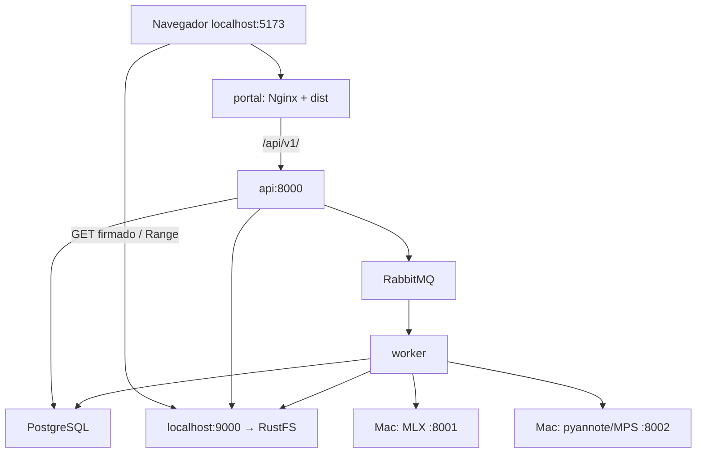
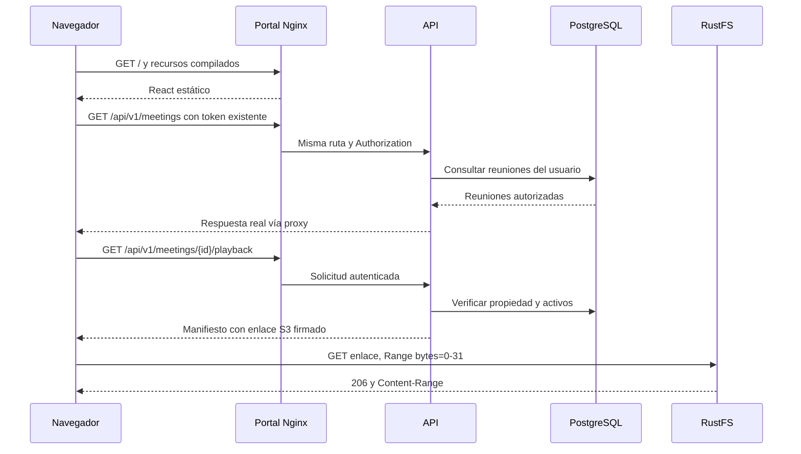

# Documento de Diseño — Despliegue local integrado de Sauri

## Resumen

El núcleo actual puede iniciar API, worker, PostgreSQL, RustFS y RabbitMQ, pero no sirve el portal construido. El navegador necesita además un origen local estable y enlaces de medios alcanzables, distintos de los nombres internos de Docker. Completar ese despliegue no demuestra que la captura, la inferencia o el aislamiento entre cuentas funcionen: cada tramo requiere evidencia propia.

**Base contrastada:** `origin/main` `cb7510f4a23481e7e7c8c82b9d532d650b9bc071`, `docker-compose.yml`, `_tools/compose-bringup.sh`, `frontend/{package.json,vite.config.ts,src/api.ts}`, `backend/app/{main.py,infra/object_store.py,infra/ensure_bucket.py}` y `docs/ARCHITECTURE.md`. Requisitos aprobados por Fer mediante merge del PR #819 el 12-11-2026, commit `392a958eac37f156d0bbdc0ea6619deafefe0d20`. Issue #818; APX `task_9e74a2d278d648ad`. El merge de #703 también está verificado; no acredita captura real ni recorrido completo. Este diseño está redactado para aprobación, no implementado.

La solución consiste en:
1. Construir el workspace React con Node y servir únicamente `frontend/dist` mediante Nginx dentro de un nuevo servicio `portal`.
2. Usar el mismo origen del portal para `/api/v1/`, mediante proxy a `api:8000`, conservando rutas, códigos y autorización existentes.
3. Conservar S3 directo mediante enlaces firmados con `OBJECT_STORE_PUBLIC_ENDPOINT`, sin reescribir firmas ni pasar medios por el portal.
4. Extender el arranque existente para iniciar el portal después de bucket y migraciones, sin introducir motores en Docker.
5. Verificar conexiones y navegación en un proyecto Compose aislado con autenticación activa, y retirar exclusivamente los recursos creados por esa ejecución.
6. Registrar por separado infraestructura, navegación, procesamiento e intervención/aceptación del dueño.

## Decisiones de Diseño Clave

### D1. Imagen multietapa del portal, sin servidor de desarrollo

Crear `frontend/Dockerfile` con contexto raíz del repositorio, etapa `node:22-alpine` y runtime `nginx:stable-alpine`. Resolver y registrar los digests de ambas imágenes durante implementación, antes de publicar la unidad; no inventar digests en documentación. Copiar manifiestos de los workspaces y `package-lock.json`, ejecutar `npm ci`, copiar `frontend/` y `packages/shared-types/`, y construir con `VITE_API_BASE_URL='' npm run build --workspace frontend`. Conservar el lock; ninguna dependencia nueva de aplicación. Copiar solo el resultado a `/usr/share/nginx/html` y `frontend/nginx.conf` a `/etc/nginx/conf.d/default.conf`. La imagen runtime no contiene `.env`, fuentes, cachés de modelos ni credenciales.

Crear `.dockerignore` raíz para excluir `.git`, `.worktrees`, `.apc`, `.env*`, `node_modules`, `dist`, cachés Python, archivos de medios y artefactos de QA; permitir explícitamente manifiestos, lock y fuentes requeridos. Antes de construir, comprobar que no se envían secretos ni archivos del dueño como contexto.

*Alternativas descartadas:* Vite dev/preview no es el servidor de entrega; servir React desde FastAPI acopla publicación web y backend; una imagen monolítica incorpora herramientas de compilación innecesarias al runtime.

### D2. Un origen para portal y API; S3 conserva su contrato separado

Portal predeterminado `http://localhost:5173`, publicación `127.0.0.1:${PORTAL_PORT:-5173}:80`. `VITE_API_BASE_URL` es cadena vacía en la compilación Docker: `frontend/src/api.ts` usa `??`, por lo que preserva esa cadena y forma rutas relativas. No hace falta modificar ese módulo. El proxy conserva `Authorization` y URI completa, sin almacenar ni generar tokens. Los motores permanecen en `host.docker.internal:8001` y `:8002` para el worker.

La API sigue firmando con `OBJECT_STORE_PUBLIC_ENDPOINT` (predeterminado `http://localhost:9000`) y accediendo internamente a `http://minio:9000`. No sustituir el host de un enlace después de firmarlo. Validar CORS/Range reales del almacén con el origen del portal. No ampliar CORS global ni modificar políticas de bucket existentes para que una prueba pase. Si el entorno existente no permite el origen, reportar la discrepancia antes de cambiar su política; la validación aislada usa la configuración compatible existente y registra sus valores.

*Alternativas descartadas:* URL `http://api:8000` en JavaScript es inaccesible desde el navegador; fijar `localhost:8000` en el bundle pierde portabilidad y agrega dependencia CORS; proxy de medios agrega otra ruta de autorización y riesgo de romper firmas/lecturas parciales sin necesidad.

### D3. Integrar el arranque existente, sin alterar datos ni permisos de acceso

Mantener `_tools/compose-bringup.sh` como entrada de `make up`, con la secuencia actual: credenciales existentes → detener API/worker del proyecto seleccionado → infraestructura → verificar bucket → migraciones → iniciar API/worker/portal. Incorporar el portal al último paso y comprobar sus respuestas HTTP con espera acotada de 60 segundos. Un fallo de migración impide llegar a ese paso. No ejecutar el arranque sobre el proyecto de Fer en esta entrega: aplicar migraciones allí requiere coordinación explícita y respaldo acordado.

Preservar nombres `minio`, `pgdata`, `minio-data`, imagen RustFS y sus montajes. No tocar `AUTH_DISABLED`, JWT, cola firmada, cifrado de extractos ni credenciales de motores. Documentar que los valores locales por defecto no demuestran separación entre cuentas. No cambiar otros puertos existentes ni la política de exposición del núcleo como efecto colateral.

*Alternativas descartadas:* otro script de despliegue independiente divergiría de `make up`; recrear volúmenes para arrancar destruye datos; migrar MinIO/RustFS está excluido y tiene seguimiento propio #543.

### D4. Estado observable por capas, no un indicador engañoso

Distinguir servidor estático (`/portal-health`), proceso API (`/api-health` que proxifica `/health`), conexiones de infraestructura y motores. `/health` de API solo devuelve `status: ok`: no convertirlo en prueba de PostgreSQL/S3/cola. No agregar un panel nuevo ni simular mensajes de procesamiento en la UI. `make engines-status` informa procesos, no accesibilidad desde Docker ni uso de GPU.

*Alternativas descartadas:* un único verde por contenedor ignora dependencias y modelos; probar inferencia como requisito para servir el portal impide consultar grabaciones cuando los motores están detenidos.

### D5. Validación aislada y limpieza por identidad de ejecución

Proyecto de prueba `sauri-local-qa-<id>`, donde `<id>` son 12 caracteres hexadecimales aleatorios. Override Compose en carpeta temporal APX, secretos sintéticos y archivo de inventario fuera del repositorio. `COMPOSE_PROJECT_NAME`/`-p` explícitos en cada comando. Volúmenes propios no `external`, sin `name:` fijo, sin montar volúmenes del dueño. Override de puertos de prueba: portal `127.0.0.1:15173:80`, API `127.0.0.1:18000:8000`, PostgreSQL `127.0.0.1:15432:5432`, S3 `127.0.0.1:19000:9000`, consola `127.0.0.1:19001:9001`, AMQP `127.0.0.1:15673:5672`, administración `127.0.0.1:15674:15672`. Reemplazar, no agregar, las publicaciones de Compose; comprobar el resultado con `docker compose config`. Comprobar listeners y contenedores antes de iniciar; ante conflicto no detener al ocupante: elegir otro bloque libre y registrar los valores efectivos.

Las rutas de secretos del worker en el override deben apuntar a archivos sintéticos de esa ejecución. No copiar ni imprimir secretos reales. La prueba inicial no inicia/detiene motores de Fer ni instala/descarga modelos. Puede verificar conectividad a motores existentes sin enviar grabaciones del dueño, pero la inferencia queda pendiente hasta contar con entorno y credenciales compatibles; no declarar un doble de motor como inferencia real.

*Alternativas descartadas:* reutilizar `sauri` o `sauri-fer-test` expone datos existentes; limpieza global o por prefijo de nombre puede borrar recursos de otra ejecución; generar más copias de modelos consume disco sin valor.

## Arquitectura





## Componentes e Interfaces

### 1. Servicio `portal` — `docker-compose.yml`

- `build.context: .`, `build.dockerfile: frontend/Dockerfile`.
- Red existente `sauri-net`; `depends_on: api` para orden de proceso, no prueba de disponibilidad.
- Publicación local definida en D2; sin volúmenes de fuentes ni `.env` en runtime.
- Healthcheck interno: `wget -q -O /dev/null http://127.0.0.1/portal-health`, intervalo 10 s, timeout 3 s, 6 reintentos. Solo acredita Nginx estático.
- `make build` ya construye todos los servicios: no crear otro mecanismo de compilación.

### 2. Servidor — `frontend/nginx.conf`

| Ruta | Contrato |
|---|---|
| `/portal-health` | Respuesta local 200 `ok`; no afirmar salud de API ni motores. |
| `/api-health` | Proxy a `http://api:8000/health`; errores reales, nunca fallback React. |
| `/api/` | `proxy_pass http://api:8000` sin URI final, conservando ruta y query; HTTP/1.1; encabezado Authorization sin reemplazo. |
| `/assets/` | Archivos compilados o 404; no entregar HTML por un JavaScript faltante. |
| `/` y rutas de aplicación | `try_files $uri $uri/ /index.html`; `index.html` con `Cache-Control: no-cache`. |

`client_max_body_size 0` en `/api/` conserva la admisión del backend, sin añadir un límite Nginx inferior no aprobado; el backend mantiene sus controles existentes. `proxy_request_buffering off` evita copiar videos completos a disco del proxy. `proxy_connect_timeout 5s`, `proxy_read_timeout 3600s`, `proxy_send_timeout 3600s`; estas esperas no declaran que haya procesamiento exitoso. No cachear respuestas API, errores ni Authorization. Errores 401/403/404/422/5xx y contenido de respuesta pasan sin transformarse en 200. Un upstream caído produce 502/504. No habilitar listado de directorios.

### 3. Arranque y comprobación — `_tools/compose-bringup.sh`

Extender las pruebas existentes `_tools/test_compose_bringup.py` al último paso con portal y a la comprobación HTTP. Mantener salida no cero y etapa identificable ante fallo. El mensaje final debe decir que portal/núcleo respondieron y que inferencia requiere verificación separada, no «Sauri completamente operativo». Los comandos deben respetar el proyecto y los archivos Compose seleccionados por el entorno; la validación comprueba esa propagación antes de cualquier `stop`.

### 4. Guía operativa — `docs/LOCAL_DEPLOYMENT.md`

Documentar requisitos de Docker/Node para construir, variables privadas requeridas sin valores reales, URL local, alcance de `make up`, motores nativos existentes, matriz de verificación y recuperación sin borrado. Explicar que `/api-health` no verifica datos/cola y que arrancar contenedores no acredita transcripción. Advertir que `make clean` elimina datos y no es parte de arranque ni de este procedimiento. Actualizar README y `docs/ARCHITECTURE.md` al implementar, incluyendo estado real de #703 y esta spec, sin convertir este documento en un reporte de ejecución.

### 5. Validación reproducible — `_tools/validate-local-platform.py`

Herramienta propuesta de QA con librería estándar Python, sin agregar dependencias de aplicación. Modos explícitos `create`, `check`, `cleanup`; nunca seleccionar el proyecto principal por defecto. `create` valida identidad, genera override/secretos sintéticos en carpeta temporal e inventaría IDs antes/después. `check` registra pruebas por capa sin almacenar tokens ni URLs firmadas completas. `cleanup` compara inventario y etiquetas Compose; ante discrepancia se detiene sin borrar. Los artefactos de navegador y métricas se escriben en la carpeta temporal.

Los recorridos se ejecutan con navegador real/Playwright sobre ese entorno. Reusar fixtures y endpoints de las specs existentes, sin crear una API de demostración ni cambiar la UI para facilitar pruebas. Las pruebas con sustitutos de Docker cubren secuencias/fallos del script, no prueban que Docker funcione.

## Modelos de Datos

No se agregan tablas, migraciones, estados de reunión ni contratos públicos. Se mantienen autenticación, manifiesto de playback y trabajos firmados existentes.

Inventario QA propuesto, archivo JSON fuera del repositorio:

```typescript
interface LocalValidationRun {
  schemaVersion: 1;
  runId: string;                 // /^[a-f0-9]{12}$/
  projectName: string;           // `sauri-local-qa-${runId}`
  sourceCommit: string;
  startedAt: string;             // ISO-8601 UTC
  composeFiles: string[];        // rutas absolutas verificadas
  resourceIds: {
    containers: string[];
    networks: string[];
    volumes: string[];
  };
  ports: Record<string, number>; // asignación efectiva, no supuesta
  checks: Array<{
    layer: 'config' | 'portal' | 'api' | 'storage' | 'queue' | 'ownership' | 'engines' | 'inference';
    outcome: 'passed' | 'failed' | 'not_verified';
    evidencePath: string;
  }>;
}
```

El inventario no contiene contraseñas, JWT, claves, muestras biométricas ni enlaces firmados. Antes de borrar, exigir pertenencia al inventario **y** etiqueta `com.docker.compose.project` exacta. Las imágenes compartidas y el build cache no se borran automáticamente; registrar espacio antes/después. Eliminar recursos de ejecución no autoriza eliminar imágenes antiguas del dueño.

## Propiedades de Correctitud

| ID | Invariante comprobable | Requisitos |
|---|---|---|
| P1 | Para cada inicio exitoso, `/` y los recursos construidos responden sin Vite; recarga de una ruta válida entrega la aplicación. Recurso ausente bajo `/assets/` devuelve 404. | R1.1–1.2 |
| P2 | Ningún servicio nuevo ejecuta MLX/pyannote en Docker; URLs y controles de credenciales de los motores conservan su contrato. | R1.3, R3.3 |
| P3 | Para toda operación probada, proxy y acceso directo conservan ruta, identidad, código y cuerpo semántico; respuestas no exitosas nunca se convierten en HTML 200. | R2.1, R2.4 |
| P4 | Para cualquier rango válido probado de un medio sintético, enlace firmado alcanzable desde navegador entrega 206, bytes exactos y Content-Range correcto con el origen permitido. Firma inválida no entrega el objeto. | R2.2 |
| P5 | Build/dist/runtime no contienen secretos de los archivos privados ni variables sensibles de ejecución; solo recursos públicos construidos. | R2.3 |
| P6 | Una comprobación estática/API positiva no marca motores o inferencia como aprobados. Sin motores, lectura de reuniones previas sigue siendo comprobable y procesamiento nuevo no se declara validado. | R3.1–3.2, R5.2 |
| P7 | Para cada recurso creado en QA, proyecto, etiquetas e inventario coinciden; ningún volumen/montaje apunta a recursos del dueño. | R4.1 |
| P8 | Cleanup solo elimina recursos inventariados de la ejecución; repetir cleanup es seguro. Etiqueta ajena, inventario faltante o ID distinto producen rechazo sin borrado. No ejecuta prune ni `make clean`. | R4.2–4.3 |
| P9 | Usuario sintético B no obtiene manifiesto/medios mediante API de A, y peticiones sin autenticación no heredan privilegios del proxy. Un enlace firmado es una capacidad temporal según contrato existente, no se redefine su política. | R2.1, R5.1 |
| P10 | Cada afirmación de entrega tiene capa, resultado y evidencia; inferencia y aceptación de Fer no se derivan de build, mocks o healthchecks. | R5.1–5.2 |

## Manejo de Errores

| Escenario | Comportamiento |
|---|---|
| Puerto ocupado o proyecto de prueba ya existente | No detener recursos ajenos; elegir puertos libres o abortar con conflicto concreto antes de iniciar. |
| Configuración privada faltante | Fallar sin imprimir el secreto ni recurrir a valores débiles alternativos. |
| Bucket/migración fallan | Interrumpir arranque; no iniciar el último paso ni borrar/recrear datos. |
| API caída | Proxy devuelve error real; UI conserva manejo existente; `/portal-health` no acredita API. |
| URL firmada inaccesible/CORS/Range incorrectos | Marcar almacenamiento/recorrido fallidos, conservar respuesta y encabezados no sensibles; corregir endpoint/configuración sin reescribir firmas ni abrir acceso público. |
| Motores detenidos o inaccesibles desde worker | Registrar motores no disponibles e inferencia no verificada; no levantar dobles como sustituto funcional. |
| Modelos/licencia/credenciales de inferencia faltantes | No descargar/duplicar ni saltar acceso; informar acción concreta requerida si excede permisos. |
| Inventario incompleto o propiedad dudosa al limpiar | No eliminar el recurso dudoso; registrar ID y motivo para resolver preservación. |
| Interrupción de QA | Conservar inventario fuera del repositorio; cleanup explícito y verificable de la misma ejecución, nunca limpieza global. |

## Estrategia de Testing

### Automatizadas

1. Extender `python3 -m unittest _tools/test_compose_bringup.py` para arranque con portal, fallos de migración/bucket/HTTP y conservación del proyecto seleccionado. Ningún fallo debe continuar ni emitir éxito.
2. Crear `_tools/test_validate_local_platform.py`: pruebas unitarias de inventario/puertos y eliminación segura; generación de combinaciones de IDs, etiquetas y proyectos con `unittest.subTest` para P7–P8, sin añadir una biblioteca por esta tarea.
3. `npm ci`, `npm run typecheck --workspace frontend`, `npm run test --workspace frontend`, `npm run build --workspace frontend`. Construir la imagen y ejecutar `nginx -t` dentro del contenedor. Revisar que una cadena privada sintética de prueba no aparezca en dist/runtime. Ninguna prueba introduce secretos reales en el build.
4. `docker compose ... config --quiet` sobre el override; inspeccionar configuración sin publicar su salida con secretos. Verificar que el conjunto de servicios no incluye motores.
5. Reusar `backend/tests/infra/test_object_store_browser_endpoint.py` y `backend/tests/meetings/test_playback_storage_integration.py`; el segundo requiere S3 real y sus variables de entorno documentadas, no omitirlo silenciosamente. Si cambia Python del backend, ejecutar también sus validaciones configuradas en `backend/pyproject.toml` y CI; esta fase no cambia ese código.

### Integración y navegador reales

- Levantar exclusivamente el proyecto QA. Crear dos identidades sintéticas con `AUTH_DISABLED=false`, y cargar un medio audiovisual sintético por la API real. Conservar los estados de procesamiento reales; usar fixtures explícitos de playback no acredita inferencia.
- Abrir portal Docker, iniciar sesión con la autenticación existente, consultar biblioteca, recargar una vista válida y reproducir el medio autorizado; capturar pantalla y errores de consola/red. Comprobar bytes parciales y encabezados mediante HTTP además del reproductor. No interceptar API ni medios para fabricar éxito.
- Verificar denegación para B y sin token; errores de API y medio ausente. Mantener separado este recorrido de la captura Chrome, que depende de `chrome-recording-completion` y se verificará según sus propios criterios.
- Comprobar PostgreSQL con escritura/lectura sintética, S3 con objeto propio y cola con publicación/recepción/confirmación aisladas; no usar solo `/health`.
- Verificar desde el worker conectividad a motores existentes solo si el entorno lo permite sin modificar procesos ajenos. Inferencia real posterior: medio sintético autorizado, contratos y capacidades existentes, transcripción/diarización y dispositivo observados; ausencia de esa evidencia se reporta como **no verificado**, no aprobación implícita.
- Medir `docker system df` y recursos propios antes/después, ejecutar cleanup verificado, inspeccionar que no quedan recursos QA no justificados y que no cambió la identidad de volúmenes ajenos. Las métricas globales incluyen otros proyectos.

### Puertas de entrega

Diseño aprobado → fase tasks con IDs y unidades/issue/PR → implementación y controles → revisión del candidato → merge verificado → validación integrada reportada. Una fase documental `complete` significa documento redactado, no aprobación ni software disponible. El entorno personal de Fer, sus datos y su aceptación de producto permanecen fuera de cualquier resultado inferido automáticamente.
