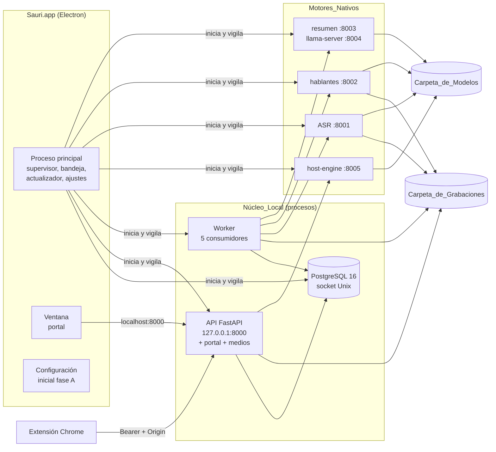
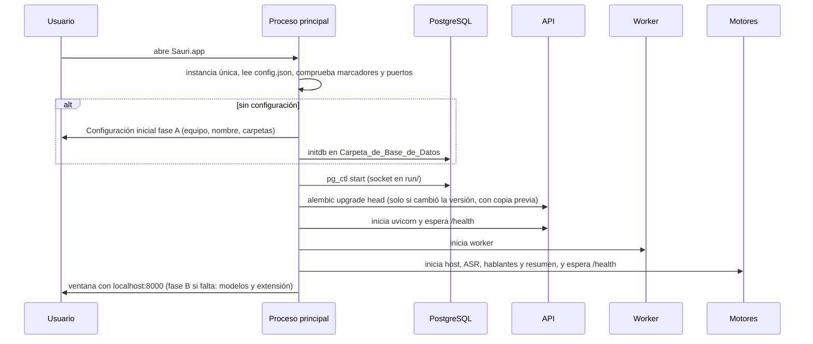

# Documento de Diseño — Sauri como app de escritorio para Mac con chip M

## Resumen

Sauri se empaqueta como una app Electron para macOS arm64, con el mismo patrón que APX. La app lleva dentro un intérprete de Python, el backend, el portal ya construido, PostgreSQL 16, `ffmpeg` y los binarios de los motores, todo precompilado. Al abrirse, inicia esos procesos en el Mac, sin Docker, y muestra el portal en su ventana. PostgreSQL se queda: el código depende de sus bloqueos y de sus 30 migraciones. RabbitMQ se reemplaza por una cola sobre PostgreSQL, y el almacén S3 por carpetas normales. Sin login, la API atiende a un único Usuario_Local. Una regla de origen cierra el acceso a cualquier página ajena. Una configuración inicial pide el nombre y las carpetas. La app se actualiza desde un repositorio público de descargas.

Hechos verificados el 2026-11-18 que sostienen el diseño (informes de lectura del worktree `spec-mac-desktop-app`, HEAD `5b8f931e`, y mediciones en el Mac del dueño):

- **Base de datos.** SQLAlchemy 2 asíncrono con `asyncpg` (`backend/app/infra/database.py:32-40`). Hay 27 `with_for_update()`, `skip_locked` en `regeneration/service.py:558` y `summaries/outbox.py:32`, `RETURNING` como comparar-y-escribir (`infra/processing_claims.py:269,302,336`) y `pg_try_advisory_lock` en `infra/engine_slot.py:34-76`. Las migraciones 005, 007, 009, 015, 024 y 026 usan construcciones exclusivas de PostgreSQL.
- **Cola.** La interfaz `JobQueue` (`infra/queue.py:17-85`) tiene una sola implementación real, RabbitMQ (`infra/queue_rabbitmq.py`). Usa reintentos con colas de espera por TTL, temas `.failed`, `DeferDelivery` y `pending_count`, que el barredor de huérfanos necesita (`infra/orphan_sweeper.py:136`). Hay cinco consumidores en un solo proceso worker (`app/worker.py`).
- **Almacén.** La interfaz `ObjectStore` (`infra/object_store.py:23-90`) tiene la implementación S3 con boto3. El navegador reproduce con URL prefirmadas directas al almacén (`meetings/router.py:556,576,637`). Los motores de ASR y hablantes leen el bucket con boto3 (`asr-engine/native_main.py:272`, `diar-engine/native_main.py:177`).
- **Autenticación.** 54 rutas dependen de `get_current_user`/`require_sales`. Los datos tienen dueño mediante claves foráneas a `users.id` (`infra/models.py:730,741,864,906,938,978`). No hay comprobación de `Host`, `Origin` ni CSRF (`infra/http_security.py`).
- **Motores en disco.** `asr-venv` ocupa 83 MB, `diar-venv` 749 MB (Senko con `coremltools`, sin PyTorch), `host-venv` 19 MB, `llm/venv` 19 MB, `llm/bin` 15 MB y `parakeet` 26 MB. El modelo de resumen de 5,3 GB y los demás modelos (1,1 GB) se descargan aparte. Hoy se compilan en el equipo `llama.cpp` (cmake) y `fluidaudiocli` (Swift 6), y `whisper-cli` sale de Homebrew.
- **Portal.** nginx sirve el portal y hace de proxy de `/api` con CSP por hash (`frontend/nginx.conf`, `frontend/security-headers.conf:15-20`). La extensión fija `http://localhost:8000` en cuatro sitios (`extension/src/background.ts:125`, `core/api/client.ts:9`, `SidePanelApp.tsx`, `DetailApp.tsx`).
- **Repositorio.** `lufermalgo/sauri` es privado (`gh repo view`: PRIVATE). APX publica sus versiones en un repositorio público (`packages/protocol/src/releases.ts:8`).

**Cambio del 2026-11-19 (decisión del dueño): puertos de la app.** La app instalada deja el bloque 8000–8005 y usa 41750–41755, todo derivado del puerto de la API: API y portal 41750, motores +1 a +3, `llama-server` +4 (`SAURI_LLAMA_PORT`) y `host-engine` +5 (`desktop/src/main/ports.ts`). El bloque queda por debajo del rango efímero de macOS (49152–65535). El entorno Docker de desarrollo sigue en 8000–8005. `/health` responde `{"status":"ok","service":"sauri","version":…}`. La extensión prueba 41750 y luego 8000 contra esa firma (en 8000 también acepta el `{"status":"ok"}` exacto de las apps anteriores), guarda el resultado en `chrome.storage.session` y lo olvida si la app deja de responder (`extension/src/core/backend.ts`). Donde este documento dice 8000 para la app instalada, rige el bloque nuevo.

## Decisiones de Diseño Clave

**D1. Electron con `electron-builder`, solo `mac`/`arm64`, sin firma (`identity: "-"`)**, en una carpeta nueva `desktop/` del monorepo (workspace de npm).
- *Por qué:* es el patrón de APX que el dueño pidió seguir. Reutiliza el portal React tal cual y da ventana, ícono en la barra de menú, instancia única, arranque con la sesión y actualizaciones.
- *Rechazado:* Tauri, que obliga a sumar Rust a la cadena de construcción y no aporta nada que el dueño haya pedido. Swift nativo, que reescribe el portal y la extensión. Un instalador sin ventana, que no da ícono, estado ni actualizaciones.
- La firma ad-hoc basta para ejecutar en Apple silicon. El instructivo de la landing cubre el aviso de Gatekeeper.

**D2. Se conserva PostgreSQL 16, compilado y llevado dentro de la app**, escuchando solo en un socket Unix interno, sin TCP.
- *Por qué:* mantiene intactos los bloqueos de fila, `SKIP LOCKED`, `RETURNING`, el bloqueo consultivo y la cadena de migraciones (Requisito 3.2–3.3). El traslado de los datos del dueño es un `pg_dump`/`pg_restore` entre la misma versión mayor. PostgreSQL es reubicable y su licencia permite distribuirlo.
- *Rechazado:* SQLite. Ignora `FOR UPDATE`, rompe el turno único de motor y obliga a un esquema base nuevo fuera de Alembic, justo lo que el Requisito 3.3 prohíbe. La idea de «una base de datos en un archivo» se cumple igual para el usuario: es una carpeta que él elige.
- *Rechazado:* binarios de terceros como embedded-postgres. Se compila desde el código fuente oficial, fijado por versión y SHA-256, por procedencia.

**D3. La cola pasa a PostgreSQL (`PostgresJobQueue`)**, detrás de la misma interfaz `JobQueue`.
- Tabla `job_messages`. El consumo usa `FOR UPDATE SKIP LOCKED` con un tiempo de visibilidad de 1800 s, igual al `consumer_timeout` de RabbitMQ. `LISTEN/NOTIFY` despierta a los consumidores, con sondeo de respaldo cada 2 s.
- Conserva los mismos reintentos, esperas, aplazamientos, temas `.failed`, `pending_count` y prefetch 1.
- *Rechazado:* llevar RabbitMQ dentro, porque exige Erlang (unos 100 MB y otro proceso que supervisar). *Rechazado:* una cola en memoria, porque pierde trabajos al reiniciar y no sirve entre la API y el worker.
- La firma HMAC de mensajes se retira para esta cola. Protegía un bróker de red; aquí el mensaje vive en la misma base de datos, que ya es la frontera de confianza.

**D4. Las grabaciones pasan a carpetas normales (`FilesystemObjectStore`)** con la misma estructura de claves: `recordings/{meeting_id}/{uuid}/audio|video|thumbnail.jpg` bajo la Carpeta_de_Grabaciones.
- La reproducción y la descarga pasan por una ruta nueva de la API, `GET /api/v1/media/{token}`. El token lleva firma HMAC y caducidad. La ruta responde con `FileResponse` de Starlette 1.10.0, que soporta Range; la unidad U2 lo demuestra con una prueba de `206`.
- Los motores de ASR y hablantes, y `ffmpeg` para las miniaturas, leen el archivo local por su ruta, comprobada dentro de la carpeta raíz.
- *Rechazado:* llevar RustFS dentro. Guarda los objetos en su formato interno, así que el usuario no vería archivos normales ni podría usar un disco externo con libertad, y suma otro proceso y otras credenciales.

**D5. La API sirve el portal construido**, sin nginx.
- `StaticFiles` para `/assets/*`, con caché inmutable. Para cualquier otra ruta GET que no sea `/api`, la API devuelve `index.html` con `no-cache`.
- La CSP con el hash del script en línea se calcula al iniciar, leyendo `index.html`, con la misma lógica de `scripts/platform/inline-script-hash.mjs`. Las demás cabeceras de `security-headers.conf` se reproducen en un middleware.
- Un solo origen, `http://localhost:8000`, para el portal y la API: así desaparece el CORS del portal.
- *Rechazado:* servir el portal desde Electron con un esquema propio (`app://`). La extensión abre el portal en Chrome, y Chrome no entiende ese esquema.

**D6. Modo_Local con `SAURI_AUTH_MODE=local`**, que es el valor por defecto en la app. `get_current_user` devuelve la fila del Usuario_Local, cuyo id llega en `SAURI_LOCAL_USER_ID`, tras validar la Credencial_Local (D7).
- El modo `password` sigue igual para desarrollo, pruebas y un futuro servidor central (Requisito 4.5).
- En Modo_Local no se exige `JWT_SECRET` al iniciar. En el portal desaparecen `LoginScreen` y el manejo de 401 que borra el token. En la extensión desaparecen `AuthView` y el flujo de refresco: son código sin uso en Modo_Local, y si llega un servidor se reintroducirán.
- *Rechazado:* reutilizar el bypass `AUTH_DISABLED`, porque solo funciona con `APP_ENV=test` y usa un usuario sin fila. *Rechazado:* cambiar la firma de las 54 rutas, porque la dependencia ya es el único punto de entrada.

**D7. Protección por origen y credencial local**, porque CORS solo impide leer y no impide enviar. Una petición de datos se acepta solo si cumple una de dos condiciones, y siempre con un `Host` válido (`localhost:8000` o `127.0.0.1:8000`):
- **(a) Desde el portal:** cookie `sauri_local` (HttpOnly, `SameSite=Strict`, `Path=/`), que la API pone al servir `index.html`, y `Sec-Fetch-Site: same-origin`.
- **(b) Desde la extensión:** `Authorization: Bearer <token local>` y `Origin` dentro de `SAURI_EXTENSION_ORIGINS`, que incluye el identificador de la tienda y el de desarrollo.

La extensión obtiene el token con `POST /api/v1/local/pair`, que solo responde a esos orígenes; el emparejamiento es automático. Las URL de medios llevan su propio token firmado y de vida corta, como hoy las prefirmadas. Una página en otro puerto de `127.0.0.1` es del mismo sitio, pero no del mismo origen: `Sec-Fetch-Site` vale `same-site` y se rechaza.
- *Rechazado:* solo CORS. Deja pasar el multipart de subida y los GET.
- *Rechazado:* un token inyectado por el preload de Electron. El portal también se abre en Chrome, donde no hay preload.

**D8. Python embebido**, con CPython 3.11 arm64 de python-build-standalone (`install_only`, fijado por SHA-256).
- Cada componente (`core`, `host-engine`, `asr-engine`, `diar-engine`, `llm-engine`) tiene su propia carpeta de paquetes, construida con `uv pip install --target <dir> --python <cpython>` desde requisitos fijados. Se ejecuta con `PYTHONPATH=<dir>`, `PYTHONNOUSERSITE=1` y `PYTHONSAFEPATH=1`.
- *Rechazado:* entornos virtuales, que no se pueden reubicar. *Rechazado:* PyInstaller, que complica las extensiones nativas como `coremltools` y la depuración.

**D9. La app base y los Componentes_Descargables viajan por separado.**
- La app base lleva Electron, CPython, `core`, `host-engine`, `asr-engine` con `whisper-cli` y `fluidaudiocli`, `llm-engine` con `llama-server`, PostgreSQL, `ffmpeg` y el portal: unos 350 MB instalada, cifra que se mide en U9.
- El runtime de hablantes (`diar-engine` con Senko, unos 750 MB) se descarga en la Configuración_Inicial con el mismo trabajo de instalación de `host-engine` (`local_models.py`: espacio del 120 %, `.part`, SHA-256, `os.replace`), como una entrada más del catálogo.
- `host-engine` hoy solo descarga de `huggingface.co`/`hf.co` (`local_models.py:100-126`). La lista se amplía con el host de versiones del Lugar_de_Descarga.
- *Por qué:* una actualización de la app no vuelve a bajar 750 MB que no cambiaron. Los modelos ya se descargan aparte.
- *Rechazado:* meterlo todo en el `.dmg`, porque cada versión obligaría a bajar más de 1 GB.

**D10. Los binarios se compilan en el Mac del dueño con `make package`**, no en CI. El CI está inactivo por facturación (`AGENTS.md`) y sus minutos de macOS cuestan.
- Se compilan, fijados por commit o tag: `whisper.cpp` con Metal (`whisper-cli` y el binario de VAD), `llama.cpp` (reutiliza `install-llm-engine.sh`), `fluidaudiocli` (reutiliza `install-parakeet-engine.sh`), PostgreSQL 16.x y un `ffmpeg` mínimo con licencia LGPL. Del `ffmpeg` solo se necesita decodificar WebM, Opus, VP8/VP9 y H.264, y codificar JPEG.
- Cada artefacto deja su SHA-256 en `desktop/runtime-manifest.json`.
- *Rechazado:* `ffmpeg` estático de terceros, por procedencia y por licencia, ya que muchos se compilan con GPL.

**D11. Rutas.**
- `~/Library/Application Support/Sauri/config.json` guarda las Rutas_de_Usuario, el id del Usuario_Local, el paso de la configuración y las preferencias.
- Las Rutas_Internas quedan en `~/Library/Application Support/Sauri/`: `secrets/` (0700), `run/` (socket de PostgreSQL y PID) y `components/`. Los registros van a `~/Library/Logs/Sauri`.
- Por defecto, las Rutas_de_Usuario son `~/Sauri/Recordings`, `~/Sauri/Database` y `~/Sauri/Models` (en inglés, sea cual sea el idioma de la interfaz; en desarrollo, `~/Sauri-dev/...`). Una instalación que ya guardó sus rutas las conserva tal cual: no se renombran ni se mueven (hasta la v0.1.1 los nombres por defecto eran `Grabaciones`, `Base de datos` y `Modelos`).
- Cada carpeta lleva un archivo marcador `.sauri-folder` con el id de la instalación, para no arrancar nunca sobre una carpeta vacía o ajena (Requisito 7.4).
- Las variables existentes se conservan como mecanismo: `SAURI_MODELS_DIR`, los `*_FILE` y `SAURI_NATIVE_ENGINE_STATE_DIR`. La app solo las fija.

**D12. Las actualizaciones siguen el patrón de APX (`updater.ts`)**, con una diferencia: las migraciones se ejecutan **antes** de cambiar la app.
1. La app vieja comprueba con `GET /api/v1/local/status` que no hay nada procesándose.
2. Detiene los servicios, copia la carpeta `pgdata` detenida a `backups/pgdata-<versión>` y ejecuta `alembic upgrade head` con el `core` de la versión nueva ya descargada y verificada.
3. Si sale bien, reemplaza `Sauri.app` y se reinicia. Si falla, restaura la copia, mantiene la app vieja y muestra el error (Requisito 9.3–9.4).
- Se conserva solo la última copia.
- *Rechazado:* `pg_dump` como copia, porque es más lento de restaurar y no es idéntico byte a byte. *Rechazado:* migrar después del cambio, porque dejaría una app nueva sin datos utilizables y sin vuelta atrás.

**D13. Lugar_de_Descarga: un repositorio público de GitHub dedicado** (`lufermalgo/sauri-app`, aprobado por el dueño el 18-11-2026).
- *Actualización 25-11-2026:* el dueño decidió dejar el proyecto en un solo repositorio público, `lufermalgo/sauri`. Desde la versión que trae ese cambio, la app busca actualizaciones y componentes allí. `sauri-app` se elimina; las instalaciones hasta la 0.2.3 se actualizan a mano una vez. Plan y orden de pasos en `docs/operations/single-public-repo.md`.
- GitHub Pages sirve la landing y la política de privacidad. Releases sirve el `.dmg`, el `.zip`, los `.sha256` y los Componentes_Descargables.
- Es gratis y no expone el repositorio privado. El código que va dentro del paquete sí queda legible para quien lo abra, como en cualquier app de escritorio sin ofuscar. Eso forma parte de la decisión del dueño.
- **Cada publicación de una versión es contenido público y necesita el OK expreso del dueño.** La autorización permanente no la cubre.

**D14. Traslado único con `scripts/migrate-from-docker/`.** Lo ejecuta el dueño una vez, desde el repo, con `uv`.
1. Comprueba con la lógica de `deploy-guard.sh` que no hay nada en curso.
2. Detiene solo los contenedores `api`, `worker` y `portal` del proyecto `sauri`, para liberar el puerto 8000 y congelar escrituras.
3. Ejecuta `pg_dump -Fc` dentro de `sauri-postgres-1` y `pg_restore` en el PostgreSQL de la app, con la app detenida salvo su base.
4. Descarga cada objeto de RustFS con boto3 a su ruta en la Carpeta_de_Grabaciones y compara tamaño y MD5 con el ETag; las subidas son de una sola parte (`object_store_s3.py:74-91`).
5. Compara las filas por tabla, fija `SAURI_LOCAL_USER_ID` con el id de `admin@sauri.local` y escribe el informe en `~/Library/Logs/Sauri/`.
- Nunca borra volúmenes. Retirar Docker es una acción aparte, con autorización del dueño.

**D15. Desarrollo sin Docker.**
- `make dev` arranca el mismo supervisor de `desktop/` apuntando al código fuente: `uv run` para el backend y el portal construido con Vite. Usa `~/Library/Application Support/Sauri-dev` para no tocar los datos de uso real.
- Las pruebas que necesitan PostgreSQL usan `scripts/tests/pg-disposable.sh`, que crea un clúster temporal con los binarios de `make package-runtime` en un directorio propio y lo borra al terminar. Reemplaza a los contenedores `sauri_qa_*`.
- `docker-compose.yml`, `queue_rabbitmq.py` y `object_store_s3.py` se retiran en U12, después del traslado aceptado. `object_store_s3.py` lo usa el traslado; boto3 queda solo en esa herramienta.

## Arquitectura

### Componentes



### Arranque



## Componentes e Interfaces

### 1. App de escritorio (`desktop/`)

Estructura, en TypeScript con Electron 44.x fijado:

```
desktop/
  electron-builder.json      # mac: target dmg+zip, arch arm64, identity "-", extraResources: runtime/
  runtime-manifest.json      # versión y SHA-256 de cada binario y componente
  src/main/
    main.ts                  # instancia única, ciclo de vida, menú, bandeja
    config.ts                # lee y escribe config.json (schemaVersion: 1)
    paths.ts                 # Rutas_de_Usuario e internas; marcadores .sauri-folder
    services.ts              # orden de arranque y parada, entorno de cada proceso
    supervisor.ts            # spawn, /health, reinicio 1 s→30 s, registro rotado a 20 MB
    ports.ts                 # comprueba 8000–8005 libres antes de iniciar
    status.ts                # GET /api/v1/local/status → {processing: n, ready: bool}
    tray.ts                  # ícono: listo / procesando / error
    relocate.ts              # mueve una Ruta_de_Usuario: copiar, verificar, cambiar
    updater.ts               # D12
    uninstall.ts             # Requisito 10
    autostart.ts             # app.setLoginItemSettings, apagado por defecto
  src/setup/                 # fase A, sin red: equipo, nombre, carpetas
  scripts/
    build-runtime.sh         # D10: compila y prepara runtime/ con su manifiesto
    stage.ts                 # copia core, portal y engines a .stage/
```

El entorno de cada proceso lo arma `services.ts`:

| Proceso | Comando | Entorno clave |
|---|---|---|
| PostgreSQL | `runtime/pg/bin/pg_ctl -D <db>/pgdata -o "-c listen_addresses='' -k <run>"` | — |
| API | `runtime/python/bin/python3 -m uvicorn app.main:app --host 127.0.0.1 --port 8000` | `SAURI_AUTH_MODE=local`, `SAURI_LOCAL_USER_ID`, `DATABASE_URL=postgresql+asyncpg://sauri@/sauri?host=<run>`, `QUEUE_KIND=postgres`, `OBJECT_STORE_KIND=filesystem`, `SAURI_RECORDINGS_DIR`, `SAURI_PORTAL_DIR`, `SAURI_EXTENSION_ORIGINS`, `*_FILE` → `secrets/` |
| Worker | `... -m app.worker` | igual que la API |
| Motores | lo mismo que `native-engines.sh start` | `SAURI_MODELS_DIR`, `SAURI_RECORDINGS_DIR`, `SAURI_NATIVE_ENGINE_STATE_DIR=<run>`, binarios de `runtime/bin` |

### 2. Cola sobre PostgreSQL (`backend/app/infra/queue_postgres.py`)

```python
class PostgresJobQueue(JobQueue):
    # publish(topic, body, headers=None, delay_s=0) -> None: INSERT + NOTIFY sauri_jobs
    # subscribe(topic, handler, max_retries, retry_delay_s): una tarea por tema, prefetch 1
    # pending_count(topic) -> int: COUNT(*) WHERE topic = :t AND locked_until IS NULL
    # stop_consuming / wait_idle / cancel_in_flight: misma semántica que queue_rabbitmq.py
```

Ciclo de consumo de un mensaje:
1. `SELECT ... FOR UPDATE SKIP LOCKED LIMIT 1` sobre mensajes disponibles. Fija `locked_until = now() + 1800 s` y confirma la transacción.
2. Ejecuta el manejador.
3. Si termina bien: `DELETE`.
4. Si lanza `DeferDelivery(s)`: `available_at = now() + s`, desbloquea y no suma intentos.
5. Si falla: suma un intento. Si supera `max_retries`, publica `<topic>.failed` y borra el mensaje en la misma transacción. Si no, `available_at = now() + retry_delay_s`.
6. Si el proceso muere, el mensaje vuelve a estar disponible cuando vence `locked_until`. El barredor de huérfanos sigue funcionando sin cambios.

`infra/queue.py`: la fábrica elige por `QUEUE_KIND`, con `rabbitmq` hasta U12 y `postgres` en la app.

### 3. Almacén en carpetas (`backend/app/infra/object_store_fs.py`)

```python
class FilesystemObjectStore(ObjectStore):
    def __init__(self, root: Path): ...
    # _path(key): rechaza absolutas, '..', '\0' y claves fuera de root tras resolve()
    # save/save_stream: escribe en <dir>/.<name>.part, fsync y os.replace (atómico)
    # get / get_bounded / inspect / delete: mismas firmas que la interfaz
    # temporary_read_url(key, ttl, content_type) -> "http://localhost:8000/api/v1/media/<token>"
    # temporary_download_url(key, ttl, filename) -> igual, con disposition=attachment en el token
    # local_path(key) -> Path   # para motores y ffmpeg en la misma máquina
```

Token de medios: `base64url(json{key, exp, ct, disp}) + "." + HMAC-SHA256(recording_capability_key)`. La ruta `backend/app/media/router.py` lo valida y responde `FileResponse(path, media_type=ct, content_disposition_type=disp)`. Los tiempos de vida siguen los de `meetings/signed_urls.py`.

Motores: `asr-engine` y `diar-engine` reciben el mismo `audio_ref`. Con `SAURI_RECORDINGS_DIR` definida, leen el archivo local con la misma validación de ruta en lugar de usar boto3. `thumbnails/service.py` pasa la ruta local a `ffmpeg`.

### 4. Portal servido por la API (`backend/app/portal/static.py`)

Se monta en `app.main` solo si `SAURI_PORTAL_DIR` existe. Reglas:
- `/assets/*` lleva `Cache-Control: public, max-age=31536000, immutable`.
- Cualquier otra ruta GET que no empiece por `/api` ni sea `/health` devuelve `index.html` con `Cache-Control: no-cache`, la cookie `sauri_local` y la CSP (`default-src 'self'; script-src 'self' 'sha256-<hash>'; media-src 'self'; img-src 'self' data:; connect-src 'self'`) junto con el resto de cabeceras de `security-headers.conf`.

### 5. Modo_Local y protección (`backend/app/auth/local.py`, `infra/http_security.py`)

- **`LocalGuardMiddleware`**, para todas las rutas salvo `/health`:
  1. `Host` en `{localhost:8000, 127.0.0.1:8000}`, si no `421`.
  2. En `/api/v1/*`, salvo `/api/v1/media/*` y `/api/v1/local/pair`: acepta (a) cookie válida con `Sec-Fetch-Site: same-origin` o (b) Bearer válido con `Origin` en `SAURI_EXTENSION_ORIGINS`. Si no, `403 local_origin_required`.
- **`POST /api/v1/local/pair`:** solo para un `Origin` en `SAURI_EXTENSION_ORIGINS`. Devuelve `{token}`, que es `secrets/local_token`: 32 bytes aleatorios creados en la primera ejecución.
- **`GET /api/v1/local/status`:** `{ready, processing, version}`. `processing` reutiliza la consulta de `scripts/platform/pipeline_admission.py`, trasladada a `backend/app/local/inflight.py`.
- **`python -m app.local.bootstrap --name <nombre>`:** crea el Usuario_Local (`email = local@sauri.local`, `is_sales = true`, `password_hash` imposible) y siembra las plantillas como hoy `seed_admin`. Imprime el id.

### 6. Portal (`frontend/`)

- `App.tsx`: sin `LoginScreen` cuando `/api/v1/local/status` responde. `api.ts`: sin Bearer en Modo_Local, porque la cookie viaja sola en el mismo origen.
- `AccountSettings.tsx`: el nombre del Usuario_Local, sin cerrar sesión.
- Nueva ruta `/bienvenida` para la fase B: instalación automática de los modelos recomendados y conexión de la extensión (enlace a la tienda y estado del emparejamiento). La instalación no pide elegir nada: sigue el `setup_plan` que `host-engine` calcula con `recommend.setup_plan` (el modelo recomendado de cada proceso; con Parakeet, también Whisper, que es su respaldo y el que el motor de transcripción comprueba al arrancar; el detector de voz; el runtime de hablantes), descarga cada archivo por las mismas rutas de Ajustes (hash fijado y hosts permitidos), muestra un único avance con reintento y, al terminar, guarda `local:<id>` solo donde el recomendado no es lo que resuelve `local:default` (el 4B en un Mac de 8 GB). Cambiar de modelo después sigue en Ajustes › Motores y modelos (`LocalModelCard`).
- Nueva página de ajustes `/settings/almacenamiento`: Rutas_de_Usuario, tamaño, espacio libre y «Cambiar», que pide el cambio a Electron mediante el preload (`window.sauriDesktop.relocate(kind)`). En Chrome muestra «Abre la app Sauri para cambiar carpetas».

### 7. Extensión (`extension/`)

- `src/core/backend.ts`: una sola constante `BACKEND_URL = import.meta.env.VITE_SAURI_BACKEND_URL ?? "http://localhost:8000"`. El portal está en el mismo origen. Reemplaza las cuatro copias.
- `src/core/local-pairing.ts`: `ensureLocalToken()` llama a `/api/v1/local/pair` y guarda `sauriLocalToken` en `chrome.storage.local`. Ante un 403 o 401 lo renueva una vez.
- Se retiran `AuthView`, `session-refresh.ts`, `sauriSessionToken`, `sauriRefreshToken` y `sauriSignInRequired`. Una migración de almacenamiento limpia esas claves.
- Si `GET /health` no responde: aviso «Abre Sauri en tu Mac…» en el panel. La cola de subidas pendientes sigue con su alarma actual.
- Manifiesto: se quita `notifications`. `host_permissions` queda en `meet.google.com` y `localhost:8000`.
- Material de la tienda en `extension/store/{es,en}/`: `listing.md`, `permissions.md` (una justificación por permiso) y capturas.

### 8. Landing y Lugar_de_Descarga

- `landing/` (rama `feature/landing-indigo`, que primero se integra) suma la sección «Descargar», el instructivo de cinco pasos con capturas de la versión vigente de macOS y la página `privacidad.html`.
- `scripts/package/publish-release.sh <versión>`: comprueba las sumas y crea la Release en el Lugar_de_Descarga con `gh release create`. **Solo se ejecuta con el OK del dueño para esa versión.**

## Modelos de Datos

Nueva migración Alembic `030_job_messages` (la última es `029_meeting_recorded_at`; si al implementar ya existe una 030, se usa el número siguiente):

```sql
CREATE TABLE job_messages (
  id            VARCHAR(36) PRIMARY KEY,
  topic         VARCHAR(64)  NOT NULL,
  body          JSON         NOT NULL,
  headers       JSON         NOT NULL DEFAULT '{}',
  attempts      INTEGER      NOT NULL DEFAULT 0,
  available_at  TIMESTAMPTZ  NOT NULL DEFAULT now(),
  locked_until  TIMESTAMPTZ  NULL,
  created_at    TIMESTAMPTZ  NOT NULL DEFAULT now()
);
CREATE INDEX job_messages_ready ON job_messages (topic, available_at) WHERE locked_until IS NULL;
```

`config.json` (Electron):

```json
{
  "schemaVersion": 1,
  "installId": "<uuid>",
  "setupStep": "done | identity | folders | models | extension",
  "localUserId": "<uuid>",
  "paths": { "recordings": "~/Sauri/Recordings", "database": "~/Sauri/Database", "models": "~/Sauri/Models" },
  "launchAtLogin": false,
  "autoUpdate": true,
  "appVersionOfData": "1.0.0"
}
```

## Propiedades de Correctitud

1. **Entrega única en cola.** Para todo conjunto de mensajes publicados y N consumidores concurrentes, cada mensaje lo procesa a la vez como mucho un consumidor. Todo mensaje termina borrado, o publicado una sola vez en `.failed`. `DeferDelivery` no cambia `attempts`.
2. **Reentrega tras caída.** Si un consumidor muere con un mensaje bloqueado, ese mensaje vuelve a entregarse cuando vence `locked_until`, y no antes.
3. **Ida y vuelta del almacén.** Para todo contenido, `get(save(k, b)) == b`. Una escritura interrumpida no deja un archivo visible con la clave `k`.
4. **Confinamiento de rutas.** Para toda clave con `..`, ruta absoluta, `\0` o enlace simbólico que salga de `root`, `_path` lanza un error. Lo mismo vale para la lectura local de los motores.
5. **Range exacto.** Para todo rango válido `a-b` de un archivo, `/api/v1/media/{token}` responde `206` con exactamente los bytes `a..b`. Un token vencido o alterado responde `403`.
6. **Origen cerrado.** Para toda ruta de `/api/v1` del enrutador (enumerada desde `app.routes`, no a mano) salvo `media`, `pair` y `/health`: sin credencial, con `Host` ajeno, con `Sec-Fetch-Site` distinto de `same-origin` o con `Origin` fuera de la lista, la respuesta es `403` o `421`.
7. **Usuario único.** En Modo_Local, toda ruta que hoy exige usuario funciona con el Usuario_Local, y todo dato creado tiene su id como dueño.
8. **Traslado sin pérdida.** Tras `migrate-from-docker`, el número de filas por tabla y el conjunto {clave, tamaño, MD5} de archivos coinciden con el origen. Los volúmenes de origen no cambian.
9. **Cambio de ruta sin pérdida.** Tras `relocate`, el conjunto {ruta relativa, tamaño, SHA-256} de destino es igual al de origen, y el origen queda intacto.
10. **Actualización reversible.** Si la migración de la versión nueva falla, `pgdata` queda idéntica a la copia previa y la app instalada sigue siendo la anterior.

## Manejo de Errores

| Situación | Comportamiento |
|---|---|
| Puerto 8000–8005 ocupado | No se inicia nada. La pantalla dice el puerto y ofrece «Reintentar». |
| Carpeta sin marcador o desconectada | No se inicia nada. La pantalla dice qué carpeta falta y ofrece «Elegir de nuevo» o «Reintentar». |
| Un proceso cae | El supervisor lo reinicia con espera de 1 s a 30 s y lo anota en el registro. Tras 5 caídas en 10 min, el ícono pasa a error y muestra el registro. |
| Disco lleno al subir o grabar | La API responde `507 storage_full` y el portal o la extensión lo dicen. La extensión conserva la grabación en su cola. |
| Descarga de componente con SHA-256 distinto | Se borra el `.part` y se muestra el error. Nunca se usa el archivo. |
| Migración fallida al actualizar | D12: se restaura la copia, se mantiene la versión vieja y se muestra el error. |
| La extensión no encuentra la app | Aviso «Abre Sauri en tu Mac…». Las subidas esperan en cola. |
| Salir con trabajos en curso | Diálogo con el número de reuniones pendientes: «Esperar» o «Salir de todos modos». En el segundo caso, la etapa se repite al volver. |

## Estrategia de Testing

- **Backend** (`cd backend && uv run --extra dev pytest`):
  - Propiedades 1–2 con Hypothesis sobre PostgreSQL desechable (`pg-disposable.sh`).
  - Propiedades 3–5 con carpetas temporales.
  - Propiedades 6–7 enumerando `app.routes`.
  - `test_pipeline_e2e.py` adaptado a cola PostgreSQL y almacén en carpetas, sobre clúster desechable.
- **Portal y extensión:** `npm run typecheck`, `npm run test` y `npm run i18n:check`. Recorrido en el navegador integrado: arranque sin login, `/bienvenida`, `/settings/almacenamiento` y el aviso de la extensión sin app.
- **App de escritorio:** pruebas unitarias de `supervisor`, `config`, `relocate` (propiedad 9) y `updater` (propiedad 10, con una migración que falla a propósito).
- **Traslado:** el dueño ejecuta la herramienta sobre sus datos reales (propiedad 8) y guarda el informe en su carpeta privada de evidencias.
- **Instalación limpia:** un usuario nuevo de macOS sin herramientas de desarrollador, con descarga desde el Lugar_de_Descarga, configuración inicial y una reunión real de punta a punta (Requisito 14.2).
