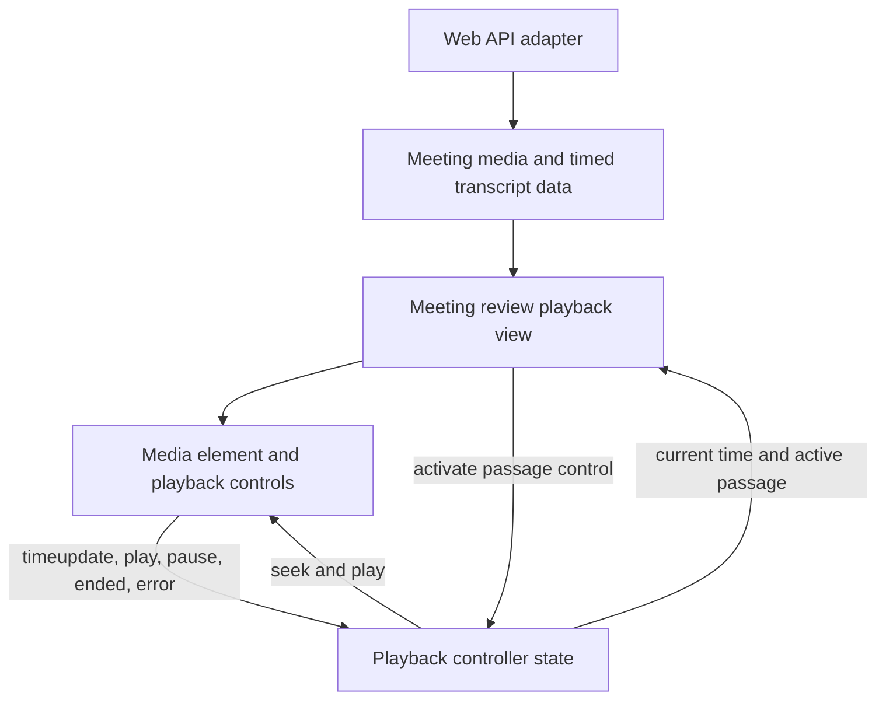
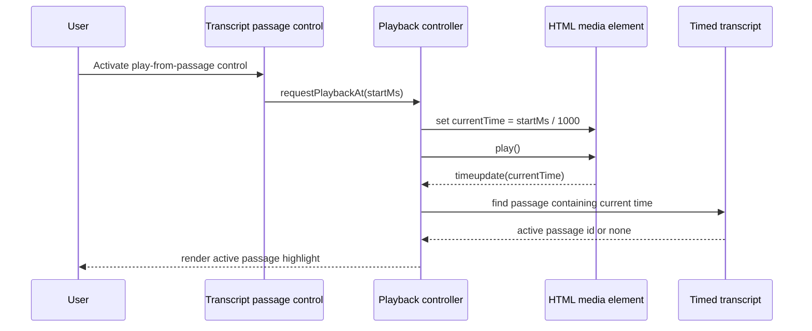

# Design — Meeting Review Playback

## Summary

The approved feature adds interactive playback to the meeting review view and connects media time to transcript passages. The user must be able to operate standard playback controls, follow the passage associated with the playing time, and start playback at a passage's linked time. The design is limited to those behaviors; it does not define transcript editing, meeting library behavior, or the rest of the meeting view.

1. Extend the web meeting review component with an accessible media player and ordinary controls.
2. Keep playback state in one player controller and use the media element as the authoritative clock.
3. Model timed transcript passages in milliseconds and derive the active highlight from current playback time.
4. Add a per-passage playback control that seeks to its linked start and starts playback.
5. Obtain media source and transcript data through the web API adapter; expose quality selection only when multiple playable source options are available.

## Key Design Decisions

**Use a browser-native HTML media element, with a small React control layer.** The media element already implements seeking, pause/resume, playback rate, volume, mute, and playback events. React should render controls and transcript state around that single source of playback truth. *Rejected alternative:* a custom playback engine duplicates browser media behavior and creates unnecessary synchronization and accessibility risks.

**Use milliseconds for transcript boundaries and seconds only at the media-element boundary.** The current web transcript contract already represents turn timestamps as `startMs` and `endMs`; a conversion at the player adapter keeps units explicit. *Rejected alternative:* introducing a second time unit in the UI/domain contract makes passage matching error-prone. This is a technical representation choice, not a requirement that fixes a user-visible time format.

**Keep source selection behind the web API adapter and represent available quality choices as source options.** The player UI displays a quality/resolution selector only when the supplied media has more than one playable option. *Rejected alternative:* inferring quality choices from browser settings or hard-coding a list would not reflect media actually available for that meeting. The exact delivery endpoint and encoding catalogue are not specified by the approved requirements and must be aligned with the existing backend contract during implementation; do not invent an endpoint here.

**Derive active passage rather than persisting a second playback cursor.** On time updates, find the passage whose interval contains the current media time; update the visible highlight and scroll the active passage into view only when the active passage changes. *Rejected alternative:* maintaining a separately updated transcript cursor risks drift after seeking, rate changes, or source changes.

## Architecture

### Component diagram



### Playback and passage navigation



## Components and Interfaces

### `frontend/src/components/MeetingPlaybackView.tsx` (new)

Owns the media element, accessible playback controls, the selected source option when quality selection is available, and the timed transcript presentation. It receives meeting media and transcript data and does not fetch directly. The view must not add library, notes, summary, metadata, or editing behavior.

### `frontend/src/components/PlaybackController.ts` (new, pure helpers plus controller)

The controller binds the media element events to current playback state and exposes:

```typescript
export interface TimedPassage {
  id: string;
  startMs: number;
  endMs: number;
  text: string;
}

export interface MediaSourceOption {
  id: string;
  label: string;
  src: string;
}

export interface PlaybackState {
  currentTimeMs: number;
  durationMs: number | null;
  isPlaying: boolean;
  playbackRate: number;
  volume: number;
  muted: boolean;
  activePassageId: string | null;
  selectedSourceId: string | null;
}

export function findPassageAt(
  passages: readonly TimedPassage[],
  currentTimeMs: number,
): TimedPassage | null;
```

Use half-open intervals `[startMs, endMs)` so adjacent passage boundaries resolve to the next passage. For overlap, choose the first matching passage in the transcript's supplied order; passage ordering is not mutated. A passage-control action seeks to `startMs` and calls `play()`. A rejected `play()` promise is handled as a playback error and leaves the media paused; it is not silently reported as playing.

A source change selects the supplied source option and lets the media element load it. Preserve the prior current time and playing/paused state across a successful source change when the browser can do so; if the selected source cannot load or resume, expose an error and retain usable controls. Do not show a quality selector for zero or one source option.

### API/data boundary

Add typed media/transcript retrieval methods to `frontend/src/api.ts` only after matching them to the actual backend API contract. Existing frontend rules require HTTP access through this adapter. The current `TranscriptView` fetches timed `SpeechTurn` records via `getTranscript`; its source is evidence of a timestamped transcript, not an approved media endpoint or a complete target interface. Map backend transcript records to `TimedPassage` without changing transcript content. Do not make backend endpoint or media storage changes part of this design absent an approved API contract.

## Data Models

`TimedPassage` and `MediaSourceOption` above are view-facing types. `startMs` and `endMs` are non-negative finite millisecond offsets relative to the media timeline; a passage is eligible for synchronization only when its times are valid and `endMs > startMs`. Media sources are the actual options available for that meeting; `label` is user-visible, and `src` is consumed by the player but must not be rendered as untrusted HTML. The approved requirements do not require persisting playback position or source selection.

## Correctness Properties

1. **Ordinary controls (Requirements 1.1–1.7):** with playable media, seek changes the media position; pause and resume invoke the corresponding media operations; changing speed applies the chosen rate; volume and mute controls update media state. A quality selector is present and applies a selected source only when multiple options are supplied.
2. **Playback highlight (Requirements 2.1–2.2):** for each playback time update, the highlighted passage is exactly the first valid supplied passage containing that time, or none if no passage contains it; a passage change moves the visible highlight to the newly active passage.
3. **Passage jump (Requirement 3.1):** activating a passage control sets media time to that passage's `startMs` and requests playback.
4. **Scope boundaries (Requirements 4.1–4.4):** the feature introduces no transcript editing, library, notes, summary, metadata, mandated control form, mandated user-visible time format, video-only behavior, fixed speed values, or fixed quality options.
5. **Playback-state consistency:** displayed playing, rate, volume, mute, current-time, and active-passage state are derived from media events/current media state and do not advance independently of the media element.

## Error Handling

| Condition | Behavior |
|---|---|
| Media or transcript request fails | Show an inline, accessible error for the failed content; do not present stale transcript as synchronized to a different meeting. |
| Media metadata is loading or duration is unavailable | Keep applicable controls disabled until the media element reports the needed capability; show loading state. |
| Browser rejects playback (including passage-triggered playback) | Keep paused state, surface an accessible playback error, and allow another user action. |
| Selected quality/source fails | Surface an accessible error and retain the last usable player state where the browser permits; do not claim the failed source is active. |
| Transcript passage has invalid/missing timing | Render its text without a time-linked active state or passage-play action. |
| Current time has no corresponding passage | Clear the active highlight; do not fabricate a transcript association. |
| No media or empty transcript | Render an explicit unavailable/empty state; do not imply synchronization is active. |

## Testing Strategy

Use frontend unit/component tests with synthetic media-source and transcript fixtures. Mock the media element's properties/events where a real browser decoder is not available; test the user-visible controls and controller logic independently.

- Unit-test `findPassageAt` for interval starts, end-exclusive boundaries, gaps, overlaps, invalid intervals, and empty input.
- Component-test seek, pause/resume, playback rate, volume, mute, conditional quality selector, active highlight changes, scroll-on-change, and passage-triggered seek/play.
- Test rejected `play()`, media load errors, failed source changes, and missing/invalid transcript timing without asserting unavailable runtime infrastructure.
- Verify the meeting review view contains no transcript-editing or unrelated feature controls.

Run the relevant frontend tests and typecheck from `frontend/`; no test result is claimed by this design artifact.