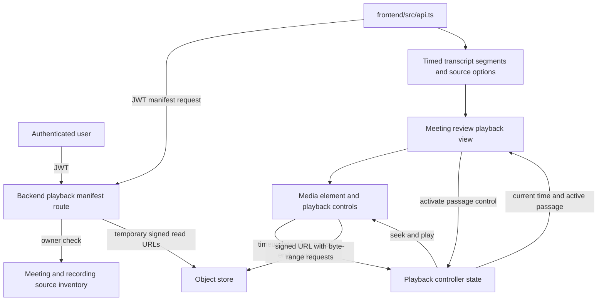
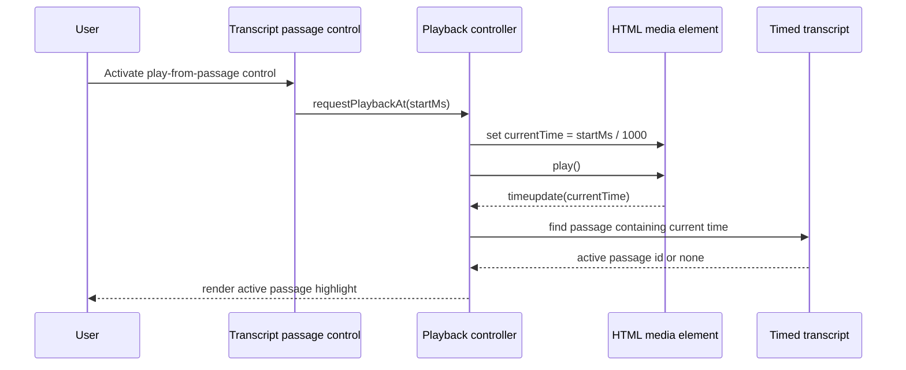

# Design — Meeting Review Playback

## Summary

The approved feature adds interactive playback to the meeting review view and connects media time to transcript passages. The user must be able to operate standard playback controls, follow the passage associated with the playing time, and start playback at a passage's linked time. The design is limited to those behaviors; it does not define transcript editing, meeting library behavior, or the rest of the meeting view.

1. Extend the web meeting review component with an accessible media player and ordinary controls.
2. Keep playback state in one player controller and use the media element as the authoritative clock.
3. Model timed transcript passages in milliseconds and derive the active highlight from current playback time.
4. Add a per-passage playback control that seeks to its linked start and starts playback.
5. Obtain media source and transcript data through the web API adapter; expose quality selection only when multiple playable source options are available.

## Key Design Decisions

**Use a browser-native HTML media element, with a small React control layer.** The media element already implements seeking, pause/resume, playback rate, volume, mute, and playback events. React should render controls and transcript state around that single source of playback truth. *Rejected alternative:* a custom playback engine duplicates browser media behavior and creates unnecessary synchronization and accessibility risks.

**Use milliseconds for transcript boundaries and seconds only at the media-element boundary.** The backend transcript response provides `segments` with `start_ms` and `end_ms`; the frontend adapter maps those fields to `TimedPassage.startMs` and `endMs`, with conversion to seconds only when interacting with the media element. *Rejected alternative:* mixing units in the UI/domain contract makes passage matching error-prone. This is a technical representation choice, not a requirement that fixes a user-visible time format.

**Add a backend playback-manifest endpoint and use short-lived object-store read URLs after per-meeting authorization.** The web player cannot attach the API's bearer token to a native `<video>` source request, and sending full recording bytes through the current `ObjectStore.get()` (which returns an in-memory `bytes`) would not be a scalable delivery path. `GET /api/v1/meetings/{meeting_id}/playback` therefore requires `get_current_user`, loads the meeting and its recording, verifies `Meeting.created_by == user.id` (returning 404 for absent or non-owned meetings), and returns only source URLs minted by `ObjectStore.temporary_read_url()` for that recording's stored objects. URLs use a 3600-second TTL (the existing object-store default); on an expired/failed source, the client refetches the manifest and retries at the current playback time once, then reports an error. *Rejected alternative:* a public object-store URL or unbounded in-memory API proxy would either bypass the auth boundary or duplicate large media in API memory.

**Represent quality choices as the actual recording source inventory, not invented encodings.** Add a `recording_media_sources` table keyed to `SessionRecording`, with source id, kind (`video` or `audio`), object reference, MIME type, optional width/height, and a user-visible quality label. Recording persistence registers the existing `video_ref` (and audio when used) as the original source; it registers any additional already-available source renditions when present, but this feature does not add transcoding or promise new renditions. The manifest returns all playable video sources with their labels; show a quality/resolution selector only when there are multiple video sources. Selecting one uses its signed URL while preserving time and play/pause state. *Rejected alternative:* hard-coded quality levels or inferring multiple renditions from one file misrepresents actual assets. This adds the minimum source inventory/API work needed for the conditional selector; the feature does not alter capture/transcoding policy.

**Derive active passage rather than persisting a second playback cursor.** On time updates, find the passage whose interval contains the current media time; update the visible highlight and scroll the active passage into view only when the active passage changes. *Rejected alternative:* maintaining a separately updated transcript cursor risks drift after seeking, rate changes, or source changes.

## Architecture

### Component diagram



### Playback and passage navigation



## Components and Interfaces

### `frontend/src/components/MeetingPlaybackView.tsx` (new)

Owns the media element, accessible playback controls, the selected source option when quality selection is available, and the timed transcript presentation. It receives meeting media and transcript data and does not fetch directly. The view must not add library, notes, summary, metadata, or editing behavior.

### `frontend/src/components/PlaybackController.ts` (new, pure helpers plus controller)

The controller binds the media element events to current playback state and exposes:

```typescript
export interface TimedPassage {
  id: string;
  startMs: number;
  endMs: number;
  text: string;
}

export interface MediaSourceOption {
  id: string;
  label: string;
  videoSrc: string | null;
  audioSrc: string;
  mimeType: string | null;
}

export interface PlaybackState {
  currentTimeMs: number;
  durationMs: number | null;
  isPlaying: boolean;
  playbackRate: number;
  volume: number;
  muted: boolean;
  activePassageId: string | null;
  selectedSourceId: string | null;
}

export function findPassageAt(
  passages: readonly TimedPassage[],
  currentTimeMs: number,
): TimedPassage | null;
```

Use half-open intervals `[startMs, endMs)` so adjacent passage boundaries resolve to the next passage. For overlap, choose the first matching passage in the transcript's supplied order; passage ordering is not mutated. A passage-control action seeks to `startMs` and calls `play()`. A rejected `play()` promise is handled as a playback error and leaves the media paused; it is not silently reported as playing.

The playback controller owns one audio timeline and, when available, a separate muted video display element. The audio element is the authoritative clock, receives seek/play/pause/rate/volume/mute operations, and drives transcript highlighting. When a video source is selected, the controller loads that source muted and synchronizes its `currentTime`, `playbackRate`, play, and pause state to the audio element; on audio `timeupdate` and `seeked`, correct video drift when absolute offset exceeds 250 ms. Starting playback waits for both elements' `play()` promises when video is present; if either fails, pause both and report an error rather than showing unsynchronized playback. For an audio-only recording, use the audio element alone. A quality change switches only the video source, preserves the audio source and current time, then re-synchronizes before resuming; show a quality selector only when there are multiple video options. Do not expose a quality selector for an audio-only recording or one video option.

### API/data boundary

Add typed retrieval methods to `frontend/src/api.ts`; all web HTTP calls remain in this adapter. The playback manifest contract is:

```typescript
export interface PlaybackManifest {
  meeting_id: string;
  duration_seconds: number;
  audio_source: {
    source_id: string;
    url: string;                 // short-lived presigned read URL for audio_ref
    mime_type: string | null;
  };
  video_sources: Array<{
    source_id: string;
    url: string;                 // short-lived presigned read URL for video_ref
    mime_type: string | null;
    quality_label: string;
    width: number | null;
    height: number | null;
  }>;
}

export interface TranscriptResponse {
  transcript_id: string;
  meeting_id: string;
  language: string;
  provider: string;
  supports_turns: boolean;
  segments: Array<{
    id: string;
    text: string;
    start_ms: number;
    end_ms: number;
    sequence: number;
  }>;
}

export async function getPlaybackManifest(meetingId: string): Promise<PlaybackManifest>;
export async function getTranscript(meetingId: string): Promise<TranscriptResponse>;
```

`GET /api/v1/meetings/{meeting_id}/playback` returns the manifest described above. It requires a valid JWT and the authenticated user must own the meeting; for absent/non-owned meetings return the same 404 response. The backend reads the recording source inventory and signs only the recorded objects through `ObjectStore.temporary_read_url(reference, ttl_seconds=3600)`. The web client requests this authenticated manifest, then the browser fetches media bytes from the signed URL; the object-store URL is not persisted or shared. A failed/expired URL causes one manifest refresh and retry at the saved current time, then an accessible error. Object-store CORS and byte-range support must permit the configured frontend origin and browser seeking; verify this contract in integration tests before enabling the feature in a deployment.

The manifest groups one mandatory audio track from `SessionRecording.audio_ref` with zero or more video renditions from that recording's `video_ref`/video source rows; source selection changes only the video rendition, never the audio track. The audio track is the playback clock and supplies audible sound, with the video element muted to prevent doubled audio. `audio_ref` is always available as the audio stream; if it is a muxed audio/video container and no separate `video_ref` exists, load it in the sole media element so its video remains visible and its audio remains controllable. If `video_ref` exists, load it in a muted video element alongside the audio element and synchronize both to the shared recording timeline as defined by `PlaybackController`; audio-only sources use only the audio element. This establishes alignment through shared recording-relative timestamps and seeks; no new transcoding, timestamp generation, or audio/video editing is in scope. The existing transcript route's actual JSON has `segments`, each with `id`, `text`, `start_ms`, `end_ms`, `sequence`; the web adapter must correct the current frontend type mismatch (`turns`/camelCase) and map each segment to `TimedPassage` as `{ id: segment.id, text: segment.text, startMs: segment.start_ms, endMs: segment.end_ms }`. Preserve the backend's sequence order and source text. Reject/skip invalid timing for playback actions while retaining the segment text. The current `get_transcript` route authenticates but only checks that the meeting exists; it must additionally apply the same per-meeting ownership check as the playback manifest, returning indistinguishable 404 responses for absent and non-owned meetings before returning transcript text. This is a scoped access boundary for this feature's media/transcript retrieval, not a decision about broader multi-user, sharing, role, or identity policy. The playback backend work is in this feature's implementation scope: source registry migration, manifest route, aligned ownership checks, and API/adapter mapping are needed for the approved web playback behavior. No media transcoder or new encoding-generation behavior is included.

## Data Models

`TimedPassage` is a view-facing type mapped from API `segments` as specified above. Add a `RecordingMediaSource` persistence model/table with: `id` (string UUID primary key), `recording_id` (FK to `session_recordings.id`, cascade delete), `kind` (`video` or `audio`), `object_ref` (private object-store key), nullable `mime_type`, `quality_label`, nullable integer `width` and `height`, and a uniqueness constraint on `(recording_id, kind, object_ref)`. Migration backfills one `audio` source from every existing non-null `SessionRecording.audio_ref` (label `Original`, dimensions unknown) plus one `video` source from each non-null `video_ref` (label `Original`, dimensions unknown). Thus an existing audio-only recording still has a playable audio source, and recordings with both refs expose both assets. The existing DB has no MIME field: preserve any available object metadata; otherwise leave historical `mime_type` null and let the browser use the signed object's `Content-Type`. New recording persistence registers audio and video source(s), including their stored MIME type, for new recordings. No raw object-store references are exposed in API JSON. The manifest maps the required audio source row and any video source rows belonging to the same recording into one audio track plus a list of selectable video renditions, generating fresh signed URLs per response. The audio source is mandatory because `SessionRecording.audio_ref` is non-null; an absent video ref means audio-only or a muxed playable audio/video container as described above. The controller keeps the audio and video elements on the same recording-relative timeline, uses audio as clock and sound output, mutes paired video, and corrects video drift over 250 ms. `startMs` and `endMs` are non-negative finite millisecond offsets relative to the shared media timeline; a passage is eligible for synchronization only when `endMs > startMs`. Do not persist playback position or selected source.

## Correctness Properties

1. **Ordinary controls (Requirements 1.1–1.7):** with playable media, seek changes the media position; pause and resume invoke the corresponding media operations; changing speed applies the chosen rate; volume and mute controls update media state. A quality selector is present and applies a selected source only when multiple options are supplied.
2. **Playback highlight (Requirements 2.1–2.2):** for each playback time update, the highlighted passage is exactly the first valid supplied passage containing that time, or none if no passage contains it; a passage change moves the visible highlight to the newly active passage.
3. **Passage jump (Requirement 3.1):** activating a passage control sets media time to that passage's `startMs` and requests playback.
4. **Scope boundaries (Requirements 4.1–4.4):** the feature introduces no transcript editing, library, notes, summary, metadata, mandated control form, mandated user-visible time format, video-only behavior, fixed speed values, or fixed quality options.
5. **Playback-state consistency:** displayed playing, rate, volume, mute, current-time, and active-passage state are derived from the authoritative audio/media element and do not advance independently. For paired separate tracks, video remains muted and is synchronized to the same recording-relative position, rate, play, and pause state; drift above 250 ms is corrected. Audio-only playback remains fully controllable without a video element.
6. **Playback/transcript access boundary:** a valid authenticated owner can receive only their meeting's transcript and signed media-source URLs; unauthenticated, absent, or non-owner requests return no transcript/object references, and absent/non-owned ids are indistinguishable at the API boundary.

## Error Handling

| Condition | Behavior |
|---|---|
| Missing/invalid JWT for manifest or transcript | Return 401; never sign a media URL or return transcript content. |
| Meeting is absent or not owned by the authenticated user | Return the same 404 response for both cases; do not reveal the distinction or sign any object URL. |
| Media manifest, signed-URL generation, or transcript request fails | Show an inline, accessible error for the failed content; do not present stale transcript as synchronized to a different meeting. |
| Signed URL expires or storage denies/does not support range/CORS access | Refresh the manifest once at the saved media time; if retry fails, stop playback and show an accessible error. Do not fall back to a public URL or unauthenticated API path. |
| Source-inventory migration/backfill fails | Let the migration transaction fail and roll back; do not remove or rewrite the existing `SessionRecording` references. Deployment stays on the prior schema until the migration succeeds. |
| Media metadata is loading or duration is unavailable | Keep applicable controls disabled until the media element reports the needed capability; show loading state. |
| Browser rejects playback (including passage-triggered playback) | Keep paused state, surface an accessible playback error, and allow another user action. |
| Selected quality/source fails | Surface an accessible error and retain the last usable player state where the browser permits; do not claim the failed source is active. |
| Transcript passage has invalid/missing timing | Render its text without a time-linked active state or passage-play action. |
| Current time has no corresponding passage | Clear the active highlight; do not fabricate a transcript association. |
| No media or empty transcript | Render an explicit unavailable/empty state; do not imply synchronization is active. |

## Testing Strategy

Use unit/component tests with synthetic media and transcript fixtures plus backend migration, route, and object-store integration tests. Mock browser media events for control logic; exercise database and storage contracts against disposable test infrastructure where required. Do not use real meeting recordings or transcripts.

- `frontend/src/**/__tests__/PlaybackController.test.ts`: test interval starts, end-exclusive boundaries, gaps, overlaps, invalid timing, empty input; test control state transitions and active-passage changes.
- `frontend/src/**/__tests__/MeetingPlaybackView.test.tsx`: test seek, pause/resume, rate, volume, mute, source selection only for multiple video options, passage seek/play, URL refresh retry once at the saved time, and accessible errors; assert audio-only playback uses the audio element with working volume/mute, paired audio+video playback uses audio as the audible clock and muted video, play/pause/seek/rate stay synchronized, video drift over 250 ms is corrected, changing quality preserves the audio source and playback position, and failure to start either paired element pauses both. Assert no editing or out-of-scope meeting controls.
- `backend/tests/test_migration.py`: start from revision `008_speaker_review_aggregate`, seed audio-only and audio-plus-video recordings, upgrade to the new source-inventory revision, and assert exactly one backfilled original audio source for every `audio_ref`, plus exactly one original video source for each non-null `video_ref` and none for null refs. Assert legacy MIME stays null when unavailable. Downgrade to `008` and assert original `session_recordings.audio_ref`/`video_ref` data remains intact while the derived source table is removed; re-upgrade must recreate both source kinds. Verify duplicate `(recording_id, kind, object_ref)` is rejected.
- `backend/tests/meetings/test_playback_manifest.py`: test authenticated owner success, missing/invalid JWT (401), absent and non-owned meetings (same 404 response), no recording/no playable source, one vs multiple source options, and that only owner-authorized object refs are passed to `temporary_read_url` with TTL 3600 and never serialized in the response. Test transcript route applies the identical ownership boundary and does not return another user's text.
- `backend/tests/meetings/test_playback_storage_integration.py`: with disposable S3-compatible storage, fetch a signed source URL using HTTP `Range` and verify 206/`Content-Range`/correct bytes; run browser-origin CORS preflight and GET from the configured frontend origin. A deployment must pass this integration contract before playback is enabled; configuration failure blocks playback delivery rather than bypassing authorization.

Run backend tests from `backend/` (`pytest`) and frontend tests/typecheck from `frontend/`; these are required implementation validations, not claims that this design run executed them.