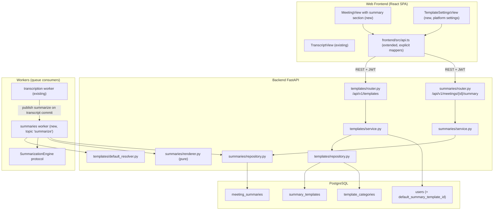
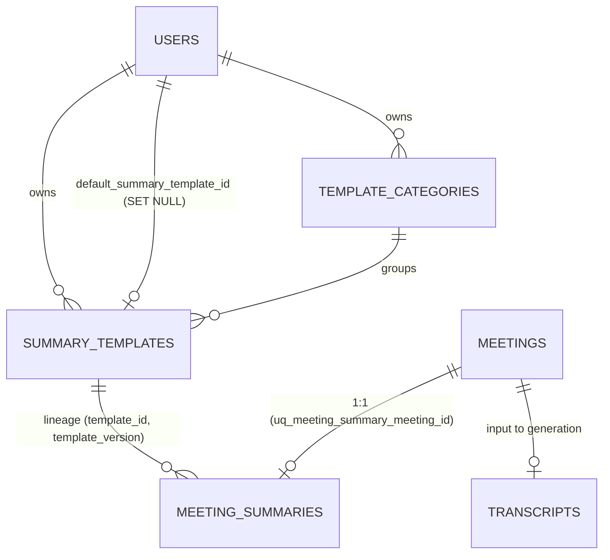

# Design Document — Meeting Summaries and Templates

Spec: `.spectra/specs/meeting-summaries-templates/`
Requirements source: `requirements.md` @ commit `cdce9c34c566b72f42bb6db5eecdd76bdacb4532`
(blob `12025987ad4ac44ac52a9acb5373ddf0f5f4520b`), Mira-APPROVED; PR #231 merged to main.
Baseline source: `PRODUCT_BASELINE.md` @ commit `26d44ca7b212097c82415d0ae038bd9d096873d4`
(blob `3afefd5e3da230cc3e26d7b89e74f48dc01d82ae`), owner-approved snapshot assigned by Ansel.
Owner decision: Fer, 2026-10-16 — templates are personal; users create multiple templates with
specific instructions in Sauri web and configure their personal default there. That default is
automatically applied across categories when a transcript summary is requested without an
explicit template choice. Requirements do not define a seed template or behavior when no default
is configured; this design adds neither.

## Resumen

Sauri currently produces a transcript and diarization per meeting, but the meeting view in the
web portal has no summary artifact and the platform has no notion of templates. The approved
requirements ask for (a) a structured summary as a distinct meeting artifact, (b) copy/download
of that summary, (c) user-owned, editable summary templates with optional categories, and (d) a
single personal default template selected in platform settings that is applied automatically to
every transcription summary for that user until changed. The spec deliberately leaves the
summary-generation method, accuracy thresholds, template visual layout, broader access-control
policy, and any retention period or broader deletion guarantee unresolved. It requires only that
the persisted structured summary be deleted together with its transcript when that transcript
expires or is deleted.

The solution consists of:

1. **Templates module** (`backend/app/templates/`): user-owned `Summary_Template` and
   `Template_Category` tables plus CRUD API under `/api/v1/templates`, following the existing
   router → service → repository → schemas layering, JWT auth, and sales-user authorization.
2. **Default-template resolution service**: a deterministic, dependency-free resolver in the
   templates module that, for a user with a configured default, returns that template id;
   per the owner decision it applies to transcription summaries automatically, across all
   categories. Behavior when no default is configured stays unspecified and the resolver
   returns `None` without guessing a fallback.
3. **Summaries module** (`backend/app/summaries/`): a `Meeting_Summary` entity associated
   with its meeting and frozen template/event lineage, produced by a dedicated `summarize`
   worker from a durable outbox event committed atomically with the transcript.
4. **A canonical summary model** (`topic` + `key_points`), both mandatory in every valid
   template and generated artifact, rendered to Markdown by a pure renderer.
5. **Meeting-view integration**: a new summary section in the portal's meeting view, distinct
   from transcript and notes, with copy and download actions; a platform-settings view for
   template CRUD and default selection.
6. **Tests-first TDD plan**: property tests (with `hypothesis`, ≥100 examples) for the
   resolver/renderer/selection contracts and unit/integration tests for API and worker
   behavior, each property sequenced RED before its implementation.

## Decisiones de Diseño Clave

**D1 — Summary generation stays out of scope; the design defines the mechanism, not the
method.** The requirements do not select a generation method or accuracy threshold. The design
therefore defines where summaries are produced (a queue worker triggered by transcription), what
they persist (a structured model), and what the worker requires to run (a `SummarizationEngine`
protocol). The engine's internal method is a task-level implementation choice, constrained by
the protocol, not a product decision made here. *Alternativas descartadas:* choosing an LLM
provider here would invent unapproved product scope; leaving generation entirely open would
leave the architecture under-specified for Zoya's task plan, since the worker, persistence, and
lineage model do not depend on which engine fills the protocol.

**D2 — Every summary identifies both required content elements (R1.2).** Every persisted
summary contains identifiable main-topic and key-arguments/points content. Template instructions
shape those contents but cannot suppress either one. The requirements explicitly defer the
internal structure, schema, and format of templates; this design therefore does not prescribe a
template schema, template-side markup, or a user-configurable inclusion switch. Presentation
layout remains unspecified beyond making both elements identifiable. *Alternativas descartadas:*
optional output elements fail R1.2; defining a template schema or fixed visual layout would
resolve matters explicitly deferred by the approved requirements.

**D3 — Default is one nullable column on `users`, not a row in a per-user settings table.**
The owner decision gives every user at most one default template across all categories. A
`users.default_summary_template_id` FK (nullable, ON DELETE SET NULL) models that invariant
structurally; a separate settings table would need an extra uniqueness constraint to enforce
the same thing and adds a join for every generation. Category is carried by the template
itself, so "applies across all categories" needs no category-aware resolution logic — the
default is category-independent by construction. *Alternativas descartadas:* a per-category
default table contradicts the recorded decision; a general key/value settings table invites
unapproved future settings semantics and couples unrelated features.

**D4 — Freeze the triggering event's template; redelivery never replaces history.** Each
summary job carries the template id, version and selection snapshot resolved for the pertinent
transcription event. Retries/redeliveries reuse that immutable event data and an event idempotency
key, so the same event is a no-op after its first successful persist; a later default change
cannot rewrite an already-produced historical summary. A subsequent transcription event uses
the then-current default. Template version increments when its selection changes. *Alternativas
descartadas:* resolving the current default at worker execution time can change an in-flight
job's template after a user changes settings; overwriting historical content on redelivery
violates event idempotency and the “subsequent summaries” boundary.

**D5 — Lineage is data, not authorization; template names are visible, definitions are not.**
Requirement 3.3 is verified through lineage: a generated summary records which template shaped
it. Lineage does not entitle a user to read another user's template definition; the templates
API only ever exposes the requesting user's own templates. The summary GET includes the
shaping template's **name** (resolved via FK; the template row cannot disappear while
referenced, since no deletion endpoint exists and the FK has no cascade) so the default is
identifiable in the UI (R5.4) without exposing definitions. *Alternativas descartadas:*
full definition read-through would silently create template sharing, which the owner decision
does not grant; hiding lineage entirely would leave "identify the default" (R5.4) unverifiable.

**D6 — Persist the structured summary shaped by the selected template's instructions (R1.2,
R3.3).** The worker persists the summary's structured main-topic and key-points content so both
remain identifiable and available for copy/download. The template's specific instructions shape
both elements; they do not make either optional. This specifies the summary artifact, not the
deferred internal schema or format of `Summary_Template`. *Alternativas descartadas:* storing
only rendered text would discard the required structured artifact; designing a template schema
here would exceed the approved scope.

**D7 — Design fixes data + transport only; portal layout stays open.** The requirements and
baseline explicitly leave portal layout unresolved. The design therefore specifies the API
surface, the `MeetingSummary` shared type, and a distinct summary section inside the existing
meeting view — and nothing about placement or styling beyond that. The baseline's imagined
left/center/right layout is recorded as future inspiration, not adopted. *Alternativas
descartadas:* adopting the imagined layout would decide an explicitly open question; skipping
frontend integration entirely would leave the requirements unverifiable end-to-end.

**D8 — Copy/download without extra endpoints.** Copy uses `navigator.clipboard` on already
fetched summary content; download serializes the same fetched content client-side as a
`.md` file via `URL.createObjectURL` + anchor click. No new backend endpoint is needed.
*Alternativas descartadas:* a backend `/download` endpoint adds auth surface for zero
requirement value; any extension clipboard bridge is outside this spec's surfaces.

**D9 — No default-behavior invented where the spec is silent.** Where the approved
requirements deliberately leave behavior unspecified, the design does not fill the gap: no
fallback template exists, so the resolver returns `None` when no default is configured and
generation simply does not run; engine failures follow the existing transcription-worker
discipline (exceptions propagate uncaught; queue redelivery governs) without new retry
semantics; access control reuses the existing sales-user policy without extending it; template
or category deletion is not designed because the requirements do not grant it. These silences
are requirements-scope boundaries, not gaps this design may close.

**D10 — Summaries in relational storage, not the object store.** The meeting summary is a
small, structured, per-meeting artifact queried by meeting id, like transcripts; object storage
is for media blobs. *Alternativas descartadas:* object-store storage would complicate querying
and lineage without any requirement benefit at this scale.

**D11 — Stable, meeting-scoped download filename.** The downloaded file is named
`meeting-summary-<meetingId>.md`: stable across downloads of the same meeting (re-downloading
overwrites the same local file), ASCII-safe, and free of locale-dependent date formatting.
*Alternativas descartadas:* date-stamped names would accumulate duplicate files and introduce
locale decisions the spec does not make; meeting-title-based names would leak rename history
into filenames.

**D12 — Template-driven content selection, not template-side rendering.** The renderer owns
all rendering; a template never carries markup. This keeps the template schema
requirements-shaped (D2) and makes "structure reflects the template" testable as selection
invariants (P1, P2) instead of string comparisons. *Alternativas descartadas:* template-carried
markup would smuggle layout authority into user data — an unapproved layout decision — and
would require sanitization the spec does not ask for.

**D13 — New API returns snake_case; the frontend maps explicitly.** The existing backend
endpoints serialize snake_case keys (verified: `GET /api/v1/meetings/{id}/transcript` returns
`transcript_id`, `supports_turns`, …; the templates endpoints likewise use Pydantic's default
snake_case), while `@sauri/shared-types` and `frontend/src/api.ts` use camelCase types. The
new endpoints follow the backend's snake_case convention, and `api.ts` gains **explicit
mapper functions** into the camelCase shared types for every new endpoint, so the frontend
contract is real instead of a blind cast. The pre-existing mismatch for older endpoints is
observed evidence only; this spec does not touch those endpoints. *Alternativas descartadas:*
camelCase responses would deviate from the adjacent transcript/diarization endpoints;
perpetuating the blind-cast pattern would repeat a latent runtime bug in new code.

## Arquitectura



Data flow — automatic default-template application (Requirements 5.5, 5.6):

```mermaid
sequenceDiagram
    participant TW as transcription worker
    participant Q as JobQueue (RabbitMQ)
    participant SW as summaries worker
    participant RES as default_resolver
    participant DB as PostgreSQL
    participant ENG as SummarizationEngine

    TW->>Q: publish "summarize" {meeting_id} (after transcript tx commit)
    Q->>SW: deliver message
    SW->>DB: load meeting, transcript, stored summary lineage
    alt default configured (users.default_summary_template_id not null)
        SW->>RES: resolve(user default row)
        RES-->>SW: template_id + version (or None if row vanished)
        alt stored lineage == resolved lineage
            SW->>DB: no-op (idempotent skip, D4)
        else lineage differs or no stored summary
            SW->>ENG: generate(transcript text)
            ENG-->>SW: canonical topic + key_points
            SW->>DB: upsert shaped summary + lineage + generation
        end
    else no default configured (unspecified by requirements)
        SW->>DB: nothing to do; skip silently
    end
```

Sequence notes (verified against `backend/app/transcription/worker.py` at `f5aa6b3e`): the
transcription worker currently publishes `{"meeting_id": ...}` to `"diarize"` after the
transcript transaction commits and does not alter `Meeting.process_state`. The summaries
worker receives the same message shape and likewise does not mutate `Meeting.process_state` —
summary generation is not a state-machine transition, so no new `ProcessState` value is
introduced (editing the state machine is outside this spec's approved scope).

## Componentes e Interfaces

### 1. Backend module: `backend/app/templates/`

New module following the project's router → service → repository → schemas layering
(patterns verified in `meetings/`, `ingestion/`, `transcription/`).

**`schemas.py`** (Pydantic v2; `backend/pyproject.toml` declares `pydantic>=2.0.0`):

```python
class TemplateSelectionSpec(BaseModel):
    """Declarative content-selection spec stored on a template (D2)."""
    include_topic: Literal[True] = True
    include_key_points: Literal[True] = True

    @model_validator(mode="after")
    def require_both_elements(self) -> "TemplateSelectionSpec":
        if not (self.include_topic and self.include_key_points):
            raise ValueError("topic and key_points are both required")
        return self

class TemplateCreate(BaseModel):
    name: str = Field(..., min_length=1, max_length=128)
    category_id: str | None = None
    selection: TemplateSelectionSpec = TemplateSelectionSpec()

class TemplateUpdate(BaseModel):
    # Omitted fields remain unchanged; explicit JSON null clears category_id.
    name: str | None = Field(None, min_length=1, max_length=128)
    category_id: str | None = None
    selection: TemplateSelectionSpec | None = None

# Service uses model_fields_set to distinguish omitted category_id from explicit null.

class TemplateOut(BaseModel):
    id: str
    name: str
    owner_user_id: str
    category_id: str | None
    version: int
    selection: TemplateSelectionSpec
    is_default: bool
    created_at: str  # ISO 8601
    updated_at: str  # ISO 8601

class CategoryCreate(BaseModel):
    name: str = Field(..., min_length=1, max_length=128)

class CategoryOut(BaseModel):
    id: str
    name: str
    owner_user_id: str
    created_at: str
```

**`router.py`** — `prefix="/api/v1/templates"`, all routes JWT-authenticated and gated by the
existing `require_sales` authorization dependency (pattern verified in
`backend/app/auth/authorization.py`; denials are recorded in `access_log`):

| Method | Path | Purpose | Success | Notes |
|--------|------|---------|---------|-------|
| POST | `/api/v1/templates` | create template | 201 + `TemplateOut` | body `TemplateCreate`; `category_id` must belong to user, else 422 |
| GET | `/api/v1/templates` | list own templates | 200 + `TemplateOut[]` | identifies the default via `is_default` (R5.4) |
| GET | `/api/v1/templates/categories` | list own categories | 200 + `CategoryOut[]` | declared before `/{template_id}` (see guard below) |
| POST | `/api/v1/templates/categories` | create category | 201 + `CategoryOut` | |
| GET | `/api/v1/templates/{template_id}` | get own template | 200 / 404 | 404 also for another user's template (no existence leak) |
| PATCH | `/api/v1/templates/{template_id}` | edit own template | 200 + `TemplateOut` | bumps `version` when the selection changes (D4) |
| PUT | `/api/v1/templates/default` | set own default | 204 | body `{"template_id": str}`; template must be owned by the user, else 422 |

Static route ordering guard: `GET /api/v1/templates/categories` must be registered before
`GET /api/v1/templates/{template_id}` in the router file, or FastAPI resolves the path
parameter first and returns 404 with `template_id="categories"`.

`is_default` is computed by the service layer by comparing the template id with the user's
`users.default_summary_template_id`; it is not stored on the template row.

### 2. Backend module: `backend/app/summaries/`

**`engine.py`** — protocol only (D1):

```python
class SummarizationEngine(Protocol):
    async def generate(self, transcript_text: str) -> CanonicalSummary: ...
```

`CanonicalSummary` (Pydantic model): `topic: str`, `key_points: list[str]`. The engine is
selection-agnostic: it always produces the canonical elements from the transcript text; the
worker applies template selection (P1) afterwards, so selection stays testable without any
engine and engines stay interchangeable (D1).

**`repository.py`** — `SummaryRepository`: `upsert(summary_row)`,
`get_by_meeting(meeting_id)`, with the same session/transaction ownership conventions as
`TranscriptRepository` (verified: the caller controls the transaction; the repository does not
open, close, or commit the session).

**`service.py`** — `SummaryService`: `get_summary_for_user(meeting_id, user)` enforcing
meeting ownership (404 semantics below) and composing `render_markdown` output for the
response.

**`renderer.py`** — pure functions (no I/O):

```python
def apply_selection(summary: CanonicalSummary, selection: TemplateSelectionSpec) -> CanonicalSummary:
    """Returns the summary restricted to the selected structural elements (D2, D6)."""

def render_markdown(summary: CanonicalSummary) -> str:
    """Renders the fixed Markdown layout (D12). Never produces whitespace-only output."""
```

Renderer Markdown layout (fixed by design, not by template):

```markdown
# Meeting Summary

## Topic

<topic text>

## Key Points

- <point 1>
- <point 2>
```

Both sections are always present in the fixed order above. Empty content is rendered as an
empty-value marker within its section; no quality threshold or fallback content is specified.

**`worker.py`** — mirrors `transcription/worker.py` (verified message-validation and
exception disciplines at `f5aa6b3e`):

- Subscribes to topic `"summarize"`; message includes `event_id`, `meeting_id`, frozen `template_id`, `template_version`, and
  the event's template-selection snapshot.
- Discards invalid/empty `meeting_id` with a warning log (same discipline as the
  transcription worker).
- Loads the meeting and its transcript; if either is missing, logs and returns (queue
  redelivery governs; no custom retry loop).
- Uses the immutable event payload's `template_id`, version and selection snapshot; it does
  not resolve the user's current default during processing. If no default was configured at
  the triggering event, no job is emitted; no fallback is invented.
- **Idempotent skip (D4):** if the event id was already successfully applied, ack without
  regenerating or changing the historical summary.
- Calls the configured `SummarizationEngine` via `create_summarization_engine()` (factory
  reading `SUMMARIZATION_PROVIDER` from env, same pattern as `transcription/factory.py`;
  an unrecognized value raises `ValueError` at worker startup, mirroring
  `create_asr_engine()`). Engine exceptions propagate uncaught — the same discipline as the
  transcription worker — so queue redelivery governs retries (D9).
- Applies the template instructions frozen in the event to both required summary elements;
  it never reads a mutable template row to determine the event's instructions or version. Within
  one DB transaction, it atomically claims `event_id` in `processed_summary_events` (unique
  primary key), inserts the structured summary artifact with both elements, rendered content,
  and lineage copied from that immutable event, then commits both writes together. It does not
  upsert or overwrite a persisted summary. A unique claim conflict means this event already
  committed: ack without regenerating or changing any stored summary, even if the user's default
  has since changed. A failed generation/persist rolls back the claim so queue redelivery can
  retry.
- Publishes nothing downstream; does not mutate `Meeting.process_state`.

**Wiring in `backend/app/worker.py`**: `start_worker` imported from `app.summaries.worker`
and subscribed after the diarization worker (one import + one call, matching the existing
bootstrap; verified structure of `backend/app/worker.py`).

**Enqueue point and recovery**: write an outbox row in the same transaction that commits
the transcript, containing event id, meeting id, and the default-template id/version/selection
snapshot resolved for that event. A dispatcher publishes the outbox record to RabbitMQ and
marks it delivered only after broker confirmation; retry is idempotent by event id. Do not use
a bare post-commit publish as the only recovery mechanism: a crash or broker failure after DB
commit would lose the summary trigger. No outbox implementation currently exists in the repo.

### 3. Backend API surface: meeting summary read

Added in `backend/app/summaries/router.py`, registered in `backend/app/main.py`:

| Method | Path | Purpose | Success | Errors |
|--------|------|---------|---------|--------|
| GET | `/api/v1/meetings/{meeting_id}/summary` | get the meeting's summary artifact | 200 | 404 meeting / 404 summary / 403 non-sales |

Access rule: same as every meeting route — meeting must exist and
`meeting.created_by == user.id`, else `404` (the existing meetings routes' 404-not-403
ownership convention, verified at `backend/app/meetings/router.py`); `require_sales` still
gates the route itself with `403` + audit log for non-sales users.

GET response body (snake_case keys, D13):

```json
{
  "summary_id": "uuid",
  "meeting_id": "uuid",
  "template_id": "uuid",
  "template_name": "Default Summary Template",
  "template_version": 3,
  "topic": "...",
  "key_points": ["..."],
  "rendered_markdown": "# Meeting Summary\n\n## Topic\n\n...",
  "generation": 2,
  "created_at": "2026-10-15T21:04:00+00:00",
  "updated_at": "2026-10-15T21:04:00+00:00"
}
```

`template_name` is always included (name only; definitions are never exposed through this
endpoint, D5). There is no regeneration endpoint: the requirements bind the default to
subsequent transcription summaries only, so historical summaries are not re-shaped on demand
(see Scope Boundaries).

### 4. Data model additions (`backend/app/infra/models.py` + Alembic migration `008_`)

```python
class TemplateCategory(Base):
    """Optional grouping for a user's summary templates (R4)."""
    __tablename__ = "template_categories"

    id: Mapped[str] = mapped_column(String(36), primary_key=True)
    owner_user_id: Mapped[str] = mapped_column(
        String(36), ForeignKey("users.id"), nullable=False, index=True
    )
    name: Mapped[str] = mapped_column(String(128), nullable=False)
    created_at: Mapped[datetime] = mapped_column(DateTime(timezone=True), nullable=False)


class SummaryTemplate(Base):
    """User-owned, editable summary template (R3, R4, R5)."""
    __tablename__ = "summary_templates"

    id: Mapped[str] = mapped_column(String(36), primary_key=True)
    owner_user_id: Mapped[str] = mapped_column(
        String(36), ForeignKey("users.id"), nullable=False, index=True
    )
    category_id: Mapped[str | None] = mapped_column(
        String(36), ForeignKey("template_categories.id"), nullable=True
    )
    name: Mapped[str] = mapped_column(String(128), nullable=False)
    version: Mapped[int] = mapped_column(Integer, nullable=False, default=1)
    include_topic: Mapped[bool] = mapped_column(Boolean, nullable=False, default=True)
    include_key_points: Mapped[bool] = mapped_column(Boolean, nullable=False, default=True)
    created_at: Mapped[datetime] = mapped_column(DateTime(timezone=True), nullable=False)
    updated_at: Mapped[datetime] = mapped_column(DateTime(timezone=True), nullable=False)


class ProcessedSummaryEvent(Base):
    """Transactional idempotency ledger for successfully applied summary events (D4)."""
    __tablename__ = "processed_summary_events"

    event_id: Mapped[str] = mapped_column(String(36), primary_key=True)
    meeting_id: Mapped[str] = mapped_column(
        String(36), ForeignKey("meetings.id", ondelete="CASCADE"), nullable=False
    )
    completed_at: Mapped[datetime] = mapped_column(DateTime(timezone=True), nullable=False)


class MeetingSummary(Base):
    """Persisted structured summary for a source transcript (R1, R5, R6)."""
    __tablename__ = "meeting_summaries"
    __table_args__ = (
        UniqueConstraint("event_id", name="uq_meeting_summary_event_id"),
        UniqueConstraint("transcript_id", name="uq_meeting_summary_transcript_id"),
    )

    id: Mapped[str] = mapped_column(String(36), primary_key=True)
    event_id: Mapped[str] = mapped_column(String(36), nullable=False)
    meeting_id: Mapped[str] = mapped_column(
        String(36), ForeignKey("meetings.id", ondelete="CASCADE"), nullable=False
    )
    transcript_id: Mapped[str] = mapped_column(
        String(36), ForeignKey("transcripts.id", ondelete="CASCADE"), nullable=False
    )
    template_id: Mapped[str] = mapped_column(
        String(36), ForeignKey("summary_templates.id"), nullable=False
    )
    template_version: Mapped[int] = mapped_column(Integer, nullable=False)
    topic: Mapped[str] = mapped_column(Text, nullable=False, default="")
    key_points_json: Mapped[str] = mapped_column(Text, nullable=False, default="[]")
    rendered_markdown: Mapped[str] = mapped_column(Text, nullable=False, default="")
    generation: Mapped[int] = mapped_column(Integer, nullable=False)
    created_at: Mapped[datetime] = mapped_column(DateTime(timezone=True), nullable=False)
    updated_at: Mapped[datetime] = mapped_column(DateTime(timezone=True), nullable=False)
```

Plus, in the existing `User` model (`backend/app/infra/models.py`):

```python
default_summary_template_id: Mapped[str | None] = mapped_column(
    String(36), ForeignKey("summary_templates.id", ondelete="SET NULL"), nullable=True
)
```

`key_points_json` is order-preserving JSON text (see P2). All ids are `String(36)` UUIDs and
timestamps are `DateTime(timezone=True)`, matching every existing table (verified in
`backend/app/infra/models.py`).

Alembic migration `008_summaries_and_templates.py`
(`down_revision = "007_rename_schema_to_english"`, the verified current head):

1. `CREATE TABLE template_categories`, then `CREATE TABLE summary_templates` (columns as
   above; creation order matters — `users` must exist, and `users.default_summary_template_id`
   will reference `summary_templates`).
2. `CREATE TABLE processed_summary_events` with `event_id` primary key, meeting FK, and
   completion timestamp; this ledger is committed atomically with its successful summary write.
3. `CREATE TABLE meeting_summaries` with unique `event_id` and unique `transcript_id`; the
   latter is a non-null FK to `transcripts.id ON DELETE CASCADE` (R6), and `meeting_id` is a
   non-unique FK to `meetings.id ON DELETE CASCADE`. Retries of an already-processed event do
   not update this row. Do not add a unique constraint on `meeting_id`: identity and deletion
   follow the source transcript/event, not a mutable “latest summary” slot.
4. `ALTER TABLE users ADD COLUMN default_summary_template_id VARCHAR(36) NULL REFERENCES
   summary_templates(id) ON DELETE SET NULL`.
5. Seed the one defined template (R5.1) **for each existing user**: `id` uuid4,
   `owner_user_id = user.id`, `name = 'Default Summary Template'`, `category_id = NULL`,
   `version = 1`, `include_topic = TRUE`, `include_key_points = TRUE`,
   `created_at = updated_at = now()`; then set each user's `default_summary_template_id` to
   their own copy's id. Naming rationale: the requirements and baseline explicitly state that
   `General > Resumen básico` is a proposal, not an approved default/template, so the seed
   uses a neutral name instead of silently adopting an unapproved label. The seed makes R5.1
   immediately satisfiable and demonstrates the default mechanism for existing users without
   inventing per-user fallback logic. It skips users that already own a template (guard).
   New users created afterwards by `backend/app/auth/seed.py` receive the same treatment in
   the application layer (a post-seed step creating the defined template + default per
   seeded user).
6. `downgrade()` reverses in exact reverse order: drop `users.default_summary_template_id`,
   then `meeting_summaries`, `processed_summary_events`, `summary_templates`, and
   `template_categories`.

### 5. Default-template resolver (`backend/app/templates/default_resolver.py`)

```python
from typing import NamedTuple

class ResolvedDefault(NamedTuple):
    template_id: str
    version: int

def resolve_default(template_row: "SummaryTemplate | None") -> ResolvedDefault | None:
    """Pure function: the user's configured default template, or None (D9)."""
    if template_row is None:
        return None
    return ResolvedDefault(template_id=template_row.id, version=template_row.version)
```

The repository layer supplies the user's default template row (join
`users.default_summary_template_id` → `summary_templates`); the pure function owns the
None-handling so the None semantics stay unit-testable without a database. The FK
`ON DELETE SET NULL` guarantees the DB cannot hold a dangling default id; if the referenced
row vanished inside a transaction race, the resolver's `None` path covers it.

### 6. Shared types (`packages/shared-types/src/index.ts`)

```typescript
/** Structured summary artifact associated 1:1 with a meeting (R1). */
export interface MeetingSummary {
  summaryId: string;
  meetingId: string;
  templateId: string;
  templateName: string;
  templateVersion: number;
  topic: string;
  keyPoints: string[];
  renderedMarkdown: string;
  generation: number;
  createdAt: string;
  updatedAt: string;
}

/** User-owned summary template (R3–R5). */
export interface SummaryTemplate {
  id: string;
  name: string;
  ownerId: string;
  categoryId?: string;
  version: number;
  selection: { includeTopic: boolean; includeKeyPoints: boolean };
  isDefault: boolean;
  createdAt: string;
  updatedAt: string;
}

/** Optional template grouping (R4). */
export interface TemplateCategory {
  id: string;
  name: string;
  ownerId: string;
  createdAt: string;
}
```

### 7. Web frontend integration (`frontend/src/`)

**`api.ts`** additions (same `getAuthHeaders`/`handleResponse` pattern, verified in the
existing file; every new function maps its snake_case response explicitly into the camelCase
shared types, D13):

```typescript
export async function getSummary(meetingId: string): Promise<MeetingSummary>;
export async function listTemplates(): Promise<SummaryTemplate[]>;
export async function createTemplate(input: {
  name: string;
  categoryId?: string | null;
  selection: { includeTopic: boolean; includeKeyPoints: boolean };
}): Promise<SummaryTemplate>;
export async function updateTemplate(
  id: string,
  input: Partial<{
    name: string;
    categoryId: string | null;
    selection: { includeTopic: boolean; includeKeyPoints: boolean };
  }>,
): Promise<SummaryTemplate>;
export async function listCategories(): Promise<TemplateCategory[]>;
export async function createCategory(name: string): Promise<TemplateCategory>;
export async function setDefaultTemplate(templateId: string): Promise<void>;
```

**`components/SummarySection.tsx`** (new): rendered inside the meeting view as a **separate
section** from the transcript view (R1.1). Owns local state only (`summary | null`,
`loading`, `error`); fetches on mount via `getSummary`; renders `renderedMarkdown` as
pre-formatted text (no new Markdown dependency); provides:

- **Copy** button → `navigator.clipboard.writeText(summary.renderedMarkdown)` (R2.1); success
  feedback is local UI state ("Copied"), no alert/dialog.
- **Download** button → serializes `summary.renderedMarkdown` into a `Blob`
  (`type: "text/markdown;charset=utf-8"`), object URL, anchor click named
  `meeting-summary-<meetingId>.md` (R2.2, D11).
- **Not-available state**: if `getSummary` returns 404 (no summary yet — e.g. no default
  configured, or generation not run), the section renders a neutral "No summary available for
  this meeting yet." message. This is a UI-state design, not a no-default fallback behavior
  (D9).

**`components/TemplateSettingsView.tsx`** (new): platform-settings surface for templates.
Reached from `App.tsx` by extending the `View` union type (verified current shape:
`{ type: "list" } | { type: "transcript"; meetingId: string }`) with `{ type: "templates" }`
and a nav entry. Contains:

- Template list with `isDefault` identification (R5.4) and a "Set as default" action per
  template (R5.3); the current default is visually marked.
- Create/edit template form: `name`, category dropdown (own categories + "No category",
  R4.3), and the two selection checkboxes (D2). Validation errors from 422 render inline.
- Category creation inline form (R4).

### 8. Worker bootstrap and configuration

- `SUMMARIZATION_PROVIDER` env var selects the engine via
  `summaries/factory.py::create_summarization_engine()`; recognized values and their default
  are fixed at task level (the protocol, not the provider, is the design contract). Startup
  raises `ValueError` on an unrecognized value, mirroring `create_asr_engine()`.
- No new Compose service is introduced. The summaries worker subscribes inside the existing
  worker process (`backend/app/worker.py`), avoiding the known Compose/diarization-engine gap
  pattern (AGENTS.md: the Compose stack does not define a diarization-engine service; do not
  widen that gap for summaries).

## Modelos de Datos

Entity-relationship additions (PostgreSQL, migration `008_summaries_and_templates`):



Key data contracts:

- `summary_templates` selection is stored as two boolean columns (`include_topic`,
  `include_key_points`), not JSON, so DB-level NOT NULL/defaults are enforceable and the
  "at least one selected" rule is validated in the schema layer
  (`TemplateSelectionSpec` validator, D2).
- `meeting_summaries.key_points_json` preserves order; the renderer emits list items in
  stored order (P2).
- `meeting_summaries` has no `state`/`failure_cause` columns: a row exists only after a
  successful generation (failed attempts leave no row; queue redelivery governs retries,
  D9) — the artifact's existence is its state.
- Foreign keys: `meeting_summaries.meeting_id` cascades with the meeting (consistent with
  `transcripts`/`diarizations`); `meeting_summaries.template_id` has no cascade and no
  deletion endpoint exists, so lineage rows remain resolvable (D5);
  `users.default_summary_template_id` uses `SET NULL` (D3).

## Propiedades de Correctitud

**P1 — Required summary content is present for every applied template (R1.2, R3.3, R5.5).**
For every successfully persisted summary, `topic` and `key_points` are both represented as
identifiable structured content; no template option can omit either element. The applicable
template's specific instructions shape the content of both elements, not whether either exists.
The summary also records the template and immutable template-version/instruction snapshot used
for that event; later edits do not rewrite the already-persisted result (D2, D4, D6).
*Valida: R1.2, R3.3, R5.5.*

**P2 — Renderer determinism and content preservation.**
For any shaped summary `S'`:
`render_markdown(S')` is deterministic (same input → same output string); it preserves the
stored order of `key_points`; it contains the topic text iff it is non-empty (an empty topic
renders as `-`); it never produces an empty or whitespace-only string (minimum artifact is
`# Meeting Summary`); every element not present in `S'` is absent from the output.
*Valida: R1.2 (clearly organized content), R2.1/R2.2 (copy/download carry the exact content).*

**P3 — Default resolution is unique, personal, and category-blind (R5.3–R5.6).**
For any user `u` and any snapshot of `users`/`summary_templates`:
- at most one default exists for `u` (single nullable column, D3);
- default resolution at transcription-event creation returns the then-configured template's
  `(id, version, selection snapshot)`, or `None` iff the column is null (D9: no fallback);
- the resolved template's `owner_user_id == u.id` (personal; enforced by FK + service checks);
- resolution never reads the template's category (category-blind, R5.3/R5.5);
- the outbox event freezes that resolution for delivery/retry; a later transcription event
  resolves the then-current default, so subsequent summaries use the new selection (R5.6).
*Valida: R5.3, R5.4, R5.5, R5.6.*

**P4 — Initial-release invariant: exactly one defined template per user.**
After seeding/migration, every user has exactly one `Summary_Template` row (the defined one),
it is that user's default, and it selects both structural elements. Creating additional
templates is allowed (R5.2) but the seeded one remains the only auto-seeded template.
*Valida: R5.1, R5.2.*

**P5 — Summary is a distinct artifact associated with its meeting (R1.1, R1.3).**
For any persisted summary row, `meeting_id` references the meeting it summarizes; multiple
summary events for the same meeting are not conflated by meeting-level uniqueness. The portal's
meeting view presents the available summary in a section distinct from transcript and notes
(component boundary, verified by component test rather than property test).
*Valida: R1.1, R1.3.*

**P6 — Copy/download exactness (R2.1, R2.2).**
The clipboard write payload and the downloaded file's text equal `summary.renderedMarkdown`
exactly; the download filename is `meeting-summary-<meetingId>.md` (verified by component
test with mocked clipboard/object-URL).
*Valida: R2.1, R2.2.*

**P7 — API and storage privacy boundaries.**
Any templates API response for user `u` contains only templates owned by `u`; the summary GET
for user `u` requires `meeting.created_by == u.id`, else 404; `require_sales` denials are
recorded in `access_log`. Boundary check (repository/service level): for any user pair
(u1 ≠ u2), `list_templates(u1)` ∩ `{t : t.owner_user_id == u2.id}` = ∅.
*Valida: cross-surface privacy boundary; `SECURITY.md` access-control rules (JWT + sales-user
restriction + access audit apply to the new endpoints).*

**P8 — Event-scoped idempotency and transcript-coupled deletion (D4/R6).**
For any durable summary event `e` with frozen transcript id, template id/version, and selection
snapshot: processing or redelivering the same `event_id` more than once persists at most one
summary row, and a duplicate after successful commit leaves the stored summary unchanged.
The event ledger and summary row commit atomically; failures before that commit leave neither
marked complete nor partially persisted. A distinct later transcription event is not a retry
of `e` and uses the template snapshot resolved for that later event. Deleting the source
transcript (including transcript expiry) deletes its persisted summary through the FK cascade;
no independent summary retention period is implied.
*Valida: R5.5–R5.6 boundary, R6.1, D4.*

## Manejo de Errores

| Scenario | Behavior |
|----------|----------|
| `POST /api/v1/templates` with `category_id` not owned by user | 422, no row created |
| Template create/update with neither element selected | 422 (`TemplateSelectionSpec` validator) |
| `PUT /api/v1/templates/default` with another user's template id | 422, no change |
| `GET /api/v1/templates/{id}` for another user's template | 404 (no existence leak) |
| Meeting summary GET for nonexistent or not-owned meeting | 404 (existing meetings convention) |
| Summary GET when no summary exists for the meeting | 404 (same style as the transcript endpoint's "not available" detail); frontend shows the neutral empty state |
| Worker message with missing/empty `meeting_id` | Discarded with warning log (transcription-worker convention) |
| Worker: meeting or transcript row missing at process time | Log + return (queue redelivery governs; no custom retry) |
| Worker: no default configured for the meeting owner | Log "no default configured; skipping" and return — behavior unspecified by requirements; no fallback (D9) |
| Worker: engine raises | Exception propagates uncaught (transcription-worker discipline); queue redelivery governs; no failed row is persisted (D9) |
| Worker: stored lineage equals resolved default lineage | Idempotent no-op ack (D4, P8) |
| Worker: engine returns empty topic and empty key_points with both selected | Stored as-is; renderer guarantees a non-whitespace artifact (P2). Engine-quality thresholds are unapproved scope (D1) |
| `SUMMARIZATION_PROVIDER` unrecognized at worker startup | `ValueError` at startup, mirroring `create_asr_engine()` |
| `GET /api/v1/templates/categories` vs `/{template_id}` route conflict | Static route registered first (implementation-order guard in the router file) |
| Frontend copy blocked (clipboard permission) | Button shows a transient "Copy failed" state; no data loss |
| Frontend `getSummary` 404 | Neutral "No summary available for this meeting yet." (UI state, not fallback behavior) |

## Estrategia de Testing

**Enfoque dual: unit/integration + property-based.** Rationale: the resolver, selection, and
renderer are pure functions — ideal property-test territory; API/worker behavior is
integration-tested like the existing modules.

- **Property-based** (`hypothesis`, verified present in `backend` dev dependencies;
  ≥100 examples per property, per AGENTS.md milestone criteria): P1–P5, P8 where automatable
  (P1, P2, P3, P4 seed shape, P5 DB constraint via integration fixture, P8).
- **Unit/integration**: router behavior (auth, 404/422 semantics), worker message handling
  and idempotent skip, frontend component tests (`vitest` + `@testing-library/react`,
  already in `frontend` devDependencies) for SummarySection states and copy/download
  exactness (P6, P7 frontend half).

**Estructura de archivos (backend):**

```
backend/tests/
├── templates/
│   ├── test_templates_api.py             # unit/integration
│   ├── test_default_resolver_property.py # P3 (property)
│   └── test_selection_spec.py            # validator unit tests
├── summaries/
│   ├── test_renderer_property.py         # P1, P2 (property)
│   ├── test_worker.py                    # integration (skip/no-default/idempotent paths)
│   └── test_summary_api.py               # unit/integration
└── integration/
    └── test_summary_pipeline.py          # transcribe→summarize end-to-end
```

**Estructura de archivos (frontend):**

```
frontend/src/components/
├── SummarySection.tsx
├── SummarySection.test.tsx
├── TemplateSettingsView.tsx
└── TemplateSettingsView.test.tsx
```

**TDD sequencing (binding for the task plan):** every property P1–P8 lands as a failing test
(RED) before its implementation (GREEN), then refactor. The RED commit for a property lives
in the same worktree/branch immediately before the implementation commit that makes it pass.
The task plan must sequence test tasks before their implementation tasks in the dependency
graph (AGENTS.md non-negotiable TDD order).

**Test handoff prerequisites (for Zoya's plan):**

- Pre-production base branch/SHA: `feature/issue-task_23304e68098a4c6b-meeting-summaries-design`
  branched at `f5aa6b3e4d1e2c8a0816743f11de8a7a6ad8c43a` (merge-base with `main`:
  `a753dee72703f3aeaf97c3b163de6b4954ab80e9`).
- Failing-command evidence to produce at RED time: `cd backend && pytest
  tests/summaries/test_renderer_property.py tests/templates/test_default_resolver_property.py
  -q` must fail with collection errors naming the missing modules
  (`app.summaries.renderer`, `app.templates.default_resolver`) — this captured RED output is
  the required transfer evidence for the implementation task.
- Authorized integration route: the `transcribe` → `summarize` enqueue in
  `backend/app/transcription/worker.py` and the worker subscription in
  `backend/app/worker.py`.
- Candidate worktree: this branch's worktree or a successor created by
  `_tools/new-worktree.sh` per AGENTS.md §7.

**Comandos:**

```bash
cd backend && pytest tests/templates tests/summaries -q
cd backend && pytest tests/integration/test_summary_pipeline.py -q
cd frontend && npm run test -- --run src/components/SummarySection.test.tsx
cd frontend && npm run typecheck && npm run test
cd backend && ruff check . && mypy .
```

## Scope Boundaries (explicit non-decisions)

Restated for the auditor: this design does not select a summarization method or accuracy
threshold (D1); does not define template visual layout beyond the fixed renderer layout
(D2, D12); does not define access control beyond the existing sales-user policy (P7); does
defines deletion only as removing the persisted structured summary together with its transcript
when that transcript expires or is deleted (R6), with no retention period or broader deletion
guarantee; and defines no template/category deletion endpoints (D9); does not adopt the baseline's
imagined portal layout (D7); does not define behavior for users without a configured default
beyond "generation does not run" (D9); and defines no summary-regeneration endpoint, because
the requirements bind the default to subsequent transcription summaries only — historical
summaries keep their lineage as recorded. Category names are free text owned by the user; no
category taxonomy is invented. The download filename is the one concrete user-visible string
this design fixes (D11, P6).

## Correcciones de auditoría — ronda 1 (sustituyen reglas incompatibles anteriores)

These amendments are normative for implementation and supersede any conflicting text above.

1. **Mandatory content selection (D2/P1).** Every valid template MUST set both
   `include_topic = true` and `include_key_points = true`. These are required content
   fields for every generated artifact, not optional checkboxes. Template selection remains
   explicit as stored schema fields for forward-compatible implementation, but no current
   template can omit either field. Remove the “at least one” rule, empty-section behavior,
   and any user-facing claim that selecting either element is optional. Both fields are
   validated true on create/update and by database constraints.

2. **Freeze template choice at the triggering event (D4/P8).** Resolve the user's selected
   default and read its immutable selection/version snapshot in the transcription workflow
   at the point the transcript is committed. The durable `summarize` message carries
   `{meeting_id, template_id, template_version}` (and the resolved selection snapshot needed
   to complete a job without reading a later-edited definition). The worker MUST use that
   event snapshot, never re-resolve a newer default when processing/retrying/redelivering.
   Persist with a uniqueness/idempotency key for the pertinent transcript/generation event;
   repeated delivery of that same event is a no-op and MUST NOT overwrite an existing
   historical summary after a later default change. Subsequent transcription events use the
   then-current default. A versioned immutable template snapshot or equivalent event payload
   must make the event reproducible. A default change alone does not regenerate old summaries.

3. **Generation engine integration boundary (D1).** The application invokes a configured
   `SummarizationEngine` adapter; business services and workers depend only on its protocol.
   Configuration is supplied through backend environment (`SUMMARIZATION_PROVIDER` plus
   provider-specific endpoint/model/credential settings, with credentials supplied through
   the deployment secret mechanism and never logged). Factory validation fails closed at
   worker startup for unsupported/missing configuration; adapter uses authenticated TLS for
   remote calls, bounded request timeouts, and propagates provider failures to the queue's
   retry/dead-letter handling. The adapter receives only the transcript text required to
   produce the canonical `topic` and `key_points`; it must not send recording/audio/video,
   user identity, template names, or unrelated meeting metadata. Output is parsed/validated
   into the canonical schema before persistence. Provider choice, model, prompt, deployment,
   accuracy threshold, and any new observable quality or fallback rule remain explicitly
   unselected because approved requirements do not select them. Do not claim an existing
   summarization provider or deployed endpoint: none was verified in this repository. Before
   implementation, the provider/configuration/deployment binding is a technical prerequisite
   for Zoya's task plan; choosing a provider requires approval if it changes privacy, cost,
   or product behavior.

4. **Post-commit enqueue recovery.** Transcript persistence and summary-job publication are
   separate systems; publication after commit can fail or the process can stop between commit
   and publish. Therefore the transcription service records a durable pending-summary outbox
   event in the same DB transaction as transcript commit, keyed by transcript/event identity.
   A dispatcher publishes pending events to RabbitMQ and marks them delivered only after
   broker confirmation; retry is safe through the event idempotency key. Alternatively an
   equivalent verified transactional-outbox mechanism must be specified and tested. A bare
   post-commit `queue.publish` is not recoverable and does not satisfy this design. No
   outbox implementation was found in the current repository; this is a new component, not
   an existing capability.

5. **Migration distinction.** The initial release's single defined template is the
   application-provided template, not a personal selection. Migration seeds exactly one
   system-defined/available template without setting `users.default_summary_template_id`.
   Each user's personal default is nullable and changes only through an explicit personal
   selection; the system template may be selected if and only if requirements/owner policy
   permit it as a selectable personal template. Do not describe the initial template as
   automatically selected for a user or substitute it for an explicit default. Since personal
   ownership and the availability of one defined template do not specify a shared/system
   ownership model, the table's ownership/selection mechanics for that initial defined template
   remain an explicit implementation decision for Ansel to reconcile upstream before task
   planning; do not seed per-user defaults by assumption.

6. **Transcript-coupled summary deletion (R6).** The approved requirement is narrowly scoped:
   when a transcript expires or is deleted, delete its associated persisted structured summary
   together with it. The `meeting_summaries.transcript_id` foreign key uses `ON DELETE CASCADE`
   to enforce that relationship, including for deletions issued by the existing retention worker.
   This design specifies no retention period for transcripts or summaries and no broader deletion
   guarantee; it does not add an independent summary expiry policy.

7. **PATCH category clearing and frontend 204 handling.** `TemplateUpdate.category_id` uses
   field-presence semantics: omitted means no change; explicit JSON `null` clears the
   category; a string assigns an owned category. Use Pydantic `model_fields_set` (or the
   equivalent validated distinction) so `None` is not conflated with omission. The default
   setter's `204 No Content` response is consumed without JSON parsing in `frontend/src/api.ts`;
   no response-body decode is attempted for 204.

8. **Cross-task TDD transfer.** For every property, the test task must commit its RED test
   before implementation starts and hand the implementation task the test commit/diff, exact
   pre-production base branch and SHA, exact failing command and captured failing output,
   and expected failure. Both tasks must converge through the authorized integration route
   into the same eventual delivery candidate/worktree; candidate must include the predecessor
   test commit plus implementation. A late QA test is not evidence of RED. Keep RED/green/
   refactor ordering explicit in the task dependency graph.

9. **Evidence-backed current boundaries.** Existing transcription performs a direct
   post-commit `queue.publish("diarize", ...)` (`backend/app/transcription/worker.py`), and
   RabbitMQ queue implementation provides persistent messages/retries but no observed
   transactional outbox (`backend/app/infra/queue_rabbitmq.py`). The retention worker deletes
   `SessionRecording` and `Transcript`; no summary table exists in this current snapshot. The
   design's transcript FK cascade couples future persisted summaries to transcript deletion.
   The repo contains configurable ASR
   factories/providers but no summary engine implementation or summary provider endpoint;
   `SummarizationEngine` is a new adapter seam, not a claim of verified provider availability.
