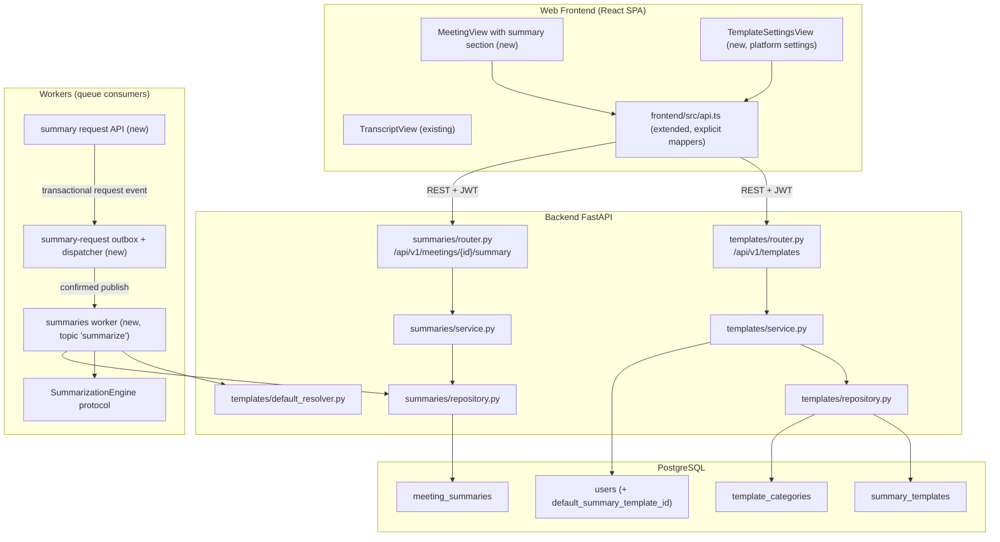
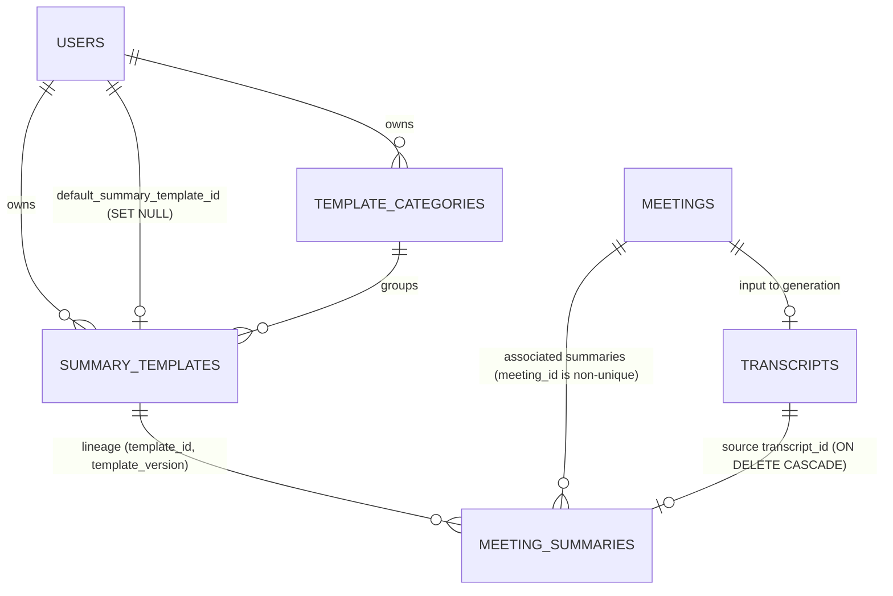

# Design Document — Meeting Summaries and Templates

Spec: `.spectra/specs/meeting-summaries-templates/`
Requirements source: `requirements.md` @ commit `cdce9c34c566b72f42bb6db5eecdd76bdacb4532`
(blob `12025987ad4ac44ac52a9acb5373ddf0f5f4520b`), Mira-APPROVED; PR #231 merged to main.
Baseline source: `PRODUCT_BASELINE.md` @ commit `26d44ca7b212097c82415d0ae038bd9d096873d4`
(blob `3afefd5e3da230cc3e26d7b89e74f48dc01d82ae`), owner-approved snapshot assigned by Ansel.
Owner decision: Fer, 2026-10-16 — templates are personal; users create multiple templates with
specific instructions in Sauri web and configure their personal default there. That default is
automatically applied across categories when a transcript summary is requested without an
explicit template choice. Requirements do not define a seed template or behavior when no default
is configured; this design adds neither.

## Resumen

Sauri currently produces a transcript and diarization per meeting, but the meeting view in the
web portal has no summary artifact and the platform has no notion of templates. The approved
requirements ask for (a) a structured summary as a distinct meeting artifact, (b) copy/download
of that summary, (c) user-owned, editable summary templates with optional categories, and (d) a
single personal default template selected in platform settings that is applied automatically to
every transcription summary for that user until changed. The spec deliberately leaves the
summary-generation method, accuracy thresholds, template visual layout, broader access-control
policy, and any retention period or broader deletion guarantee unresolved. It requires only that
the persisted structured summary be deleted together with its transcript when that transcript
expires or is deleted.

The solution consists of:

1. **Templates module** (`backend/app/templates/`): user-owned `Summary_Template` and
   `Template_Category` tables plus CRUD API under `/api/v1/templates`, following the existing
   router → service → repository → schemas layering, JWT auth, and sales-user authorization.
2. **Default-template resolution service**: a deterministic, dependency-free resolver in the
   templates module that, for a user with a configured default, returns that template id;
   per the owner decision it applies to transcription summaries automatically, across all
   categories. Behavior when no default is configured stays unspecified and the resolver
   returns `None` without guessing a fallback.
3. **Summaries module** (`backend/app/summaries/`): a `Meeting_Summary` entity associated
   with its meeting and frozen template/event lineage, produced by a dedicated `summarize`
   worker from a durable outbox event committed atomically with the user's summary request.
   The request accepts an optional explicit personal template choice; otherwise it resolves the
   user's configured personal default at request time. No job is triggered merely by transcript
   commit.
4. **Structured summary content** that makes the main topic and key arguments or points
   identifiable (R1.2), without imposing a fixed presentation or template schema.
5. **Meeting-view integration**: a new summary section in the portal's meeting view, distinct
   from transcript and notes, with copy and download actions; a platform-settings view for
   template CRUD and default selection.
6. **Tests-first TDD plan**: property tests (with `hypothesis`, ≥100 examples) for approved
   invariants, plus unit/integration tests for API, worker, and UI behavior, each property
   sequenced RED before its implementation.

## Decisiones de Diseño Clave

**D1 — Summary generation stays out of scope; the design defines the mechanism, not the
method.** The requirements do not select a generation method or accuracy threshold. The design
therefore defines where summaries are produced (a queue worker triggered only by a user summary request), what
they persist (a structured model), and what the worker requires to run (a `SummarizationEngine`
protocol). The engine's internal method is a task-level implementation choice, constrained by
the protocol, not a product decision made here. The design does not claim any verified
provider, deployment, or executable generation path exists in this repository; it specifies
only a testable adapter boundary and a hard technical prerequisite: no implementation task may
begin end-to-end summary generation until the provider/configuration/deployment binding is
selected, configured, and verified (D14). *Alternativas descartadas:* choosing an LLM
provider here would invent unapproved product scope; leaving generation entirely open would
leave the architecture under-specified for Zoya's task plan, since the worker, persistence, and
lineage model do not depend on which engine fills the protocol.

**D2 — Every summary identifies both required content elements (R1.2).** Every persisted
summary contains identifiable main-topic and key-arguments/points content. Template instructions
shape those contents but cannot suppress either one. The requirements explicitly defer the
internal structure, schema, and format of templates; this design therefore does not prescribe a
template schema, template-side markup, or a user-configurable inclusion switch. Presentation
layout remains unspecified beyond making both elements identifiable. *Alternativas descartadas:*
optional output elements fail R1.2; defining a template schema or fixed visual layout would
resolve matters explicitly deferred by the approved requirements.

**D3 — Default is one nullable column on `users`, not a row in a per-user settings table.**
The owner decision gives every user at most one default template across all categories. A
`users.default_summary_template_id` FK (nullable, ON DELETE SET NULL) models that invariant
structurally; a separate settings table would need an extra uniqueness constraint to enforce
the same thing and adds a join for every generation. Category is carried by the template
itself, so "applies across all categories" needs no category-aware resolution logic — the
default is category-independent by construction. *Alternativas descartadas:* a per-category
default table contradicts the recorded decision; a general key/value settings table invites
unapproved future settings semantics and couples unrelated features.

**D4 — Resolve and snapshot the user's chosen template at summary-request time; redelivery never changes it.** A user-initiated summary request may name an explicitly selected personal `template_id`; absent that input, the request resolves the user's personal default. In the same transaction that writes the durable outbox event, the service freezes the selected template id, its current version, and the opaque instructions payload. Retries/redeliveries reuse that immutable event snapshot; they never re-read a mutable template row or re-resolve a later default. The same event is a no-op after successful persistence. Editing a template affects only requests created afterward; no instruction-version history table is required because in-flight work carries its own snapshot. *Alternativas descartadas:* resolving the current default at worker execution time can change in-flight work after settings change; storing only an id/version requires mutable history or risks applying different instructions on retry.

**D5 — Lineage is data, not authorization; template names are visible, definitions are not.**
Requirement 3.3 is verified through lineage: a generated summary records which template shaped
it. Lineage does not entitle a user to read another user's template definition; the templates
API only ever exposes the requesting user's own templates. The summary GET includes the
shaping template's **name** (resolved via FK; the template row cannot disappear while
referenced, since no deletion endpoint exists and the FK has no cascade) so the default is
identifiable in the UI (R5.4) without exposing definitions. *Alternativas descartadas:*
full definition read-through would silently create template sharing, which the owner decision
does not grant; hiding lineage entirely would leave "identify the default" (R5.4) unverifiable.

**D6 — Persist the structured summary shaped by the selected template's instructions (R1.2,
R3.3).** The worker persists the summary's structured main-topic and key-points content so both
remain identifiable and available for copy/download. The template's specific instructions shape
both elements; they do not make either optional. This specifies the summary artifact, not the
deferred internal schema or format of `Summary_Template`. *Alternativas descartadas:* storing
only rendered text would discard the required structured artifact; designing a template schema
here would exceed the approved scope.

**D7 — Design fixes data + transport only; portal layout stays open.** The requirements and
baseline explicitly leave portal layout unresolved. The design therefore specifies the API
surface, the `MeetingSummary` shared type, and a distinct summary section inside the existing
meeting view — and nothing about placement or styling beyond that. The baseline's imagined
left/center/right layout is recorded as future inspiration, not adopted. *Alternativas
descartadas:* adopting the imagined layout would decide an explicitly open question; skipping
frontend integration entirely would leave the requirements unverifiable end-to-end.

**D8 — Copy/download the available summary without extra endpoints.** Copy and download use
content already fetched for the meeting summary; no separate backend download endpoint is
needed. The serialized representation, file format, and renderer remain unresolved because
the approved requirements specify copy/download capability but no format or layout (R2, D12).
*Alternativas descartadas:* a backend `/download` endpoint adds auth surface without a stated
requirement; choosing a specific client-side serialization here would invent an output format.

**D9 — Do not invent the no-template request outcome.** An explicit personal template or the configured personal default selects the instructions for a summary request. The approved requirements do not state what happens when a request omits an explicit choice and the user has no default. The request outcome in that case is an implementation gate pending an approved product decision; this design specifies neither silent skipping, fallback, prompting, nor an error response. Engine failures follow the existing worker discipline (exceptions propagate to queue retry handling) without new retry semantics; access control reuses the existing sales-user policy; template/category deletion is not designed because the requirements do not grant it.

**D10 — Summaries in relational storage, not the object store.** The meeting summary is a
small, structured, per-meeting artifact queried by meeting id, like transcripts; object storage
is for media blobs. *Alternativas descartadas:* object-store storage would complicate querying
and lineage without any requirement benefit at this scale.

**D11 — Download filename and format remain unresolved.** The approved requirements require
download capability but do not define a filename, file extension, serialization, or renderer.
Implementation planning must preserve that boundary or obtain an approved product clarification;
this design does not choose a format or filename. *Alternativas descartadas:* hard-coding a
Markdown extension, date, or meeting-title naming policy would add choices absent from R2.

**D12 — Treat template instructions as an opaque payload; do not impose a grammar or renderer.** R3 requires each user-created template to have specific instructions but defers their internal structure, schema, and format. The minimum cross-component boundary is an opaque instruction string: the web API accepts and returns it unchanged, persistence stores it unchanged, and the summary request snapshots it unchanged for the engine adapter. No markup, prompt syntax, field-level selectors, validation rules beyond the string transport type, or renderer semantics are defined. The engine receives this payload alongside transcript text and is responsible for applying the instructions while producing canonical topic and key-points fields. If the approved author interprets even the opaque string transport boundary as requiring a product-level format decision, implementation is gated until clarified. *Alternatives discarded:* omitting instruction transport makes R3.2/R3.6 impossible to implement; defining a grammar or renderer would resolve the explicitly deferred format.

**D13 — New API returns snake_case; the frontend maps explicitly.** The existing backend
endpoints serialize snake_case keys (verified: `GET /api/v1/meetings/{id}/transcript` returns
`transcript_id`, `supports_turns`, …; the templates endpoints likewise use Pydantic's default
snake_case), while `@sauri/shared-types` and `frontend/src/api.ts` use camelCase types. The
new endpoints follow the backend's snake_case convention, and `api.ts` gains **explicit
mapper functions** into the camelCase shared types for every new endpoint, so the frontend
contract is real instead of a blind cast. The pre-existing mismatch for older endpoints is
observed evidence only; this spec does not touch those endpoints. *Alternativas descartadas:*
camelCase responses would deviate from the adjacent transcript/diarization endpoints;
perpetuating the blind-cast pattern would repeat a latent runtime bug in new code.

## Arquitectura



Data flow — user-initiated summary request and immutable template selection (Requirements 5.4–5.6):

```mermaid
sequenceDiagram
    participant U as User
    participant UI as MeetingView
    participant API as Summary request API
    participant RES as default_resolver
    participant DB as PostgreSQL + outbox
    participant DISP as Outbox dispatcher
    participant Q as JobQueue (RabbitMQ)
    participant SW as summaries worker
    participant ENG as SummarizationEngine

    U->>UI: Request summary; optionally select an owned template
    UI->>API: POST summary request {template_id?}
    API->>DB: load owned meeting + transcript
    alt explicit template_id supplied
        API->>DB: verify template owner; read version + instructions
    else no explicit template choice
        API->>RES: resolve current personal default
        RES-->>API: selected template row or None
    end
    API->>DB: atomically persist request outbox event with selected id/version/instructions snapshot
    DISP->>Q: publish pending event; mark delivered only after broker confirm
    Q->>SW: deliver event
    SW->>ENG: generate(transcript text, frozen instructions)
    ENG-->>SW: canonical topic + key_points
    SW->>DB: atomically persist summary + event idempotency claim
```

If no explicit choice and no default exists, the approved requirements do not define the
request outcome; this case is blocked pending product clarification and is not represented as a
silent skip or fallback. Transcript commit alone does not enqueue summary generation. The
existing transcription worker's post-commit diarization publish is unrelated and remains
unchanged; summary requests use their own durable outbox transaction. Summary generation does
not mutate `Meeting.process_state`.

## Componentes e Interfaces

### 1. Backend module: `backend/app/templates/`

New module following the project's router → service → repository → schemas layering
(patterns verified in `meetings/`, `ingestion/`, `transcription/`).

**`schemas.py`** (Pydantic v2; `backend/pyproject.toml` declares `pydantic>=2.0.0`):

```python
# Instructions are an opaque string payload (D12): transport and persist unchanged;
# do not add a grammar, renderer syntax, content validation, or maximum length here.
class TemplateCreate(BaseModel):
    name: str = Field(..., min_length=1, max_length=128)
    instructions: str
    category_id: str | None = None

class TemplateUpdate(BaseModel):
    name: str | None = None
    instructions: str | None = None
    category_id: str | None = None

class TemplateOut(BaseModel):
    id: str
    name: str
    instructions: str
    owner_user_id: str
    category_id: str | None
    version: int
    is_default: bool
    created_at: str
    updated_at: str

class SummaryRequest(BaseModel):
    # Omitted means resolve the current personal default; null is not a template id.
    template_id: str | None = None

class CategoryCreate(BaseModel):
    name: str = Field(..., min_length=1, max_length=128)

class CategoryOut(BaseModel):
    id: str
    name: str
    owner_user_id: str
    created_at: str
```

**`router.py`** — `prefix="/api/v1/templates"`, all routes JWT-authenticated and gated by the
existing `require_sales` authorization dependency (pattern verified in
`backend/app/auth/authorization.py`; denials are recorded in `access_log`):

| Method | Path | Purpose | Success | Notes |
|--------|------|---------|---------|-------|
| POST | `/api/v1/templates` | create template | 201 + `TemplateOut` | body `TemplateCreate`; `category_id` must belong to user, else 422 |
| GET | `/api/v1/templates` | list own templates | 200 + `TemplateOut[]` | identifies the default via `is_default` (R5.4) |
| GET | `/api/v1/templates/categories` | list own categories | 200 + `CategoryOut[]` | declared before `/{template_id}` (see guard below) |
| POST | `/api/v1/templates/categories` | create category | 201 + `CategoryOut` | |
| GET | `/api/v1/templates/{template_id}` | get own template | 200 / 404 | 404 also for another user's template (no existence leak) |
| PATCH | `/api/v1/templates/{template_id}` | edit own template | 200 + `TemplateOut` | omitted `instructions` means unchanged; supplied string replaces it and increments version; payload remains opaque (D4, D12) |
| PUT | `/api/v1/templates/default` | set own default | 204 | body `{"template_id": str}`; template must be owned by the user, else 422 |

Static route ordering guard: `GET /api/v1/templates/categories` must be registered before
`GET /api/v1/templates/{template_id}` in the router file, or FastAPI resolves the path
parameter first and returns 404 with `template_id="categories"`.

`is_default` is computed by the service layer by comparing the template id with the user's
`users.default_summary_template_id`; it is not stored on the template row.

### 2. Backend module: `backend/app/summaries/`

**`engine.py`** — protocol only (D1):

```python
class SummarizationEngine(Protocol):
    async def generate(
        self, transcript_text: str, instructions_snapshot: str
    ) -> CanonicalSummary: ...
```

`CanonicalSummary` (Pydantic model): `topic: str`, `key_points: list[str]`, matching the two
identifiable content elements required by R1.2. `instructions_snapshot` is the opaque, unchanged
string stored on the selected template and frozen into the request event (D4, D12); the adapter
applies it without requiring a grammar or renderer contract.

**`repository.py`** — `SummaryRepository`: `upsert(summary_row)`,
`get_by_meeting(meeting_id)`, with the same session/transaction ownership conventions as
`TranscriptRepository` (verified: the caller controls the transaction; the repository does not
open, close, or commit the session).

**`service.py`** — `SummaryService`: `get_summary_for_user(meeting_id, user)` enforcing
meeting ownership (404 semantics below) and returning the structured summary artifact.

**Presentation/serialization** — the approved requirements do not define a renderer contract,
fixed layout, serialized copy/download format, or internal instruction representation. These
interfaces remain unresolved. The eventual presentation must make the main topic and key points
identifiable (R1.2) and support copy/download (R2), without this design prescribing a format.

**`worker.py`** — mirrors `transcription/worker.py` (verified message-validation and
exception disciplines at `f5aa6b3e`):

- Subscribes to topic `"summarize"`; message includes `event_id`, `meeting_id`, `transcript_id`, frozen `template_id`, `template_version`, and exact `instructions_snapshot` string.
- Discards invalid/empty `meeting_id` with a warning log (same discipline as the
  transcription worker).
- Loads the meeting and its transcript; if either is missing, logs and returns (queue
  redelivery governs; no custom retry loop).
- Uses the immutable event payload's template id, version, transcript id, and instruction snapshot; it never resolves the user's current default during processing. If a request omits an explicit template and no default exists, generation is gated pending the approved product decision (D9); the worker does not define skip, fallback, prompt, or error behavior.
- **Idempotent skip (D4):** if the event id was already successfully applied, ack without
  regenerating or changing the historical summary.
- Calls the configured `SummarizationEngine` via `create_summarization_engine()` (factory
  reading `SUMMARIZATION_PROVIDER` from env, same pattern as `transcription/factory.py`;
  an unrecognized value raises `ValueError` at worker startup, mirroring
  `create_asr_engine()`). Engine exceptions propagate uncaught — the same discipline as the
  transcription worker — so queue redelivery governs retries (D9).
- Applies the template instructions frozen in the event to both required summary elements;
  it never reads a mutable template row to determine the event's instructions or version. Within
  one DB transaction, it atomically claims `event_id` in `processed_summary_events` (unique
  primary key), inserts the structured summary artifact with both required identifiable
  elements and lineage copied from that immutable event, then commits both writes together.
  the persisted row carries only structured data (`topic`, `key_points`); it stores no
  rendered text, markup, or presentation artifact, because the presentation format is
  unspecified (D12). It does not upsert or overwrite a persisted summary. A unique claim
  conflict means this event already
  committed: ack without regenerating or changing any stored summary, even if the user's default
  has since changed. A failed generation/persist rolls back the claim so queue redelivery can
  retry.
- Publishes nothing downstream; does not mutate `Meeting.process_state`.

**Wiring in `backend/app/worker.py`**: `start_worker` imported from `app.summaries.worker`
and subscribed after the diarization worker (one import + one call, matching the existing
bootstrap; verified structure of `backend/app/worker.py`).

**Enqueue point and recovery (D15)**: summary-request persistence and summary-job publication are
separate systems, so a bare post-commit `queue.publish` is not acceptable: a crash or broker
failure between DB commit and publish would permanently lose the requested summary. Therefore
the summary request service writes a durable outbox row **in the same DB transaction** that
accepts the user request, containing `event_id`, `meeting_id`, `transcript_id`, selected
`template_id`, `template_version`, and exact `instructions_snapshot`. An explicit template
choice is owner-checked; otherwise the personal default is resolved at request time. A dispatcher publishes pending outbox rows to
RabbitMQ and marks a row delivered **only after broker confirmation** (publisher confirm;
verified: the current `RabbitMQJobQueue.publish()` uses persistent `delivery_mode=2` but does
not enable publisher confirms, so the dispatcher's confirmation requirement is new capability,
not an existing one). A committed-but-undelivered row survives process restart and is
redispatched, so delivery is eventually at-least-once; consumer-side idempotency on `event_id`
(the `processed_summary_events` claim) makes republishing the same event a safe no-op. The
concrete dispatch mechanism (a periodic dispatcher loop, a startup recovery sweep over
undelivered rows, or an equivalent verified transactional-outbox pattern) is an implementation
decision for Zoya's task plan; whichever is chosen must satisfy both invariants: no committed
pending event can be lost, and republished duplicates cannot duplicate or overwrite a stored
summary. No outbox implementation currently exists in the repo; this is a new component.

### 3. Backend API surface: meeting summary read

Added in `backend/app/summaries/router.py`, registered in `backend/app/main.py`:

| Method | Path | Purpose | Success | Errors |
|--------|------|---------|---------|--------|
| POST | `/api/v1/meetings/{meeting_id}/summary-requests` | request generation for an available transcript | 202 + `{event_id}` | body `{template_id?: string}`; explicit id must be owned by caller; omitted id resolves personal default |
| GET | `/api/v1/meetings/{meeting_id}/summary` | get the meeting's summary artifact | 200 | 404 meeting / 404 summary / 403 non-sales |

Access rule: same as every meeting route — meeting must exist and
`meeting.created_by == user.id`, else `404` (the existing meetings routes' 404-not-403
ownership convention, verified at `backend/app/meetings/router.py`); `require_sales` still
gates the route itself with `403` + audit log for non-sales users.

GET response body (snake_case keys, D13):

```json
{
  "summary_id": "uuid",
  "meeting_id": "uuid",
  "template_id": "uuid",
  "template_name": "Default Summary Template",
  "template_version": 3,
  "topic": "...",
  "key_points": ["..."],
  "generation": 2,
  "created_at": "2026-10-15T21:04:00+00:00",
  "updated_at": "2026-10-15T21:04:00+00:00"
}
```

`template_name` is always included (name only; definitions are never exposed through this
endpoint, D5). There is no regeneration endpoint: the requirements bind the default to
subsequent transcription summaries only, so historical summaries are not re-shaped on demand
(see Scope Boundaries).

### 4. Data model additions (`backend/app/infra/models.py` + Alembic migration `008_`)

```python
class TemplateCategory(Base):
    """Optional grouping for a user's summary templates (R4)."""
    __tablename__ = "template_categories"

    id: Mapped[str] = mapped_column(String(36), primary_key=True)
    owner_user_id: Mapped[str] = mapped_column(
        String(36), ForeignKey("users.id"), nullable=False, index=True
    )
    name: Mapped[str] = mapped_column(String(128), nullable=False)
    created_at: Mapped[datetime] = mapped_column(DateTime(timezone=True), nullable=False)


class SummaryTemplate(Base):
    """User-owned, editable summary template (R3, R4, R5)."""
    __tablename__ = "summary_templates"

    id: Mapped[str] = mapped_column(String(36), primary_key=True)
    owner_user_id: Mapped[str] = mapped_column(
        String(36), ForeignKey("users.id"), nullable=False, index=True
    )
    category_id: Mapped[str | None] = mapped_column(
        String(36), ForeignKey("template_categories.id"), nullable=True
    )
    name: Mapped[str] = mapped_column(String(128), nullable=False)
    version: Mapped[int] = mapped_column(Integer, nullable=False, default=1)
    instructions: Mapped[str] = mapped_column(Text, nullable=False)  # opaque payload (D12)
    created_at: Mapped[datetime] = mapped_column(DateTime(timezone=True), nullable=False)
    updated_at: Mapped[datetime] = mapped_column(DateTime(timezone=True), nullable=False)


class SummaryRequestOutbox(Base):
    """Durable accepted request, including immutable template instructions (D4/D15)."""
    __tablename__ = "summary_request_outbox"

    event_id: Mapped[str] = mapped_column(String(36), primary_key=True)
    meeting_id: Mapped[str] = mapped_column(String(36), ForeignKey("meetings.id", ondelete="CASCADE"), nullable=False)
    transcript_id: Mapped[str] = mapped_column(String(36), ForeignKey("transcripts.id", ondelete="CASCADE"), nullable=False)
    template_id: Mapped[str] = mapped_column(String(36), ForeignKey("summary_templates.id"), nullable=False)
    template_version: Mapped[int] = mapped_column(Integer, nullable=False)
    instructions_snapshot: Mapped[str] = mapped_column(Text, nullable=False)
    delivered_at: Mapped[datetime | None] = mapped_column(DateTime(timezone=True), nullable=True)


class ProcessedSummaryEvent(Base):
    """Transactional idempotency ledger for successfully applied summary events (D4)."""
    __tablename__ = "processed_summary_events"

    event_id: Mapped[str] = mapped_column(String(36), primary_key=True)
    meeting_id: Mapped[str] = mapped_column(
        String(36), ForeignKey("meetings.id", ondelete="CASCADE"), nullable=False
    )
    completed_at: Mapped[datetime] = mapped_column(DateTime(timezone=True), nullable=False)


class MeetingSummary(Base):
    """Persisted structured summary for a source transcript (R1, R5, R6)."""
    __tablename__ = "meeting_summaries"
    __table_args__ = (
        UniqueConstraint("event_id", name="uq_meeting_summary_event_id"),
        UniqueConstraint("transcript_id", name="uq_meeting_summary_transcript_id"),
    )

    id: Mapped[str] = mapped_column(String(36), primary_key=True)
    event_id: Mapped[str] = mapped_column(String(36), nullable=False)
    meeting_id: Mapped[str] = mapped_column(
        String(36), ForeignKey("meetings.id", ondelete="CASCADE"), nullable=False
    )
    transcript_id: Mapped[str] = mapped_column(
        String(36), ForeignKey("transcripts.id", ondelete="CASCADE"), nullable=False
    )
    template_id: Mapped[str] = mapped_column(
        String(36), ForeignKey("summary_templates.id"), nullable=False
    )
    template_version: Mapped[int] = mapped_column(Integer, nullable=False)
    topic: Mapped[str] = mapped_column(Text, nullable=False)
    key_points_json: Mapped[str] = mapped_column(Text, nullable=False)
    generation: Mapped[int] = mapped_column(Integer, nullable=False)
    created_at: Mapped[datetime] = mapped_column(DateTime(timezone=True), nullable=False)
    updated_at: Mapped[datetime] = mapped_column(DateTime(timezone=True), nullable=False)
```

Plus, in the existing `User` model (`backend/app/infra/models.py`):

```python
default_summary_template_id: Mapped[str | None] = mapped_column(
    String(36), ForeignKey("summary_templates.id", ondelete="SET NULL"), nullable=True
)
```

`key_points_json` is order-preserving JSON text (see P2). All ids are `String(36)` UUIDs and
timestamps are `DateTime(timezone=True)`, matching every existing table (verified in
`backend/app/infra/models.py`).

Alembic migration `008_summaries_and_templates.py`
(`down_revision = "007_rename_schema_to_english"`, the verified current head):

1. `CREATE TABLE template_categories`, then `CREATE TABLE summary_templates` (columns as
   above; creation order matters — `users` must exist, and `users.default_summary_template_id`
   will reference `summary_templates`).
2. `CREATE TABLE summary_request_outbox` with immutable request fields (`event_id`, meeting,
   transcript, selected template id/version, instructions snapshot) and nullable delivery
   timestamp; it is committed atomically with the accepted request. `CREATE TABLE
   processed_summary_events` with `event_id` primary key, meeting FK, and completion timestamp;
   this ledger is committed atomically with its successful summary write.
3. `CREATE TABLE meeting_summaries` with unique `event_id` and unique `transcript_id`; the
   latter is a non-null FK to `transcripts.id ON DELETE CASCADE` (R6), and `meeting_id` is a
   non-unique FK to `meetings.id ON DELETE CASCADE`. Retries of an already-processed event do
   not update this row. Do not add a unique constraint on `meeting_id`: identity and deletion
   follow the source transcript/event, not a mutable “latest summary” slot.
4. `ALTER TABLE users ADD COLUMN default_summary_template_id VARCHAR(36) NULL REFERENCES
   summary_templates(id) ON DELETE SET NULL`.
5. Do not seed a template or configure a default in this migration. Requirements do not
   define a seed template, and R5.1 only allows users to configure a template they own as their
   personal default; it does not require a default to exist for every user (D12). The ownership
   and onboarding behavior for template instructions/default setup remains unresolved pending
   an approved requirements decision.
6. `downgrade()` reverses in exact reverse order: drop `users.default_summary_template_id`,
   then `meeting_summaries`, `processed_summary_events`, `summary_templates`, and
   `template_categories`.

### 5. Default-template resolver (`backend/app/templates/default_resolver.py`)

```python
from typing import NamedTuple

class ResolvedDefault(NamedTuple):
    template_id: str
    version: int

def resolve_default(template_row: "SummaryTemplate | None") -> ResolvedDefault | None:
    """Pure function: the user's configured default template, or None (D9)."""
    if template_row is None:
        return None
    return ResolvedDefault(template_id=template_row.id, version=template_row.version)
```

The repository layer supplies the user's default template row (join
`users.default_summary_template_id` → `summary_templates`); the pure function owns the
None-handling so the None semantics stay unit-testable without a database. The FK
`ON DELETE SET NULL` guarantees the DB cannot hold a dangling default id; if the referenced
row vanished inside a transaction race, the resolver's `None` path covers it.

### 6. Shared types (`packages/shared-types/src/index.ts`)

```typescript
/** Structured summary artifact associated 1:1 with a meeting (R1). */
export interface MeetingSummary {
  summaryId: string;
  meetingId: string;
  templateId: string;
  templateName: string;
  templateVersion: number;
  topic: string;
  keyPoints: string[];
  generation: number;
  createdAt: string;
  updatedAt: string;
}

/** User-owned summary template (R3–R5). */
export interface SummaryTemplate {
  id: string;
  name: string;
  ownerId: string;
  categoryId?: string;
  version: number;
  // Instruction payload shape is deferred by the approved requirements (D12).
  isDefault: boolean;
  createdAt: string;
  updatedAt: string;
}

/** Optional template grouping (R4). */
export interface TemplateCategory {
  id: string;
  name: string;
  ownerId: string;
  createdAt: string;
}
```

### 7. Web frontend integration (`frontend/src/`)

**`api.ts`** additions (same `getAuthHeaders`/`handleResponse` pattern, verified in the
existing file; every new function maps its snake_case response explicitly into the camelCase
shared types, D13):

```typescript
export async function getSummary(meetingId: string): Promise<MeetingSummary>;
export async function requestSummary(meetingId: string, input?: { templateId?: string }): Promise<{ eventId: string }>;
export async function listTemplates(): Promise<SummaryTemplate[]>;
export async function createTemplate(input: { name: string; instructions: string; categoryId?: string | null }): Promise<SummaryTemplate>;
export async function updateTemplate(
  id: string,
  input: Partial<{ name: string; instructions: string; categoryId: string | null }>,
): Promise<SummaryTemplate>;
export async function listCategories(): Promise<TemplateCategory[]>;
export async function createCategory(name: string): Promise<TemplateCategory>;
export async function setDefaultTemplate(templateId: string): Promise<void>;
```

**`components/SummarySection.tsx`** (new): rendered inside the meeting view as a **separate
section** from the transcript view (R1.1). Owns local state only (`summary | null`,
`loading`, `error`); fetches on mount via `getSummary`; presents the structured summary so
its main topic and key points are identifiable (R1.2). Provides copy and download actions on
the available summary content (R2); serialization and file format remain unspecified (D8, D11).

- **Copy** button uses the browser clipboard API for the available summary content (R2.1);
  success feedback is local UI state ("Copied"), no alert/dialog.
- **Download** button downloads the available summary content (R2.2); filename and serialization
  are not prescribed by the approved requirements.
- **Request flow**: when the meeting has an available transcript, the view offers a summary-request action and an optional selector populated only with the user's own templates. The configured default is identified in that selector; submitting without an explicit selection asks the API to resolve it automatically. No job is created on transcript commit.
- **Not-available state**: if `getSummary` returns 404, the section renders a neutral "No summary available for this meeting yet." message. This UI state is separate from the unresolved request outcome when no default exists (D9).

**`components/TemplateSettingsView.tsx`** (new): platform-settings surface for templates.
Reached from `App.tsx` by extending the `View` union type (verified current shape:
`{ type: "list" } | { type: "transcript"; meetingId: string }`) with `{ type: "templates" }`
and a nav entry. Contains:

- Template list with `isDefault` identification (R5.4) and a "Set as default" action per
  template (R5.3); the current default is visually marked.
- Create/edit template form supports a template name, opaque instruction string, and optional category (R3.2, R4.3). The instructions editor transports the string unchanged; no grammar, markup, selection controls, or include/exclude behavior is defined (D12).
- Category creation inline form (R4).

### 8. Worker bootstrap and configuration

- `SUMMARIZATION_PROVIDER` env var selects the engine via
  `summaries/factory.py::create_summarization_engine()`; recognized values and their default
  are fixed at task level (the protocol, not the provider, is the design contract). Startup
  raises `ValueError` on an unrecognized value, mirroring `create_asr_engine()`.
- **Generation prerequisite (B3 containment, D14).** This design specifies the adapter seam and
  fail-closed factory validation; it does **not** select or verify a summarization provider,
  model, endpoint, credential, or deployment route, and no executable end-to-end generation
  path exists in this repository today (verified: `backend/app/` has ASR/diarization
  factories/providers but no summary engine implementation or provider endpoint). Selecting
  that binding is a technical prerequisite that Zoya's plan must schedule before any task whose
  acceptance depends on actually producing a summary (worker engine call, integration test of
  generated content, UI states that assume a summary appears); if the choice changes privacy,
  cost, or product behavior it needs upstream approval. Tasks that depend only on the protocol
  seam — repository, resolver, persistence, event idempotency, API surface, UI empty state, and
  the outbox/dispatcher of D15 — are independent of that prerequisite and may proceed without
  it. Until the binding is verified, a worker that cannot construct an engine fails closed at
  startup rather than emitting summaries of unknown provenance.
- No new Compose service is introduced. The summaries worker subscribes inside the existing
  worker process (`backend/app/worker.py`), avoiding the known Compose/diarization-engine gap
  pattern (AGENTS.md: the Compose stack does not define a diarization-engine service; do not
  widen that gap for summaries).

## Modelos de Datos

Entity-relationship additions (PostgreSQL, migration `008_summaries_and_templates`):



Key data contracts:

- The internal representation and storage format of template instructions are not specified;
  the approved requirements defer them (D12). Do not add a selection schema, boolean columns,
  or constraints that encode optional inclusion behavior without an approved decision.
- `meeting_summaries.key_points_json` preserves the order of key points (P2); presentation
  layout and serialization remain unspecified.
- `meeting_summaries` has no `state`/`failure_cause` columns: a row exists only after a
  successful generation (failed attempts leave no row; queue redelivery governs retries,
  D9) — the artifact's existence is its state.
- Foreign keys: `meeting_summaries.transcript_id` is non-null, unique, and uses
  `ON DELETE CASCADE`; deletion of a transcript (including expiry by the retention worker)
  therefore deletes its associated persisted summary as required by R6. `meeting_summaries.meeting_id`
  is a non-unique FK that also cascades with the meeting; this association does not replace the
  transcript-coupled deletion path. No independent summary retention period or broader deletion
  guarantee is specified. `meeting_summaries.template_id` has no cascade and no deletion endpoint
  exists, so lineage rows remain resolvable (D5); `users.default_summary_template_id` uses
  `SET NULL` (D3).

## Propiedades de Correctitud

**P1 — Required summary content is identifiable for every applied template (R1.2, R3.3, R5.5).**
For every successfully persisted summary, its main topic and key points remain identifiable as
required by R1.2. The applicable template's specific instructions shape the content; this design
does not prescribe template fields, controls, or an internal instruction representation. The
summary also records the template and immutable template-version association used for that event;
later edits do not rewrite the already-persisted result (D2, D4, D6).
*Valida: R1.2, R3.3, R5.5.*

**P2 — Preserve required content in the presented summary (R1.2).**
The summary presentation makes its main topic and key points identifiable and preserves their
content for copy/download (R2). The approved requirements do not define a fixed layout, output
format, empty-value marker, or renderer algorithm; those details remain unresolved (D12).

**P3 — Default resolution is unique, personal, and category-blind (R5.3–R5.6).**
For any user `u` and any snapshot of `users`/`summary_templates`:
- at most one default exists for `u` (single nullable column, D3);
- on a summary request without explicit choice, default resolution identifies the then-configured template `(id, version)` and its exact opaque instructions string;
- the resolved or explicitly selected template's `owner_user_id == u.id` (personal; enforced by service checks);
- resolution never reads the template's category (category-blind, R5.3/R5.5);
- the accepted request outbox event freezes that resolution for delivery/retry; a later request resolves the then-current default, so subsequent summaries use the new selection (R5.6);
- if there is neither an explicit selection nor a configured default, processing is gated for an approved product decision; this property does not assert skip, fallback, prompt, or error behavior (D9).
*Valida: R5.3, R5.4, R5.5, R5.6.*

**P4 — No template schema or initial-template invariant is derived here.**
The approved requirements defer the template's internal structure, schema, and format, and do
not define a seed template or require a personal default to be preconfigured. Do not encode
these behaviors as schema or property-test invariants without an approved decision.

**P5 — Summary is a distinct artifact associated with its meeting (R1.1, R1.3).**
For any persisted summary row, `meeting_id` references the meeting it summarizes; multiple
summary events for the same meeting are not conflated by meeting-level uniqueness. The portal's
meeting view presents the available summary in a section distinct from transcript and notes
(component boundary, verified by component test rather than property test).
*Valida: R1.1, R1.3.*

**P6 — Copy and download are available for the meeting summary (R2.1, R2.2).**
The meeting-summary UI exposes copy and download actions for the available summary content.
The approved requirements do not prescribe exact serialized text, MIME type, file extension, or
filename; tests verify the actions can operate on the fetched summary without asserting those
unspecified representation choices.
*Valida: R2.1, R2.2.*

**P7 — API and storage privacy boundaries.**
Any templates API response for user `u` contains only templates owned by `u`; the summary GET
for user `u` requires `meeting.created_by == u.id`, else 404; `require_sales` denials are
recorded in `access_log`. Boundary check (repository/service level): for any user pair
(u1 ≠ u2), `list_templates(u1)` ∩ `{t : t.owner_user_id == u2.id}` = ∅.
*Valida: cross-surface privacy boundary; `SECURITY.md` access-control rules (JWT + sales-user
restriction + access audit apply to the new endpoints).*

**P8 — Request-event idempotency, immutable template snapshot, and transcript-coupled deletion (D4/R6/D15).**
For any accepted summary request event `e`, delivery and redelivery use its frozen transcript id,
template id/version, and opaque instructions snapshot. Processing the same `event_id` more than
once persists at most one summary row; a duplicate after successful commit leaves stored
content unchanged. The summary row and processed-event ledger commit atomically; failures before
that commit do not mark processing complete. A later user request is a distinct event and
resolves the selection applicable to that request, not a transcript commit. Deleting the source
transcript (including expiry) deletes its persisted summary through the FK cascade; no
independent summary retention period is implied.
*Valida: R5.5–R5.6, R6.1, D4, D15.*

## Manejo de Errores

| Scenario | Behavior |
|----------|----------|
| `POST /api/v1/templates` with `category_id` not owned by user | 422, no row created |
| Template instruction payload | Transport as an opaque string unchanged; do not impose grammar or semantic validation (D12) |
| `PUT /api/v1/templates/default` with another user's template id | 422, no change |
| `GET /api/v1/templates/{id}` for another user's template | 404 (no existence leak) |
| Meeting summary GET for nonexistent or not-owned meeting | 404 (existing meetings convention) |
| Summary GET when no summary exists for the meeting | 404 (same style as the transcript endpoint's "not available" detail); frontend shows the neutral empty state |
| Worker message with missing/empty `meeting_id` | Discarded with warning log (transcription-worker convention) |
| Worker: meeting or transcript row missing at process time | Log + return (queue redelivery governs; no custom retry) |
| Summary request omits an explicit template and no personal default exists | Request processing is gated pending an approved product decision (D9); no skip, fallback, prompt, or error behavior is specified |
| Worker: engine raises | Exception propagates uncaught (transcription-worker discipline); queue redelivery governs; no failed row is persisted (D9) |
| Worker: duplicate `event_id` already committed | Idempotent no-op ack; never upsert or replace the stored summary (D4, P8) |
| Worker: engine returns empty topic or key points | Output handling remains unspecified; no renderer or empty-value policy is introduced by this design (D1, D8, D12) |
| `SUMMARIZATION_PROVIDER` unrecognized at worker startup | `ValueError` at startup, mirroring `create_asr_engine()` |
| `GET /api/v1/templates/categories` vs `/{template_id}` route conflict | Static route registered first (implementation-order guard in the router file) |
| Frontend copy blocked (clipboard permission) | Button shows a transient "Copy failed" state; no data loss |
| Frontend `getSummary` 404 | Neutral "No summary available for this meeting yet." (UI state, not fallback behavior) |

## Estrategia de Testing

**Enfoque dual: unit/integration + property-based.** Rationale: the default resolver is a
pure function suitable for property tests; API/worker behavior and required summary content
are covered by integration and component tests. No tests infer a template-instruction schema
or a fixed summary serialization from the deferred requirements.

- **Property-based** (`hypothesis`, verified present in `backend` dev dependencies;
  ≥100 examples per property, per AGENTS.md milestone criteria): approved properties P1–P5
  and P8 where automatable (P3 default resolution; P4 protects against adding an initial
  template invariant; P5 persistence behavior; P8 event and transcript lifecycle).
- **Unit/integration**: router behavior (auth, 404/422 semantics), worker message handling,
  required summary content, and frontend component tests (`vitest` + `@testing-library/react`,
  already in `frontend` devDependencies) for SummarySection states and available copy/download
  actions without asserting unspecified serialization (P6, P7 frontend half).

**Estructura de archivos (backend):**

```
backend/tests/
├── templates/
│   ├── test_templates_api.py             # unit/integration
│   └── test_default_resolver_property.py # P3 (property)
├── summaries/
│   ├── test_worker.py                    # immutable snapshot, idempotency, engine-failure paths
│   └── test_summary_api.py               # unit/integration, including explicit selection
└── integration/
    └── test_summary_pipeline.py          # request→outbox→summarize end-to-end; no transcript trigger
```

**Estructura de archivos (frontend):**

```
frontend/src/components/
├── SummarySection.tsx
├── SummarySection.test.tsx
├── TemplateSettingsView.tsx
└── TemplateSettingsView.test.tsx
```

**TDD sequencing (binding for the task plan):** every property P1–P8 lands as a failing test
(RED) before its implementation (GREEN), then refactor. The RED commit for a property lives
in the same worktree/branch immediately before the implementation commit that makes it pass.
The task plan must sequence test tasks before their implementation tasks in the dependency
graph (AGENTS.md non-negotiable TDD order).

**Test handoff prerequisites (for Zoya's plan):**

- Pre-production base branch/SHA: `feature/issue-task_23304e68098a4c6b-meeting-summaries-design`
  branched at `f5aa6b3e4d1e2c8a0816743f11de8a7a6ad8c43a` (merge-base with `main`:
  `a753dee72703f3aeaf97c3b163de6b4954ab80e9`).
- At RED time, the test task records the exact pre-implementation candidate SHA, command,
  and captured failing output; tests must target the approved request→outbox→summarize flow.
  No test may assert a no-default outcome until the product decision is approved, and no
  test may invent a template grammar, renderer, or summary serialization.
- Authorized integration route: the user summary-request API persists an outbox event;
  the dispatcher publishes it and the summary worker consumes it. Transcript commit alone
  does not enqueue summary generation.
- Candidate worktree: this branch's worktree or a successor created by
  `_tools/new-worktree.sh` per AGENTS.md §7.

**Comandos:**

```bash
cd backend && pytest tests/templates tests/summaries -q
cd backend && pytest tests/integration/test_summary_pipeline.py -q
cd frontend && npm run test -- --run src/components/SummarySection.test.tsx
cd frontend && npm run typecheck && npm run test
cd backend && ruff check . && mypy .
```

## Scope Boundaries (explicit non-decisions)

Restated for the auditor: this design does not select a summarization method or accuracy
threshold (D1); define a template grammar or summary visual layout (D2, D12); broaden access
control beyond the existing sales-user policy (P7); add retention periods or deletion guarantees
beyond deleting a persisted summary with its transcript (R6); or define template/category
deletion endpoints (D9). It does not adopt the baseline's imagined portal layout (D7), nor define
what a request does when neither explicit template nor configured default exists; that case is
gated pending product decision (D9). It adds no automatic transcript-commit generation, and
no standalone regeneration endpoint. A later user request is a subsequent summary and resolves
the then-current selection; historical summaries retain their recorded lineage. Category names
are free text owned by the user; no taxonomy is invented. The download filename is the one
concrete user-visible string fixed by this design (D11, P6).

## Correcciones de auditoría — ronda 1 (sustituyen reglas incompatibles anteriores)

These amendments are normative for implementation and supersede any conflicting text above.

1. **Template format boundary (D12).** The approved requirements defer internal structure,
   schema, and format. The implementable cross-component boundary is an opaque string payload:
   create/update API accepts it, persistence stores it unchanged, and summary requests freeze
   the exact value for the engine. Do not define a grammar, validation beyond string transport,
   selection controls, or renderer layout. The engine applies the instructions while preserving
   identifiable topic and key points (R1.2, R3.6). If product approval is required to establish
   even this transport boundary, implementation is gated pending that clarification.

2. **Freeze template choice at the summary request (D4/P8).** A user request may select an
   owned template; absent explicit selection, the service resolves the personal default. In the
   same transaction as the accepted request's outbox event, freeze `template_id`, current
   `template_version`, and exact opaque `instructions_snapshot`. The worker MUST use that event
   snapshot, never re-read a mutable template or re-resolve a newer default during retries.
   Persist with event-id idempotency; duplicate delivery is a no-op and MUST NOT overwrite a
   historical summary. A later request uses the then-current selection; a default change alone
   does not regenerate old summaries.

3. **Generation engine integration boundary (D1).** The application invokes a configured
   `SummarizationEngine` adapter; business services and workers depend only on its protocol.
   Configuration is supplied through backend environment (`SUMMARIZATION_PROVIDER` plus
   provider-specific endpoint/model/credential settings, with credentials supplied through
   the deployment secret mechanism and never logged). Factory validation fails closed at
   worker startup for unsupported/missing configuration; adapter uses authenticated TLS for
   remote calls, bounded request timeouts, and propagates provider failures to the queue's
   retry/dead-letter handling. The adapter receives only the transcript text required to
   produce the canonical `topic` and `key_points`; it must not send recording/audio/video,
   user identity, template names, or unrelated meeting metadata. Output is parsed/validated
   into the canonical schema before persistence. Provider choice, model, prompt, deployment,
   accuracy threshold, and any new observable quality or fallback rule remain explicitly
   unselected because approved requirements do not select them. Do not claim an existing
   summarization provider or deployed endpoint: none was verified in this repository. Before
   implementation, the provider/configuration/deployment binding is a technical prerequisite
   for Zoya's task plan (D14); choosing a provider requires approval if it changes privacy,
   cost, or product behavior. This design therefore specifies a viable integration *boundary*
   with fail-closed validation and bounded data transfer, not a verified executable generation
   path; tasks that depend only on the protocol seam are independent of that prerequisite.

4. **Post-commit enqueue recovery (D15).** Acceptance of a summary request and job publication
   are separate systems; publication after commit can fail or the process can stop between
   commit and publish. Therefore the request service records a durable pending-summary outbox
   event in the same DB transaction that accepts the request, keyed by `event_id` and carrying
   meeting/transcript ids plus the immutable template id/version/instructions snapshot. A
   dispatcher publishes pending events to RabbitMQ and marks them delivered only after broker
   confirmation (publisher confirm, which the current `queue_rabbitmq.py` does not enable); a
   committed-but-undelivered row survives restart and is redispatched, so delivery is eventually
   at-least-once. Consumer-side idempotency on `event_id` makes republished duplicates a safe
   no-op. The concrete dispatch mechanism (periodic dispatcher, startup recovery sweep, or
   equivalent verified transactional-outbox pattern) is an implementation decision for the
   task plan, constrained by those invariants; it must be tested. A bare post-commit
   `queue.publish` is not recoverable. No outbox implementation exists in the current repository.

5. **No implied template seed or personal default (R3/R5).** The approved requirements do
   not specify a seed template, a system-provided template, or onboarding behavior. Migration
   `008_summaries_and_templates.py` therefore creates the template tables and nullable
   `users.default_summary_template_id` column but seeds neither a template nor a personal
   default. Do not infer a shared/system template or model one as selectable by personal users;
   any such template or onboarding behavior would require an approved requirements decision
   before it is added. Each personal default is set only when its owner explicitly configures a
   template they own; absent a configured default, resolver returns `None` and this design
   specifies no fallback (D9). This preserves the required distinction between available
   templates and a user's personal choice without inventing a first-release template.

6. **Transcript-coupled summary deletion (R6).** The approved requirement is narrowly scoped:
   when a transcript expires or is deleted, delete its associated persisted structured summary
   together with it. The `meeting_summaries.transcript_id` foreign key uses `ON DELETE CASCADE`
   to enforce that relationship, including for deletions issued by the existing retention worker.
   This design specifies no retention period for transcripts or summaries and no broader deletion
   guarantee; it does not add an independent summary expiry policy.

7. **PATCH category clearing and frontend 204 handling.** `TemplateUpdate.category_id` uses
   field-presence semantics: omitted means no change; explicit JSON `null` clears the
   category; a string assigns an owned category. Use Pydantic `model_fields_set` (or the
   equivalent validated distinction) so `None` is not conflated with omission. The default
   setter's `204 No Content` response is consumed without JSON parsing in `frontend/src/api.ts`;
   no response-body decode is attempted for 204.

8. **Cross-task TDD transfer.** For every property, the test task must commit its RED test
   before implementation starts and hand the implementation task the test commit/diff, exact
   pre-production base branch and SHA, exact failing command and captured failing output,
   and expected failure. Both tasks must converge through the authorized integration route
   into the same eventual delivery candidate/worktree; candidate must include the predecessor
   test commit plus implementation. A late QA test is not evidence of RED. Keep RED/green/
   refactor ordering explicit in the task dependency graph.

9. **Evidence-backed current boundaries.** Existing transcription performs a direct
   post-commit `queue.publish("diarize", ...)` (`backend/app/transcription/worker.py`), and
   RabbitMQ queue implementation provides persistent messages/retries but no observed
   transactional outbox (`backend/app/infra/queue_rabbitmq.py`). The retention worker deletes
   `SessionRecording` and `Transcript`; no summary table exists in this current snapshot. The
   design's transcript FK cascade couples future persisted summaries to transcript deletion.
   The repo contains configurable ASR
   factories/providers but no summary engine implementation or summary provider endpoint;
   `SummarizationEngine` is a new adapter seam, not a claim of verified provider availability.
