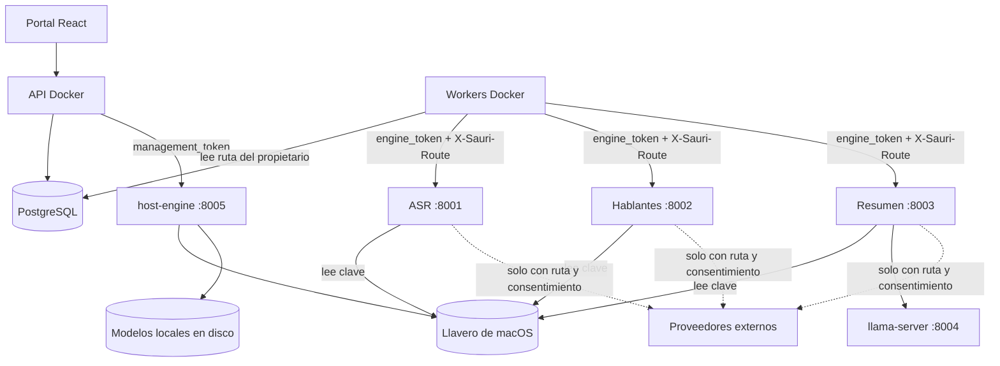
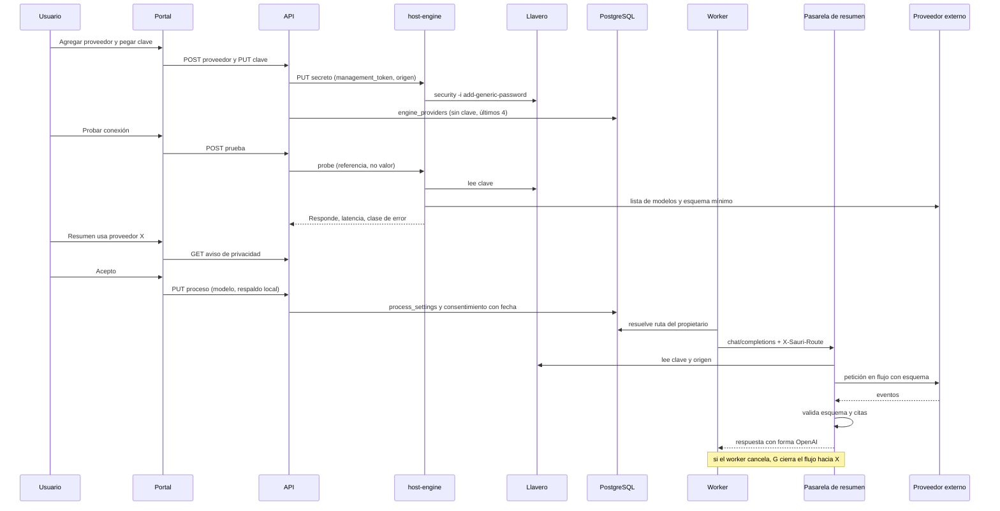

# Documento de Diseño — Motores y modelos

## Resumen

Hoy el motor de cada proceso es fijo y vive detrás de una pasarela HTTP nativa (`backend/asr-engine/native_main.py` en :8001, `backend/diar-engine/native_main.py` en :8002, `backend/llm-engine/native_main.py` en :8003 con `llama-server` interno en :8004), arrancada por `scripts/engines/native-engines.sh` y consumida por los workers Docker mediante `LocalProvider` y `OpenAICompatibleSummarizationEngine`. El único cambio posible sin tocar código es apuntar el resumen a otro servidor con `SUMMARIZATION_BASE_URL` y un archivo de clave montado en el worker, lo que expone la clave a Docker y no cubre ni transcripción ni hablantes. No existe registro de proveedores, almacenamiento seguro de claves, aviso de privacidad, catálogo de modelos locales ni instalación desde la interfaz, y la consola de configuración del portal (PR #1049) es una lista plana de cuatro categorías.

La solución agrega proveedores externos como **adaptadores detrás de los mismos contratos**, ejecutados en el anfitrión, y un servicio de administración local para claves y modelos:
1. **Registro y elección en PostgreSQL** (por propietario): proveedores, elección por proceso y consentimientos. El worker resuelve la ruta de cada intento y la envía a la pasarela en una cabecera; sin elección guardada, el comportamiento actual no cambia.
2. **Servicio_Anfitrión `host-engine` (puerto 8005, solo loopback)**: guarda claves en el llavero de macOS, prueba conexiones, lista modelos, detecta hardware e instala modelos locales con hash. La API Docker lo llama con un token de administración que el worker no recibe.
3. **Adaptadores externos en las pasarelas** (`backend/engine-common/sauri_engine_common/external/`): chat (`openai-chat`, `anthropic-messages`, `chatgpt-responses`), transcripción (`openai-audio`, `assemblyai`, `deepgram`) y hablantes (`assemblyai`, `deepgram`), con errores clasificados, cancelación hacia el proveedor y validación local de contratos.
4. **Gestión de modelos locales**: catálogo versionado con SHA-256, recomendación determinista por hardware, instalación con botón y progreso.
5. **Portal**: navegación de configuración por grupos con buscador, pantalla «Motores y modelos», selectores por proceso con aviso de privacidad y procedencia en la reunión.

## Evidencia verificada (2026-11-16)

Hechos externos consultados en documentación oficial durante el diseño. Todo lo marcado `NO VERIFICADO` debe comprobarse en la unidad indicada antes de ofrecerse al usuario.

| Hecho | Fuente | Efecto en el diseño |
|---|---|---|
| OpenAI: `whisper-1`, `gpt-4o-transcribe`, `gpt-4o-mini-transcribe` y `gpt-4o-transcribe-diarize` se apagan el 26-02-2027 (aviso 26-08-2026); reemplazo `gpt-transcribe` / `gpt-live-transcribe` | developers.openai.com/api/docs/deprecations | OpenAI no se ofrece para transcripción ni hablantes en esta spec |
| OpenAI: solo `whisper-1` admite `timestamp_granularities[]=word` (con `verbose_json`); `gpt-4o-transcribe-diarize` no admite marcas por palabra y exige `chunking_strategy` si dura más de 30 s; límite de archivo 25 MB | developers.openai.com (guía de voz a texto y referencia de transcripciones) | Sin palabras no hay contrato v2: `gpt-transcribe` queda `NO VERIFICADO` para palabras (la documentación consultada no las describe) |
| AssemblyAI: `POST /v2/upload` y `POST /v2/transcript` con `speaker_labels: true`; respuesta con `utterances[]` y `words[]` con `text`, `speaker`, `start`, `end` (ms), `confidence`; etiquetas `A`, `B`… | assemblyai.com/docs (pre-recorded-audio/label-speakers) | Un mismo trabajo sirve para transcripción con palabras y para hablantes. Español en diarización: `NO VERIFICADO` (U5) |
| Deepgram: `diarize_model` (`latest`, `v1`, `v2` solo por lotes); `diarize=true` está obsoleto; palabras con `word`, `start`, `end`, `confidence`, `speaker` (entero) | developers.deepgram.com/docs/diarization | Idem. Español, límites de tamaño y precios: `NO VERIFICADO` (U4/U5) |
| Groq: `whisper-large-v3-turbo` y `whisper-large-v3`, `timestamp_granularities[]=word` con `verbose_json`, ruta `https://api.groq.com/openai/v1/audio/transcriptions`, límite 25 MB (gratis) / 100 MB (pago), sin diarización documentada | console.groq.com/docs/speech-to-text | Candidato de transcripción con el transporte `openai-audio` (U4) |
| ElevenLabs: `diarize`, `timestamps_granularity=word`, `words[]` con `speaker_id`, hasta 32 hablantes, archivo hasta 5 GB | elevenlabs.io/docs (speech-to-text/convert) | Candidato posterior para ambos procesos; fuera de la primera entrega |
| Anthropic: salida estructurada estable con `output_config.format = {type: "json_schema", schema}`; `additionalProperties: false` obligatorio; `maxItems` no se admite en el API (los SDK lo quitan y validan localmente); `minItems` solo 0 o 1; enums de cadenas sí | platform.claude.com/docs (structured-outputs) | El adaptador `anthropic-messages` debe adaptar el esquema y validar localmente (Propiedad 13) |
| Gemini: salida estructurada con esquema JSON (`enum`, `minItems`, `maxItems`, `additionalProperties`), forma exacta de la llamada y ruta compatible con OpenAI | aistudio.google.com/docs/structured-output | Forma de la llamada y ruta compatible con OpenAI: `NO VERIFICADO` (U3 elige la que funcione con una clave real) |
| OpenRouter: `response_format.type = json_schema` con `strict`; el soporte depende del endpoint del modelo; `provider.require_parameters: true` evita enrutar a endpoints sin soporte | openrouter.ai/docs/features/structured-outputs | Adaptador `openai-chat` con `require_parameters` |
| Ollama (`11434`) y LM Studio (`1234`, base `http://localhost:1234/v1`): `response_format` con `json_schema`; modelos pequeños (< 7B) pueden no cumplirlo | docs.ollama.com, lmstudio.ai | «Probar conexión» comprueba el esquema; base `/v1` de Ollama `NO VERIFICADO` (U2) |
| OpenAI «Sign in with ChatGPT» con uso del plan: vía oficial para aplicaciones de código abierto o alojadas localmente; autorización con PKCE y retorno `http://127.0.0.1:<puerto>/auth/callback`; registro dinámico de cliente (`client_id=dynamic_agent_client`, `ext_agent_host_id` estable); alcances `offline_access resource.invoke chatgpt.tokens.use.direct`; token de acceso de 1 h con rotación del de actualización; llama a la API de Respuestas con `store: false`, `stream: true`; aplicaciones de pago o alojadas remotamente deben completar un formulario de interés; vista previa. La documentación de Codex indica no apuntar a `backend-api` de ChatGPT | developers.openai.com/siwc/token-sharing-open-source (y `/sign-in`) | Reemplaza el flujo de código de dispositivo de APX (Decisión 8). Soporte de `text.format = json_schema` en esa vía y alcance legal: `NO VERIFICADO` (U9) |
| Catálogo local: `ggml-large-v3-turbo-q5_0.bin` 574 041 195 B, SHA-256 `394221…a7e2` (coincide con `engine-hashes.json`); `ggml-large-v3-turbo-q8_0.bin` 874 188 075 B, `317eb69c…59a1`; `ggml-small-q5_1.bin` 190 085 487 B, `ae85e4a9…11bb`; `Qwen3.5-4B-Q4_K_M.gguf` 2 740 937 888 B, `00fe7986…11a4`; `Qwen3.5-2B-Q4_K_M.gguf` 1 280 835 840 B, `aaf42c8b…9223` | API de archivos de huggingface.co (rama `main` el 16-11-2026) | Valores iniciales; U6 los fija con revisión de commit y los vuelve a verificar |

## Decisiones de Diseño Clave

**1. La ruta se decide en el worker a partir de PostgreSQL; las pasarelas del anfitrión la ejecutan.** El worker resuelve en cada intento la Ruta_de_Proceso del propietario de la reunión (proveedor, modelo, consentimiento) y la envía a la pasarela en `X-Sauri-Route`. Sin fila de elección no se envía la cabecera y la pasarela usa su motor local actual.
*Alternativas descartadas:* enrutar dentro de las pasarelas leyendo su propia copia de la configuración (la pasarela no conoce al propietario ni el consentimiento, y exigiría un canal de empuje y una segunda fuente de verdad que se desfasa); que las pasarelas lean PostgreSQL (más credenciales en el anfitrión y acoplamiento al esquema); que el worker llame directamente al proveedor (las claves terminarían en Docker).
*Cambio respecto a la decisión inicial del orquestador:* la «decisión de ruta» baja al worker; las pasarelas siguen siendo los únicos que hablan con proveedores y leen claves.

**2. Claves en el llavero de macOS, leídas por la pasarela en el momento de la llamada.** Servicio `sauri`, cuenta `sauri/<propietario>/<proveedor>`, valor JSON `{"key": "...", "origin": "https://..."}`. Escritura con `security -i` (el comando entra por entrada estándar, así que la clave no aparece en `argv` ni en `ps`); lectura con `security find-generic-password -w`. Se usa el binario `/usr/bin/security` como único accesor para evitar avisos del llavero por cada intérprete de Python de cada entorno virtual. Alternativa si no hay llavero: archivo 0600 en `~/.config/sauri/secrets/` (carpeta 0700). El acceso va detrás de un puerto `SecretStore` para cambiar de almacén sin tocar adaptadores.
*Alternativas descartadas:* archivos `*_FILE` montados en Docker (patrón actual de contraseñas: expone claves a Docker y el worker no las necesita); PostgreSQL cifrado (la llave de cifrado tendría que vivir junto a los datos o en Docker); biblioteca `keyring` (dependencia nueva en cada entorno virtual y el llavero pediría permiso a cada intérprete); variables de entorno (visibles en `ps`/`docker inspect`). *Límite honesto:* cuando el usuario escribe o reemplaza una clave en el portal, esta pasa por la memoria del contenedor `api` en tránsito (nunca se guarda ni se registra). El worker, que procesa los datos de las reuniones, nunca la recibe.
*Vinculación a origen:* el valor guardado incluye el origen para el que fue emitida; la pasarela rechaza `origin_mismatch` si la ruta apunta a otro. Así, un worker comprometido no puede mandar una clave a un servidor ajeno cambiando `base_url`. Verificación en macOS del comportamiento del llavero con procesos lanzados por `nohup`: `NO VERIFICADO` (U1).

**3. `host-engine`: un cuarto proceso nativo (:8005) para administración, con su propio token.** `backend/host-engine/native_main.py`, lanzado por `native-engines.sh` como `host`. Autenticación con `~/.config/sauri/management_token` (nuevo, generado por `ensure-native-engine-credentials.sh`), montado solo en `api`, no en `worker`. El token de motor del worker no autoriza ninguna ruta de administración. Ninguna ruta devuelve secretos.
*Alternativas descartadas:* ruta de administración en la pasarela LLM (:8003; el proceso arranca y apaga `llama-server`, tiene otro entorno virtual y mezcla un servicio de datos con uno de administración; compartiría además el token que usa el worker); que el portal hable con el anfitrión (necesitaría validar la sesión del usuario en el anfitrión y abrir CORS); herramienta de línea de comandos sin servicio (no cubre instalaciones con progreso ni pruebas desde la interfaz).

**4. La configuración vive en PostgreSQL por propietario y se lee en cada intento.** Tres tablas: `engine_providers`, `engine_process_settings`, `engine_privacy_consents`. Un cambio aplica al siguiente intento sin reiniciar nada. Se descarta empujar la configuración a las pasarelas.

**5. Consentimiento por proceso y proveedor, versionado.** Fila por (propietario, proceso, proveedor) con `notice_version` y `accepted_at`. Cambiar de modelo dentro del mismo proveedor no lo pide; cambiar de proveedor o subir la versión del aviso sí. El texto del aviso se genera desde un único módulo (`backend/app/copy/engine_notices_es.py`), que la API sirve al portal.
*Alternativa descartada:* un consentimiento global por proveedor (el dueño pidió aviso **por proceso**: enviar texto de resumen no es lo mismo que enviar audio completo).

**6. Los adaptadores de chat siempre hablan en flujo con el proveedor y agregan la respuesta.** La petición del worker al gateway sigue siendo no-streaming; internamente, la pasarela pide `stream: true` al proveedor, vigila el silencio entre eventos y agrega el resultado. Cerrar el flujo cancela la generación remota sin depender de que el proveedor detenga una petición no-streaming ya aceptada. La API de Respuestas de la vía de ChatGPT exige `stream: true`. Que cada proveedor deje de generar y de cobrar al cerrar el flujo: `NO VERIFICADO` por proveedor (U3).
*Alternativa descartada:* petición no-streaming y cerrar el socket (varios proveedores terminan de generar y cobran la respuesta completa).

**7. Cancelación por desconexión.** FastAPI no cancela por sí solo el manejador de una petición no-streaming cuando el cliente se va. Cada manejador externo ejecuta el adaptador como tarea y una tarea vigía que consulta `request.is_disconnected()` cada segundo y la cancela; el adaptador cancela la petición al proveedor (y, para trabajos asíncronos como AssemblyAI, borra o cancela el trabajo remoto).

**8. Un proveedor que no cumple el contrato no se ofrece.** `capability_matrix.py` es la fuente de verdad: por tipo de proveedor y proceso, soporte, transporte, evidencia y fecha. La API valida contra ella y la pasarela vuelve a validar la ruta recibida.
*Alternativa descartada:* ofrecerlos todos y dejar que fallen (el usuario descubriría el problema con una reunión real).

**9. OpenAI no se ofrece para transcripción ni hablantes por ahora.** La única variante con palabras (`whisper-1`) se apaga el 26-02-2027 y `gpt-transcribe` no documenta palabras ni hablantes. Para transcripción externa se ofrecen AssemblyAI, Deepgram y Groq; para hablantes, AssemblyAI y Deepgram; ElevenLabs queda como candidato posterior. OpenAI sí se ofrece para resumen y chat.

**10. Los proveedores que hacen ambas cosas se llaman una vez por proceso.** AssemblyAI y Deepgram devuelven texto con palabras y hablantes en un mismo trabajo, pero cada proceso tiene su contrato, su generación y su etapa. La primera entrega hace una llamada por proceso, descarta el texto en el adaptador de hablantes y advierte al usuario del doble envío y del doble cobro. Una caché de resultado compartida por (audio, proveedor) queda como optimización posterior, porque obliga a retener contenido en el anfitrión.
*Alternativa descartada:* fusionar ASR y hablantes en una etapa (rompe el flujo secuencial, los contratos v2 y la atribución por palabra que ya existen).

**11. Respaldo solo hacia local.** «Si el proveedor falla, usar el modelo local» es por proceso, solo ante fallos transitorios y solo si el modelo local está instalado. No hay cadenas entre proveedores externos ni respaldo de local a externo: ninguna combinación envía datos a un destino al que el usuario no dio su consentimiento para ese proceso.
*Alternativa descartada:* cadena ordenada de candidatos como APX (válida para agentes; aquí un candidato adicional sería un envío de datos no consentido).

**12. Recomendación como función pura sobre el hardware y el catálogo.** `recommend(hardware, catalog) -> {proceso: modelo, motivo, medido}`. Cada entrada del catálogo declara `measured` (el equipo la midió) o `proposal`. Solo el modelo por defecto de cada proceso está medido (evidencia de `core-speech-pipeline`); el resto es propuesta y la interfaz lo dice.
*Alternativa descartada:* elegir por nombre del chip (frágil); la memoria total y la arquitectura son suficientes para la primera versión.

**13. Instalación de modelos con descarga a `.part`, hash y renombrado atómico; instalación del motor separada.** Un botón instala modelos (datos). El entorno Python o binario del motor (compilar `llama.cpp`, entorno de Senko) sigue en `make engines-install`; el portal solo muestra «Motor no instalado» con el comando y qué herramientas faltan. APX no verificaba hash; Sauri sí (SHA-256 contra el catálogo, como `engine-hashes.json`).
*Alternativas descartadas:* compilar `llama.cpp` desde el portal (requiere CMake y herramientas de Xcode que el usuario puede no tener; falla a mitad de camino); descargar sin verificar (un archivo corrupto o alterado dañaría el procesamiento sin diagnóstico).

**14. Navegación de configuración como APX: grupos y buscador, sin ventana modal.** Se conserva la consola de página completa de #1049 (rutas `/settings/<slug>`), con grupos, buscador y el flujo de dos pasos en móvil. *Alternativa descartada:* un diálogo modal grande como APX (el portal no usa modales para pantallas completas y las rutas por categoría ya existen).

**15. Codex con plan de ChatGPT por la vía oficial de OpenAI, no por el flujo de APX.** APX usa un flujo de código de dispositivo con el identificador público del cliente de Codex contra `backend-api` de ChatGPT. La documentación de OpenAI dice no apuntar a `backend-api`, y publica una vía oficial para aplicaciones locales. Se adopta la oficial (PKCE con retorno por loopback, registro dinámico, API de Respuestas), condicionada a la verificación legal y a que acepte `json_schema` (Requisito 16).

## Arquitectura



Los trazos punteados solo existen cuando el usuario cambió un proceso. Con configuración vacía, las flechas de lectura de claves y de salida a proveedores no se ejercen.



## Componentes e Interfaces

### 1. Contrato de ruta (`backend/engine-common/sauri_engine_common/route.py`, nuevo)

```python
Capability = Literal["transcription", "diarization", "summary", "chat"]
Transport = Literal["openai-chat", "anthropic-messages", "chatgpt-responses",
                    "openai-audio", "assemblyai", "deepgram"]

@dataclass(frozen=True)
class RouteTimeouts:
    connect_s: float = 10.0
    first_byte_s: float = 120.0
    idle_s: float = 60.0
    total_s: float = 900.0     # techo por intento; nunca mayor que ENGINE_CALL_TIMEOUT_S

@dataclass(frozen=True)
class Route:
    version: Literal[1]
    capability: Capability
    kind: str                      # "local" | "openai" | "anthropic" | ...
    transport: Transport | None    # None cuando kind == "local"
    base_url: str | None
    model: str                     # "local:<id>" o nombre del modelo del proveedor
    secret_ref: str | None
    consent_version: int | None
    timeouts: RouteTimeouts

def encode_route(route: Route) -> str: ...        # base64url(JSON compacto), máx. 4 KiB
def decode_route(header: str | None) -> Route | None: ...   # None = motor local por defecto
def validate_route(route: Route, matrix: CapabilityMatrix, secret: SecretRecord | None) -> None: ...
```

`validate_route` falla con `provider_unsupported`, `consent_missing` (ruta externa sin `consent_version`), `origin_mismatch` (origen de `base_url` distinto del vinculado al secreto), `secret_unavailable`, o con error de URL (HTTPS obligatorio salvo loopback). La cabecera no lleva claves ni contenido. Sin cabecera: motor local, sin cambios.

### 2. Almacén de secretos (`backend/engine-common/sauri_engine_common/secrets.py`, nuevo)

```python
@dataclass(frozen=True)
class SecretRecord:
    key: str            # nunca se registra; __repr__ lo oculta
    origin: str         # "https://api.example.com"

class SecretStore(Protocol):
    def put(self, ref: str, record: SecretRecord) -> None: ...
    def get(self, ref: str) -> SecretRecord: ...          # SecretUnavailable si falta
    def delete(self, ref: str) -> None: ...

class KeychainSecretStore(SecretStore): ...     # /usr/bin/security; put usa `security -i` por stdin
class FileSecretStore(SecretStore): ...         # ~/.config/sauri/secrets/<ref hash>, 0600, carpeta 0700
def default_secret_store() -> SecretStore: ...  # Keychain si Darwin y responde; si no, archivo
```

`ref` tiene la forma `sauri/<owner_id>/<provider_id>` (se valida con `[A-Za-z0-9._/-]{1,200}`). `put` reemplaza. Las excepciones llevan códigos, nunca valores. `key_hint(key)` devuelve los últimos 4 solo si `len(key) >= 12`.

### 3. Servicio_Anfitrión (`backend/host-engine/native_main.py`, nuevo; :8005)

Autenticación `Authorization: Bearer <management_token>`; escucha en `127.0.0.1`. Rutas:

| Ruta | Función |
|---|---|
| `GET /health` | Estado y versión |
| `PUT /v1/secrets/{ref}` | Cuerpo `{key, origin}`; responde `{key_hint}`; `DELETE` la quita. No hay `GET` |
| `POST /v1/providers/probe` | `{kind, transport, base_url, secret_ref?, capability?}` → `{ok, latency_ms, error_class?, json_schema_ok?}` |
| `POST /v1/providers/models` | `{kind, transport, base_url, secret_ref?, capability, refresh}` → lista filtrada por proceso (caché 24 h en memoria) |
| `GET /v1/discover/local` | Ollama (11434) y LM Studio (1234) en loopback |
| `GET /v1/hardware` | `{arch, metal, memory_bytes, cores, disk_free_bytes}` |
| `GET /v1/local/models` | Catálogo con estado (`not_installed`, `installed`, `verifying`, `corrupt`), recomendación y motivo |
| `POST /v1/local/models/{id}/install` | Crea trabajo de descarga (`409` si hay otro activo) |
| `GET /v1/local/jobs/{job_id}` | `{state, bytes_done, bytes_total, error?}` |
| `POST /v1/local/jobs/{job_id}/cancel` | Cancela y borra el parcial |
| `POST /v1/local/models/{id}/verify` / `DELETE` | Recalcula hash / quita (si no está en uso) |
| `GET /v1/engines/status` | Procesos 8001–8003 y 8005 |
| `POST /v1/oauth/chatgpt/*` | Flujo de ChatGPT (U9; ver §9) |

Estado: `~/.local/state/sauri/host-engine/` (trabajos, caché), modelos en `~/.local/share/sauri/models/` (ASR) y `~/.local/share/sauri/native-engines/llm/models/` (resumen), tal como hoy. Registro sin claves ni contenido.

### 4. Adaptadores externos (`backend/engine-common/sauri_engine_common/external/`, nuevo)

```python
class ProviderError(Exception):
    code: str                  # Error_Clasificado
    retryable: bool
    retry_after_s: int | None

class ChatAdapter(Protocol):
    async def complete(self, request: dict, route: Route, secret: SecretRecord,
                       cancel: asyncio.Event) -> dict: ...      # respuesta con forma OpenAI

class AudioAdapter(Protocol):
    async def transcribe(self, wav: Path, language: str, route: Route, secret: SecretRecord,
                         cancel: asyncio.Event) -> WordsResult: ...
    async def diarize(self, wav: Path, route: Route, secret: SecretRecord,
                      cancel: asyncio.Event) -> list[SpeakerSegmentDict]: ...
```

- `chat_openai.py` (`openai-chat`): OpenAI, OpenRouter (`provider: {require_parameters: true}`), Ollama, LM Studio, genérico y, si U3 lo confirma, Gemini por su ruta compatible. `POST {base}/chat/completions` con `stream: true`, `response_format = json_schema`, `Authorization: Bearer`.
- `chat_anthropic.py` (`anthropic-messages`): `POST /v1/messages` con `output_config.format`. Traduce mensajes de sistema/usuario; **adapta el esquema** quitando `maxItems`/`minItems > 1`/`minLength`… y exige `additionalProperties: false` (ya lo cumple `_request_schema`); la respuesta se valida después con el esquema original y `validate_citations`.
- `chat_responses.py` (`chatgpt-responses`, U9): API de Respuestas con `store: false`, `stream: true`.
- `audio_prep.py`: normalización existente (`normalize_to_wav`) → compresión Opus mono (≈24–32 kbps, unos 11–14 MB por hora; el PCM de 60 min pesa ≈ 115 MB) → división en tramos en pausas de voz con la lógica de `asr_vad.group_chunks` cuando `route`/proveedor declara límite (`max_upload_bytes`, `max_audio_s`) → desfase por tramo. Ningún archivo temporal sobrevive al intento.
- `asr_openai_audio.py` (`openai-audio`): `POST {base}/audio/transcriptions` con `response_format=verbose_json` y `timestamp_granularities[]=word` (Groq y servidores compatibles).
- `asr_assemblyai.py` / `diar_assemblyai.py`: subida, creación del trabajo con `speaker_labels` según el proceso, consulta con sondeo y límite de 1200 s; cancelación borra el trabajo remoto (`NO VERIFICADO` el borrado, U4).
- `asr_deepgram.py` / `diar_deepgram.py`: `POST /v1/listen` con audio en el cuerpo, `diarize_model` en hablantes; palabras con `speaker`.
- `errors.py`: `classify(status, body_hint, exc) -> ProviderError` (Manejo de errores).
- `schema.py`: `adapt_schema_for(transport, schema)`.

Las pasarelas importan este paquete (se agrega a `PYTHONPATH` como `engine-common`); cada entorno virtual agrega `httpx` si falta (`requirements-native*.txt`).

### 5. Pasarelas (`backend/asr-engine/native_main.py`, `backend/diar-engine/native_main.py`, `backend/llm-engine/native_main.py`)

- Cada `POST` acepta `X-Sauri-Route`. `decode_route` → `None` o ruta local: flujo actual, con el modelo local elegido por `route.model` (`local:<id>` resuelto contra el catálogo y verificado por tamaño y fecha de modificación guardados al instalar). Ruta externa: `validate_route`, lectura del secreto, adaptador, **el mismo cuerpo de respuesta v2** (ASR: segmentos, palabras, `engine = {name: "<tipo>", model, device: "remote"}`; hablantes: segmentos y `speaker_count`; resumen: respuesta de chat).
- Las rutas externas descargan el audio del almacén S3 con la misma capacidad por grabación (`X-Sauri-Recording-Capability`) y los mismos controles de `_validate_audio_ref` que hoy.
- `llm-engine`: en rutas externas no toma el candado de `llama-server`. Para modelo local distinto del cargado, detiene y reinicia `llama-server` con el archivo elegido y `--alias <id>` (hoy el alias es fijo `qwen3.5-9b`).
- Manejador con tarea vigía de desconexión (Decisión 7). Los errores salen como `{"error": {"code", "retryable", "retry_after_s"}}` con estado HTTP por clase.

### 6. Resolución de ruta en el worker (`backend/app/engines/routing.py`, nuevo)

```python
@dataclass(frozen=True)
class ResolvedRoute:
    route: Route | None            # None = Motor_Local por defecto
    local_fallback: bool
    local_route: Route | None      # ruta local de respaldo si está instalada

async def resolve_route(session: AsyncSession, owner_id: str, capability: Capability) -> ResolvedRoute: ...
async def call_with_fallback(resolved, call: Callable[[Route | None], Awaitable[T]]) -> tuple[T, Provenance]: ...
```

`resolve_route` lee `engine_process_settings` + `engine_providers` + el consentimiento vigente; sin fila → `route=None`; con proveedor apagado, eliminado o sin consentimiento → `ProviderError("consent_missing")` o vuelve a local según el caso (apagado/eliminado ya devolvió el proceso a local al guardarse, Requisito 3.2). `call_with_fallback` aplica el Requisito 11.5/11.6 y devuelve la `Provenance` real (`engine_name`, `engine_model`, `external`). Los puertos reciben la ruta en sus opciones: `TranscriptionOptions.route`, `DiarizationOptions.route` y `SummarizationEngine.generate(..., route=None)`; `LocalProvider` y el cliente de resumen agregan la cabecera.

### 7. Capacidades (`backend/app/engines/capability_matrix.py`, nuevo)

```python
@dataclass(frozen=True)
class Support:
    transport: Transport
    verified_on: str | None        # fecha ISO de la verificación o None = NO VERIFICADO
    notes: str

MATRIX: dict[str, dict[Capability, Support]] = { ... }   # por tipo de proveedor
```

| Tipo | Transcripción (palabras) | Hablantes | Resumen / chat (JSON estricto) |
|---|---|---|---|
| Local (whisper.cpp, Senko, llama.cpp) | sí | sí | sí |
| Ollama / LM Studio | no | no | `openai-chat`, comprobado con «Probar conexión» |
| OpenAI | no (ver evidencia) | no (ver evidencia) | `openai-chat` |
| Anthropic | no | no | `anthropic-messages` con adaptación de esquema |
| Gemini | no | no | `openai-chat` o nativo, **NO VERIFICADO** (U3) |
| OpenRouter | no | no | `openai-chat` + `require_parameters` |
| Compatible con OpenAI | `openai-audio` (opcional) | no | `openai-chat` |
| Codex (plan de ChatGPT) | no | no | `chatgpt-responses`, **NO VERIFICADO** `json_schema` (U9) |
| AssemblyAI | `assemblyai` | `assemblyai` | no |
| Deepgram | `deepgram` | `deepgram` | no |
| Groq | `openai-audio` | no | no (primera entrega) |

### 8. API y configuración (`backend/app/engines/`, nuevo: `router.py`, `schemas.py`, `service.py`, `host_client.py`)

Prefijo `/api/v1/engines`, todo con autenticación y propietario:

- `GET /capabilities`: matriz por tipo y proceso (para filtrar la interfaz).
- `GET|POST /providers`, `PATCH|DELETE /providers/{id}`: sin valores de claves; devuelve `status`, `key_set`, `key_hint`, procesos que lo usan.
- `PUT|DELETE /providers/{id}/key`: cuerpo `{key}`; la API toma el origen de la URL base del proveedor y llama a `host-engine`; responde `{key_set, key_hint}`.
- `POST /providers/{id}/test`, `GET /providers/{id}/models?capability=&refresh=`: proxy a `host-engine`.
- `GET /processes`, `PUT /processes/{capability}`: cuerpo `{provider_id|null, model, local_fallback, notice_version?}`; si el proveedor es externo exige `notice_version` igual a la vigente y registra el consentimiento; `422` si el tipo no soporta el proceso.
- `GET /processes/{capability}/notice?provider_id=`: texto del aviso con su versión.
- `GET /local/*`: proxy autenticado de hardware, catálogo, instalación y progreso de `host-engine`.
- `GET /status`.

`host_client.py` es el único módulo con el token de administración (`MANAGEMENT_TOKEN_FILE`). Textos de usuario del backend (avisos, causas de fallo) en `backend/app/copy/engine_notices_es.py`. Tipos de intercambio en `packages/shared-types`.

### 9. Plan de ChatGPT (U9)

`host-engine` ejecuta el flujo de «Sign in with ChatGPT» para aplicaciones locales: escucha en `127.0.0.1` un callback temporal (la ruta y el puerto de la documentación), genera `state`, `nonce` y PKCE, abre el navegador del usuario (el portal muestra el enlace), canjea el código, valida el token de identidad y los alcances (incluido `chatgpt.tokens.use.direct`), y guarda un registro único `{access, refresh, expires_at, scopes, client_id, ext_agent_host_id, id_token}` en el Almacén_de_Secretos. El `ext_agent_host_id` es un `urn:uuid` estable generado una vez y guardado junto al secreto. El adaptador `chatgpt-responses` renueva antes de vencer y **guarda el token de actualización nuevo antes de usarlo**. Si OpenAI exige formulario o aprobación para este caso, la tarjeta no se ofrece (Requisito 16.1).

### 10. Gestión de modelos locales (`scripts/engines/model-catalog.json`, `backend/host-engine/local_models.py`, `backend/engine-common/sauri_engine_common/recommend.py`)

```jsonc
// scripts/engines/model-catalog.json (extracto; U6 fija las revisiones y completa tamaños)
{ "catalog_version": 1,
  "models": [
   { "id": "whisper-large-v3-turbo-q5_0", "process": "transcription", "engine": "whisper.cpp",
     "repo": "ggerganov/whisper.cpp", "revision": "<commit a fijar en U6>", "file": "ggml-large-v3-turbo-q5_0.bin",
     "size": 574041195, "sha256": "394221709cd5ad1f40c46e6031ca61bce88931e6e088c188294c6d5a55ffa7e2",
     "min_ram_gib": 8, "requires": ["metal"], "status": "measured" },
   { "id": "whisper-small-q5_1", "process": "transcription", "file": "ggml-small-q5_1.bin",
     "size": 190085487, "sha256": "ae85e4a935d7a567bd102fe55afc16bb595bdb618e11b2fc7591bc08120411bb",
     "min_ram_gib": 4, "status": "proposal" },
   { "id": "qwen3.5-9b-q4_k_m", "process": "summary", "repo": "unsloth/Qwen3.5-9B-GGUF",
     "revision": "3885219b6810b007914f3a7950a8d1b469d598a5", "file": "Qwen3.5-9B-Q4_K_M.gguf",
     "sha256": "03b74727a860a56338e042c4420bb3f04b2fec5734175f4cb9fa853daf52b7e8",
     "min_ram_gib": 16, "status": "measured" },
   { "id": "qwen3.5-4b-q4_k_m", "process": "summary", "file": "Qwen3.5-4B-Q4_K_M.gguf",
     "size": 2740937888, "sha256": "00fe7986ff5f6b463e62455821146049db6f9313603938a70800d1fb69ef11a4",
     "min_ram_gib": 8, "status": "proposal" },
   { "id": "senko-coreml", "process": "diarization", "engine": "senko", "managed_by": "install-diar-engine.sh",
     "status": "measured" }
  ] }
```

Recomendación (`recommend.py`, pura): transcripción → `whisper-large-v3-turbo-q5_0` si `arch == arm64` y RAM ≥ 8 GiB; si no, `whisper-small-q5_1` con aviso de que sin Metal será lento; resumen → 9B si RAM ≥ 16 GiB, 4B si RAM ≥ 8 GiB (aviso: propuesta sin medir y de menor calidad esperada; se sugiere un proveedor externo), y «sin modelo local recomendado» por debajo; hablantes → Senko si hay Metal/CoreML (Apple silicon). Cada resultado incluye el motivo en una cadena traducible (clave de copy + parámetros). Con RAM monótona creciente, el nivel recomendado nunca baja (Propiedad 9).

Instalación (`local_models.py`): comprobar espacio (`size × 1.2`), descargar con `httpx` en flujo a `<destino>.part` con `Range` para reanudar, hash SHA-256 incremental, comprobar tamaño y hash, `os.replace` a destino final, escribir `<destino>.manifest.json` (hash, tamaño, `mtime_ns`, `installed_at`) y liberar. Un `asyncio.Lock` global asegura una descarga a la vez; el trabajo expone `bytes_done/bytes_total`. «Verificar» recalcula el hash y marca `corrupt` si difiere. «Quitar» rechaza si el modelo está elegido en algún proceso (devuelve qué procesos).
Las pasarelas aceptan un modelo local solo si existe el manifiesto y coinciden tamaño y `mtime_ns`; no recalculan el hash por petición (5,7 GiB tardarían demasiado).

### 11. Navegación y pantallas del portal (`frontend/src/`)

- `router.ts`: `SETTINGS_CATEGORIES` pasa a `["account","appearance","engines","transcription","speakers","summaries","recording"]` y se agrega `SETTINGS_GROUPS = [{id:"general", categories:[account, appearance]}, {id:"models", categories:[engines, transcription, speakers, summaries]}, {id:"recording", categories:[recording]}]`; `chat` se declara como categoría reservada (`hidden`) y no se enruta. Slugs en `copy/settings.ts`: `cuenta`, `apariencia`, `motores`, `transcripcion`, `hablantes`, `resumenes`, `grabacion`. Las URL actuales no cambian.
- `components/SettingsView.tsx`: navegación agrupada con etiqueta de grupo y un campo de búsqueda (`TextField` con icono `Search`) que filtra con coincidencia sin acentos sobre etiqueta, descripción y palabras clave del `copy`.
- `components/settings/EnginesSettings.tsx`: rejilla de tarjetas (`Card`, `StatusBadge`, interruptor, iconos Lucide `Pencil`/`Trash2`, botón «Administrar»), «Agregar proveedor» y la lista de procesos que usa cada uno.
- `components/settings/ProviderDialog.tsx` (sobre `ui/Dialog`): tipo, nombre, URL base editable, clave (campo de contraseña, «Guardada ••••1234», «Reemplazar»/«Quitar clave»), activo, «Guardar y probar conexión» con resultado «Responde / No responde» y causa.
- `components/settings/ProcessSettings.tsx` (reutilizado por Transcripción, Hablantes y Resúmenes): indicador «Hoy usa: Local / <proveedor>», selector de motor y modelo (menú con «Local (recomendado)» primero), interruptor de respaldo local, tarjeta `LocalModelCard`; en Resúmenes, las plantillas existentes debajo.
- `components/settings/PrivacyNoticeDialog.tsx`: aviso por proceso y proveedor con «Cancelar» antes de «Aceptar y usar».
- `components/settings/LocalModelCard.tsx`: hardware detectado, recomendación con motivo y marca «medido/propuesta», «Instalar», progreso (`ProgressBar` en `role="status"`), «Cancelar», «Verificar», «Quitar».
- Procedencia en la reunión: línea discreta en `MeetingHeader`/panel de resumen con motor y modelo.
- Texto en `frontend/src/copy/engines.ts`; estilos con tokens en `frontend/src/styles/engines.css`.

## Modelos de Datos

```python
class EngineProvider(Base):                  # tabla engine_providers (migración siguiente a 022)
    id: str                                  # uuid
    owner_id: str                            # FK users.id
    kind: str                                # openai|anthropic|gemini|openrouter|ollama|lmstudio|openai_compatible|chatgpt_plan|assemblyai|deepgram|groq
    label: str                               # único por propietario
    base_url: str | None
    enabled: bool
    secret_ref: str | None                   # referencia, nunca el valor
    key_hint: str | None                     # últimos 4 si la clave tiene >= 12 caracteres
    key_set_at: datetime | None
    created_at: datetime
    updated_at: datetime

class EngineProcessSetting(Base):            # tabla engine_process_settings, PK (owner_id, capability)
    owner_id: str
    capability: str                          # transcription|diarization|summary|chat
    provider_id: str | None                  # NULL = Motor_Local
    model: str                               # "local:<id>" o nombre del modelo del proveedor
    local_fallback: bool
    version: int                             # control optimista, sube en cada cambio
    updated_at: datetime

class EnginePrivacyConsent(Base):            # tabla engine_privacy_consents
    id: str
    owner_id: str
    capability: str
    provider_id: str                         # FK engine_providers.id ON DELETE CASCADE
    notice_version: int
    accepted_at: datetime
    revoked_at: datetime | None
    # índice único parcial (owner_id, capability, provider_id) WHERE revoked_at IS NULL
```

Procedencia: columnas nullable `engine_name`, `engine_model` y `engine_external` (boolean) en `transcripts`, `diarizations` y `meeting_summaries` (las filas anteriores muestran «motor local anterior»). Sin columnas de claves, de audio ni de contenido. La migración se numera con el siguiente `0NN` libre al implementarse (hoy el último es `022_recording_thumbnail`). La eliminación del proveedor deja los procesos en Motor_Local en la misma transacción.

## Propiedades de Correctitud

**Propiedad 1 — Local por defecto sin salida.** Para cualquier propietario sin fila `engine_process_settings` o con `provider_id` nulo, `resolve_route` devuelve `route=None`/local y ninguna prueba de red registra conexiones a destinos no loopback durante el procesamiento. *Valida: Requisitos 1.1, 1.3, 1.4, 18.2*

**Propiedad 2 — Consentimiento exacto.** Una ruta externa se resuelve solo si existe un consentimiento vigente con el mismo (propietario, proceso, proveedor) y la versión actual del aviso; un consentimiento de (P, A) no autoriza (P, B) ni (Q, A). Sin él, `consent_missing` y cero conexiones salientes. *Valida: Requisitos 1.3, 7.2, 7.3, 7.4*

**Propiedad 3 — Secretos no retornan.** Para cualquier valor de clave generado, ninguna respuesta serializada de la API ni del Servicio_Anfitrión lo contiene; `key_hint` solo existe con longitud ≥ 12 y son exactamente los últimos 4. *Valida: Requisitos 4.1, 4.2*

**Propiedad 4 — Secretos fuera de registros.** Para cualquier clave, ninguna línea de registro, excepción, diagnóstico copiado ni cuerpo de error de ningún adaptador contiene la clave, el encabezado de autorización ni texto de la transcripción. *Valida: Requisitos 4.4, 15.3, 17.2*

**Propiedad 5 — Vinculación a origen.** Para toda ruta cuyo origen de `base_url` difiera del origen guardado con el secreto, `validate_route` falla con `origin_mismatch` antes de leer la clave para enviarla; ninguna URL no loopback con `http` es aceptada; las redirecciones no se siguen. *Valida: Requisitos 3.5, 4.5, 17.1*

**Propiedad 6 — Compatibilidad cerrada.** Para todo par (tipo, proceso) fuera de la matriz, la API devuelve 422 y la pasarela devuelve `provider_unsupported` sin contactar al proveedor; para todo par dentro con `verified_on = None`, la interfaz no lo ofrece. *Valida: Requisitos 2.2, 2.3*

**Propiedad 7 — Palabras sin fabricar.** Para cualquier respuesta de adaptador de transcripción, las palabras emitidas cumplen `start_ms <= end_ms` y están dentro de la duración del audio; si un segmento con texto no trae palabras, la salida es el error `no_word_timestamps` y no una alineación inventada. *Valida: Requisitos 8.1, 8.2, 8.6*

**Propiedad 8 — Hablantes por unión exacta.** Para cualquier respuesta con palabras etiquetadas, los segmentos producidos cubren exactamente el intervalo de las palabras consecutivas de cada etiqueta (sin filtro de duración), `speaker_count` es el número de etiquetas distintas y ningún texto del proveedor aparece en la salida ni en registros. *Valida: Requisitos 9.1, 9.2*

**Propiedad 9 — Recomendación monótona y determinista.** `recommend(hw, catalog)` es una función pura; con la misma arquitectura, subir la memoria nunca baja el nivel de modelo recomendado para un proceso; nunca recomienda un modelo cuyo `min_ram_gib` supere la memoria detectada. *Valida: Requisito 12.2*

**Propiedad 10 — Integridad de la descarga.** Tras cualquier secuencia de instalación, cancelación o fallo (corte de red, hash distinto, disco lleno simulado), el archivo final existe si y solo si su SHA-256 es el del catálogo; no queda `.part`; nunca hay dos descargas activas. *Valida: Requisitos 12.3, 12.4*

**Propiedad 11 — Clasificación total de errores.** Todo par (estado HTTP, excepción de transporte, indicio de cuerpo) produce exactamente una clase de `Error_Clasificado` con `retryable` definido; 401/403 → `provider_auth` no reintentable; 429 → `provider_rate_limited` reintentable con `retry_after` si viene; 5xx y cortes → reintentables; contexto excedido → `provider_context_exceeded` no reintentable. *Valida: Requisito 11.1*

**Propiedad 12 — Cancelación sin huérfanos.** Para un proveedor simulado que cuenta flujos abiertos, desconectar al cliente en cualquier punto deja cero flujos abiertos hacia el proveedor en ≤ 2 s y, para el proveedor asíncrono simulado, el trabajo remoto queda cancelado o borrado. *Valida: Requisitos 8.4, 11.3*

**Propiedad 13 — Esquema adaptado, contrato intacto.** Para todo esquema del resumen y toda respuesta (válida o no) del proveedor, el esquema adaptado es aceptado por las reglas del proveedor, y toda respuesta que viole el esquema original o cite pasajes inexistentes es rechazada localmente con `provider_invalid_output`. *Valida: Requisitos 10.2, 10.3*

**Propiedad 14 — El respaldo nunca escala.** Para cualquier combinación de rutas y fallos, `call_with_fallback` solo ejecuta una segunda llamada hacia Motor_Local, nunca hacia un proveedor distinto, y solo ante clases transitorias con modelo local instalado; las clases de acción del usuario no producen cambio de motor. *Valida: Requisitos 6.4, 11.5, 11.6*

**Propiedad 15 — Cambio sin reinicio e idempotencia.** Tras `PUT /processes/{capability}`, el siguiente intento resuelve la ruta nueva sin reiniciar procesos; reentregar un mensaje con otro motor no duplica transcripciones, hablantes ni resúmenes (fencing existente). *Valida: Requisitos 6.5, 11.7*

**Propiedad 16 — Catálogo coherente.** Todo modelo por defecto del catálogo coincide en nombre, revisión y SHA-256 con `scripts/engines/engine-hashes.json`; ningún modelo se instala fuera del catálogo. *Valida: Requisito 12.6*

**Propiedad 17 — Propietario aislado.** Para dos propietarios A y B, ninguna lectura ni escritura de proveedores, procesos o consentimientos de A es visible o posible para B (404). *Valida: Requisito 3.6*

## Manejo de Errores

| Clase | Causas típicas | `retryable` | Qué hace el worker | Qué ve el usuario |
|---|---|---|---|---|
| `provider_auth` | 401/403, clave inválida o vencida | no | Reunión reintentable, sin cambio de motor | «El proveedor rechazó la clave. Revísala en Motores y modelos.» |
| `provider_quota` | 402, cuota o saldo agotado | sí (con respaldo local) | Respaldo local si está activo | «Tu cuenta con el proveedor no tiene cuota.» |
| `provider_rate_limited` | 429 | sí, con `Retry-After` | Espera y reintenta; respaldo local al agotar | «El proveedor limitó las peticiones; reintentamos.» |
| `provider_timeout` | sin primer byte, silencio, total | sí | Reintento; respaldo local | «El proveedor tardó demasiado.» |
| `provider_unavailable` | 5xx, conexión rechazada, DNS | sí | Reintento; respaldo local | «No pudimos conectar con el proveedor.» |
| `provider_bad_request` | 400 por parámetros | no | Falla | «El proveedor no aceptó la petición» (sin contenido) |
| `provider_invalid_output` | esquema o citas inválidos | no | Falla sin guardar texto | «El modelo no devolvió un resumen válido.» |
| `provider_context_exceeded` | contexto insuficiente | no | Falla; sin truncar | «La reunión es demasiado larga para ese modelo.» |
| `provider_unsupported` | ruta fuera de la matriz | no | Falla | «Ese proveedor no sirve para este proceso.» |
| `audio_too_large` | tamaño tras compresión supera el límite y no se puede dividir | no | Falla | «El audio no cabe en el límite del proveedor.» |
| `no_word_timestamps` | transcripción sin palabras | no | Falla | «El proveedor no devolvió tiempos por palabra.» |
| `consent_missing` | sin consentimiento vigente | no | No contacta al proveedor | «Falta aceptar el aviso de privacidad.» |
| `origin_mismatch` | origen distinto al de la clave | no | No envía la clave | «La dirección no coincide con la de la clave.» |
| `secret_unavailable` | llavero no responde o no hay clave | no | Falla | «No pudimos leer la clave guardada.» |

Otros escenarios: modelo local elegido y no instalado → `model_not_installed` (reintentable tras instalar); descarga con disco insuficiente → rechazada antes de empezar; cortes de red en descarga → reanuda con `Range` hasta 3 veces y luego falla con `.part` conservado solo hasta que el usuario cancele; `host-engine` caído → la API devuelve `503 host_unavailable` y el portal ofrece reintentar (los procesos en Motor_Local no se ven afectados); llavero bloqueado → `secret_unavailable` con indicación de desbloquearlo. Todos los textos de usuario salen de `backend/app/copy/` y `frontend/src/copy/`.

## Estrategia de Testing

**Enfoque dual.** Propiedades (Hypothesis) para funciones puras (`encode/decode/validate_route`, `recommend`, `classify`, `adapt_schema_for`, mapeo de hablantes, división de audio), y pruebas de integración con proveedores simulados en red local (los dobles solo en pruebas) para adaptadores, cancelación y respaldo.

- **Secretos**: pruebas con `FileSecretStore` en directorio temporal para todo; el llavero real solo en una prueba marcada `native`, bajo `SAURI_RUN_NATIVE_TESTS=1`, con un nombre de servicio de prueba que se elimina (Propiedades 3, 4, 5).
- **Adaptadores**: servidores HTTP falsos que reproducen las formas de respuesta documentadas de cada proveedor; casos de flujo, silencios, 429 con `Retry-After`, 5xx, JSON inválido, cierre del cliente (Propiedades 7, 8, 11, 12, 13).
- **Worker**: PostgreSQL real desechable con nombre propio (`sauri_qa_*`), RabbitMQ real, motores falsos: elección externa, consentimiento, respaldo, reintento, idempotencia (Propiedades 1, 2, 14, 15, 17).
- **Modelos locales**: servidor de archivos falso con hash correcto e incorrecto y cortes; disco simulado (Propiedades 9, 10, 16).
- **Portal**: `vitest` para navegación con grupos y buscador, tarjetas y diálogos, aviso de privacidad, tarjeta de modelo local y copy; `npm run typecheck && npm run test`. Revisión visual de claro y oscuro y a 320/768/1440 px en el navegador integrado, según `DESIGN.md` §12.
- **Aceptación (U10)**: recorrido real con los proveedores que el dueño vincule, sin audio ni texto de reuniones en el registro de evidencias; resultados en `.spectra/specs/model-engines/acceptance-run.md`.

**Estructura de archivos:**
```
backend/
├── engine-common/sauri_engine_common/{route.py,secrets.py,recommend.py,external/…}
├── host-engine/{native_main.py,local_models.py,requirements-native.txt}
├── app/engines/{router.py,schemas.py,service.py,routing.py,capability_matrix.py,host_client.py}
├── app/copy/engine_notices_es.py
└── tests/{engine_common,host_engine,engines,integration}/
frontend/src/{copy/engines.ts,styles/engines.css,components/settings/{EnginesSettings,ProviderDialog,ProcessSettings,PrivacyNoticeDialog,LocalModelCard}.tsx}
scripts/engines/{model-catalog.json,install-host-engine.sh}
```

**Comandos:**
```bash
cd backend && uv run --extra dev pytest tests/engine_common tests/host_engine tests/engines -q
cd backend && uv run --extra dev ruff check . && uv run --extra dev mypy app
npm run typecheck && npm run test
SAURI_RUN_NATIVE_TESTS=1 uv run --extra dev pytest tests/native -q   # llavero real y motores instalados
make engines-status
```

## Abiertas (decisiones que el orquestador deja para el dueño o para verificación)

1. **Cuenta de ChatGPT (Codex).** La vía oficial de OpenAI para aplicaciones locales está en vista previa, exige registro dinámico y no documenta salida JSON estricta ni cuotas; el alcance legal para una plataforma interna con varios usuarios futuros es del dueño. Hasta su confirmación, Codex se ofrece solo con clave de API de OpenAI (U9 bloqueada).
2. **OpenAI para transcripción y hablantes.** No se ofrece (apagado el 26-02-2027; sin palabras ni hablantes documentados en el sucesor). Se pide confirmar que AssemblyAI, Deepgram y Groq cubren lo que el dueño espera de «transcripción externa».
3. **Respaldo local por defecto.** Propuesta: activado en transcripción y hablantes y en resumen, solo si el modelo local está instalado. Decisión de producto del dueño.
4. **Cuentas de prueba para la aceptación (U10).** El dueño debe vincular al menos un proveedor por proceso con sus claves; el equipo no usa claves propias.
5. **Calidad de hablantes externos.** No se ha comparado AssemblyAI/Deepgram contra Senko con grabaciones del dueño; la aceptación decide si se recomienda alguno.

## Decisiones del orquestador revisadas

| Decisión original | Cambio | Motivo |
|---|---|---|
| 1. Cada pasarela es el router de su capacidad | La ruta se resuelve en el worker desde PostgreSQL; la pasarela ejecuta | La pasarela no conoce propietario ni consentimiento; evita una segunda fuente de verdad |
| 2. Canal de gestión (ej. un servicio nuevo o un router en la pasarela LLM) | Servicio `host-engine` con token de administración propio, montado solo en `api` | El token de motor del worker no debe poder escribir secretos; la pasarela LLM arranca y apaga `llama-server` |
| 2. Docker nunca ve claves | El worker nunca las ve; la API las ve en tránsito al guardarlas | El portal envía la clave a la API; hablar directo con el anfitrión exigiría validar sesiones allí |
| 3. Configuración empujada o leída por las pasarelas | La lee el worker por intento | Sin sincronización ni reinicios |
| 4. Matriz con OpenAI en transcripción | OpenAI fuera de transcripción y hablantes | Retiro anunciado de los modelos con palabras o hablantes |
| 8. Código de dispositivo de APX | Vía oficial «Sign in with ChatGPT» | La documentación de Codex desaconseja `backend-api`; existe vía oficial |


## Adenda 2026-11-16: modelos de varios archivos y modelo preferido (#1180)

El catálogo admite entradas formadas por varios archivos (`files`: ruta relativa, tamaño y SHA-256; `file` nombra el directorio, `size` es la suma y `sha256` es el resumen del listado, comprobado al leer el catálogo). `host-engine` los instala archivo por archivo en `<modelo>.part/` (cada archivo verificado, los completos se conservan al reintentar) y mueve el directorio a su nombre final solo si todos coinciden; el manifiesto guarda el resumen y el tamaño y `mtime_ns` de cada archivo, que las pasarelas comparan sin recalcular hashes. La adopción de un directorio ya presente y la copia verificada desde otra carpeta (`seed_model.py`) usan la misma comprobación. `preferred` marca el modelo al que apunta `local:default` mientras esté instalado y el motor administrado que `needs` esté presente (`fluidaudio-cli`: binario construido desde el commit fijado, con procedencia); el modelo `default` es el respaldo y nunca se quita mientras sea ese respaldo. La recomendación por hardware añade `min_macos` y no marca como «reducida» la elección cuando el modelo preferido no cabe. Evidencia y decisión de producto: `core-speech-pipeline/design.md`, adenda de la misma fecha.
