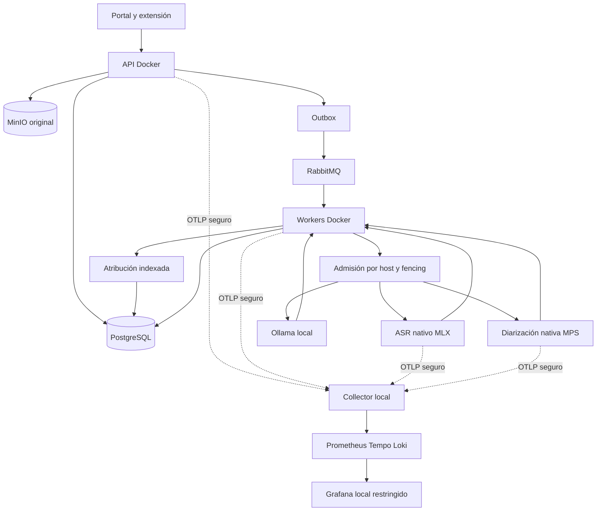
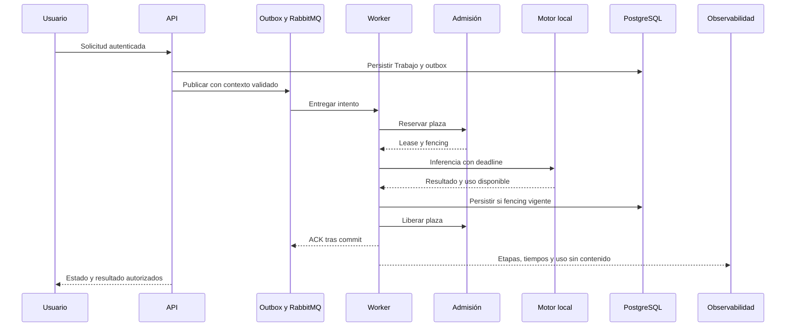

# Diseño — Reescritura incremental del pipeline y observabilidad

## Resumen

El costo principal observado del resumen fue procesar el contexto completo (618,588 s frente a 105,793 s de salida). Un cambio de UI, un timeout más largo o reescribir Python en Rust no elimina ese costo. La atribución temporal tiene además un recorrido evitable de todos los segmentos por turno. Elegimos sustituir etapas detrás de contratos existentes, medir sus costos y solo después promover cambios de inferencia.

Secuencia: (1) baseline y primera optimización exacta de atribución; (2) contadores nativos del proveedor sin contenido; (3) trazas y métricas de todo el recorrido; (4) admisión común de recursos; (5) evaluación controlada de alternativas de inferencia y resúmenes largos. La finalización documental de las tres fases fue solicitada explícitamente por Fer; no equivale a aceptación de producto ni habilitación de todos los candidatos.

## Decisiones de Diseño Clave

1. **Strangler por etapa, no big bang.** Conservar PostgreSQL, MinIO, RabbitMQ, API, extensión y motores nativos MLX/MPS. Reemplazar implementaciones tras contratos. Descartamos Tauri/Rust como migración inicial: cambia distribución y UI sin evidencia de que el lenguaje sea el cuello de botella. Reversión por commit/versión de etapa, sin migraciones destructivas.
2. **Optimización exacta de intersecciones temporales.** `backend/app/diarization/assignment.py` actualmente compara cada turno con cada segmento y ordena las intersecciones. Construir un índice por raw_label, reutilizable dentro de una llamada, con consultas de área de intervalos mediante límites ordenados y sumas prefijas. En modo acumulado preservar multiplicidad; en modo exclusivo unir intervalos por hablante antes de indexar. Consulta `area(end)-area(start)` con búsqueda binaria; intervalos vacíos/invertidos no aportan. Conservar orden de turnos, desempate por sequence y la condición de un solo candidato positivo. Alternativa más simple aceptable si mide mejor: barrido o índice start/prefix-max-end que conserve exactamente los mismos intervalos. No usar asignación por punto medio ni recortar segmentos: cambia resultados.
3. **Observabilidad estándar OpenTelemetry, salida local.** SDK/API OTel con OTLP hacia collector interno; Prometheus para métricas, Tempo para trazas y Loki para logs, Grafana como consulta local. No montar todo este stack en la primera ventana: primero eventos seguros de etapa y uso Ollama; luego despliegue opt-in con presupuesto. Descartamos un SaaS y escribir una plataforma de observabilidad propia por privacidad/costo y mantenimiento.
4. **Logs estructurados de lista positiva.** JSON por línea con UTC, severity, service.name/version, operation, outcome, attempt y correlación opaca. Nunca serializar excepciones arbitrarias, mensajes de broker, objetos request ni respuestas LLM. La instrumentación automática HTTP/SQL se configura para no capturar querystrings, cuerpos, parámetros SQL ni encabezados sensibles.
5. **Admisión común con leases persistidos.** Un coordinador de Sauri respaldado por PostgreSQL administra inicialmente una plaza pesada por host. ASR, diarización y resumen deben participar. Lease 30 s, renovación cada 10 s, token de fencing creciente, espera FIFO por clase con prioridad de trabajos del usuario sobre diagnósticos. Operaciones de control/health no ocupan plaza. No reiniciar ni descargar modelos ajenos; observar presión del host antes de admitir. Un semaphore por proceso no coordina Docker, motores nativos y Ollama: descartado como solución global.
6. **Reutilizar el pool DB del lifespan para lecturas del portal.** `meetings/router.py:get_transcript` crea y destruye un engine por petición aunque `main.py:lifespan` ya mantiene uno. Exponer factory por dependencia con alcance de aplicación, sesión por petición y dispose solo en shutdown. No cachear resultados ni compartir sesión entre usuarios. Mantener autorización, auditoría y errores. El replay READ ONLY de las dos consultas del endpoint sobre1519 turnos reales redujo mediana14,907125→8,170ms (15 muestras por variante), igualdad de resultados30/30; excluye HTTP/autorización/auditoría. Es evidencia de candidato, no código implementado ni mejora del LLM. Evitar singleton global de engine fuera del lifespan por límites de event loop y tests.
7. **Sin cambio de modelo por defecto.** Chunking jerárquico de resumen, VAD compartido, ventanas incrementales y cuantización son candidatos, no mejoras asumidas. Primero instrumentar y comparar calidad. No descartar tokens/palabras para ganar el benchmark.

## Referencias y límites de la inspiración

Inspección el 13/11/2026, documentación y código público; no benchmarks propios de esos proyectos. Heads consultados por API para trazabilidad de la referencia: MeetMemo `189229fa726cb0f53a18cc2f9c7341df1f35208d`, ghostmeet `bded100e373caeaa63f0ece640ed3c76a1b48317`, meetily `9e50dc245157de376b1a9a5b8dcd78a9cde3f2e6` (las lecturas web se realizaron sobre main, no se verificó todo el repositorio):

| Proyecto/fuente | Patrón relevante | Aplicación y límite en Sauri |
|---|---|---|
| MeetMemo, README y `docs/ARCHITECTURE.md` | Servicios por capas, cliente HTTP compartido, modelos residentes y perfiles de hardware | Reutilizar separación y medir residencia; cifras “4x” del proyecto son declaraciones sobre otro entorno CUDA, no evidencia para Metal. No copiar ausencia de autenticación ni autoelección de modelo |
| ghostmeet, README y `legacy/backend/incremental.py` | Ventanas acotadas, cursor temporal, holdback y decodificación única | Candidato para captura futura; no copiar PCM persistido (incompatible con restricción actual). El código inspeccionado avanza cursor tras fallo: Sauri no debe perder audio de ese modo. No incorpora diarización en ese flujo |
| meetily, `docs/architecture.md` | Motores nativos, canales de audio, VAD separado de la grabación, vaciado al terminar y contexto de modelos reutilizado | Preservar original y asegurar flush/backpressure; no migrar al archivo Python legacy ni asumir que Rust acelera el contexto LLM. Identificación de hablantes anunciada en Pro no es código abierto validado aquí |

Inspección adicional de código: `MeetMemo/backend/services/transcription_service.py` en commit `189229f` mantiene `_model_cache`, usa beam_size=1/best_of=1 y un executor para obtener el generador; luego consume ese generador en el event loop. Por tanto, no asumimos que todo el trabajo pesado esté realmente fuera del loop ni copiamos sus valores como garantía de precisión. En `meetily/frontend/src-tauri/src/audio/pipeline.rs` se observan buffers de mezcla y contadores de muestras descartadas; hay comentarios de ventana que no coinciden con el valor ejecutado (comentario50ms, valor600ms). Se toma el código como evidencia, no esos comentarios; Sauri debe medir dropped samples/flush y no adoptar pérdidas silenciosas.

Fuentes de código adicionales: https://raw.githubusercontent.com/NotYuSheng/MeetMemo/189229fa726cb0f53a18cc2f9c7341df1f35208d/backend/services/transcription_service.py ; https://raw.githubusercontent.com/Zackriya-Solutions/meetily/main/frontend/src-tauri/src/audio/pipeline.rs .

Fuentes: https://github.com/NotYuSheng/MeetMemo ; https://raw.githubusercontent.com/NotYuSheng/MeetMemo/main/docs/ARCHITECTURE.md ; https://github.com/Higangssh/ghostmeet ; https://raw.githubusercontent.com/Higangssh/ghostmeet/main/legacy/backend/incremental.py ; https://github.com/Zackriya-Solutions/meetily ; https://raw.githubusercontent.com/Zackriya-Solutions/meetily/main/docs/architecture.md . No importar código de terceros en esta entrega; registrar licencias y commit de referencia si se incorpora más adelante.

## Arquitectura

## Componentes e Interfaces

### Atribución (`backend/app/diarization/assignment.py`)
Mantener firma `assign_turns(turns, segments, speakers, *, require_exclusive=False) -> list[tuple[str, Speaker, int]]`. Índices privados puros, sin cache global ni cambios DB. Construcción O(S log S); consulta objetivo O(T * H * log S), H hablantes. Devolver exactamente el mismo resultado que el algoritmo anterior para datos válidos, incluidos duplicados, simultáneos, turnos desordenados y hablantes sin segmentos. `start_ms >= end_ms` produce cero. Si se usan prefijos de área, acumular enteros para evitar errores de redondeo.

### Uso del resumen (`backend/app/summaries/engine.py`)
Mantener `CanonicalSummary` y `SummarizationEngine.generate`. Tras validar resultado, leer únicamente contadores tipados del sobre Ollama: `prompt_eval_count`, `eval_count`, `total_duration`, `load_duration`, `prompt_eval_duration`, `eval_duration` (nanosegundos convertidos a segundos). Valores ausentes/negativos/no finitos/tipos inválidos se omiten, no invalidan un resumen válido. Registrar duración de pared con reloj monotónico. Nunca loguear `response`, `context`, `thinking`, `prompt`, `instructions_snapshot` ni URL. Un fallo de observabilidad no cambia la excepción de producto. Primera entrega puede emitir un evento seguro con logging stdlib; el SDK posterior consumirá el mismo esquema. No agregar llamadas para obtener contadores ya devueltos.

### Instrumentación (`backend/app/infra/telemetry.py`, nuevo)
API futura: `stage(name, *, operation_id, attempt, attributes)`, `record_usage(provider, model_alias, usage)`, `record_resource_sample(sample)`. Contexto en contextvars, extracción/inyección W3C `traceparent` con validación de tamaño/formato. No propagar `baggage` arbitrario. Vincular reintentos mediante span links. El contexto agregado a mensajes debe quedar cubierto por la firma actual y no cambiar la firma de cuerpos anteriores; probar compatibilidad de consumidores. Recursos OTel: `service.name`, `service.version`, `deployment.environment.name`, alias local de host; no hostname personal.

Spans: `ingest.upload`, `outbox.publish`, `queue.consume`, `resource.wait`, `audio.fetch`, `audio.decode`, `model.load`, `asr.infer`, `diarization.infer`, `speaker.assign`, `summary.generate`, `db.persist`, `portal.fetch`. Cola se modela con enlaces y `messaging.message.id` opaco, no manteniendo un span vivo durante horas.

### Métricas y recursos
- Histogramas en segundos: `sauri.stage.duration`, `sauri.queue.wait`, `sauri.http.duration`, `sauri.db.duration`. Buckets iniciales: 0.005, 0.01, 0.05, 0.1, 0.5, 1, 5, 10, 30, 60, 120, 300, 600, 900, 1800.
- Contadores: `sauri.operations`, `sauri.retries`, `sauri.tokens.input`, `sauri.tokens.output`, `sauri.transfer.bytes`, `sauri.telemetry.dropped`; tasas derivadas, no contadas dos veces.
- Gauges: cola ready/unacked/edad, outbox pendiente, plazas ocupadas, RSS/CPU/I/O por servicio, almacenamiento bytes, presión host. Muestreo host/contenedor cada 5 s; exportación cada 15 s.
- Dimensiones permitidas: servicio, etapa, resultado categorizado, dispositivo, proveedor, alias de modelo de catálogo acotado, tipo de trabajo. IDs solo en trazas/logs autorizados, nunca labels de métricas. No texto SQL, nombres de archivos ni raw labels de hablantes.
- macOS: RSS/CPU/I/O desde procesos propios; VM pressure y memoria host separadas. Docker: stats por contenedor del proyecto. GPU Metal/energía sin soporte fiable: `availability=unsupported`, no instalar ni ejecutar herramientas privilegiadas. No interpretar memoria unificada como dos consumos independientes.
- Dinero: campo opcional con moneda, tarifa y fuente configurada; por defecto ausente. Tokens no equivalen a energía ni a costo del hardware.

### Portal y extensión
Instrumentar `frontend/src/api.ts`, `extension/src/core/api/client.ts` y `extension/src/upload-queue.ts` con reloj monotónico y nombres de operación de catálogo; medir subida, reintentos y espera de respuesta sin cuerpos, URLs, nombres de archivos ni campos de formularios. Propagar contexto solo hacia el backend Sauri autorizado, nunca a la página de reunión ni a terceros. Enviar lotes acotados al endpoint autenticado `POST /api/telemetry/client-events` (nuevo `backend/app/telemetry/router.py`): máximo 50 eventos/32 KiB por lote, lista positiva, 60 lotes/minuto por usuario, retención igual al resto; rechazo de campos desconocidos y límites de longitud/tipos. El identificador de usuario se usa para autorización/rate-limit, no como label de métricas. Sin reintentos ilimitados si falla telemetría y sin nueva captura de contenido.

### Collector y consulta (`ops/observability/`, nuevos)
Collector OTLP en red interna, endpoints no públicos; UI solo loopback y autenticación, sin credenciales por defecto. Exportadores externos apagados. Métricas al 100%; trazas iniciales 10% probabilístico y captura de errores mediante política tail del collector; logs de fallo/saturación sin contenido. Presupuesto conjunto 512 MiB de retención/7 días: logs 256, trazas 128, métricas 128; imponer cuotas/rotación y buffers en memoria de hasta 8 MiB por proceso. Si la tecnología requiere un mínimo mayor, no arrancar fuera del presupuesto: ajustar diseño con evidencia, no ocultarlo. Recursos de stack medidos separadamente de producto. Primera ventana no despliega estos componentes.

### Admisión (`backend/app/infra/resource_admission.py`, nuevo)
Lease: `host_alias`, `slot`, `operation_id`, `owner_token`, `fence`, `expires_at`. Obtener dentro de transacción corta y `SELECT FOR UPDATE`; no mantener transacción abierta durante inferencia. Renovación independiente; reloj DB para vencimiento. Si falla heartbeat, abortar cooperativamente cuando sea posible y no persistir resultado con fence obsoleto. Restricción única de plaza por host. FIFO con prioridad explícita y envejecimiento para evitar hambre. Diagnósticos nunca desplazan trabajos ya activos. Cambio de esquema aditivo con migración cuya revisión se asignará conforme al head Alembic real al ejecutarla, no un número supuesto.

### Candidatos posteriores
- Resumen largo: comparación monolítico vs extracción por bloques con síntesis, conservando orden y trazabilidad. Rechazar si agrega omisiones o inventa decisiones. No habilitar automáticamente por longitud.
- Preparación de audio: compartir lectura/decodificación efímera por Trabajo cuando contratos lo permitan; límites RAM, cancelación y no persistir audio derivado. No reutilizar decisiones VAD de ASR para borrar voces de diarización.
- Captura incremental: cursor y backpressure con flush final, sin adelantar cursor tras errores ni convertir subtítulos parciales en transcript final. Necesita diseño de contratos adicional antes de implementación.

## Modelos de Datos

`StageEvent`: schema_version=1, UTC timestamp, operation enum, outcome enum, duration_seconds >=0, attempt entero >=0, trace_id/span_id opcionales validados, service/version, usage numérico opcional. Contexto LLM no es parte del modelo. `ResourceSample`: scope (`process|container|host`), source, availability, CPU seconds, RSS bytes, read/write bytes y memoria disponible opcionales. Nunca sustituir ausencia por 0. No guardar estos eventos en tablas de reuniones.

## Propiedades de Correctitud

P1 (R1/R4): igualdad exacta del asignador anterior y nuevo para todos los intervalos válidos y ambos modos; invariancia de inputs y orden, desempates, duplicados, huecos, varios hablantes y solapamientos. Pruebas property-based con Hypothesis y oracle anterior independiente.
P2 (R2): benchmark usa ambas implementaciones sobre la misma entrada y prueba igualdad antes de reportar ratio; distingue fixture/sintético/replay/real y no incorpora exportación DB en un solo lado.
P3 (R5): cada tramo HTTP→outbox→cola→worker→motor→DB tiene correlación validada; reintentos distintos no duplican métricas de éxito ni estados persistidos.
P4 (R6/R7): únicamente campos numéricos permitidos del sobre del proveedor llegan a logs/métricas; valores inválidos/ausentes no rompen generación válida; contenido y secretos centinela no aparecen.
P5 (R7/R8): buffers, cardinalidad, retención y error del colector permanecen acotados; pérdida observable, producto independiente. Comparar overhead con telemetría activada/desactivada.
P6 (R3): con procesos concurrentes hay como máximo una reserva pesada vigente; un propietario vencido no puede confirmar, aunque termine tarde. Caída y reintento conservan idempotencia.
P7 (R4/R9): equivalencia algorítmica no se presenta como mejora acústica. Candidatos de inferencia requieren referencia humana y métricas WER/DER según disponibilidad de anotación; tres personas confirmadas no constituyen una referencia temporal completa. Para resúmenes evaluar decisiones, acciones, cifras y omisiones sobre el mismo texto.
P8 (R6): recursos host/proceso/contenedor se distinguen y campos no disponibles no son ceros. p95 se etiqueta con n; con una corrida no se reporta percentil de servicio.

## Manejo de Errores

| Escenario | Comportamiento |
|---|---|
| Contadores Ollama ausentes o malformados | Omitir campo; conservar validación del resultado |
| Proveedor falla o timeout | Conservar excepción/deadline/reintentos actuales; evento categorizado sin payload |
| Collector caído o disco lleno | Buffer limitado, descartar con contador, nunca bloquear inferencia |
| Presión de memoria o plaza ocupada | Esperar sin loops de inferencia; estado veraz y tiempo de espera medido |
| Lease vencido | Fencing y recuperación; no commit tardío |
| Cancelación | Liberación en finally y cierre de span; no marcar éxito |
| Calidad o benchmark empeora | No promover; conservar anterior y registrar comparación |

## Estrategia de Testing

Primera entrega: `backend/tests/diarization/test_assignment_property.py`, `test_exclusive_assignment.py`, nuevas pruebas diferenciales y benchmark reproducible en `_tools/benchmark-assignment.py`; `backend/tests/summaries/test_engine.py` y nuevas pruebas de telemetría de uso. Usar `backend/.venv/bin/python` del checkout disponible con `PYTHONPATH` del worktree aislado para no instalar dependencias innecesarias. Ejecutar pytest, ruff y mypy según `backend/pyproject.toml`, registrar límites y fallos previos sin desactivarlos.

Siguientes entregas: suites de contexto entre cola/HTTP, redacción de centinelas, cardinalidad, colector ausente, carga/overhead y concurrencia PostgreSQL real. Cada prueba Docker temporal termina eliminando sus contenedores/redes/volúmenes exclusivos, sin tocar datos del dueño. Toda UI nueva requiere navegador APX y captura. Cambios TS/Rust exigirán los checks específicos del proyecto, no comandos inventados.

Benchmark inicial: preferir replay de segmentos reales si están disponibles legítimamente; si la DB solo guarda asignaciones finales, no reconstruir segmentos inventados y presentarlos como acústicos originales. Una carga generada se etiqueta sintética. Mínimo 7 repeticiones por variante tras warmup, alternar orden, usar `perf_counter`, reportar todas las observaciones y mediana. No disparar GPU/LLM simultáneos para ahorrar tiempo de reloj. El objetivo >=20% corresponde solo a la etapa optimizada. El resumen de 12m38s es baseline observacional, no un control comparable.
