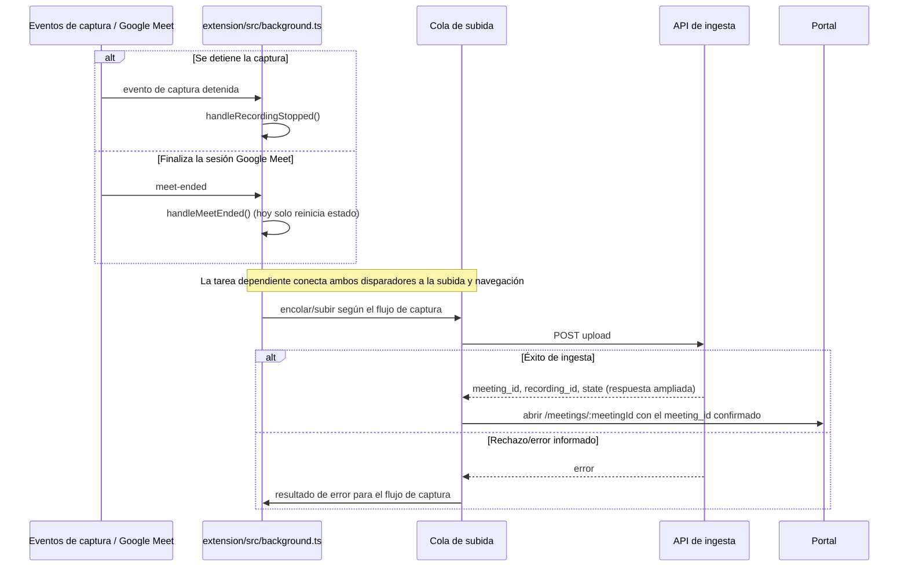

# Documento de Diseño — Portal web mínimo de Sauri

## Resumen

Este diseño cubre Fase 1; Fase 2 está secuenciada, no excluida, conforme a la tabla de fases de los requisitos aprobados. La Fase 1 abarca login visual, biblioteca básica, carga manual y revisión de reunión, incluyendo pestañas Chat (solo composición) y Notes/Summary. El disparador de producto para apertura es detener la captura o finalizar la sesión de Google Meet; la apertura automática requiere trabajo dependiente de extensión. No se inventa comportamiento/API allí donde falten contratos; esas brechas deben resolverse antes de implementación.

1. Mantener el login y la sesión existentes, con tratamiento visual consistente.
2. Estructurar la SPA en biblioteca, carga manual y vista de reunión, con `frontend/src/api.ts` como única capa HTTP.
3. Usar capacidades API existentes para listar/abrir reuniones, presentar video y turnos; añadir dependencias backend concretas para confirmar el vínculo upload–meeting y recuperar el resumen real, sin simular resultados.
4. Aplicar la decisión de producto de Fer del 2026-10-31: es elegible lo que acepta la validación actual de ingesta, sin límites nuevos; si el backend rechaza el archivo, la UI muestra su mensaje.
5. Abrir la vista al detener la captura o finalizar la sesión de Google Meet, sujeto a la dependencia explícita de que `background.ts` actualmente solo reinicia estado al recibir `meet-ended` y no abre el portal.
6. Conservar el `meeting_id` que el cliente genera y envía al upload manual (el backend ya auto-crea la reunión si no existe y deriva el título del filename); añadir solo el contrato backend que falta para leer el resumen persistido real. No se especifica ni simula generación del resumen.

## Trazabilidad de esta enmienda

- Requisitos fuente: `.spectra/specs/portal-visual-design/requirements.md`, versión base del PR #683 (head auditado `d64498273b81741d6071fa9e391f041447a1805b`, blob `53791220edb5e569e89f6a0514dfaa3dbef37160`), con la corrección R6.4 aprobada por Mira en el snapshot exacto del PR #758 (head `f4cd0fc42170b9fcdd41f659dfba3d10297ee4e1`, blob `9b73a0bc8130648083e6a041e4329ca902add3f1`). El PR #758 está abierto y no fusionado al momento de esta enmienda; esta versión exacta aprobada, incluidas las cuatro superficies y todos los criterios, es la fuente normativa para el diseño.
- Diseño que se enmienda: PR #723, head auditado `09f7b4fb8dbce7684176b5c327571e7ba70e8152`, blob `0d9421f98762094b81ffea0d775fc188aaa6d958`; Mira APPROVED.
- Baseline de producto: PR #665, commit `85b603ada14996842d913cfbbed4bcffe9fe54c5`, blob aprobado `2337a46b2ba78ef4364e23a86df9918db621c881`.
- Esta enmienda resuelve discrepancias de contratos y rutas técnicas; no modifica requisitos, baseline, comportamiento de autenticación, política de acceso, privacidad ni alcance de producto.

## Decisiones de Diseño Clave

**La Fase 1 implementa las cuatro superficies aprobadas sin excluir capacidades secuenciadas a Fase 2.** En esta fase, el portal cubre presentación de acceso, biblioteca, carga manual y revisión de reunión; Fase 2 conserva el alcance establecido por los requisitos y se diseña/entrega después. Se reutilizan contratos existentes solo donde satisfacen los criterios; las brechas de correlación de upload, resumen y apertura automática se documentan como dependencias explícitas abajo. *Alternativa descartada:* tratar código actual o mockups como sustituto de requisitos, o inferir endpoints, modelos o permisos no verificados.

**Mantener SPA y capa HTTP existentes.** La interfaz se compone en `frontend/src/`; todas las solicitudes pasan por `frontend/src/api.ts`. *Alternativas descartadas:* HTTP desde componentes, que dispersa autenticación/errores, o mover la experiencia a backend/extensión, contrario al alcance web.

**Rutas explícitas `/` (biblioteca), `/upload` y `/meetings/:meetingId`.** Usar el router existente si lo hubiera; en su defecto un módulo pequeño con History API, evitando nueva dependencia solo para estas rutas. *Alternativa descartada:* navegación solo en estado React, que no permite URL directa ni apertura desde otra superficie.

**Mantener componentes por pantalla y estado local a cada flujo.** Shell autenticado, biblioteca, carga y vista de reunión se separan bajo `frontend/src/components/`. El checkout verificado no contiene archivos CSS en `frontend/src/`; crear `frontend/src/index.css` como hoja global e importarla desde `frontend/src/main.tsx`, concentrando allí los estilos globales y tokens semánticos que la implementación necesite, sin fijar paleta ni convertir `docs/design/stitch/` en contrato de pantallas, textos o comportamiento. *Alternativas descartadas:* asumir una hoja global inexistente, dispersar estilos globales por componentes o copiar mockups no normativos como contrato visual; un `App.tsx` monolítico también concentra responsabilidades.

**Login solo cambia en presentación.** Reutilizar la experiencia y llamada de autenticación actuales, sin alterar protocolo, permisos ni estados funcionales. *Alternativa descartada:* recrear el login de Stitch, que no define el acceso aprobado.

**Elegibilidad de carga sigue la decisión de producto de Fer del 2026-10-31.** Es elegible lo que acepta la validación actual de ingesta; no se agregan límites ni reglas nuevas. Tras elegir el archivo, ofrecer «Subir y procesar» y, si el backend lo rechaza, mostrar su mensaje. Esta regla es una decisión de producto vigente, no un detalle pendiente. *Alternativa descartada:* introducir validaciones locales o límites de formato/tamaño no aprobados.

**Estados de transferencia separados de procesamiento y reintento acotado.** Mostrar progreso solo cuando el transporte informa bytes; no simular porcentaje ni afirmar que el procesamiento terminó al finalizar HTTP. Conforme a la corrección aprobada de R6.4, ante fallo el archivo seleccionado queda disponible para reintentar y se ofrece «Reintentar»; los errores de carga manual no ofrecen «Copiar diagnóstico» mientras se revisa el contenido de esos diagnósticos. No se garantiza conservación del blob/job en servidor ni supervivencia de reintentos ante interrupción de red o cierre. *Alternativa descartada:* prometer persistencia/continuidad no aprobada.

**Vincular la carga manual con el ID confirmado por la respuesta de ingesta.** Al seleccionar el archivo, el portal crea un `meeting_id` y una clave de idempotencia para ese intento lógico, los conserva en memoria durante el flujo y envía ambos junto con el título del filename a `POST /api/v1/ingestion/upload`. El backend ya acepta `meeting_id` requerido, `title` opcional y `meet_link` opcional; normaliza el título con `resolve_upload_title(..., audio.filename)` y `process_ingestion` auto-crea la reunión de origen `manual` con ese mismo ID, título y `created_by` autenticado si aún no existe. Extender la respuesta tanto para éxito nuevo como para reintento idempotente con `meeting_id`, preservando `{recording_id, state}`; el portal abre `/meetings/:meetingId` solo tras confirmación de éxito y usa el `meeting_id` devuelto. El servidor confirma el enlace sin que el frontend interprete `recording_id` como ID de reunión ni confíe solo en una variable local. En el reintento explícito del mismo flujo, mantener archivo, ID y clave ya asignados. No persistirlos para prometer recuperación tras cerrar o interrumpir la pestaña. *Alternativas descartadas:* llamada previa a `POST /meetings` que exige un enlace Meet válido y no aplica a una grabación independiente; ruta de creación duplicada; inferir meeting ID de recording ID; navegar usando solo un ID local no confirmado por el servidor; inventar un enlace Meet.

**Leer el resumen desde un contrato backend real y separado del transcript.** Añadir al backend/API una operación autenticada de lectura para el resumen persistido de la reunión; el frontend tipa el resultado, lo presenta separado de notas/transcripción y genera copiar/descargar únicamente a partir del contenido devuelto. La respuesta debe aportar tema principal y argumentos/puntos clave que exige Requisito 4.8. No se prescribe ni se simula el mecanismo de generación, plantilla, estado de procesamiento o contenido del resumen: el contrato solo se considera listo cuando CORE ofrece el resumen real que se debe leer. *Alternativas descartadas:* extraer una aproximación del transcript en el navegador, mostrar fixtures o tratar la disponibilidad de una plantilla como si fuera un resumen.

**Apertura automática al detener la captura o finalizar una sesión de Google Meet: dependencia de extensión.** Requisito 3.7 exige abrir la vista de la reunión correspondiente tras cualquiera de esos disparadores. Hoy `extension/src/background.ts` maneja `chrome.tabs.onRemoved` para detener la captura cuando se cierra la pestaña propietaria; el mensaje `meet-ended` llama a `handleMeetEnded()`, que reinicia estado, pero no abre el portal. La tarea dependiente de extensión debe conectar la detención/fin de sesión de Google Meet con la subida y el destino de la reunión, sin afirmar que el código actual ya navega ni ampliar el disparador a otros servicios. *Alternativa descartada:* atribuir apertura automática al código actual, que solo realiza stop/reset.

## Arquitectura

```mermaid
graph TD
  Browser[Portal React] --> Shell[Shell autenticado y rutas]
  Shell --> Login[Login existente]
  Shell --> Library[Biblioteca: listar y abrir]
  Shell --> Upload[Carga manual]
  Shell --> Meeting[Reunión: video, turnos y resumen]
  Login --> Api[frontend/src/api.ts]
  Library --> Api
  Upload --> Api
  Meeting --> Api
  Api --> Backend[API Sauri existente]
  Backend -->|GET summary autenticado pendiente| Summary[Resumen persistido real]
  Capture[Extensión MV3 background] --> Queue[Cola durable de subida]
  Queue --> Ingestion[POST ingestion upload]
  Ingestion -->|meeting_id confirmado por respuesta ampliada| ExtNavigate[Extensión abre Portal meeting URL]
  ExtNavigate --> Meeting
  Upload -->|crear meeting_id + idempotency_key en estado del flujo; title = filename| UploadRequest[POST ingestion upload]
  UploadRequest -->|meeting_id, title, meet_link opcional| IngestionService[process_ingestion]
  IngestionService -->|auto-crea Meeting manual si falta| MeetingStore[Meeting con ID, título y owner]
  UploadRequest -->|meeting_id + recording_id + state| UploadResult[Resultado confirmado]
  UploadResult -->|abrir usando el meeting_id devuelto| OpenMeeting[/meetings/:meetingId]
  OpenMeeting --> Meeting
```



Flujo de carga manual separado de la captura de extensión:

```mermaid
sequenceDiagram
  participant U as Usuario
  participant P as Portal
  participant API as API Sauri
  participant DB as Persistencia de reuniones
  U->>P: Selecciona archivo
  P->>P: Crear meeting_id + idempotency_key; conservarlos con el archivo en memoria
  P->>API: POST /api/v1/ingestion/upload (meeting_id, title=filename)
  API->>DB: process_ingestion crea Meeting manual si falta, con meet_link opcional y owner autenticado
  DB-->>API: Meeting con el ID enviado
  API-->>P: meeting_id, recording_id, state
  P->>P: Abrir /meetings/:meetingId usando meeting_id confirmado; transferencia != procesamiento completo
```

## Componentes e Interfaces

### Web — `frontend/src/`

- `App.tsx`: sesión existente, shell y rutas `/`, `/upload`, `/meetings/:meetingId`.
- `components/PortalShell.tsx`: navegación limitada a Biblioteca, Subir grabación y reunión abierta.
- `components/LoginScreen.tsx`: presentación nueva alrededor de login existente, sin cambiar su contrato.
- `components/RecordingLibrary.tsx`: carga de lista ordenada newest-first, estados cargando/vacío/error, abrir selección.
- `components/RecordingUpload.tsx`: selector; ofrecer acción según validación actual de ingesta conforme a decisión de producto Fer 2026-10-31, sin límites nuevos; mostrar error del backend. Al aceptar la selección, crear y conservar `meeting_id` e `idempotency_key` en estado del flujo; enviar esos valores y el filename como `title` a la operación existente de upload. El backend ya auto-crea la reunión manual autenticada al no existir el ID, con enlace Meet opcional y título resuelto desde el filename. Al aceptar la carga, ofrecer link/abrir `/meetings/:meetingId` usando el `meeting_id` devuelto por el backend; `recording_id`/`state` describen grabación/estado y no sustituyen al ID de reunión. Progreso real y reintento; en errores de carga manual no ofrecer «Copiar diagnóstico». Conservar selección, ID y clave durante el flujo abierto para reintentar, sin prometer recuperación tras cierre/interrupción.
- `components/MeetingView.tsx`: reproductor arriba de transcripción; controles ordinarios visibles de seek, velocidad, calidad/resolución, pausa, volumen y mute. Calidad/resolución solo refleja opciones disponibles del medio/reproductor y no promete calidad inexistente. Cada turno muestra timestamp, etiqueta de hablante coloreada y texto; al avanzar playback se resalta el turno correspondiente y se desplaza la lista para mantenerlo visible; seleccionar turno hace seek a su tiempo vinculado e inicia reproducción. No fijar colores ni formato de timestamp.
- Panel lateral inicial con pestañas **Chat** y **Notes/Summary**. Chat en Fase 1 es solo pestaña, sin interfaz ni interacción de chat; sus capacidades interactivas quedan Fase 2. Notes/Summary mantiene notas, resumen y transcripción como contenidos distintos, no mezcla el transcript en el resumen. `Summary` consume el resumen real de la reunión mediante la nueva operación de lectura autenticada del backend; copiar y descargar serializan solo ese contenido devuelto en estructura legible con tema principal y argumentos/puntos clave, sin imponer un layout fijo. El contrato backend y la disponibilidad de resumen persistido son prerequisitos explícitos de esta parte de UI; no se bloquea el resto del portal ni se simula contenido mientras falten.
- `api.ts`: extender `RecordingUploadData` con `title: string` para enviar el filename como título; en el flujo web crear una vez `meeting_id` e `idempotency_key`, enviarlos junto con `capture_origin: "web_upload"`, `duration_seconds` y `video_presence`, y conservarlos para el reintento visible. Para reportar progreso real, el adaptador de upload usa `XMLHttpRequest.upload` progress events (no `fetch`, que no expone progreso de subida); solo muestra porcentaje determinista cuando `lengthComputable`, y no fija progreso ficticio. `uploadRecording` continúa usando `POST /api/v1/ingestion/upload`; extender `RecordingUploadResult` a `{meeting_id, recording_id, state}` y responder el meeting ID asociado tanto en éxito nuevo como idempotente. El cliente navega solo con ese ID confirmado. Para el resumen, agregar `getMeetingSummary(meetingId: string): Promise<{ main_topic: string; key_points: string[] }>` sobre `GET /api/v1/meetings/{meetingId}/summary` (contrato backend autenticado pendiente); los campos reflejan Requisito 4.8, y el backend provee valores reales persistidos, no generación definida aquí.
- Crear `frontend/src/index.css` como hoja global porque el checkout inspeccionado no tiene CSS en `frontend/src/`; importarla en `frontend/src/main.tsx`. Ahí se aplican los tokens semánticos Terra.

### Límites de la dirección visual

- `docs/design/stitch/` es inspiración visual no normativa, no especificación de pantallas, contenido, comportamiento ni criterios de aceptación.
- Los requisitos y la línea base no fijan breakpoints, paleta, ratios de contraste ni objetivos de accesibilidad específicos; este diseño no los inventa ni los convierte en criterios nuevos de aceptación.

### Backend / contratos dependientes

Brechas y contratos dependientes verificados:

1. **Vínculo upload→reunión: la capacidad backend ya existe; el frontend debe usarla.** `IngestionData.meeting_id` es obligatorio y `title`/`meet_link` opcionales. Antes de llamar `POST /api/v1/ingestion/upload`, el portal genera un ID y una clave de idempotencia, fija el título al filename y los conserva durante el flujo. `resolve_upload_title` usa ese valor (con fallback actual a `audio.filename`); `process_ingestion` auto-crea la reunión si falta, con `id` igual al recibido, `title` resuelto, `meet_link` nullable, `origin="manual"` y `created_by` del usuario autenticado. La respuesta vigente `{recording_id, state}` no devuelve `meeting_id`; extender ambos caminos de respuesta (nuevo e idempotente) a `{meeting_id, recording_id, state}`. El frontend navega solo con ese ID confirmado y el backend conserva la semántica de auto-creación ya existente. No crear endpoint de reunión adicional, ni cambiar validación/enlaces Meet.
2. **Lectura de resumen: contrato backend faltante.** Añadir `GET /api/v1/meetings/{meetingId}/summary`, protegido por autenticación y ownership existentes, con solo datos reales requeridos por la vista: `{main_topic, key_points}`. En el checkout examinado no hay ruta, modelo/entidad, generador ni método frontend de resumen (solo un resolver de plantillas). El backend debe conectar la lectura a un resumen realmente producido y persistido; no se diseña el algoritmo/generación ni se trata una plantilla como resultado. Si CORE no provee ese resumen, Zoya separa y obtiene aprobación de la tarea/spec backend necesaria; el UI de resumen espera el contrato, mientras el resto de las superficies puede seguir.

No hay cambio de política de autenticación, permisos, privacidad o retención. El endpoint de resumen se debe comportar bajo los mismos límites de autorización que los endpoints actuales de reuniones. Las capacidades secuenciadas a Fase 2 (renombrar/eliminar/descargar artefactos, editar metadatos/tags, renombrar hablantes y filtrar la biblioteca) permanecen dentro del alcance aprobado, pero sus contratos/modelos técnicos se concretarán en esa fase.

### Extensión y correlación de resultado

- `extension/src/background.ts`: hoy `chrome.tabs.onRemoved` detiene la captura en la pestaña propietaria; el mensaje `meet-ended` reinicia estado, no abre el portal. La tarea dependiente de extensión debe conectar los disparadores aprobados —detención de captura o fin de sesión de Google Meet— con la subida y la apertura de la reunión correspondiente; el código actual no completa esa navegación.
- La captura de extensión es independiente de la carga web manual. `background.ts` genera actualmente un `meeting_id` en `uploadRecording`, pero esa función retorna `void` y no propaga el ID; la respuesta actual de ingesta tampoco lo devuelve. Con el contrato ampliado, ambos clientes reciben `meeting_id`; la tarea de extensión debe abrir portal solo tras éxito confirmado y conectar stop/cierre al destino, sin inferir de `recording_id`.
- No asumir preservación de job/blob ante fallo o cierre de la pestaña. Para la UI web manual, el ID/clave viven solo mientras el formulario permanece abierto; su reintento explícito reutiliza ambos.
- La API del portal tampoco ofrece método de resumen actualmente; la lectura real requiere el contrato backend descrito arriba.
- La detención de captura o el fin de sesión de Google Meet son los únicos disparadores aprobados para la apertura automática; la implementación actual no completa ese recorrido.

### Colocación y pruebas

| Superficie | Carpetas / archivos | Pruebas | Migración / Compose / shared-types |
|---|---|---|---|
| Web | Modificar `frontend/src/App.tsx`, `frontend/src/api.ts`, `frontend/src/components/`; crear `frontend/src/index.css` e importarla desde `frontend/src/main.tsx` | Tests existentes bajo `frontend/src/`; creación/correlación de upload, acceso a resumen, copiar/descargar, estados y rutas | Sin migración ni Compose |
| Backend/API | Mantener el auto-create en `backend/app/ingestion/`; añadir `meeting_id` a las respuestas nuevas e idempotentes; agregar lectura real del resumen cuando CORE provea origen persistido | Tests contractuales para los dos caminos de respuesta y resumen en `backend/tests/`; verificar vínculo y título filename | No requiere migración/Compose para correlación; resumen solo según contrato y datos aprobados |
| Extensión | Tarea dependiente en `extension/src/background.ts` para conectar disparadores a apertura; sin garantías sobre job/blob | Tests colocados junto al módulo y E2E en `extension/tests/e2e/` para señales y navegación, cuando contrato esté listo | Sin migración ni Compose salvo necesidad aprobada; no importar fuentes cruzadas/shared-types |

## Modelos de Datos

- **Carga web**: `meeting_id`, `idempotency_key` y `title` pertenecen al estado efímero del flujo activo; se generan/derivan al seleccionar el archivo, se envían en `IngestionData` y se reutilizan en el reintento explícito. El backend crea la reunión con ese ID si no existe; no se persisten en el navegador tras abandonar la página.
- **Resultado de ingesta objetivo**: `{meeting_id, recording_id, state}`; `meeting_id` es el identificador asociado a la grabación, confirmado por backend en respuesta nueva e idempotente. El portal nunca lo deduce de `recording_id`.
- **Reintento manual**: el archivo seleccionado permanece disponible en el flujo de UI para la acción «Reintentar» según `docs/product/baseline.md` §4.D.5; no se especifican garantías de almacenamiento o continuidad fuera de ese flujo.
- En web, reutilizar tipos actuales cuando correspondan; el contrato de resumen es el prerequisito descrito arriba y los contratos de las capacidades secuenciadas a Fase 2 se concretarán en esa fase.

## Propiedades de Correctitud

1. **Acceso preservado:** aplicar estilo al login no cambia solicitud, sesión ni permisos.
2. **Biblioteca veraz:** muestra registros reales en orden newest-first y permite abrirlos; no presenta búsqueda full-text ni filtros/acciones no incluidas en esta entrega.
3. **Revisión sincronizada:** video/media antecede a turnos; cada turno presenta timestamp, etiqueta coloreada y texto; durante playback el turno correspondiente se resalta y la lista lo desplaza a vista; seleccionar un pasaje busca su tiempo enlazado e inicia playback. El reproductor expone seek, velocidad, calidad/resolución, pausa, volumen y mute. El panel empieza con Chat y Notes/Summary; Chat no interactúa en Fase 1. Notes, resumen y transcripción permanecen separados; copiar/descargar exporta únicamente resumen con tema principal y argumentos/puntos clave.
4. **Elegibilidad y rechazo:** seleccionar un archivo habilita acción sin límites locales nuevos; rechazo backend se presenta claramente y conserva archivo.
5. **Progreso honesto:** progreso mostrado deriva bytes reportados; no se informa procesamiento completado por fin de transferencia.
6. **Disparadores de apertura:** detener la captura o finalizar la sesión de Google Meet son los disparadores aprobados; la apertura requiere la tarea dependiente de extensión, pues `meet-ended` hoy reinicia estado y no abre el portal.
7. **Correlación de carga manual:** el portal genera `meeting_id` e `idempotency_key` una vez por intento lógico; el backend auto-crea la reunión si falta y deriva título desde filename; toda respuesta exitosa (incluido reintento idempotente) retorna ese `meeting_id` asociado, y la UI abre solo con el ID confirmado, nunca `recording_id`.
8. **Resumen de fuente real:** el contenido mostrado/copied/downloaded proviene solo de `getMeetingSummary` y de una reunión autorizada; sin el contrato/dato real no se renderiza resumen simulado. El contrato API/backend es prerequisite de esta vista.
9. **Reintento acotado:** en errores de carga manual mostrar «Reintentar» y no ofrecer «Copiar diagnóstico»; mantener el archivo seleccionado, `meeting_id` y clave de idempotencia en el flujo abierto; no afirmar garantías de job/blob ante interrupciones o cierre.
10. **Privacidad:** URL/mensajes de navegación no incluyen tokens, audio ni texto de transcripción.

## Manejo de Errores

| Escenario | Comportamiento |
|---|---|
| Login/API 401 en portal | Reutilizar `sauri:unauthorized` y volver al login; no exponer detalles sensibles. |
| Biblioteca vacía/error | Mostrar vacío solo con respuesta vacía real; ante error mostrar aviso y reintento, no datos ficticios. |
| Archivo rechazado por backend | Mostrar mensaje claro devuelto; conservar selección y no imponer validación local extra. |
| Rechazo de ingesta | Mostrar el mensaje de backend; no agregar límite local de elegibilidad. |
| Fallo de carga manual | Explicar en lenguaje claro, ofrecer «Reintentar» y no ofrecer «Copiar diagnóstico» mientras se revisa su contenido; dejar disponible el archivo seleccionado; no afirmar recuperación de servidor. |
| Ingesta exitosa | Usar el `meeting_id` devuelto por el backend para abrir la reunión; no derivarlo de `recording_id`. Si el backend no confirma el ID, no construir la ruta de reunión. |
| Resumen sin contrato/dato real disponible | No simularlo ni derivarlo del transcript; el bloque de resumen espera el contrato backend y comunica solo errores reales devueltos por la API. |
| Detención de captura / fin de sesión de Google Meet | `tabs.onRemoved` actual detiene captura al cerrar la pestaña propietaria; `meet-ended` reinicia estado pero no abre portal. La apertura automática requiere una tarea de extensión y debe cubrir solo los disparadores aprobados. |

## Estrategia de Testing

**Frontend:** usar comandos y runner establecidos en `frontend/package.json`; probar login sin cambio de contrato, biblioteca con datos sintéticos, creación/correlación de carga, ruta de reunión solo después de un `meeting_id` confirmado, estados/rechazo con archivo retenido, progreso real y ausencia de acciones fuera de alcance. Probar `getMeetingSummary`, render de tema/puntos y copiar/descargar solo de los valores devueltos por API una vez disponible el contrato backend.

**Backend/API (prerrequisito dependiente):** probar reunión auto-creada para `meeting_id` nuevo con título del filename, `meet_link` null y `created_by` del usuario; respuestas nueva e idempotente incluyen el mismo `meeting_id`, `recording_id` y `state`. Para resumen, tests contractuales de producción/persistencia/lectura autenticada con datos sintéticos; no inventar contenido ni tocar datos reales.

**Extensión (tarea dependiente):** probar detención de captura y fin de sesión de Google Meet como disparadores de apertura; propagar el `meeting_id` confirmado por respuesta y navegar solo tras éxito. No asumir que `meet-ended` hoy abre portal ni exigir garantías de retención/reintento no definidas por baseline. Usar fixtures sintéticos y APIs Chrome controladas en tests.

**Comandos configurados:** `npm run test`, `npm run typecheck`, `npm run build` desde `frontend/`; `npm run test`, `npm run typecheck`, `npm run build` y `npm run test:e2e` desde `extension/` para cambios de captura; backend sigue sus comandos configurados en `backend/`. En esta enmienda documental no se ejecutan pruebas de implementación.
