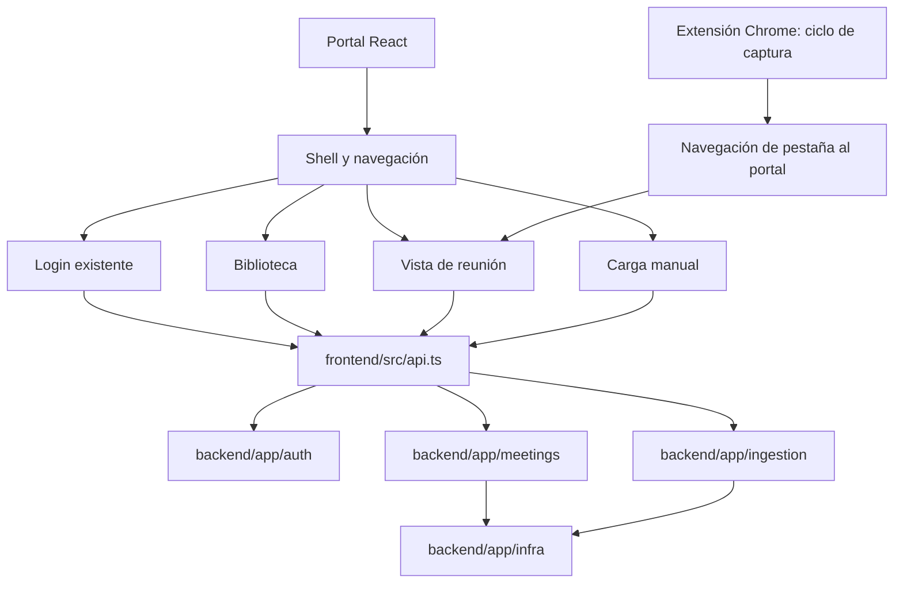

# Documento de Diseño — Portal web mínimo de Sauri

## Resumen

El portal existente es una SPA React pequeña con login y vistas de reuniones/transcripción, mientras que el alcance aprobado amplía su papel a biblioteca, revisión integral de reunión y carga web manual. El código existente acredita patrones y capacidades disponibles, pero no satisface por sí solo los nuevos comportamientos de producto. La UI debe mantener autenticación y autorización existentes, distinguir transferencia de procesamiento y presentar solo funciones respaldadas por requisitos; Stitch orienta exploración visual, no define pantallas ni políticas.

1. Evolucionar `frontend/src/App.tsx` a un shell web autenticado con vistas explícitas de biblioteca, reunión y carga, manteniendo el login existente como única operación de acceso.
2. Separar componentes de presentación de estado/efectos y conservar `frontend/src/api.ts` como única capa HTTP.
3. Extender el backend en sus módulos existentes y contratos para completar CRUD/metadatos, descarga, revisión, listado y carga, con control de usuario en cada operación.
4. Modelar transferencia, confirmación de carga, resultado y reintento como estados distintos; no equiparar respuesta de ingestión con procesamiento finalizado.
5. Enrutar la apertura automática de una reunión desde el flujo de captura hacia una URL de portal identificada por meeting ID, usando un destino de navegación explícito y sin compartir tokens.
6. Aplicar la aclaración de producto de Fer: la elegibilidad provisional de carga coincide con lo que acepta hoy la validación existente de ingesta; al seleccionar un archivo se habilita «Subir y procesar», y un rechazo del backend se muestra con su mensaje claro. No agregar restricciones de formato o tamaño.

## Decisiones de Diseño Clave

**Mantener la SPA React en `frontend/` y su API central en `frontend/src/api.ts`.** La aplicación existente usa `App.tsx` para navegación local y concentra HTTP en `api.ts`; extender ese límite reduce nuevas abstracciones y conserva el aislamiento de superficies. *Alternativas descartadas:* llamadas HTTP desde componentes, porque fragmentarían autenticación y errores; mover la UI al backend o a la extensión, porque los requisitos describen portal web.

**Usar navegación de aplicación con rutas identificables `/` (biblioteca), `/meetings/:meetingId` y `/upload`, con enlaces internos y resolución de ID.** La ruta de reunión hace posible volver a una reunión concreta y es destino estable del flujo de captura; guardar directamente URLs evita depender de un estado React efímero. Si no hay librería de routing en `frontend/package.json`, usar History API con un módulo pequeño en `frontend/src/` antes que agregar una dependencia solo para tres rutas. *Alternativas descartadas:* estado local exclusivo, que no permite navegación directa ni abrir una reunión desde otra superficie; introducir ahora un framework de routing sin necesidad demostrada.

**Separar el shell y las pantallas por función bajo `frontend/src/components/` y mantener lógica reusable de estado/formatos en módulos dedicados del mismo `frontend/src/`.** El shell resuelve login y navegación; cada pantalla posee sus solicitudes, estados y acciones. La biblioteca aplica búsqueda/filtros/orden sobre campos/metadatos disponibles, orden inicial newest-first y nunca busca texto de transcripción entre reuniones. *Alternativas descartadas:* un componente monolítico condicional como el `App.tsx` actual, que ya mezcla autenticación, navegación y vistas; una nueva capa global de estado, no requerida para flujos acotados.

**CSS semántico mediante variables de tema centralizadas en `frontend/src/` (archivo global de estilos a determinar por inspección al implementar), componentes sin colores inline y tokens de rol para superficie, texto, borde, acción, foco, selección y error.** La guía Terra de `design/stitch/README.md` puede inspirar el tono cálido, pero sus hex, tipografías, composiciones y umbrales no son requisitos aprobados ni se copiarán como decisión normativa. La línea base no aprueba un catálogo de tokens visuales ni conformidad visual; por tanto se evita fijar valores, breakpoint o claims de accesibilidad no especificados. En todos los estados los controles deben seguir siendo operables con teclado y etiquetas semánticas como condición técnica básica, sin afirmar una certificación. *Alternativas descartadas:* convertir valores de mock directamente en contrato visual; estilos inline por pantalla, que impiden una escala coherente.

**Reutilizar login y sesión existentes sin alterar el protocolo ni su política.** El rediseño se limita a la presentación del componente login existente y delega `login()` a la API actual. No se derivan del mock campos, copy, expiración, recuperación, IdP, mensajes de sesión ni pasos adicionales. *Alternativas descartadas:* introducir auth nueva o replicar UI de login Stitch, ambas contrarias al requisito 1.

**Tratar carga manual como estado de UI coordinado con endpoint de ingestión, no como tarea síncrona de transcripción.** `uploadRecording` actual usa `fetch`, que no expone progreso de subida; se añadirá un adaptador con progreso de bytes (por ejemplo XMLHttpRequest) tras la misma capa `api.ts`, evitando exponer progreso de procesamiento no existente. El éxito solo confirma recepción/encolado que pruebe el contrato del servidor; muestra vínculo/abre reunión con ID de resultado y título inicial igual al nombre seleccionado. El estado de error conserva el mismo `File` mientras la página permanece montada y ofrece reintento. *Alternativas descartadas:* porcentaje simulado, que sería engañoso; mostrar éxito de transcripción tras respuesta HTTP de carga; reintentar creando silenciosamente una operación no idempotente.

**Tratar ingestión como frontera de datos autenticada con identidad estable e idempotencia.** El cliente obtiene un `meeting_id` e `idempotency_key` por intento lógico y reutiliza el mismo identificador en retry de esa operación; no genera una operación nueva al reintentar. No guarda audio en almacenamiento web persistente ni registra contenido/credenciales. La decisión de Fer establece provisionalmente como elegible lo que acepte hoy la validación de ingesta del backend; seleccionar un archivo habilita «Subir y procesar», sin validaciones locales adicionales ni límites nuevos de formato o tamaño. El formulario envía el contrato de ingesta vigente; si el backend rechaza el archivo o la solicitud, la UI presenta su mensaje claro y conserva el archivo para corregir/reintentar cuando corresponda. No sintetizar metadata requerida ni ocultar incompatibilidades del contrato: cualquier rechazo por datos requeridos también se informa según el mensaje del backend. *Alternativas descartadas:* inferir restricciones adicionales de formatos/tamaño/duración desde HTML, mocks o código legado; duplicar en cliente la validación autoritativa del backend.

**Extender módulos de backend existentes en vez de crear un módulo portal.** Reuniones permanecen en `backend/app/meetings/`; ingesta en `backend/app/ingestion/`; auth en `backend/app/auth/`; persistencia compartida continúa en `backend/app/infra/`. Mantener cambios de modelo y migración juntos si se necesitan, con pruebas en módulos espejo. *Alternativas descartadas:* duplicar lógica del portal en frontend o inventar un `backend/app/portal/`; saltarse controles/ownership existentes.

**Abrir automáticamente la reunión al detenerse la captura mediante navegación a la ruta del portal con el ID confirmado.** El componente de captura/extensión notifica al coordinador existente el meeting ID cuando conoce el fin de sesión; una navegación de pestaña explícita abre el portal en `/meetings/:meetingId`. El evento no lleva JWT, audio ni transcripción. Requiere identificar y modificar el punto exacto que observa el fin de captura en la extensión durante implementación; no se asume que el backend actual notifique a una pestaña web. *Alternativas descartadas:* polling global del portal, que no resuelve portal cerrado; incluir token en URL; fingir que la sesión de Meet terminada implica procesamiento completo.

## Arquitectura



```mermaid
sequenceDiagram
  participant U as Usuario
  participant UI as Portal React
  participant API as frontend/src/api.ts
  participant BE as API Sauri
  U->>UI: Selecciona archivo
  UI->>UI: Mantiene File en memoria
  UI-->>U: Habilita «Subir y procesar» al seleccionar archivo
  U->>UI: Subir y procesar
  UI->>API: Archivo + metadata del contrato + idempotency key
  API->>BE: Multipart autenticado; informa bytes transferidos
  BE-->>API: Resultado o mensaje claro de rechazo
  alt rechazo del backend
    API-->>UI: Error de ingesta
    UI-->>U: Mensaje del backend; conserva archivo
  else carga aceptada
    API-->>UI: Transferencia completada, procesamiento pendiente/no afirmado
    UI-->>U: Enlace o apertura de reunión
  end
  opt error recuperable durante transferencia
    BE-->>API: Error
    API-->>UI: Error normalizado
    UI-->>U: Explicación clara; conserva archivo y permite reintentar
  end
```

### Fronteras y estados de pantalla

- **Shell autenticado:** no realiza peticiones de datos antes de comprobar la sesión existente. Mantiene el mecanismo actual de `sauri_token` mientras no se apruebe un cambio de auth. El evento 401 vuelve al login según patrón existente.
- **Biblioteca:** solicitudes tienen estados inicial/cargando, resultado vacío, error recuperable con volver a solicitar, y lista. La lista presenta registros más nuevos primero; búsqueda, filtros derivados de metadatos disponibles y ordenamiento se limitan a datos de grabación/metadatos, no texto de transcripción. Los filtros no se predefinen como catálogo ni se muestran tarjetas con agregados inventados.
- **Vista de reunión:** carga de entidad y artefactos con estados loading/empty/error por recurso para que un fallo de resumen no oculte la transcripción. Reproductor arriba; transcripción debajo; cada turno con timestamp, color/identidad visual de speaker y texto. El controlador sincroniza posición: avance de media selecciona y desplaza al turno temporizado; seleccionar turno busca al inicio enlazado. Cambiar nombre de speaker solo actualiza atribución. Panel lateral inicialmente contiene Chat no interactivo y Notes/Summary; notas/resumen separados de transcripción; resumen puede copiarse o descargarse y presenta tema principal y argumentos/puntos clave sin fijar layout. Eliminación requiere confirmación de intención y refleja el resultado o error; no implica garantía de borrado más allá de respuesta del servidor. Los controles de reproducción contemplan seek, velocidad, calidad/resolución cuando el medio lo soporte, pausa, volumen y mute; no inventan conducta específica para video.
- **Carga:** al seleccionar el archivo, «Subir y procesar» queda habilitado; el backend vigente es autoridad para aceptar o rechazar. No se añaden filtros locales de formato/tamaño ni límites nuevos. Estados: selección, transfiriendo con progreso de bytes real, transferencia completa/resultado y fallo recuperable/retry. No hay progreso de procesamiento inferido. Error no borra el archivo seleccionado; la UI muestra en claro el mensaje de rechazo del backend. «Copiar diagnóstico» solo copia un payload expresamente allowlisted, sin token, secretos, nombre de archivo ni transcripción. Esta regla de elegibilidad es provisional por decisión de Fer, hasta que se definan otras reglas.
- **Login:** solo composición/estilo del flujo existente; presentación no define estados nuevos ni altera comportamiento.

## Componentes e Interfaces

Las interfaces siguientes son límites de diseño; el detalle de campos debe seguir contratos backend/shared existentes y cambios aprobados, no recrear estructuras divergentes.

### Frontend — `frontend/src/`

- `App.tsx`: resolver ruta, autenticación y shell; delegar por pantalla. Ruta no encontrada vuelve a biblioteca o muestra una ruta interna no encontrada sin petición de API.
- `components/PortalShell.tsx`: navegación entre Biblioteca, Subir grabación y reunión seleccionada; no incorpora secciones de hablantes o plantillas como destinos de navegación.
- `components/LoginScreen.tsx`: reemplazo visual o estilizado del login actual, conserva `api.login`, almacenamiento y eventos actuales.
- `components/RecordingLibrary.tsx`: lista, búsqueda local/servidor, filtros de metadatos disponibles, selección/orden. Datos de filtro derivan de metadatos reales retornados.
- `components/MeetingView.tsx`: compone reproductor, transcripción y panel Chat/Notes-Summary; piezas existentes `MeetingPlaybackView.tsx`, `TranscriptView.tsx`, `PlaybackController.ts` se reutilizan solo si pasan criterios actuales.
- `components/RecordingUpload.tsx`: selector local, botón habilitado al seleccionar, estados de transferencia y resultado, mensaje claro de rechazo del backend, reintento y diagnóstico reducido; sin validaciones adicionales de elegibilidad del lado cliente.
- `api.ts`: agregar funciones tipadas para list/search/sort, detalle/actualización de metadatos/tags, rename/delete/download, notas/resumen y subida con callback `onProgress(loadedBytes, totalBytes)`. Mantener `fetch` solo donde progreso no sea requerido; no llamadas HTTP directas desde componentes.
- `styles/` o archivo CSS global ya existente (verificar package y árbol al implementar): tokens de rol y estilos de shell/pantallas, sin importar CSS/HTML de Stitch.

### Backend

- `backend/app/meetings/router.py`, `service.py`, `repository.py`, `schemas.py`: contratos requeridos para listar y ordenar, leer/renombrar/eliminar, metadatos company/project/participants, tags, descarga autenticada y artefactos de reunión. Aplicar ownership por usuario en cada acceso; el diseño no define garantía de eliminación ni formato de exportación.
- `backend/app/ingestion/router.py`, `service.py`, `schemas.py`: aceptar carga web con origen `web_upload`; resolver respuesta con meeting ID/recording ID y estado de transferencia/ingestión; respetar idempotencia; no indicar procesamiento terminado sin estado backend que lo demuestre.
- `backend/app/auth/`: mantener login/dependencies existentes. Los nuevos endpoints usan dependencia de usuario existente, no un bypass por origen web.
- `backend/app/infra/models.py` y `backend/alembic/versions/`: solo si los campos/tags requeridos no tienen persistencia existente; cualquier migración secuencial y reversible acompaña el cambio de modelo. La revisión de modelo actual y migraciones determinará si hace falta migrar.

### Extensión e integración

- La detección de fin de captura vive en ciclo de vida existente de `extension/src/background.ts`, `content.ts` o coordinador correspondiente, no en UI del portal.
- En señal confirmada con `meeting_id`, construir destino con origen/configuración de portal vigente y navegar a `/meetings/:meetingId`; no pasar JWT ni datos de medios por URL/mensaje. Si no hay destino de portal configurado o no se obtiene ID, no fabricar una reunión; registrar el fallo operacional según mecanismos existentes y preservar comportamiento actual. La configuración del destino y agente responsable de la navegación requieren inspección del código de captura antes de implementar.

### Colocación y pruebas

| Superficie | Archivos previstos | Pruebas previstas | Migración / configuración |
|---|---|---|---|
| Web | `frontend/src/App.tsx`, `frontend/src/api.ts`, `frontend/src/components/`, estilos globales existentes | Unitarias/componentes React en `frontend/src/**/*.test.ts(x)`; flujos de navegación/upload en ubicación frontend establecida por package | Sin migración web; comprobar `frontend/package.json`, sin `docker-compose.yml` |
| Backend API | módulos existentes `backend/app/auth/`, `meetings/`, `ingestion/`, `infra/` | `backend/tests/meetings/`, `backend/tests/ingestion/`, `backend/tests/auth/`, integración autenticada bajo `backend/tests/integration/` | Migración en `backend/alembic/versions/` si el modelo cambia; sin servicio Compose nuevo salvo requisito operativo probado |
| Chrome integración de apertura | coordinador real dentro de `extension/src/` (punto exacto por verificar) | pruebas unitarias junto al módulo y E2E `extension/tests/e2e/` si aplica | no cambiar permisos/manifest sin necesidad demostrada; inspeccionar conexión existente |
| Tipos compartidos | `packages/shared-types/src/index.ts` solo si un contrato requerido es común a frontend/extensión | suite del paquete y consumidores | Sin duplicar tipos ni cambiar paquete por comodidad; Compose no aplica |

No se planea nueva carpeta top-level, módulo backend `portal`, ni modificación de `docker-compose.yml`. El frontend consume API por HTTP y no importa source de backend/extensión.

## Modelos de Datos

La pantalla consume entidades existentes `Meeting`, `MeetingListItem`, `MeetingTranscript`, `PlaybackManifest` y estados definidos en `@sauri/shared-types` donde correspondan. Antes de ampliar contratos se verifica el shape real. No persistir estado UI en el backend.

La transferencia necesita un estado temporal explícito:

```typescript
type UploadUiState =
  | { kind: "idle" }
  | { kind: "selected"; file: File }
  | { kind: "uploading"; file: File; loadedBytes: number; totalBytes: number | null; idempotencyKey: string }
  | { kind: "uploaded"; meetingId: string; recordingId: string; processingState: string }
  | { kind: "failed"; file: File; idempotencyKey: string; message: string };
```

La selección siempre habilita el intento de carga; la validación vigente del backend decide aceptación, sin duplicarse como filtro cliente ni ampliarse con formatos o límites nuevos. No se define aquí estructura del archivo/transcripción, retención de blobs ni nuevos campos backend sin revisar modelo. En respuesta exitosa, los IDs de reunión y grabación vienen del servidor; `processingState` se representa con vocabulario validado por contrato y nunca se reduce a «completo» por éxito de transferencia.

## Propiedades de Correctitud

1. **Acceso existente preservado.** Estilizar login sin cambiar la llamada, datos enviados, manejo de token ni política; fallo 401 conserva retorno al login. Valida requisito 1.1–1.3.
2. **Biblioteca sin texto transcripto.** Ninguna consulta/filtro entre grabaciones inspecciona contenido de segmentos/turnos; primera carga ordenada por fecha más reciente; filtros solo proceden de metadatos disponibles. Valida requisito 2.1–2.5.
3. **Selección y mutaciones por grabación.** Elegir registro abre esa reunión; cambios de metadatos guardados se vuelven a mostrar; rename/tag/delete/download se refieren al meeting seleccionado y fallos no mutan UI a éxito. Valida requisito 3.1–3.8.
4. **Sincronización reproductor-transcripción.** Cada turno representado conserva timestamp, color de speaker y texto; avance a tiempo enlazado desplaza/resalta pasaje; seleccionar pasaje busca al tiempo correspondiente; cambio de speaker no cambia texto. Valida requisito 4.1–4.9.
5. **Elegibilidad provisional sin restricciones nuevas.** Seleccionar cualquier archivo habilita el intento de carga; no se filtra por formato o tamaño en cliente. La validación actual del backend decide aceptación; su rechazo se comunica claramente y conserva el archivo. Valida requisitos 5.1–5.4 según la aclaración de producto de Fer, que resuelve provisionalmente la elegibilidad abierta.
6. **Progreso veraz y fin diferenciado.** Por cada evento reportado, loadedBytes no decrece durante un intento y el porcentaje, si totalBytes es conocido, se deriva de loaded/total; transferencia completada no representa por sí sola procesamiento completado. Valida requisito 6.1–6.3.
7. **Retry conserva operación y archivo.** Error de transferencia mantiene `File` y clave idempotente para reintentar la misma carga; no se crea una grabación duplicada por reenvío de la misma operación. Valida requisito 6.4 y contrato de ingestión inspeccionado.
8. **Diagnóstico allowlist.** El texto copiado no contiene token, secret ni contenido de transcripción. Valida requisito 6.5.
9. **Fin de captura navega a reunión confirmada.** Solo una señal de fin con meeting ID lleva a ruta correspondiente; ausencia de ID no produce navegación a una entidad inventada. Valida requisito 3.7.
10. **Límites de reunión.** Chat no permite interacción con grabación; texto de transcripción es solo lectura; resumen permanece artefacto separado y expone copiar/descargar; controles ordinarios no anuncian calidad/resolución que no ofrezca el medio. Valida requisito 4.5–4.9.

## Manejo de Errores

| Escenario | Comportamiento |
|---|---|
| Token expirado / API 401 | Respetar evento `sauri:unauthorized`, limpiar estado autenticado según mecanismo actual y volver al login; no filtrar respuesta sensible. |
| Error al cargar biblioteca | Mantener pantalla, mensaje recuperable y acción de recarga; no renderizar conteos/filas ficticias. |
| Recurso o artefacto de reunión no disponible | Mostrar error en sección afectada y permitir volver/reintentar; preservar el resto de vista que sí cargó. |
| Error al guardar metadatos/tag o rename | Mantener valores previos como guardados hasta confirmación servidor; informar fallo y permitir corrección/reintento. |
| Error al eliminar | No quitar registro de forma optimista irreversible; mantenerlo visible con error y volver a sincronizar con servidor. No afirmar borrado garantizado. |
| Error al descargar | Informar descarga fallida sin crear archivo de contenido alternativo ni cambiar estado del registro. |
| API no puede reportar progreso | Mostrar actividad de transferencia indeterminada, no porcentaje inventado. |
| Error de carga | Mensaje claro, conservar archivo para retry durante sesión de página, mantener idempotency key de la operación; «Copiar diagnóstico» copia solo campos seguros allowlisted; no persistir la carga en local storage. |
| Respuesta exitosa de carga sin estado final de proceso | Mostrar transferencia recibida y reunión resultante con procesamiento no afirmado/completado; enlace a meeting ID del servidor. |
| Archivo rechazado por la validación actual de ingesta | Mostrar claramente el mensaje de rechazo devuelto por backend y conservar el archivo seleccionado para corrección/reintento; no añadir reglas locales de formato/tamaño. |
| Fin de captura sin meeting ID o portal no disponible | No construir una ruta falsa ni insertar identificador sensible en URL; conservar flujo existente e informar según mecanismos existentes de la extensión. |

## Estrategia de Testing

**Frontend — pruebas de componentes y API:** usar runner ya configurado en `frontend/package.json` y patrones en `MeetingList.test.tsx`, `TranscriptView.test.tsx`, `api.test.ts`. Cubrir estados loading/empty/error, filtros basados en metadatos, newest-first, ausencia de búsqueda full-text, navegación de meeting ID, controles de reproductor/transcripción, login sin cambios de protocolo y propiedades de estados de carga/retry. La prueba de progreso debe alimentar eventos de progreso deterministas del adaptador, validar derivación del porcentaje y que no se dibuje porcentaje cuando no hay total.

**Backend — pruebas autenticadas de contrato y límites:** ampliar suites existentes de meetings/ingestion/auth. Verificar ownership, respuestas de mutaciones, ID/title inicial por filename, idempotencia al retry, estado tras recepción vs procesamiento, rechazo de ingesta con mensaje comprensible y descarga autenticada. Usar solo fixtures sintéticos. Añadir migración + pruebas de upgrade/downgrade si se incorpora persistencia nueva.

**Cross-surface / extensión:** probar que el fin de captura con meeting ID produce destino del portal correcto y que no hay token/datos de medios en URL; ausencia de ID no navega. E2E browser de upload comprueba que seleccionar habilita la acción y que un rechazo controlado del backend expone el mensaje y conserva el archivo; usar solo fixtures sintéticos.

**Comandos configurados:** `npm run test`, `npm run typecheck`, `npm run build` en `frontend/`; `npm run test` y `npm run test:e2e` en `extension/` si se modifica el flujo de captura; `pytest`, `ruff check .`, `mypy .` desde `backend/` cuando sus módulos se amplíen. Esta fase no ejecuta tests de implementación.
