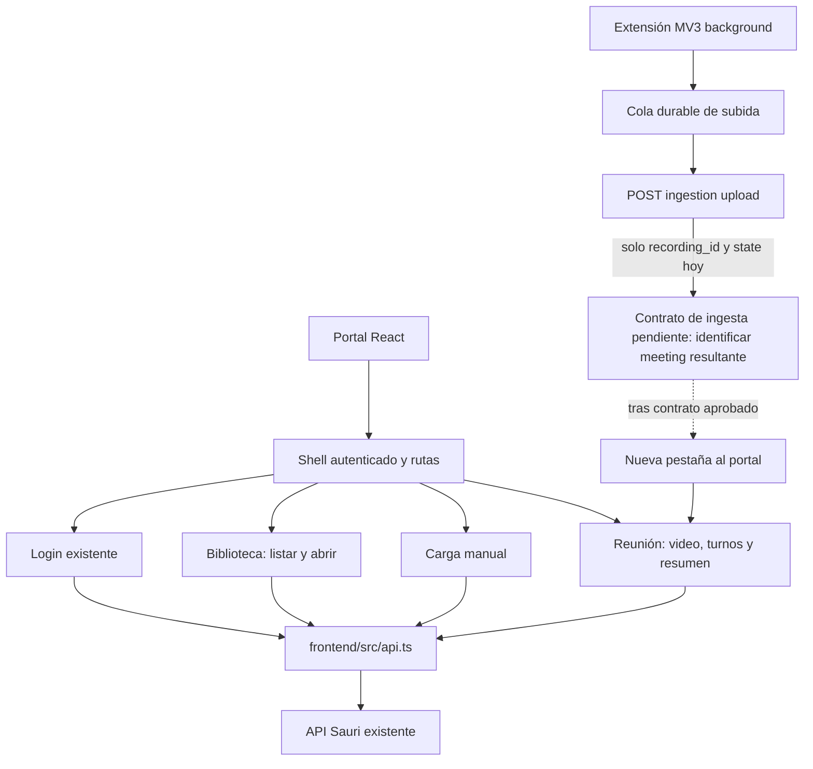

# Documento de Diseño — Portal web mínimo de Sauri

## Resumen

Este diseño cubre Fase 1; Fase 2 está secuenciada, no excluida, conforme a la tabla de fases de los requisitos aprobados. La Fase 1 abarca login visual, biblioteca básica, carga manual y revisión de reunión, incluyendo pestañas Chat (solo composición) y Notes/Summary. El disparador de producto para apertura es detener grabación o cerrar pestaña Meet/Teams; la apertura automática requiere trabajo dependiente de extensión. No se inventa comportamiento/API allí donde falten contratos; esas brechas deben resolverse antes de implementación.

1. Mantener el login y la sesión existentes, con tratamiento visual consistente.
2. Estructurar la SPA en biblioteca, carga manual y vista de reunión, con `frontend/src/api.ts` como única capa HTTP.
3. Usar solo capacidades API actualmente disponibles para listar/abrir reuniones, presentar video y turnos, y solicitar/resumir artefactos existentes; no diseñar mutaciones sin contrato.
4. Aplicar la decisión de producto de Fer del 2026-10-31: es elegible lo que acepta la validación actual de ingesta, sin límites nuevos; si el backend rechaza el archivo, la UI muestra su mensaje.
5. Abrir la vista al detener la grabación o cerrar la pestaña de Meet/Teams, sujeto a la dependencia explícita de que `background.ts` actualmente solo reinicia estado al recibir `meet-ended` y no abre el portal.

## Decisiones de Diseño Clave

**Acotar esta entrega al comportamiento soportado actualmente: login visual, biblioteca (lista, estados y abrir), carga de grabación, reunión (video, turnos y resumen).** Renombrar/eliminar/descargar grabaciones, editar metadatos, gestionar tags, renombrar hablantes y filtrar la biblioteca quedan fuera de esta fase y requieren contratos y persistencia antes de diseñarse. *Alternativa descartada:* inferir endpoints, modelos o derechos de acceso a partir de los requisitos de producto o de código no verificado; produciría una interfaz que no puede implementarse de forma segura y verificable. Los requisitos de alcance mayor siguen trazables al documento aprobado, pero este diseño identifica expresamente esas funciones como fase posterior y no propone su API.

**Mantener SPA y capa HTTP existentes.** La interfaz se compone en `frontend/src/`; todas las solicitudes pasan por `frontend/src/api.ts`. *Alternativas descartadas:* HTTP desde componentes, que dispersa autenticación/errores, o mover la experiencia a backend/extensión, contrario al alcance web.

**Rutas explícitas `/` (biblioteca), `/upload` y `/meetings/:meetingId`.** Usar el router existente si lo hubiera; en su defecto un módulo pequeño con History API, evitando nueva dependencia solo para estas rutas. *Alternativa descartada:* navegación solo en estado React, que no permite URL directa ni apertura desde otra superficie.

**Mantener componentes por pantalla y estado local a cada flujo.** Shell autenticado, biblioteca, carga y vista de reunión se separan bajo `frontend/src/components/`; estilos en el CSS global ya existente y tokens semánticos. Stitch informa tono, no fija UI, textos ni comportamiento. *Alternativas descartadas:* un `App.tsx` monolítico o copiar mockups no normativos como contrato visual.

**Login solo cambia en presentación.** Reutilizar la experiencia y llamada de autenticación actuales, sin alterar protocolo, permisos ni estados funcionales. *Alternativa descartada:* recrear el login de Stitch, que no define el acceso aprobado.

**Elegibilidad de carga sigue la decisión de producto de Fer del 2026-10-31.** Es elegible lo que acepta la validación actual de ingesta; no se agregan límites ni reglas nuevas. Tras elegir el archivo, ofrecer «Subir y procesar» y, si el backend lo rechaza, mostrar su mensaje. Esta regla es una decisión de producto vigente, no un detalle pendiente. *Alternativa descartada:* introducir validaciones locales o límites de formato/tamaño no aprobados.

**Estados de transferencia separados de procesamiento y reintento acotado.** Mostrar progreso solo cuando el transporte informa bytes; no simular porcentaje ni afirmar que el procesamiento terminó al finalizar HTTP. Conforme a `PRODUCT_BASELINE.md` §4.D.5 ya fusionado en `main`, ante fallo el archivo seleccionado queda disponible para reintentar y se ofrecen «Reintentar» y «Copiar diagnóstico». No se garantiza conservación del blob/job en servidor, idempotencia ni supervivencia de reintentos ante interrupción de red o cierre. *Alternativa descartada:* prometer persistencia/continuidad no aprobada.

**Apertura automática al detener grabación o cerrar pestaña de Meet/Teams: dependencia de extensión.** El disparador de producto definido por Fer es detener la grabación o cerrar la pestaña Meet/Teams. Hoy `extension/src/background.ts` maneja `chrome.tabs.onRemoved` para detener captura cuando se cierra la pestaña propietaria; el mensaje `meet-ended` llama a `handleMeetEnded()`, que reinicia estado, pero no abre el portal. Por lo tanto, el cierre Meet/Teams y la navegación automática requieren una tarea dependiente de extensión que conecte los eventos existentes con la subida y el destino, sin describirlo como un «fin de sesión» ya soportado. *Alternativa descartada:* atribuir apertura automática al código actual, que solo realiza stop/reset.

## Arquitectura



```mermaid
sequenceDiagram
  participant T as Pestaña Google Meet
  participant SW as extension/src/background.ts
  participant Q as Cola de subida
  participant API as API de ingesta
  participant P as Portal
  T->>SW: chrome.tabs.onRemoved (tabId propietario, recording)
  SW->>SW: handleStopCapture()
  SW->>SW: recording-stopped → handleRecordingStopped
  SW->>Q: iniciar carga según comportamiento actual
  Q->>API: POST upload
  alt Éxito de ingesta
    API-->>Q: recording_id, state
    Q-->>P: no hay meeting_id confirmado; registrar brecha de contrato
  else Rechazo/error informado
    API-->>Q: error
    Q-->>T: mensaje; UI ofrece reintentar y copiar diagnóstico
  end
```

## Componentes e Interfaces

### Web — `frontend/src/`

- `App.tsx`: sesión existente, shell y rutas `/`, `/upload`, `/meetings/:meetingId`.
- `components/PortalShell.tsx`: navegación limitada a Biblioteca, Subir grabación y reunión abierta.
- `components/LoginScreen.tsx`: presentación nueva alrededor de login existente, sin cambiar su contrato.
- `components/RecordingLibrary.tsx`: carga de lista ordenada newest-first, estados cargando/vacío/error, abrir selección.
- `components/RecordingUpload.tsx`: selector; ofrecer acción según validación actual de ingesta conforme a decisión de producto Fer 2026-10-31, sin límites nuevos; mostrar error del backend. Progreso real, reintento y «Copiar diagnóstico» sin secretos ni transcripción; archivo seleccionado disponible para reintentar, sin prometer recuperación tras cierre/interrupción.
- `components/MeetingView.tsx`: reproductor arriba de transcripción; controles ordinarios visibles de seek, velocidad, calidad/resolución, pausa, volumen y mute. Calidad/resolución solo refleja opciones disponibles del medio/reproductor y no promete calidad inexistente. Cada turno muestra timestamp, etiqueta de hablante coloreada y texto; al avanzar playback se resalta el turno correspondiente y se desplaza la lista para mantenerlo visible; seleccionar turno hace seek a su tiempo vinculado e inicia reproducción. No fijar colores ni formato de timestamp.
- Panel lateral inicial con pestañas **Chat** y **Notes/Summary**. Chat en Fase 1 es solo pestaña, sin interfaz ni interacción de chat; sus capacidades interactivas quedan Fase 2. Notes/Summary mantiene notas, resumen y transcripción como contenidos distintos, no mezcla el transcript en el resumen. El resumen ofrece copiar y descargar su propio contenido; estructura legible que identifica tema principal y argumentos/puntos clave, sin imponer un layout fijo. No depender de capacidades ya existentes como condición para exponer estos comportamientos aprobados: si faltan API/contratos o datos, registrar esa brecha concreta antes de implementar, no simularlos.
- `api.ts`: métodos tipados para login, listado/detalle existentes y carga; cualquier endpoint/mutación faltante se eleva como brecha, no se inventa contrato.
- CSS global existente: estilos y tokens semánticos.

### Reglas visuales accionables

- Tomar `design/stitch/` como referencia de tokens Terra y componentes semánticos, no como especificación de pantallas o contenido.
- En viewport de escritorio ≥1280 px, distribuir shell, contenido principal y panel lateral sin superposición; al reducir ancho, colapsar panel lateral/navegación en flujo vertical y mantener controles utilizables sin desplazamiento horizontal de página.
- Foco de teclado siempre visible en controles interactivos; orden de tabulación sigue el orden visual y semántico.
- Texto y controles cumplen contraste WCAG AA (4.5:1 texto normal, 3:1 texto grande y componentes gráficos), usando los tokens Terra existentes/de referencia. Verificar combinaciones reales en pruebas visuales/accesibilidad; no inventar una paleta.

### Backend / contratos dependientes

No se inventan endpoints. `frontend/src/api.ts` no tiene método para obtener el resumen. El endpoint actual de ingesta devuelve `recording_id` y `state`; no confirma `meeting_id`. Cada brecha requiere una tarea dependiente de definición y aprobación del contrato API antes de implementar la interfaz correspondiente. La vista no puede afirmar que accede a resumen ni abrir un meeting resultante de carga hasta resolver el contrato. Las capacidades excluidas (rename/delete/download, metadata/tags, rename speaker y filtros de biblioteca) requieren contrato API y modelo/persistencia diseñados y aprobados en fase posterior.

### Extensión y correlación de resultado

- `extension/src/background.ts`: hoy `chrome.tabs.onRemoved` detiene la captura en la pestaña propietaria; el mensaje `meet-ended` llama al reset de estado, no abre el portal. La tarea dependiente de extensión debe conectar la detención y cierre de pestaña a la experiencia portal; tratar el evento `meet-ended` como reset existente, no como apertura ya implementada.
- La correlación durable, semántica de reintento y navegación tras ingesta dependen de contratos/tareas aprobados. No asumir preservación de job/blob o clave idempotente ante fallo o cierre.
- Contrato pendiente: no hay `meeting_id` confirmado en respuesta de ingesta; sin él no se construye una ruta de reunión. La API tampoco ofrece método de resumen actualmente.
- El cierre de pestaña es disparador definido por producto, pero la extensión debe efectuar la transición y apertura; la implementación actual no completa ese recorrido.

### Colocación y pruebas

| Superficie | Carpetas / archivos | Pruebas | Migración / Compose / shared-types |
|---|---|---|---|
| Web | Modificar `frontend/src/App.tsx`, `frontend/src/api.ts`, `frontend/src/components/` y CSS global existente | Tests de componentes y API en ubicaciones existentes bajo `frontend/src/`; estados, rutas y retry | Sin migración, Compose ni `packages/shared-types` salvo contrato aprobado |
| Backend/API | Tareas dependientes para acordar resumen y correlación de resultado de ingesta; no se prescriben rutas ni payloads | Tests contractuales tras aprobar el contrato, en `backend/tests/` del módulo dueño | Migración/Compose/shared-types solo si el contrato aprobado lo requiere; no asumidos |
| Extensión | Tarea dependiente en `extension/src/background.ts` para conectar disparadores a apertura; sin garantías sobre job/blob | Tests colocados junto al módulo y E2E en `extension/tests/e2e/` para señales y navegación, cuando contrato esté listo | Sin migración ni Compose salvo necesidad aprobada; no importar fuentes cruzadas/shared-types |

## Modelos de Datos

- **Resultado de ingesta actual**: `recording_id` y `state`; no contiene `meeting_id` confirmado. La correlación con reunión requiere contrato dependiente aprobado.
- **Reintento manual**: el archivo seleccionado permanece disponible en el flujo de UI para la acción «Reintentar» según `PRODUCT_BASELINE.md` §4.D.5; no se especifican garantías de almacenamiento o continuidad fuera de ese flujo.
- En web, reutilizar tipos actuales cuando correspondan; no declarar contratos de resumen ni estructuras para capacidades excluidas.

## Propiedades de Correctitud

1. **Acceso preservado:** aplicar estilo al login no cambia solicitud, sesión ni permisos.
2. **Biblioteca veraz:** muestra registros reales en orden newest-first y permite abrirlos; no presenta búsqueda full-text ni filtros/acciones no incluidas en esta entrega.
3. **Revisión sincronizada:** video/media antecede a turnos; cada turno presenta timestamp, etiqueta coloreada y texto; durante playback el turno correspondiente se resalta y la lista lo desplaza a vista; seleccionar un pasaje busca su tiempo enlazado e inicia playback. El reproductor expone seek, velocidad, calidad/resolución, pausa, volumen y mute. El panel empieza con Chat y Notes/Summary; Chat no interactúa en Fase 1. Notes, resumen y transcripción permanecen separados; copiar/descargar exporta únicamente resumen con tema principal y argumentos/puntos clave.
4. **Elegibilidad y rechazo:** seleccionar un archivo habilita acción sin límites locales nuevos; rechazo backend se presenta claramente y conserva archivo.
5. **Progreso honesto:** progreso mostrado deriva bytes reportados; no se informa procesamiento completado por fin de transferencia.
6. **Disparadores de apertura:** detener grabación y cierre de pestaña Meet/Teams están definidos como disparadores de producto; la apertura requiere la tarea dependiente de extensión, pues `meet-ended` hoy reinicia estado y no abre el portal.
7. **Contratos de navegación:** la ingesta actual solo devuelve `recording_id` y `state`; no se navega a meeting sin contrato aprobado que confirme su ID. `api.ts` carece de método de resumen; su uso también espera contrato.
8. **Reintento acotado:** mostrar «Reintentar» y «Copiar diagnóstico» y mantener el archivo seleccionado disponible; no afirmar garantías de blob/job/idempotencia en servidor o tras interrupciones.
9. **Privacidad:** URL/mensajes de navegación no incluyen tokens, audio ni texto de transcripción.

## Manejo de Errores

| Escenario | Comportamiento |
|---|---|
| Login/API 401 en portal | Reutilizar `sauri:unauthorized` y volver al login; no exponer detalles sensibles. |
| Biblioteca vacía/error | Mostrar vacío solo con respuesta vacía real; ante error mostrar aviso y reintento, no datos ficticios. |
| Archivo rechazado por backend | Mostrar mensaje claro devuelto; conservar selección y no imponer validación local extra. |
| Rechazo de ingesta | Mostrar el mensaje de backend; no agregar límite local de elegibilidad. |
| Fallo de carga | Explicar en lenguaje claro, ofrecer «Reintentar» y «Copiar diagnóstico», dejar disponible el archivo seleccionado conforme a `PRODUCT_BASELINE.md` §4.D.5; no afirmar recuperación de servidor. |
| Ingesta exitosa sin reunión confirmada | No inventar `meeting_id` ni construir ruta; señalar brecha de contrato como dependencia. |
| Resumen solicitado sin método API | Registrar dependencia de contrato para resumen; no simular contenido ni inventar endpoint. |
| Cierre de pestaña / `meet-ended` | `tabs.onRemoved` actual detiene captura; `meet-ended` reinicia estado pero no abre portal. Requiere tarea de extensión para cumplir el disparador de producto. |

## Estrategia de Testing

**Frontend:** usar comandos y runner establecidos en `frontend/package.json`; probar login sin cambio de contrato, biblioteca con datos reales sintéticos, apertura de meeting, estados de carga y rechazo/error con archivo retenido. Probar que no aparecen acciones fuera de alcance.

**Extensión (tarea dependiente):** probar stop y cierre de pestaña Meet/Teams como disparadores de apertura implementados, junto con contrato de correlación de meeting cuando aprobado. No asumir que `meet-ended` hoy abre portal ni exigir garantías de retención/reintento no definidas por baseline. Usar fixtures sintéticos y APIs Chrome controladas en tests.

**Comandos configurados:** `npm run test`, `npm run typecheck`, `npm run build` desde `frontend/`; `npm run test`, `npm run typecheck`, `npm run build` y `npm run test:e2e` desde `extension/` para cambios de captura. Backend sin cambios previstos; no ejecutar validaciones de implementación en esta fase.
