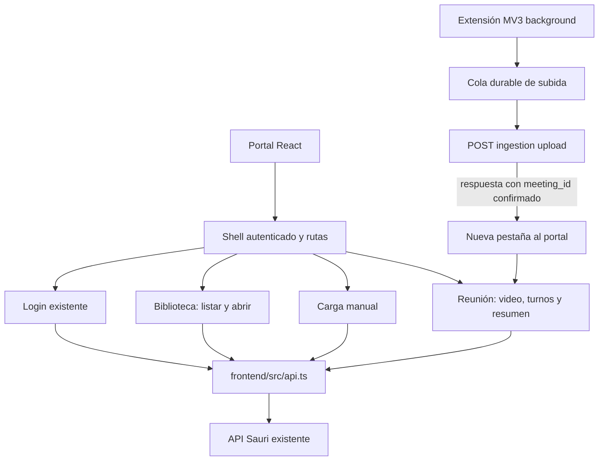
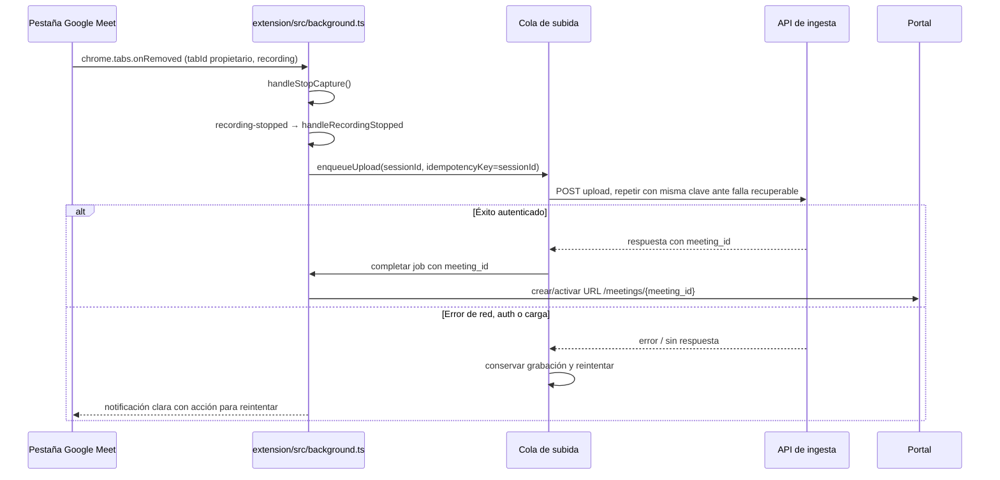

# Documento de Diseño — Portal web mínimo de Sauri

## Resumen

Este diseño cubre Fase 1; Fase 2 está secuenciada, no excluida, conforme a la tabla de fases de los requisitos aprobados. La Fase 1 abarca login visual, biblioteca básica, carga manual y revisión de reunión, incluyendo pestañas Chat (solo composición) y Notes/Summary. La apertura automática corresponde únicamente a Google Meet. No se amplía a Teams ni se inventa comportamiento/API allí donde falten contratos; esas brechas deben resolverse antes de implementación.

1. Mantener el login y la sesión existentes, con tratamiento visual consistente.
2. Estructurar la SPA en biblioteca, carga manual y vista de reunión, con `frontend/src/api.ts` como única capa HTTP.
3. Usar solo capacidades API actualmente disponibles para listar/abrir reuniones, presentar video y turnos, y solicitar/resumir artefactos existentes; no diseñar mutaciones sin contrato.
4. Usar backend como autoridad de aceptación de carga: seleccionar archivo habilita «Subir y procesar»; un rechazo se muestra claramente.
5. Abrir automáticamente la reunión correspondiente tanto cuando se detiene la captura como cuando termina la sesión de Google Meet, usando el identificador de reunión confirmado por el servidor; los límites de detección del fin de sesión deben respetar las señales reales disponibles.

## Decisiones de Diseño Clave

**Acotar esta entrega al comportamiento soportado actualmente: login visual, biblioteca (lista, estados y abrir), carga de grabación, reunión (video, turnos y resumen).** Renombrar/eliminar/descargar grabaciones, editar metadatos, gestionar tags, renombrar hablantes y filtrar la biblioteca quedan fuera de esta fase y requieren contratos y persistencia antes de diseñarse. *Alternativa descartada:* inferir endpoints, modelos o derechos de acceso a partir de los requisitos de producto o de código no verificado; produciría una interfaz que no puede implementarse de forma segura y verificable. Los requisitos de alcance mayor siguen trazables al documento aprobado, pero este diseño identifica expresamente esas funciones como fase posterior y no propone su API.

**Mantener SPA y capa HTTP existentes.** La interfaz se compone en `frontend/src/`; todas las solicitudes pasan por `frontend/src/api.ts`. *Alternativas descartadas:* HTTP desde componentes, que dispersa autenticación/errores, o mover la experiencia a backend/extensión, contrario al alcance web.

**Rutas explícitas `/` (biblioteca), `/upload` y `/meetings/:meetingId`.** Usar el router existente si lo hubiera; en su defecto un módulo pequeño con History API, evitando nueva dependencia solo para estas rutas. *Alternativa descartada:* navegación solo en estado React, que no permite URL directa ni apertura desde otra superficie.

**Mantener componentes por pantalla y estado local a cada flujo.** Shell autenticado, biblioteca, carga y vista de reunión se separan bajo `frontend/src/components/`; estilos en el CSS global ya existente y tokens semánticos. Stitch informa tono, no fija UI, textos ni comportamiento. *Alternativas descartadas:* un `App.tsx` monolítico o copiar mockups no normativos como contrato visual.

**Login solo cambia en presentación.** Reutilizar la experiencia y llamada de autenticación actuales, sin alterar protocolo, permisos ni estados funcionales. *Alternativa descartada:* recrear el login de Stitch, que no define el acceso aprobado.

**Elegibilidad de carga = aceptación actual del backend, provisionalmente.** Al elegir un archivo se habilita «Subir y procesar», sin filtros locales ni límites nuevos de formato/tamaño. El backend decide; si rechaza, mostrar su mensaje claro y conservar el archivo. *Alternativa descartada:* duplicar/anticipar validación autoritativa con reglas inventadas.

**Estados de carga separados de procesamiento.** Mostrar progreso de transferencia real cuando el transporte lo informa; no simular porcentaje ni afirmar que el procesamiento terminó por recibir HTTP exitoso. La operación conserva archivo e identidad idempotente para retry. *Alternativa descartada:* porcentaje o finalización ficticios.

**Apertura automática en los dos disparadores aprobados.** Tanto la detención de captura como el fin de la sesión de Google Meet deben converger al cierre normal de captura, subida y apertura de la reunión identificada por un `meeting_id` confirmado por servidor; nunca usar `sessionId` local como sustituto. El código actual demuestra el camino de detener/cerrar la pestaña propietaria mediante `chrome.tabs.onRemoved`, `handleStopCapture` y `handleRecordingStopped`, pero no basta para afirmar que detecta el fin de la sesión Meet independientemente del cierre de pestaña. Antes de implementar, verificar la señal observable disponible en la integración Meet y conectar ambas señales al mismo camino idempotente; si no existe una señal fiable, registrar la brecha para resolverla, sin presentar cierre de pestaña como equivalente al fin de sesión. *Alternativa descartada:* abrir antes de tener el `meeting_id` confirmado, que puede producir un destino inválido.

## Arquitectura

## Componentes e Interfaces

### Web — `frontend/src/`

- `App.tsx`: sesión existente, shell y rutas `/`, `/upload`, `/meetings/:meetingId`.
- `components/PortalShell.tsx`: navegación limitada a Biblioteca, Subir grabación y reunión abierta.
- `components/LoginScreen.tsx`: presentación nueva alrededor de login existente, sin cambiar su contrato.
- `components/RecordingLibrary.tsx`: carga de lista ordenada newest-first, estados cargando/vacío/error, abrir selección.
- `components/RecordingUpload.tsx`: selector; selección habilita acción cuando se conoce elegibilidad aprobada; progreso de transferencia, resultado, reintento y «Copiar diagnóstico» sin secretos ni transcripción; no inventar límites de elegibilidad.
- `components/MeetingView.tsx`: reproductor arriba de transcripción; controles ordinarios visibles de seek, velocidad, calidad/resolución, pausa, volumen y mute. Calidad/resolución solo refleja opciones disponibles del medio/reproductor y no promete calidad inexistente. Cada turno muestra timestamp, etiqueta de hablante coloreada y texto; al avanzar playback se resalta el turno correspondiente y se desplaza la lista para mantenerlo visible; seleccionar turno hace seek a su tiempo vinculado e inicia reproducción. No fijar colores ni formato de timestamp.
- Panel lateral inicial con pestañas **Chat** y **Notes/Summary**. Chat en Fase 1 es solo pestaña, sin interfaz ni interacción de chat; sus capacidades interactivas quedan Fase 2. Notes/Summary mantiene notas, resumen y transcripción como contenidos distintos, no mezcla el transcript en el resumen. El resumen ofrece copiar y descargar su propio contenido; estructura legible que identifica tema principal y argumentos/puntos clave, sin imponer un layout fijo. No depender de capacidades ya existentes como condición para exponer estos comportamientos aprobados: si faltan API/contratos o datos, registrar esa brecha concreta antes de implementar, no simularlos.
- `api.ts`: métodos tipados para login, listado/detalle existentes y carga; cualquier endpoint/mutación faltante se eleva como brecha, no se inventa contrato.
- CSS global existente: estilos y tokens semánticos. No imponer hex, breakpoints ni formato de timestamp no fijados por requisitos.

### Backend / persistencia

Esta fase consume endpoints existentes de login, listado/detalle de reuniones, lectura de medios/turnos/resumen e ingesta. No se define endpoint nuevo ni cambio de esquema en este diseño. Si el código actual no ofrece una operación necesaria para los cuatro flujos acotados, registrar la brecha concreta y elevarla para requisito/contrato aprobado antes de implementarla; no improvisar ruta, payload ni persistencia. Las capacidades excluidas (rename/delete/download, metadata/tags, rename speaker y filtros de biblioteca) requieren contrato API y modelo/persistencia diseñados y aprobados en fase posterior.

### Extensión y correlación de resultado

- `extension/src/background.ts`: stop explícito y `chrome.tabs.onRemoved` de la pestaña capturada disparan finalización; el handler escucha resultado de `recording-stopped`, encola job persistente y procesa cola.
- `extension/src/upload-queue.ts`: mantener job/reintentos con misma idempotency key. Extender el resultado persistido para incluir `meeting_id` solo después de parsear respuesta de éxito de ingesta. Reintentos tras auth fallida deben preservar datos; acción de reintento vuelve a solicitar autenticación existente y no descarta el job.
- Apertura: solo luego de respuesta exitosa validada con meeting ID; componer URL desde origen de portal configurado, codificar ID como segmento y abrir/activar pestaña. No incluir token, audio ni transcripción en URL o mensajes.
- Señales de error: informar al usuario mediante mecanismo existente de extensión y permitir reintento; nunca limpiar IndexedDB ni marcar job `done` hasta respuesta autenticada aceptada y meeting ID guardado. Si resultado exitoso no contiene ID válido, mantener job recuperable, informar error y no navegar.
- Stop manual: seguir el mismo camino de `stop-recording` → evento de grabación completa → upload. Cierre de tab detectado con `chrome.tabs.onRemoved` para la pestaña propietaria y estado de captura. El stop no equivale a subida completada.

### Colocación y pruebas

| Superficie | Carpetas / archivos | Pruebas | Migración / Compose / shared-types |
|---|---|---|---|
| Web | Modificar `frontend/src/App.tsx`, `frontend/src/api.ts`, `frontend/src/components/` y CSS global existente | Tests de componentes y API en las ubicaciones ya usadas bajo `frontend/src/`; estados, rutas y retry | Sin migración, Compose ni `packages/shared-types` salvo que contrato compartido aprobado lo exija |
| Backend | Sin cambios previstos en `backend/app/` | Reutilizar tests existentes de API como evidencia contractual; brechas se elevan antes de codificar | Ninguna en esta fase |
| Extensión | `extension/src/background.ts`, `extension/src/upload-queue.ts` y módulos existentes solo si requieren correlación durable | Tests unitarios colocados junto al módulo y E2E en `extension/tests/e2e/` para fin, respuesta ID, retry y navegación | Sin migración ni Compose; contratos HTTP, no import de fuentes cruzadas/shared-types |

## Modelos de Datos

- **Trabajo de carga existente**: `sessionId`, `idempotencyKey` (misma identidad para retries), datos del blob en IndexedDB y estado de cola. Añadir `meetingId?: string` al resultado durable del trabajo; solo se establece tras respuesta satisfactoria parseada.
- **URL de destino**: configuración existente del origen del portal + `meetingId`; nunca credenciales, contenido audiovisual o transcripción.
- En web, reutilizar tipos actuales de meeting/turn/transcript; no declarar estructuras para capacidades excluidas.

## Propiedades de Correctitud

1. **Acceso preservado:** aplicar estilo al login no cambia solicitud, sesión ni permisos.
2. **Biblioteca veraz:** muestra registros reales en orden newest-first y permite abrirlos; no presenta búsqueda full-text ni filtros/acciones no incluidas en esta entrega.
3. **Revisión sincronizada:** video/media antecede a turnos; cada turno presenta timestamp, etiqueta coloreada y texto; durante playback el turno correspondiente se resalta y la lista lo desplaza a vista; seleccionar un pasaje busca su tiempo enlazado e inicia playback. El reproductor expone seek, velocidad, calidad/resolución, pausa, volumen y mute. El panel empieza con Chat y Notes/Summary; Chat no interactúa en Fase 1. Notes, resumen y transcripción permanecen separados; copiar/descargar exporta únicamente resumen con tema principal y argumentos/puntos clave.
4. **Elegibilidad y rechazo:** seleccionar un archivo habilita acción sin límites locales nuevos; rechazo backend se presenta claramente y conserva archivo.
5. **Progreso honesto:** progreso mostrado deriva bytes reportados; no se informa procesamiento completado por fin de transferencia.
6. **Disparadores de apertura:** detener captura y fin de sesión de Google Meet convergen a una sola finalización idempotente; la señal de cierre de pestaña por sí sola no se presenta como prueba de fin de sesión.
7. **Apertura tras confirmación:** solo una respuesta de ingesta exitosa con `meeting_id` validado habilita abrir la reunión correspondiente; ningún ID local sustituye al ID del servidor.
8. **Recuperación:** fallo de subida o autenticación conserva blob/job y clave idempotente; no limpiar grabación ni marcar completado. Si abrir pestaña falla después de éxito, conservar `meeting_id` y reintentar navegación sin volver a subir.
9. **Privacidad:** URL/mensajes de navegación no incluyen tokens, audio ni texto de transcripción.

## Manejo de Errores

| Escenario | Comportamiento |
|---|---|
| Login/API 401 en portal | Reutilizar `sauri:unauthorized` y volver al login; no exponer detalles sensibles. |
| Biblioteca vacía/error | Mostrar vacío solo con respuesta vacía real; ante error mostrar aviso y reintento, no datos ficticios. |
| Archivo rechazado por backend | Mostrar mensaje claro devuelto; conservar selección y no imponer validación local extra. |
| Transferencia interrumpida / red | Mantener blob y job; mensaje de error y reintento con la misma clave. |
| Autenticación de extensión ausente/expirada | Notificar que hace falta autenticarse y ofrecer reintento tras resolver auth; conservar audio localmente. |
| Éxito HTTP sin `meeting_id` válido | Tratar como resultado incompleto, no navegar ni borrar blob; conservar job para recuperación y mostrar aviso. |
| Error al crear/activar pestaña de portal | Mantener `meeting_id` confirmado y ofrecer/ejecutar nuevo intento de apertura; no repetir upload. |
| Fallo leyendo blob o cola | Informar que la grabación sigue pendiente si puede comprobarse; nunca declarar subida exitosa. |

## Estrategia de Testing

**Frontend:** usar comandos y runner establecidos en `frontend/package.json`; probar login sin cambio de contrato, biblioteca con datos reales sintéticos, apertura de meeting, estados de carga y rechazo/error con archivo retenido. Probar que no aparecen acciones fuera de alcance.

**Extensión:** probar stop normal y cierre de la pestaña propietaria durante captura; evento de fin encola una sola operación; errores de red/auth mantienen blob, job y clave; respuesta con ID produce navegación correcta; éxito sin ID o fallo al abrir pestaña no descarta grabación ni repite innecesariamente el upload. Usar fixtures sintéticos y APIs Chrome controladas en tests.

**Comandos configurados:** `npm run test`, `npm run typecheck`, `npm run build` desde `frontend/`; `npm run test`, `npm run typecheck`, `npm run build` y `npm run test:e2e` desde `extension/` para cambios de captura. Backend sin cambios previstos; no ejecutar validaciones de implementación en esta fase.
