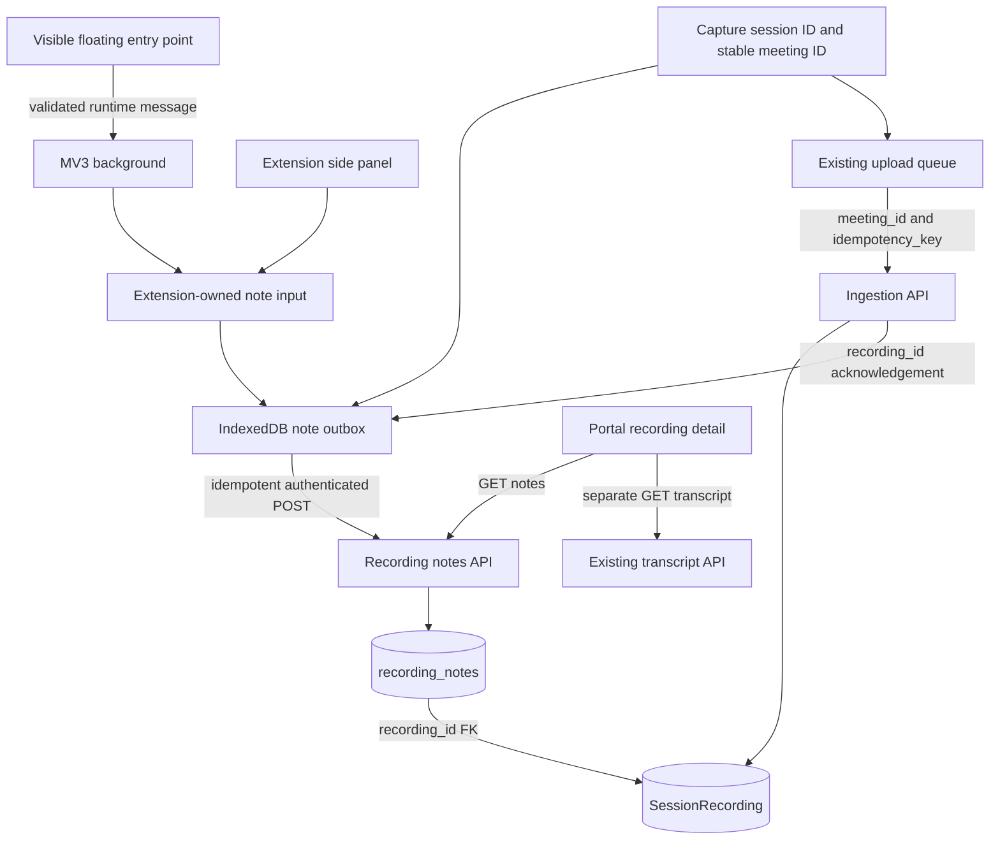

# Design — Recording-Associated Notes

## Summary

A user must be able to add notes from the extension or its visible floating recording control and later read those notes from the corresponding recording in the web portal, without conflating them with the transcript. The current repository has a meeting/recording/transcript pipeline but no recording-note entity or portal note section. Its extension's existing “My Notes” labels refer to meeting cards, not user-authored recording notes. This design adds a separate recording-owned note resource, one durable capture-to-upload association, and two clients for the same API; it does not redesign capture or settle the excluded questions of note format, editing, or access when the floating control is hidden.

Implementation approach:
1. Persist a stable `meetingId` alongside the capture `sessionId` before accepting notes, and use that same pair for every upload retry. Keep note drafts in a durable extension outbox until their recording is acknowledged and note writes are acknowledged.
2. Store each note as an independent row linked to `session_recordings.id`, never as transcript content. Add authenticated, recording-scoped create/list endpoints with owner checks and idempotent creation.
3. Have the extension panel and the *visible* floating control invoke one note-composition/queue boundary; the control passes the active capture context via validated extension messaging rather than handling credentials in the page.
4. Add an independent Notes section on the portal recording view, fetched separately from the transcript, including the case in which transcription is not yet available.
5. Test association, isolation, retries, absence of accidental duplication, and transcript independence before implementation. No release, policy, security, or product acceptance is granted by this design.

### Authority and traceability

- Product authority: approved `PRODUCT_BASELINE.md` at `d738e78d65940f17d209edf9a54af5d34e92e059`, blob `6c6a3c3e7d7c761dc307d2313e8d3e899ce7ae13`, approved in `22df139`; §§2 outcome 4, 3, 4.A.4/A.6/C.5, 5, and 7 open decision 5.
- Exact Phase 1 input: `.spectra/specs/recording-notes/requirements.md` at `535a5fb4729aceaf95d957d64b0a8dfe23c53f9b`, blob `b2a61fc017f21f21f5201dfc1b02441e471ca576`; Mira's independent `APPROVED` round 1 is recorded in `th_dc47985b566e46c9`. This approval does not approve this design.
- R1.1: the extension's active or explicitly selected recording context supplies the recording ID; its write reaches that recording. R1.2: the visible floating control delegates to the same boundary with that capture's ID. R2.1: the portal loads notes by recording ID. R2.2–2.3: notes and transcript are separately fetched, modeled, and rendered in separately identified sections, including when both are available.
- Exclusions remain exclusions: capture flow/controls beyond the notes entry point, note format/structure/length, editing, and access from a hidden floating control. Discovery images and historical `handoff.md` add no requirements. The current “My Notes” meeting cards are not evidence that recording notes already exist.

## Key design decisions

1. **Use `SessionRecording` as the authoritative owner and a capture-local `meetingId` as the stable bridge.** The backend's current ingestion contract already accepts `meeting_id` and an idempotency key and returns `recording_id`. Generate and durably persist a UUID `meetingId` once when the extension starts this capture, before accepting a note; use it on all uploads for that `sessionId`. On successful upload (including `idempotent_duplicate`), persist the returned `recording_id` in the outbox mapping, then send pending notes to that recording. For an explicitly selected *existing* recording, use its server `recording_id` directly. **Rejected:** generating `meeting_id` in `uploadRecording()` on each attempt (current code) loses a stable relationship across retries; sending notes against a nonexistent server recording forces a premature capture/server-resource redesign. One note can never silently fall back to the most recent meeting.
2. **Use a separate `recording_notes` table and recording-scoped endpoints.** The backend owns persisted notes; `transcripts` and `speech_turns` are unchanged. **Rejected:** embedding notes into transcript segments or meeting title would make notes appear as speech or erase the distinction on transcription refresh; extending the old extension `NoteDTO` is wrong because that DTO represents meeting cards.
3. **Write-behind with an idempotent note ID and an explicit delivery state.** The extension assigns each note UUID once and stores `{noteId, sessionId, meetingId, content, state}` in IndexedDB before reporting local save; upload acknowledgement is a prerequisite for server delivery. Retry the same ID after worker suspension/network ambiguity; server uniqueness makes replay safe. A pending item is not represented as available in the portal. **Rejected:** volatile service-worker memory loses notes across MV3 restarts; blind POST retry creates duplicates; deleting local data immediately after upload can lose unsynced notes.
4. **Single trusted extension composition boundary for two entry points.** The visible floating UI sends a narrow message to the extension background, which checks the sending tab and active capture `sessionId`/`tabId` before opening or routing to the extension-owned note input. Only the extension context creates and sends notes, never the Meet page or its DOM. The side panel uses the same input/queue functions. **Rejected:** exposing a bearer token or note payload to the page/content-script bridge, or implementing two independent note stores, creates unnecessary leakage and divergence. This does not create a new hidden-indicator pathway.
5. **Portal recording detail renders independent Notes and Transcript sections.** The web app currently has a transcript view keyed by meeting ID; evolve the selected-recording detail to obtain its `recording_id` from the meeting's recording relation (add a narrowly scoped authenticated lookup or an optional field on the existing meeting-detail response). Fetch notes from the recording endpoint independently of the transcript request. **Rejected:** nesting notes under `TranscriptView`'s success branch would hide them when ASR is pending or fails. Do not infer a full portal layout from discovery.
6. **Conservative access boundary and lifecycle.** Authenticate all note requests; require the recording's meeting to belong to the current user (`Meeting.created_by == user.id`), returning the same 404 for missing and foreign recordings; retain existing authorization rules where applicable and audit allowed/denied access using existing access-audit infrastructure without recording note content. Delete notes when their recording is deleted or expires. **Rejected:** globally readable notes or reliance on client-side filtering would expose meeting-sensitive information. Ownership is the narrow safe boundary for this design, not a final multi-user sharing policy; broader identity/access remains an approved-baseline open decision and needs upstream approval before implementation beyond that boundary.

## Architecture



```mermaid
sequenceDiagram
    participant U as User
    participant UI as Extension note input
    participant DB as IndexedDB outbox
    participant W as MV3 upload and note worker
    participant I as Ingestion API
    participant N as Recording notes API
    participant P as Portal
    U->>UI: Add note from extension or visible control
    UI->>DB: Persist noteId, sessionId, meetingId, content
    DB-->>UI: Durable local acknowledgement
    W->>I: Upload recording with stable meetingId and sessionId key
    I-->>W: recording_id (new or idempotent duplicate)
    W->>DB: Persist recording_id mapping
    W->>N: POST /recordings/{recording_id}/notes (same noteId)
    N-->>W: 201 or idempotent 200
    W->>DB: Mark delivered; remove sensitive draft only after acknowledgement
    P->>N: GET /recordings/{recording_id}/notes
    N-->>P: Notes for this recording only
    P->>P: Render Notes separately from Transcript
```

Source of truth after acknowledgement is PostgreSQL; the local outbox is only a delivery buffer. Recording upload and note delivery are separate transactions: losing either response requires retry, not assuming completion. Multi-surface identifiers are `sessionId` (local capture/idempotency key), `meetingId` (stable existing ingestion contract), `recordingId` (authoritative note scope), and `noteId` (client-generated write idempotency). No new Chrome permission or host access is required beyond the existing extension/backend boundary; verify manifest and target environment before implementation.

## Components and interfaces

### Extension (`extension/src/`)

- `background.ts`: allocate and persist `{sessionId, meetingId, tabId}` before note acceptance; use persisted `meetingId` instead of `crypto.randomUUID()` inside `uploadRecording()`. Validate floating-control message origin against active `tabId` and `sessionId`, with no payload that can set another recording ID. On upload response, map the returned `recording_id` to the persisted capture. An upload attempt's HTTP success is not a note-delivery acknowledgement. Recovery via existing startup/alarm upload mechanisms, with pending-note drain on start, online recovery, and successful upload.
- `recording-db.ts` / `upload-queue.ts`: extend durable IndexedDB state with a session→meeting→recording mapping and a notes outbox; migrate existing stores without clearing chunks or pending upload jobs. Do not reuse the `chunks` cleanup for notes. Persist before sending and acknowledge by `noteId` only after a matching server response; an indeterminate network result stays pending. If a recording never uploads, keep notes locally pending, never attach them to a different recording.
- `panel/SidePanelApp.tsx` and a note-input component: use one `addRecordingNote(context, content)` path for the panel and floating entry. The floating control itself is part of the separately approved capture capability; this design specifies only its notes activation and secure handoff when visible, not its placement, visibility control, or other controls. If no active/selected recording exists, no note is written; surface unavailable context rather than guessing. Never conflate `core/notes.ts`'s meeting-card helpers with recording notes.
- `core/api/client.ts`: authenticated note POST with the existing transport guard and timeout; 401 pauses delivery pending a valid session, 403/404 do not retarget. Treat client-side notes as sensitive; do not log bodies, URLs containing content, or tokens. Existing `extension/manifest.json` MV3 permission constraints apply.

### Backend (`backend/app/`)

Proposed bounded addition: `recording_notes/{router.py,service.py,repository.py,schemas.py}` included by `main.py`, model in `infra/models.py`, and one Alembic migration in `backend/alembic/versions/` based on the actual migration head at implementation time (no invented revision identifier). Dependency inject the existing async session/auth boundary; do not inline storage mutations in the router.

```text
POST /api/v1/recordings/{recording_id}/notes
Authorization: Bearer <existing session token>
JSON: {"id":"<UUID>","content":"<user-authored text>"}
201: {"id":"<UUID>","recording_id":"<UUID>","content":"...","created_at":"<ISO 8601 UTC>"}
200: identical previously persisted note for same id, recording, owner and content
409: same id with conflicting recording or content; 422: malformed input
401: unauthenticated; 404: missing or inaccessible recording

GET /api/v1/recordings/{recording_id}/notes
200: [{"id":"<UUID>","recording_id":"<UUID>","content":"...","created_at":"<ISO 8601 UTC>"}, ...]
401: unauthenticated; 404: missing or inaccessible recording
```

GET order: `created_at ASC, id ASC` for stable presentation, a technical choice not a product chronology requirement. POST is insert-on-conflict with equality check scoped by owner and recording; no overwrite or note-edit endpoint. Enforce FK and unique `id`; verify recording/meeting ownership within the transaction. Existing meeting-detail lookup should return an optional `recording_id` only after ownership verification, or use a narrow dedicated lookup if adding that optional field would break current consumers; absence means no persisted recording to query. Do not imply that a meeting card is a recording.

### Portal (`frontend/src/` and `packages/shared-types/src/index.ts`)

Add `RecordingNote { id: string; recordingId: string; content: string; createdAt: string }` and an API mapper in `frontend/src/api.ts`; add a `RecordingNotes` section to the selected recording detail in `App.tsx` or its extracted component. Keep transcript request/state independent. A loading/error/empty notes state never masks a successful transcript, and an unavailable transcript never masks notes. Render note content as escaped text, not HTML or Markdown; this is a safe renderer, not a product decision about future formatting. Reuse existing auth-header mechanism for portal requests while flagging its `localStorage` token handling for separate security review; do not introduce a token in a URL.

## Data models and compatibility

```text
recording_notes:
  id             VARCHAR(36) PRIMARY KEY  -- client UUID, idempotency
  recording_id   VARCHAR(36) NOT NULL REFERENCES session_recordings(id) ON DELETE CASCADE
  content        TEXT NOT NULL             -- opaque user-authored text; no length/format policy here
  created_at     TIMESTAMPTZ NOT NULL      -- assigned by server
INDEX (recording_id, created_at, id)
```

No transcript column, speech-turn association, note title, rich-text schema, edit history, format rule, or fixed application-level length rule is authorized by this spec. The UI handles user-authored content as inert text. Existing recordings get an empty notes collection; existing transcript endpoints/payloads remain unchanged; existing meeting cards remain untouched. The additive schema migration requires an actual database migration before API rollout; deploy API before portal/extension clients and preserve compatibility with old clients that do not use notes. The outbox migration must retain old upload jobs and recorded chunks. Deleting a meeting follows the current explicit deletion path plus FK cascade from its recording; deleting an expired recording cascades notes, and separate transcript expiry alone must not delete notes. The backend retention implementation and lifecycle are subject to Security review and approved retention policy: do not infer a new retention period or silently preserve notes after deletion of their recording. Local pending notes for removed/inaccessible recordings require explicit safe disposal/recovery handling under the approved policy, not silent reassignment.

## Correctness properties

1. **Attachment from extension (R1.1):** for each accepted local note `(noteId, sessionId)` with mapping `sessionId → meetingId → recordingId`, every persisted server note with that `noteId` has exactly that `recordingId`; unrelated sessions cannot acquire it. Exercise active capture and explicit selection of an existing recording.
2. **Attachment from visible control (R1.2):** for an active capture, a validated floating entry and panel entry using the same `sessionId` resolve to the same eventual `recordingId`; a foreign/stale tab or session message creates no note.
3. **Replay invariance (R1.1–1.2):** for any number of upload/POST retries and worker restarts with stable identifiers, there is at most one persisted row per `noteId`, and identical retry yields identical data; conflicting reuse cannot mutate it.
4. **Recording-scoped retrieval (R2.1):** for any two distinct recordings A/B, `GET A/notes` returns only rows with `recording_id=A` and no rows of B, whether either has a transcript or not. Missing/foreign recordings reveal no note content.
5. **Separation (R2.2–2.3):** whenever a recording has a note and transcript, the portal renders that note only in Notes and transcript turns only in Transcript; fetching a transcript never changes note content, and note creation never changes transcript rows or its response.
6. **Failure/lifecycle preservation (R1.1–R2.3):** a failed/ambiguous upload or note request cannot mark a note delivered; a subsequent successful acknowledgement supplies its correct recording without duplicates. Deleting/expiring the recording removes server notes, while expiring only its transcript does not remove notes.

## Error handling and recovery

| Condition | Behavior |
| --- | --- |
| No active or explicitly selected recording, or stale/forged floating message | Do not enqueue; report unavailable target within extension; never attach to a guessed meeting. |
| IndexedDB write/quota failure | Do not claim note saved; keep input available for retry; no remote POST from volatile-only data. |
| Upload pending, offline, MV3 suspension or backend 5xx/timeout | Keep local note pending with stable IDs; restart/alarm recovery retries upload then notes. Ambiguous response is not success. |
| Note POST already committed but response lost | Retry same `noteId`; server replies with existing row without duplication. Conflicting ID returns 409, stops automatic retry, preserves local item for diagnosis. |
| 401/403/404 on note operation | Pause or stop automatic delivery as appropriate; require valid auth for 401; never send to another resource. Do not expose foreign recording existence. |
| Notes GET fails while transcript succeeds (or vice versa) | Show an error in only the affected section; keep the other independent section visible. |
| Recording deleted/expired before pending note sync | Server rejects the write; no silent recreation or reassignment. Local residual sensitive data requires policy-approved cleanup/reconciliation. |

## Test strategy

For **every property 1–6**, Phase 3 must produce a failing RED test against the pre-implementation base, then its GREEN implementation, then REFACTOR with the same test passing. Zoya must sequence required test tasks before their corresponding implementation tasks. A failing test due only to missing infrastructure is a blocker, not RED. If test and implementation belong to separate worktrees/tasks, carry the test commit/diff, the pre-production base branch and SHA, the exact failing command/output and expected assertion failure, the authorized integration route, and candidate worktree into the implementation task. Integrate predecessor tests with implementation in the delivered candidate; late QA cannot retroactively establish RED.

- Backend: `backend/tests/recording_notes/` property tests for cross-recording isolation, idempotency, ownership and cascade; integration tests for 201/200/409/401/404, transcript independence, and schema migration. Run from `backend/`: `pytest tests/recording_notes`, then `pytest`, `ruff check .`, `mypy .` when dependencies are available. Use only synthetic note/media fixtures; target property runs use the project minimum of at least 100 examples.
- Extension: unit/property tests for stable capture mapping and durable outbox migration/replay, MV3 message sender/context rejection, offline/restart and visible-control path; integration/E2E exercises the actual authorized extension surface when available. Run from `extension/`: `npm run test`, `npm run typecheck`, `npm run build`, and `npm run test:e2e` with the required test environment. No claim these commands have run or passed at design time.
- Portal: component tests in `frontend/src/components/RecordingNotes.test.tsx` for distinct Notes/Transcript sections, independent loading/errors, empty collection, text escaping, and recording changes; API tests for authorized lookup and response mapping. Run from `frontend/`: `npm run test`, `npm run typecheck`, `npm run build`.
- End-to-end synthetic sequence: two captures with different IDs; add notes through each entry point; upload with a forced lost acknowledgement/retry; open both portal recordings; check isolation and separate transcript; delete/expire one recording and verify no leakage to the other. Before release, Ansel routes this sensitive storage/auth change to independent Security review in addition to Mira's exact-design audit and later QA/product gates.

## Open boundaries and evidence

This design does not resolve product-open questions on note formatting/structure/length, edits, or hidden-control access; no task should infer them. A broader cross-user access/share policy, detailed privacy retention, and the general floating-control implementation require their own approved source before expansion. A material requirement conflict goes back through Ansel to Zoya and Mira; only an independently `APPROVED` design snapshot may proceed to Zoya's task planning.

Technical evidence inspected at the assigned base `535a5fb`: `backend/app/infra/models.py` (`Meeting`, `SessionRecording`, `Transcript`), `backend/app/ingestion/{schemas,service,router}.py` (stable-key ingestion and returned `recording_id`), `backend/app/meetings/{router,service}.py` (transcript and deletion paths), `backend/app/auth/{authorization,dependencies,audit}.py`, `backend/app/retention/worker.py`, `extension/src/{background,recording-db,upload-queue,content}.ts`, `extension/src/panel/SidePanelApp.tsx`, `extension/src/core/{notes,types}.ts`, `extension/src/core/api/client.ts`, `extension/manifest.json`, `frontend/src/App.tsx`, `frontend/src/api.ts`, `frontend/src/components/TranscriptView.tsx`, `SECURITY.md`, and `AGENTS.md`. Source presence and tests are not proof of runtime delivery or product acceptance. Existing `SECURITY.md` describes current policy, not an approved exception to the baseline's unresolved privacy/governance decisions.
