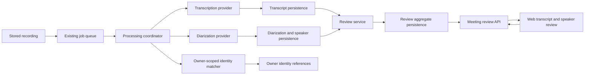
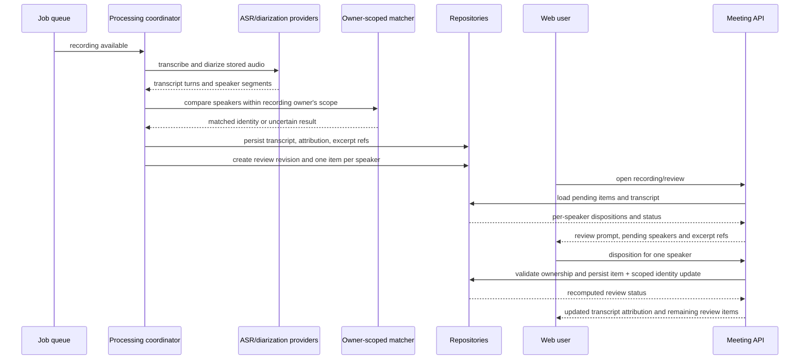

# Design — Stored Recording Processing and Speaker Review

## Summary

Approved requirements call for a stored recording to yield a transcript and speaker attributions while distinguishing recognized identities from uncertain voices. Users must be able to review each speaker independently, hear a clear excerpt, leave and resume an incomplete review, and have their own corrections inform later recordings without sharing identity data across users.

1. Extend the existing asynchronous backend transcription/diarization flow so a stored recording reaches an explicit review-ready result only after transcript, diarization and speaker-review state have been persisted.
2. Persist per-recording review state and one disposition per speaker; derive `pending` versus `complete` from the review items rather than a user-editable completion flag.
3. Present the review in the web transcript view using authenticated meeting-scoped API operations, with a speaker excerpt playback control and per-speaker name/correction/confirmation actions.
4. Keep established speaker references scoped to the current user and consult them during later recognition; uncertain matches remain `Speaker N`. Do not use shared/global training or expose another user's associations.
5. Add database migrations, API/service tests and frontend tests for lifecycle, isolation, uncertainty and partial-review invariants.

## Key Design Decisions

**Use the existing backend async processing pipeline and add a review-coordination step after transcript and diarization persistence.** The web process should not transcribe or diarize inline. A single review record is created only after initial processing has enough persisted data to construct its speaker set. *Alternatives rejected:* running engines in a request handler risks blocking and does not fit the current worker/queue architecture; creating review items before diarization completes would expose a mutable/incomplete speaker set.

**Model review as a recording-scoped aggregate with one immutable speaker key per initial diarization speaker and an optional disposition per key.** Its status is derived: pending while any review item lacks a disposition, complete otherwise. *Alternatives rejected:* a single completion boolean can disagree with item state and permit premature completion; one status per meeting cannot distinguish each speaker's reviewed state. Reprocessing that changes the original speaker set must not silently mark new speakers reviewed; it creates a new processing/review revision and preserves the prior revision for deterministic audit/history. The user-facing requirements do not prescribe revision history UI.

**Use explicit dispositions: `named`, `corrected`, or `confirmed`, with a chosen display label for named/corrected and the shown identity for confirmed.** A disposition applies only to its target speaker item. *Alternatives rejected:* treating a bulk “accept all” action as a disposition would mark speakers reviewed without an explicit per-speaker decision; free-form text alone cannot distinguish confirmation from correction.

**Store an owner-scoped acoustic reference for each established identity and use it only as evidence in later recognition for recordings owned by that same user.** The reference is not a global model and is not used to force a match: if the matcher cannot distinguish a candidate confidently, return an uncertain result and render `Speaker N`. An accepted correction updates the owner's reference for future matching; a per-recording label remains attached to that recording. *Alternatives rejected:* diarizer-local speaker IDs are recording-scoped and cannot support later recordings; a global embedding/model would violate the explicit no-sharing boundary; storing only a name cannot support acoustic comparison. The chosen reference is sensitive voice-derived data: retention, encryption/key management and access policy are not specified by the approved requirements and must be reviewed before implementation/deployment; this design does not authorize a new retention policy or broader access.

**Place the review UI in the existing web transcript view and put review operations behind the meeting API.** *Alternatives rejected:* adding extension capture controls would expand scope; a separate app would duplicate transcript context and authentication/session integration. This spec's card activates web, backend and cross-surface integration, not Chrome-extension changes.

## Architecture

### Components

The coordinator correlates processing by stored recording/meeting ID and passes the recording owner ID as an explicit scope to identity lookup and update. Workers remain provider-agnostic; provider-specific recognition details are behind an adapter. The API derives the user scope from the authenticated principal, never from a request-body owner ID. This is a data-isolation design requirement, not a definition of multi-user rollout or a new authentication feature.

### Processing and review sequence

A submission is idempotent for `(review_revision_id, speaker_id, disposition_version)`; concurrent writes to one speaker use optimistic version checking and return a conflict rather than overwrite another edit. The review status is recomputed transactionally after each accepted item. Returning to a pending review reloads only items without a disposition; completing the last one stops the review prompt.

## Components and Interfaces

### Backend processing and domain service

- Extend the existing transcription/diarization coordination boundary rather than coupling the review service directly to a particular ASR/diarization provider.
- `SpeakerIdentityMatcher.match(owner_id, speaker_evidence) -> MatchResult`: returns either a stable owner-scoped identity with display label or `uncertain`. It must never return an identity from another owner. Match calibration and confidence threshold are implementation decisions to validate against the acceptance outcomes; uncertain outcomes are never promoted to confirmed names.
- `SpeakerIdentityMatcher.apply_disposition(owner_id, identity_id | null, speaker_evidence, chosen_label, disposition)`: updates/reuses only that owner's reference when an explicit naming/correction disposition is recorded. `confirmed` preserves the existing association; it is not an implicit update to other speakers.
- `SpeakerReviewService.get_review(owner_id, recording_id)` and `record_disposition(owner_id, recording_id, speaker_id, request, expected_version)` enforce ownership, item membership and state invariants. The owner scope comes from the authenticated principal.
- Use the existing worker/queue pattern for processing and repository/transaction boundaries for persistence. No new visible processing-progress, retry UX, transcript editing, notes, library or media synchronization feature is part of this design.

### Meeting review API

Add to the existing authenticated meeting API (exact route names are implementation detail, these contracts are normative):

- `GET /api/v1/meetings/{meeting_id}/speaker-review` returns `review_id`, `status` (`pending|complete`), `revision`, transcript turns with current display attribution, and review items. Each item includes `speaker_id`, `current_label`, `attribution_state` (`recognized|uncertain`), `disposition` or null, and an opaque excerpt reference.
- `PUT /api/v1/meetings/{meeting_id}/speaker-review/speakers/{speaker_id}` accepts `{ disposition: "named"|"corrected"|"confirmed", label?: string, expected_version: integer }`. `label` is required for named/corrected and omitted for confirmed. Return the updated item plus derived review status and remaining item identifiers.
- `GET /api/v1/meetings/{meeting_id}/speaker-review/speakers/{speaker_id}/excerpt` streams the review excerpt using the existing authorized media/object-store boundary. The response must not reveal object-store keys or let a caller choose arbitrary object references.

The handlers must scope recording lookup and review repository queries to the current authenticated owner. Return not-found for an absent or non-owned meeting to avoid disclosing its existence. Reject unknown speaker IDs, invalid disposition/label combinations, stale `expected_version`, or edits to completed revisions with a validation/conflict response; never treat a failed request as a saved disposition.

### Web transcript review

Extend `frontend/src/components/TranscriptView.tsx` and the typed API module. When processing is complete, display the pending review request and one review control per speaker, including an excerpt play control and explicit `Confirm`, `Name`, or `Correct` action. `Speaker N` remains the visible label for uncertain attribution until named. Submitting one speaker updates only that item and renders the updated attribution; all unreviewed items remain clearly pending. On remount/re-entry, reload server state to resume. On completion, show transcript with reviewed attributions and omit the re-request prompt. Keep the interaction keyboard-operable and expose asynchronous errors without falsely advancing the item state. Do not add controls or layout assumptions not needed by these behaviors.

## Data Models

Names are proposed logical fields; implementation should map them onto existing SQLAlchemy conventions and add an Alembic migration. All foreign keys and writes occur in the same database transaction where noted.

| Entity | Fields and constraints |
| --- | --- |
| `SpeakerReview` | `id`, `recording_id`, `revision`, `status` (derived/persisted cache), timestamps; unique `(recording_id, revision)`. A review revision references the completed transcript and diarization revision. |
| `SpeakerReviewItem` | `id`, `review_id`, `speaker_id`, `current_label`, `attribution_state`, `disposition` nullable, `chosen_label` nullable, `version`; unique `(review_id, speaker_id)`. One item exists for every speaker presented. |
| `SpeakerIdentityReference` | `id`, `owner_id`, `display_label`, `acoustic_reference`, `created_at`, `updated_at`; unique owner/identity association as needed by the matcher. The acoustic reference is sensitive biometric-like data and is strictly owner-scoped; avoid copying raw audio into this record. No cross-owner/global rows or global training artifact. |
| `SpeakerEvidence` (logical, may reuse diarization data) | speaker ID, recording/revision ID, excerpt locator and matching evidence reference. Store a bounded clear excerpt reference or derivable time ranges over the stored source; the API resolves it server-side. No new retention duration is defined here. |

`acoustic_reference` is an opaque representation produced by a selected matcher, not an API field. Its concrete vector format and calibration are provider-adapter decisions. A disposal operation, voice-data retention period, consent workflow, encryption policy, audit policy and multi-user provisioning are not defined or authorized by these requirements; security review must resolve applicable handling before deployment. A change in speaker set creates a new review revision so new speakers cannot inherit a completed disposition accidentally.

## Correctness Properties

1. **Per-speaker disposition isolation.** For any review with speakers `S`, recording a disposition for `s ∈ S` changes only `s`'s disposition/label and leaves every `t ∈ S, t ≠ s` without a disposition unchanged. Validates Req. 3.3–3.5.
2. **Completion equivalence.** A review is complete iff every item in its revision has a non-null valid disposition; otherwise it is pending. No API request can set complete directly. Validates Req. 3.6–3.7 and 4.1–4.4.
3. **Resume persistence.** After leaving and reloading a pending review, all previously recorded item dispositions remain and only undisposed items are requested; after the final disposition, reopening does not request review again. Validates Req. 4.1–4.4.
4. **Uncertainty honesty.** For every unknown or uncertain automatic match, rendered attribution is `Speaker N` until an explicit disposition; a low-confidence candidate is never rendered as a confirmed identity. Validates Req. 2.1–2.2, 5.1, 6.1.
5. **Same-owner identity isolation.** For any two distinct owners `a` and `b`, matching or applying a disposition under `a` cannot read, alter or produce a reference belonging to `b`; a future match may use only the current recording owner's references. Validates Req. 5.1 and 6.1–6.2.
6. **Correction influence is bounded.** A named/corrected identity is available as evidence for subsequent recordings of the same owner, while uncertainty in a later recording still yields `Speaker N`; the change does not train or modify any global model. Validates Req. 6.1–6.2.
7. **Excerpt and item correspondence.** Every review item resolves only to an excerpt for its own diarized speaker and recording; a missing/invalid excerpt cannot be presented as another speaker's evidence. Validates Req. 3.2.
8. **Processing readiness.** A review is not exposed as review-ready until the initial transcript, speaker set and excerpt references for the review revision are persisted. Validates Req. 1.1 and 3.1.

## Error Handling

| Scenario | Behavior |
| --- | --- |
| Transcript/diarization provider failure or absent usable speaker set | Do not create a review that appears complete or ready. Preserve existing worker failure/retry semantics; visible progress/error UX is explicitly out of scope. |
| Identity matcher unavailable | Keep affected attributions uncertain (`Speaker N`); do not invent identity. Persist match failure using existing processing error/observability conventions and allow the review to proceed when required data exists. |
| Missing or inaccessible excerpt | Return a non-success API response for playback; preserve the pending disposition and allow the user to continue only by explicitly choosing a valid disposition. Do not silently mark reviewed. |
| Recording/review not owned by authenticated principal | Return not-found; do not return review or identity data. |
| Unknown speaker, malformed disposition, missing required label | Return validation/not-found error; do not change the review aggregate. |
| Stale item version/concurrent update | Return conflict with current item version/state; require a fresh read before retry. |
| Database transaction failure | Roll back item and identity-reference changes together; do not return success or render local completion as saved. |

## Testing Strategy

Use synthetic recordings/audio fixtures and deterministic fake matcher/provider implementations; never use real meeting audio, transcripts, identities, credentials or customer details.

- **Backend unit/property tests:** review status equivalence, per-speaker independence, idempotent repeated submissions, concurrent version conflict, and owner-scoped matcher lookup/update. Generate varying review sizes and disposition subsets.
- **Backend integration tests:** queue-to-review readiness, transcript/diarization/review transaction boundaries, migration constraints, pending-review reload, last-item completion, review revision replacement, excerpt authorization and cross-owner isolation.
- **Web tests:** pending and complete render states, `Speaker N` for uncertain results, excerpt play request, each explicit disposition, single-item update, resume after remount, and API failures that leave an item pending.
- **Cross-surface contract tests:** schema/route response compatibility, authenticated owner scope propagation, and no cross-owner reference resolution.

Run configured project validation from the relevant package roots: backend `pytest`, `ruff check .`, `mypy .`; frontend `npm run test`, `npm run typecheck`, `npm run build`. Tests must assert the listed correctness properties; these commands are proposed validation and have not been run during design authoring.

## Traceability and Boundaries

This design is based on the feature artifact `.spectra/specs/recording-speaker-review/requirements.md`, blob `4ed34b66` at the approved requirements commit/PR #232 (Mira approved; PR open, not merged), and the approved `PRODUCT_BASELINE.md` snapshot at commit `f5ff445fd508983740cd6b5a89c08adafcbb9295`, blob `c43cad6515b01a52037ad9cd4e09010a40477fb4` (approval annotation commit `b071a7c6d2c72613aa42543d15e47b81f4999077`). This is the approved design target; repository code is current-state evidence only.

Out of scope: recording capture/control, library and metadata, general media/transcript synchronization, transcript editing, notes, summaries, visible processing progress/timing/errors, cross-user identity sharing, global voice modeling/training, authentication rollout, consent workflow, retention guarantees/policy, and broader privacy/access governance. Security review is required before implementing or deploying voice-derived identity storage; this design does not decide policy that the spec leaves open.
