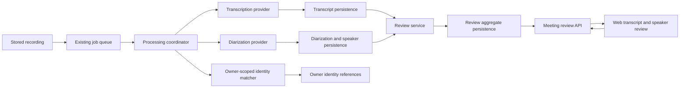
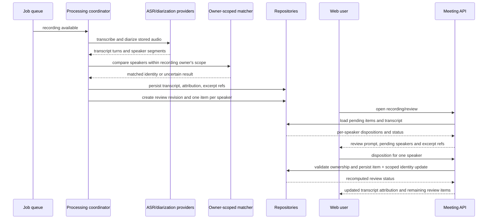

# Design — Stored Recording Processing and Speaker Review

## Summary

Approved requirements call for a stored recording to yield a transcript and speaker attributions while distinguishing recognized identities from uncertain voices. Users must be able to review each speaker independently, hear a clear excerpt, leave and resume an incomplete review, and have their own corrections inform later recordings without sharing identity data across users.

1. Extend the existing asynchronous backend transcription/diarization flow so a stored recording reaches an explicit review-ready result only after transcript, diarization and speaker-review state have been persisted.
2. Persist per-recording review state and one disposition per speaker; derive `pending` versus `complete` from the review items rather than a user-editable completion flag.
3. Present the review in the web transcript view using authenticated meeting-scoped API operations, with a speaker excerpt playback control and per-speaker name/correction/confirmation actions.
4. Keep established speaker references scoped to the current user and consult them during later recognition; uncertain matches remain `Speaker N`. Do not use shared/global training or expose another user's associations.
5. Add database migrations, API/service tests and frontend tests for lifecycle, isolation, uncertainty and partial-review invariants.

## Key Design Decisions

**Use the existing backend async pipeline, but stage every output under an explicit processing revision.** The migration adds `processing_revision_id` to transcript and diarization rows, backfills existing rows to revision 1, replaces `UNIQUE(meeting_id)` with `UNIQUE(meeting_id, processing_revision_id)`, and adds a per-recording revision row. Allocate a revision once when a new processing attempt is requested; every queue delivery carries that ID. Exact retries/recovery resume the same revision. A distinct revision request is admitted under a lock on the per-recording processing-state row and only if `in_flight_revision_id` is NULL; exact retries resume that revision, while any second distinct request is rejected without allocating another revision. If an active revision exists, admission additionally requires its review to be complete; if the active pointer is NULL (new or partial legacy recording), only one initial candidate may be in flight. Speaker-review GET and candidate admission acquire the same per-recording state-row lock. Under that lock, the GET may lazily activate complete legacy revision 1 only if `in_flight_revision_id` is NULL; if a candidate is already in flight, the GET does not create/activate revision 1 and returns not-ready, leaving activation to the exact-revision candidate finalizer. If the GET wins first and activates revision 1, later admission observes its pending review and rejects the distinct request. The state stores `in_flight_revision_id` until that candidate is atomically activated or explicitly failed/cancelled, so no later candidate can race it. Keep an explicit `active_processing_revision_id` on the recording/meeting processing state: it points only to a revision whose transcript, diarization, validated excerpts and review aggregate committed together as ready. Do not change the active pointer while a candidate revision is processing. The finalizer locks the state row and may activate only the revision currently named by `in_flight_revision_id` and only if the active pointer still equals the pointer value observed at admission; activation and clearing the in-flight slot commit atomically. Workers and repositories always query/write the queue's exact revision ID, never infer “latest.”

**Use lease-based, idempotent stage claims.** Claim each `(processing_revision_id, stage)` with a conditional `pending → running` transition and lease: completed stages return their persisted result, an unexpired claim prevents duplicate provider execution, and an expired claim permits recovery.

**Commit stage output and outbox events transactionally.** Persist the stage output, completion state, and transactional outbox event in one database transaction; uniqueness on `(processing_revision_id, stage)` prevents duplicate result/event rows. ASR and diarization keep their separate commits.

**Finalize after both stages and activate atomically.** A finalizer consumes the event only when both stage records are complete, then creates excerpt refs and the review aggregate and atomically switches the active pointer in one transaction. If review creation fails after diarization commits, the outbox event remains retryable; the finalizer retries from persisted transcript/diarization and never reruns a successful provider stage solely to recreate the review. The review is not review-ready or active until the finalizer commits. *Alternatives rejected:* inline processing blocks web requests; overwriting current rows loses pending-review source data; creating review items before both stages finish exposes a mutable/incomplete speaker set; queue-only notifications can be lost after a stage commit.

**Model review as a recording-scoped aggregate with one immutable speaker key per initial diarization speaker and an optional disposition per key.** Its status is derived: pending while any review item lacks a disposition, complete otherwise. *Alternatives rejected:* a single completion boolean can disagree with item state and permit premature completion; one status per meeting cannot distinguish each speaker's reviewed state. A distinct reprocessing request after the active review is complete creates a new processing/review revision; the previous revision remains unchanged and is no longer active after the candidate revision becomes ready and the active pointer switches atomically. A request while the active review is pending is rejected without creating or activating a revision, so it cannot displace the incomplete review. The user-facing requirements do not prescribe revision history UI.

**Use explicit dispositions: `named`, `corrected`, or `confirmed`, with a chosen display label for named/corrected and the shown identity for confirmed.** A disposition applies only to its target speaker item. *Alternatives rejected:* treating a bulk “accept all” action as a disposition would mark speakers reviewed without an explicit per-speaker decision; free-form text alone cannot distinguish confirmation from correction.

**Store an owner-scoped acoustic reference for each established identity and use it only as evidence in later recognition for recordings owned by that same user.** The reference is not a global model and is not used to force a match: if the matcher cannot distinguish a candidate confidently, return an uncertain result and render `Speaker N`. Matching uses versioned speaker embeddings and owner-scoped nearest-neighbor cosine similarity. Compare each diarized speaker embedding with that owner's active samples; return the top identity only when its score passes a model-version-specific calibrated threshold and separates from the runner-up by a calibrated margin. Otherwise return `uncertain` and render `Speaker N`. Calibrate both values for the selected embedding model against synthetic validation data; until calibrated, fail closed as uncertain. Keep multiple immutable samples per identity to accommodate acoustic variation without averaging away corrected evidence. Key each appended sample to its source review item and model version, not merely its recording, so two speakers in one recording may be explicitly assigned to the same identity while retries of either disposition remain idempotent. *Alternatives rejected:* exact-label lookup cannot handle acoustic variation; a single mutable prototype can erase useful evidence; global model training violates the no-sharing boundary. The specific embedding model remains an implementation dependency behind an adapter.

A `named` disposition resolves or creates the user's target identity and appends the current speaker embedding as a new sample. A `corrected` disposition detaches the speaker item from the wrongly matched identity, resolves or creates the user-selected target identity, and appends this speaker's embedding to the target. It never edits, replaces, or appends this observation to the wrongly matched source identity. `confirmed` preserves the current association and does not update samples. This distinguishes correcting a wrong match from overwriting its reference. *Alternatives rejected:* a label-only overwrite cannot identify which acoustic reference future matching should use; replacing the source reference corrupts future matches for the identity originally suggested.

Voice samples are sensitive data; security review must resolve applicable handling before implementation/deployment. Each sample keeps source-recording lineage and is deleted with that recording when it expires or is deleted under the existing lifecycle. This adds no independent expiry duration or new retention policy; the retention worker must delete linked samples in the same cleanup transaction. The identity's display label is not itself a voice sample. *Alternatives rejected:* unlinked or aggregated samples could survive source deletion and cannot be cleaned up correctly.

**Derive and validate one review excerpt per speaker before marking a revision ready.** Candidate intervals are formed only from that speaker's diarization-assigned segments, merging adjacent segments only when there is no intervening gap and no overlap with another speaker. Decode candidates from longest to shortest; break duration ties by the highest proportion of voice-activity-positive analysis windows, then earliest start time. Validate each candidate's bounds against the stored audio duration, successful decoding, at least one speech-active window, and diarization assignment to the target speaker. These checks define a deterministic selection method without inventing a user-facing duration or quality threshold absent from requirements. If no candidate passes, leave the revision not-ready and retry excerpt derivation from its persisted stages; never create an item with a missing/invalid excerpt. *Alternatives rejected:* whole-recording playback is not the required speaker-specific clear excerpt; trusting an unvalidated locator can yield silence, invalid media, or another speaker's evidence.

**Place the review UI in the existing web transcript view and put review operations behind the meeting API.** *Alternatives rejected:* adding extension capture controls would expand scope; a separate app would duplicate transcript context and authentication/session integration. This spec's card activates web, backend and cross-surface integration, not Chrome-extension changes.

## Architecture

### Components

The coordinator correlates processing by stored recording/meeting ID and passes the recording owner ID as an explicit scope to identity lookup and update. Workers remain provider-agnostic; provider-specific recognition details are behind an adapter. The API derives the user scope from the authenticated principal, never from a request-body owner ID. This is a data-isolation design requirement, not a definition of multi-user rollout or a new authentication feature.

### Processing and review sequence

Processing idempotency is keyed by `(recording_id, processing_revision_id, stage)`; the same stage event cannot create a second transcript, diarization, excerpt, or review for that revision. A per-recording processing-state row serializes revision admission and stores the active and in-flight revision pointers. Admission locks that row and permits only one in-flight candidate, including when the active pointer is NULL; exact retries resume it and additional distinct requests are rejected without allocation. When an active review exists it must be complete before admission. Readers continue using the old active revision (or legacy compatibility reads when active is NULL) until the candidate is fully ready; the finalizer activates only the in-flight candidate if the active pointer still matches its admission-time value, and clears the in-flight pointer in the same transaction that commits its review. For review writes, each request requires an `Idempotency-Key` and an `expected_version`. Persist the key, canonical request hash, and original response atomically with the disposition. Replaying the same key and same hash returns that original result without reapplying identity-sample changes, even if a later request advanced the item. Reusing the key with a different hash returns conflict. A different key with stale `expected_version` is a competing write and returns conflict without mutation. The review status is recomputed transactionally after each newly accepted item. Returning to a pending review reloads only items without a disposition; completing the last one stops the review prompt.

## Components and Interfaces

### Backend processing and domain service

- Extend the existing transcription/diarization coordination boundary rather than coupling the review service directly to a particular ASR/diarization provider.
- `SpeakerIdentityMatcher.match(owner_id, speaker_embedding) -> MatchResult`: query only active samples owned by `owner_id`; compare normalized vectors by cosine similarity and return a recognized identity only when the calibrated top-score threshold and runner-up margin both pass. Otherwise return `uncertain`. Thresholds are model-versioned and calibrated using synthetic validation data; no calibration means uncertain, never a guessed display name.
- `SpeakerIdentityMatcher.resolve_target(owner_id, target_identity_id | null, label | null) -> Identity`: validate that a supplied identity belongs to `owner_id`; otherwise create a new owner-scoped identity for the chosen label. Reject cross-owner IDs and labels that do not match the supplied target.
- `SpeakerIdentityMatcher.apply_disposition(owner_id, current_identity_id | null, target_identity, speaker_embedding, disposition)`: `named`/`corrected` append an immutable sample linked to the source recording under the target identity; for `corrected`, change only this review item's association and never modify the source identity's existing samples. `confirmed` preserves the presented association and writes no sample.
- `SpeakerReviewService.record_disposition(...)` persists disposition, identity-sample change and idempotency receipt in one transaction; a retry with the same key replays the saved result without reapplying the sample.
- `SpeakerReviewService.get_active_review(owner_id, meeting_id)` resolves the recording's `active_processing_revision_id` once and returns that revision's review. `record_disposition(owner_id, meeting_id, revision_id, speaker_id, request, expected_version)` requires the supplied revision to still be active and enforces ownership, item membership and state invariants; stale-revision writes return conflict without mutation. The owner scope comes from the authenticated principal.
- Use the existing worker/queue pattern for processing and repository/transaction boundaries for persistence. No new visible processing-progress, retry UX, transcript editing, notes, library or media synchronization feature is part of this design.

### Meeting review API

Add to the existing authenticated meeting API (exact route names are implementation detail, these contracts are normative):

- `GET /api/v1/meetings/{meeting_id}/speaker-review` resolves the recording's active revision once and returns `review_id`, `revision_id`, `status` (`pending|complete`), transcript turns with current display attribution, and review items. Each item includes `speaker_id`, `current_label`, `attribution_state` (`recognized|uncertain`), `disposition` or null, and an opaque excerpt reference. It never merges rows from multiple revisions.
- `PUT /api/v1/meetings/{meeting_id}/speaker-review/revisions/{revision_id}/speakers/{speaker_id}` accepts `{ disposition: "named"|"corrected"|"confirmed", target_identity_id?: string, label?: string, expected_version: integer }` plus a required `Idempotency-Key` header. Require `revision_id` to equal the current active revision; otherwise return conflict without mutation. `named`/`corrected` require either an owner-scoped `target_identity_id` or a `label` that creates a new identity; if both are supplied, the label must match that identity. `confirmed` omits both. Return the updated item plus derived review status and remaining item identifiers.
- `GET /api/v1/meetings/{meeting_id}/speaker-review/revisions/{revision_id}/speakers/{speaker_id}/excerpt` requires the requested revision to be active, then streams its review excerpt using the existing authorized media/object-store boundary. The response must not reveal object-store keys or let a caller choose arbitrary object references.

The two legacy `GET .../transcript` and `GET .../diarization` handlers resolve one revision under the recording/meeting state and query by that exact `processing_revision_id` in addition to the meeting owner predicate: use `active_processing_revision_id` when non-null, otherwise use `legacy_compatibility_revision_id` solely for migrated legacy output. If neither pointer exists, return the handler's existing no-row response. They must not use an unqualified `scalar_one_or_none()` query that can match multiple revisions. `GET .../speaker-review` never returns compatibility data as a review: with a null active pointer it acquires the same per-recording state-row lock used by candidate admission. It may lazily finalize complete legacy revision 1 only if `in_flight_revision_id` is NULL and revision 1 has both transcript and diarization; otherwise it leaves revision 1 inactive and returns not-ready conflict. It returns review data only if finalization validates excerpts and commits the active pointer. When a candidate is in flight, only that candidate's exact-revision finalizer can activate a revision. Processing workers, stage repositories and finalizers likewise carry and constrain every read/write by the queue's exact revision ID. Review GET resolves the active pointer once per request; revision-qualified PUT/excerpt requests compare their path revision with that same active pointer in the transaction and return conflict for stale revisions. This ensures no endpoint combines outputs from different revisions.

Before enabling these review routes or exposing revised labels/excerpt evidence, apply the same resource-owner check to the existing `GET /api/v1/meetings/{meeting_id}/transcript` and `/diarization` read handlers: query the meeting by both ID and `created_by == authenticated principal ID`, and return not-found when either check fails. The legacy handlers must not remain an existence-only bypass. Apply this owner predicate to every new route, recording lookup, excerpt resolution and identity repository query; derive owner ID only from the authenticated principal, never the request. Return not-found for absent/non-owned meetings to avoid disclosing existence. Reject unknown speaker IDs, invalid disposition/target combinations, stale `expected_version`, reused idempotency keys with a different request hash, or edits to completed revisions with validation/conflict responses; never treat a failed request as a saved disposition. A missing/invalid excerpt prevents creation of a ready review item, so no disposition endpoint exists for that item until excerpt validation succeeds.

### Web transcript review

Extend `frontend/src/components/TranscriptView.tsx` and the typed API module. When processing is complete, display the pending review request and one review control per speaker, including an excerpt play control and explicit `Confirm`, `Name`, or `Correct` action. `Speaker N` remains the visible label for uncertain attribution until named. Submitting one speaker updates only that item and renders the updated attribution; all unreviewed items remain clearly pending. On remount/re-entry, reload server state to resume. On completion, show transcript with reviewed attributions and omit the re-request prompt. Keep the interaction keyboard-operable and expose asynchronous errors without falsely advancing the item state. Do not add controls or layout assumptions not needed by these behaviors.

## Data Models

Names are proposed logical fields; implementation should map them onto existing SQLAlchemy conventions and add an Alembic migration. All foreign keys and writes occur in the same database transaction where noted.

| Entity | Fields and constraints |
| --- | --- |
| `RecordingProcessingState` | `recording_id` primary/foreign key, nullable `active_processing_revision_id`, nullable `in_flight_revision_id`, nullable `legacy_compatibility_revision_id`, next revision sequence; one row serializes revision admission and activation. The active pointer references only a ready revision; the in-flight pointer names at most one candidate and is cleared atomically on activation or terminal cancellation/failure, but retained through transient retryable failures. Migration initializes legacy records with active and in-flight pointers NULL and compatibility revision 1; revision 1 is never marked active merely because legacy transcript/diarization rows exist. |
| `ProcessingRevision` | `id`, `recording_id`, monotonically allocated `revision`, ASR/diarization/finalization stage states and lease expiry/claim token, timestamps; unique `(recording_id, revision)`. The migration adds `processing_revision_id` to existing `Transcript` and `Diarization` rows, assigns each existing row to revision 1, and changes each uniqueness constraint from `meeting_id` alone to `(meeting_id, processing_revision_id)`. Existing IDs/data remain intact. Revision 1's stage state reflects which legacy outputs exist and remains not-ready until its full review inputs are validated. |
| `SpeakerReview` | `id`, `processing_revision_id`, derived `status` (`pending|complete`), `created_at`; unique `processing_revision_id`. The aggregate is created only after transcript, diarization, speaker set and validated excerpts for that revision are ready. |
| `SpeakerReviewItem` | `id`, `review_id`, `speaker_id`, `current_label`, `identity_id` nullable, `attribution_state`, `disposition` nullable, `chosen_label` nullable, `version`, validated `excerpt_ref`; unique `(review_id, speaker_id)`. One item exists for every speaker presented and cannot be created without a validated excerpt. |
| `SpeakerIdentity` | `id`, `owner_id`, `display_label`; unique owner-scoped identity key. No cross-owner/global rows. |
| `SpeakerIdentitySample` | `id`, `identity_id`, `source_recording_id`, `source_review_item_id`, `model_version`, normalized `embedding`, `created_at`; unique `(source_review_item_id, model_version)` prevents duplicate appends on retry while permitting distinct speaker items in one recording to map to the same identity. Each sample is immutable and source-linked; recording deletion/expiry deletes these samples via FK cascade/in the same DB cleanup transaction. Matching uses only the authenticated owner's active samples. Do not store raw audio here. |
| `SpeakerReviewSubmission` | `id`, `review_item_id`, `idempotency_key`, canonical `request_hash`, committed response snapshot; unique `(review_item_id, idempotency_key)`. Persist atomically with disposition and sample append; same-key/same-hash replay returns snapshot and has no side effects, key/hash mismatch conflicts. |
| `SpeakerEvidence` (logical, may reuse diarization data) | speaker ID, processing revision ID, validated excerpt locator and speaker embedding reference. Store only a bounded interval over the source recording plus the server-side locator; validate against duration, decodeability, non-silence, speech activity and diarization ownership before review creation. Link every derived sample to the source recording for expiry/deletion cleanup. |

For legacy records, migration preserves every existing row and ID, assigns any existing transcript and/or diarization row to compatibility revision 1, and leaves `active_processing_revision_id` NULL; it does not fabricate a review or infer readiness from the presence of only one or both old outputs. On a speaker-review GET, acquire the same state-row lock used for candidate admission. Under that lock, lazily finalize complete legacy transcript and diarization data into revision 1 only if `in_flight_revision_id` is NULL: derive and validate excerpts, create the review, and set revision 1 active in one transaction. If a candidate is already in flight, do not create or activate revision 1; return not-ready conflict and let that candidate's exact-revision finalizer proceed. If the GET wins the lock first and activates revision 1, later admission observes its pending review and rejects the distinct request. A normal finalizer for an in-flight candidate handles only its named revision and never lazily activates compatibility revision 1. If required source data or excerpt validation is absent, revision 1 stays inactive and no review is exposed. A partial legacy record (for example, transcript without diarization) remains readable through its compatibility revision; the next normal processing request allocates revision 2 or later and processes into that candidate without overwriting revision 1. Until any candidate is ready, legacy transcript/diarization GETs with no active pointer read only `legacy_compatibility_revision_id` (revision 1) and preserve their existing no-row response; they never combine rows. `GET .../speaker-review` with no active ready revision returns a not-ready conflict and no partial review. Once a revision is ready, all three read routes use only the active revision. Tests cover migration and reads for both complete and partial legacy records, successful lazy finalization/activation of complete legacy inputs, and a partial record remaining inactive while its old transcript is still returned and its diarization remains absent until a later candidate is ready.

Meeting media, transcripts, speaker identity data and participant details are sensitive. Embedding bytes and model versions are internal-only; never return them through the API or logs. Source-linked immutable samples are removed with their source recording through the existing expiration/deletion event, and implementation must update the retention cleanup transaction and FK behavior so no sample survives. This specifies no new retention duration or policy and does not decide identity-label handling or deletion guarantees. Consent workflow, detailed permissions/access policy, encryption/key management and broader privacy/data-governance controls remain open under the approved baseline and require explicit definition and security/privacy review before implementation or deployment; this design does not authorize them or imply a policy. A new processing revision has its own review and cannot inherit dispositions from an earlier revision.

## Correctness Properties

1. **Per-speaker disposition isolation.** For any review with speakers `S`, recording a disposition for `s ∈ S` changes only `s`'s disposition/label and leaves every `t ∈ S, t ≠ s` without a disposition unchanged. Validates Req. 3.3–3.5.
2. **Completion equivalence.** A review is complete iff every item in its revision has a non-null valid disposition; otherwise it is pending. No API request can set complete directly. Validates Req. 3.6–3.7 and 4.1–4.4.
3. **Resume persistence.** After leaving and reloading a pending review, all previously recorded item dispositions remain and only undisposed items are requested; after the final disposition, reopening does not request review again. Validates Req. 4.1–4.4.
4. **Uncertainty honesty.** For every unknown or uncertain automatic match, rendered attribution is `Speaker N` until an explicit disposition; a low-confidence candidate is never rendered as a confirmed identity. Validates Req. 2.1–2.2, 5.1, 6.1.
5. **Same-owner identity isolation.** For any two distinct owners `a` and `b`, matching or applying a disposition under `a` cannot read, alter or produce a reference belonging to `b`; a future match may use only the current recording owner's references. Validates Req. 5.1 and 6.1–6.2.
6. **Correction influence is bounded.** A named/corrected identity is available as evidence for subsequent recordings of the same owner, while uncertainty in a later recording still yields `Speaker N`; the change does not train or modify any global model. For `corrected`, only this item's association changes and existing samples for the wrongly suggested identity remain unchanged. Validates Req. 6.1–6.2.
7. **Excerpt and item correspondence.** Every review item resolves only to an excerpt for its own diarized speaker and recording; a missing/invalid excerpt cannot be presented as another speaker's evidence. Validates Req. 3.2.
8. **Processing readiness and retry recovery.** A review is exposed only after transcript, diarization, speaker set and every validated per-speaker excerpt for one processing revision are persisted. Replaying any stage/finalizer event for that revision creates no duplicate output/review and does not rerun a successfully persisted stage; a failed finalizer can recover from committed stage data. Validates Req. 1.1 and 3.1.
9. **Safe idempotent review writes.** For a given item/key, same canonical request hash replays the original response without another disposition/sample mutation; key reuse with a different hash conflicts. A different key with stale version conflicts and changes nothing. Validates Req. 4.1–4.4.
10. **Legacy read ownership.** For any authenticated principal, transcript/diarization routes and speaker-review/excerpt routes return no meeting data for a meeting owned by another principal. Validates Req. 6.2.
11. **Revision-consistent active reads and pending-review preservation.** For each recording, transcript/diarization legacy reads and review GET resolve only the active revision; worker reads/writes are constrained to their event's revision; revision-qualified review PUT/excerpt requests reject a non-active revision without mutation. A distinct reprocessing request while the active review is pending is rejected and leaves its active pointer, transcript, speaker set and pending dispositions unchanged. After the active review is complete, a ready candidate becomes active atomically; no reader can observe a mixed-revision response. Validates Req. 3.1 and 4.1–4.4.

## Error Handling

| Scenario | Behavior |
| --- | --- |
| Transcript/diarization provider failure or absent usable speaker set | Do not create a review that appears complete or ready. Preserve existing worker failure/retry semantics; visible progress/error UX is explicitly out of scope. |
| Finalization fails after a stage commit | Leave the transactional outbox event and processing revision incomplete/retryable. A retry idempotently reads the persisted ASR/diarization outputs, validates/derives excerpts, and creates the review once; do not rerun a successful stage or expose partial review. |
| Identity matcher unavailable | Keep affected attributions uncertain (`Speaker N`); do not invent identity. Persist match failure using existing processing error/observability conventions and allow the review to proceed when required data exists. |
| No candidate excerpt passes validation | Do not create/expose the review or item; persist finalization as retryable and retry excerpt derivation from the same processing revision. The user cannot submit a disposition until the item has a validated excerpt. Playback failure after readiness returns a non-success response and leaves the item pending; never substitute another speaker's excerpt. |
| Recording/review not owned by authenticated principal | Return not-found; do not return review or identity data. |
| Unknown speaker, malformed disposition, missing required label | Return validation/not-found error; do not change the review aggregate. |
| Stale item version/concurrent update | Different idempotency key plus stale `expected_version` returns conflict with current version/state and no mutation; same key/hash replay returns the original saved response; same key with changed hash returns conflict. |
| New processing revision requested while active review is pending | Reject the distinct revision request without changing the active pointer or pending review; exact retry/recovery continues the existing revision. |
| Database transaction failure | Roll back item and identity-reference changes together; do not return success or render local completion as saved. |

## Testing Strategy

Use synthetic recordings/audio fixtures and deterministic fake matcher/provider implementations; never use real meeting audio, transcripts, identities, credentials or customer details.

- **Backend unit/property tests:** review status equivalence, per-speaker isolation, matcher threshold/margin fail-closed behavior, correction changing only the item's identity while preserving source samples, idempotent replay (same key/hash), key/hash mismatch conflict, and stale-version competing-write conflict. Generate varying review sizes, dispositions and retry sequences.
- **Backend integration tests:** migration backfill and replacement of meeting-only uniqueness with revision-scoped constraints; complete legacy record lazy-finalization into revision 1 and atomic activation; GET-versus-admission race tests for both lock orders (GET first: lazily activate revision 1, then distinct admission conflicts on its pending review; admission first: set a candidate in flight, GET returns not-ready without activating revision 1, then that candidate's finalizer activates only its exact revision); partial legacy record (transcript without diarization) keeps a null active pointer, returns only the compatibility transcript, preserves the existing no-row diarization response and exposes no review until a later candidate is ready; concurrent duplicate delivery blocked by an active stage lease, completed-stage replay and expired-lease recovery; recovery when finalization/review creation fails after diarization commits; excerpt candidate duration/VAD ranking, bounds/decoder/assignment rejection and retry-before-readiness; unique review creation; source-recording expiry/deletion removing linked samples; owner isolation for legacy and new routes; and revision-pinning for transcript/diarization reads, exact-revision worker persistence, review GET/PUT and excerpt lookup. Include a regression scenario with revision 1 active and partially reviewed: request distinct reprocessing, assert conflict and no mutation/displacement; complete the review, process revision 2, then assert atomic activation and that each response contains rows from only one revision. Add a concurrent-admission scenario with `active_processing_revision_id` NULL (including partial legacy input): submit two distinct requests concurrently, assert exactly one allocates and sets `in_flight_revision_id`, the other conflicts without mutation, exact retries resume the admitted revision, and a finalizer for any non-current candidate cannot activate or replace a newly pending review. Also test two separately reviewed speaker items from one recording explicitly assigned to the same identity: both item-keyed samples persist, while replaying either item's same idempotency key/hash creates no duplicate sample.
- **Web tests:** pending and complete render states, `Speaker N` for uncertain results, excerpt play request, each explicit disposition, single-item update, resume after remount, and API failures that leave an item pending.
- **Cross-surface contract tests:** schema/route response compatibility, authenticated owner scope propagation, and no cross-owner reference resolution.

Run configured project validation from the relevant package roots: backend `pytest`, `ruff check .`, `mypy .`; frontend `npm run test`, `npm run typecheck`, `npm run build`. Tests must assert the listed correctness properties; these commands are proposed validation and have not been run during design authoring.

## Traceability and Boundaries

This design is based on the feature artifact `.spectra/specs/recording-speaker-review/requirements.md`, blob `4ed34b66` at the approved requirements commit/PR #232 (Mira approved; PR open, not merged), and the approved `PRODUCT_BASELINE.md` snapshot at commit `f5ff445fd508983740cd6b5a89c08adafcbb9295`, blob `c43cad6515b01a52037ad9cd4e09010a40477fb4` (approval annotation commit `b071a7c6d2c72613aa42543d15e47b81f4999077`). This is the approved design target; repository code is current-state evidence only.

Out of scope: recording capture/control, library and metadata, general media/transcript synchronization, transcript editing, notes, summaries, visible processing progress/timing/errors, cross-user identity sharing, global voice modeling/training, authentication rollout, consent workflow, retention guarantees/policy, and broader privacy/access governance. Security review is required before implementing or deploying voice-derived identity storage; this design does not decide policy that the spec leaves open.
