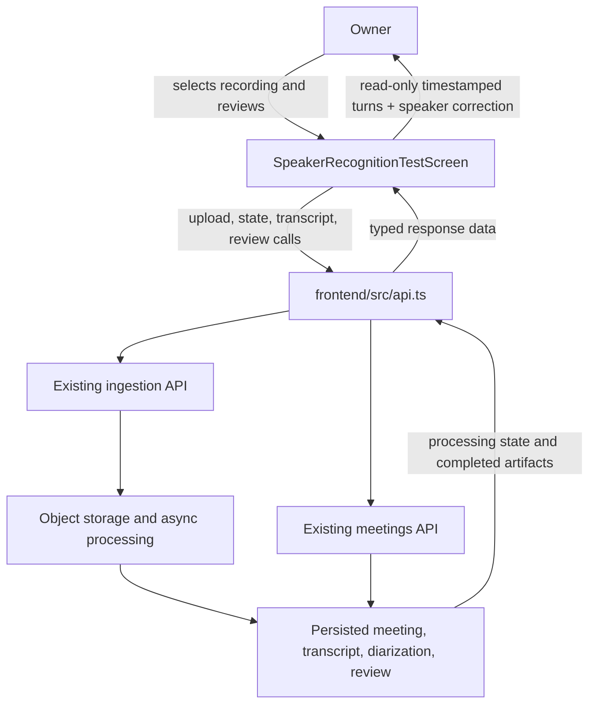
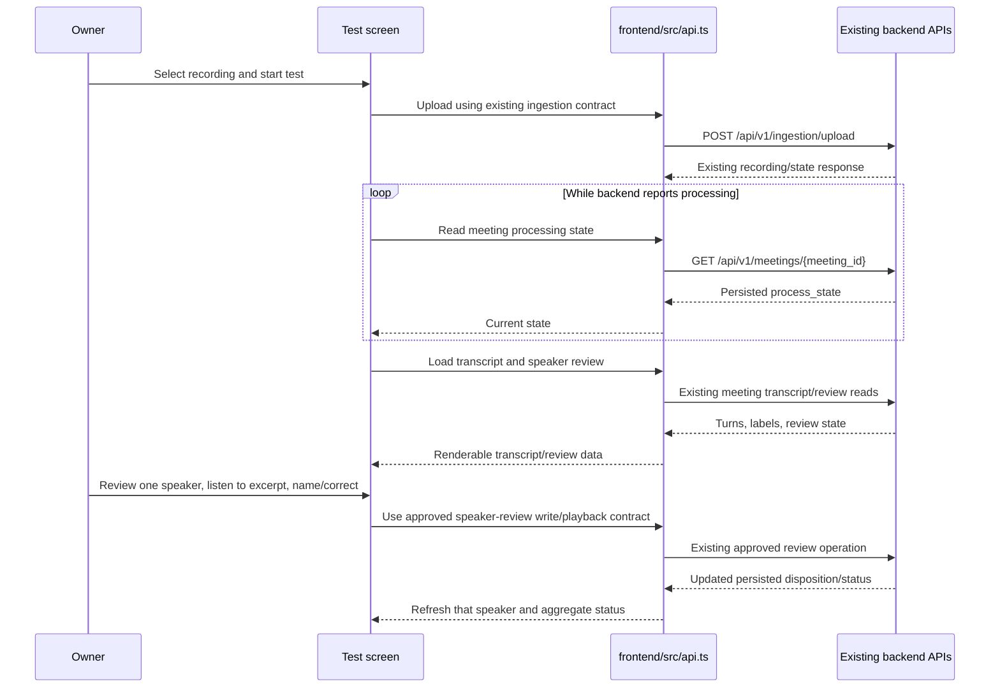

# Design — Owner-Run Speaker-Recognition Test Screen

## Summary

This feature is a narrow web entry point for exercising a saved recording through processing and human speaker review. It must expose the requested flow without turning the existing small SPA into a redesigned meeting portal, and it must preserve `Speaker N` for unknown or uncertain attribution and the existing per-user boundary for speaker corrections.

1. Add one focused test-screen view to the existing React SPA and keep upload, processing, transcript, and speaker review within that view.
2. Use the existing frontend HTTP boundary (`frontend/src/api.ts`) and existing meeting, ingestion, transcript, diarization, and speaker-review backend capabilities where their contracts support the flow; do not introduce parallel client/server abstractions or invent endpoint paths.
3. Render the completed transcript as timestamped turns with speaker labels and text, reusing the current transcript and speaker-review interaction rather than adding transcript-text editing.
4. Show a processing state from persisted backend state without inventing progress percentages, timing promises, or new failure semantics.
5. Extend the existing ingestion contract to create an upload-only meeting without a fabricated Meet link, add focused frontend/backend tests, and keep the response contract shared; the nullable meeting link requires a migration and shared-type update. No Compose change is proposed.

The approved requirements do not require a Google Meet link. The current upload path already accepts a caller-supplied `meeting_id` and automatically creates a meeting when that ID does not exist, but it substitutes the fabricated link `https://meet.google.com/unknown`; it also requires `duration_seconds` and accepts only `chrome_extension` or `server_bot` as `capture_origin`. The design therefore extends the existing ingestion contract rather than adding a new endpoint: accept a linkless upload-only meeting (`meet_link = null`), add the truthful `web_upload` capture origin, and preserve an upload's stable `meeting_id` and `idempotency_key` across retries. **Unresolved metadata mapping:** the existing contract requires `duration_seconds`, but the approved requirements do not specify duration collection, a media parser, accepted formats, or a fallback when duration cannot be read. Do not use zero, a guessed value, or a filename-derived value. Ansel must have Zoya/requirements author resolve this technical/product boundary before implementation tasks define the behavior. Other upload metadata must be derived from actual selected media and existing fields; no fabricated meeting link or title.

## Key Design Decisions

**Extend the existing web SPA in place rather than create a new portal or route system.** Add a test-screen view selected within `frontend/src/App.tsx`, implemented in a focused `frontend/src/components/SpeakerRecognitionTestScreen.tsx`. This meets the minimal-screen requirement and follows the current single-SPA structure. *Alternatives rejected:* a new application or full library redesign expands scope; putting the flow in the Chrome extension conflicts with the explicit portal-screen request.

**Keep the existing `POST /api/v1/ingestion/upload` endpoint and add linkless upload creation there; do not add a new endpoint.** It already accepts multipart audio, optional separate video, and `IngestionData`; `process_ingestion` already creates a missing meeting from the supplied meeting ID. Change that creation path to store `meet_link = null` instead of `https://meet.google.com/unknown`, and allow truthful `web_upload` `capture_origin`. Keep screen requests in `frontend/src/api.ts`; use existing meeting, transcript, diarization and speaker-review routes. Extend the existing `GET /api/v1/meetings/{meeting_id}/transcript` response with `speaker_label` on each segment. Resolve each label through `SpeechTurn.id == SpeakerAssignment.turn_id`, then `SpeakerAssignment.speaker_id == Speaker.id`; the speaker-review contract MUST persist `SpeakerReviewItem.speaker_key == str(Speaker.id)` within the same active processing revision. For `named`/`corrected` disposition with a persisted `chosen_label`, return that label; otherwise return the review item's `current_label`, which is `Speaker N` when attribution remains uncertain. With no review item, retain the diarization speaker's current label; never infer a name. This extends one existing response and adds no route. Reuse the approved write/excerpt contracts from speaker-review work; the current router snapshot lacks the disposition-write and excerpt routes shown by existing frontend helpers, so resolve against that approved contract rather than guessing. *Alternatives rejected:* requiring a Meet link contradicts approved scope; a second upload endpoint duplicates ingestion; client-side joins cannot recover completed corrections because review GET returns only outstanding items; component-level `fetch` duplicates auth/error handling. The required `duration_seconds` mapping remains unresolved; do not fabricate a fallback.

**Represent processing with the backend's persisted state, not a fabricated percentage.** After upload returns its existing recording/state result, the UI refreshes the existing meeting state until the backend indicates the result is ready, then loads transcript and review data. The screen communicates “processing” while that state remains in progress; no estimated duration, percentage, retry policy, or error UX is added because the requirements do not define them. *Alternatives rejected:* a client timer or synthetic percentage misrepresents actual server progress; a new progress API is not authorized by the requirements.

**Render effective speaker attribution in the existing transcript response and reuse speaker review.** Transcript turns remain read-only. The response joins each turn to its diarization assignment and same-revision review item using `turn_id` and the immutable `speaker_key == str(Speaker.id)` contract. A `named`/`corrected` item's persisted `chosen_label` is its displayed label; otherwise the persisted `current_label` is used, preserving `Speaker N` for unresolved attribution. Review actions update speaker attribution only, never transcript text; the persisted review remains pending until all speakers receive an explicit disposition. Leaving the view does not mark review complete; reopening fetches persisted state and prompts for unfinished items. *Alternatives rejected:* editing transcript text mixes separate data and is out of scope; client-side joins against only pending review items lose labels after completion; a local-only completion flag cannot resume reliably.

**Preserve existing ownership, identity isolation, and retention behavior.** Requests use the existing authenticated API client and meeting-scoped backend authorization; the unowned meeting-state read must be brought under that same owner check. Speaker names/corrections remain associated with the current user and must not be exposed to another user. Do not add cross-user identity lookup, global identity behavior, or a new retention policy; the recording follows existing retention and deletion behavior. Audio/video and transcript content are sensitive; use only synthetic files and synthetic text in automated tests.

## Architecture

The UI generates a stable meeting ID and idempotency key once per selected upload and reuses them on retries. The existing ingestion handler creates the owner-scoped meeting when absent, then creates the recording and queues processing. It must persist no Meet link rather than its current `https://meet.google.com/unknown` placeholder. `duration_seconds` is still required by the current ingestion schema and remains an explicitly unresolved mapping; do not implement an assumed value until the requirements author resolves it.

## Components and Interfaces

### 1. `SpeakerRecognitionTestScreen` (`frontend/src/components/SpeakerRecognitionTestScreen.tsx`)

A single focused UI component that owns the current test recording/meeting selection, upload-in-progress state, processing state, and loaded transcript/review view. It presents one upload-and-review flow and does not add library management. Follow the existing SPA's component conventions and UI language established for the feature; the requirements do not define exact copy or visual styling.

The file input accepts the audio/video recording for upload. A muxed video file is sent in the existing audio multipart field and declared `video_presence: "muxed"`; an audio-only file uses `"absent"`. Separate audio/video source selection remains outside this single-file flow unless explicitly approved. The screen must not invent file size/duration limits; requirements defer media limits. It generates the stable `meeting_id` and `idempotency_key` once per selection and sends the truthful `capture_origin: "web_upload"`. It does not send a Meet link or fabricate a title. The required `duration_seconds` cannot yet be populated under an approved rule; implementation is blocked on that mapping.

After the existing ingestion endpoint creates/uses the upload-only meeting and returns its existing recording/state response, the component observes persisted meeting state. On completion it loads the transcript and speaker review in the same view. While review has pending items, reopening that recording fetches the stored state and resumes outstanding speakers. No transcript-editing control is provided.

### 2. API boundary (`frontend/src/api.ts`)

Keep requests in this existing module. Reuse current authenticated fetch conventions and existing method helpers if their request/response contracts match the approved speaker-review implementation. Add only wrappers for existing upload/status/transcript/review operations; do not add guessed route strings. Type the existing transcript segment with the additive `speaker_label: string` response field. The upload call sends existing file/data multipart fields with a stable client-generated `meeting_id` and `idempotency_key`, actual `video_presence`, and `capture_origin: "web_upload"`; omit `meet_link` and `title`. The transcript wrapper consumes `speaker_label` from the backend response rather than reconstructing corrected labels from incomplete review items.

### 3. Existing backend capabilities and required adaptation

Upload remains in `backend/app/ingestion/`; meeting/transcript/speaker-review operations remain in `backend/app/meetings/`. The existing authenticated ingestion endpoint auto-creates a missing meeting from `meeting_id` and queues processing, so the web screen can use the same endpoint without requiring a Meet link. Modify that creation path to persist a null `meet_link` rather than the fabricated `https://meet.google.com/unknown`, and extend `IngestionData.capture_origin` with `web_upload`. Update the model/type/migration accordingly. Do not add another upload endpoint.

`duration_seconds` remains mandatory in checked-in `IngestionData` and `SessionRecording`; requirements do not establish how to obtain it, so upload implementation is blocked until Zoya/requirements author records the mapping. The existing `GET /api/v1/meetings/{meeting_id}` handler does not enforce ownership; add its owner check before polling and cover foreign-owner denial in `backend/tests/meetings/`. Extend the existing authenticated `GET /api/v1/meetings/{meeting_id}/transcript` response: resolve one active processing revision, join turns to assignments (`SpeechTurn.id == SpeakerAssignment.turn_id`) and speakers (`SpeakerAssignment.speaker_id == Speaker.id`), then left-join the same-revision review item whose `speaker_key == str(Speaker.id)`. The review-item producer must persist that exact key, matching the approved speaker-review contract's immutable per-diarization-speaker identifier. Return `chosen_label` only for `named`/`corrected` items with a value; for `confirmed` or undisposed items return `current_label`; absent a review item, return the diarization speaker label. Keep the original transcript `text` unchanged. Test same-revision and owner constraints. The current router lacks speaker disposition-write and excerpt routes in this branch snapshot; use exact approved speaker-review contracts when present, not guessed routes.

### 4. Folder placement and platform impact

| Area | Add or modify | Tests | Migration / deployment / contract |
|---|---|---|---|
| Web frontend/shared contract | Add `frontend/src/components/SpeakerRecognitionTestScreen.tsx`; modify `frontend/src/App.tsx` and `frontend/src/api.ts` to mount the flow and call existing routes; update `packages/shared-types/src/index.ts` (`Meeting.meetLink: string | null`, `CaptureOrigin.WebUpload`) | Add colocated `frontend/src/components/SpeakerRecognitionTestScreen.test.tsx`; extend `frontend/src/api.test.ts` for upload metadata; run shared-types/frontend typechecks and extension typecheck for the additive shared enum | No `docker-compose.yml` change; shared contract change is required because `Meeting.meetLink` is currently non-null and `CaptureOrigin` currently omits web upload |
| Backend API and ingestion | Modify `backend/app/ingestion/schemas.py`, `backend/app/ingestion/service.py`, `backend/app/infra/models.py`, and `backend/app/meetings/router.py` for linkless creation, owner-protected status, and effective transcript labels; retain existing upload/transcript routes | Extend `backend/tests/ingestion/` for linkless owner-scoped meeting creation, accurate source, idempotency, and no placeholder URL; use `backend/tests/meetings/` for nullable-link serialization, foreign-owner denial, turn/assignment/review-key join, label rules, same-revision isolation, and unchanged transcript text | Add one sequential migration under `backend/alembic/versions/` to make `meetings.meet_link` nullable; no Compose change. `duration_seconds` mapping remains a pre-implementation dependency; no fallback specified |
| Speaker review integration | Reuse existing `backend/app/meetings/` and the approved speaker-review operations; do not invent routes | Existing `backend/tests/speaker_review/` plus frontend component behavior tests | No additional persistence change for screen state |

No Chrome extension or mobile surface is touched. Existing diarization runtime/configuration gaps remain external deployment prerequisites, not silently solved here.

## Data Models

No new domain entity is proposed. The existing `Meeting.meet_link` becomes nullable so upload-created meetings have no fabricated Meet URL; `SessionRecording` retains its existing fields. Add `web_upload` to accepted `capture_origin` values in the existing string column. A sequential Alembic migration makes `meetings.meet_link` nullable; shared TypeScript types represent nullable links and the added upload origin. Deploy compatible readers/types and the nullable schema before allowing the upload path to write null links. The downgrade must refuse while null links exist; never backfill a fabricated URL. The existing transcript response adds `speaker_label` per segment. The approved speaker-review contract defines one immutable review speaker key per diarization speaker; persist that key as the string form of `Speaker.id` so it joins to `SpeakerAssignment.speaker_id` within the same active processing revision, without adding a new model or column. For `named`/`corrected`, use the item's persisted `chosen_label`; otherwise use `current_label` (fall back to the diarization label only if no review item exists). Keep `SpeechTurn.text` unchanged. Exact write/excerpt payloads come from the approved speaker-review contract, not this design.

The screen must preserve these semantic distinctions:

- Transcript text is read-only.
- `Speaker N` is a valid unresolved/uncertain label, not a confirmed identity.
- Per-speaker review disposition is distinct from aggregate review status.
- `pending` remains pending until every displayed speaker has a persisted explicit disposition; completion is not a client-only state.
- Speaker identity associations are user-scoped; media and transcript test fixtures are synthetic.

## Correctness Properties

**Property 1 — No transcript before processing completion.** For every uploaded recording, the screen does not present its transcript/review result while the persisted meeting state indicates that processing is still in progress. It loads the result after the backend reports completion. *Validates: Requirement 2.1–2.2.*

**Property 2 — Transcript turn fidelity.** For every returned transcript turn, the rendered row includes its timestamp, speaker label, and exact transcript text, without providing a text-edit operation. *Validates: Requirements 3.1 and 5.2.*

**Property 3 — Honest unresolved attribution.** For every returned unknown or uncertain speaker, the UI renders the backend's `Speaker N` label and never substitutes an inferred or confirmed person's name. *Validates: Requirement 3.2.*

**Property 4 — Independent speaker disposition.** Recording one speaker disposition updates only that speaker's persisted review item; it does not mark any other speaker reviewed or complete the aggregate while another item remains pending. *Validates: Requirements 4.1–4.3, 4.5–4.6.*

**Property 5 — Resume pending review.** For a review with at least one undisposed speaker, leaving and reopening the same recording reloads the pending state and exposes the remaining speakers for review; it never converts pending to complete locally. *Validates: Requirements 4.5–4.6.*

**Property 6 — Owner boundary preserved.** The screen only uses authenticated existing meeting-scoped operations; no UI/API path exposes one user's speaker names or identity associations to another user. *Validates: Requirement 4.4.*

**Property 7 — Minimal scope.** The test flow offers recording upload, progress, transcript inspection, and speaker review only; it has no transcript-text editor, redesigned library, or unrelated meeting-management controls. *Validates: Requirements 1.2, 5.1–5.2.*

**Property 8 — Effective speaker label joins the same turn and review revision.** For each transcript segment, the response joins only its own `turn_id` assignment, the assigned `Speaker.id`, and the matching same-revision review item (`speaker_key == str(Speaker.id)`). `named`/`corrected` disposition returns its persisted `chosen_label`; otherwise it returns `current_label`, with unresolved attribution remaining `Speaker N`. The join does not alter the segment's text or borrow another speaker's label. *Validates: Requirements 3.1–3.2, 4.2–4.3 and the approved speaker-review design's revision/key contract.*

## Error Handling

The requirements do not define upload, processing, polling, transcript-fetch, or speaker-review failure behavior. This design does not select retry rules, error copy, timeout behavior, or recovery states. Implementation must use existing API error behavior and must not mark review complete after a failed write. If a failure requires new user-visible behavior beyond what existing components/contracts provide, return a specific decision to the requirements author through Ansel before implementing it.

The current checked-in source does not expose all speaker-review operations in the meetings router (the current router snapshot has the review GET; disposition-write and excerpt playback are not present there). This is an integration dependency against the existing approved speaker-review work, not authorization to invent routes. The checked-in Compose stack also has no diarization-engine service; a successful local run cannot be claimed based on this screen design.

## Testing Strategy

Use the existing frontend test runner and component-test conventions. UI tests should use synthetic recording metadata, synthetic transcript text, and mocked API responses only in test files.

- **Component tests:** selected recording invokes upload; processing state is visible before results; completed transcript renders timestamp, `Speaker N`, and text; transcript text cannot be edited; each speaker's review action affects only its own rendered item; pending status survives unmount/remount by reloading persisted API data; complete state appears only after the persisted review reports completion.
- **API tests:** calls remain routed through `frontend/src/api.ts`; upload uses authenticated existing route and exact multipart contract, stable IDs across retries, `web_upload`, and no fabricated Meet link/title. No guessed endpoint or schema is accepted by tests.
- **Backend ingestion tests:** with synthetic media, assert automatic meeting creation is owner-scoped, has `meet_link = null`, uses `web_upload`, preserves idempotency, and never writes the old placeholder URL. Add migration coverage for nullable meeting links. Duration assertions wait on the approved mapping; tests must not encode an invented fallback.
- **Backend transcript-label contract tests:** synthetic transcript turns and diarization assignments assert exact `turn_id` association, stable `speaker_key == str(Speaker.id)`, same active revision, unresolved `Speaker N` fallback, `named`/`corrected` label override, and unchanged transcript text. Include at least two speakers to catch cross-item label leakage.
- **Cross-boundary verification:** verify upload, meeting state, transcript, and speaker review remain bound to the same owner/meeting, and type contracts agree on nullable links and capture origin. Synthetic fixtures only; never use real customer recordings or transcripts.
- **Commands:** from `frontend/`, `npm run test`, `npm run typecheck`, and `npm run build`; from `packages/shared-types/`, `npm run typecheck`; from `extension/`, `npm run typecheck` for the additive shared enum. Backend changes require the configured `pytest`, `ruff check .`, and `mypy .` commands from `backend/`.

No tests were run during design authoring. The implementation and independent QA phases must report actual command results.

## Traceability and Boundaries

This design traces to `.spectra/specs/speaker-recognition-test-screen/requirements.md`, SHA-256 `48feeed1ba38794e68ca349d53c94059e4e495dc3580d5c560e841417eaf3be4`, exact approved requirements commit `d0c45a275d5861eabca78d7fa53484bf31b9afc1` (Mira approved; PR #536 open, not merged). Product authority is the baseline candidate approved by Fer for PR #528 at commit `f31c1437d002a49849fc577446290ab83d29a584` (open, not merged); its scope amendment states the minimal owner-run upload → progress → timestamped Speaker N transcript → existing speaker review/name correction flow. The exact approved requirement artifact remains the behavior source for this design; repository code is current-state evidence only.

Out of scope: portal redesign, transcript-text editing, cross-user identity sharing, unrelated meeting-management behavior, new recognition/identity-matching behavior, speculative API endpoints, media limits, progress percentages/timing targets, and undefined error behavior. The upload-only meeting design avoids requiring a Meet link and removes the current fabricated link placeholder. Before implementation, Zoya/requirements author must resolve how the required `duration_seconds` is obtained for selected media; no value or fallback is authorized here. Existing speaker-review route availability and diarization deployment/configuration remain prerequisites to verify against their approved work and target runtime.
