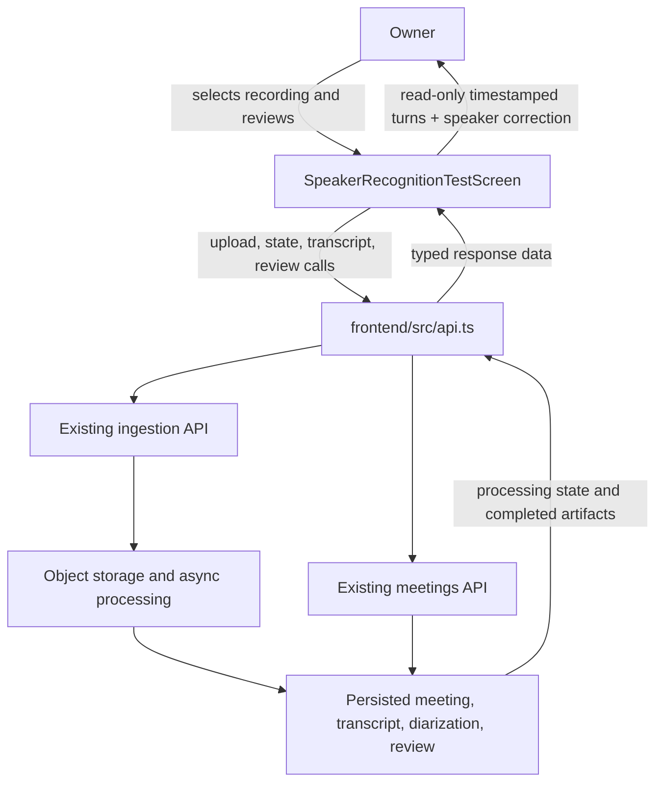
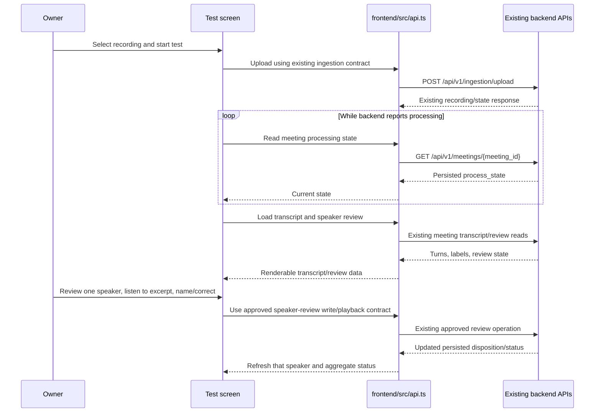

# Design — Owner-Run Speaker-Recognition Test Screen

## Summary

This feature is a narrow web entry point for exercising a saved recording through processing and human speaker review. It must expose the requested flow without turning the existing small SPA into a redesigned meeting portal, and it must preserve `Speaker N` for unknown or uncertain attribution and the existing per-user boundary for speaker corrections.

1. Add one focused test-screen view to the existing React SPA and keep upload, processing, transcript, and speaker review within that view.
2. Use the existing frontend HTTP boundary (`frontend/src/api.ts`) and existing meeting, ingestion, transcript, diarization, and speaker-review backend capabilities where their contracts support the flow; do not introduce parallel client/server abstractions or invent endpoint paths.
3. Render the completed transcript as timestamped turns with speaker labels and text, reusing the current transcript and speaker-review interaction rather than adding transcript-text editing.
4. Show a processing state from persisted backend state without inventing progress percentages, timing promises, or new failure semantics.
5. Add focused frontend and integration-contract tests using synthetic media/transcript data; no schema migration, shared-types change, or Compose change is proposed for the screen itself.

**Implementation prerequisite requiring a product decision:** the checked-in ingestion contract requires a `meeting_id` plus metadata (`video_presence`, `idempotency_key`, `capture_origin`, `duration_seconds`, and optional `title`/`meet_link`), while the current manual meeting registration endpoint accepts meeting-registration inputs rather than an uploaded file. The requirements do not decide how the standalone screen obtains or creates the associated meeting, nor which recording metadata the user must provide. Do not silently invent a default meeting, title, link, or metadata. Ansel should obtain the decision stated in HAND-OFF before this design is sent for approval as implementation-ready. Recommended narrow option: have the user supply the minimum meeting context required by the already-approved ingestion contract on the same screen, without navigating the library; if that contract cannot represent this use case, obtain approval for a contract change before designing it.

## Key Design Decisions

**Extend the existing web SPA in place rather than create a new portal or route system.** Add a test-screen view selected within `frontend/src/App.tsx`, implemented in a focused `frontend/src/components/SpeakerRecognitionTestScreen.tsx`. This meets the minimal-screen requirement and follows the current single-SPA structure. *Alternatives rejected:* a new application or full library redesign expands scope; putting the flow in the Chrome extension conflicts with the explicit portal-screen request.

**Keep all HTTP calls in `frontend/src/api.ts`; use only established backend contracts.** The repository currently exposes `POST /api/v1/ingestion/upload`, `GET /api/v1/meetings/{meeting_id}`, `GET /api/v1/meetings/{meeting_id}/transcript`, and `GET /api/v1/meetings/{meeting_id}/speaker-review`; the upload accepts multipart audio, optional separate video, and JSON ingestion metadata. The meeting endpoint provides the persisted processing state. Reuse the accepted write/excerpt contracts from the independently approved speaker-review work when available; this branch's current backend router snapshot exposes the review GET, but does not expose the disposition-write or excerpt routes shown by the existing frontend API helpers. Do not create endpoint names or payloads in this feature design. If those approved contracts are not present in the implementation base when implementation starts, stop and resolve the dependency against the approved speaker-review artifact rather than guessing. *Alternatives rejected:* component-level `fetch` duplicates authentication/error handling and violates the established HTTP boundary; new speculative endpoints would create an unreviewed backend contract.

**Represent processing with the backend's persisted state, not a fabricated percentage.** After upload returns its existing recording/state result, the UI refreshes the existing meeting state until the backend indicates the result is ready, then loads transcript and review data. The screen communicates “processing” while that state remains in progress; no estimated duration, percentage, retry policy, or error UX is added because the requirements do not define them. *Alternatives rejected:* a client timer or synthetic percentage misrepresents actual server progress; a new progress API is not authorized by the requirements.

**Render attribution separately from transcript text and reuse speaker review.** Transcript turns remain read-only. Their labels are taken from the transcript/diarization/review contract; uncertain/unknown attribution is rendered literally as `Speaker N`. Review actions update attribution only, and the persisted review remains pending until all speakers receive an explicit disposition. Leaving the view does not mark the review complete; reopening that recording reloads persisted review status and prompts for unfinished items. *Alternatives rejected:* editing transcript text mixes separate data and is explicitly out of scope; a local-only completion flag can falsely complete review and cannot resume reliably.

**Preserve existing ownership and identity isolation.** Requests use the existing authenticated API client and meeting-scoped backend authorization. Speaker names/corrections remain associated with the current user and must not be exposed to another user. Do not add cross-user identity lookup or global identity behavior. Audio/video and transcript content are sensitive; use only synthetic files and synthetic text in automated tests.

## Architecture

The sequence describes the intended end-to-end flow but does not define the unresolved meeting-context/metadata step. That step must be settled before implementation; it cannot be inferred from the diagrams.

## Components and Interfaces

### 1. `SpeakerRecognitionTestScreen` (`frontend/src/components/SpeakerRecognitionTestScreen.tsx`)

A single focused UI component that owns the current test recording/meeting selection, upload-in-progress state, processing state, and loaded transcript/review view. It presents one upload-and-review flow and does not add library management. Follow the existing SPA's component conventions and UI language established for the feature; the requirements do not define exact copy or visual styling.

The file input accepts audio/video selections. The screen must not invent file size/duration limits: requirements explicitly defer media limits. Whether files with separate audio/video tracks can be selected or only one media file is submitted must follow the existing ingestion contract and await the meeting-context decision; `video_presence` must describe actual selected media, not be guessed from a filename.

Once an associated meeting and valid ingestion metadata are available, the component calls the API wrapper for upload and observes the existing persisted meeting state. On completion it loads the transcript and speaker review in the same view. While the review has pending items, reopening that same recording fetches the stored state and resumes outstanding speakers. No transcript-editing control is provided.

### 2. API boundary (`frontend/src/api.ts`)

Keep requests in this existing module. Reuse the current authenticated fetch conventions and existing method helpers if their request/response contracts match the approved speaker-review implementation. Add only wrappers required to invoke established contracts; do not add guessed route strings, response shapes, new backend endpoint definitions, or shared types in this design. The exact meeting-context/upload orchestration remains pending the decision above.

### 3. Existing backend capabilities (no new module planned)

The current source places upload in `backend/app/ingestion/` and meeting/transcript/speaker-review operations in `backend/app/meetings/`. The current ingestion API is authenticated and queues processing; meeting reads are owner-scoped in the transcript and diarization handlers. Existing tests for speaker review are under `backend/tests/speaker_review/`. This design proposes no backend module, endpoint, persistence, or behavioral change solely to render the screen; if implementation discovers the approved review write/excerpt contract is not present, treat it as an upstream dependency and request a scoped amendment rather than bypassing review logic.

### 4. Folder placement and platform impact

| Area | Add or modify | Tests | Migration / deployment / contract |
|---|---|---|---|
| Web frontend | Add `frontend/src/components/SpeakerRecognitionTestScreen.tsx`; modify `frontend/src/App.tsx` and `frontend/src/api.ts` only as needed to mount the focused flow and call established API contracts | Add colocated `frontend/src/components/SpeakerRecognitionTestScreen.test.tsx`; extend `frontend/src/api.test.ts` for any added wrappers | No database migration; no `docker-compose.yml` change; no `packages/shared-types` change proposed |
| Backend API and workers | No files planned for this screen. Existing ingestion, meeting, transcript, diarization, and speaker-review modules remain the integration boundary | Reuse existing `backend/tests/ingestion/`, `backend/tests/meetings/`, and `backend/tests/speaker_review/`; add backend tests only if a separately approved backend contract/change is required | No backend migration or Compose change proposed. Existing diarization runtime/configuration gaps remain external deployment prerequisites, not silently solved here |

No Chrome extension or mobile surface is touched.

## Data Models

No new persisted model or cross-surface TypeScript contract is proposed. The UI consumes the existing meeting processing state, transcript turns (timestamps, text, speaker attribution), and speaker-review aggregate/items from the established backend contracts. The exact payloads for speaker-review writes and excerpt playback must be taken from the approved speaker-review implementation contract; they are not restated or invented here.

The screen must preserve these semantic distinctions:

- Transcript text is read-only.
- `Speaker N` is a valid unresolved/uncertain label, not a confirmed identity.
- Per-speaker review disposition is distinct from aggregate review status.
- `pending` remains pending until every displayed speaker has a persisted explicit disposition; completion is not a client-only state.
- Speaker identity associations are user-scoped; media and transcript test fixtures are synthetic.

## Correctness Properties

**Property 1 — No transcript before processing completion.** For every uploaded recording, the screen does not present its transcript/review result while the persisted meeting state indicates that processing is still in progress. It loads the result after the backend reports completion. *Validates: Requirement 2.1–2.2.*

**Property 2 — Transcript turn fidelity.** For every returned transcript turn, the rendered row includes its timestamp, speaker label, and exact transcript text, without providing a text-edit operation. *Validates: Requirements 3.1 and 5.2.*

**Property 3 — Honest unresolved attribution.** For every returned unknown or uncertain speaker, the UI renders the backend's `Speaker N` label and never substitutes an inferred or confirmed person's name. *Validates: Requirement 3.2.*

**Property 4 — Independent speaker disposition.** Recording one speaker disposition updates only that speaker's persisted review item; it does not mark any other speaker reviewed or complete the aggregate while another item remains pending. *Validates: Requirements 4.1–4.3, 4.5–4.6.*

**Property 5 — Resume pending review.** For a review with at least one undisposed speaker, leaving and reopening the same recording reloads the pending state and exposes the remaining speakers for review; it never converts pending to complete locally. *Validates: Requirements 4.5–4.6.*

**Property 6 — Owner boundary preserved.** The screen only uses authenticated existing meeting-scoped operations; no UI/API path exposes one user's speaker names or identity associations to another user. *Validates: Requirement 4.4.*

**Property 7 — Minimal scope.** The test flow offers recording upload, progress, transcript inspection, and speaker review only; it has no transcript-text editor, redesigned library, or unrelated meeting-management controls. *Validates: Requirements 1.2, 5.1–5.2.*

## Error Handling

The requirements do not define upload, processing, polling, transcript-fetch, or speaker-review failure behavior. This design does not select retry rules, error copy, timeout behavior, or recovery states. Implementation must use existing API error behavior and must not mark review complete after a failed write. If a failure requires new user-visible behavior beyond what existing components/contracts provide, return a specific decision to the requirements author through Ansel before implementing it.

The current checked-in source does not expose all speaker-review operations in the meetings router (the current router snapshot has the review GET; disposition-write and excerpt playback are not present there). This is an integration dependency against the existing approved speaker-review work, not authorization to invent routes. The checked-in Compose stack also has no diarization-engine service; a successful local run cannot be claimed based on this screen design.

## Testing Strategy

Use the existing frontend test runner and component-test conventions. UI tests should use synthetic recording metadata, synthetic transcript text, and mocked API responses only in test files.

- **Component tests:** selected recording invokes upload; processing state is visible before results; completed transcript renders timestamp, `Speaker N`, and text; transcript text cannot be edited; each speaker's review action affects only its own rendered item; pending status survives unmount/remount by reloading persisted API data; complete state appears only after the persisted review reports completion.
- **API tests:** calls remain routed through `frontend/src/api.ts`; wrappers use existing authenticated request conventions and exact backend contracts after they are verified. No guessed endpoint or schema is accepted by tests.
- **Cross-boundary verification:** with the existing backend contract, verify the upload binds to the authorized meeting, transcript/review data is for that same meeting, and owner-scoped operations do not cross user boundaries. Synthetic fixtures only; never use real customer recordings or transcripts.
- **Commands:** from `frontend/`, `npm run test`, `npm run typecheck`, and `npm run build`. If independently approved backend contract changes become necessary, use the backend's configured `pytest`, `ruff check .`, and `mypy .` commands from `backend/`; they are not validation of a UI-only change.

No tests were run during design authoring. The implementation and independent QA phases must report actual command results.

## Traceability and Boundaries

This design traces to `.spectra/specs/speaker-recognition-test-screen/requirements.md`, SHA-256 `48feeed1ba38794e68ca349d53c94059e4e495dc3580d5c560e841417eaf3be4`, exact approved requirements commit `d0c45a275d5861eabca78d7fa53484bf31b9afc1` (Mira approved; PR #536 open, not merged). Product authority is the baseline candidate approved by Fer for PR #528 at commit `f31c1437d002a49849fc577446290ab83d29a584` (open, not merged); its scope amendment states the minimal owner-run upload → progress → timestamped Speaker N transcript → existing speaker review/name correction flow. The exact approved requirement artifact remains the behavior source for this design; repository code is current-state evidence only.

Out of scope: portal redesign, transcript-text editing, cross-user identity sharing, unrelated meeting-management behavior, new recognition/identity-matching behavior, speculative API endpoints, media limits, progress percentages/timing targets, and undefined error behavior. The pending meeting-context/upload-metadata product decision is identified above and must be resolved by Ansel with the requirements author or owner before this design advances as implementation-ready. Existing diarization deployment/configuration prerequisites remain separate tracked work.
