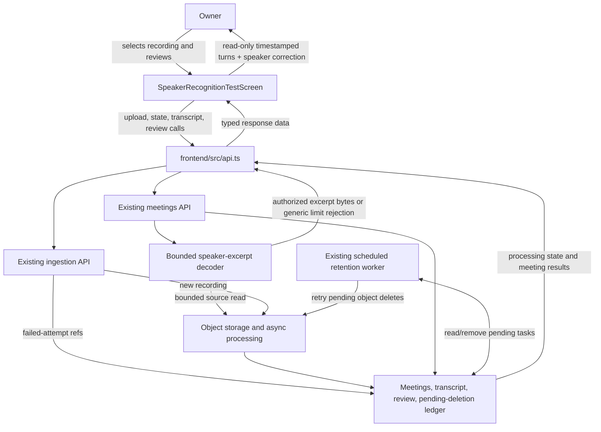

# Design — Owner-Run Speaker-Recognition Test Screen

## Summary

This feature is a narrow web entry point for exercising a saved recording through processing and human speaker review. It must expose the requested flow without turning the existing small SPA into a redesigned meeting portal, and it must preserve `Speaker N` for unknown or uncertain attribution and the existing per-user boundary for speaker corrections.

1. Add one focused test-screen view to the existing React SPA and keep upload, processing, transcript, and speaker review within that view.
2. Use the existing frontend HTTP boundary (`frontend/src/api.ts`) and existing meeting, ingestion, transcript, diarization, and speaker-review backend capabilities where their contracts support the flow; do not introduce parallel client/server abstractions or invent endpoint paths.
3. Render the completed transcript as timestamped turns with speaker labels and text, reusing the current transcript and speaker-review interaction rather than adding transcript-text editing.
4. Show a processing state from persisted backend state without inventing progress percentages, timing promises, or unapproved user-facing error behavior.
5. Extend the existing ingestion contract to create an upload-only meeting without a fabricated Meet link; make retries owner-scoped and route failed staged-media deletion through a durable ledger retried by the existing retention worker. Add focused tests and required type/schema migration updates; no new Compose service.
6. Bound speaker-excerpt source reads to 20 MiB, reject media whose audio duration exceeds 30 seconds, select only validated excerpts up to 10 seconds, and allow at most two concurrent decode operations per backend worker process; reject limit violations without truncation or decoder-detail leakage.

The approved requirements do not require a Google Meet link. The current upload path already accepts a caller-supplied `meeting_id` and automatically creates a meeting when that ID does not exist, but it substitutes the fabricated link `https://meet.google.com/unknown`; it also requires `duration_seconds` and accepts only `chrome_extension` or `server_bot` as `capture_origin`. The design therefore extends the existing ingestion contract rather than adding a new endpoint: accept a linkless upload-only meeting (`meet_link = null`), add the truthful `web_upload` capture origin, and preserve an upload's stable `meeting_id` and `idempotency_key` across retries. Obtain the selected local file's duration from browser media metadata using an `HTMLMediaElement` backed by a temporary object URL, then convert its finite non-negative duration to the schema's integer seconds with `Math.ceil`; revoke the URL after metadata resolution or failure. Never use zero as a fallback, estimate from file size, or infer duration from a filename. If the browser cannot provide finite media duration, do not submit the upload and use the component's existing error presentation; do not add a new error UX or silently substitute a value. This uses no new parser or dependency. Other upload metadata must be derived from actual selected media and existing fields; no fabricated meeting link or title.

## Key Design Decisions

**Extend the existing web SPA in place rather than create a new portal or route system.** Add a test-screen view selected within `frontend/src/App.tsx`, implemented in a focused `frontend/src/components/SpeakerRecognitionTestScreen.tsx`. This meets the minimal-screen requirement and follows the current single-SPA structure. *Alternatives rejected:* a new application or full library redesign expands scope; putting the flow in the Chrome extension conflicts with the explicit portal-screen request.

**Keep the existing `POST /api/v1/ingestion/upload` endpoint and make its idempotency path owner-safe; do not add a second upload endpoint.** It already accepts multipart audio, optional separate video, and `IngestionData`; `process_ingestion` creates a missing meeting from the supplied meeting ID. Change that creation path to store `meet_link = null` instead of `https://meet.google.com/unknown`, and allow truthful `web_upload` `capture_origin`. Keep screen requests in `frontend/src/api.ts`. The existing transcript HTTP response is a `segments` array with snake_case timing fields; retain that wire shape and add `speaker_label` to each segment. Update the frontend API-local response types and component to consume `segments` (do not type the response as `turns` or `SpeechTurn[]` without a conversion). Resolve each label through `SpeechTurn.id == SpeakerAssignment.turn_id`, then `SpeakerAssignment.speaker_id == Speaker.id`; the speaker-review contract MUST persist `SpeakerReviewItem.speaker_key == str(Speaker.id)` within the same active processing revision. For `named`/`corrected` disposition with a persisted `chosen_label`, return that label; otherwise return the review item's `current_label`, which is `Speaker N` when attribution remains uncertain. With no review item, retain the diarization speaker's current label; never infer a name. The checked-in router currently implements the speaker-review GET only. Add the missing authenticated disposition-write and excerpt-playback handlers in the existing `backend/app/meetings/router.py`, using the approved `recording-speaker-review` route contract already mirrored by `frontend/src/api.ts`: `PUT /api/v1/meetings/{meeting_id}/speaker-review/revisions/{revision_id}/speakers/{speaker_id}` with required `Idempotency-Key` and JSON `{disposition, target_identity_id?, label?, expected_version}`, and `GET` on the same path with `/excerpt` suffix. `named`/`corrected` use an owner-scoped target identity or a label that creates one; `confirmed` supplies neither. The PUT checks active revision, idempotency hash and optimistic version, delegates to `SpeakerReviewService`, and returns the updated item plus derived aggregate status/remaining speaker IDs. The excerpt handler checks the requested revision is active, resolves only the persisted validated excerpt for that review item, and streams bytes/media type without exposing object references or accepting caller-provided refs. All review routes check ownership from the authenticated principal before service/storage access. The GET response includes the active revision's review items with current label, attribution state, disposition, opaque excerpt reference, and version; adapt the existing service response to that approved contract. This implements existing review behavior, not new product scope.

For upload idempotency, check an existing meeting ID and key before writing media, and recheck both inside `process_ingestion`'s transaction. The existing unique `uq_session_recording_idempotency_key` constraint is the concurrent-insert arbiter: if a concurrent request wins after preflight, roll back, reload the key in a fresh transaction, and classify it by owner and `meeting_id` before returning any response. A meeting ID already owned by someone else yields the same non-disclosing not-found response used for an absent meeting. Resolve an existing key through its meeting owner: only the same authenticated owner and same `meeting_id` may receive the existing recording ID/state as a retry; a key belonging to another owner is indistinguishable from not-found, and same-owner reuse with a different meeting ID is a generic conflict. Never return another owner's recording ID or state.

For any attempt that does not commit a new `SessionRecording` (duplicate race, rejected race, or pre-commit media/DB failure), persist one `PendingObjectDeletion` task per unique object ref in a separate committed transaction before attempting deletion. The task stores the ref and `cleanup_scope_hash = SHA-256(canonical(user_id, meeting_id, idempotency_key))`, not the raw key; it has no meeting FK so it survives meeting deletion. The shared `drain_pending_object_deletions(session, object_store, cleanup_scope_hash=None)` operation (`backend/app/retention/cleanup.py`) first confirms the ref is not referenced by a committed `SessionRecording` or `RecordingMediaSource`; a live reference causes task cancellation without deleting the media. Otherwise it calls `ObjectStore.delete`, whose contract must guarantee idempotent deletion; the checked-in S3 adapter and conformance fakes already behave this way, and the contract test will assert a repeated delete is harmless. Remove the task only after deletion succeeds. A failed delete leaves its task pending; partial audio/video cleanup is safe because successful refs can be removed individually and remaining refs are retried. On an exact same-owner/same-meeting retry, drain pending tasks for that scope before returning the existing ID/state; if any remain, return the existing backend/storage error and do not report duplicate success. Extend `start_retention_worker` (already started by `backend/app/worker.py`) to drain all pending tasks each scheduled cycle, so recovery does not depend on the client retrying. A newly committed recording keeps its refs and creates no cleanup tasks; a post-commit queue failure must not enqueue its refs for deletion. Never put a committed recording's audio/video refs in the cleanup ledger. *Alternatives rejected:* inline-only deletion loses the refs when a request ends; a client retry cannot rediscover random failed refs; a separate queue/service is unnecessary because this reuses the scheduled retention loop and leaves Compose unchanged. Deterministic object keys could overwrite an existing recording's content on a retry with changed bytes; globally returning an existing key's recording leaks cross-owner data. Requiring a Meet link, adding another upload endpoint, client-side transcript joins, or component-level `fetch` are also rejected for the earlier scope/contract reasons. For `duration_seconds`, assert that the client derives a finite duration from synthetic local-media metadata, rounds it up to an integer second, revokes the temporary URL, and refuses to submit when duration metadata is unavailable; no fallback value is permitted.

**Represent processing with the backend's persisted state, not a fabricated percentage.** After upload returns its existing recording/state result, the UI refreshes the existing meeting state until the backend indicates the result is ready, then loads transcript and review data. The screen communicates “processing” while that state remains in progress; no estimated duration, percentage, or new user-facing retry/error UX is added. Backend-owned durable object cleanup and its storage-error response are specified separately as required data-lifecycle behavior. *Alternatives rejected:* a client timer or synthetic percentage misrepresents actual server progress; a new progress API is not authorized by the requirements.

**Render effective speaker attribution in the existing transcript response and reuse speaker review.** Transcript turns remain read-only. The response joins each turn to its diarization assignment and same-revision review item using `turn_id` and the immutable `speaker_key == str(Speaker.id)` contract. A `named`/`corrected` item's persisted `chosen_label` is its displayed label; otherwise the persisted `current_label` is used, preserving `Speaker N` for unresolved attribution. Review actions update speaker attribution only, never transcript text; the persisted review remains pending until all speakers receive an explicit disposition. Leaving the view does not mark review complete; reopening fetches persisted state and prompts for unfinished items. *Alternatives rejected:* editing transcript text mixes separate data and is out of scope; client-side joins against only pending review items lose labels after completion; a local-only completion flag cannot resume reliably.

**Preserve existing ownership, identity isolation, and retention behavior.** Requests use the existing authenticated API client and meeting-scoped backend authorization; the unowned meeting-state read must be brought under that same owner check. Speaker names/corrections remain associated with the current user and must not be exposed to another user. Do not add cross-user identity lookup, global identity behavior, or a new retention policy; committed recordings follow existing retention and deletion behavior. `SECURITY.md` classifies audio/video and transcript data as personal data subject to configured automatic retention. The durable cleanup ledger and existing scheduled retention worker ensure failed-attempt objects are retried for deletion instead of remaining outside that lifecycle. Use only synthetic files and synthetic text in automated tests.

**Bound source-media decoding for speaker excerpts and fail closed.** The limits apply only to `Excerpt_Decode_Request`; they do not cap recording uploads or general playback. In the authenticated excerpt path, acquire a non-blocking, process-scoped decoder permit before object retrieval; allow exactly two simultaneous decoding operations per backend worker process and reject additional requests instead of queueing them. Release the permit in `finally` on every success, rejection, cancellation, or decoder failure. Extend `ObjectStore` with a bounded read contract that checks authoritative object length before transfer and never passes more than 20 MiB of source data to a probe or decoder; the S3 adapter must reject missing/oversize metadata, read no more than the bound plus one sentinel byte to detect a length mismatch, discard that sentinel, and close the response body on all paths. Never invoke a media probe or decoder when the source is over 20 MiB or cannot be safely bounded.

For an accepted source, inspect its audio duration without decoding it; reject missing, invalid, indeterminate, or greater-than-30-second duration metadata before decoding. Decode only a selected validated interval whose `end_ms - start_ms` is positive and at most 10,000 ms. Candidate selection may skip an over-10-second candidate and consider another valid shorter candidate, but it must never clamp/truncate a candidate; if none fit, reject derivation explicitly. The same bounded-source and concurrency gate applies when serving the persisted excerpt: use only the authenticated review item's stored opaque reference, revalidate its scope and interval, and never accept caller-supplied object references or time ranges. No successful response may contain partial output from a rejected/over-limit decode. Map byte, duration, excerpt-length, and concurrency limit rejections to the clear generic limit message required by Requirement 4.10; do not expose decoder commands, metadata, object references, or internal exception text. *Alternatives rejected:* downloading through the current unbounded `ObjectStore.get` before checking size defeats the byte cap; clamping a long interval silently changes the selected excerpt; waiting in a queue does not explicitly reject a request that exceeds the per-worker concurrency limit.

## Architecture



```mermaid
sequenceDiagram
    participant U as Owner
    participant UI as Test screen
    participant API as frontend/src/api.ts
    participant BE as Existing backend APIs
    participant DB as PostgreSQL
    participant OBJ as Object store
    participant Q as Existing job queue
    participant RET as Scheduled retention worker
    participant DEX as Bounded excerpt decoder
    U->>UI: Select recording and start test
    UI->>API: Upload with stable meeting_id and idempotency_key
    API->>BE: POST /api/v1/ingestion/upload
    BE->>DB: Preflight meeting owner and idempotency key
    DB-->>BE: Authorized new upload, exact retry, not-found, or conflict
    alt Exact retry for same owner and meeting
        BE->>DB: Load pending cleanup tasks for request scope
        alt No pending refs
            BE-->>API: Existing recording ID/state (no object write)
        else Pending refs exist
            loop Each task in this request scope
                BE->>OBJ: Retry deleting one pending ref
                alt Delete succeeded
                    BE->>DB: Remove that completed task
                else Delete failed
                    Note over DB: Keep this ref's task pending
                end
            end
            BE->>DB: Check for remaining tasks in scope
            alt No tasks remain
                BE-->>API: Existing recording ID/state
            else Tasks remain
                BE-->>API: Backend/storage error; no duplicate success
            end
        end
    else Rejected non-owned meeting/key or mismatched meeting
        BE-->>API: Generic not-found/conflict (no object write)
    else New upload
        BE->>OBJ: Save unique per-attempt audio/video refs
        OBJ-->>BE: New refs
        BE->>DB: Recheck owner/key and persist recording atomically
        alt Recording committed
            DB-->>BE: New recording
            BE->>Q: Publish transcribe job after commit
            Q-->>BE: Accepted
            BE-->>API: Recording/state response
        else Retry race or rejected ownership/key reuse
            DB-->>BE: Existing retry result or generic not-found/conflict
            BE->>DB: Persist per-ref cleanup tasks and commit
            loop Each staged ref
                BE->>OBJ: Delete this ref
                alt Delete succeeded
                    BE->>DB: Remove this ref's task
                else Delete failed
                    Note over DB: Keep this ref's task durable
                end
            end
            BE->>DB: Check remaining tasks for request scope
            alt No tasks remain
                BE-->>API: Retry result or rejection; no foreign ID/state
            else Tasks remain
                BE-->>API: Backend/storage error; no duplicate success
            end
        end
    end
    loop Existing retention-worker cycle
        RET->>DB: Read pending object-deletion tasks
        DB-->>RET: Refs for retry
        RET->>OBJ: Retry each delete (idempotent)
        RET->>DB: Remove only tasks whose deletes succeeded
    end
    loop While backend reports processing
        UI->>API: Read meeting processing state
        API->>BE: GET /api/v1/meetings/{meeting_id}
        BE-->>API: Persisted process_state
        API-->>UI: Current state
    end
    UI->>API: Load transcript and speaker review
    API->>BE: Existing meeting transcript/review reads
    BE-->>API: Turns, labels, review state
    API-->>UI: Renderable transcript/review data
    U->>UI: Listen to the persisted excerpt for one speaker
    UI->>API: GET approved speaker-review /excerpt route
    API->>BE: Authenticated excerpt request
    BE->>DB: Verify owner, active revision, and persisted review item
    BE->>DEX: Resolve only the item's opaque excerpt reference
    DEX->>DEX: Acquire one of two non-blocking process permits
    alt Two decode permits already held
        DEX-->>BE: Reject as limit exceeded; return no bytes
    else Permit acquired
        DEX->>OBJ: Request bounded source object (max 20 MiB)
        OBJ-->>DEX: Size-verified source
        DEX->>DEX: Verify audio duration <=30 s and stored interval <=10 s
        alt Source/duration/interval exceeds an approved cap
            DEX-->>BE: Reject; return no partial bytes
        else All bounds pass
            DEX->>DEX: Decode only the validated interval
            DEX-->>BE: Excerpt bytes
        end
        DEX->>DEX: Release permit on every exit path
    end
    BE-->>API: Audio bytes or generic limit error
    API-->>UI: Play excerpt or show clear limit message
    U->>UI: Name/correct the speaker
    UI->>API: Use approved speaker-review write contract
    API->>BE: Existing approved review operation
    BE-->>API: Updated persisted disposition/status
    API-->>UI: Refresh that speaker and aggregate status
```

The UI generates a stable meeting ID and idempotency key once per selected upload and reuses them on retries. Before object-store writes, the ingestion path verifies the meeting owner and looks up the key joined to its meeting: an exact same-owner/same-meeting retry returns the existing recording ID/state only after pending cleanup tasks for that scope are cleared; an absent key proceeds; a key used by another owner is indistinguishable from not-found, and same-owner reuse for another meeting is a generic conflict. `process_ingestion` repeats owner/key validation inside its transaction to close the race after preflight. For any attempt that does not commit, first persist its unique audio/video refs to the cleanup ledger, then attempt deletion; delete only those refs, never refs referenced by the original recording. Failed deletes remain pending for same-scope retry and the scheduled retention worker. Retain refs for a newly committed recording. The existing ingestion handler creates the owner-scoped meeting when absent and queues processing. It must persist no Meet link rather than its current `https://meet.google.com/unknown` placeholder. `duration_seconds` remains required by the current ingestion schema and is populated from finite selected-file browser metadata as specified in the component interface; there is no fabricated fallback.

## Components and Interfaces

### 1. `SpeakerRecognitionTestScreen` (`frontend/src/components/SpeakerRecognitionTestScreen.tsx`)

A single focused UI component that owns the current test recording/meeting selection, upload-in-progress state, processing state, and loaded transcript/review view. It presents one upload-and-review flow and does not add library management. Follow the existing SPA's component conventions and UI language established for the feature; the requirements do not define exact copy or visual styling.

The file input accepts the audio/video recording for upload. A muxed video file is sent in the existing audio multipart field and declared `video_presence: "muxed"`; an audio-only file uses `"absent"`. Separate audio/video source selection remains outside this single-file flow unless explicitly approved. Do not apply the speaker-excerpt decoding limits to this upload path or general recording playback; only backend `Excerpt_Decode_Request` operations use the approved 20 MiB source, 30-second decoded-audio, 10-second excerpt, and two-concurrent-decode limits. Before upload it reads finite duration metadata from a temporary object URL through an `HTMLMediaElement`, uses `Math.ceil(duration)` for integer `duration_seconds`, and revokes the URL after resolution; if duration metadata is unavailable, it does not submit and uses the component's existing error presentation without a fallback. It generates the stable `meeting_id` and `idempotency_key` once per selection and sends the truthful `capture_origin: "web_upload"`. The backend, not the client, determines whether a retry is an exact owner/meeting match; it never returns another owner's recording ID/state. It does not send a Meet link or fabricate a title.

After the existing ingestion endpoint creates/uses the upload-only meeting and returns its existing recording/state response, the component observes persisted meeting state. On completion it loads the transcript and speaker review in the same view. While review has pending items, reopening that recording fetches the stored state and resumes outstanding speakers. No transcript-editing control is provided.

### 2. API boundary (`frontend/src/api.ts`)

Keep requests in this existing module. Use a dedicated multipart auth-header helper that returns only `Authorization: Bearer …`; do not reuse `getAuthHeaders()` because it sets `Content-Type: application/json`. Send `FormData` as the body without any manually set `Content-Type`, so `fetch` supplies the multipart boundary. Add an API test proving the authorization header is present, `Content-Type` is absent from request headers, the browser-generated multipart body includes its boundary, and the existing multipart fields are used exactly: `audio` (the selected audio or muxed file), optional `video` only for separate-source mode, and `data` containing the JSON-serialized `IngestionData`. Keep JSON requests on the existing helper. Add wrappers for upload/status/transcript/review operations, and use the established speaker-review path contract specified in the prior component section. Define snake_case wire DTOs for both transcript segments and review responses, then normalize them to the frontend's camelCase view types inside `api.ts`; do not cast backend JSON directly to camelCase types. The review GET DTO includes `review_id`, `revision_id`, aggregate `status`, and items with `speaker_id`, `current_label`, `attribution_state`, `disposition`, `excerpt_ref`, and `version`; the API adapter maps these to the component's existing `SpeakerReview`/`SpeakerReviewItem` fields. Type the backend transcript wire response as `segments: Array<{id, text, start_ms, end_ms, sequence, speaker_label}>`; update the component to render those fields, rather than asserting that the backend returns `turns` or silently relying on the incompatible shared `SpeechTurn` type. The upload call sends existing file/data multipart fields with a stable client-generated `meeting_id` and `idempotency_key`, actual `video_presence`, `capture_origin: "web_upload"`, and the browser-derived `duration_seconds`; omit `meet_link` and `title`. The transcript wrapper consumes `speaker_label` from the backend response rather than reconstructing corrected labels from incomplete review items.

### 3. Existing backend capabilities and required adaptation

Upload remains in `backend/app/ingestion/`; meeting/transcript/speaker-review operations remain in `backend/app/meetings/`. The existing authenticated ingestion endpoint auto-creates a missing meeting from `meeting_id` and queues processing, so the web screen can use the same endpoint without requiring a Meet link. Modify that creation path to persist a null `meet_link` rather than the fabricated `https://meet.google.com/unknown`, and extend `IngestionData.capture_origin` with `web_upload`. Update the model/type/migration accordingly. Do not add another upload endpoint.

`duration_seconds` remains mandatory in checked-in `IngestionData` and `SessionRecording`; the web client obtains actual duration from browser media metadata as specified above and rounds up to an integer second, without a fallback. Before object-store writes, verify any existing meeting ID belongs to the authenticated user and classify an existing idempotency key by joining `SessionRecording` to its `Meeting`; the retry may return an existing ID/state only for the same owner and same meeting. Return a generic not-found for non-owned meetings or keys, and a generic conflict for same-owner key reuse with a different meeting ID. Repeat these checks inside the transaction in `process_ingestion` to cover races. Each attempt writes unique refs. For every non-committed attempt, persist one `PendingObjectDeletion` row per ref, scoped by a SHA-256 of the canonical authenticated user/meeting/idempotency tuple, and commit those rows before attempting deletion. A shared cleanup helper in `backend/app/retention/cleanup.py` deletes each ref with `ObjectStore.delete` and removes its row only after success; failed refs remain durable. On an exact retry, drain pending rows for its scope before returning the existing ID/state, and return a backend/storage error while any remain. The existing scheduled retention loop also drains all pending rows, so cleanup recovers without another client request. New committed recording refs are never queued; if queue publication fails after commit, keep those refs. Add tests for partial delete/recovery and all cleanup/non-disclosure branches. The existing `GET /api/v1/meetings/{meeting_id}` handler does not enforce ownership; add its owner check before polling and cover foreign-owner denial in `backend/tests/meetings/`. Extend the existing authenticated `GET /api/v1/meetings/{meeting_id}/transcript` response: resolve one active processing revision, join turns to assignments (`SpeechTurn.id == SpeakerAssignment.turn_id`) and speakers (`SpeakerAssignment.speaker_id == Speaker.id`), then left-join the same-revision review item whose `speaker_key == str(Speaker.id)`. The review-item producer must persist that exact key, matching the approved speaker-review contract's immutable per-diarization-speaker identifier. Return `chosen_label` only for `named`/`corrected` items with a value; for `confirmed` or undisposed items return `current_label`; absent a review item, return the diarization speaker label. Keep the original transcript `text` unchanged. Test same-revision and owner constraints. The router currently lacks speaker disposition-write and excerpt routes; add the handlers at the exact paths and shapes in the key design decision above. Both use the existing JWT dependency and `_get_authorized_meeting`; the write delegates to `SpeakerReviewService` with idempotency/version checks, while playback resolves the validated excerpt for the requested revision and returns bytes with media type without exposing object refs. Cover path/payload, stale-version and idempotency behavior, excerpt access, and cross-owner denial in `backend/tests/speaker_review/`.

The bounded decoder interface uses these fixed requirement-derived values: `MAX_SOURCE_BYTES = 20 * 1024 * 1024`, `MAX_SOURCE_AUDIO_SECONDS = 30`, `MAX_EXCERPT_DURATION_MS = 10_000`, and `MAX_CONCURRENT_DECODES_PER_PROCESS = 2`. Extend async `ObjectStore` with `get_bounded(reference, max_bytes) -> bytes`: the S3 adapter checks response `ContentLength` before reading, rejects absent or oversize lengths, reads at most `max_bytes` plus a one-byte overflow sentinel (not retained in the returned value), verifies actual byte count against declared length, and always closes the body; it returns no bytes on an over-limit or length-mismatch result. The service requests only the approved 20 MiB limit and never falls back to unbounded `get`.

The existing `SpeakerExcerptService.derive` and `.play` use synchronous injected callbacks; make these entry points awaitable so they can use async `ObjectStore.get_bounded` and run synchronous media-probe/decode callbacks in a worker thread rather than blocking the API event loop. Both share one app-scoped, process-wide non-blocking two-permit limiter. Acquire before object retrieval/probing, hold through validation and decoding, and release only after the decoder operation has actually exited: HTTP cancellation must not release a permit while a worker thread/process is still decoding; either wait for that operation to finish or terminate and join its subprocess before release. Probe the audio stream from the bounded source; reject unknown or invalid duration and duration above 30 seconds before interval decoding. The decoder is constrained to no more than 30 seconds of audio output and the selected interval is independently constrained to 10 seconds; if probe and decoder output disagree or a cap would be reached without a valid complete result, fail closed rather than returning truncated bytes. Rank candidates as currently specified, skip invalid or over-10-second candidates, and reject if none fit. The playback path revalidates the persisted encrypted reference's meeting/revision/speaker scope and interval, then uses the same bounded read and permit; no caller-provided storage key or time range is accepted. Excerpt limits add no database fields, migration, shared contract, or Compose service.

### 4. Folder placement and platform impact

| Area | Add or modify | Tests | Migration / deployment / contract |
|---|---|---|---|
| Web frontend/shared contract | Add `frontend/src/components/SpeakerRecognitionTestScreen.tsx`; modify `frontend/src/App.tsx` and `frontend/src/api.ts` to mount the flow and call existing routes; update `packages/shared-types/src/index.ts` (`Meeting.meetLink: string | null`, `CaptureOrigin.WebUpload`) | Add colocated `frontend/src/components/SpeakerRecognitionTestScreen.test.tsx`; extend `frontend/src/api.test.ts` for multipart headers, body fields and wire response shape; run shared-types/frontend typechecks and extension typecheck for the additive shared enum | No `docker-compose.yml` change; shared contract change is required because `Meeting.meetLink` is currently non-null and `CaptureOrigin` currently omits web upload |
| Backend API, ingestion, and retention cleanup | Modify `backend/app/ingestion/router.py` and `service.py` for owner-safe idempotency and linkless creation; update ingestion schema and `backend/app/infra/models.py`; make `ObjectStore.delete`'s idempotency contract explicit and add a bounded `ObjectStore.get_bounded(reference, max_bytes)` contract in `backend/app/infra/object_store.py`, implemented with authoritative size checks and capped reads in `backend/app/infra/object_store_s3.py`; update `backend/app/meetings/speaker_excerpt_service.py` to enforce duration/interval caps and a shared non-blocking two-decode process limiter; add `backend/app/retention/cleanup.py` for durable ref deletion and extend `backend/app/retention/worker.py` to retry it through the existing scheduled worker; update `backend/app/meetings/router.py` for protected status, effective transcript labels, and authenticated disposition/excerpt handlers | Extend `backend/tests/ingestion/test_idempotency_property.py` and `test_playback_source_ingestion.py` for owner/key checks, duplicate cleanup, no foreign refs deleted, pending cleanup persistence, and no duplicate success while refs remain. Add `backend/tests/meetings/test_speaker_excerpt_limits.py` for 20 MiB exact/over/unknown source sizes, <=30-second duration and unknown-duration fail-closed behavior, <=10-second candidate selection without truncation, and shared two-active-decode rejection plus permit release on error; use synthetic media only. Add `backend/tests/infra/test_object_store_bounded_read.py` to prove the S3 adapter rejects oversize metadata, detects actual-length mismatch without reading an unbounded body, and closes response streams on failure. Add `backend/tests/retention/test_pending_object_cleanup.py` for partial-delete failure, periodic recovery, and idempotent re-delete; extend `backend/tests/infra/test_adaptadores_conformidad_property.py` to assert repeated delete is harmless; use `backend/tests/meetings/` for nullable-link serialization, owner denial, transcript label joins/rules/revision, and unchanged text | Add one sequential migration after `010_speaker_excerpt_reference` to make `meetings.meet_link` nullable and create the cleanup-task table; downgrade must not discard pending tasks or null meeting links. Existing worker service is reused; no Compose change. The excerpt bounds add no table/model fields, migration, shared-type contract, or deployment service. `duration_seconds` is derived from finite browser media metadata and covered by frontend tests; no fallback is specified |
| Speaker review integration | Modify `backend/app/meetings/router.py` and adapt `SpeakerReviewService` response serialization to implement the exact approved GET/PUT/excerpt contracts; keep persistence in existing meetings/review modules | Extend `backend/tests/speaker_review/` for route/auth/shape/idempotency/version/excerpt behavior, plus frontend API adapter and component tests | Reuse approved review persistence and excerpt storage; no additional persistence change for screen state |

No Chrome extension or mobile surface is touched. Existing diarization runtime/configuration gaps remain external deployment prerequisites, not silently solved here.

## Data Models

No new user-facing domain entity is proposed. The excerpt byte/duration/interval bounds and process-scoped decode permits are transient controls, not persisted configuration or domain data; they require no schema migration. Add infrastructure model `PendingObjectDeletion` in `backend/app/infra/models.py` for table `pending_object_deletions`: `id String(36)` primary key, `object_ref String(1024)`, `cleanup_scope_hash String(64)`, and `created_at DateTime(timezone=True)`. Index the scope hash and enforce uniqueness on `(cleanup_scope_hash, object_ref)`. The scope hash is SHA-256 over a canonical serialization of authenticated `user_id`, `meeting_id`, and `idempotency_key`; do not store the raw idempotency key in cleanup rows. Keep no foreign key to `Meeting` or `SessionRecording`, so failed-upload cleanup survives meeting/recording deletion. Persist one row per attempt-owned ref before deletion; remove a row only after `ObjectStore.delete` succeeds. Before deletion, the cleanup helper checks `SessionRecording.audio_ref`, `SessionRecording.video_ref`, and `RecordingMediaSource.object_ref`; if any committed row references the object, cancel the cleanup task without deleting it. The cleanup worker logs task identifiers, not raw refs.

The existing `Meeting.meet_link` becomes nullable so upload-created meetings have no fabricated Meet URL; `SessionRecording` retains its existing fields. Add `web_upload` to accepted `capture_origin` values in the existing string column. A sequential Alembic revision after `010_speaker_excerpt_reference` makes `meetings.meet_link` nullable and creates the cleanup-task table; shared TypeScript types represent nullable links and the added upload origin. Deploy compatible readers/types and the nullable schema before allowing the upload path to write null links. The downgrade must refuse while null links or pending deletion rows exist; never backfill a fabricated URL or drop outstanding cleanup work. The existing transcript response adds `speaker_label` per segment. The approved speaker-review contract defines one immutable review speaker key per diarization speaker; persist that key as the string form of `Speaker.id` so it joins to `SpeakerAssignment.speaker_id` within the same active processing revision, without adding a new model or column. For `named`/`corrected`, use the item's persisted `chosen_label`; otherwise use `current_label` (fall back to the diarization label only if no review item exists). Keep `SpeechTurn.text` unchanged. Exact write/excerpt payloads come from the approved speaker-review contract, not this design.

The screen must preserve these semantic distinctions:

- Transcript text is read-only.
- `Speaker N` is a valid unresolved/uncertain label, not a confirmed identity.
- Per-speaker review disposition is distinct from aggregate review status.
- `pending` remains pending until every displayed speaker has a persisted explicit disposition; completion is not a client-only state.
- Speaker identity associations are user-scoped; media and transcript test fixtures are synthetic.

## Correctness Properties

**Property 1 — No transcript before processing completion.** For every uploaded recording, the screen does not present its transcript/review result while the persisted meeting state indicates that processing is still in progress. It loads the result after the backend reports completion. *Validates: Requirement 2.1–2.2.*

**Property 2 — Transcript turn fidelity.** For every returned transcript turn, the rendered row includes its timestamp, speaker label, and exact transcript text, without providing a text-edit operation. *Validates: Requirements 3.1 and 5.2.*

**Property 3 — Honest unresolved attribution.** For every returned unknown or uncertain speaker, the UI renders the backend's `Speaker N` label and never substitutes an inferred or confirmed person's name. *Validates: Requirement 3.2.*

**Property 4 — Independent speaker disposition.** Recording one speaker disposition updates only that speaker's persisted review item; it does not mark any other speaker reviewed or complete the aggregate while another item remains pending. *Validates: Requirements 4.1–4.3, 4.5–4.6.*

**Property 5 — Resume pending review.** For a review with at least one undisposed speaker, leaving and reopening the same recording reloads the pending state and exposes the remaining speakers for review; it never converts pending to complete locally. *Validates: Requirements 4.5–4.6.*

**Property 6 — Owner boundary preserved.** The screen only uses authenticated, owner-scoped operations. A meeting ID or idempotency key owned by another user never returns that user's recording ID, state, speaker names, or identity associations. *Validates: Requirement 4.4 and the existing ingestion ownership contract.*

**Property 7 — Minimal scope.** The test flow offers recording upload, progress, transcript inspection, and speaker review only; it has no transcript-text editor, redesigned library, or unrelated meeting-management controls. *Validates: Requirements 1.2, 5.1–5.2.*

**Property 8 — Effective speaker label joins the same turn and review revision.** For each transcript segment, the response joins only its own `turn_id` assignment, the assigned `Speaker.id`, and the matching same-revision review item (`speaker_key == str(Speaker.id)`). `named`/`corrected` disposition returns its persisted `chosen_label`; otherwise it returns `current_label`, with unresolved attribution remaining `Speaker N`. The join does not alter the segment's text or borrow another speaker's label. *Validates: Requirements 3.1–3.2, 4.2–4.3 and the approved speaker-review design's revision/key contract.*

**Property 9 — Idempotent retry preserves the accepted recording and removes only retry media.** For a repeated key from the same owner and meeting, return the original recording ID/state only after no cleanup tasks remain for that scope; never delete or overwrite the accepted recording's media refs. A preflight retry writes no new objects; if a concurrent retry is discovered after this attempt's unique refs were stored, persist cleanup tasks for only those refs. A newly committed recording retains its refs and creates no cleanup task for them. *Validates: Requirement 1.1 and existing ingestion idempotency behavior.*

**Property 10 — Upload ownership and key collisions are non-disclosing.** For a meeting or key owned by another user, the response reveals neither recording ID nor process state and uses the same not-found result as an absent resource; same-owner key reuse for another meeting returns a generic conflict. The unique-key race is reclassified only after rollback and a fresh owner/meeting lookup. *Validates: Requirement 4.4 and the approved per-user boundary.*

**Property 11 — Failed staged-object deletion is durable and recoverable.** For each failed-attempt object ref not referenced by a committed recording, its cleanup task remains persisted until `ObjectStore.delete` succeeds; after partial failure, successfully deleted refs may be removed while failed refs remain. A later same-scope upload retry or scheduled retention-worker cycle retries the remaining refs idempotently. If the safety check finds a committed recording/media-source reference, cancel the task without deleting the live object. No duplicate recording response is returned while any cleanup task for that owner/meeting/key scope remains. *Validates: sensitive-media retention and Property 9.*

**Property 12 — Multipart upload preserves browser boundary and authentication.** The client sends the selected file and serialized metadata as the existing `audio`/`data` FormData fields with an authorization header, and does not set `Content-Type`; the browser supplies a multipart boundary that matches the encoded body. *Validates: Requirement 1.1 and the existing ingestion endpoint contract.*

**Property 13 — Required upload duration is measured, not fabricated.** A selected local file contributes only finite browser-reported media duration, rounded up to integer seconds; if unavailable, no upload request is sent, and no estimate or fallback is substituted. *Validates: Requirement 1.1 and the existing `IngestionData` schema.*

**Property 14 — Source-media caps fail closed before decode.** For every `Excerpt_Decode_Request`, a source of at most 20 MiB with a valid audio duration of at most 30 seconds may proceed to interval selection; a source larger than 20 MiB, with unknown/inconsistent size, or with invalid/unknown/greater-than-30-second duration is rejected without invoking interval decode or returning excerpt bytes. Boundary values 20 MiB and 30 seconds are permitted only when the actual bounded read and duration probe verify them. *Validates: Requirement 4.7.*

**Property 15 — Excerpts are never silently shortened.** Every returned excerpt interval has `0 <= start_ms < end_ms <= source_audio_duration_ms` and `end_ms - start_ms <= 10,000`; candidates longer than 10 seconds are not clamped and may be skipped only in favor of another valid candidate. If no candidate fits, derivation is explicitly rejected and no partial excerpt is returned. *Validates: Requirement 4.8.*

**Property 16 — Per-process decode concurrency is at most two.** Across all excerpt derivation and playback requests in one backend worker process, no more than two decode operations hold permits concurrently; a third request while both permits are held is rejected without waiting, and every permit is released after success, exception, or cancellation. *Validates: Requirement 4.9.*

## Error Handling

| Excerpt-decode condition | Backend behavior | Client-visible behavior |
|---|---|---|
| Source length >20 MiB, unavailable/inconsistent byte length, decoded-audio duration >30 seconds, unknown/invalid duration, or requested decode would exceed the two-operation process limit | Reject before returning any excerpt; do not continue past any cap or expose decoder/storage details | Clear generic message that the excerpt could not be provided because a limit was exceeded, as required by Requirement 4.10 |
| No validated candidate interval of at most 10 seconds | Reject derivation; do not clamp/truncate or return partial audio | Existing speaker-review error behavior; no new copy or recovery interaction is introduced |
| Decoder/probe/object-store failure unrelated to a stated limit | Fail closed with no bytes and preserve existing backend error mapping; release the decode permit in all cases | Existing API/UI error behavior; internal command, path, object reference, and exception details are not exposed |

The requirements do not define user-facing upload, processing, polling, transcript-fetch, or speaker-review failure copy, timing, or retry UX; those remain on existing API/UI behavior and are not expanded here. The backend must nevertheless enforce ownership/idempotency: non-owned/absent meetings and keys return the same non-disclosing not-found result; same-owner key reuse for another meeting returns a generic conflict; only an exact same-owner/same-meeting retry may return the prior ID/state. A race lost at the unique-key constraint is rolled back and reclassified from a fresh owner-scoped read. Before any delete attempt for uncommitted/retry refs, persist one `PendingObjectDeletion` row per ref with its scope hash and commit the ledger. The cleanup helper deletes each ref and removes only its successful task row; any failed deletion leaves a durable task and causes the request not to report duplicate success. Same-scope retries drain pending tasks before returning the existing recording; if any remain, propagate the existing backend/storage error. The scheduled retention worker drains all remaining tasks every cycle (default interval 3600 seconds), so cleanup recovers even when the client does not retry. `ObjectStore.delete` must be idempotent, so a retry after the object was deleted but before its task row committed is safe; enforce this with the adapter-conformance test. Never queue a committed recording's refs; a queue failure after recording commit preserves them. A failed speaker-review write never advances local completion. Any additional user-visible behavior not already supplied by existing components/contracts goes to the requirements author through Ansel before implementation.

The checked-in meetings router currently exposes review GET but not the disposition-write or excerpt-playback routes required by the existing frontend API contract; this design explicitly adds those handlers at the paths and shapes already used by `frontend/src/api.ts`, with ownership, idempotency, version, and excerpt-access checks. The checked-in Compose stack also has no diarization-engine service; a successful local run cannot be claimed based on this screen design.

## Testing Strategy

Use the existing frontend test runner and component-test conventions. UI tests should use synthetic recording metadata, synthetic transcript text, and mocked API responses only in test files.

- **Component tests:** selected recording invokes upload; processing state is visible before results; completed transcript renders timestamp, `Speaker N`, and text; transcript text cannot be edited; each speaker's review action affects only its own rendered item; pending status survives unmount/remount by reloading persisted API data; complete state appears only after the persisted review reports completion.
- **API tests:** calls remain routed through `frontend/src/api.ts`; upload uses the authenticated existing route and exact multipart contract, stable IDs across retries, `web_upload`, browser-derived duration, and no fabricated Meet link/title. Verify `Content-Type` omission for FormData, segment wire-shape normalization, review DTO normalization, and the approved speaker-review GET/PUT/excerpt paths and payload headers. No unapproved endpoint or schema is accepted by tests.
- **Backend ingestion tests:** with synthetic media, assert automatic meeting creation is owner-scoped, has `meet_link = null`, uses `web_upload`, preserves idempotency, and never writes the old placeholder URL. Extend `backend/tests/ingestion/test_idempotency_property.py` for same-owner/same-meeting replay, mismatched meeting, cross-owner key, and concurrent unique-key arbitration/reclassification. Extend `backend/tests/ingestion/test_playback_source_ingestion.py` to assert exact retries preflight without object writes; a late race writes cleanup tasks only for its newly saved audio/video refs; a failed video save records the already-saved audio ref; partial deletion never returns duplicate success; same-scope retry drains pending tasks before returning the prior ID/state; non-owned meeting IDs are rejected before storage; owner/key errors disclose no foreign ID/state. New uploads retain the references committed to their recording and never add those refs to cleanup tasks. Add migration coverage for nullable links and the cleanup-task table. Frontend tests assert finite media-duration extraction, integer ceiling, object-URL revocation, and no request when metadata is unavailable; tests must not encode an invented fallback.
- **Backend cleanup recovery tests:** add `backend/tests/retention/test_pending_object_cleanup.py`. Inject an object-store failure for one of two staged refs; assert only successfully deleted refs lose their tasks, the failed ref remains persisted across a fresh DB session, and no duplicate result is returned while any task for the scope remains. On the next scheduled cleanup cycle, the failed delete succeeds, its task is removed, and repeated deletion of an already-removed object is harmless. Verify same-scope upload retries drain pending tasks before returning an existing record, and committed recording refs are never queued or removed.
- **Backend transcript-label contract tests:** synthetic transcript turns and diarization assignments assert exact `turn_id` association, stable `speaker_key == str(Speaker.id)`, same active revision, unresolved `Speaker N` fallback, `named`/`corrected` label override, and unchanged transcript text. Include at least two speakers to catch cross-item label leakage.
- **Bounded decoder tests:** synthetic media fixtures cover exact 20 MiB/30-second/10-second boundaries and values immediately above them; assert over-limit or unknown-length/duration media is rejected before decoder invocation, overlong candidates are never truncated, persisted playback uses only the authorized opaque reference, no partial bytes escape, and a third concurrent request is promptly rejected while two permits are held. Assert permits release after decode/probe/storage exceptions and cancellation. Tests must not use real meetings or customer recordings.
- **Cross-boundary verification:** verify upload, meeting state, transcript, and speaker review remain bound to the same owner/meeting, and type contracts agree on nullable links and capture origin. Synthetic fixtures only; never use real customer recordings or transcripts.
- **Commands:** from `frontend/`, `npm run test`, `npm run typecheck`, and `npm run build`; from `packages/shared-types/`, `npm run typecheck`; from `extension/`, `npm run typecheck` for the additive shared enum. Backend changes require the configured `pytest`, `ruff check .`, and `mypy .` commands from `backend/`.

No tests were run during design authoring. The implementation and independent QA phases must report actual command results.

## Traceability and Boundaries

This design traces to `.spectra/specs/speaker-recognition-test-screen/requirements.md`, exact Mira-approved blob `e33ff36aea2a3c3ac6fc79393312584636f7000c` (SHA-256 `91ae1b69b6f633d2ffd1fe6373c2384e69c987c9e8f001e646144b25d4c11e44`), published in merged PR #685, merge commit `03edd73cc2624bd809c65c4b8df1e87c47755c8c`. This is the approved requirements version for the bounded-excerpt amendment, including Requirement 4.7–4.10; the limits are decode-only and do not cap uploads or general playback. Product authority is the exact baseline content approved by Fer on 2026-10-16 11:11Z (“Apruebo esta versión exacta”): commit `f5ff445fd508983740cd6b5a89c08adafcbb9295`, blob `c43cad6515b01a52037ad9cd4e09010a40477fb4`, recorded in canonical task `task_1d23bf45cb9b460a` and Cyrus chat `th_d30dc93a5ef54bce`. The initial `DRAFT` header predates that approval. Annotation-only commit `b071a7c6d2c72613aa42543d15e47b81f4999077` recorded the approval without changing product content; PR #230 was merged at `e57296eeeebd7bfe17152f49471362ed037c3d2f`. The test-screen addition is authorized by Fer's explicit request recorded in the approved requirements, not by an unmerged draft. The related speaker-review contract remains `.spectra/specs/recording-speaker-review/design.md` at Mira-approved commit `014d84c635201d037225b1e0f162264c45e2e2e8`; this design uses its immutable per-speaker review identity and revision-pinned read semantics. Exact approved requirements remain the behavior source; repository code is current-state evidence only.

Out of scope: portal redesign, transcript-text editing, cross-user identity sharing, unrelated meeting-management behavior, new recognition/identity-matching behavior, speculative API endpoints, media limits for recording uploads or general playback (the Requirement 4 speaker-excerpt decode caps are in scope), progress percentages/timing targets, and unspecified user-facing error copy/recovery UX. The upload-only meeting design avoids requiring a Meet link and removes the current fabricated link placeholder. The client-side media-metadata strategy for required `duration_seconds` is specified above; no estimate or fallback is authorized. Speaker-review write/excerpt handlers are included as explicit backend adaptations, while diarization deployment/configuration remains a separately tracked runtime prerequisite.
