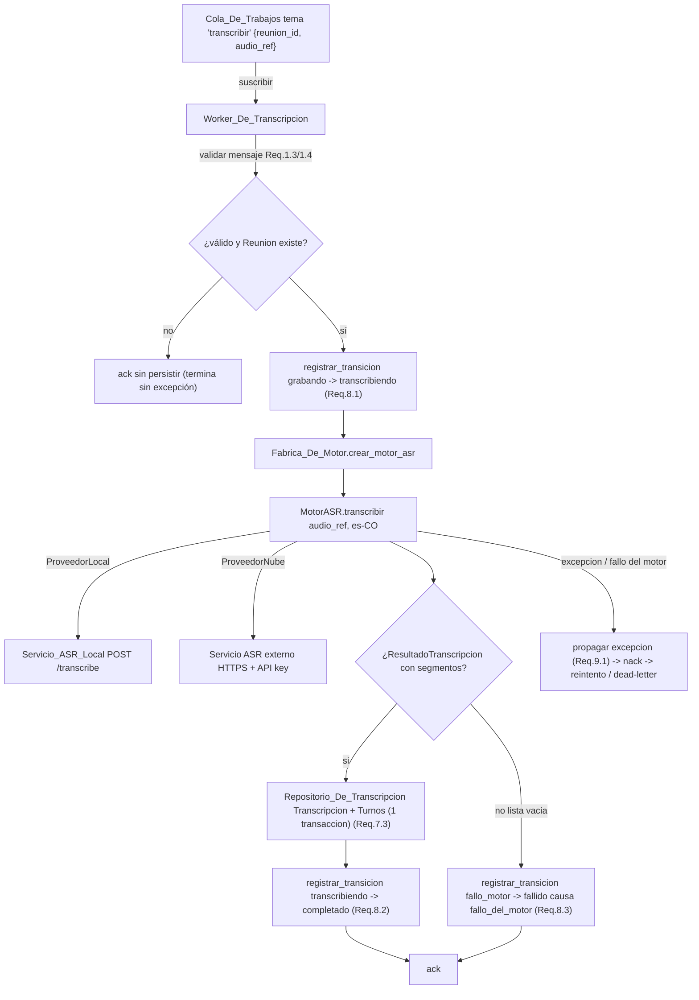
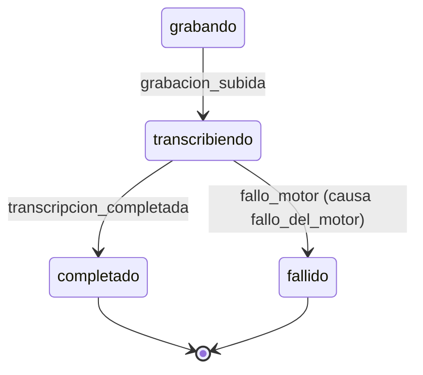

# Design Document

## Overview

Este documento describe el diseño del módulo **Transcripción (ASR)** de sauri (Milestone 2). El módulo toma una `Grabacion_De_Audio` ya cargada (insumo del Milestone 1) y produce una `Transcripcion` con sus `Turnos_De_Habla`, asociada a la `Reunion`, actualizando su `Estado_De_Proceso`.

El diseño **documenta y consolida la estructura ya existente** en el repositorio en lugar de inventar una nueva:

- `backend/app/transcripcion/` — `factory.py`, `motor_asr.py`, `proveedor_local.py`, `proveedor_nube.py`, `repository.py`, `worker.py`.
- `backend/asr-engine/` — servicio HTTP propio (`main.py`) que expone `POST /transcribe`.
- `backend/app/infra/` — abstracciones `queue.py` (Cola_De_Trabajos), `models.py` (ORM `Transcripcion`, `TurnoDeHabla`, `Reunion`, `EstadoHistorial`), `object_store.py` (Almacen_De_Objetos).
- `backend/app/reuniones/state_machine.py` y `service.py` — máquina de estados pura (`aplicar_evento`) y persistencia de transiciones (`registrar_transicion`).

El alcance del diseño cubre: el flujo de datos `cola → worker → motor → repositorio → transición de estado`, la interfaz `MotorASR` y sus dos proveedores, la selección por configuración en la `Fabrica_De_Motor`, el contrato `POST /transcribe`, los modelos de datos, la persistencia transaccional, la integración con la máquina de estados, el manejo de errores y reintentos con dead-letter, y las propiedades de corrección para pruebas basadas en propiedades.

### Estado del scaffold vs. requerimientos (qué falta completar)

El scaffold existente es funcional como esqueleto pero **incompleto** respecto a varios requerimientos. El diseño describe lo que debe completarse:

| Componente | Estado actual | Brecha vs. requerimientos |
| --- | --- | --- |
| `worker.py` | Persiste inline dentro de `session.begin()`; no usa el repositorio; `orden` inicia en 0 vía `enumerate`; idioma fijo `"es-CO"`; `proveedor` leído de `os.environ`; no aplica la transición `grabando → transcribiendo`; no valida mensajes inválidos. | Req. 1.3, 1.4 (validar mensaje), 5.5 (`orden` inicia en 1), 6.3/6.4 (idioma del resultado), 7.5 (proveedor desde `capacidades`), 8.1 (transición inicial). |
| `factory.py` | Comparación exacta de `ASR_PROVIDER`; default a `"local"`; URL local con default fijo; no falla si la URL local falta. | Req. 2.1 (case-insensitive + trim), 2.4 (vacío→local), 2.6 (URL local ausente→error). |
| `proveedor_local.py` | `data.get("segments", [])` trata la ausencia de la clave como lista vacía válida. | Req. 3.7 (ausencia de `segments`→fallo, distinto de lista vacía válida). |
| `proveedor_nube.py` | Stub; no exige `ASR_CLOUD_API_KEY`; sin timeout de 30 s; sin validación de segmentos. | Req. 4.4 (credencial ausente→error), 4.5 (validación de segmentos), 4.6 (timeout 30 s / preservar audio). |
| `repository.py` | `obtener_por_reunion` no carga los `TurnoDeHabla`; sin restricción de unicidad por `reunion_id`. | Req. 7.1 (unicidad), 7.7 (recuperar con turnos). |
| `queue_rabbitmq.py` | `nack(requeue=False)` sin conteo de reintentos. | Req. 9.2–9.4 (reintentos acotados 0–10, default 3; dead-letter / descarte). |
| `models.py` | `transcripciones` sin `UniqueConstraint(reunion_id)`. | Req. 7.1 (a lo sumo una `Transcripcion` por `Reunion`). |
| `asr-engine/main.py` | Stub que devuelve segmentos de ejemplo; contrato definido. | Integración real con faster-whisper (fuera del núcleo lógico; el contrato ya está fijado). |

## Architecture

### Componentes y responsabilidades

- **Worker_De_Transcripcion** (`app/transcripcion/worker.py`): orquesta el procesamiento de un `Mensaje_De_Transcripcion`. Valida el mensaje, transiciona la `Reunion` a `transcribiendo`, invoca el `MotorASR`, decide entre persistir o marcar fallo, y delega la persistencia transaccional.
- **Fabrica_De_Motor** (`app/transcripcion/factory.py`): construye el `Proveedor_De_Transcripcion` activo según `ASR_PROVIDER`.
- **MotorASR** (`app/transcripcion/motor_asr.py`): interfaz común independiente del proveedor; tipos de datos `OpcionesTranscripcion`, `SegmentoTranscripcion`, `ResultadoTranscripcion`, `CapacidadesASR`.
- **Proveedor_Local** (`app/transcripcion/proveedor_local.py`): invoca el `Servicio_ASR_Local` por HTTP interno, sin salida a servicios externos.
- **Proveedor_Nube** (`app/transcripcion/proveedor_nube.py`): transmite a un servicio externo por HTTPS con autenticación por API key.
- **Servicio_ASR_Local** (`asr-engine/main.py`): servicio FastAPI propio basado en faster-whisper; expone `POST /transcribe`.
- **Repositorio_De_Transcripcion** (`app/transcripcion/repository.py`): persiste `Transcripcion` + `Turnos_De_Habla` en una única transacción y recupera por `reunion_id`.
- **Servicio_De_Reuniones** (`app/reuniones/`): `aplicar_evento` (función pura de transición) y `registrar_transicion` (persiste estado + `EstadoHistorial`).
- **Cola_De_Trabajos** (`app/infra/queue.py`): entrega al-menos-una-vez, ack/nack, reintentos acotados y dead-letter.

### Flujo de datos



### Decisión de diseño: alcance de la transacción y uso del repositorio

El scaffold tiene una inconsistencia: `worker.py` persiste inline con `session.begin()` mientras que `repository.py` abre su propia sesión y hace commit. El requerimiento 7.3 atribuye la transacción al `Repositorio_De_Transcripcion`.

**Decisión:** el `Worker_De_Transcripcion` controla una única transacción que abarca tanto la persistencia de la `Transcripcion`/`Turnos_De_Habla` como la transición de estado, para que ambos efectos sean atómicos (una transcripción completada implica estado `completado`, y un rollback no deja estado inconsistente). El `Repositorio_De_Transcripcion` expone métodos que operan **sobre una sesión provista por el worker** (no abren ni cierran su propia sesión), de modo que `registrar_transicion` (que hace `flush` sin commit) y la persistencia compartan la misma unidad de trabajo. El método `crear` que abre su propia sesión se ajustará para aceptar la sesión del llamador.

Esto satisface Req. 7.3 (transacción única), Req. 7.4 / 9.6 (rollback total ante fallo) y Req. 8.2 (estado `completado` consistente con la persistencia).

### Decisión de diseño: distinción entre "sin contenido" y "fallo del motor"

Dos situaciones distintas conducen a resultados distintos:

- **Sin contenido transcribible (lista vacía válida):** el motor respondió correctamente con cero segmentos. El worker **no** persiste `Transcripcion`, transiciona a `fallido` con causa `fallo_del_motor` (Req. 8.3) y hace `ack` (no es un error de procesamiento). El `Resultado_De_Transcripcion` con lista vacía es válido (Req. 5.6, 7.2).
- **Fallo del motor (excepción):** el proveedor señaló un fallo (error HTTP, timeout, respuesta sin la estructura esperada). El worker **propaga la excepción** a la cola (Req. 9.1) para activar la política de reintentos; no persiste nada ni transiciona a `completado`.

> Nota: el contrato del scaffold hace que "lista vacía" desemboque en `fallido/fallo_del_motor` vía el evento `fallo_motor`. La distinción operativa clave es que la lista vacía produce `ack` (no se reintenta), mientras que una excepción produce `nack` (se reintenta).

## Components and Interfaces

### MotorASR (interfaz común) — Req. 2.7, 5, 6.2

```python
class MotorASR(ABC):
    async def transcribir(self, audio_ref: str, opciones: OpcionesTranscripcion) -> ResultadoTranscripcion: ...
    def capacidades(self) -> CapacidadesASR: ...
```

Tipos de datos (en `motor_asr.py`):

- `OpcionesTranscripcion(idioma_prioritario: str = "es-CO")`
- `SegmentoTranscripcion(texto: str, inicio_ms: int, fin_ms: int)`
- `ResultadoTranscripcion(segmentos: list[SegmentoTranscripcion], idioma: str, soporta_turnos: bool)`
- `CapacidadesASR(soporta_turnos: bool, es_local: bool)`

El `Servicio_De_Reuniones`/`Worker` interactúa con el motor **únicamente** a través de esta interfaz (Req. 2.7).

### Fabrica_De_Motor — Req. 2

`crear_motor_asr() -> MotorASR` debe completarse para cumplir:

1. Normalizar `ASR_PROVIDER`: `valor.strip().lower()` (Req. 2.1).
2. Valor normalizado `""` o variable ausente → `Proveedor_Local` con `ASR_LOCAL_URL` (Req. 2.4).
3. `"local"` → `Proveedor_Local` con `ASR_LOCAL_URL` (Req. 2.2).
4. `"cloud"` → `Proveedor_Nube` (Req. 2.3).
5. Cualquier otro valor → `ValueError` que **incluya el valor inválido recibido** (Req. 2.5).
6. Si se selecciona `Proveedor_Local` y `ASR_LOCAL_URL` está ausente o vacía → `ValueError` que indique la ausencia de la URL (Req. 2.6).

Construye **exactamente un** proveedor activo por invocación (Req. 2.1).

### Proveedor_Local — Req. 3

- `transcribir(audio_ref, opciones)`: `POST {ASR_LOCAL_URL}/transcribe` con cuerpo `{"audio_ref", "language": opciones.idioma_prioritario}`, timeout **300 s** (Req. 3.1).
- Procesa sin enviar el audio fuera de la infraestructura de sauri (Req. 3.2): la comunicación es servicio-a-servicio interna con el contenedor `asr-engine`.
- Respuesta exitosa: convierte cada elemento de `segments` en `SegmentoTranscripcion(texto=text, inicio_ms=start_ms, fin_ms=end_ms)` (Req. 3.4); usa `language` como idioma reportado.
- Error HTTP (`raise_for_status`) → propaga excepción, sin segmentos parciales (Req. 3.5).
- Timeout / inalcanzable (`httpx.TimeoutException`, `httpx.ConnectError`) → propaga excepción (Req. 3.6).
- **Brecha a completar:** distinguir respuesta **sin la clave `segments`** (estructura inválida → señalar fallo, Req. 3.7) de una respuesta con `segments: []` (lista vacía válida, Req. 5.6). El uso actual de `data.get("segments", [])` debe reemplazarse por una verificación explícita de presencia de la clave.

### Proveedor_Nube — Req. 4

- Inicialización: leer `ASR_CLOUD_API_KEY` y `ASR_CLOUD_ENDPOINT`.
  - Endpoint sin esquema `https://` → `ValueError` indicando esquema no soportado (Req. 4.2).
  - `ASR_CLOUD_API_KEY` ausente o vacía → `ValueError` indicando ausencia de credencial (Req. 4.4). **Brecha a completar** (el stub actual usa default `""` sin fallar).
- `transcribir`: transmite por HTTPS (Req. 4.1) autenticando con la API key (Req. 4.3), timeout **30 s** (Req. 4.6).
- Conversión de segmentos con **validación** (Req. 4.5): `texto` no vacío, `inicio_ms` y `fin_ms` enteros ≥ 0, `fin_ms ≥ inicio_ms`.
- Timeout, error o respuesta sin segmentos válidos → abortar, conservar la `Grabacion_De_Audio` sin modificar y señalar error que indique falla del servicio externo (Req. 4.6).
- **Brecha a completar:** el cuerpo de la llamada HTTP real está como stub; el diseño fija el contrato y la validación, la integración concreta depende del proveedor elegido.

### Servicio_ASR_Local (asr-engine) — contrato `POST /transcribe` — Req. 3.3

```
POST /transcribe
Request:  { "audio_ref": str, "language": str = "es-CO" }
Response: {
  "segments": [ { "text": str, "start_ms": int, "end_ms": int }, ... ],
  "language": str
}
GET /health -> { "status": "ok" }
```

El servicio devuelve cero o más segmentos, cada uno con `text`, `start_ms`, `end_ms`, más el `language` detectado (Req. 3.3). El contrato ya está definido en `asr-engine/main.py` (stub); la integración con faster-whisper lo implementará conservando este contrato.

### Worker_De_Transcripcion — Req. 1, 5.5, 6, 7, 8, 9

Algoritmo de `_procesar_transcripcion(mensaje, session_factory)`:

1. **Validar mensaje (Req. 1.2, 1.3):** extraer `reunion_id` y `audio_ref`; si alguno está ausente o vacío → terminar sin excepción y sin persistir (`ack`).
2. **Cargar Reunion (Req. 1.4):** si no existe → terminar sin excepción y sin persistir (`ack`).
3. **Transición inicial (Req. 8.1):** si el estado es `grabando`, `registrar_transicion(..., "grabacion_subida")` → `transcribiendo`.
4. **Crear motor (Req. 2):** `crear_motor_asr()`.
5. **Transcribir (Req. 6.1, 6.2):** `motor.transcribir(audio_ref, OpcionesTranscripcion(idioma_prioritario="es-CO"))`. Una excepción aquí **se propaga** (Req. 9.1).
6. **Decidir según resultado:**
   - Con segmentos → persistir `Transcripcion` + `Turnos_De_Habla` (en la transacción del worker) y transicionar a `completado` (Req. 7.1, 7.3, 8.2).
   - Lista vacía → no persistir, transicionar a `fallido`/`fallo_del_motor` (Req. 5.6, 7.2, 8.3).
7. **Mapear segmentos a turnos (Req. 5.5):** `orden` inicia en **1** e incrementa en 1 preservando el orden ascendente por `inicio_ms`.
8. **Idioma (Req. 6.3, 6.4):** `Transcripcion.idioma = resultado.idioma or "es-CO"`.
9. **Metadatos (Req. 7.5):** `proveedor` y `soporta_turnos` provienen de `motor.capacidades()` (no de `os.environ`).

El worker se suscribe al tema `"transcribir"` al iniciar (Req. 1.1) vía `iniciar_worker(cola, session_factory)`.

### Repositorio_De_Transcripcion — Req. 7

- `crear(session, transcripcion, turnos)`: agrega la `Transcripcion` y todos sus `Turnos_De_Habla` a la sesión provista, dentro de la **misma transacción** del worker (Req. 7.3). El rollback de la transacción elimina cualquier registro parcial (Req. 7.4, 9.6).
- `obtener_por_reunion(reunion_id) -> Transcripcion | None`: recupera la `Transcripcion` **junto con sus `Turnos_De_Habla`** (carga ansiosa / consulta de turnos) (Req. 7.7); devuelve `None` si no existe (Req. 7.8). **Brecha a completar:** actualmente no carga los turnos.

### Servicio_De_Reuniones (máquina de estados) — Req. 8

Función pura `aplicar_evento(estado_actual, evento) -> ResultadoTransicion` (ya implementada). Transiciones relevantes al módulo:



- Transición válida → actualiza estado y crea `EstadoHistorial` con estado anterior/nuevo y marca UTC (Req. 8.4).
- Estado terminal o evento no admitido → `exitosa=False`, estado sin cambios (Req. 8.5).
- `fallo_motor` → `fallido` con `causa_fallo="fallo_del_motor"` (Req. 8.3).

### Cola_De_Trabajos — Req. 1.5–1.7, 9

Interfaz `ColaDeTrabajos` (`publicar`, `suscribir`, `conectar`, `desconectar`). Semántica:

- Procesamiento exitoso del manejador → `ack` (Req. 1.5).
- Excepción del manejador → `nack` sin reencolar inmediato (Req. 1.6).
- **Reintentos acotados (Req. 9.2):** mientras los reintentos acumulados de un mensaje `< ASR_MAX_RETRIES` (rango 0–10, default 3), reencolar para reprocesamiento.
- **Dead-letter (Req. 1.7, 9.3):** configurado vía DLX; al alcanzar el máximo, derivar a la cola dead-letter.
- **Sin dead-letter (Req. 9.4):** al alcanzar el máximo, descartar registrando el agotamiento de reintentos.

**Brecha a completar:** la implementación `queue_rabbitmq.py` hace `nack(requeue=False)` sin conteo de reintentos. Debe completarse el conteo de intentos (p. ej. encabezado `x-death` de RabbitMQ o conteo en el mensaje) y la política acotada con `ASR_MAX_RETRIES`. La validación del rango 0–10 con default 3 es lógica propia testeable.

## Data Models

### Configuración (variables de entorno)

| Variable | Componente | Uso | Requerimiento |
| --- | --- | --- | --- |
| `ASR_PROVIDER` | Fabrica_De_Motor | `local` \| `cloud` (case-insensitive, trim); vacío/ausente → `local` | 2.1–2.5 |
| `ASR_LOCAL_URL` | Proveedor_Local | URL base del `asr-engine`; obligatoria si proveedor local | 2.2, 2.6, 3.1 |
| `ASR_CLOUD_API_KEY` | Proveedor_Nube | Credencial de autenticación; obligatoria | 4.3, 4.4 |
| `ASR_CLOUD_ENDPOINT` | Proveedor_Nube | URL HTTPS del servicio externo | 4.1, 4.2 |
| `ASR_MAX_RETRIES` | Cola_De_Trabajos | Máximo de reintentos (0–10, default 3) | 9.2 |

### Mensaje_De_Transcripcion (tema `transcribir`)

```json
{ "reunion_id": "str", "audio_ref": "str" }
```

Ambos campos deben ser cadenas no vacías; en caso contrario el worker termina sin persistir (Req. 1.3).

### Modelos de dominio del motor (en memoria)

- `SegmentoTranscripcion(texto, inicio_ms, fin_ms)` — unidad producida por el motor (Req. 5.2, 5.3).
- `ResultadoTranscripcion(segmentos, idioma, soporta_turnos)` — lista ordenada ascendente por `inicio_ms` (Req. 5.1).
- `CapacidadesASR(soporta_turnos, es_local)` — declaración del proveedor (Req. 7.5).

### Modelos ORM (SQLAlchemy, `app/infra/models.py`)

**Transcripcion** (tabla `transcripciones`):

| Campo | Tipo | Notas |
| --- | --- | --- |
| `id` | `str(36)` PK | UUID |
| `reunion_id` | `str(36)` FK → `reuniones.id` | **debe añadirse `UniqueConstraint(reunion_id)`** (Req. 7.1, 9.5) |
| `idioma` | `str(16)` | idioma reportado por el motor o `es-CO` (Req. 6.3, 6.4) |
| `proveedor` | `str(128)` | desde `capacidades`/configuración (Req. 7.5) |
| `soporta_turnos` | `bool` | desde `capacidades` (Req. 7.5, 7.6) |
| `expira_en` | `datetime?` | retención |
| `creada_en` | `datetime` (UTC) | |

**TurnoDeHabla** (tabla `turnos_de_habla`):

| Campo | Tipo | Notas |
| --- | --- | --- |
| `id` | `str(36)` PK | UUID |
| `transcripcion_id` | `str(36)` FK → `transcripciones.id` | |
| `texto` | `Text` | sin identidad nominal (Req. 7.6) |
| `inicio_ms` | `int` | ≥ 0 (Req. 5.2) |
| `fin_ms` | `int` | ≥ `inicio_ms` (Req. 5.3) |
| `orden` | `int` | inicia en 1, ascendente (Req. 5.5) |

La restricción de unicidad sobre `transcripciones.reunion_id` requiere una migración Alembic adicional (consistente con `001_initial_schema.py`).

## Correctness Properties

*Una propiedad es una característica o comportamiento que debe ser verdadero en todas las ejecuciones válidas del sistema — esencialmente, una afirmación formal sobre lo que el sistema debe hacer. Las propiedades sirven de puente entre las especificaciones legibles por humanos y las garantías de corrección verificables por máquina.*

Las propiedades se derivan del prework de criterios de aceptación, consolidando criterios lógicamente redundantes en propiedades únicas y comprensivas.

### Property 1: Selección del proveedor por configuración

*Para cualquier* valor de `ASR_PROVIDER` igual a "local" o "cloud" con capitalización y espacios arbitrarios al inicio/fin, y *para cualquier* caso en que la variable esté ausente o sea una cadena vacía o de solo espacios, la `Fabrica_De_Motor` construye exactamente un proveedor: `Proveedor_Local` para "local", vacío o ausente, y `Proveedor_Nube` para "cloud".

**Validates: Requirements 2.1, 2.2, 2.3, 2.4**

### Property 2: Valor de proveedor inválido señala error con el valor recibido

*Para cualquier* cadena de `ASR_PROVIDER` que, normalizada, no sea "local" ni "cloud" ni vacía, la `Fabrica_De_Motor` rechaza la construcción sin instanciar ningún proveedor y señala un error de configuración cuyo mensaje incluye el valor inválido recibido.

**Validates: Requirements 2.5**

### Property 3: Rechazo de endpoint no cifrado en el Proveedor_Nube

*Para cualquier* `ASR_CLOUD_ENDPOINT` cuyo esquema no sea `https`, la inicialización del `Proveedor_Nube` falla sin transmitir ninguna `Grabacion_De_Audio` y señala un error de configuración que indica el esquema no soportado.

**Validates: Requirements 4.2**

### Property 4: Mapeo fiel de la respuesta local a segmentos

*Para cualquier* respuesta válida del `Servicio_ASR_Local` con una lista de N elementos `{text, start_ms, end_ms}`, el `Proveedor_Local` produce exactamente N `SegmentoTranscripcion`, preservando para cada uno el `texto`, `inicio_ms` y `fin_ms` correspondientes en el mismo orden.

**Validates: Requirements 3.4**

### Property 5: Validez de los segmentos del resultado

*Para cualquier* `ResultadoTranscripcion` válido producido por un `Motor_ASR` sobre una `Grabacion_De_Audio` de duración D, todo `SegmentoTranscripcion` cumple: `inicio_ms` y `fin_ms` son enteros, `inicio_ms ≥ 0`, `fin_ms ≥ inicio_ms`, `fin_ms ≤ D`, y (para el `Proveedor_Nube`) `texto` no vacío.

**Validates: Requirements 4.5, 5.2, 5.3, 5.4**

### Property 6: Orden ascendente de los segmentos

*Para cualquier* `ResultadoTranscripcion` válido, la lista de `SegmentoTranscripcion` está ordenada de forma no decreciente por `inicio_ms`.

**Validates: Requirements 5.1**

### Property 7: Mapeo de segmentos a turnos preserva orden y marcas sin identidad

*Para cualquier* lista de N `SegmentoTranscripcion` ordenada ascendentemente por `inicio_ms`, al persistirse como `Turnos_De_Habla` cada turno recibe `orden` consecutivo iniciando en 1 (1, 2, …, N) en la misma secuencia, conserva `inicio_ms` y `fin_ms`, y no contiene ningún campo de identidad nominal.

**Validates: Requirements 5.5, 7.6**

### Property 8: Resultado sin segmentos no produce Transcripcion

*Para cualquier* `ResultadoTranscripcion` con lista de segmentos vacía, el `Worker_De_Transcripcion` persiste cero `Turnos_De_Habla`, no persiste ninguna `Transcripcion`, y trata el resultado como válido (sin lanzar error), registrándolo como sin contenido transcribible.

**Validates: Requirements 5.6, 7.2**

### Property 9: Selección del idioma de la Transcripcion

*Para cualquier* `ResultadoTranscripcion`, la `Transcripcion` persistida registra como `idioma` el idioma reportado por el motor cuando este es no vacío, y el `Idioma_Prioritario` (por defecto "es-CO") cuando el motor no reporta idioma.

**Validates: Requirements 6.3, 6.4**

### Property 10: Unicidad de la Transcripcion por Reunion

*Para cualquier* `reunion_id` y *para cualquier* número de procesamientos o reintentos del mismo `Mensaje_De_Transcripcion`, existe a lo sumo una `Transcripcion` persistida asociada a esa `Reunion`.

**Validates: Requirements 7.1, 9.5**

### Property 11: Atomicidad de la persistencia

*Para cualquier* conjunto de `Transcripcion` + `Turnos_De_Habla`, la persistencia es todo-o-nada: si la transacción tiene éxito quedan persistidos la `Transcripcion` y la totalidad de sus turnos; si ocurre un fallo en cualquier punto de la persistencia, no queda ninguna `Transcripcion` ni `Turno_De_Habla` parcial y se propaga un indicador de fallo que habilita el reintento.

**Validates: Requirements 7.3, 7.4, 9.6**

### Property 12: Registro de metadatos del proveedor

*Para cualquier* `CapacidadesASR` declarada por el `Motor_ASR`, la `Transcripcion` persistida registra el `proveedor` utilizado y el indicador `soporta_turnos` consistentes con lo declarado por el motor.

**Validates: Requirements 7.5**

### Property 13: Round-trip de persistencia y recuperación

*Para cualquier* `Transcripcion` con sus `Turnos_De_Habla` persistida para una `Reunion`, la consulta por `reunion_id` recupera esa `Transcripcion` junto con todos sus `Turnos_De_Habla` equivalentes.

**Validates: Requirements 7.7**

### Property 14: Corrección de la máquina de estados

*Para cualquier* par (estado_actual, evento), `aplicar_evento` retorna `exitosa=True` con el nuevo estado únicamente si el par pertenece al mapa de transiciones válidas; en todo otro caso (estado terminal o evento no admitido) retorna `exitosa=False` conservando el estado actual sin cambios. En particular, `grabando`+`grabacion_subida`→`transcribiendo`, `transcribiendo`+`transcripcion_completada`→`completado`, y `transcribiendo`+`fallo_motor`→`fallido` con `causa_fallo="fallo_del_motor"`.

**Validates: Requirements 8.1, 8.2, 8.3, 8.5**

### Property 15: Registro de historial en cada transición

*Para cualquier* transición de estado exitosa, el `Servicio_De_Reuniones` crea una entrada de `EstadoHistorial` con el nuevo estado y una marca de tiempo expresada en UTC.

**Validates: Requirements 8.4**

### Property 16: Entrada inválida no persiste ni lanza excepción

*Para cualquier* `Mensaje_De_Transcripcion` cuyo `reunion_id` o `audio_ref` esté ausente, vacío o sea solo espacios, y *para cualquier* `reunion_id` que no corresponda a una `Reunion` existente, el `Worker_De_Transcripcion` termina el procesamiento sin lanzar excepción y sin persistir ninguna `Transcripcion`.

**Validates: Requirements 1.3, 1.4**

### Property 17: Fallo del motor se propaga sin persistir

*Para cualquier* fallo señalado por el `Motor_ASR` durante el procesamiento (excepción), el `Worker_De_Transcripcion` propaga el fallo a la `Cola_De_Trabajos` (habilitando la política de reintentos) y no persiste ninguna `Transcripcion` para ese mensaje.

**Validates: Requirements 9.1**

## Error Handling

El manejo de errores distingue cuatro categorías, cada una con un efecto distinto sobre la `Reunion` y la `Cola_De_Trabajos`:

1. **Entrada inválida (no es error):** mensaje mal formado (Req. 1.3) o `reunion_id` inexistente (Req. 1.4). El worker termina limpiamente, no persiste y hace `ack`. No hay transición de estado.

2. **Sin contenido transcribible (no es error de procesamiento):** el motor responde con lista vacía (Req. 5.6, 7.2). El worker no persiste `Transcripcion`, transiciona a `fallido` con causa `fallo_del_motor` (Req. 8.3) y hace `ack` (no se reintenta, el resultado es determinista).

3. **Fallo del motor (errores reintentables):** el proveedor lanza excepción por:
   - Error HTTP del `Servicio_ASR_Local` (Req. 3.5).
   - Timeout (300 s local / 30 s nube) o servicio inalcanzable (Req. 3.6, 4.6).
   - Respuesta sin la estructura de segmentos esperada (Req. 3.7) o sin segmentos válidos en nube (Req. 4.6).
   - Error de configuración del proveedor en inicialización: `ASR_PROVIDER` inválido (Req. 2.5), `ASR_LOCAL_URL` ausente (Req. 2.6), endpoint no-HTTPS (Req. 4.2), `ASR_CLOUD_API_KEY` ausente (Req. 4.4).

   El worker **propaga la excepción** (Req. 9.1). La cola hace `nack` sin reencolar inmediato (Req. 1.6) y aplica la política de reintentos acotada.

4. **Fallo de persistencia:** cualquier error durante la escritura de `Transcripcion`/`Turnos_De_Habla` revierte la transacción completa (Req. 7.4, 9.6); no quedan registros parciales y se propaga el fallo para habilitar reintento. La unicidad por `reunion_id` (Req. 7.1, 9.5) garantiza que un reintento no cree duplicados.

### Política de reintentos y dead-letter (Req. 9)

- Reintentos acotados por `ASR_MAX_RETRIES` (rango 0–10, default 3) (Req. 9.2).
- Con DLX configurado: al agotar reintentos, derivar a dead-letter (Req. 1.7, 9.3).
- Sin DLX: al agotar reintentos, descartar registrando el agotamiento (Req. 9.4).

### Errores de configuración

Los errores de configuración (`ValueError` con mensaje descriptivo que incluye el dato ofensor) se detectan al construir el proveedor y son visibles en el arranque del worker o en el primer procesamiento, evitando estados inconsistentes.

## Testing Strategy

Se emplea un enfoque dual: **pruebas basadas en propiedades** (PBT) para la lógica universal y **pruebas por ejemplo / integración** para casos concretos, contratos de servicio y comportamiento de infraestructura.

### Aplicabilidad de PBT

PBT es apropiado para este módulo porque el núcleo es lógica determinista con espacios de entrada amplios: la función pura de la máquina de estados, la selección de proveedor por configuración, el mapeo y validación de segmentos, la asignación de `orden`, la selección de idioma y los invariantes de persistencia (unicidad, atomicidad, round-trip). Las dependencias externas (asr-engine, servicio cloud, RabbitMQ, PostgreSQL) se aíslan con mocks o sesiones de prueba para que las propiedades ejerciten la lógica sin coste de I/O real.

PBT **no** aplica a: cableado de suscripción (Req. 1.1), comportamiento de `ack`/`nack`/DLX de la cola (Req. 1.5–1.7, 9.2–9.4), contrato del servicio externo (Req. 3.3), egreso HTTPS y cabeceras de autenticación (Req. 4.1, 4.3), y la separación arquitectónica vía interfaz (Req. 2.7, 3.2). Estos se cubren con pruebas de integración (1–3 ejemplos) o de humo.

### Biblioteca y configuración de PBT

- **Biblioteca:** Hypothesis (estándar de PBT para Python; el backend ya usa Python/pytest). No se implementa PBT desde cero.
- **Iteraciones:** mínimo **100** por prueba de propiedad (`@settings(max_examples=100)`).
- **Etiqueta obligatoria** en cada prueba de propiedad, como comentario que referencia la propiedad del diseño:
  `# Feature: transcripcion-asr, Property {número}: {texto de la propiedad}`
- Cada propiedad de corrección se implementa con **una sola** prueba de propiedad.

### Cobertura de pruebas

**Pruebas de propiedad (Hypothesis)** — una por cada propiedad 1–17:
- Generadores: valores de `ASR_PROVIDER` (capitalización/espacios), esquemas de URL, respuestas de segmentos (listas de tamaño variable con enteros y texto), duraciones, pares (estado, evento) de la máquina de estados, mensajes de cola (campos faltantes/vacíos), capacidades del motor e idiomas reportados.
- Persistencia (Prop. 10, 11, 13): usar una base de datos de prueba (vía `backend/tests/conftest.py`) con sesiones transaccionales; inyectar fallos para verificar rollback (Prop. 11).

**Pruebas por ejemplo (pytest)** — casos concretos y de borde:
- Factory: "local"/"cloud" con URL (Req. 2.2, 2.3).
- Edge cases con generadores o ejemplos dirigidos: `ASR_LOCAL_URL` ausente (Req. 2.6), error HTTP (Req. 3.5), timeout/inalcanzable (Req. 3.6), respuesta sin `segments` (Req. 3.7), `ASR_CLOUD_API_KEY` ausente (Req. 4.4), timeout cloud (Req. 4.6), consulta sin transcripción → `None` (Req. 7.8).
- Worker: idioma por defecto "es-CO" enviado al motor (Req. 6.1, 6.2).

**Pruebas de integración (1–3 ejemplos)** — infraestructura y contratos:
- Cola: `ack` tras éxito (Req. 1.5), `nack` sin requeue ante excepción (Req. 1.6), derivación a dead-letter (Req. 1.7, 9.3), descarte sin DLX (Req. 9.4), reencolado con reintentos (Req. 9.2).
- Suscripción al tema "transcribir" (Req. 1.1).
- Contrato `POST /transcribe` del asr-engine (Req. 3.3).
- Proveedor_Nube: uso de HTTPS y cabecera de autenticación (Req. 4.1, 4.3).

**Validación del proyecto:** la suite se ejecuta con la configuración existente del backend (`backend/pyproject.toml`, `backend/tests/conftest.py`) en modo de ejecución única (no watch). Antes de abrir un PR que toque Python, la validación configurada del proyecto debe pasar.
