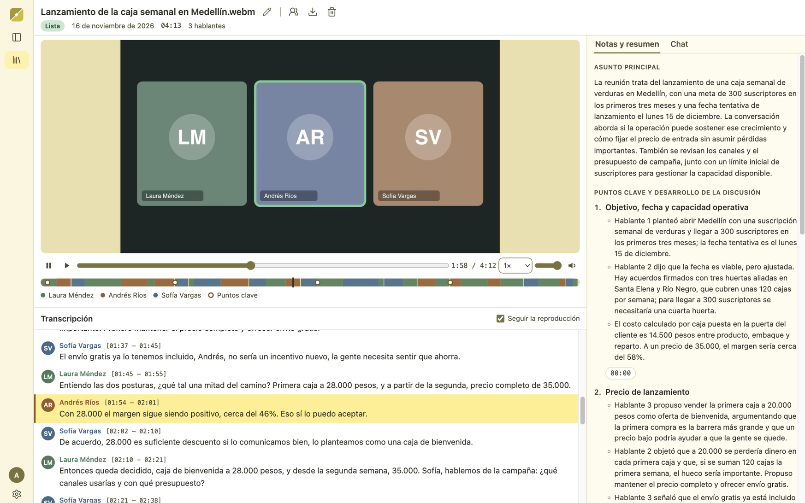

<h1 align="center">
  <picture>
    <source media="(prefers-color-scheme: dark)" srcset="brand/sauri-logo-dark.svg">
    
  </picture>
</h1>

<p align="center"><strong>Record your meetings, get transcripts with speakers and a draft summary, all on your Mac.</strong></p>

<p align="center">
  <a href="LICENSE"></a>
  <a href="https://github.com/lufermalgo/sauri/releases/latest"></a>
  
</p>

<p align="center">
  
</p>

Sauri is an open-source, local-first meeting recorder. A Chrome extension records any browser tab (Google Meet or any other web meeting), and the Sauri app on your Mac transcribes it, tells the speakers apart and drafts a summary you review. There is no account and no cloud: nothing leaves your Mac unless you connect an external provider yourself.

A Spanish download page with install help lives at [lufermalgo.github.io/sauri](https://lufermalgo.github.io/sauri/).

## Download

- **Sauri for Mac**: the `.dmg` from the [latest release](https://github.com/lufermalgo/sauri/releases/latest). Each file ships with its `.sha256` checksum.
- **Chrome extension**: [Sauri on the Chrome Web Store](https://chromewebstore.google.com/detail/sauri/inebachhkahcdepkbdkhchnpahladpnk).

Requirements: a Mac with Apple silicon (M1 or later), macOS 14 Sonoma or later, 8 GB of memory or more, about 10 GB of free disk space (the app plus the models), and Google Chrome to record.

> **The app is not signed by Apple yet.** The first time you open it, macOS warns that it cannot check the app. You confirm it once in System Settings › Privacy & Security › "Open Anyway". The [download page](https://lufermalgo.github.io/sauri/#instalar) shows each step.

On first launch Sauri checks your Mac, lets you choose where recordings, the database and the models are stored, and installs the recommended models for your hardware. The extension then connects to the app on its own, without email or password. The app checks for new versions and asks before installing them.

## Features

- **Record any tab** from Chrome, or upload a recording you already have.
- **Transcripts that follow the video**: the current phrase is highlighted and a click jumps to that moment.
- **Speakers**: each turn is attributed to a voice. Name a voice once and Sauri recognizes it in later meetings.
- **Draft summaries** with the main topic, key points and next steps, based on templates you can edit per meeting type.
- **Notes** taken during the recording, kept next to the meeting and apart from the transcript.
- **Library** with search and filters, and downloads of the video, audio, transcript or summary.
- Interface in Spanish and English.

## Privacy and local-first

- Recordings, transcripts, summaries and speaker names stay in folders you choose on your Mac.
- Transcription, speaker identification and summaries run on your Mac with local models.
- The app's services listen only on `127.0.0.1`, and only the Sauri extension can pair with them.
- External providers (for example an OpenAI-compatible API, Deepgram or AssemblyAI) are off by default. If you connect one for a task, Sauri shows what leaves the Mac and where, and asks you to confirm.

Read the full [privacy policy](https://lufermalgo.github.io/sauri/privacidad.html) (Spanish and English).

## How it works

```text
Chrome extension ──(recording over localhost)──▶ Sauri.app (Electron, menu bar)
                                                   ├─ API + portal   FastAPI serving the React portal
                                                   ├─ worker         processing pipeline
                                                   ├─ PostgreSQL     meetings, transcripts, speakers
                                                   └─ native engines on 127.0.0.1
                                                        ├─ asr-engine    Parakeet (FluidAudio) / whisper.cpp
                                                        ├─ diar-engine   Senko (CoreML)
                                                        ├─ llm-engine    llama.cpp
                                                        └─ host-engine   models and provider keys
```

- `desktop/`: the Electron app. It starts and supervises PostgreSQL, the API, the worker and the engines from a bundled, relocatable runtime, and runs the first-run setup and updates.
- `frontend/`: the web portal (React, TypeScript, Vite), served by the API.
- `backend/`: the API and worker (Python, FastAPI) and the engine services (`asr-engine`, `diar-engine`, `llm-engine`, `host-engine`), each behind a stable contract so a local or external provider can be swapped by configuration.
- `extension/`: the Chrome extension (Manifest V3).
- `packages/`: shared TypeScript types.

Models are downloaded on first run and checked against pinned SHA-256 hashes.

## Build from source

You need an Apple silicon Mac with macOS 14 or later, Node.js 20 or later, [uv](https://docs.astral.sh/uv/), `cmake`, `pkg-config`, and Swift 6 with the Xcode Command Line Tools.

```bash
npm ci                                  # JavaScript workspaces; also installs the git hooks

# Build the bundled runtime once (Python, PostgreSQL, ffmpeg, whisper.cpp, llama.cpp, Parakeet). Slow.
SAURI_RUNTIME_DIR="$HOME/Library/Caches/sauri-runtime-build/runtime-current" \
  bash desktop/scripts/build-runtime.sh

npm run desktop:dev                     # run the app against the repository sources
```

Development runs keep their data apart from a real installation (`~/Library/Application Support/Sauri-dev` and `~/Sauri-dev`).

Other useful commands:

```bash
make package                            # build desktop/out/Sauri-<version>-mac-arm64.dmg (ad-hoc signed)
npm run build -w extension              # build the extension into extension/dist (load it unpacked)
npm run typecheck && npm run test       # TypeScript checks and tests in every workspace
cd backend && uv run --extra dev pytest -q
```

See [CONTRIBUTING.md](CONTRIBUTING.md) for the full list of checks and how to pair an unpacked extension with a development build.

## Project status

Sauri is young and under active development. The Mac app is usable day to day, but expect rough edges and breaking changes between versions. Windows and Linux are planned, not available.

## Contributing

Bug reports, ideas and pull requests are welcome. Start with [CONTRIBUTING.md](CONTRIBUTING.md) and follow the [Code of Conduct](CODE_OF_CONDUCT.md). Please do not attach real meeting recordings or transcripts to issues.

Security problems go through private vulnerability reporting, not public issues: see [SECURITY.md](SECURITY.md).

## License

Sauri is licensed under the [Apache License 2.0](LICENSE). See [NOTICE](NOTICE) for attribution. Third-party components and models keep their own licenses, listed in [THIRD_PARTY_NOTICES.md](THIRD_PARTY_NOTICES.md).
