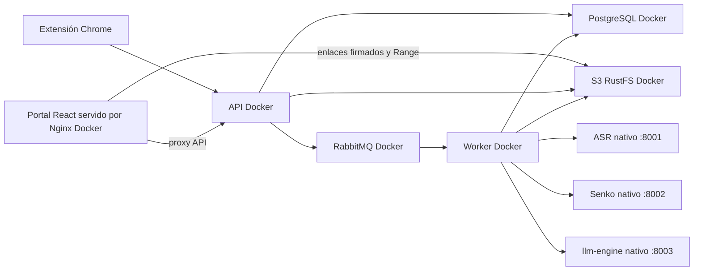

# Arquitectura de Sauri

Estado: dirección confirmada por Fer el 12-11-2026 (conversación del 12-11-2026, 19:10–19:25 UTC). Inventario contrastado con `origin/main` `c19b4ae`. Este documento distingue configuración, implementación y validación; no declara aceptación de producto ni reemplaza las specs.

## Decisiones y límites

- Núcleo de servicios en Docker; transcripción y diarización nativas en el Mac para aprovechar Apple GPU. No se trasladan los motores a Docker/CPU: esa alternativa pierde la aceleración prevista en este Mac. No es una limitación universal de Docker.
- La extensión vive en Chrome. El portal React se construye con Vite y se sirve mediante Nginx en Docker, añadido al candidato de local-platform-deployment (#829 → #832 → #836 → U4 #837). El runtime no usa Vite ni expone fuentes. Mantener publicación/merge/recorrido/aceptación separados; los PR de despliegue no se consideran integrados por existir. Ver [operación y QA](docs/operations/local-deployment.md).
- PostgreSQL almacena datos estructurados y propiedad de las reuniones. Un almacén S3 guarda medios; RabbitMQ entrega trabajos a los procesadores. No guardar videos en PostgreSQL ni usar la cola como archivo durable de grabaciones.
- Compose actualmente usa RustFS, aunque el servicio, volumen y variables conservan nombres MinIO. No renombrar ni migrar volúmenes existentes para limpiar nomenclatura. La compatibilidad real con datos anteriores requiere evidencia separada: issue #543 sigue abierto.
- Se conserva la autenticación y autorización existentes. `AUTH_DISABLED=true`, valor predeterminado del Compose local, **no demuestra aislamiento entre cuentas**. La validación de propiedad debe ejecutarse con autenticación activa y dos identidades sintéticas; no habilitar un despliegue multiusuario ni cambiar política de acceso como parte de esta reconciliación.

## Componentes y conexiones

| Componente | Tecnología actual | Ubicación | Contrato / responsabilidad |
|---|---|---|---|
| Captura | Chrome MV3, TypeScript, React | Chrome | Capturar medios autorizados; persistencia local y cola de carga |
| Portal | React/TypeScript construido con Vite, servido por Nginx | Navegador y Docker `portal` en candidato #818 | Consultar reuniones vía proxy API y reproducir enlaces S3 autorizados |
| API | Python, FastAPI, SQLAlchemy | Docker `api` | Ingestión y acceso a reuniones del usuario |
| Procesadores | Python | Docker `worker` | Consumir trabajos y coordinar motores |
| Datos | PostgreSQL 16 | Docker `postgres`, volumen `pgdata` | Reuniones, estados, transcripciones, hablantes y propiedad |
| Archivos | RustFS compatible con S3 | Docker `minio`, volumen `minio-data` | Audio/video y enlaces firmados para acceso temporal |
| Cola | RabbitMQ 3 | Docker `rabbitmq` | Trabajos asíncronos firmados |
| Transcripción | MLX Whisper `large-v3-turbo` (se reemplaza por whisper.cpp `large-v3-turbo` Q5_0 en la unidad U2 de `core-speech-pipeline`) | Host Mac, puerto 8001 | `POST /transcribe`; `backend/asr-engine/native_main.py` |
| Diarización | Senko (CoreML), contrato v2 | Host Mac, puerto 8002 | `POST /diarize`; `backend/diar-engine/native_main.py` |
| Resumen | `llm-engine` + `llama-server` (llama.cpp) con Qwen3.5-9B, o un proveedor compatible con OpenAI configurado explícitamente | Host Mac, puerto 8003 (llama-server interno en 8004) | `POST /v1/chat/completions`; `backend/llm-engine/native_main.py` |

## Entorno local con Docker Desktop

En el Mac, los servicios de Sauri corren en **Docker Desktop** como el proyecto de Compose **`sauri`** (`docker-compose.yml` de la raíz). Los motores de IA no van en Docker: corren nativos en el Mac para usar Metal/CoreML, y los contenedores los alcanzan por `host.docker.internal`.

| Servicio (Compose) | Puerto en el Mac | Datos |
|---|---|---|
| `portal` (Nginx con el portal construido) | `127.0.0.1:5173` (`PORTAL_PORT`) | — |
| `api` (FastAPI) | `8000` | — |
| `worker` (transcripción, diarización, resumen, retención) | — | — |
| `postgres` (PostgreSQL 16) | `5432` | volumen `sauri_pgdata` |
| `minio` (RustFS, compatible S3; conserva el nombre MinIO) | `9000` (API) y `9001` (consola) | volumen `sauri_minio-data` |
| `rabbitmq` (RabbitMQ 3 con consola de administración) | `5672` y `15672` | — |
| Motores nativos (fuera de Docker) | `8001` ASR, `8002` diarización, `8003` resumen | modelos en `~/.local/share/sauri/`, credenciales en `~/.config/sauri/` |

Comandos: `make up` (levanta el proyecto `sauri`), `make logs`, `make down`; `make engines-install`, `make engines-up`, `make engines-status`, `make engines-down` para los motores nativos. Instalación paso a paso en `docs/operations/installation-notes.md`.

Reglas del entorno local:
- Hay **un solo entorno principal**, el proyecto `sauri`, y sus volúmenes guardan los datos reales del dueño: nunca se borran ni se recrean sin su autorización.
- Las pruebas que necesitan PostgreSQL o RabbitMQ usan bases o contenedores **desechables** con otro nombre (bases `sauri_qa_*`/`sauri_t11_*`, contenedores `sauri-qa-*`), sin publicar puertos fuera de `127.0.0.1`, y se eliminan al terminar.
- Antes de diagnosticar o probar, se revisa el estado real con `docker compose -p sauri ps` y `make engines-status`; un servicio configurado no demuestra que esté corriendo.

La configuración de API/worker apunta a `host.docker.internal:8001`, `:8002` y `:8003`. Los motores implementan HTTP y controles de credenciales/capacidad por grabación. Su arranque, accesibilidad desde Docker y uso efectivo de GPU deben comprobarse juntos; tener una URL o un modelo configurado no demuestra inferencia. Credenciales fuera del repositorio en `~/.config/sauri`, montadas de solo lectura al worker; modelos compartidos en caché, nunca copiados al repositorio.

## Mapa de especificaciones del primer recorrido

| Tramo | Fuente existente | Estado contrastado / pendiente |
|---|---|---|
| Captura y preferencias | `.spectra/specs/extension-capture-preferences/requirements.md` | Solo requirements en main; no inventar diseño/tareas aprobados |
| Finalización, carga y apertura de revisión | `.spectra/specs/chrome-recording-completion/{requirements,design,tasks}.md` | Tres documentos presentes; PR #703 MERGED (head `191c8aa`, verificado durante U4). No inferir de ese merge captura real, recorrido integrado ni aceptación; revisar cada issue antes de abrir trabajo |
| Reproducción | `.spectra/specs/meeting-review-playback/` | Diseño, tareas y registro de aceptación separados; API `/api/v1/meetings/{meeting_id}/playback` implementada, falta comprobar recorrido integrado |
| Biblioteca y metadatos | `.spectra/specs/recording-library-metadata/` | Main contiene requirements/config; discrepancias documentales ya registradas en #701, #715, #716. Reusar esos issues, no duplicarlos |
| Fallos de carga existentes | #606 y pruebas `extension/src/background.upload-retry.test.ts`, `upload-queue.*test.ts` | Inspeccionar correcciones existentes antes de iniciar otra; una prueba con dobles no acredita carga real |

La spec de finalización exige abrir revisión **después de procesamiento exitoso y activos protegidos disponibles**. El avance inicial de guardar/reproducir no autoriza suprimir esa condición ni anunciar transcripción terminada. Primero validar almacenamiento y reproducción como capacidades reales; conservar el comportamiento aprobado de apertura automática hasta que una enmienda funcional sea aprobada.

## Evidencia y brechas

Una auditoría previa verificó aisladamente escrituras/lecturas PostgreSQL, migraciones, objetos S3 con lectura parcial firmada, envío/recepción RabbitMQ y arranque API/worker. Se retiraron recursos sintéticos de esa auditoría. **No acredita inferencia, captura real Chrome, propiedad con autenticación activa ni recorrido completo.**

U4 #837 repitió en entorno nuevo y autenticado escrituras/lecturas PostgreSQL/S3, mensaje firmado publish/consume/ack, login real de dos usuarios sintéticos, carga audiovisual por API/proxy y permisos A/B/anónimo; tres rangos del enlace firmado con bytes/Content-Range/CORS exactos y firma alterada denegada. También pasaron las tres pruebas existentes de endpoint público y playback con S3 real. Entorno eliminado al terminar. El recorrido del 13/11 comprobó biblioteca autenticada, reproducción S3 real, salto temporal, velocidad, recarga, error ante medio ausente y logout; además detectó y corrigió una redirección que perdía el puerto del portal. Ver detalles y límites en `docs/operations/local-deployment.md`: sesión QA emitida por login API y restaurada mediante la herramienta de navegador, no envío manual del formulario. Con un fragmento autorizado de Downloads, una llamada directa y offline a MLX produjo cuatro segmentos reales (dispositivo predeterminado reportado GPU); se importó ese resultado como datos QA sin marcar la reunión completed para revisar la lectura/reproducción. No demuestra worker, endpoint nativo HTTP, utilización GPU medida ni diarización. El worker QA no alcanzó los motores (`ConnectError`); los procesos nativos seguían detenidos y pyannote no estaba en la caché local. La UI existente sin transcript muestra 404 y no abre el reproductor. Estos resultados son del candidato, no del merge de #840 ni aceptación de producto.

Orden de ejecución: reconciliar especificaciones y aprobaciones → reparar conexiones concretas con pruebas → publicar e integrar unidades → validar captura/carga/propiedad/reproducción → validar transcripción y hablantes sobre ese recorrido. No reemplazar funcionalidad con rutas de demostración o datos simulados; los datos sintéticos son únicamente fixtures de prueba.

## Preservación y mantenimiento

No ejecutar `docker system prune`, eliminar volúmenes ni limpiar recursos ajenos. Identificar proyecto, propiedad, datos y autorización antes de retirar recursos existentes. La auditoría inicial midió un volumen principal de aproximadamente 2,426 GB; es un dato histórico, no un inventario vigente ni autorización de borrado. Las mediciones globales de Docker pueden incluir otros recursos: verificar siempre su estado y la autorización actual. QA retira contenedores/redes/volúmenes propios al finalizar; no ejecuta limpieza global de imágenes compartidas ni cache.

Todo cambio arquitectónico debe actualizar este documento y la spec afectada en la misma entrega, indicando motivo, alternativas descartadas, impacto de despliegue/datos y evidencia. Registrar decisiones de producto, privacidad, gasto o seguridad aprobadas por Fer; decisiones técnicas no amplían esas autorizaciones. `docs/product/baseline.md` sigue siendo la autoridad de producto, y las fases SDD conservan sus aprobaciones separadas de implementación, merge y aceptación.
