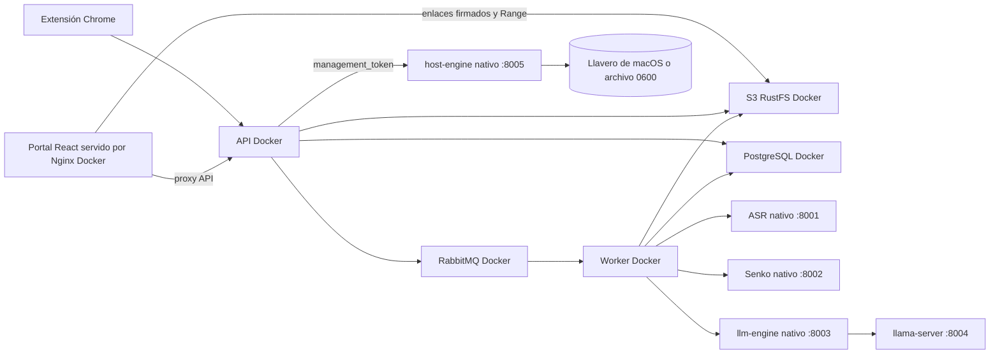

# Arquitectura de Sauri

Estado: dirección confirmada por Fer el 12-11-2026 (conversación del 12-11-2026, 19:10–19:25 UTC). Inventario contrastado con `origin/main` `98591fb` (16-11-2026). Este documento distingue configuración, implementación y validación; no declara aceptación de producto ni reemplaza las specs.

## Decisiones y límites

- Núcleo de servicios en Docker; transcripción y diarización nativas en el Mac para aprovechar Apple GPU. No se trasladan los motores a Docker/CPU: esa alternativa pierde la aceleración prevista en este Mac. No es una limitación universal de Docker.
- La extensión vive en Chrome. El portal React se construye con Vite y se sirve mediante Nginx en Docker, añadido al candidato de local-platform-deployment (#829 → #832 → #836 → U4 #837). El runtime no usa Vite ni expone fuentes. Mantener publicación/merge/recorrido/aceptación separados; los PR de despliegue no se consideran integrados por existir. Ver [operación y QA](docs/operations/local-deployment.md).
- PostgreSQL almacena datos estructurados y propiedad de las reuniones. Un almacén S3 guarda medios; RabbitMQ entrega trabajos a los procesadores. No guardar videos en PostgreSQL ni usar la cola como archivo durable de grabaciones.
- Compose actualmente usa RustFS, aunque el servicio, volumen y variables conservan nombres MinIO. No renombrar ni migrar volúmenes existentes para limpiar nomenclatura. La compatibilidad real con datos anteriores requiere evidencia separada: issue #543 sigue abierto.
- Se conserva la autenticación y autorización existentes. `AUTH_DISABLED` ya es `false` por defecto en el Compose local (#1071); el atajo heredado solo opera con `APP_ENV=test` y **no demuestra aislamiento entre cuentas**. La validación de propiedad debe ejecutarse con autenticación activa y dos identidades sintéticas; no habilitar un despliegue multiusuario ni cambiar política de acceso como parte de esta reconciliación.

## Componentes y conexiones

| Componente | Tecnología actual | Ubicación | Contrato / responsabilidad |
|---|---|---|---|
| Captura | Chrome MV3, TypeScript, React | Chrome | Capturar medios autorizados; persistencia local y cola de carga |
| Portal | React/TypeScript construido con Vite, servido por Nginx | Navegador y Docker `portal` en candidato #818 | Consultar reuniones vía proxy API y reproducir enlaces S3 autorizados |
| API | Python, FastAPI, SQLAlchemy | Docker `api` | Ingestión y acceso a reuniones del usuario |
| Procesadores | Python | Docker `worker` | Consumir trabajos y coordinar motores |
| Datos | PostgreSQL 16 | Docker `postgres`, volumen `pgdata` | Reuniones, estados, transcripciones, hablantes y propiedad |
| Archivos | RustFS compatible con S3 | Docker `minio`, volumen `minio-data` | Audio/video y enlaces firmados para acceso temporal |
| Cola | RabbitMQ 3 | Docker `rabbitmq` | Trabajos asíncronos firmados |
| Transcripción | whisper.cpp (`whisper-cli`, Metal) con `large-v3-turbo` cuantizado Q5_0, contrato v2 (palabras con tiempos) y detección de voz Silero activa por omisión | Host Mac, puerto 8001 | `POST /transcribe`; `backend/asr-engine/native_main.py`. Reemplazó a MLX Whisper (unidad U2 de `core-speech-pipeline`, #922) |
| Diarización | Senko (CoreML, commit fijado), contrato v2: segmentos crudos, `speaker_count`, `engine` y `diagnostics` | Host Mac, puerto 8002 | `POST /diarize`; `backend/diar-engine/native_main.py`. Reemplazó a pyannote en el camino nativo (unidad U1, #921) |
| Resumen | Pasarela `llm-engine` (:8003) que arranca `llama-server` (llama.cpp compilado en el commit fijado, :8004, solo interno) con Qwen3.5-9B Q4_K_M bajo demanda y lo detiene tras 120 s de inactividad (5 s en un Mac con menos de 16 GB, ver «Modo de poca memoria»); o un proveedor externo elegido explícitamente (ver «Enrutamiento por proceso») | Host Mac, puerto 8003 (llama-server interno en 8004) | `POST /v1/chat/completions`; `backend/llm-engine/native_main.py` |
| Administración del anfitrión (`host-engine`) | Python, FastAPI | Host Mac, puerto 8005 (solo `127.0.0.1`) | Guarda las claves de proveedores externos en el llavero de macOS (archivo 0600 en `~/.config/sauri/secrets/` como alternativa), prueba proveedores y lista sus modelos (`POST /v1/providers/probe`, `POST /v1/providers/models`, `GET /v1/discover/local`), y administra los modelos locales: hardware, catálogo con SHA-256, adopción de los ya instalados a mano, instalación, verificación y borrado (`/v1/hardware`, `/v1/local/...`). Además `PUT`/`DELETE /v1/secrets/{ref}`, `GET /v1/engines/status` y `GET /health`. Autentica cada llamada con `management_token`; ninguna ruta devuelve una clave. `backend/host-engine/native_main.py`; spec `model-engines`. La API lo llama con `HOST_ENGINE_URL` (`backend/app/engines/host_client.py`) |

## Entorno local con Docker Desktop

En el Mac, los servicios de Sauri corren en **Docker Desktop** como el proyecto de Compose **`sauri`** (`docker-compose.yml` de la raíz). Los motores de IA no van en Docker: corren nativos en el Mac para usar Metal/CoreML, y los contenedores los alcanzan por `host.docker.internal`.

| Servicio (Compose) | Puerto en el Mac | Datos |
|---|---|---|
| `portal` (Nginx con el portal construido) | `127.0.0.1:5173` (`PORTAL_PORT`) | — |
| `api` (FastAPI) | `127.0.0.1:8000` | — |
| `worker` (transcripción, diarización, resumen, retención, miniaturas de la biblioteca con `ffmpeg` estático) | — | — |
| `postgres` (PostgreSQL 16) | `127.0.0.1:5432` | volumen `sauri_pgdata` |
| `minio` (RustFS, compatible S3; conserva el nombre MinIO) | `127.0.0.1:9000` (API) y `127.0.0.1:9001` (consola) | volumen `sauri_minio-data` |
| `rabbitmq` (RabbitMQ 3 con consola de administración) | `127.0.0.1:5672` y `127.0.0.1:15672` | volumen `sauri_rabbitmq-data` |
| Motores nativos (fuera de Docker) | `127.0.0.1` `8001` ASR, `8002` diarización, `8003` pasarela de resumen (con `llama-server` interno en `8004`), `8005` administración (`host-engine`) | modelos en `~/.local/share/sauri/`, credenciales en `~/.config/sauri/` |

Comandos: `make up` (levanta el proyecto `sauri`), `make logs`, `make down`; `make engines-install`, `make engines-up`, `make engines-status`, `make engines-down` para los motores nativos. Instalación paso a paso en `docs/operations/installation-notes.md`.

Reglas del entorno local:
- Hay **un solo entorno principal**, el proyecto `sauri`, y sus volúmenes guardan los datos reales del dueño: nunca se borran ni se recrean sin su autorización.
- Las pruebas que necesitan PostgreSQL o RabbitMQ usan bases o contenedores **desechables** con otro nombre (bases `sauri_qa_*`/`sauri_t11_*`, contenedores `sauri-qa-*`), sin publicar puertos fuera de `127.0.0.1`, y se eliminan al terminar.
- Antes de diagnosticar o probar, se revisa el estado real con `docker compose -p sauri ps` y `make engines-status`; un servicio configurado no demuestra que esté corriendo.

La configuración de API/worker apunta a `host.docker.internal:8001`, `:8002` y `:8003`. Los motores implementan HTTP y controles de credenciales/capacidad por grabación. Su arranque, accesibilidad desde Docker y uso efectivo de GPU deben comprobarse juntos; tener una URL o un modelo configurado no demuestra inferencia. Credenciales fuera del repositorio en `~/.config/sauri`, montadas de solo lectura al worker; modelos compartidos en caché, nunca copiados al repositorio.

**Claves de proveedores y regla «el worker no recibe claves».** Las claves de proveedores externos viven solo en el host (llavero o archivo 0600) y las administra `host-engine` (:8005). El token de administración (`management_token`) es una credencial distinta del `engine_token`: se monta de solo lectura **únicamente** en el contenedor `api` (`/run/secrets/management_token`, variable `MANAGEMENT_TOKEN_FILE`; junto con `HOST_ENGINE_URL=http://host.docker.internal:8005`) y nunca en `worker`, ni lo leen las pasarelas de datos. El `engine_token` del worker no autoriza ninguna ruta de `host-engine`. La API llama a este servicio para guardar claves, probar proveedores y gestionar modelos locales (unidades U1, U2 y U6 de `model-engines`).

## Core de voz: motores nativos, contrato v2 y slot

Fuente: spec `.spectra/specs/core-speech-pipeline/`; mediciones en `.spectra/specs/core-speech-pipeline/acceptance-run.md`. Este apartado describe la implementación en `main`; no declara aceptación de producto.

- **Motores (HTTP nativos, solo `127.0.0.1`):** ASR en :8001 con dos modelos locales: **Parakeet-TDT-0.6B-v3 «ultra» (Core ML, predeterminado cuando está instalado)** y whisper.cpp `large-v3-turbo` Q5_0 (`whisper-cli`, un subproceso por trozo de voz; modelo `ggml-large-v3-turbo-q5_0.bin` fijado por revisión y SHA-256 en `scripts/engines/engine-hashes.json`), una alternativa que el usuario elige en Ajustes, mejor con nombres propios poco comunes (ver «Transcripción local: Parakeet y Whisper»); diarización Senko en :8002; pasarela de resumen en :8003 con `llama-server` en :8004 (Qwen3.5-9B Q4_K_M, también fijado por hash). Los instala `make engines-install` y se controlan con `make engines-up|down|status` (`scripts/engines/native-engines.sh start|stop|status {asr|diar|llm|host|all}`). Cada motor tiene su entorno virtual propio y normaliza el audio con `sauri_engine_common` (`ffmpeg`, mono 16 kHz); durante cada petición lo protege de la suspensión con `caffeinate -i`.
- **Contrato v2:** el ASR devuelve segmentos, **palabras con inicio, fin y probabilidad** (los tiempos invertidos se reparan con una regla determinista y se marcan), el idioma usado, `engine` y `diagnostics`; la diarización devuelve segmentos crudos de Senko (no la salida suavizada), `speaker_count`, `engine` y `diagnostics`. Ambos exigen `contract_version: 2`; una respuesta anterior se rechaza en el cliente. El idioma sale de configuración, no está fijado.
- **Persistencia:** las palabras viven en `transcript_words` y la atribución por palabra en `word_speaker_assignments` (estados `assigned`, `ambiguous`, `unassigned`); `speech_turns` conserva el segmento original del ASR y los turnos visibles se construyen al leer, agrupando palabras por hablante.
- **Slot de motor pesado:** los workers de transcripción, diarización y resumen toman un `pg_advisory_lock` de sesión antes de llamar a un motor (`backend/app/infra/engine_slot.py`; espera máxima de 120 s para obtenerlo), de modo que nunca corren dos cargas pesadas a la vez. Transcripción y diarización van en serie.
- **Modo de poca memoria (Mac con menos de 16 GB):** el slot ya evita que dos trabajos pesados corran a la vez en cualquier equipo; lo que se acumulaba en un Mac de 8 GB era el modelo de resumen cargado después de usarlo. `sauri_engine_common.memory.low_memory_mode()` lo detecta con `sysctl hw.memsize` (`SAURI_LOW_MEMORY=1/0` lo fuerza) y entonces `llm-engine` detiene `llama-server` 5 s después del último pedido y lo arranca con `-ub 256` (mismo contexto de 32 768 tokens; el búfer de cálculo baja a la mitad sin perder velocidad). La recomendación de modelos añade el aviso `low_memory_slow` a cada proceso, que la bienvenida y Ajustes muestran en palabras simples.
- **Resumen:** se solicita solo al terminar la diarización, usa el cliente de chat compatible con OpenAI contra :8003 y queda como borrador con citas validadas por código; no entra en `Tiempo_Hasta_Transcripcion`.

## Transcripción local: Parakeet y Whisper

Decisión del dueño del 16-11-2026; sin modelo de respaldo desde el 18-11-2026 (un modelo activo por proceso). Fuente de las cifras: benchmark en el Mac del dueño (M3 Air) con una grabación de 60 min (ArgosOKRs) y otras de hasta ~94 min; los textos no se copian al repositorio.

- **Qué hace cada modelo.** `local:default` de transcripción significa ahora **Parakeet ultra** cuando está instalado y su motor está sano; si no, el Whisper integrado (un Mac sin la herramienta Swift sigue funcionando con Whisper). Se decide antes de cada petición y una sola vez: ningún modelo repite el trabajo de otro. Whisper turbo es una alternativa que se instala y se elige en «Motores y modelos» (`local:whisper-large-v3-turbo-q5_0`); al instalarlo, `host-engine` instala también su detector de voz (`silero-vad`), que solo usa whisper.cpp. La primera puesta en marcha instala solo lo que pide el modelo recomendado (`setup_plan`): con Parakeet no descarga Whisper ni el detector de voz, y el motor ASR arranca sin esos archivos (las peticiones a Whisper sin sus archivos se rechazan con `model_not_installed`). Una instalación anterior conserva Whisper en disco como alternativa instalada; no se borra nada. Parakeet corre con `fluidaudiocli` (FluidAudio, Apache-2.0) sobre el Neural Engine: 60 min en 19,5 s de motor (25 s de petición completa con descarga y conversión; Whisper por la misma ruta: 549 s), ~0,4 GB de memoria; la primera ejecución con un modelo nuevo tarda ~70 s porque Core ML compila para el Neural Engine (el instalador y el arranque del ASR lo calientan una vez).
- **Cómo se ejecuta.** La pasarela convierte el audio a WAV 16 kHz mono (el mismo paso de ffmpeg), lanza `fluidaudiocli transcribe … --model-version ultra --word-timestamps --local-model-dir <dir>` **sobre toda la grabación** (sin recorte por VAD: así se midió) en su propio grupo de procesos (misma cancelación que `whisper-cli`: se mata si el worker se desconecta, al agotar el tiempo o al apagar el motor) y convierte el JSON al contrato v2. Cada palabra conserva su puntuación y mayúsculas y recibe el espacio inicial de las palabras de Whisper (los turnos se arman uniendo textos); `confidence` pasa a `probability`. Los tiempos del modelo son múltiplos de 80 ms; la atribución por palabra (`attribute_words`) usa el **solape** de la palabra con los segmentos de hablante (no su punto medio), así que no supone una resolución más fina. Los segmentos se arman con las palabras (fin de frase, pausa ≥ 1,5 s, tope de 30 s u 80 palabras).
- **Sin descargas en ejecución.** El binario debe coincidir con `provenance.json` (commit fijado de FluidAudio y SHA-256 del archivo; un binario adoptado debe ser una compilación conocida); el modelo es el directorio que `host-engine` verificó por hash; se usa `--local-model-dir` (la opción del CLI que nunca descarga) y además `REGISTRY_URL` apunta a un puerto cerrado. Con la red denegada (`sandbox-exec`) la transcripción funciona igual.
- **Guardia y fallos.** Las guardias de calidad (deriva al inglés y repetición) **no hacen fallar la reunión**: se entrega el texto de Parakeet, el registro anota la guardia y el valor medido (sin texto) y la respuesta lleva `diagnostics.parakeet.guard_warning`; el usuario puede regenerar con Whisper. Si la salida no sirve (vacía, tiempos rotos, inválida), o el CLI falla, excede el tiempo o no está verificado, **la transcripción falla** con un código estable (`model_failed`, HTTP 500; 503 si el CLI no está verificado) y el worker la marca con la causa `local_model_failed`; un idioma `auto` o no soportado se rechaza antes de leer el audio (`language_not_supported`, 422; causa `language_not_supported`), y los archivos que faltan del modelo activo dan `model_not_installed`/`model_not_verified` (409; causa `local_model_missing`). Ningún otro modelo transcribe la grabación por su cuenta: el usuario la vuelve a generar o elige Whisper en Ajustes y la regenera. El motivo concreto (`parakeet_language_drift`: palabras vacías del inglés > 1 %; `parakeet_empty_output`: cero palabras; `parakeet_repetition`: una frase de 1–6 palabras repetida ≥ 6 veces seguidas y ≥ 12 palabras; `parakeet_timestamps`: > 0,5 % de palabras con tiempos que retroceden o > 1 % fuera de la grabación; `parakeet_failed`, `parakeet_timeout`, `parakeet_invalid_output`, `parakeet_unavailable`) va solo al registro del motor, sin texto. Umbrales en `SAURI_ASR_PARAKEET_*` (ver `docs/operations/local-deployment.md`). El tiempo del CLI se acota (90 s + 5 % del audio, máximo 420 s).
- **Catálogo.** Una entrada puede ser un conjunto de archivos (`files`: ruta, tamaño y SHA-256 de cada uno, y un resumen del listado como `sha256`); `preferred` marca el modelo al que apunta `local:default`; `needs` nombra el motor administrado que necesita (`fluidaudio-cli`, que se construye con `scripts/engines/install-parakeet-engine.sh` desde el commit fijado, o se adopta si es una compilación conocida); `min_macos` y `license`/`attribution` completan la ficha. La atribución CC-BY-4.0 se muestra en la tarjeta del modelo y vive en `NOTICE`.

## Enrutamiento por proceso, respaldo local y procedencia (`model-engines`)

Fuente: spec `.spectra/specs/model-engines/`. Sin configuración guardada, cada proceso usa su motor local y nada sale del Mac.

- **Configuración:** por propietario, en PostgreSQL: `engine_providers` (proveedores enlazados, sin claves), `engine_process_settings` (proveedor, modelo y `local_fallback`, activado por defecto, por proceso: transcripción, hablantes, resumen) y `engine_privacy_consents` (consentimiento por proceso y proveedor, con la versión del aviso). API en `/api/v1/engines` (proveedores, claves, prueba, modelos, procesos, aviso, estado) y `/api/v1/engines/local` (hardware, modelos locales, adopción, instalación, verificación, trabajos).
- **Dónde se decide:** en cada intento, el worker resuelve la ruta del propietario desde PostgreSQL (`backend/app/engines/routing.py`), exige consentimiento vigente para esa combinación proceso/proveedor y la envía a la pasarela en la cabecera `X-Sauri-Route`. El worker nunca lee una clave: la pasarela la lee del almacén del anfitrión (llavero de macOS o archivo 0600) en el momento de la llamada, la valida contra el origen para el que se guardó y habla con el proveedor. `backend/app/engines/capability_matrix.py` es la fuente de verdad de qué proveedor sirve a qué proceso; al 16-11-2026 se ofrecen resumen con OpenAI, Anthropic, Gemini, OpenRouter, LM Studio y servidores compatibles, transcripción con AssemblyAI, Deepgram y Groq, y hablantes con Deepgram. OpenAI no se ofrece para transcripción ni hablantes. El inicio de sesión con el plan de ChatGPT sigue bloqueado.
- **Respaldo local:** con el respaldo activado, ante cualquier fallo del proveedor que no exija una acción del dueño (caída, límite, petición rechazada, modelo no disponible, salida inválida), el worker hace una segunda llamada al motor local y registra el motivo; los fallos que sí la exigen (inicio de sesión o clave rechazados, consentimiento ausente, ruta no permitida, secreto ilegible) nunca cambian de motor y no hay cadena entre proveedores externos.
- **Procedencia:** transcripción, diarización y resumen guardan `engine_name`, `engine_model`, `engine_external` y `engine_fallback_reason`. Está registrado en la base; **exponerlo en la API de reuniones y mostrarlo en el portal (tarea U8.3 de `model-engines`) sigue pendiente**. Las reuniones procesadas antes de esa columna no la tienen.
- **Modelos locales:** el catálogo (`scripts/engines/model-catalog.json`) fija repositorio, revisión, tamaño y SHA-256 de cada archivo (los modelos de varios archivos, como Parakeet, listan cada uno). `host-engine` instala solo desde `huggingface.co` con ese hash, reconoce los modelos ya instalados a mano (adopción sin mover ni descargar nada) y bloquea quitar el modelo en uso. Los modelos viven en `~/.local/share/sauri/models/` (variable `SAURI_MODELS_DIR`; los instalados a mano antes se reconocen en su ubicación original) y las pasarelas usan el modelo elegido en cada proceso.
- **Alcance de la evidencia:** los adaptadores de proveedores externos se verificaron contra servidores simulados en `127.0.0.1` y la documentación de cada proveedor; el recorrido real con claves y material del dueño (unidad U10) no se ha hecho.

## Alternativas descartadas y evidencia

Fuentes: `.spectra/specs/core-speech-pipeline/design.md` y `model-engines/design.md`; las cifras de Codex son de su evaluación en el Mac del dueño (M3, 24 GiB) fuera de Sauri, con informes privados fuera del repositorio. WER y DER no se midieron (no hay referencia humana).

| Decisión | Descartado | Evidencia |
|---|---|---|
| Motores nativos, no en Docker | Motores en contenedores; app nativa Swift | Docker en macOS corre una VM Linux sin CoreML ni Metal |
| ASR whisper.cpp Turbo Q5_0 por subproceso (respaldo y opción para nombres propios) | MLX Whisper; `whisper-server`; binding Python; Whisper CoreML | MLX 9,0 s frente a 6,0 s en el mismo fragmento y más memoria; cargar el modelo cuesta 168 ms, un servidor residente (~1,5 GiB) no ahorra nada; Whisper CoreML resultó más lento que la variante Metal elegida (67,8 s en clips de 9 min) |
| ASR predeterminado: Parakeet-TDT-0.6B-v3 «ultra» con `fluidaudiocli` (Core ML / Neural Engine) | Parakeet v3 sin «ultra»; «redux»; `parakeet-mlx`; WhisperKit; vocabulario CTC (`--custom-vocab`); `--encoder-compute-units gpu\|all` | 60 min en 19,5 s frente a 549 s; v3 sin «ultra» se desvía al inglés (10,5 % de las palabras frente a 0,2 %); «redux» 130 s y 2 GB de memoria; `parakeet-mlx` 291 s, 28,9 % de palabras en inglés y la mitad de las palabras; WhisperKit 532–553 s (sin ganancia sobre whisper.cpp); `--custom-vocab` dispara de más; `gpu\|all` se cuelgan al compilar Core ML; `--language es` no tiene efecto; ver `core-speech-pipeline/design.md` (adenda 16-11-2026) |
| Diarización Senko, salida cruda | FluidAudio; pyannote 3.1 y community-1; salida suavizada de Senko | 98 min: Senko 11,1 s de inferencia frente a 49,6 s de FluidAudio (que además exige compilar Swift); pyannote 8–15 min por reunión; la salida suavizada descarta turnos de 0,78 s o menos, justo el hablante breve |
| Atribución por palabra con función pura | Punto medio de la palabra; alineación forzada con wav2vec2; modificar `assign_turns` | Cambiaría resultados y partiría palabras largas; añade minutos y un modelo por idioma; los más de 400 casos de equivalencia de #907 protegen el comportamiento por segmento |
| Ejecución en serie con `pg_advisory_lock` | Paralelizar ASR y diarización; arrendamiento con fencing; `flock` en el anfitrión | La diarización dura unos 30 s de unos 6 min: menos de 10 % de ganancia; los workers corren en Docker y no comparten sistema de archivos con el anfitrión |
| Resumen: Qwen3.5-9B Q4_K_M con llama.cpp fijado | Qwen3-4B; Qwen2.5-14B; resumen extractivo; `llama-server` residente; solo Ollama | Qwen3-4B inventó que no había metas; Qwen2.5-14B abortó por presión de memoria; el extractivo (12–16 s) omitió el bloque final; un `llama-server` residente ocupa unos 5,5 GiB permanentes; el `llama-completion` de Homebrew aborta por incompatibilidad con GGML |
| Claves en el llavero del anfitrión | Archivos `*_FILE` montados en Docker; PostgreSQL cifrado; biblioteca `keyring`; variables de entorno | Exponen la clave a Docker o a `ps`/`docker inspect`, o piden permiso por cada intérprete |
| Ruta decidida en el worker y ejecutada en la pasarela | Que la pasarela lea su propia copia de la configuración; que las pasarelas lean PostgreSQL; que el worker llame al proveedor | La pasarela no conoce al propietario ni el consentimiento; el worker llamando directo dejaría las claves en Docker |
| `host-engine` aparte (:8005) con su propio token | Ruta de administración en la pasarela LLM; que el portal hable con el anfitrión | La pasarela comparte el token del worker y mezcla datos con administración; el portal obligaría a validar sesiones en el anfitrión y abrir CORS |
| Revisión de hablantes sobre la grabación original | Un WAV por hablante (`speaker_excerpt_service`) | Crea audio derivado y contradice la decisión del dueño del 13-11; la revisión de hablantes reproduce la grabación original |

Medido en la corrida real del 15 y 16-11 (detalle y límites en `acceptance-run.md`): 0,25 % y 0,29 % de palabras sin asignar frente a la meta de 3 %; `Tiempo_Hasta_Transcripcion` de 6,3 min para 55 min de audio y 14,2 min para 94 min, frente a la meta de 7 min para 60 min, que **no queda demostrada**; memoria y presión del host, no registradas.

## Validación de entrada, límites y errores de la API (#1070)

**Contrato de errores.** Las rutas de ingesta, reuniones, plantillas y resúmenes responden con un código estable y nada más: `{"detail": "invalid_request" | "not_found" | "conflict" | "forbidden" | "payload_too_large" | "unsupported_media_type"}`. Una validación fallida (422) agrega `errors` con la ubicación y el nombre de la regla, nunca el valor enviado. La reunión ajena y la inexistente siguen devolviendo el mismo 404. `app/infra/http_errors.py` también ofrece `request_validation_exception_handler` para registrarlo de forma global.

**Cuerpos y rutas.** Todo modelo de entrada rechaza campos desconocidos. Los ids de ruta y de cuerpo siguen `[A-Za-z0-9][A-Za-z0-9_.:-]{0,63}` (36 caracteres en `meeting_id` de la subida, por la columna); título ≤ 512, clave de idempotencia ≤ 256, nombre de plantilla y de categoría ≤ 128, instrucciones de plantilla ≤ 20 000 caracteres (unos 5 000 tokens: la plantilla inicial usa 1 329 y el resto del contexto del modelo queda para la transcripción), `revision_id` entre 1 y 2 147 483 647.

**Paginación.** `GET /api/v1/meetings/`, `GET /api/v1/templates` y `GET /api/v1/templates/categories` aceptan `limit` (1–500, por defecto 200) y `offset` (0–1 000 000). El cuerpo sigue siendo una lista; `X-Total-Count` trae el total y `Link: <...>; rel="next"` aparece mientras queden filas. El portal pide todo sin parámetros, por eso el valor por defecto es grande: con más de 200 reuniones solo vería las 200 más recientes hasta que pagine.

**Subida de grabaciones.** `MAX_UPLOAD_BYTES` (por defecto 4 GiB, máximo 5 GiB porque la subida al almacén es un solo PUT) limita toda la petición: se rechaza con 413 por `Content-Length` antes de leer nada y, si falta o miente, al contar el flujo. Las partes se escriben a disco temporal (no a memoria) y de ahí al almacén por bloques; el directorio temporal de la API necesita ese espacio. El contenedor se verifica por sus primeros bytes (WebM/Matroska, MP4/M4A/MOV, MP3, WAV, OGG, FLAC, AAC ADTS); otro contenido recibe 415. El nombre y el tipo que declara el cliente no se usan: el nombre solo propone el título por omisión y el `Content-Type` guardado sale del contenedor detectado.

**Enlaces firmados.** Hay tres vidas, porque el reproductor lee un solo enlace con peticiones de rango (al almacenar en búfer o al saltar) y, vencido el enlace, esas peticiones reciben 403. `PLAYBACK_URL_TTL_SECONDS` (por defecto 14 400, es decir 4 h; entre 300 y 43 200) fija la vida de los enlaces de reproducción: una grabación puede pasar de una hora (la más larga medida dura 94 min) y una vida corta exigiría un reproductor que renueve sus enlaces, lo cual es trabajo del frontend. `SIGNED_URL_TTL_SECONDS` (por defecto 900, entre 60 y 3600) se queda para miniaturas y otras capacidades de vida corta. `DOWNLOAD_URL_TTL_SECONDS` (por defecto 300, entre 60 y 3600) fija la vida del enlace de descarga (`GET /api/v1/meetings/{id}/media-download`): el almacén lo firma con `response-content-disposition=attachment` y el título como nombre de archivo (`filename*` RFC 5987 para caracteres no ASCII), de modo que todos los navegadores guardan el archivo sin permisos de CORS; el navegador lo sigue al recibirlo y la firma solo se comprueba al empezar la transferencia. En todos los casos un valor inválido da error en lugar de alargar el enlace sin avisar. Sauri es local: cada enlace es una capacidad al portador limitada a un objeto, y se obtiene solo tras comprobar que la reunión es del usuario.

## Procesamiento sin repeticiones y regeneración explícita (#1053)

**Regla.** Una etapa cuya salida ya existe (transcripción de la grabación, revisión de hablantes, resumen) nunca se vuelve a calcular por un disparador automático: ni al refrescar o reabrir la página, ni al reiniciar API o worker, ni por reentregas o reconexiones de la cola, ni al guardar un nombre de hablante, cambiar la plantilla por defecto, reenviar la subida o por la retención. Solo una petición explícita del usuario crea trabajo nuevo.

**Cómo se garantiza.**
- Cada mensaje de la cola lleva una generación de procesamiento y se consume una sola vez (`meeting_processing_claims`). Los workers descartan, con una línea `reason=stage_complete`/`fenced`, cualquier mensaje de una etapa ya completa, salvo que traiga una operación de regeneración vigente (reclamo `recovery` con `operation_id`).
- El resumen automático solo existe como primer resumen de una transcripción (id determinista); cuando ya hay cualquier solicitud o resumen, el camino automático no crea otro. El outbox solo reenvía solicitudes `pending`/`running`.
- Una operación de regeneración abre una generación nueva: los mensajes de generaciones anteriores quedan descartados.

**API** (dueño de la reunión; cabecera opcional `Idempotency-Key`):
- `POST /api/v1/meetings/{id}/regenerate` con `{"stage": "transcription" | "speakers" | "summary", "template_id"?, "cascade"?}` responde 202 con `operation_id`, `stage`, `status`, `requested_at`, `replaces` (etapas que se recalculan) y `stale` (salidas posteriores que quedan visibles pero desactualizadas). `cascade` (por defecto `false`) encadena las etapas siguientes, una a la vez. Etapa desconocida: 422. Otra operación o procesamiento en curso: 409 `operation_active`/`processing_active` (con la operación activa). Grabación no disponible: 409 `media_unavailable`.
- `GET /api/v1/meetings/{id}/regenerate/latest` y `GET .../regenerate/{operation_id}` consultan el estado (`accepted`, `running`, `succeeded`, `failed`, con `failure_cause`).
- `GET /api/v1/meetings/{id}` agrega, solo cuando aplica, `stale_stages` y `active_operation`. `GET .../speaker-review?revision_id=N` lee una revisión anterior.

**Reglas por etapa.** *Resumen:* misma aceptación que `/summary-requests`; el resumen anterior sigue visible hasta que el nuevo termina bien. *Hablantes:* nueva revisión sobre la misma transcripción; un nombre se arrastra a la nueva revisión solo si ambos hablantes son la mejor coincidencia mutua y comparten al menos 70 % del tiempo de voz de cada uno; si no, la revisión nueva queda pendiente de revisión y la anterior sigue accesible. No se regenera el resumen. *Transcripción:* se reemplaza el contenido de la misma transcripción; la detección de hablantes previa se re-atribuye por tiempo y queda marcada como desactualizada junto con el resumen; la reunión pasa a `transcribing` mientras corre y vuelve a `completed` al terminar, también si falla (se conservan las salidas previas y se guarda `failure_cause`).

**Auditoría.** Tabla `regeneration_operations` (etapa, solicitante, `requested_at`, `started_at`, `finished_at`, estado, causa de fallo, detalle sin contenido). Una reunión admite una sola operación activa (índice único parcial). Un barrido del worker marca como fallidas (`stale_operation`) las ejecuciones que superan `SUMMARY_STALE_AFTER_SECONDS` (75 min por defecto).

## Seguridad local

- **Puertos solo locales.** Todo puerto publicado (portal 5173, API 8000, PostgreSQL 5432, RustFS 9000/9001, RabbitMQ 5672/15672) escucha únicamente en `127.0.0.1`; otras máquinas de la red no los alcanzan. Los motores nativos (8001 ASR, 8002 diarización, 8003 pasarela LLM, 8004 llama-server, 8005 `host-engine`) también.
- **Sin credenciales fijas.** `scripts/engines/ensure-native-engine-credentials.sh` (invocado por `make build`/`make up` mediante `scripts/platform/compose-bringup.sh`) genera una vez valores al azar en archivos privados (0600, carpeta 0700) bajo `~/.config/sauri/`: `engine_token`, `management_token`, `recording_capability_key`, `queue_signing_key`, `admin_password`, `database_password`, `queue_password`, `object_store_access_key`, `object_store_secret_key` y `jwt_secret`. Nunca se versionan ni se imprimen.
- **Almacén de secretos del anfitrión.** `host-engine` escribe las claves de proveedores con `/usr/bin/security -i` (el comando entra por entrada estándar: la clave no aparece en `argv` ni en `ps`) bajo el servicio `sauri` del llavero; si el llavero no responde, usa archivos 0600 en `~/.config/sauri/secrets/` (carpeta 0700). Cada clave queda vinculada al origen para el que se guardó. Las respuestas solo llevan los últimos 4 caracteres cuando la clave tiene al menos 12; los cuerpos de `PUT` no se registran (el servicio arranca sin registro de accesos). Los errores llevan códigos, nunca valores.
- **Codex (plan de ChatGPT; cuenta, sin clave; solo Resumen).** Decisión del dueño del 16/11/2026, copia el flujo de APX y no es una vía documentada oficialmente: puede dejar de funcionar. `host-engine` ejecuta el inicio de sesión por código de dispositivo (`POST /v1/oauth/chatgpt/{start,poll,logout}`, `GET .../status`) contra `auth.openai.com`; los tokens quedan solo en el llavero (`oauth/chatgpt/refresh` y `oauth/chatgpt/access`) y nunca se leen ni se tocan los archivos de la CLI de Codex (`~/.codex`). La renovación es de un solo vuelo (candado en el proceso y `flock` compartido entre `host-engine` y la pasarela 8003, que leen los mismos registros); si OpenAI rechaza el token de actualización, se borra la sesión y el portal pide conectar de nuevo. La pasarela 8003 llama a `chatgpt.com/backend-api/codex/responses` con el adaptador `chatgpt-responses` (`external/chat_responses.py`); todo el tráfico de este proveedor pasa por `AllowlistedHttp`, que solo admite `auth.openai.com` y `chatgpt.com` sobre HTTPS, además de las garantías de `SafeHttp`. El aviso de privacidad y el consentimiento versionado aplican como a cualquier proveedor externo. En la API, el tipo `chatgpt_plan` usa autenticación «cuenta» (sin clave, dirección fija), se ofrece solo para Resumen y su entrada en la matriz queda sin fecha de verificación (`verified_on` vacío, `accepted_on` = decisión del dueño) hasta la aceptación en vivo; `GET/POST/DELETE /api/v1/engines/providers/{id}/account[/start|/poll]` reenvían al host y solo devuelven correo, plan y el código a escribir. Elegirlo para un proceso exige que la cuenta esté conectada; desconectar devuelve al motor local los procesos que lo usaban. Si la sesión vence, el resumen falla con `provider_auth` (no cae al motor local, como una clave rechazada) hasta conectar de nuevo; los errores reintentables (límite, 5xx, tiempo) sí caen al motor local.
- **Patrón `*_FILE`.** Los contenedores reciben esos archivos de solo lectura en `/run/secrets/<nombre>` y los leen con `DATABASE_PASSWORD_FILE`, `QUEUE_BROKER_PASSWORD_FILE`, `OBJECT_STORE_ACCESS_KEY_FILE`, `OBJECT_STORE_SECRET_KEY_FILE` y `JWT_SECRET_FILE` (PostgreSQL: `POSTGRES_PASSWORD_FILE`; RustFS: `RUSTFS_ACCESS_KEY_FILE`/`RUSTFS_SECRET_KEY_FILE`). Las URL de conexión no llevan contraseña. Los motores ASR y diarización leen las llaves del almacén desde `~/.config/sauri/`.
- Migración de instalaciones existentes, rotación de valores y reinicio de motores: ver `docs/operations/local-deployment.md`.

## Mapa de especificaciones del primer recorrido

| Tramo | Fuente existente | Estado contrastado / pendiente |
|---|---|---|
| Captura y preferencias | `.spectra/specs/extension-capture-preferences/requirements.md` | Solo requirements en main; no inventar diseño/tareas aprobados |
| Finalización, carga y apertura de revisión | `.spectra/specs/chrome-recording-completion/{requirements,design,tasks}.md` | Tres documentos presentes; PR #703 MERGED (head `191c8aa`, verificado durante U4). No inferir de ese merge captura real, recorrido integrado ni aceptación; revisar cada issue antes de abrir trabajo |
| Reproducción | `.spectra/specs/meeting-review-playback/` | Diseño, tareas y registro de aceptación separados; API `/api/v1/meetings/{meeting_id}/playback` implementada, falta comprobar recorrido integrado |
| Biblioteca y metadatos | `.spectra/specs/recording-library-metadata/` | Main contiene requirements/config; discrepancias documentales ya registradas en #701, #715, #716. Reusar esos issues, no duplicarlos |
| Core de voz (transcripción, hablantes, resumen, portal, revisión de hablantes) | `.spectra/specs/core-speech-pipeline/{requirements,design,tasks}.md` y `acceptance-run.md` | Unidades U1–U7 y U9 integradas en `main`; corrida real medida (U8.1), con la meta de tiempo no demostrada y la apertura por el dueño sin registrar; aceptación de producto del dueño pendiente |
| Motores y modelos (proveedores externos, claves, modelos locales) | `.spectra/specs/model-engines/{requirements,design,tasks}.md` | Integradas U1–U8 salvo la procedencia visible en la reunión (U8.3); U9 (plan de ChatGPT) bloqueada por verificación legal; U10 (recorrido real con proveedores) pendiente |
| Fallos de carga existentes | #606 y pruebas `extension/src/background.upload-retry.test.ts`, `upload-queue.*test.ts` | Inspeccionar correcciones existentes antes de iniciar otra; una prueba con dobles no acredita carga real |

La spec de finalización exige abrir revisión **después de procesamiento exitoso y activos protegidos disponibles**. El avance inicial de guardar/reproducir no autoriza suprimir esa condición ni anunciar transcripción terminada. Primero validar almacenamiento y reproducción como capacidades reales; conservar el comportamiento aprobado de apertura automática hasta que una enmienda funcional sea aprobada.

## Evidencia y brechas

Una auditoría previa verificó aisladamente escrituras/lecturas PostgreSQL, migraciones, objetos S3 con lectura parcial firmada, envío/recepción RabbitMQ y arranque API/worker. Se retiraron recursos sintéticos de esa auditoría. **No acredita inferencia, captura real Chrome, propiedad con autenticación activa ni recorrido completo.**

U4 #837 repitió en entorno nuevo y autenticado escrituras/lecturas PostgreSQL/S3, mensaje firmado publish/consume/ack, login real de dos usuarios sintéticos, carga audiovisual por API/proxy y permisos A/B/anónimo; tres rangos del enlace firmado con bytes/Content-Range/CORS exactos y firma alterada denegada. También pasaron las tres pruebas existentes de endpoint público y playback con S3 real. Entorno eliminado al terminar. El recorrido del 13/11 comprobó biblioteca autenticada, reproducción S3 real, salto temporal, velocidad, recarga, error ante medio ausente y logout; además detectó y corrigió una redirección que perdía el puerto del portal. Ver detalles y límites en `docs/operations/local-deployment.md`: sesión QA emitida por login API y restaurada mediante la herramienta de navegador, no envío manual del formulario. Con un fragmento autorizado de Downloads, una llamada directa y offline a MLX produjo cuatro segmentos reales (dispositivo predeterminado reportado GPU); se importó ese resultado como datos QA sin marcar la reunión completed para revisar la lectura/reproducción. No demuestra worker, endpoint nativo HTTP, utilización GPU medida ni diarización. El worker QA no alcanzó los motores (`ConnectError`); los procesos nativos seguían detenidos y pyannote no estaba en la caché local. La UI existente sin transcript muestra 404 y no abre el reproductor. Estos resultados son del candidato, no del merge de #840 ni aceptación de producto.

Orden de ejecución: reconciliar especificaciones y aprobaciones → reparar conexiones concretas con pruebas → publicar e integrar unidades → validar captura/carga/propiedad/reproducción → validar transcripción y hablantes sobre ese recorrido. No reemplazar funcionalidad con rutas de demostración o datos simulados; los datos sintéticos son únicamente fixtures de prueba.

## Preservación y mantenimiento

No ejecutar `docker system prune`, eliminar volúmenes ni limpiar recursos ajenos. Identificar proyecto, propiedad, datos y autorización antes de retirar recursos existentes. La auditoría inicial midió un volumen principal de aproximadamente 2,426 GB; es un dato histórico, no un inventario vigente ni autorización de borrado. Las mediciones globales de Docker pueden incluir otros recursos: verificar siempre su estado y la autorización actual. QA retira contenedores/redes/volúmenes propios al finalizar; no ejecuta limpieza global de imágenes compartidas ni cache.

Todo cambio arquitectónico debe actualizar este documento y la spec afectada en la misma entrega, indicando motivo, alternativas descartadas, impacto de despliegue/datos y evidencia. Registrar decisiones de producto, privacidad, gasto o seguridad aprobadas por Fer; decisiones técnicas no amplían esas autorizaciones. `docs/product/baseline.md` sigue siendo la autoridad de producto, y las fases SDD conservan sus aprobaciones separadas de implementación, merge y aceptación.

## Modos de captura de la extensión (#994)

- **«Record» / Grabar (principal):** selector nativo con `getDisplayMedia` dentro
  del offscreen, según la [guía de Chrome](https://developer.chrome.com/docs/extensions/how-to/web-platform/screen-capture).
  Cancelar no cambia el estado previo ni crea sesión. Sin audio se liberan las
  pistas y se pide volver a elegir con «Share tab audio» activado. Se rechazan
  ventanas/monitores por `displaySurface`; ante `TypeError` se reintenta una vez
  sin opciones opcionales, conservando esa validación. No hay loopback: se pide
  `suppressLocalAudioPlayback: false` para evitar audio duplicado.
- **«Record this tab» / Grabar esta pestaña (atajo):** `tabCapture.getMediaStreamId`
  del worker obtiene la pestaña activa; el offscreen consume el ID con fuente
  `tab` e incluye audio. Aquí sí hay loopback al destino local del AudioContext,
  porque esta API silencia la pestaña. Se conservan `tabCapture` y `activeTab`;
  abrir el panel desde `action.onClicked` concede acceso a esa pestaña. Si falta
  ese permiso, se explica cómo volver a invocar la extensión, sin sesión huérfana.
  El atajo se deshabilita en páginas internas/extensiones/tienda; admite páginas
  web HTTP(S). Cambiar de pestaña no concede automáticamente otro `activeTab`.

Ambos modos usan offscreen con razones `DISPLAY_MEDIA` y `USER_MEDIA`: el siguiente
inicio recrea documentos inactivos para actualizar razones, nunca capturas vivas.
`pickerSource` registra `picker` o `current-tab` en el estado de sesión, sin contenido
personal adicional. Comparten MediaRecorder, mezcla de micrófono solo para el
archivo, WebM, IndexedDB y subida. La identidad durable se crea después de obtener
los medios válidos. `audio_only` excluye video del archivo, pero conserva su pista
fuente para detectar `ended`, usando el cierre durable de `captured-tab-close`.
Cerrar la pestaña de origen también finaliza; en el selector puede ser distinta de
la elegida. Cualquier pestaña web se puede grabar. Meet usa su script de contenido
estático (título, banner, cuenta regresiva y barra, además de `meet_link`); las demás
pestañas reciben el mismo overlay por inyección bajo demanda (`overlay/entry`) en la
pestaña activa al iniciar, con `activeTab` (sin permisos de host nuevos), y usan el
título de la pestaña, `provider: "tab"` y `meet_link` nulo. Si Chrome no permite
inyectar (páginas internas, tienda, visor PDF, `file://`, concesión vencida), la
grabación sigue y los controles quedan solo en el panel («sin barra en esta
pestaña»). Con el selector, el overlay aparece solo en la pestaña que estaba activa
al iniciar, aunque se elija otra. Se reinyecta al terminar una carga completa de la
pestaña grabada (`tabs.onUpdated`); la instalación es idempotente por página.

Con micrófono configurado, el panel consulta su permiso antes de cualquiera de los
modos. Si no está concedido, o el offscreen recibe `NotAllowedError` del micrófono,
no inicia MediaRecorder: abre la página de opciones existente y pide autorizarlo
allí y volver a pulsar Record. El panel enumera dispositivos sin pedir permiso por
su cuenta; los dispositivos sin ID visible usan el micrófono predeterminado, no se
convierten silenciosamente en una captura sin micrófono.
**NO VERIFICADO en Chrome del dueño:** ambos inicios, permisos, selector, audio
local sin silencio/eco y recorrido real; los mocks no sustituyen aceptación.

### Lista de prueba manual para el dueño

1. Construir y recargar la extensión; abrir una pestaña nueva (Meet u otra) e invocar
   el panel desde el icono de la extensión, con sesión iniciada en Sauri.
2. Con micrófono sin permiso, probar cada botón: debe abrir opciones sin grabar.
   Autorizar con «Enable microphone», volver a esa pestaña y pulsar Record otra vez.
3. Probar «Record»: ver el estado de selección sin contador; elegir una pestaña
   (también distinta del origen) con audio activado y hablar por el micrófono.
4. Verificar audio local una sola vez; usar «Dejar de compartir». El portal debe
   abrir la reunión y reproducir video, audio de pestaña y voz.
5. Probar Cancelar y desmarcar audio: ninguno debe crear sesión; el segundo debe
   explicar cómo activar «Share tab audio». Reintentar con audio activado.
6. Probar «Record this tab»: inicio sin selector, audio local audible una sola vez,
   micrófono en el archivo; cerrar esa pestaña y comprobar subida/apertura del portal.
   Repetir deteniendo la captura y con `audio_only` en ambos modos.
7. Comprobar atajo deshabilitado en `chrome://settings`, y ambos modos desde una web
   no-Meet: con banner, cuenta regresiva y barra si Chrome permite inyectar, o solo panel si no. Reabrir el panel durante una captura: no debe iniciar otra ni
   destruir la actual. Reinvocar el icono si se cambia de pestaña para usar el atajo.
