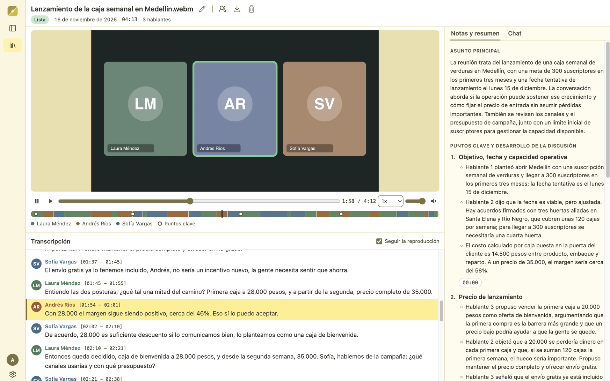
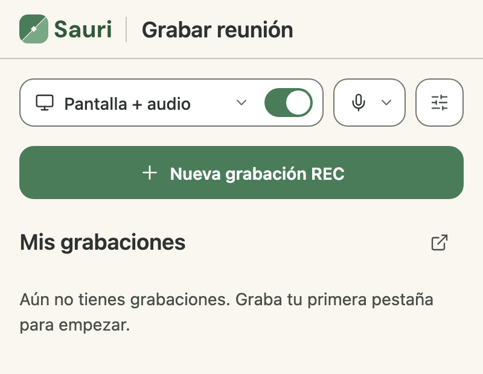
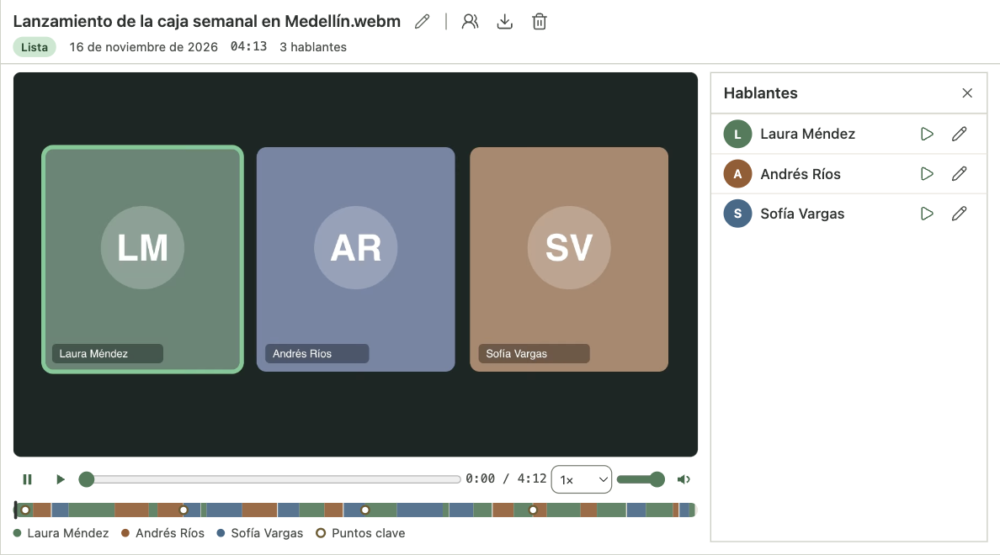
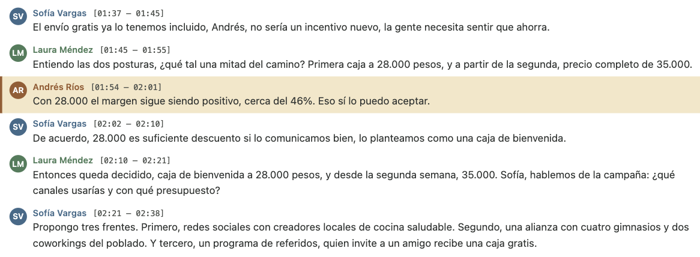
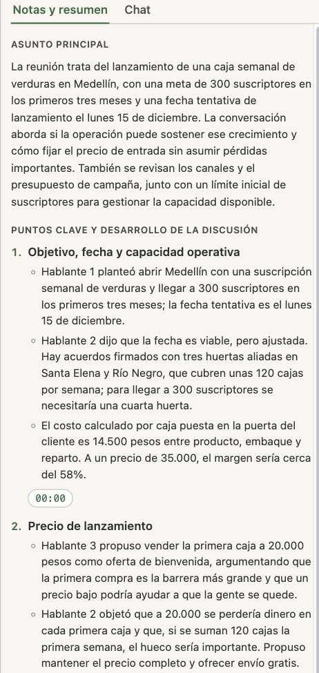
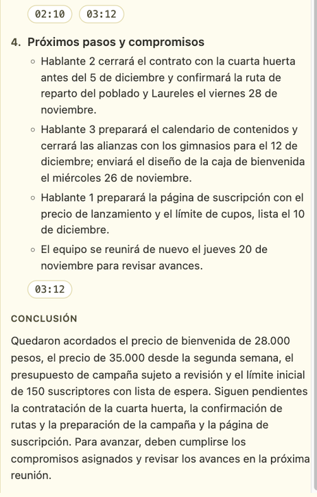
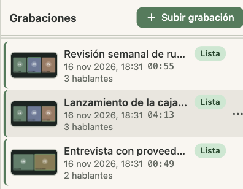
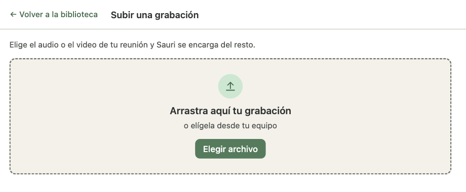

# Landing de Sauri

Página pública que explica Sauri a quien no lo conoce, con la descarga de la app, el instructivo para abrirla la primera vez y la política de privacidad. Vive en `landing/` (HTML y CSS estáticos, sin compilación). **Todavía no está publicada:** el Lugar_de_Descarga (dónde viven la página y los archivos) lo decide el dueño (decisión D13 de `.spectra/specs/mac-desktop-app/design.md`; la opción propuesta es un repositorio público dedicado con GitHub Pages y Releases). Cada publicación necesita su OK expreso.

Decisiones del dueño (2026-11-16): publicación a decidir al final; llamada a la acción = solicitar acceso anticipado por correo; material = capturas reales de una reunión de demostración inventada; idioma = español primero, estructura lista para inglés.

## 0. Versión de descarga (2026-11-18)

La página pasó a ser la página pública de descarga (se servirá desde `https://lufermalgo.github.io/sauri-app/`, una subruta: todas las rutas de archivos son relativas, sin compilación ni scripts o fuentes externas). Cambios frente a lo descrito más abajo:

- **Llamada a la acción:** «Descargar para Mac» (descarga directa del `.dmg`) en portada y cierre; «Descargar» en la cabecera lleva a `#descargar`. Desaparece «Solicitar acceso anticipado»; el contacto queda en el pie («Ayuda», la página de ayuda de GitHub) y en la política de privacidad. Al pulsar la descarga aparece un aviso que enlaza a los pasos para abrirla.
- **Estructura:** portada (insignia «Para Mac con chip de Apple», titular, botones, versión y tamaño, captura en un marco de ventana) · «Cómo funciona» como tres pestañas con la captura de cada paso · funciones en mosaico · privacidad en la única banda índigo · «Consigue Sauri» (tarjetas de la app y de la extensión, «Qué necesitas» y aviso de app sin verificar) · «Cómo abrirla la primera vez» (por qué avisa macOS, «¿Es seguro abrirla?» y los cinco pasos con ilustraciones y puntero) · «Tus primeros minutos con Sauri» (configurar, descargar modelos de 3 a 6 GB, conectar la extensión) y desinstalar · preguntas frecuentes (se suman la extensión y si es versión final; el bloque «Estado» se movió aquí y al pie) · cierre.
- **Extensión:** mientras `chromeWebStoreUrl` esté vacío se muestra «En revisión en Chrome Web Store, disponible pronto»; con el enlace real de la ficha (`https://chromewebstore.google.com/detail/inebachhkahcdepkbdkhchnpahladpnk`) aparece el botón «Agregar a Chrome».
- **Diseño:** referencia estructural de apxagent.app (cabecera con menú en píldora, titular grande con poco interletrado, tarjetas de descarga con estado, pasos unidos por una línea), sin copiar textos, marca ni código. Letra del sistema (San Francisco en Mac). Botones en píldora, tarjetas con radio de 20 px. Botón principal índigo con texto blanco en modo claro y voltio con texto índigo en oscuro. Iconos Lucide (ya los usa el portal) incrustados en la página. Animaciones de aparición solo si el visitante no pidió reducir el movimiento.
- **Datos de la versión 0.1.2:** tamaño del `.dmg` (272 MB, como lo muestra el Finder) y huella SHA-256 comprobados contra el archivo de `desktop/out` de la rama de la versión.

## 1. Qué aprendimos de apxagent.app (estrategia, no estilo)

APX abre con una promesa de una frase y una captura real visible sin desplazarse; sigue con qué puedes hacer, una sección numerada de tres pasos, documentación, preguntas frecuentes y un cierre con la misma llamada a la acción. Usa capturas estáticas reales (sin video automático), código copiable y una página de privacidad que separa con precisión lo que se queda en el equipo, lo que sale siempre, lo que sale solo si lo aceptas y lo que nunca sale. Admite la fricción de instalación con franqueza. La misma llamada a la acción se repite con el mismo texto en cabecera, portada, sección de descarga y cierre.

Adaptamos a Sauri:
1. Promesa de una frase y la pantalla real de una reunión sin desplazarse.
2. «Cómo funciona» en tres pasos: grabar, revisar quién habló, revisar el resumen.
3. El resumen como borrador: tú tienes la última palabra.
4. Privacidad como prueba concreta (qué se queda, qué sale y cuándo), no como un candado decorativo.
5. Honestidad sobre el estado: en desarrollo, solo Mac con Apple silicon y Chrome.
6. Preguntas frecuentes cortas.
7. Una sola llamada a la acción con el mismo texto en cabecera, portada y cierre.

No imitamos: comparativas con competidores, galerías largas de ilustraciones, muchas rutas de documentación, ni callar el estado del producto.

## 2. Plan de material visual

Todo sale de una reunión inventada («Hortalia», tres personas ficticias). Desde el 2026-11-18 las capturas son del portal real en la paleta Índigo, compilado en local y con todas las llamadas a la API respondidas con datos de muestra (reunión, transcripción, hablantes y resumen escritos a mano; ningún dato real). El video de la reunión es un fotograma con tres recuadros de iniciales. La extensión se captura desde su servidor de desarrollo con una imitación mínima de las funciones de Chrome. Todas las capturas se hacen con Playwright sin ventana; nunca se captura la pantalla del Mac.

| Pieza | Mensaje | Qué muestra | Sección |
|---|---|---|---|
| `meeting-detail` | «Esto es lo que obtienes» | Reunión completa: video, transcripción con hablantes en color y resumen | Portada |
| `extension-panel` | Grabar es un clic | Panel de la extensión «Grabar reunión» listo para grabar | Paso 1 |
| `speakers` | Sabes quién dijo qué | Panel de hablantes junto al video con los nombres asignados | Paso 2 |
| `summary` | Un borrador que revisas | Panel de resumen: asunto, puntos clave, próximos pasos | Paso 3 |
| `follow` (video corto, sin sonido) | La transcripción sigue al video | Resaltado que avanza con la reproducción | Lo que puedes hacer |
| Instructivo (`#instalar`) | Abrirla la primera vez es fácil | Cinco ilustraciones en SVG dentro de la página (no son capturas del sistema) | Primera vez |
| `transcript` | Turnos claros | Recorte de turnos con colores por hablante | Lo que puedes hacer |
| `library` | Todo queda ordenado | Biblioteca con miniaturas y fechas | Lo que puedes hacer |
| `upload` | También sirve con grabaciones que ya tienes | Pantalla «Subir grabación» | Lo que puedes hacer |

Formato: PNG de origen y WebP optimizado, con `width`/`height` declarados; el video corto en WebM sin audio, con póster y sin reproducción automática si el visitante pidió reducir el movimiento.

### Galería del material

Las imágenes viven en `landing/assets/` (aquí se enlazan, no se copian). Todas salen de la reunión de demostración «Hortalia».

| | |
|---|---|
| **`meeting-detail`**: reunión completa  | **`extension-panel`**: grabar desde Chrome  |
| **`speakers`**: quién habló  | **`transcript`**: turnos por hablante  |
| **`summary`**: resumen  | **`summary-steps`**: próximos pasos  |
| **`library`**: biblioteca  | **`upload`**: subir grabación  |

El video corto `follow.webm` (la transcripción sigue al video, sin audio) está en [`landing/assets/follow.webm`](../../landing/assets/follow.webm). Desde el 2026-11-18 está regrabado en Índigo y en español con el mismo método de las capturas (10,5 s a 800 × 498, sin audio, unos 48 KB); su póster es `follow-poster.webp`, que también sirve de imagen alternativa si el navegador no reproduce el video.

## 3. Textos

Límite de lo que se promete: `docs/product/baseline.md` (alcance aprobado) y lo ya integrado. No se prometen el chat con la grabación (fase 2), ni tiempos exactos, ni precios.

**Cabecera:** logo · Cómo funciona · Privacidad · Descargar · Preguntas · botón «Solicitar acceso».

**Portada**
- Etiqueta: «En desarrollo · acceso anticipado para Mac»
- Titular: «Tus reuniones, transcritas y resumidas en tu propio Mac»
- Bajada: «Sauri graba la reunión desde una pestaña de Chrome, reconoce quién habló y te deja un resumen en borrador para revisar. La grabación no sale de tu equipo.»
- Botones: «Solicitar acceso anticipado» (principal) · «Ver cómo funciona» (secundario) · «Descargar para Mac» (secundario, solo en pantallas de menos de 720 px, donde el menú de la cabecera no se muestra)

**Cómo funciona** — «De la reunión al resumen en tres pasos»
1. «Graba desde Chrome» — «Abre la extensión, elige la pestaña de la reunión y pulsa grabar. Funciona con Google Meet y con cualquier reunión que tengas abierta en el navegador.»
2. «Revisa quién habló» — «Sauri separa las voces y pone cada intervención a nombre de su hablante. Si no reconoce una voz, la deja como «Hablante 2» hasta que tú le pongas nombre, y la próxima vez la recuerda.»
3. «Revisa el resumen» — «Recibes un borrador con el asunto principal, los puntos clave y los próximos pasos. Tú lo lees, lo ajustas y decides qué compartir.»

**Lo que puedes hacer** — «Todo lo de la reunión, en un solo lugar»
- «La transcripción sigue al video» — «Mientras reproduces, la frase que se está diciendo se resalta. Haz clic en cualquier frase para saltar a ese momento.»
- «Encuentra cualquier reunión» — «Tu biblioteca ordena las grabaciones por fecha, con búsqueda y filtros.»
- «Sube grabaciones que ya tienes» — «¿Grabaste con otra herramienta? Sube el archivo y Sauri lo procesa igual.»
- «Llévate lo que necesites» — «Descarga el video, la transcripción o el resumen.»
- «Resúmenes a tu manera» — «Crea plantillas para que cada tipo de reunión tenga el resumen que necesitas.»
- «Notas aparte» — «Toma notas durante la grabación; quedan junto a la reunión, separadas de la transcripción.»

**Privacidad** — «Tus reuniones se quedan contigo»
- Bajada: «Sauri hace el trabajo pesado en tu Mac: transcribir, reconocer voces y resumir. No hace falta subir tus reuniones a la nube.»
- «Se queda en tu Mac» — «Las grabaciones, las transcripciones, los resúmenes y los nombres que asignas a cada voz.»
- «Sale solo si tú lo eliges» — «Si prefieres que un servicio externo haga una tarea (por ejemplo, el resumen), lo conectas tú, para esa tarea. Ese servicio recibe lo que necesita para hacerla.»
- «Te avisa antes» — «Al activar un servicio externo, Sauri te muestra qué sale del equipo y hacia dónde, y te pide confirmarlo.»

Debajo del bloque de privacidad: enlace «Lee la política de privacidad completa» a `privacidad.html`.

**Descargar** (`#descargar`) — «Descarga Sauri para tu Mac»
- Bajada: «Instala la app en tu Mac y agrega la extensión de Chrome para grabar tus reuniones. Después, Sauri busca versiones nuevas y te pregunta antes de instalarlas.»
- Tarjeta «La app de Sauri»: botón «Descargar Sauri para Mac» (o «Disponible pronto», desactivado, mientras no haya enlace), versión, «Archivo para Mac de unos 259 MB», huella SHA-256 plegada («Comprobar que el archivo es el original») y aviso de que Sauri no está verificado por Apple con enlace a los pasos.
- Tarjeta «Qué necesitas»: Mac con chip de Apple (M1 o posterior, no Intel); macOS 14 Sonoma o posterior (`desktop/electron-builder.json`, `desktop/runtime-manifest.json`); unos 10 GB libres (app y reconocimiento de voces cerca de 1,4 GB instalados, más hasta 6 GB que se descargan al usar transcripción y resumen, según `scripts/engines/model-catalog.json`); 8 GB de memoria o más, con 16 GB los resúmenes son más completos; Google Chrome.
- Tarjeta «La extensión de Chrome»: botón «Agregar a Chrome» (o «Disponible pronto en Chrome Web Store»).

**Primera vez** (`#instalar`) — «Cómo abrirla la primera vez», cinco pasos con ilustración: arrastrar a Aplicaciones; intentar abrirla y cerrar el aviso sin mover la app a la Papelera; menú Apple → «Configuración del Sistema» («Ajustes del Sistema» en algunos Mac) → «Privacidad y seguridad» → parte «Seguridad»; «Abrir de todos modos» («Abrir igualmente» en algunos Mac; dura cerca de una hora); contraseña del Mac y «OK». Redacción comprobada el 2026-11-18 con la página de Apple «Abrir una app de un desarrollador no identificado» (`support.apple.com/es-mx/guide/mac-help/mh40616`, versiones 14, 15, 26 y la actual; la de España usa «Ajustes del Sistema» y «Abrir igualmente»).

**Si quieres quitar Sauri** (`#desinstalar`, Requisito 10.3): «Desinstalar Sauri…» en el menú de la app; si ya no abre, arrastrarla a la Papelera y borrar `~/Library/Application Support/Sauri` y `~/Library/Logs/Sauri`; las carpetas del usuario se conservan.

**Estado** — «Sauri está en desarrollo»
- «Lo usamos a diario y lo mejoramos cada semana, pero todavía no es una versión final. Hoy funciona en Mac con Apple silicon y con Google Chrome.»

**Preguntas frecuentes**
- «¿Mis reuniones se suben a internet?» — «No. Sauri las procesa en tu Mac. Solo sale algo si tú conectas un servicio externo para una tarea, y Sauri te avisa antes.»
- «¿Qué reuniones puedo grabar?» — «Cualquier reunión que tengas abierta en una pestaña de Chrome, como Google Meet. También puedes subir grabaciones que ya tengas.»
- «¿Debo avisar a los participantes?» — «Sí. Pide permiso antes de grabar, como harías con cualquier grabadora.»
- «¿Qué necesito para usarlo?» — «Un Mac con chip de Apple (M1 o posterior) y macOS 14 Sonoma o posterior, además de Google Chrome para grabar.» (enlace a Descargar)
- «¿Por qué macOS me avisa al abrir Sauri?» — «Porque Sauri todavía no está verificado por Apple. Puedes abrirlo igual siguiendo los pasos para la primera vez; solo lo haces una vez.»
- «¿En qué idiomas funciona?» — «La aplicación está en español e inglés, y transcribe reuniones en esos idiomas.»
- «¿Puedo corregir los nombres de los hablantes?» — «Sí. Puedes renombrar a cualquier hablante en cualquier momento, y Sauri usa tus correcciones en tus siguientes reuniones.»

**Cierre** — «¿Quieres probar Sauri?» · «Escríbenos y te contamos cómo empezar.» · botón «Solicitar acceso anticipado».

**Pie:** logo · «Sauri está en desarrollo.» · enlaces a las secciones y a «Política de privacidad».

**Política de privacidad** (`landing/privacidad.html`, vigente desde el 2026-11-18): en español y, en la misma página, en inglés (`#en`). Dice qué se queda en el Mac, qué sale (búsqueda de versiones en GitHub, descargas de Hugging Face y GitHub, y servicios externos solo si el usuario los conecta, con sus claves en el Llavero de macOS), qué trata la extensión (coherente con `extension/CHROMEWEBSTORE.md` y `extension/store/*/permissions.md`), que no hay analítica, publicidad ni venta de datos, la retención de 90 días del audio, el video y la transcripción (`backend/app/retention/config.py`), cómo borrar los datos y el aviso de consentimiento al grabar a otras personas. El bloque «Quién es responsable» (responsable, país, correo de contacto y página de ayuda) lo completó el dueño el 2026-11-18, en las dos lenguas.

Glosario fijo: «grabación» (no «sesión»), «reunión», «transcripción», «hablante», «resumen en borrador», «servicio externo» (no «proveedor» en la landing), «tu Mac».

## 4. Implementación (para quien la mantenga)

- **Estructura:** `landing/index.html` + `styles.css` + `tokens.css` + `motion.js` + `assets/`. Sin compilación ni dependencias; se abre con cualquier servidor estático (`python3 -m http.server --directory landing`).
- **Tokens:** `tokens.css` copia los `--ds-*` de `frontend/src/design/tokens.css` (claro/oscuro con `light-dark()`, Chrome 123+). La escala propia de la página usa el prefijo `--lp-*`. Si cambia el diseño del portal, actualizar `tokens.css`.
- **Paleta (Índigo, decisión del dueño 2026-11-16):** lavanda `#5B4BAE` (claro) / `#6A5ACD` (oscuro) es la marca y el color de los botones (texto blanco, 6,9:1 y 5,3:1); índigo `#161223` es el texto y las bandas oscuras; el verde voltio `#C6FF24` solo aparece sobre índigo (chips, iconos y el botón del cierre, 15,5:1). Fondos claros `#FAF9FE` y tintes de lavanda. Mismos tokens que el portal (`tokens.css` copia `frontend/src/design/tokens.css`) más `--lp-*` en `styles.css`. Uso: chips de la portada, números de pasos y bordes de funciones en ese orden (lavanda, lavanda suave, índigo con voltio), tarjetas de funciones, iconos de privacidad, bloque de estado en lavanda suave y cierre en índigo con botón voltio. Contraste de texto: `#161223` sobre `#FAF9FE` 17:1; `#EEEAF8` sobre `#161223` 14:1; `#C6FF24` sobre `#161223` 15,5:1; `#FFFFFF` sobre `#5B4BAE` 6,9:1.
- **Configuración de la versión publicada:** el bloque `<script id="sauri-release" type="application/json">` al principio de `index.html` es el único lugar que se edita al publicar: `version`, `downloadUrl`, `fileSize` (tamaño que muestra el Finder), `sha256`, `releasesUrl` y `chromeWebStoreUrl`. `release.js` lo lee: un enlace vacío, que no sea `https` o que apunte a un dominio de ejemplo (`.invalid`, `example.com`…) deja el botón desactivado con «Disponible pronto»; la huella solo se muestra si son 64 caracteres hexadecimales. Nunca se deja un enlace de ejemplo como si fuera real.
- **Una sola acción primaria** por grupo; el mismo texto «Solicitar acceso anticipado» en cabecera, portada y cierre. El botón abre un `mailto:` (sin servicios externos); el destino es `lufermalgo@gmail.com`.
- **Imágenes:** capturas del portal real con la reunión de muestra «Hortalia» (personas ficticias, API simulada), PNG + WebP con `width`/`height`. Las ilustraciones del instructivo son SVG en la página y usan los tokens, así que cambian solas con el modo oscuro. Sin datos de reuniones reales ni del perfil del usuario. El video `follow.webm` no tiene audio, solo se reproduce a la vista, respeta `prefers-reduced-motion` y tiene botón de pausa (WCAG 2.2.2).
- **Accesibilidad:** `lang="es"`, un solo `h1`, enlace para saltar al contenido, `alt` en todas las capturas, logo decorativo con nombre en el enlace, sin desbordamiento horizontal a 375 px. Pendiente: revisión de contraste con herramienta externa.
- **Inglés:** el texto vive en `index.html`; para traducir, duplicar a `landing/en/` con el mismo marcado y enlazar ambos con `hreflang`.
- **Limitación conocida del producto:** el resumen de la demo dice «Hablante 1/2/3» aunque los hablantes ya tengan nombre (el resumen se genera antes de nombrarlos y la interfaz no permite regenerarlo).
